# Page: Overview

# Overview

<details>
<summary>Relevant source files</summary>

The following files were used as context for generating this wiki page:

- [README.md](README.md)
- [common/ThreeWayCmpDefault.hpp](common/ThreeWayCmpDefault.hpp)
- [modules/nvswitch/DcgmModuleNvSwitch.cpp](modules/nvswitch/DcgmModuleNvSwitch.cpp)
- [nvvs/include/NvvsJsonStrings.h](nvvs/include/NvvsJsonStrings.h)
- [testing/python3/tests/test_dcgm_collectd_plugin.py](testing/python3/tests/test_dcgm_collectd_plugin.py)

</details>


## Purpose and Scope

This document provides an overview of NVIDIA Data Center GPU Manager (DCGM), explaining its purpose, architecture, and key components. For detailed information about specific subsystems, refer to:
- Architecture details: [Architecture](#1.1)
- Installation and setup: [Installation](#1.2)
- Core components and internal APIs: [Core Components](#2)
- Individual modules: [Modules](#3)
- Diagnostic capabilities: [NVVS](#4)
- Building from source: [Building and Development](#5)

Sources: [README.md:1-147]()

## What is DCGM

DCGM is a daemon-based system for monitoring, managing, and diagnosing NVIDIA datacenter GPUs in cluster environments. It provides active health monitoring, comprehensive diagnostics, system alerts, and governance policies including power and clock management. The system is designed to simplify GPU administration, improve resource reliability and uptime, automate administrative tasks, and drive overall infrastructure efficiency.

DCGM supports Linux operating systems on x86_64, Arm (aarch64), and POWER (ppc64le) platforms. The software distribution includes:
- `libdcgm.so` - Core API library
- `nv-hostengine` - Host engine daemon
- `dcgmi` - Command-line interface
- NVVS (NVIDIA Validation Suite) - Diagnostic tool suite
- API bindings for C, Python (`pydcgm`), and Go

Sources: [README.md:1-24]()

## Deployment Models

DCGM supports two deployment models, both using the same `libdcgm.so` library:

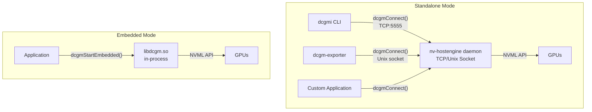

**Standalone Mode**: The `nv-hostengine` daemon runs as a separate process. Client applications connect via TCP (default port 5555) or Unix domain sockets using `dcgmConnect()`. This is the recommended deployment for production environments as it provides isolation, persistence, and allows multiple clients to share a single DCGM instance.

**Embedded Mode**: Applications directly link against `libdcgm.so` and call `dcgmStartEmbedded()` to run the host engine in-process. This mode is useful for testing, development, or single-application deployments.

Sources: [README.md:6-24]()

## Core Architecture

The following diagram shows DCGM's primary components and their relationships with specific code entities:

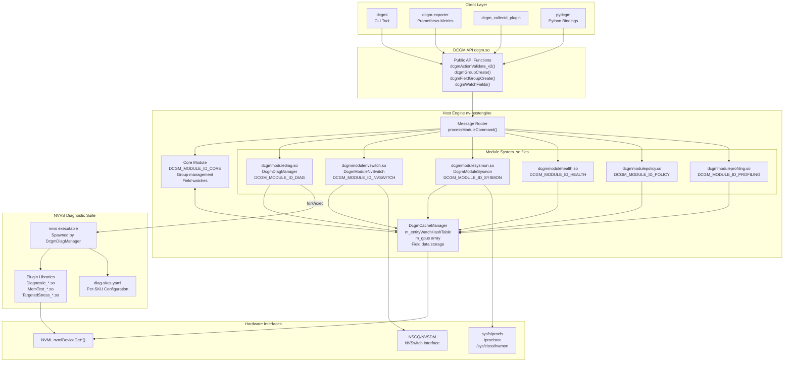

The architecture follows a modular design with clear separation of concerns:

**API Layer (`libdcgm.so`)**: Provides the public C API including functions like `dcgmActionValidate_v2()`, `dcgmGroupCreate()`, and `dcgmWatchFields()`. This layer handles both embedded and remote connections.

**Message Router**: The `processModuleCommand()` function routes API calls to appropriate modules based on `moduleId` and `subCommand` fields in the message header.

**Core Module**: Manages fundamental operations including group management, field watch registration, and client connection handling. It coordinates with `DcgmCacheManager` for data operations.

**Cache Manager (`DcgmCacheManager`)**: Central data repository that maintains `m_entityWatchHashTable` for field watches and `m_gpus` array for GPU information. Collects metrics from hardware via NVML and system interfaces, implements the field watch system, and stores time-series data.

**Specialized Modules**: Each module provides domain-specific functionality:
- **Diag Module** (`dcgmmodulediag.so`): Orchestrates diagnostic runs through NVVS
- **NVSwitch Module** (`dcgmmodulenvswitch.so`): Manages NVSwitch devices via NSCQ/NVSDM
- **Sysmon Module** (`dcgmmodulesysmon.so`): Monitors CPU metrics via sysfs/procfs
- **Health Module**: Performs health checks
- **Policy Module**: Enforces policies
- **Profiling Module**: Collects profiling metrics

**NVVS Suite**: Separate process (`nvvs`) spawned by the Diag module for running diagnostic tests. Uses plugin architecture with per-CUDA-version builds. Configuration comes from `diag-skus.yaml`.

Sources: [README.md:1-147](), [modules/nvswitch/DcgmModuleNvSwitch.cpp:1-580]()

## Entity Hierarchy and Hardware Support

DCGM provides unified monitoring across heterogeneous hardware through its entity system:

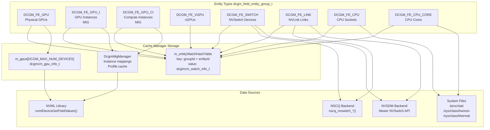

The `DcgmCacheManager` maintains a unified view of all monitored entities through `m_entityWatchHashTable`, keyed by entity group ID and entity ID. Each entity type uses appropriate backend interfaces:

- **GPUs and MIG Instances**: Monitored via NVML (`nvmlDeviceGetFieldValues()`). The `DcgmMigManager` handles bidirectional mapping between DCGM entity IDs and NVML instance IDs
- **NVSwitch Devices and Links**: Accessed through NSCQ (legacy) or NVSDM (newer) backends, selected at runtime by `DcgmModuleNvSwitch`
- **CPUs and CPU Cores**: Monitored by `DcgmModuleSysmon` reading from `/proc/stat`, `/sys/class/hwmon`, and `/sys/class/thermal`

This design allows applications to monitor mixed environments (MIG-enabled and non-MIG GPUs, multi-socket CPUs, NVSwitch fabrics) through a unified API.

Sources: [modules/nvswitch/DcgmModuleNvSwitch.cpp:1-580]()

## Key Capabilities

### GPU Monitoring and Management
- Real-time field monitoring via the watch system with configurable update intervals
- Support for 1000+ fields including clocks, temperatures, power, utilization, memory, PCIe, NVLink
- Historical data retention with time-series storage in `DcgmCacheManager`
- Group-based operations for managing multiple GPUs
- MIG (Multi-Instance GPU) awareness with per-instance metrics

### Diagnostics (NVVS)
Comprehensive GPU validation through `nvvs` executable and plugin suite:
- **Diagnostic Plugin** (`Diagnostic_*.so`): GPU stress testing with GEMM operations
- **Memory Plugin** (`MemTest_*.so`): Memory subsystem validation
- **Targeted Stress** (`TargetedStress_*.so`): Sustained performance testing
- **PCIe Plugin**: Bandwidth and connectivity tests
- **EUD Plugin**: Extended Unit Diagnostics
- Per-GPU-SKU configuration via `diag-skus.yaml`
- Multi-CUDA-version support (11/12/13) for compatibility

### System Monitoring
The Sysmon module (`DcgmModuleSysmon`) provides CPU-level telemetry:
- Per-socket and per-core CPU utilization
- CPU temperatures from hwmon sensors
- CPU power consumption where available
- Integration with GPU metrics for holistic system view

### Health and Policy Management
- Active health monitoring via Health module
- Policy-based governance via Policy module
- Automated violation detection and reporting
- Event subscription for real-time notifications

### External Integrations
- **Kubernetes**: `dcgm-exporter` exports metrics as Prometheus endpoints
- **Collectd**: `dcgm_collectd_plugin` integrates with Collectd daemon
- **Python**: `pydcgm` bindings for Python applications
- **Go**: Go language bindings available

Sources: [README.md:1-147](), [testing/python3/tests/test_dcgm_collectd_plugin.py:1-200]()

## Data Flow and Field Watch System

The field watch system is DCGM's core mechanism for efficient metric collection:

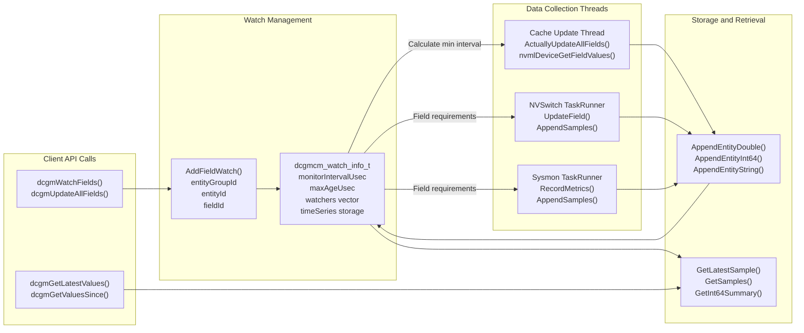

**Watch Registration**: Clients call `dcgmWatchFields()` which creates or updates `dcgmcm_watch_info_t` entries in `m_entityWatchHashTable`. Each watch info tracks multiple watchers with potentially different intervals and retention policies.

**Interval Calculation**: The cache manager calculates the minimum required polling interval across all watchers for each field, optimizing data collection frequency.

**Data Collection**: Three primary collection mechanisms:
- **Pull Model (GPUs)**: Update thread periodically calls `nvmlDeviceGetFieldValues()` based on watch intervals
- **Push Model (NVSwitch)**: `DcgmModuleNvSwitch::UpdateField()` writes samples via `AppendSamples()`
- **Push Model (Sysmon)**: `DcgmModuleSysmon::RecordMetrics()` writes CPU metrics via `AppendSamples()`

**Storage**: Samples are stored in time-series format within each `dcgmcm_watch_info_t`, with automatic retention management based on `maxAgeUsec`.

**Retrieval**: Clients retrieve data via `dcgmGetLatestValues()` or `dcgmGetValuesSince()`, which internally call `GetLatestSample()` or `GetSamples()`.

Sources: [README.md:1-147]()

## Security and Reporting

For security vulnerability reporting, DCGM follows NVIDIA's standard security process. Security issues should be reported through the [NVIDIA Product Security](https://www.nvidia.com/en-us/security/) website, not via GitHub issues. This ensures proper CVE creation and community notification.

For non-security bugs and feature requests, use the [GitHub issue tracker](https://github.com/NVIDIA/DCGM/issues).

Sources: [README.md:125-131]()

---

# Page: Architecture

# Architecture

<details>
<summary>Relevant source files</summary>

The following files were used as context for generating this wiki page:

- [README.md](README.md)
- [common/ThreeWayCmpDefault.hpp](common/ThreeWayCmpDefault.hpp)
- [dcgmlib/src/DcgmCacheManager.cpp](dcgmlib/src/DcgmCacheManager.cpp)
- [modules/nvswitch/DcgmModuleNvSwitch.cpp](modules/nvswitch/DcgmModuleNvSwitch.cpp)
- [nvvs/include/NvvsJsonStrings.h](nvvs/include/NvvsJsonStrings.h)
- [testing/python3/tests/test_dcgm_collectd_plugin.py](testing/python3/tests/test_dcgm_collectd_plugin.py)

</details>


## Purpose and Scope

This document describes the high-level architecture of DCGM (Data Center GPU Manager), including its modular design, communication patterns, and core components. It covers how the host engine, cache manager, and modules interact to provide GPU monitoring and management capabilities.

For installation instructions, see [Installation](#1.2). For detailed information about the cache manager internals, see [Cache Manager](#2.1). For information about specific modules, see [Modules](#3). For the build system architecture, see [Building and Development](#5).

---

## System Overview

DCGM is organized as a daemon-based system with a modular architecture. The central component is the **host engine** (`nv-hostengine`), which coordinates multiple specialized modules through a message-passing architecture. External systems interact with DCGM through a unified API library (`dcgm.so`), which can operate in both embedded mode (in-process) and remote mode (connecting to a running daemon).

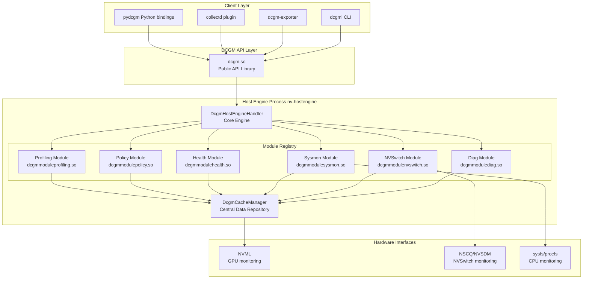

**Sources:** [README.md:1-147](), [dcgmlib/src/DcgmCacheManager.cpp:16-950]()

---

## Core Components

### Host Engine

The host engine (`nv-hostengine`) is the central daemon process that coordinates all DCGM functionality. It is implemented by `DcgmHostEngineHandler` and provides:

- **Client connection management**: Handles both local (Unix socket) and remote (TCP) connections
- **Module lifecycle management**: Loads and manages dynamically-linked module libraries
- **Message routing**: Routes API calls to appropriate modules via `ProcessModuleCommand()`
- **Group management**: Manages logical groups of GPUs and other entities

The host engine can run in two modes:
1. **Standalone daemon mode**: Runs as a system service, accepting remote connections
2. **Embedded mode**: Runs in-process within the client application

**Sources:** [README.md:1-147](), [dcgmlib/src/DcgmCacheManager.cpp:19]()

### Cache Manager

The `DcgmCacheManager` class serves as the central data hub for all monitoring data in DCGM. It implements a unified field watch system that collects metrics from various sources and stores them in time-series format.

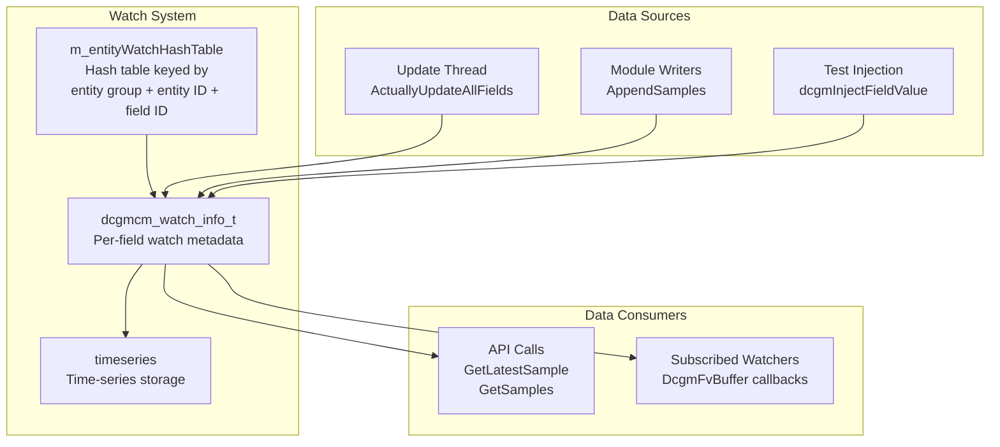

Key responsibilities:

- **Field watch management**: Tracks which fields are being monitored and at what intervals via `AddFieldWatch()` and `RemoveFieldWatch()`
- **Sample storage**: Maintains time-series data for each watched field using `timeseries_*` functions
- **Update coordination**: Runs background threads to poll NVML and other sources
- **Subscription handling**: Notifies subscribers when new data arrives via `UpdateFvSubscribers()`
- **Entity tracking**: Manages GPU, MIG instance, NVSwitch, and CPU entity hierarchies

The watch system uses a hash table (`m_entityWatchHashTable`) where each entry is keyed by `(entityGroupId, entityId, fieldId)` and contains a `dcgmcm_watch_info_t` structure with the time-series buffer and watcher list.

**Sources:** [dcgmlib/src/DcgmCacheManager.cpp:93-129](), [dcgmlib/src/DcgmCacheManager.cpp:887-950]()

### Module System

DCGM uses a plugin-based module architecture where each module is a separate shared library (`.so` file) loaded dynamically by the host engine. Modules communicate with the core and each other via message passing.

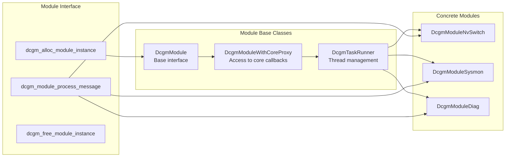

Each module:
- Implements the standard module interface: `dcgm_alloc_module_instance()`, `dcgm_module_process_message()`, `dcgm_free_module_instance()`
- Runs in its own thread context via `DcgmTaskRunner`
- Communicates via versioned message structures (e.g., `dcgm_nvswitch_msg_watch_field_t`)
- Has a unique module ID (e.g., `DcgmModuleIdNvSwitch`, `DcgmModuleIdDiag`)

**Key Modules:**
- **Diag**: Orchestrates diagnostic runs via NVVS (see [Diagnostic Module](#3.3))
- **NVSwitch**: Monitors NVSwitch devices and NVLink connections (see [NVSwitch Module](#3.2))
- **Sysmon**: Monitors CPU metrics like utilization, temperature, and power (see [System Monitoring Module](#3.1))
- **Health**: Performs health checks and watches for errors
- **Policy**: Enforces power and clock policies
- **Profiling**: Collects profiling metrics via GPM

**Sources:** [modules/nvswitch/DcgmModuleNvSwitch.cpp:49-90](), [modules/nvswitch/DcgmModuleNvSwitch.cpp:560-578]()

---

## Message-Based Communication

DCGM uses a message-passing architecture where all requests are encapsulated in versioned message structures. This design provides several benefits:

- **Decoupling**: Modules don't directly call each other's methods
- **Thread safety**: Messages can be safely queued and processed asynchronously
- **Versioning**: Message versions allow backward compatibility
- **Testability**: Messages can be easily mocked and tested

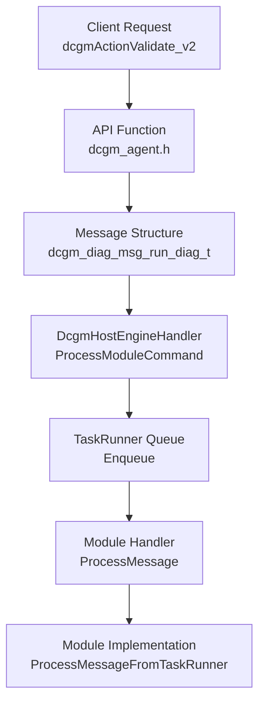

**Message Structure:**

All messages inherit from `dcgm_module_command_header_t`:
- `moduleId`: Target module (e.g., `DCGM_MODULE_ID_DIAG`)
- `subCommand`: Specific operation (e.g., `DCGM_DIAG_SR_RUN_DIAG`)
- `version`: Message format version
- `length`: Total message size

**Message Flow Example (NVSwitch field watch):**

1. Client calls `dcgmWatchFields()`
2. API layer creates `dcgm_nvswitch_msg_watch_field_t` message
3. `ProcessModuleCommand()` routes to NVSwitch module based on `moduleId`
4. NVSwitch module enqueues task via `Enqueue(make_task(...))`
5. `DcgmTaskRunner::Run()` executes task in module thread
6. `ProcessWatchField()` adds watch to internal tracking
7. Module's `RunOnce()` loop periodically updates watched fields

**Sources:** [modules/nvswitch/DcgmModuleNvSwitch.cpp:93-153](), [modules/nvswitch/DcgmModuleNvSwitch.cpp:156-343](), [dcgmlib/src/DcgmCacheManager.cpp:131-170]()

---

## Entity Hierarchy and MIG Support

DCGM supports a flexible entity hierarchy that accommodates various hardware configurations, including Multi-Instance GPU (MIG) partitioning.

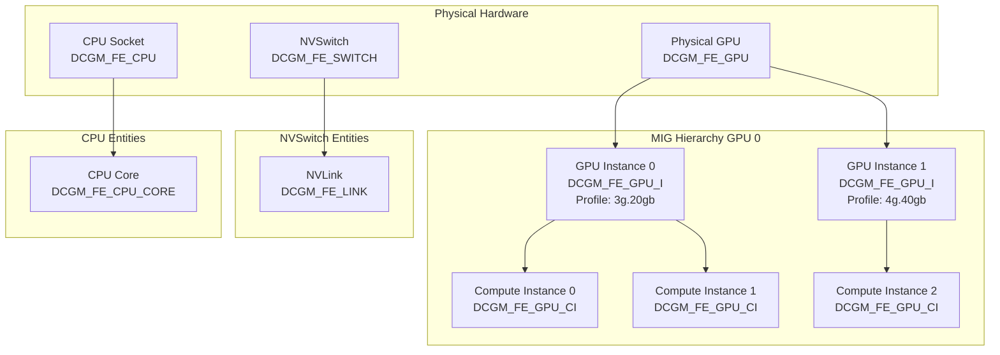

**Entity Groups:**

| Entity Group | Constant | Description |
|--------------|----------|-------------|
| GPU | `DCGM_FE_GPU` | Physical GPU device |
| GPU Instance | `DCGM_FE_GPU_I` | MIG GPU instance (slice of physical GPU) |
| Compute Instance | `DCGM_FE_GPU_CI` | MIG compute instance (subset of GPU instance) |
| NVSwitch | `DCGM_FE_SWITCH` | NVSwitch device |
| NVLink | `DCGM_FE_LINK` | NVLink connection between devices |
| CPU | `DCGM_FE_CPU` | CPU socket |
| CPU Core | `DCGM_FE_CPU_CORE` | Individual CPU core |

**MIG Management:**

The `DcgmCacheManager` uses several structures to track MIG configurations:

- `dcgmcm_gpu_info_t::instances`: Vector of `DcgmGpuInstance` objects representing GPU instances
- `DcgmGpuInstance`: Contains compute instances and profile information
- `dcgmcm_gpu_compute_instance_t`: Tracks individual compute instances
- `DcgmMigManager`: Maintains bidirectional mappings between DCGM entity IDs and NVML instance IDs

MIG detection occurs in `InitializeGpuInstances()`:
1. Query MIG mode via `nvmlDeviceGetMigMode()`
2. If enabled, enumerate GPU instance profiles via `nvmlDeviceGetGpuInstanceProfileInfo()`
3. For each profile, enumerate instances via `nvmlDeviceGetGpuInstances()`
4. For each GPU instance, enumerate compute instance profiles via `nvmlGpuInstanceGetComputeInstanceProfileInfo()`
5. For each compute profile, enumerate instances via `nvmlGpuInstanceGetComputeInstances()`
6. Store device handles via `FindAndStoreMigDeviceHandles()`

**Sources:** [dcgmlib/src/DcgmCacheManager.cpp:173-196](), [dcgmlib/src/DcgmCacheManager.cpp:620-883]()

---

## Data Flow and Field Watch System

The field watch system is DCGM's core mechanism for collecting and distributing monitoring data. It implements a publish-subscribe pattern where multiple consumers can watch the same fields with different update intervals.

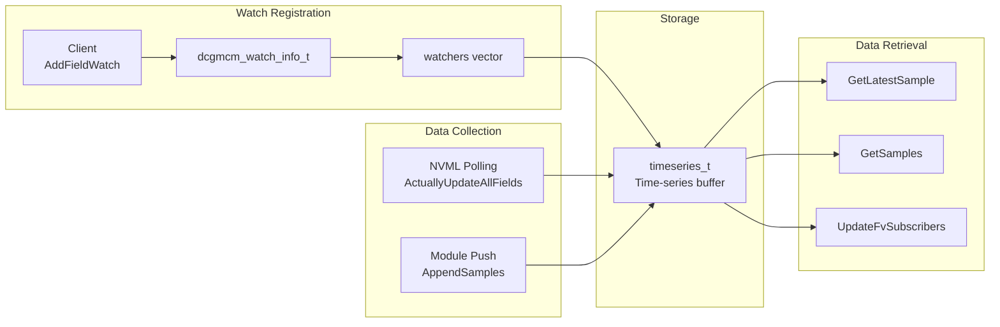

**Field Watch Lifecycle:**

1. **Watch Creation** (`AddFieldWatch()`):
   - Lookup or create `dcgmcm_watch_info_t` in `m_entityWatchHashTable`
   - Add watcher to the watch's `watchers` vector
   - Calculate minimum update interval across all watchers
   - For NVSwitch/CPU fields, delegate to respective modules via `helperNvSwitchAddFieldWatch()` or similar

2. **Data Collection**:
   - **NVML fields (GPUs)**: Background thread calls `ActuallyUpdateAllFields()` which queries NVML via `nvmlDeviceGetFieldValues()`
   - **NVSwitch fields**: `DcgmModuleNvSwitch::UpdateFields()` queries NSCQ/NVSDM and calls `AppendSamples()`
   - **CPU fields**: `DcgmModuleSysmon::UpdateFields()` reads sysfs/procfs and calls `AppendSamples()`

3. **Data Storage** (`AppendEntity*` methods):
   - Data written to `timeseries_t` buffer within `dcgmcm_watch_info_t`
   - Oldest samples evicted based on `maxAgeUsec`
   - Subscribers notified if `hasSubscribedWatchers` is true

4. **Data Retrieval**:
   - **Synchronous**: `GetLatestSample()` or `GetSamples()` query the time-series buffer
   - **Asynchronous**: `UpdateFvSubscribers()` pushes new samples to registered callbacks

**Update Intervals:**

The system calculates the effective update interval as the minimum across all watchers:
```
effectiveInterval = min(watcher[0].interval, watcher[1].interval, ...)
```

This ensures the most demanding watcher gets fresh data without over-polling.

**Sources:** [dcgmlib/src/DcgmCacheManager.cpp:131-154](), [dcgmlib/src/DcgmCacheManager.cpp:1007-1010]()

---

## Module Thread Model

Each module runs in its own thread context managed by `DcgmTaskRunner`, which implements an event loop pattern.

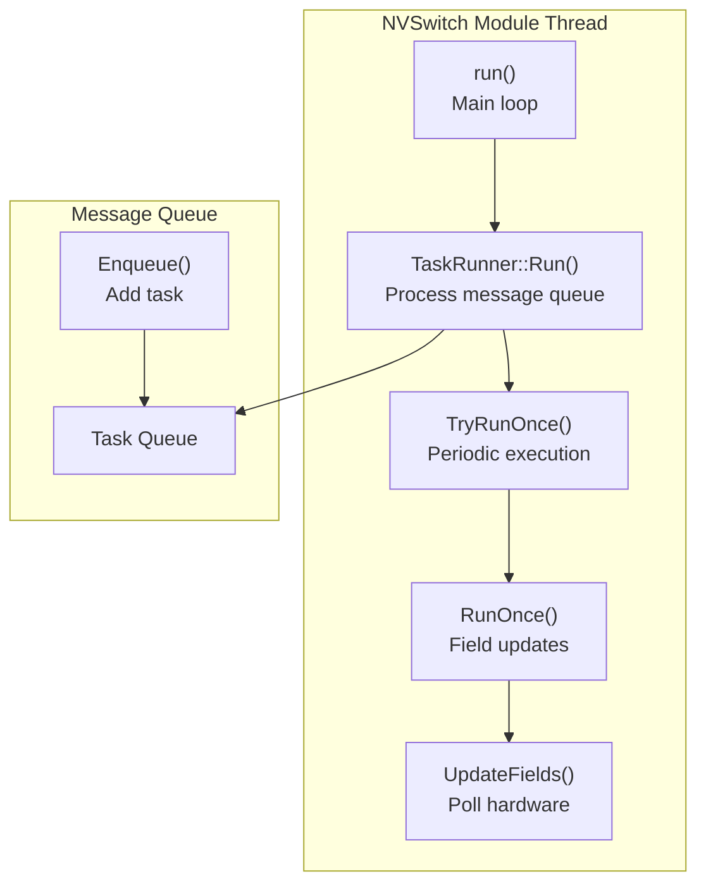

**Module Execution Pattern:**

1. Module constructor calls `Start()` which spawns thread
2. Thread enters `run()` method
3. Main loop:
   - `TaskRunner::Run()`: Process queued messages/tasks
   - `TryRunOnce()`: Check if periodic update is needed
   - `RunOnce()`: Perform field updates and return next interval
   - Sleep until next wake time or new message arrives

**Example: NVSwitch Module RunOnce:**

```cpp
unsigned int DcgmModuleNvSwitch::RunOnce()
{
    timelib64_t now = timelib_usecSince1970();
    
    // Rescan link status every 30 seconds
    if (now - m_lastLinkStatusUpdateUsec > 30000000)
    {
        RescanDevicesState();
        m_lastLinkStatusUpdateUsec = now;
    }
    
    // Update watched fields
    timelib64_t nextUpdateTimeUsec;
    m_nvswitchMgr.UpdateFields(nextUpdateTimeUsec, now);
    
    // Return sleep duration in milliseconds
    return nextUpdateTimeUsec / 1000;
}
```

This pattern ensures:
- **Responsive message handling**: Messages processed immediately via task queue
- **Efficient polling**: Only poll hardware when watches require updates
- **Thread isolation**: Each module has its own thread, preventing blocking

**Sources:** [modules/nvswitch/DcgmModuleNvSwitch.cpp:476-553]()

---

## NVVS Integration

NVVS (NVIDIA Validation Suite) runs as a separate process spawned by the Diag module. This isolation prevents diagnostic failures from affecting the DCGM daemon.

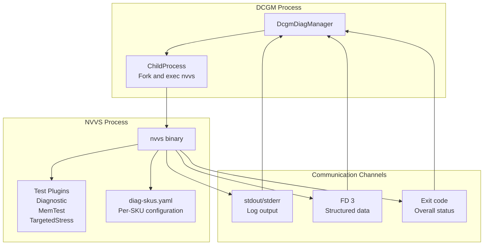

**NVVS Communication:**

- **stdout/stderr**: Human-readable logs and progress updates
- **File descriptor 3**: Structured JSON data with test results
- **Exit code**: Overall diagnostic pass/fail status

The Diag module parses this data and constructs a `dcgmDiagResponse_t` structure containing:
- Per-test results (`DCGM_DIAG_RESULT_PASS`, `DCGM_DIAG_RESULT_FAIL`, etc.)
- Per-GPU/entity status
- Error messages and codes
- Performance metrics

**Sources:** [testing/python3/tests/test_dcgm_collectd_plugin.py:1-200](), [README.md:88-97]()

---

## Build Architecture

DCGM supports multiple CUDA versions simultaneously through a sophisticated build system that compiles CUDA-dependent components separately for each version.

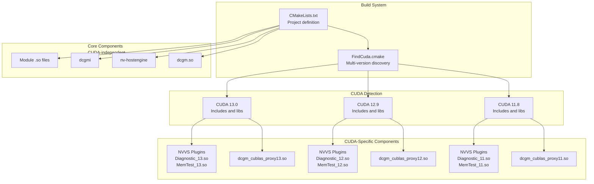

**Key Build Features:**

- **Docker-based builds**: Uses `dcgmbuild` container for reproducible builds with custom GCC toolchains targeting older glibc versions
- **Multi-architecture**: Supports x86_64, aarch64, and ppc64le
- **Component packaging**: Generates separate packages (Core, Cuda11, Cuda12, Cuda13, Development, Tests) allowing users to install only needed CUDA versions

**Build Process:**

1. `build.sh` orchestrates the build using Docker
2. `FindCuda.cmake` discovers installed CUDA toolkits
3. Core components built once (CUDA-independent)
4. CUDA-dependent components built separately for each version:
   - cuBLAS proxy libraries provide version-specific interfaces
   - NVVS plugins compiled against specific CUDA versions
5. `cpack` generates DEB and RPM packages

**Sources:** [README.md:26-86]()

---

## Summary

DCGM's architecture is built around several key principles:

1. **Modularity**: Specialized modules handle different hardware types (GPU, NVSwitch, CPU) and functions (diagnostics, health, policy)
2. **Message-based communication**: Versioned messages provide decoupling and backward compatibility
3. **Central data hub**: `DcgmCacheManager` provides unified access to all monitoring data via the field watch system
4. **Thread isolation**: Each module runs in its own thread via `DcgmTaskRunner`, preventing blocking
5. **Process isolation**: NVVS runs as a separate process to prevent diagnostic failures from affecting the daemon
6. **Flexible entity hierarchy**: Supports complex configurations including MIG, multi-GPU, NVSwitch fabrics, and CPU monitoring
7. **Multi-CUDA support**: Build system accommodates multiple CUDA versions through selective compilation

This architecture enables DCGM to efficiently monitor diverse data center GPU deployments while maintaining extensibility and reliability.

**Sources:** [README.md:1-147](), [dcgmlib/src/DcgmCacheManager.cpp:16-950](), [modules/nvswitch/DcgmModuleNvSwitch.cpp:1-581]()

---

# Page: Installation

# Installation

<details>
<summary>Relevant source files</summary>

The following files were used as context for generating this wiki page:

- [README.md](README.md)
- [common/ThreeWayCmpDefault.hpp](common/ThreeWayCmpDefault.hpp)
- [modules/nvswitch/DcgmModuleNvSwitch.cpp](modules/nvswitch/DcgmModuleNvSwitch.cpp)
- [nvvs/include/NvvsJsonStrings.h](nvvs/include/NvvsJsonStrings.h)
- [testing/python3/tests/test_dcgm_collectd_plugin.py](testing/python3/tests/test_dcgm_collectd_plugin.py)

</details>


This page provides instructions for installing DCGM packages on supported Linux distributions. It covers package types, component-based installation, post-installation configuration, and getting started with the `dcgmi` command-line tool.

For information about building DCGM from source, see [Building and Development](#5). For information about DCGM's architecture and components, see [Architecture](#1.1).

## Prerequisites

DCGM supports the following platforms:
- **Operating Systems**: Linux distributions (Ubuntu, Red Hat Enterprise Linux, CentOS, etc.)
- **Architectures**: x86_64, aarch64 (Arm), ppc64le (POWER)
- **GPU Requirements**: NVIDIA datacenter GPUs
- **Driver Requirements**: NVIDIA GPU driver must be installed

**Sources**: [README.md:16](), [README.md:43-47]()

## Package Types and Structure

DCGM is distributed in multiple package formats to support different Linux distributions and deployment scenarios:

| Package Format | File Extension | Primary Distributions |
|----------------|----------------|----------------------|
| Debian Package | `.deb` | Ubuntu, Debian |
| RPM Package | `.rpm` | RHEL, CentOS, Fedora |
| Tarball | `.tar.gz` | Distribution-agnostic |

### Component-Based Packaging

DCGM uses a component-based packaging system that allows users to install only the CUDA versions they need. The main package categories are:

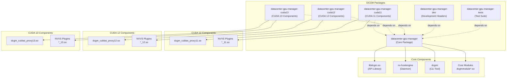

**Key Components**:
- **Core Package**: Contains CUDA-independent components including `libdcgm.so`, `nv-hostengine`, `dcgmi`, and core modules
- **CUDA-Specific Packages**: Contain version-specific `dcgm_cublas_proxy*.so` libraries and NVVS diagnostic plugins compiled for specific CUDA versions
- **Development Package**: Contains header files and development libraries for building applications with DCGM
- **Tests Package**: Contains the DCGM test suite for validation

**Sources**: [README.md:16](), [README.md:82-86]()

## Installing from DEB Packages

For Debian-based distributions (Ubuntu, Debian):

```bash
# Install the core package
sudo dpkg -i datacenter-gpu-manager_<version>_amd64.deb

# Install CUDA-specific components based on your CUDA driver version
# For CUDA 11.x
sudo dpkg -i datacenter-gpu-manager-cuda11_<version>_amd64.deb

# For CUDA 12.x
sudo dpkg -i datacenter-gpu-manager-cuda12_<version>_amd64.deb

# For CUDA 13.x
sudo dpkg -i datacenter-gpu-manager-cuda13_<version>_amd64.deb

# Optional: Install development headers
sudo dpkg -i datacenter-gpu-manager-dev_<version>_amd64.deb

# Optional: Install test suite
sudo dpkg -i datacenter-gpu-manager-tests_<version>_amd64.deb

# Resolve dependencies
sudo apt-get install -f
```

**Sources**: [README.md:84-86]()

## Installing from RPM Packages

For Red Hat-based distributions (RHEL, CentOS, Fedora):

```bash
# Install the core package
sudo rpm -ivh datacenter-gpu-manager-<version>.x86_64.rpm

# Install CUDA-specific components
sudo rpm -ivh datacenter-gpu-manager-cuda12-<version>.x86_64.rpm

# Optional: Install development and test packages
sudo rpm -ivh datacenter-gpu-manager-dev-<version>.x86_64.rpm
sudo rpm -ivh datacenter-gpu-manager-tests-<version>.x86_64.rpm
```

**Sources**: [README.md:86]()

## Installing from Tarball

For distribution-agnostic installations or when package managers are not available:

```bash
# Extract the tarball
tar -xzf datacenter-gpu-manager_<version>_amd64.tar.gz

# Navigate to the extracted directory
cd datacenter-gpu-manager_<version>_amd64

# Copy binaries to appropriate locations (requires root)
sudo cp usr/bin/* /usr/bin/
sudo cp usr/lib/* /usr/lib/
sudo cp -r usr/share/dcgm /usr/share/

# Set appropriate permissions
sudo chmod +x /usr/bin/nv-hostengine
sudo chmod +x /usr/bin/dcgmi
```

**Sources**: [README.md:82-86]()

## Post-Installation File Layout

After installation, DCGM files are organized in standard Linux directories:

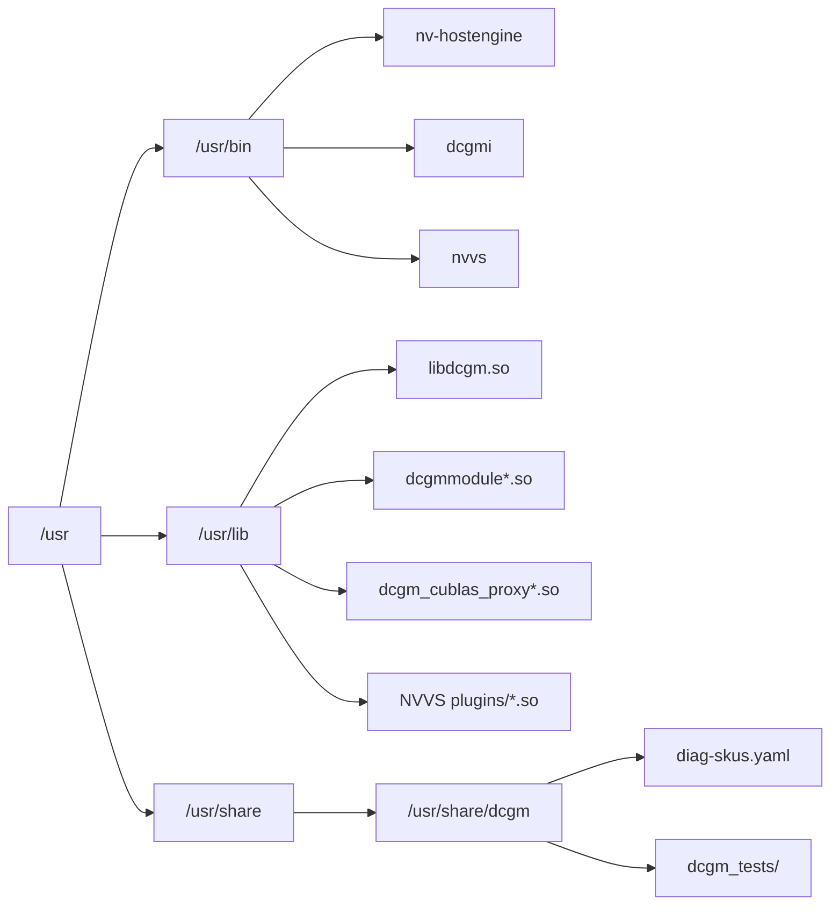

**Sources**: [README.md:16]()

## Starting the Host Engine

DCGM operates as a client-server architecture where `nv-hostengine` is the server daemon that manages GPU monitoring and all client tools communicate with it.

### Manual Start

Start the host engine manually for testing or development:

```bash
# Start with default settings
sudo nv-hostengine

# Start with logging to file
sudo nv-hostengine -f /tmp/hostengine.log --log-level ERROR

# Start in foreground (no daemonization)
sudo nv-hostengine --no-daemon
```

**Common Command-Line Options**:

| Option | Description |
|--------|-------------|
| `-f <path>` | Write log output to specified file |
| `--log-level <level>` | Set logging level (DEBUG, INFO, WARNING, ERROR) |
| `--no-daemon` | Run in foreground without daemonizing |
| `-p <port>` | Listen on specified TCP port (default: 5555) |

### Systemd Service

For production deployments, `nv-hostengine` should be configured as a systemd service:

```bash
# Enable and start the service
sudo systemctl enable dcgm
sudo systemctl start dcgm

# Check service status
sudo systemctl status dcgm

# View logs
sudo journalctl -u dcgm
```

**Sources**: [README.md:108-109]()

## Verifying Installation

After installation and starting the host engine, verify that DCGM is working correctly:

```bash
# Display DCGM version information
dcgmi -v

# List detected GPUs
dcgmi discovery -l

# Check GPU health
dcgmi health -c
```

**Expected Output for `dcgmi -v`**:
```
DCGM version
Version: x.y.z
Build ID: <build-id>
Build Date: <date>
Build Platform: <platform>
Build Type: <release/debug>
```

**Sources**: [README.md:112]()

## Getting Started with dcgmi

The `dcgmi` command-line tool provides access to all DCGM functionality. The tool is organized into subcommands:

### Basic Command Structure

```bash
dcgmi <command> [options]
```

### Common Commands

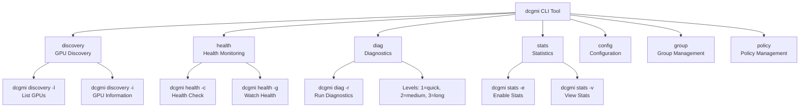

### Example Workflows

**Discover and Monitor GPUs**:
```bash
# List all GPUs
dcgmi discovery -l

# Create a group of GPUs for monitoring
dcgmi group -c mygroup

# Add GPUs to group
dcgmi group -g mygroup -a 0,1

# Start field watches for the group
dcgmi dmon -g mygroup -e 150,155,203,204
```

**Run Diagnostics**:
```bash
# Run quick diagnostic (level 1) on all GPUs
dcgmi diag -r 1

# Run comprehensive diagnostic (level 3) on specific GPUs
dcgmi diag -r 3 -i 0,1

# Run diagnostic with detailed logging
dcgmi diag -r 2 --debugLogFile /tmp/diag.log -d ERROR
```

**Health Monitoring**:
```bash
# Perform health check on all GPUs
dcgmi health -c

# Set health watches on a group
dcgmi health -g mygroup -s a

# Get health report
dcgmi health -g mygroup -c
```

**Sources**: [README.md:108-112]()

## Configuration

### Environment Variables

DCGM supports several environment variables for configuration:

| Variable | Purpose | Example |
|----------|---------|---------|
| `DCGM_TESTING_FRAMEWORK` | Enable testing mode | `export DCGM_TESTING_FRAMEWORK=True` |
| `DCGMLIBPATH` | Override library search path | `export DCGMLIBPATH=/opt/dcgm/lib` |
| `LD_LIBRARY_PATH` | Standard library path | `export LD_LIBRARY_PATH=/usr/lib/dcgm` |

### Host Engine Configuration

The `nv-hostengine` daemon can be configured via command-line arguments or environment variables:

```bash
# Configure logging
nv-hostengine -f /var/log/dcgm/hostengine.log --log-level INFO

# Configure network listening
nv-hostengine -p 5555 --listen-address 0.0.0.0

# Configure for embedded mode (no network)
nv-hostengine --no-daemon --embedded
```

**Sources**: [testing/python3/tests/test_dcgm_collectd_plugin.py:26-28]()

## Integration Configuration

### Collectd Plugin Configuration

For systems using collectd for metrics collection, DCGM provides a collectd plugin. Configuration example:

```xml
<Plugin "dcgm">
    Interval 2
    FieldIds "(100,memory_clock):5,video_clock:.1"
</Plugin>
```

The `FieldIds` parameter specifies which DCGM fields to monitor and their update intervals:
- Format: `(field_id,field_name):interval_sec`
- Multiple fields can be comma-separated
- Interval can be specified in seconds (e.g., `5`) or fractional seconds (e.g., `.1`)

**Sources**: [testing/python3/tests/test_dcgm_collectd_plugin.py:159-160]()

### Kubernetes Integration

For Kubernetes environments, DCGM integrates via `dcgm-exporter` which exposes GPU metrics as Prometheus metrics. See [Kubernetes Integration](#7.1) for details.

**Sources**: [README.md:18]()

## Troubleshooting

### Common Installation Issues

**Missing Dependencies**:
```bash
# For DEB packages
sudo apt-get install -f

# For RPM packages
sudo yum install <missing-package>
```

**Permission Issues**:
```bash
# Ensure proper permissions for binaries
sudo chmod +x /usr/bin/nv-hostengine
sudo chmod +x /usr/bin/dcgmi

# Host engine typically requires root privileges
sudo nv-hostengine
```

**Driver Compatibility**:
```bash
# Check NVIDIA driver version
nvidia-smi

# Ensure driver supports DCGM
dcgmi discovery -l
```

### Collecting Diagnostic Information

When reporting issues, collect the following information:

```bash
# DCGM version
dcgmi -v

# GPU information
nvidia-smi
nvidia-smi -q

# Host engine logs
sudo nv-hostengine -f /tmp/hostengine.log --log-level ERROR

# Diagnostic logs
dcgmi diag -r 1 --debugLogFile /tmp/diag.log -d ERROR
```

**Sources**: [README.md:101-123]()

## Next Steps

After successful installation:
- Learn about DCGM's modular architecture: [Architecture](#1.1)
- Understand the API for integration: [API Reference](#2.2)
- Explore diagnostic capabilities: [NVVS](#4)
- Integrate with monitoring systems: [Integration](#7)

**Sources**: [README.md:1-147]()

---

# Page: Security

# Security

<details>
<summary>Relevant source files</summary>

The following files were used as context for generating this wiki page:

- [SECURITY.md](SECURITY.md)

</details>


This document describes DCGM's security policies, vulnerability reporting procedures, and coordinated disclosure process. This page focuses on how to report security issues and the responsible disclosure workflow NVIDIA follows. For information about DCGM's architecture and components, see [Architecture](#1.1). For API usage, see [API Reference](#2.2).

## Security Policy Overview

NVIDIA treats security vulnerabilities in DCGM and all NVIDIA-owned repositories seriously. The security program follows industry best practices for responsible disclosure and coordinated vulnerability management through the NVIDIA Product Security Incident Response Team (PSIRT).

Security issues must meet [NVIDIA's definition of a security vulnerability](https://www.nvidia.com/en-us/security/psirt-policies/) to be processed through the PSIRT workflow. Examples include buffer overflows, remote code execution vulnerabilities, privilege escalation flaws, and other security-impacting defects.

**Important**: Security vulnerabilities should not be reported through public GitHub issues to protect users during the investigation and remediation period.

**Sources**: [SECURITY.md:1-42]()

## Reporting Channels

DCGM provides three official channels for reporting security vulnerabilities, each with different workflows and security characteristics:

### Reporting Channel Summary

| Channel | Method | Authentication | Encryption | Best For |
|---------|--------|----------------|------------|----------|
| Web Form | NVIDIA Security Portal | Required (login) | HTTPS | Most users, guided submission |
| Email | psirt@nvidia.com | Optional | PGP encryption available | Reporters preferring email, bulk submissions |
| GitHub | Security Advisories | Required (GitHub account) | GitHub's security infrastructure | GitHub-native workflow, repository maintainers |

### Channel Details

**1. NVIDIA Security Portal (Web Form)**

Submit vulnerability reports through the official web portal at [https://www.nvidia.com/en-us/security/report-vulnerability/](https://www.nvidia.com/en-us/security/report-vulnerability/). This method requires logging in and provides a structured submission form.

**2. Email Submission**

Send reports directly to [psirt@nvidia.com](mailto:psirt@nvidia.com). For sensitive disclosures, encrypt communications using NVIDIA's public PGP key available at [https://www.nvidia.com/en-us/security/pgp-key/](https://www.nvidia.com/en-us/security/pgp-key/).

**3. GitHub Security Advisories**

Use GitHub's private security advisory feature at [https://github.com/NVIDIA/DCGM/security/advisories/new](https://github.com/NVIDIA/DCGM/security/advisories/new). This integrates with GitHub's security workflow and maintains private communication until disclosure.

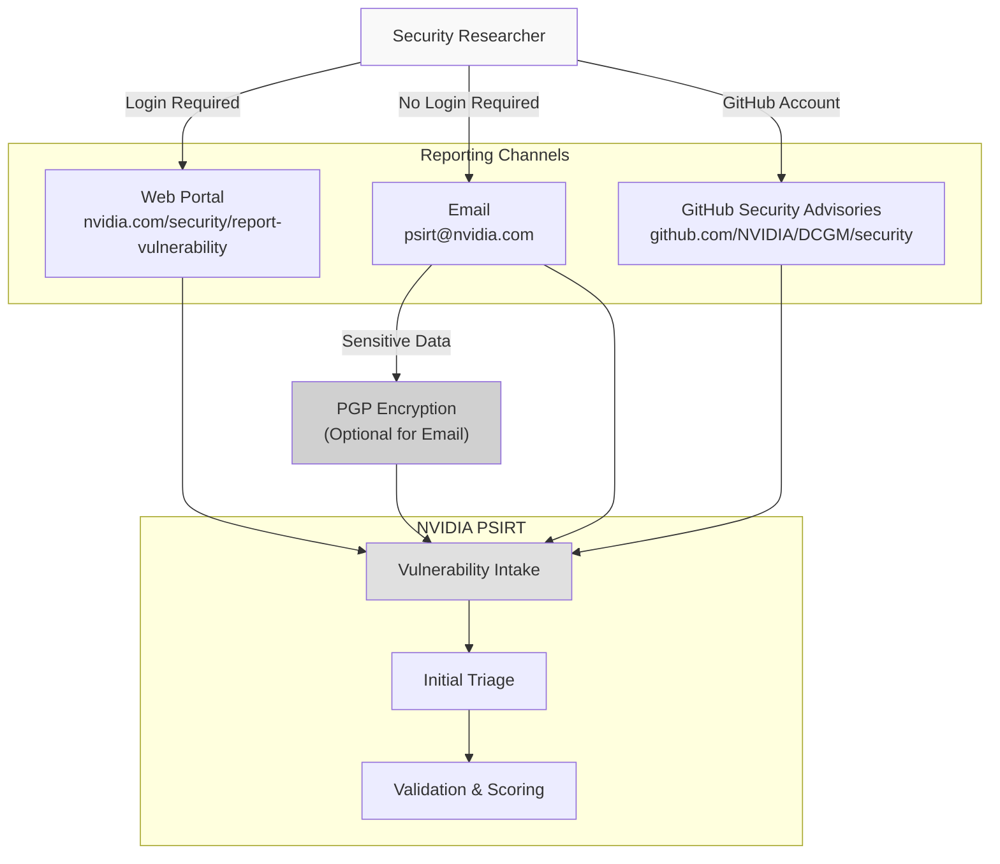

**Diagram: Security Vulnerability Reporting Channels**

**Sources**: [SECURITY.md:9-17]()

## Required Vulnerability Information

To facilitate rapid triage and investigation, vulnerability reports should include comprehensive technical details. The following information helps NVIDIA PSIRT assess severity, reproduce issues, and develop fixes efficiently.

### Information Checklist

**Issue Classification**
- Vulnerability type (e.g., buffer overflow, SQL injection, remote code execution, privilege escalation)
- Affected DCGM versions
- Affected components (e.g., `nv-hostengine`, `dcgmi`, specific modules, NVVS plugins)

**Source Code References**
- Permanent links to source files exhibiting the vulnerability
- Specific function names, class names, or line numbers
- Git commit hashes if applicable

**Reproduction Information**
- Required system configuration (GPU models, MIG configuration, OS version, CUDA version)
- Step-by-step reproduction instructions
- Environment setup requirements
- Any non-standard configuration parameters

**Proof of Concept**
- Exploit code demonstrating the vulnerability (if available)
- Sample inputs triggering the issue
- Expected vs. actual behavior
- Screenshots or logs

**Impact Assessment**
- Attack vector (local, network, physical access required)
- Privileges required (root, unprivileged user)
- Potential impact (data disclosure, service disruption, privilege escalation)
- Exploitability conditions

**Sources**: [SECURITY.md:19-28]()

## Coordinated Vulnerability Disclosure (CVD)

NVIDIA follows Coordinated Vulnerability Disclosure (CVD), a collaborative process where security researchers privately report vulnerabilities to allow investigation and remediation before public disclosure. This protects users while ensuring researchers receive appropriate recognition.

### CVD Workflow

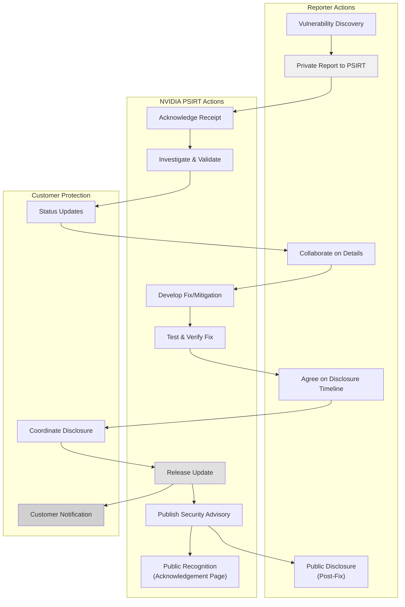

**Diagram: Coordinated Vulnerability Disclosure Timeline**

### CVD Process Stages

**1. Initial Report Phase**
- Reporter discovers vulnerability in DCGM codebase
- Reporter submits private report through one of the three reporting channels
- NVIDIA PSIRT acknowledges receipt within standard response timeframes

**2. Investigation Phase**
- PSIRT validates the vulnerability and assesses severity
- PSIRT coordinates with reporter for additional technical details
- PSIRT provides progress updates throughout investigation
- Reporter agrees to maintain confidentiality during investigation

**3. Remediation Phase**
- NVIDIA engineering develops security fixes or mitigations
- Testing validates the fix addresses the vulnerability
- PSIRT coordinates disclosure timeline with reporter
- Both parties agree on public disclosure date

**4. Disclosure Phase**
- NVIDIA releases security update or mitigation guidance
- NVIDIA publishes security advisory with vulnerability details
- NVIDIA notifies affected customers through standard channels
- Reporter may publicly discuss vulnerability post-disclosure
- NVIDIA recognizes reporter on acknowledgement page (with agreement)

### Reporter Recognition

With the reporter's consent, NVIDIA PSIRT acknowledges valid vulnerability discoveries on NVIDIA's public security acknowledgement page. Recognition includes:
- Reporter name or handle (as preferred)
- Organization affiliation (optional)
- Vulnerability reference number
- General description of finding

Public discussion by the reporter is welcomed after NVIDIA publishes updates or mitigation information.

**Sources**: [SECURITY.md:34-41]()

## Communication Preferences

All security communications should be conducted in English to ensure efficient processing and reduce translation delays. NVIDIA PSIRT maintains English as the working language for all vulnerability reports, status updates, and coordination activities.

**Sources**: [SECURITY.md:30-32]()

## NVIDIA's Reverse Disclosure Process

NVIDIA follows the same CVD principles when discovering vulnerabilities in third-party vendor products during DCGM development or security audits. 

### Reverse CVD Workflow

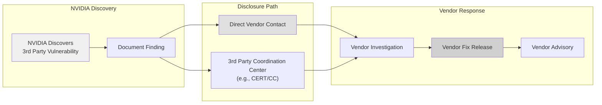

**Diagram: NVIDIA Reverse CVD Process for Third-Party Vulnerabilities**

When NVIDIA identifies security issues in dependencies or third-party components used by DCGM (e.g., NVML, CUDA libraries, third-party packages), NVIDIA:
1. Follows standard CVD process in reverse
2. Contacts affected vendor directly when possible
3. Uses third-party coordination centers (e.g., CERT/CC) when direct contact unavailable
4. Maintains confidentiality until vendor releases fixes
5. Coordinates public disclosure appropriately

**Sources**: [SECURITY.md:42]()

## Security Best Practices for DCGM Deployment

While vulnerability reporting follows the processes above, DCGM administrators should follow security best practices during deployment:

### Access Control Recommendations

**DCGM Host Engine (`nv-hostengine`)**
- Runs as a system daemon with elevated privileges
- Access to GPU hardware and system resources requires appropriate permissions
- Default socket/TCP listening configuration should restrict unauthorized access
- Consider firewall rules for remote DCGM connections

**File Permissions**
- DCGM libraries (`dcgm.so`, modules) should have restricted write permissions
- Configuration files should be readable only by authorized users
- Log files may contain sensitive system information

### Network Security
- DCGM supports TCP socket mode for remote monitoring
- Use authentication mechanisms when exposing DCGM over networks
- Consider TLS/SSL for encrypted communication in sensitive environments
- Limit network exposure through firewall rules and network segmentation

**Sources**: Inferred from DCGM architecture and standard security practices

## Related Documentation

- For DCGM installation and configuration, see [Installation](#1.2)
- For DCGM architecture and component design, see [Architecture](#1.1)
- For API security considerations, see [API Reference](#2.2)
- For build system security, see [Building and Development](#5)

---

# Page: Core Components

# Core Components

<details>
<summary>Relevant source files</summary>

The following files were used as context for generating this wiki page:

- [README.md](README.md)
- [common/ThreeWayCmpDefault.hpp](common/ThreeWayCmpDefault.hpp)
- [dcgmlib/src/DcgmCacheManager.cpp](dcgmlib/src/DcgmCacheManager.cpp)
- [modules/nvswitch/DcgmModuleNvSwitch.cpp](modules/nvswitch/DcgmModuleNvSwitch.cpp)
- [nvvs/include/NvvsJsonStrings.h](nvvs/include/NvvsJsonStrings.h)
- [testing/python3/tests/test_dcgm_collectd_plugin.py](testing/python3/tests/test_dcgm_collectd_plugin.py)

</details>


This document provides an overview of DCGM's core architectural components, including the host engine daemon, module system, cache manager, and API layers. It describes how these components interact to provide GPU monitoring and management functionality. For detailed information about the Cache Manager's field watching and data collection mechanisms, see [Cache Manager](#2.1). For API usage and function reference, see [API Reference](#2.2).

## High-Level Architecture

DCGM follows a modular, daemon-based architecture where a central host engine process coordinates specialized modules and maintains a unified cache of telemetry data.

### Component Overview

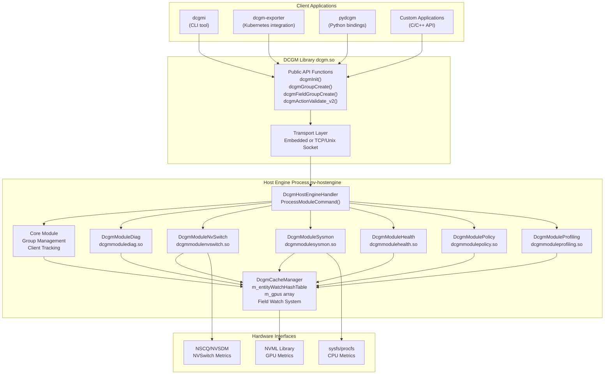

**Sources:** [README.md:1-147](), [dcgmlib/src/DcgmCacheManager.cpp:16-951](), [modules/nvswitch/DcgmModuleNvSwitch.cpp:1-580]()

### Process Model

DCGM operates in two modes:

| Mode | Description | Process Architecture |
|------|-------------|---------------------|
| **Standalone** | `nv-hostengine` daemon runs as separate process | Client applications connect via TCP or Unix domain socket through `dcgm.so` |
| **Embedded** | DCGM library loaded directly into application | All components run in single process space; `DcgmHostEngineHandler` created in-process |

The `nv-hostengine` daemon is the standalone host engine process that loads all modules and provides the core DCGM functionality. Client applications interact with it through the `dcgm.so` library, which abstracts the communication mechanism.

**Sources:** [README.md:6-24](), [dcgmlib/src/DcgmCacheManager.cpp:886-951]()

## Module System

DCGM's functionality is organized into loadable modules, each providing specialized capabilities. Modules run in their own thread contexts and communicate via asynchronous message passing.

### Module Architecture

```mermaid
graph TB
    subgraph "Module Base Classes"
        DCGM_MODULE["DcgmModule<br/>(Abstract Base)"]
        TASK_RUNNER["DcgmTaskRunner<br/>Run()<br/>Enqueue()"]
    end
    
    subgraph "Concrete Modules"
        MOD_NVSWITCH["DcgmModuleNvSwitch<br/>ProcessMessage()<br/>run()<br/>RunOnce()"]
        MOD_SYSMON["DcgmModuleSysmon<br/>ProcessMessage()<br/>run()"]
        MOD_DIAG["DcgmModuleDiag<br/>ProcessMessage()"]
        MOD_HEALTH["DcgmModuleHealth<br/>ProcessMessage()"]
        MOD_POLICY["DcgmModulePolicy<br/>ProcessMessage()"]
        MOD_PROF["DcgmModuleProfiling<br/>ProcessMessage()"]
    end
    
    MESSAGE["dcgm_module_command_header_t<br/>- moduleId<br/>- subCommand<br/>- version<br/>- length"]
    
    HANDLER["DcgmHostEngineHandler<br/>ProcessModuleCommand()"]
    
    DCGM_MODULE --> TASK_RUNNER
    TASK_RUNNER --> MOD_NVSWITCH
    TASK_RUNNER --> MOD_SYSMON
    
    DCGM_MODULE --> MOD_DIAG
    DCGM_MODULE --> MOD_HEALTH
    DCGM_MODULE --> MOD_POLICY
    DCGM_MODULE --> MOD_PROF
    
    HANDLER --> MESSAGE
    MESSAGE --> MOD_NVSWITCH
    MESSAGE --> MOD_SYSMON
    MESSAGE --> MOD_DIAG
```

**Sources:** [modules/nvswitch/DcgmModuleNvSwitch.cpp:49-90](), [modules/nvswitch/DcgmModuleNvSwitch.cpp:93-153]()

### Module Communication Pattern

Modules communicate through structured messages with a common header format. The `DcgmHostEngineHandler::ProcessModuleCommand()` function routes messages based on the `moduleId` field.

#### Message Structure

```cpp
// From dcgm_structs.h
typedef struct dcgm_module_command_header
{
    unsigned int length;      // Total message size
    unsigned int moduleId;    // Target module (DcgmModuleIdNvSwitch, etc.)
    unsigned int subCommand;  // Operation within module
    unsigned int version;     // Message version for compatibility
} dcgm_module_command_header_t;
```

#### Message Flow

```mermaid
sequenceDiagram
    participant Client
    participant API as "dcgm.so API"
    participant Handler as "DcgmHostEngineHandler<br/>ProcessModuleCommand()"
    participant Module as "DcgmModuleNvSwitch<br/>ProcessMessage()"
    participant TaskRunner as "TaskRunner<br/>Enqueue()"
    participant Worker as "Module run() thread"
    
    Client->>API: dcgmActionValidate_v2()
    API->>Handler: Send module command
    Handler->>Module: Route by moduleId
    Module->>TaskRunner: Enqueue task
    TaskRunner->>Worker: Task queued
    Worker->>Worker: ProcessMessageFromTaskRunner()
    Worker-->>Module: Result
    Module-->>Handler: Return dcgmReturn_t
    Handler-->>API: Return dcgmReturn_t
    API-->>Client: Return dcgmReturn_t
```

**Sources:** [modules/nvswitch/DcgmModuleNvSwitch.cpp:93-153](), [modules/nvswitch/DcgmModuleNvSwitch.cpp:156-343]()

### Module Identifiers

Modules are identified by numeric constants:

| Module ID | Enum Name | Shared Library | Purpose |
|-----------|-----------|----------------|---------|
| `DcgmModuleIdCore` | Core module | Built into engine | Group management, client tracking |
| `DcgmModuleIdNvSwitch` | NVSwitch module | `dcgmmodulenvswitch.so` | NVSwitch device monitoring |
| `DcgmModuleIdSysmon` | System monitoring | `dcgmmodulesysmon.so` | CPU, power, thermal metrics |
| `DcgmModuleIdDiag` | Diagnostics | `dcgmmodulediag.so` | GPU validation and testing |
| `DcgmModuleIdHealth` | Health monitoring | `dcgmmodulehealth.so` | System health checks |
| `DcgmModuleIdPolicy` | Policy management | `dcgmmodulepolicy.so` | Policy enforcement |
| `DcgmModuleIdProfiling` | Profiling | `dcgmmoduleprofiling.so` | GPU profiling metrics |

**Sources:** [modules/nvswitch/DcgmModuleNvSwitch.cpp:98-106](), [modules/nvswitch/DcgmModuleNvSwitch.cpp:160-168]()

### Module Lifecycle

```mermaid
stateDiagram-v2
    [*] --> Allocated: dcgm_alloc_module_instance()
    Allocated --> Initialized: Constructor<br/>DcgmModuleNvSwitch()
    Initialized --> Running: Start()<br/>TaskRunner begins
    Running --> Processing: ProcessMessage()<br/>Commands received
    Processing --> Running: Task completed
    Running --> Stopping: StopAndWait(60000)
    Stopping --> Stopped: All threads exit
    Stopped --> [*]: dcgm_free_module_instance()
```

Each module shared library exports three C functions:

- `dcgm_alloc_module_instance(dcgmCoreCallbacks_t *dcc)` - Allocates and initializes the module
- `dcgm_free_module_instance(DcgmModule *freeMe)` - Cleans up and deallocates the module
- `dcgm_module_process_message(DcgmModule *module, dcgm_module_command_header_t *cmd)` - Handles incoming commands

**Sources:** [modules/nvswitch/DcgmModuleNvSwitch.cpp:560-578](), [modules/nvswitch/DcgmModuleNvSwitch.cpp:49-70]()

### TaskRunner Pattern

Modules like `DcgmModuleNvSwitch` and `DcgmModuleSysmon` inherit from `DcgmTaskRunner`, which provides thread-safe task enqueueing and execution. The `run()` method executes in a dedicated thread and processes tasks from the queue.

```mermaid
graph LR
    subgraph "Module Thread"
        RUN["run() loop<br/>while ShouldStop() == 0"]
        TASK_RUN["TaskRunner::Run(true)<br/>Process queued tasks"]
        RUNONCE["RunOnce()<br/>Periodic operations"]
    end
    
    subgraph "API Thread"
        PROCESS_MSG["ProcessMessage()<br/>Receives command"]
        ENQUEUE["Enqueue task<br/>with future"]
    end
    
    PROCESS_MSG --> ENQUEUE
    ENQUEUE -.-> TASK_RUN
    RUN --> TASK_RUN
    TASK_RUN --> RUNONCE
    RUNONCE --> RUN
```

The module can enqueue tasks from any thread and wait for results via `std::future`. The `RunOnce()` method is called periodically to perform background operations like updating field watches.

**Sources:** [modules/nvswitch/DcgmModuleNvSwitch.cpp:540-553](), [modules/nvswitch/DcgmModuleNvSwitch.cpp:136-152]()

## Entity System

DCGM tracks multiple types of hardware entities using a unified entity model. Each entity is identified by an entity group ID and entity ID combination.

### Entity Groups

```mermaid
graph TB
    subgraph "Entity Group Hierarchy"
        NONE["DCGM_FE_NONE<br/>Global fields"]
        
        GPU["DCGM_FE_GPU<br/>Physical GPUs"]
        VGPU["DCGM_FE_VGPU<br/>Virtual GPUs"]
        GPU_I["DCGM_FE_GPU_I<br/>GPU Instances (MIG)"]
        GPU_CI["DCGM_FE_GPU_CI<br/>Compute Instances (MIG)"]
        
        SWITCH["DCGM_FE_SWITCH<br/>NVSwitch devices"]
        LINK["DCGM_FE_LINK<br/>NVLink connections"]
        
        CPU["DCGM_FE_CPU<br/>CPU sockets"]
        CPU_CORE["DCGM_FE_CPU_CORE<br/>CPU cores"]
    end
    
    GPU --> GPU_I
    GPU_I --> GPU_CI
    
    SWITCH --> LINK
    CPU --> CPU_CORE
```

The entity group enumeration defines the following primary types:

| Entity Group | Constant | Description | Entity ID Range |
|--------------|----------|-------------|-----------------|
| None | `DCGM_FE_NONE` | Global/system-level fields | 0 |
| GPU | `DCGM_FE_GPU` | Physical GPU devices | 0 to `m_numGpus-1` |
| vGPU | `DCGM_FE_VGPU` | Virtualized GPU instances | Variable |
| GPU Instance | `DCGM_FE_GPU_I` | MIG GPU instances | `gpuId * maxGpcs + instanceIdx` |
| Compute Instance | `DCGM_FE_GPU_CI` | MIG compute instances | `gpuId * maxGpcs + ciIdx` |
| Switch | `DCGM_FE_SWITCH` | NVSwitch devices | Variable |
| Link | `DCGM_FE_LINK` | NVLink connections | Variable |
| CPU | `DCGM_FE_CPU` | CPU sockets | Variable |
| CPU Core | `DCGM_FE_CPU_CORE` | Individual CPU cores | Variable |

**Sources:** [dcgmlib/src/DcgmCacheManager.cpp:173-196](), [dcgmlib/src/DcgmCacheManager.cpp:620-698]()

### Entity Storage in DcgmCacheManager

The `DcgmCacheManager` maintains entity information in several data structures:

```cpp
// GPU array - indexed by GPU ID
dcgmcm_gpu_info_t m_gpus[DCGM_MAX_NUM_DEVICES];
unsigned int m_numGpus;

// GPU Instance and Compute Instance tracking
unsigned int m_numInstances;
unsigned int m_numComputeInstances;

// Per-GPU instance storage (within dcgmcm_gpu_info_t)
std::vector<DcgmGpuInstance> instances;  // Each GPU has instances
```

The `dcgmcm_gpu_info_t` structure tracks per-GPU information including MIG configuration:

```cpp
typedef struct dcgmcm_gpu_info_t {
    unsigned int gpuId;
    nvmlDevice_t nvmlDevice;
    bool migEnabled;
    unsigned int maxGpcs;      // Maximum GPU partitions
    unsigned int usedGpcs;     // Currently allocated partitions
    unsigned int ciCount;      // Compute instance count
    std::vector<DcgmGpuInstance> instances;
    // ... additional fields
} dcgmcm_gpu_info_t;
```

**Sources:** [dcgmlib/src/DcgmCacheManager.cpp:702-883](), [dcgmlib/src/DcgmCacheManager.cpp:198-209]()

### Entity Key Construction

Entities are uniquely identified in the watch hash table by combining their group ID and entity ID. The key is constructed as a pointer value:

```cpp
// Entity key is (entityGroupId << 32) | entityId encoded as pointer
static unsigned int entityKeyHashCB(const void *key)
{
    unsigned int retVal = 0;
    MurmurHash3_x86_32(&key, sizeof(key), 0, &retVal);
    return retVal;
}

static int entityKeyCmpCB(const void *key1, const void *key2)
{
    if (key1 == key2)
        return 1;  // Keys match
    else
        return 0;  // Keys don't match
}
```

The hash table `m_entityWatchHashTable` uses this key to store watch information for each entity/field combination.

**Sources:** [dcgmlib/src/DcgmCacheManager.cpp:93-130](), [dcgmlib/src/DcgmCacheManager.cpp:1007-1010]()

## Cache Manager Overview

The `DcgmCacheManager` is the central data repository that coordinates field watches, collects metrics from hardware, and distributes data to consumers. It maintains a unified view of all monitored entities and fields.

### Core Data Structures

```mermaid
graph TB
    subgraph "DcgmCacheManager"
        HASH["m_entityWatchHashTable<br/>Key: entity+field<br/>Value: dcgmcm_watch_info_p"]
        GPU_ARRAY["m_gpus array<br/>dcgmcm_gpu_info_t[DCGM_MAX_NUM_DEVICES]"]
        MIG_MGR["m_migManager<br/>DcgmMigManager<br/>Instance ID mappings"]
        EVENT_SET["m_nvmlEventSet<br/>NVML event monitoring"]
        SUBSCRIPTIONS["m_subscriptions<br/>Subscriber callbacks"]
    end
    
    WATCH_INFO["dcgmcm_watch_info_t<br/>- monitorIntervalUsec<br/>- maxAgeUsec<br/>- watchers vector<br/>- timeSeries<br/>- hasSubscribedWatchers"]
    
    TIME_SERIES["timeseries_p<br/>Time-series storage<br/>Samples with timestamps"]
    
    HASH --> WATCH_INFO
    WATCH_INFO --> TIME_SERIES
```

**Key Components:**

- **`m_entityWatchHashTable`**: Hash table mapping entity+field combinations to watch information
- **`m_gpus[]`**: Array of GPU information structures, indexed by GPU ID
- **`m_migManager`**: Manages MIG instance ID to NVML instance ID mappings
- **`m_nvmlEventSet`**: NVML event set for asynchronous event monitoring
- **`m_subscriptions`**: Manages field value subscribers for real-time notifications

**Sources:** [dcgmlib/src/DcgmCacheManager.cpp:887-951](), [dcgmlib/src/DcgmCacheManager.cpp:1007-1010]()

### Watch Information Structure

Each field watch is represented by a `dcgmcm_watch_info_t` structure:

| Field | Type | Purpose |
|-------|------|---------|
| `monitorIntervalUsec` | `timelib64_t` | Minimum polling interval (calculated from all watchers) |
| `maxAgeUsec` | `timelib64_t` | Maximum sample retention time |
| `watchers` | `std::vector` | List of all watchers with their individual intervals |
| `timeSeries` | `timeseries_p` | Time-series storage for historical samples |
| `hasSubscribedWatchers` | `bool` | Whether any watcher has active subscriptions |

The cache manager calculates the effective `monitorIntervalUsec` as the minimum of all watcher intervals, ensuring data is fresh enough for the most demanding consumer.

**Sources:** [dcgmlib/src/DcgmCacheManager.cpp:112-129]()

For detailed information about field watching mechanisms, data collection pipelines, and sample storage, see [Cache Manager](#2.1).

## Message Routing

The `DcgmHostEngineHandler` acts as the central message router, directing commands to the appropriate module based on the `moduleId` field.

### Routing Implementation

```mermaid
graph TD
    CLIENT["Client API Call<br/>dcgmActionValidate_v2()"] --> HANDLER["DcgmHostEngineHandler::<br/>ProcessModuleCommand()"]
    
    HANDLER --> CHECK_ID{"Check<br/>moduleId"}
    
    CHECK_ID -->|"DCGM_MODULE_ID_CORE"| CORE["Core Module<br/>Handle internally"]
    CHECK_ID -->|"DcgmModuleIdNvSwitch"| NVSWITCH["m_modules[DcgmModuleIdNvSwitch]-><br/>dcgm_module_process_message()"]
    CHECK_ID -->|"DcgmModuleIdSysmon"| SYSMON["m_modules[DcgmModuleIdSysmon]-><br/>dcgm_module_process_message()"]
    CHECK_ID -->|"DcgmModuleIdDiag"| DIAG["m_modules[DcgmModuleIdDiag]-><br/>dcgm_module_process_message()"]
    
    NVSWITCH --> MODULE_PROCESS["DcgmModuleNvSwitch::<br/>ProcessMessage()"]
    
    MODULE_PROCESS --> CHECK_SUB{"Check<br/>subCommand"}
    
    CHECK_SUB -->|"DCGM_NVSWITCH_SR_GET_SWITCH_IDS"| GET_SWITCHES["ProcessGetSwitchIds()"]
    CHECK_SUB -->|"DCGM_NVSWITCH_SR_WATCH_FIELD"| WATCH["ProcessWatchField()"]
    CHECK_SUB -->|"DCGM_NVSWITCH_SR_UNWATCH_FIELD"| UNWATCH["ProcessUnwatchField()"]
```

The routing process follows this pattern:

1. **API Layer**: Client calls a public API function (e.g., `dcgmActionValidate_v2()`)
2. **Transport**: Message is serialized and sent to host engine
3. **Router**: `DcgmHostEngineHandler::ProcessModuleCommand()` examines `moduleId`
4. **Module Dispatch**: Message is forwarded to the target module via `dcgm_module_process_message()`
5. **Subcommand Processing**: Module's `ProcessMessage()` examines `subCommand` and calls appropriate handler
6. **Version Checking**: Module validates message version for compatibility
7. **Response**: Result propagates back through the call chain

**Sources:** [modules/nvswitch/DcgmModuleNvSwitch.cpp:93-153](), [modules/nvswitch/DcgmModuleNvSwitch.cpp:156-343]()

### Example: NVSwitch Field Watch Request

```mermaid
sequenceDiagram
    participant App as "Application"
    participant Cache as "DcgmCacheManager<br/>AddFieldWatch()"
    participant Helper as "helperNvSwitchAddFieldWatch()"
    participant Handler as "DcgmHostEngineHandler<br/>ProcessModuleCommand()"
    participant Module as "DcgmModuleNvSwitch"
    participant NvSwitchMgr as "DcgmNvSwitchManager<br/>WatchField()"
    
    App->>Cache: AddFieldWatch(DCGM_FE_SWITCH, entityId, fieldId)
    Cache->>Helper: Call helper for SWITCH entity
    Helper->>Helper: Build dcgm_nvswitch_msg_watch_field_t
    Note over Helper: Set moduleId = DcgmModuleIdNvSwitch<br/>Set subCommand = DCGM_NVSWITCH_SR_WATCH_FIELD
    Helper->>Handler: ProcessModuleCommand(&msg.header)
    Handler->>Module: dcgm_module_process_message()
    Module->>Module: ProcessMessage()<br/>Route to ProcessWatchField()
    Module->>NvSwitchMgr: WatchField(entityGroupId, entityId, ...)
    NvSwitchMgr-->>Module: Return dcgmReturn_t
    Module-->>Handler: Return dcgmReturn_t
    Handler-->>Helper: Return dcgmReturn_t
    Helper-->>Cache: Return dcgmReturn_t
    Cache-->>App: Return dcgmReturn_t
```

**Sources:** [dcgmlib/src/DcgmCacheManager.cpp:131-170](), [modules/nvswitch/DcgmModuleNvSwitch.cpp:372-388]()

### Subcommand Constants

Modules define subcommand constants to identify specific operations:

```cpp
// Example from NVSwitch module
#define DCGM_NVSWITCH_SR_GET_SWITCH_IDS      0x01
#define DCGM_NVSWITCH_SR_CREATE_FAKE_SWITCH  0x02
#define DCGM_NVSWITCH_SR_WATCH_FIELD         0x03
#define DCGM_NVSWITCH_SR_UNWATCH_FIELD       0x04
#define DCGM_NVSWITCH_SR_GET_LINK_STATES     0x05
#define DCGM_NVSWITCH_SR_SET_LINK_STATE      0x06
#define DCGM_NVSWITCH_SR_GET_ENTITY_STATUS   0x07
// ... additional subcommands
```

Each subcommand corresponds to a specific message structure with a versioned header for backward compatibility.

**Sources:** [modules/nvswitch/DcgmModuleNvSwitch.cpp:109-132](), [modules/nvswitch/DcgmModuleNvSwitch.cpp:171-343]()

## API Layers

DCGM provides multiple API layers for different use cases and programming languages.

### API Structure

```mermaid
graph TB
    subgraph "Application Layer"
        C_APP["C/C++ Application"]
        PY_APP["Python Application"]
        GO_APP["Go Application"]
        CLI["dcgmi CLI"]
    end
    
    subgraph "Language Bindings"
        C_API["C API<br/>dcgm.h<br/>dcgmInit()<br/>dcgmGroupCreate()"]
        PY_BIND["pydcgm<br/>DcgmHandle<br/>DcgmSystem"]
        GO_BIND["Go bindings<br/>dcgm.go"]
    end
    
    subgraph "DCGM Library dcgm.so"
        API_IMPL["API Implementation<br/>dcgm_agent.c"]
        EMBED["Embedded Mode<br/>DcgmHostEngineHandler"]
        REMOTE["Remote Mode<br/>TCP/Unix Socket Client"]
    end
    
    subgraph "Host Engine nv-hostengine"
        ENGINE["DcgmHostEngineHandler<br/>Standalone Daemon"]
    end
    
    C_APP --> C_API
    PY_APP --> PY_BIND
    GO_APP --> GO_BIND
    CLI --> C_API
    
    PY_BIND --> C_API
    GO_BIND --> C_API
    
    C_API --> API_IMPL
    API_IMPL --> EMBED
    API_IMPL --> REMOTE
    
    REMOTE -.->|TCP/Unix Socket| ENGINE
    EMBED -.->|In-process| ENGINE
```

**Sources:** [README.md:1-147]()

### Embedded vs. Standalone Mode

| Aspect | Embedded Mode | Standalone Mode |
|--------|---------------|-----------------|
| **Process model** | DCGM runs in application process | DCGM runs as separate daemon |
| **Initialization** | `dcgmInit()` creates `DcgmHostEngineHandler` in-process | Application connects to existing `nv-hostengine` |
| **Communication** | Direct function calls | IPC via TCP or Unix domain socket |
| **Isolation** | Application crash affects DCGM | DCGM runs independently |
| **Use case** | Single application, low overhead | Multiple applications, system service |
| **Lifecycle** | DCGM lifetime tied to application | DCGM persists across applications |

### Core API Functions

The public API is defined in `dcgm.h` and includes functions for:

**Initialization and Connection:**
- `dcgmInit()` - Initialize DCGM library
- `dcgmConnect()` - Connect to standalone host engine
- `dcgmShutdown()` - Clean up and disconnect
- `dcgmStartEmbedded()` - Start embedded host engine

**Group Management:**
- `dcgmGroupCreate()` - Create a group of entities
- `dcgmGroupDestroy()` - Delete a group
- `dcgmGroupAddEntity()` - Add entity to group
- `dcgmGroupRemoveEntity()` - Remove entity from group

**Field Management:**
- `dcgmFieldGroupCreate()` - Create a field group
- `dcgmFieldGroupDestroy()` - Delete a field group
- `dcgmWatchFields()` - Start watching fields
- `dcgmUnwatchFields()` - Stop watching fields
- `dcgmGetLatestValues()` - Retrieve latest field values

**Operations:**
- `dcgmActionValidate_v2()` - Run diagnostic validation
- `dcgmHealthCheck()` - Perform health check
- `dcgmPolicySet()` - Configure policy
- `dcgmStatusCreate()` - Create status handle

For detailed API reference and usage examples, see [API Reference](#2.2).

**Sources:** [README.md:1-147]()

### Module Communication from API

When an API function needs module functionality, it constructs a module command message:

```cpp
// Example: Watching NVSwitch fields
static dcgmReturn_t helperNvSwitchAddFieldWatch(
    dcgm_field_entity_group_t entityGroupId,
    unsigned int entityId,
    unsigned short dcgmFieldId,
    long long monitorIntervalUsec,
    DcgmWatcher watcher)
{
    dcgm_nvswitch_msg_watch_field_t msg = {};
    
    msg.header.length     = sizeof(msg);
    msg.header.version    = dcgm_nvswitch_msg_watch_field_version;
    msg.header.moduleId   = DcgmModuleIdNvSwitch;
    msg.header.subCommand = DCGM_NVSWITCH_SR_WATCH_FIELD;
    
    msg.entityGroupId      = entityGroupId;
    msg.entityId           = entityId;
    msg.numFieldIds        = 1;
    msg.fieldIds[0]        = dcgmFieldId;
    msg.updateIntervalUsec = monitorIntervalUsec;
    msg.watcherType        = watcher.watcherType;
    msg.connectionId       = watcher.connectionId;
    
    DcgmHostEngineHandler *pDcgmHandle = DcgmHostEngineHandler::Instance();
    return pDcgmHandle->ProcessModuleCommand(&msg.header);
}
```

This pattern is used throughout the codebase to invoke module functionality from the API layer.

**Sources:** [dcgmlib/src/DcgmCacheManager.cpp:131-154]()

## Summary

DCGM's core components work together to provide a unified monitoring and management framework:

- **Host Engine (`nv-hostengine`)**: Central daemon process that loads modules and coordinates operations
- **Module System**: Pluggable modules (`DcgmModule` implementations) that provide specialized functionality through message passing
- **Cache Manager (`DcgmCacheManager`)**: Central data repository that manages field watches, collects metrics, and distributes data
- **Entity System**: Unified model for tracking GPUs, MIG instances, NVSwitches, CPUs, and other hardware
- **Message Routing**: Structured message passing with `moduleId` and `subCommand` routing through `DcgmHostEngineHandler`
- **API Layers**: Public C API (`dcgm.so`) with support for embedded and standalone modes, plus Python and Go bindings

This modular architecture enables DCGM to efficiently monitor diverse hardware, support multiple clients, and extend functionality through new modules.

**Sources:** [README.md:1-147](), [dcgmlib/src/DcgmCacheManager.cpp:1-951](), [modules/nvswitch/DcgmModuleNvSwitch.cpp:1-580]()

---

# Page: Cache Manager

# Cache Manager

<details>
<summary>Relevant source files</summary>

The following files were used as context for generating this wiki page:

- [dcgmlib/src/DcgmCacheManager.cpp](dcgmlib/src/DcgmCacheManager.cpp)
- [dcgmlib/src/DcgmCacheManager.h](dcgmlib/src/DcgmCacheManager.h)
- [testing/TestCacheManager.cpp](testing/TestCacheManager.cpp)

</details>


The Cache Manager is a critical core component within the NVIDIA Data Center GPU Manager (DCGM) architecture that serves as the central data storage, collection, and retrieval system. It is responsible for collecting metrics from GPUs, maintaining historical time-series data, and providing efficient access to these metrics for other DCGM components and external clients.

## Purpose and Scope

This document covers the design, architecture, and functionality of the DCGM Cache Manager, including its interaction with other components, data flow patterns, and implementation details. For information about specific field metrics managed by the Cache Manager, see [API Reference](#2.2).

## Architecture Overview

```mermaid
classDiagram
    class DcgmCacheManager {
        -hash_table_t* m_entityWatchHashTable
        -dcgmcm_gpu_info_t m_gpus[]
        -dcgmcm_runtime_stats_t m_runStats
        +Init(pollInLockStep, maxSampleAge, nvmlLoaded)
        +AddFieldWatch()
        +RemoveFieldWatch()
        +GetSamples()
        +GetLatestSample()
        +UpdateAllFields()
        +InjectSamples()
    }
    
    class dcgmcm_watch_info_t {
        +dcgm_entity_key_t watchKey
        +short isWatched
        +timeseries_p timeSeries
        +vector~dcgm_watch_watcher_info_t~ watchers
    }
    
    class dcgmcm_gpu_info_t {
        +unsigned int gpuId
        +DcgmEntityStatus_t status
        +nvmlDevice_t nvmlDevice
        +vector~DcgmGpuInstance~ instances
    }
    
    class DcgmCacheManagerEventThread {
        +run()
    }
    
    class DcgmMigManager {
        +RecordGpuInstance()
        +RecordGpuComputeInstance()
        +GetGpuIdFromInstanceId()
    }
    
    DcgmCacheManager --> dcgmcm_watch_info_t : contains
    DcgmCacheManager --> dcgmcm_gpu_info_t : manages
    DcgmCacheManager --> DcgmCacheManagerEventThread : owns
    DcgmCacheManager --> DcgmMigManager : uses
```

Sources: [dcgmlib/src/DcgmCacheManager.h:484-491](), [dcgmlib/src/DcgmCacheManager.h:119-152](), [dcgmlib/src/DcgmCacheManager.h:166-256](), [dcgmlib/src/DcgmCacheManager.h:464-481]()

## Data Flow

```mermaid
flowchart TD
    NVML["NVIDIA Management Library\n(NVML)"]
    CM["Cache Manager\n(DcgmCacheManager)"]
    TSDb["Time Series Storage\n(timeseries_p)"]
    Module["DCGM Modules"]
    Client["Client Applications"]
    
    NVML -->|"Hardware Metrics"| CM
    CM -->|"Store Samples"| TSDb
    CM -->|"Retrieve Samples"| TSDb
    Module -->|"AppendSamples()"| CM
    Module -->|"GetLatestSample()"| CM
    Client -->|"Request via Host Engine"| CM
    CM -->|"Return Values"| Client
    
    subgraph "Internal Cache Manager Operation"
      Watch["Watch System\n(dcgmcm_watch_info_t)"]
      EventThread["Event Thread\n(DcgmCacheManagerEventThread)"]
      
      CM <-->|"Manage Watches"| Watch
      CM <-->|"Process Events"| EventThread
      EventThread -->|"XID, MIG changes"| CM
    end
```

Sources: [dcgmlib/src/DcgmCacheManager.cpp:886-948](), [dcgmlib/src/DcgmCacheManager.cpp:1079-1097](), [dcgmlib/src/DcgmCacheManager.cpp:1022-1047]()

## Core Concepts

### Watch System

The Cache Manager relies on a "watch" system to track which metrics should be monitored and stored. A watch includes:

- Entity identification (GPU ID, instance ID, etc.)
- Field ID (which metric to watch)
- Monitoring frequency
- Data retention policy

Each watch is represented by a `dcgmcm_watch_info_t` structure that maintains the configuration and a time series of collected values.

```mermaid
flowchart TD
    Client["Client Application"]
    HE["Host Engine"]
    CM["Cache Manager"]
    WH["Watch Hash Table\n(m_entityWatchHashTable)"]
    TS["Time Series\n(timeSeries_p)"]
    
    Client -->|"1. AddFieldWatch(entityId, fieldId)"| HE
    HE -->|"2. AddFieldWatch()"| CM
    CM -->|"3. Create/Update Watch"| WH
    CM -->|"4. Allocate Time Series"| TS
    CM -->|"5. Scheduled Polling"| NVML["NVML"]
    NVML -->|"6. Return Field Value"| CM
    CM -->|"7. Store in Time Series"| TS
    Client -->|"8. GetLatestSample()"| HE
    HE -->|"9. GetLatestSample()"| CM
    CM -->|"10. Retrieve from Time Series"| TS
    TS -->|"11. Return Sample"| CM
    CM -->|"12. Return Sample"| HE
    HE -->|"13. Return Sample"| Client
```

Sources: [dcgmlib/src/DcgmCacheManager.cpp:767-776](), [dcgmlib/src/DcgmCacheManager.cpp:1022-1026](), [dcgmlib/src/DcgmCacheManager.h:119-152]()

### Time Series Storage

Field values are stored in time series - sequences of timestamp-value pairs. The Cache Manager supports:

- Integer values (64-bit)
- Floating-point values (double precision)
- String values
- Blob data (binary)

Time series storage is managed with configurable retention policies:

- Maximum age (how long to keep samples)
- Maximum number of samples
- Automatic pruning of old data

Sources: [dcgmlib/src/DcgmCacheManager.cpp:1879-1880](), [dcgmlib/src/DcgmCacheManager.cpp:125-126]()

## Key Features

### GPU Management

The Cache Manager maintains a list of all GPUs in the system along with their status and capabilities:

- Discovery of GPUs via NVML
- Tracking GPU state (active, disabled, unsupported)
- Detection of GPU removal or failure
- Support for GPU virtualization

```
Table: GPU States in Cache Manager

| State               | Description                                     |
|---------------------|-------------------------------------------------|
| DcgmEntityStatusOk  | GPU is present and functioning normally         |
| DcgmEntityStatusDisabled | GPU has been paused for monitoring         |
| DcgmEntityStatusUnsupported | GPU is not supported by DCGM (old arch) |
| DcgmEntityStatusDetached | GPU has been detached from monitoring      |
| DcgmEntityStatusInaccessible | GPU cannot be accessed (permissions)   |
| DcgmEntityStatusFake | Injected test GPU                              |
```

Sources: [dcgmlib/src/DcgmCacheManager.cpp:1318-1456](), [dcgmlib/src/DcgmCacheManager.cpp:712-880]()

### Event Handling

The Cache Manager monitors GPU events such as:

- XID errors (critical GPU errors)
- MIG configuration changes
- GPU state changes

It uses a dedicated event thread (`DcgmCacheManagerEventThread`) to continuously poll for events and process them.

Sources: [dcgmlib/src/DcgmCacheManager.cpp:2242-2242](), [dcgmlib/src/DcgmCacheManager.cpp:2619-2642]()

### MIG Support

The Cache Manager provides comprehensive support for NVIDIA Multi-Instance GPU (MIG) technology:

- Discovery and tracking of GPU Instances and Compute Instances
- Mapping between NVML MIG identifiers and DCGM identifiers
- Support for MIG reconfiguration events
- Data collection for MIG entities

```mermaid
flowchart TD
    GPU["Physical GPU\n(dcgmcm_gpu_info_t)"]
    GI["GPU Instances\n(DcgmGpuInstance)"]
    CI["Compute Instances\n(dcgmcm_gpu_compute_instance_t)"]
    
    GPU -->|"1..N"| GI
    GI -->|"1..N"| CI
    
    MigMgr["MIG Manager\n(DcgmMigManager)"]
    GPU <-->|"Tracks"| MigMgr
    GI <-->|"Records"| MigMgr
    CI <-->|"Maps IDs"| MigMgr
```

Sources: [dcgmlib/src/DcgmCacheManager.cpp:699-695](), [dcgmlib/src/DcgmCacheManager.cpp:770-763](), [dcgmlib/src/DcgmCacheManager.cpp:617-880]()

## Implementation Details

### Data Structure

The Cache Manager uses several key data structures:

1. **Entity Watch Hash Table (`m_entityWatchHashTable`)**: Maps entity+field combinations to watch information
2. **GPU Information Array (`m_gpus`)**: Array of information about all detected GPUs
3. **Time Series**: One per watched field, stores historical values

Sources: [dcgmlib/src/DcgmCacheManager.h:911-912](), [dcgmlib/src/DcgmCacheManager.h:1728-1728]()

### Threading Model

The Cache Manager uses multiple threads to perform its functions:

1. **Main Thread**: Handles requests from clients
2. **Update Thread**: Periodically polls NVML for field values
3. **Event Thread**: Monitors and processes GPU events
4. **KMSG Thread**: Monitors kernel messages for GPU-related events

These threads are synchronized using mutex locks to ensure data consistency.

Sources: [dcgmlib/src/DcgmCacheManager.cpp:940-941](), [dcgmlib/src/DcgmCacheManager.cpp:2166-2170]()

### Synchronization

The Cache Manager uses several mutex locks to protect critical sections:

- `m_mutex`: Main lock for most operations
- `m_nvmlTopoMutex`: Lock for NVML topology operations (not thread-safe)

It also tracks driver API entry to ensure safe attachment/detachment:

- `m_inDriverCount`: Tracks threads currently in driver calls
- `m_waitForDriverClearCount`: Tracks threads waiting for driver to be clear

Sources: [dcgmlib/src/DcgmCacheManager.h:1736-1738](), [dcgmlib/src/DcgmCacheManager.cpp:1139-1144]()

## API Integration

### Adding Watches

To watch a field, clients call `AddFieldWatch()` with parameters:

- Entity group ID and entity ID
- Field ID to watch
- Monitoring frequency
- Data retention policy
- Watcher information (for subscription)

```
Example: Watching GPU temperature on GPU 0
- entityGroupId = DCGM_FE_GPU
- entityId = 0
- fieldId = DCGM_FI_DEV_GPU_TEMP
- monitorIntervalUsec = 1000000 (1 second)
- maxSampleAge = 3600 (1 hour)
- maxKeepSamples = 1000
```

Sources: [dcgmlib/src/DcgmCacheManager.h:767-776]()

### Retrieving Data

Clients can retrieve data using several methods:

- `GetLatestSample()`: Get most recent value of a field
- `GetSamples()`: Get historical values over a time range
- `GetSummaryData()`: Get statistical summaries (min, max, avg)

Data can be returned as individual samples or in a field-value buffer.

Sources: [dcgmlib/src/DcgmCacheManager.h:998-1006](), [dcgmlib/src/DcgmCacheManager.h:1022-1026]()

### Subscription System

Clients can subscribe to receive notifications when field values update:

1. Client calls `AddFieldWatch()` with `subscribeForUpdates = true`
2. Cache Manager flags the watch as having subscribers
3. When the field value updates, subscribers are notified

Sources: [dcgmlib/src/DcgmCacheManager.cpp:1831-1837](), [dcgmlib/src/DcgmCacheManager.cpp:1837-1837]()

## Conclusion

The Cache Manager is a foundational component of DCGM that provides efficient data collection, storage, and retrieval services. It abstracts the complexities of direct NVML interactions, provides historical data storage, and enables monitoring of GPU metrics across the datacenter. Its flexible watch system and time series storage allow clients to customize data collection based on their specific needs, while its event monitoring capabilities ensure timely notification of important GPU-related events.

---

# Page: API Reference

# API Reference

<details>
<summary>Relevant source files</summary>

The following files were used as context for generating this wiki page:

- [README.md](README.md)
- [common/ThreeWayCmpDefault.hpp](common/ThreeWayCmpDefault.hpp)
- [dcgmi/Diag.cpp](dcgmi/Diag.cpp)
- [dcgmlib/src/DcgmApi.cpp](dcgmlib/src/DcgmApi.cpp)
- [modules/diag/DcgmDiagManager.cpp](modules/diag/DcgmDiagManager.cpp)
- [modules/nvswitch/DcgmModuleNvSwitch.cpp](modules/nvswitch/DcgmModuleNvSwitch.cpp)
- [nvvs/include/NvvsJsonStrings.h](nvvs/include/NvvsJsonStrings.h)
- [testing/python3/tests/test_dcgm_collectd_plugin.py](testing/python3/tests/test_dcgm_collectd_plugin.py)
- [testing/python3/tests/test_dcgm_diag.py](testing/python3/tests/test_dcgm_diag.py)

</details>


This page documents the public DCGM API (dcgmlib), which provides programmatic access to DCGM functionality. The API is exposed through `libdcgm.so` and can be used from C, Python (via pydcgm), and Go. For information about DCGM's internal architecture and module system, see [Architecture](#1.1). For details on the cache manager's data storage and field watching system, see [Cache Manager](#2.1).

## Purpose and Scope

The DCGM API provides:
- **Connection management** for embedded and remote host engines
- **Group and entity management** for organizing GPUs, MIG instances, CPUs, and NVSwitches
- **Field watching and data retrieval** for monitoring telemetry and events
- **Diagnostic execution** via `dcgmActionValidate_v2` and related functions
- **Configuration and policy management** for GPU settings
- **Health monitoring and alerting** capabilities

All public APIs are declared in header files under `dcgmlib/` and implemented in [dcgmlib/src/DcgmApi.cpp](). The API uses versioned structures to maintain backward compatibility as DCGM evolves.

---

## API Architecture

### Entry Point Mechanism

All DCGM APIs follow a consistent pattern using the `DCGM_ENTRY_POINT` macro, which wraps each function with initialization checks, exception handling, and logging.

```mermaid
graph TB
    UserApp["User Application<br/>(C/Python/Go)"]
    EntryPoint["DCGM_ENTRY_POINT Macro<br/>dcgmFuncname()"]
    ApiEnter["apiEnter()<br/>Initialization Check"]
    TsapiFunc["tsapiFuncname()<br/>Actual Implementation"]
    ApiExit["apiExit()<br/>Cleanup"]
    
    UserApp -->|"Call dcgmGroupCreate()"| EntryPoint
    EntryPoint --> ApiEnter
    ApiEnter -->|"DCGM_ST_OK"| TsapiFunc
    ApiEnter -->|"DCGM_ST_UNINITIALIZED"| EntryPoint
    TsapiFunc --> ApiExit
    ApiExit --> EntryPoint
    EntryPoint -->|"Return dcgmReturn_t"| UserApp
    
    TsapiFunc -.->|"Exception Caught"| ApiExit
```

**Sources**: [dcgmlib/src/DcgmApi.cpp:56-84]()

The entry point macro provides:
- Automatic initialization state checking via `apiEnter()`
- Exception handling with conversion to error codes
- Debug logging for all API calls and return values
- Consistent error reporting

### Embedded vs Remote Host Engine

DCGM supports two deployment modes, differentiated by the `dcgmHandle_t` value:

```mermaid
graph TB
    subgraph "Client Process"
        UserCode["Application Code"]
        LibDcgm["libdcgm.so<br/>DCGM API Layer"]
        ClientHandler["DcgmClientHandler<br/>Remote Communication"]
    end
    
    subgraph "Embedded Mode"
        HEHandler["DcgmHostEngineHandler<br/>In-Process Engine"]
        CoreModule["Core Module"]
        CacheManager["DcgmCacheManager"]
    end
    
    subgraph "Remote Mode"
        RemoteHE["nv-hostengine<br/>Separate Process"]
        RemoteCore["Core Module"]
        RemoteCache["DcgmCacheManager"]
    end
    
    UserCode -->|"dcgmStartEmbedded()"| LibDcgm
    UserCode -->|"dcgmConnect(hostname)"| LibDcgm
    
    LibDcgm -->|"handle == DCGM_EMBEDDED_HANDLE"| HEHandler
    LibDcgm -->|"handle == connection_id"| ClientHandler
    
    HEHandler --> CoreModule
    CoreModule --> CacheManager
    
    ClientHandler -->|"TCP/Unix Socket"| RemoteHE
    RemoteHE --> RemoteCore
    RemoteCore --> RemoteCache
```

**Sources**: [dcgmlib/src/DcgmApi.cpp:337-354](), [dcgmlib/src/DcgmApi.cpp:165-223]()

The routing logic in `processModuleCommandAtHostEngine()` [dcgmlib/src/DcgmApi.cpp:337-354]() checks if `pDcgmHandle == DCGM_EMBEDDED_HANDLE`:
- **Embedded**: Calls `processModuleCommandAtEmbeddedHostEngine()` which directly invokes `DcgmHostEngineHandler::ProcessModuleCommand()`
- **Remote**: Calls `processModuleCommandAtRemoteHostEngine()` which uses `DcgmClientHandler::ExchangeModuleCommandAsync()` to send requests over the network

---

## Connection Management APIs

### Initialization and Connection

| Function | Purpose | Mode |
|----------|---------|------|
| `dcgmInit()` | Initialize the DCGM library | Both |
| `dcgmStartEmbedded(dcgmStartEmbeddedV2Params_t*)` | Start an embedded host engine in the current process | Embedded |
| `dcgmConnect(char *ipAddress)` | Connect to a remote host engine (returns `dcgmHandle_t`) | Remote |
| `dcgmShutdown()` | Cleanup and shutdown DCGM | Both |
| `dcgmStopEmbedded(dcgmHandle_t)` | Stop the embedded host engine | Embedded |
| `dcgmDisconnect(dcgmHandle_t)` | Disconnect from remote host engine | Remote |

**Sources**: [dcgmlib/src/DcgmApi.cpp:100-136](), [README.md:1-147]()

### Handle Management

```mermaid
graph LR
    subgraph "Handle Types"
        Embedded["DCGM_EMBEDDED_HANDLE<br/>(uintptr_t)0x7fffffff"]
        Remote["connection_id<br/>(uintptr_t > 0)"]
        Null["DCGM_GROUP_NULL / nullptr"]
    end
    
    subgraph "Global State"
        Globals["dcgm_globals_t<br/>g_dcgmGlobals"]
        Mutex["std::mutex<br/>g_dcgmGlobalsMutex"]
        ClientHdlr["DcgmClientHandler*<br/>clientHandler"]
        RefCount["int<br/>clientHandlerRefCount"]
    end
    
    Embedded -.->|"Direct access"| Globals
    Remote -.->|"Via ClientHandler"| ClientHdlr
    
    Globals --- Mutex
    Globals --- ClientHdlr
    Globals --- RefCount
```

**Sources**: [dcgmlib/src/DcgmApi.cpp:99-124](), [dcgmlib/src/DcgmApi.cpp:165-264]()

The global state in [dcgmlib/src/DcgmApi.cpp:99-124]() tracks:
- `isInitialized`: Whether `dcgmInit()` has been called
- `embeddedEngineStarted`: Whether embedded mode is active
- `clientHandler`: Pointer to the `DcgmClientHandler` for remote connections
- `clientHandlerRefCount`: Reference count preventing premature cleanup

---

## Group Management APIs

Groups are collections of entities (GPUs, MIG instances, CPUs, NVSwitches) that can be monitored or configured together.

### Core Group Functions

```mermaid
graph TB
    CreateGroup["dcgmGroupCreate()<br/>dcgm_core_msg_create_group_v1"]
    AddEntity["dcgmGroupAddEntity()<br/>dcgm_core_msg_add_remove_entity_t"]
    RemoveEntity["dcgmGroupRemoveEntity()<br/>dcgm_core_msg_add_remove_entity_t"]
    GetInfo["dcgmGroupGetInfo()<br/>dcgmGroupInfo_t"]
    GetAllIds["dcgmGroupGetAllIds()<br/>dcgm_core_msg_group_get_all_ids_t"]
    Destroy["dcgmGroupDestroy()<br/>dcgm_core_msg_group_destroy_t"]
    
    CoreModule["DcgmModuleIdCore<br/>DCGM_CORE_SR_CREATE_GROUP"]
    
    CreateGroup -->|"Creates dcgmGpuGrp_t"| CoreModule
    AddEntity -->|"entityGroupId + entityId"| CoreModule
    RemoveEntity -->|"entityGroupId + entityId"| CoreModule
    GetInfo -->|"Returns entity list"| CoreModule
    GetAllIds -->|"Returns group IDs"| CoreModule
    Destroy -->|"Cleanup"| CoreModule
```

**Sources**: [dcgmlib/src/DcgmApi.cpp:357-425](), [dcgmlib/src/DcgmApi.cpp:428-514]()

| Function | Description | Versioning |
|----------|-------------|------------|
| `dcgmGroupCreate(dcgmHandle_t, dcgmGroupType_t, const char *groupName, dcgmGpuGrp_t*)` | Create a new group | `dcgm_core_msg_create_group_version` |
| `dcgmGroupAddEntity(dcgmHandle_t, dcgmGpuGrp_t groupId, dcgm_field_entity_group_t, dcgm_field_eid_t)` | Add an entity to a group | `dcgm_core_msg_add_remove_entity_version` |
| `dcgmGroupRemoveEntity(dcgmHandle_t, dcgmGpuGrp_t groupId, dcgm_field_entity_group_t, dcgm_field_eid_t)` | Remove an entity from a group | `dcgm_core_msg_add_remove_entity_version` |
| `dcgmGroupGetInfo(dcgmHandle_t, dcgmGpuGrp_t groupId, dcgmGroupInfo_t*)` | Retrieve group information | Returns entity list and count |
| `dcgmGroupGetAllIds(dcgmHandle_t, dcgmGpuGrp_t *groupIdList, unsigned int *count)` | List all group IDs | `dcgm_core_msg_group_get_all_ids_version` |
| `dcgmGroupDestroy(dcgmHandle_t, dcgmGpuGrp_t groupId)` | Destroy a group | `dcgm_core_msg_group_destroy_version` |

**Sources**: [dcgmlib/src/DcgmApi.cpp:357-555]()

### Entity Types

Groups can contain entities from these entity groups:

| Entity Group | ID | Purpose |
|--------------|-----|---------|
| `DCGM_FE_NONE` | 0 | No entity group |
| `DCGM_FE_GPU` | 1 | Physical GPUs |
| `DCGM_FE_GPU_I` | 6 | GPU Instances (MIG) |
| `DCGM_FE_GPU_CI` | 7 | Compute Instances (MIG) |
| `DCGM_FE_SWITCH` | 8 | NVSwitches |
| `DCGM_FE_LINK` | 9 | NVLinks |
| `DCGM_FE_CPU` | 11 | CPUs |
| `DCGM_FE_CPU_CORE` | 12 | CPU Cores |

**Sources**: [dcgmi/Diag.cpp:404-410](), [dcgmlib/src/DcgmApi.cpp:428-468]()

---

## Field Watching APIs

Field watching enables continuous monitoring of GPU metrics, events, and telemetry. The API interacts with the cache manager's field watch system (see [Cache Manager](#2.1) for internal details).

### Field Watch Lifecycle

```mermaid
graph TB
    WatchFields["dcgmWatchFields()<br/>dcgmFieldGrp_t<br/>updateFreq, maxKeepAge"]
    UpdateFields["dcgmUpdateAllFields()<br/>Force update"]
    GetLatest["dcgmGetLatestValues()<br/>dcgmFieldValue_v2*"]
    GetSince["dcgmGetValuesSince()<br/>sinceTimestamp"]
    Unwatch["dcgmUnwatchFields()<br/>dcgmFieldGrp_t"]
    
    CacheManager["DcgmCacheManager<br/>m_entityWatchHashTable"]
    WatchInfo["dcgmcm_watch_info_t<br/>monitorIntervalUsec<br/>maxAgeUsec<br/>timeSeries"]
    
    WatchFields -->|"Creates watch"| CacheManager
    CacheManager -->|"Stores in"| WatchInfo
    UpdateFields -->|"Triggers"| CacheManager
    GetLatest -->|"Reads from"| WatchInfo
    GetSince -->|"Queries range"| WatchInfo
    Unwatch -->|"Removes watch"| CacheManager
```

**Sources**: [dcgmlib/src/DcgmApi.cpp:1100-1300](), [README.md:1-147]()

### Key Field Watch Functions

| Function | Purpose | Parameters |
|----------|---------|------------|
| `dcgmFieldGroupCreate(dcgmHandle_t, int numFieldIds, unsigned short *fieldIds, char *fieldGroupName, dcgmFieldGrp_t*)` | Create a field group for watching | Field IDs to watch |
| `dcgmWatchFields(dcgmHandle_t, dcgmGpuGrp_t groupId, dcgmFieldGrp_t fieldGroupId, long long updateFreq, double maxKeepAge, int maxKeepSamples)` | Start watching fields for a group | Update interval and retention |
| `dcgmUpdateAllFields(dcgmHandle_t, int waitForUpdate)` | Force immediate field update | Blocking flag |
| `dcgmGetLatestValues(dcgmHandle_t, dcgmGpuGrp_t groupId, dcgmFieldGrp_t fieldGroupId, dcgmFieldValue_v2 *values)` | Get latest field values | Output buffer |
| `dcgmGetValuesSince(dcgmHandle_t, dcgmGpuGrp_t groupId, dcgmFieldGrp_t fieldGroupId, long long sinceTimestamp, dcgmFieldValue_v2 *values, int *numValues)` | Get field values since timestamp | Time range query |
| `dcgmUnwatchFields(dcgmHandle_t, dcgmGpuGrp_t groupId, dcgmFieldGrp_t fieldGroupId)` | Stop watching fields | Cleanup |

**Sources**: [dcgmlib/src/DcgmApi.cpp:1100-1500]()

### Field Value Structure

The `dcgmFieldValue_v2` structure [dcgmlib/src/DcgmApi.cpp]() represents a single field sample:

```c
typedef struct {
    unsigned int version;           // Structure version
    unsigned short fieldId;         // Field identifier
    unsigned short fieldType;       // DCGM_FT_* type
    dcgmReturn_t status;           // Sample status
    long long ts;                  // Timestamp (usec since epoch)
    union {
        long long i64;             // Integer value
        double dbl;                // Floating point value
        char str[DCGM_MAX_STR_LENGTH];  // String value
        dcgmBlob_t blob;          // Binary data
    } value;
} dcgmFieldValue_v2;
```

**Sources**: [dcgmlib/src/DcgmApi.cpp](), [README.md:1-147]()

---

## Diagnostic APIs

Diagnostics are executed via the Diag module, which spawns the NVVS validation suite as a child process. For details on NVVS internals, see [Diagnostic Module](#3.3) and [NVVS](#4).

### Diagnostic Execution Flow

```mermaid
graph TB
    Client["dcgmActionValidate_v2()<br/>dcgmRunDiag_v10<br/>dcgmDiagResponse_v12"]
    
    DiagModule["DcgmModuleIdDiag<br/>DCGM_DIAG_SR_RUN_DIAG"]
    DiagManager["DcgmDiagManager<br/>PerformNVVSExecute()"]
    ChildProc["ChildProcess API<br/>Spawn nvvs binary"]
    
    NVVS["nvvs executable<br/>--channel-fd 3<br/>--response-version"]
    Plugins["Test Plugins<br/>Diagnostic, MemTest<br/>TargetedStress, etc."]
    
    Response["dcgmDiagResponse_v12<br/>tests[], results[]<br/>errors[], warnings[]"]
    
    Client -->|"Request with testNames<br/>testParms, entityIds"| DiagModule
    DiagModule --> DiagManager
    DiagManager -->|"CreateNvvsCommand()"| ChildProc
    ChildProc -->|"exec() with args"| NVVS
    NVVS -->|"Load and execute"| Plugins
    Plugins -->|"Write results to FD 3"| NVVS
    NVVS -->|"stdout/stderr/exit code"| DiagManager
    DiagManager -->|"Parse and build"| Response
    Response --> Client
```

**Sources**: [modules/diag/DcgmDiagManager.cpp:603-646](), [testing/python3/tests/test_dcgm_diag.py:196-220]()

### Primary Diagnostic Function

**`dcgmActionValidate_v2(dcgmHandle_t handle, dcgmRunDiag_v10 *drd, dcgmDiagResponse_v12 *response)`**

This is the main diagnostic API. It accepts:

- **`dcgmRunDiag_v10`** input structure:
  - `version`: Structure version (`dcgmRunDiag_version10`)
  - `validate`: Test level (`DCGM_POLICY_VALID_SV_SHORT`, `_MED`, `_LONG`, `_XLONG`)
  - `groupId`: Group to test (or `DCGM_GROUP_NULL` with `entityIds`)
  - `entityIds`: Comma-separated entity list (GPUs, CPUs)
  - `testNames[DCGM_MAX_TEST_NAMES]`: Specific tests to run (e.g., "diagnostic", "memory")
  - `testParms[DCGM_MAX_TEST_PARMS]`: Test parameters (e.g., "diagnostic.test_duration=10")
  - `configFileContents`: YAML config for tests
  - `debugLogFile`: Path for debug logs
  - `flags`: `DCGM_RUN_FLAGS_VERBOSE`, `DCGM_RUN_FLAGS_STATSONFAIL`, `DCGM_RUN_FLAGS_FAIL_EARLY`
  - `clocksEventMask`: Throttle reasons to ignore
  - `fakeGpuList`: Fake GPU IDs for testing

- **`dcgmDiagResponse_v12`** output structure:
  - `version`: Structure version (`dcgmDiagResponse_version12`)
  - `dcgmVersion[DCGM_MAX_STR_LENGTH]`: DCGM version string
  - `driverVersion[DCGM_MAX_STR_LENGTH]`: Driver version
  - `tests[DCGM_DIAG_RESPONSE_TESTS_MAX]`: Test metadata (`dcgmDiagTest_v2`)
  - `results[DCGM_DIAG_RESPONSE_RESULTS_MAX]`: Per-entity results (`dcgmDiagResult_v4`)
  - `errors[DCGM_DIAG_RESPONSE_ERRORS_MAX]`: Error details (`dcgmDiagError_v1`)
  - `numTests`, `numResults`, `numErrors`: Array counts

**Sources**: [testing/python3/tests/test_dcgm_diag.py:206-243](), [dcgmi/Diag.cpp:196-220]()

### Legacy Diagnostic Function

**`dcgmRunDiagnostic(dcgmHandle_t handle, dcgmGpuGrp_t groupId, dcgmDiagnosticLevel_t diagLevel, dcgmDiagResponse_v12 *response)`**

Simplified diagnostic API that uses predefined test levels:
- `DCGM_DIAG_LVL_SHORT`: Quick validation (~1 minute)
- `DCGM_DIAG_LVL_MED`: Medium validation (~5 minutes)
- `DCGM_DIAG_LVL_LONG`: Long validation (~15 minutes)
- `DCGM_DIAG_LVL_XLONG`: Extended validation (~hours)

**Sources**: [testing/python3/tests/test_dcgm_diag.py:296-342]()

### Stopping a Running Diagnostic

**`dcgmStopDiagnostic(dcgmHandle_t handle)`**

Sends a stop signal to the running diagnostic process. The diagnostic manager [modules/diag/DcgmDiagManager.cpp:122-250]() uses `KillActiveNvvs()` to:
1. Send `SIGTERM` up to 10 times with 4-second delays
2. Escalate to `SIGKILL` if `SIGTERM` fails
3. Clean up the child process handle

**Sources**: [dcgmi/Diag.cpp:467-474](), [modules/diag/DcgmDiagManager.cpp:122-250]()

---

## API Versioning and Backward Compatibility

DCGM uses versioned structures to maintain backward compatibility across releases. Each structure has a `version` field that determines its layout.

### Versioning Pattern

```mermaid
graph LR
    subgraph "dcgmRunDiag Versions"
        V7["dcgmRunDiag_v7<br/>dcgmRunDiag_version7<br/>gpuList field"]
        V8["dcgmRunDiag_v8<br/>dcgmRunDiag_version8<br/>Added features"]
        V9["dcgmRunDiag_v9<br/>dcgmRunDiag_version9<br/>More fields"]
        V10["dcgmRunDiag_v10<br/>dcgmRunDiag_version10<br/>entityIds, iterations"]
    end
    
    subgraph "dcgmDiagResponse Versions"
        R9["dcgmDiagResponse_v9<br/>dcgmDiagResponse_version9<br/>perGpuResponses[]"]
        R10["dcgmDiagResponse_v10<br/>dcgmDiagResponse_version10<br/>levelOneTestCount"]
        R11["dcgmDiagResponse_v11<br/>dcgmDiagResponse_version11<br/>tests[], results[]"]
        R12["dcgmDiagResponse_v12<br/>dcgmDiagResponse_version12<br/>errors[], warnings[]"]
    end
    
    V7 -.->|"Backward compatible"| V8
    V8 -.->|"Backward compatible"| V9
    V9 -.->|"Backward compatible"| V10
    
    R9 -.->|"Backward compatible"| R10
    R10 -.->|"Backward compatible"| R11
    R11 -.->|"Backward compatible"| R12
```

**Sources**: [testing/python3/tests/test_dcgm_diag.py:206-289]()

### Version Checking Example

The `helper_check_dcgm_run_diag_backwards_compatibility()` test [testing/python3/tests/test_dcgm_diag.py:206-289]() demonstrates version compatibility:

```python
# Test dcgmRunDiag_v7 with dcgmDiagResponse_v10
drd = dcgm_structs.c_dcgmRunDiag_v7()
drd.version = dcgm_structs.dcgmRunDiag_version7
drd.gpuList = str(gpuId)
drd.validate = 1
response = dcgm_structs.c_dcgmDiagResponse_v10()
response.version = dcgm_structs.dcgmDiagResponse_version10
ret = dcgmActionValidate_v2(handle, drd, response)
# DCGM accepts the old struct and returns data in the requested response version
```

The API layer [modules/diag/DcgmDiagManager.cpp:603-646]() checks the `version` field and handles structure layout differences internally, allowing older clients to work with newer DCGM versions.

**Sources**: [testing/python3/tests/test_dcgm_diag.py:206-343](), [modules/diag/DcgmDiagManager.cpp:603-646]()

---

## Error Handling

All DCGM APIs return `dcgmReturn_t`, an enumeration of status codes.

### Common Return Codes

| Code | Value | Meaning |
|------|-------|---------|
| `DCGM_ST_OK` | 0 | Success |
| `DCGM_ST_BADPARAM` | -1 | Invalid parameter |
| `DCGM_ST_GENERIC_ERROR` | -3 | Generic error |
| `DCGM_ST_UNINITIALIZED` | -6 | DCGM not initialized |
| `DCGM_ST_TIMEOUT` | -7 | Operation timed out |
| `DCGM_ST_VER_MISMATCH` | -8 | Version mismatch |
| `DCGM_ST_NO_DATA` | -13 | No data available |
| `DCGM_ST_NOT_SUPPORTED` | -20 | Operation not supported |
| `DCGM_ST_GROUP_IS_EMPTY` | -30 | Group contains no entities |
| `DCGM_ST_GROUP_INCOMPATIBLE` | -31 | Heterogeneous group |
| `DCGM_ST_PAUSED` | -46 | DCGM is paused |
| `DCGM_ST_NVVS_ERROR` | -50 | Diagnostic error |
| `DCGM_ST_NVVS_ISOLATE_ERROR` | -51 | Diagnostic isolation error |

**Sources**: [dcgmi/Diag.cpp:254-336](), [dcgmlib/src/DcgmApi.cpp:56-84]()

### Error Checking Pattern

```c
dcgmReturn_t ret = dcgmGroupCreate(handle, DCGM_GROUP_DEFAULT, "mygroup", &groupId);
if (ret != DCGM_ST_OK) {
    fprintf(stderr, "Failed to create group: %s\n", errorString(ret));
    return ret;
}
```

The `errorString()` function converts error codes to human-readable messages.

**Sources**: [dcgmi/Diag.cpp:420-487](), [README.md:99-131]()

---

## Language Bindings

### Python Bindings (pydcgm)

The Python bindings provide a Pythonic interface to DCGM:

```python
import pydcgm
import dcgm_structs
import dcgm_agent

# Initialize and connect
dcgm_agent.dcgmInit()
handle = dcgm_agent.dcgmStartEmbedded(dcgm_structs.DCGM_OPERATION_MODE_AUTO)

# Create a group
dcgmHandle = pydcgm.DcgmHandle(handle=handle)
dcgmSystem = dcgmHandle.GetSystem()
groupObj = dcgmSystem.GetDefaultGroup()
groupId = groupObj.GetId()

# Run diagnostic
runDiagInfo = dcgm_structs.c_dcgmRunDiag_v10()
runDiagInfo.version = dcgm_structs.dcgmRunDiag_version10
runDiagInfo.groupId = groupId
runDiagInfo.validate = dcgm_structs.DCGM_POLICY_VALID_SV_SHORT
response = dcgm_structs.c_dcgmDiagResponse_v12()
response.version = dcgm_structs.dcgmDiagResponse_version12
ret = dcgm_agent.dcgmActionValidate_v2(handle, runDiagInfo, response)
```

**Sources**: [testing/python3/tests/test_dcgm_diag.py:91-106](), [testing/python3/tests/test_dcgm_collectd_plugin.py:14-36]()

### Object-Oriented Helpers

The Python bindings include helper classes:
- `DcgmHandle`: Wrapper around `dcgmHandle_t`
- `DcgmSystem`: System-level operations
- `DcgmGroup`: Group management
- `DcgmFieldGroup`: Field group management

**Sources**: [testing/python3/tests/test_dcgm_diag.py:91-106]()

---

## Complete API Call Example

Here's a complete example showing the flow from API call to internal processing:

```mermaid
sequenceDiagram
    participant App as User Application
    participant API as DCGM_ENTRY_POINT
    participant Cli as DcgmClientHandler
    participant HE as nv-hostengine
    participant Mod as DcgmModuleIdCore
    participant Cache as DcgmCacheManager
    
    App->>API: dcgmGroupCreate(handle, type, name, &groupId)
    API->>API: apiEnter() checks initialization
    API->>Cli: processModuleCommandAtRemoteHostEngine()
    Cli->>Cli: Set connectionId = handle
    Cli->>HE: ExchangeModuleCommandAsync(msg)
    HE->>Mod: ProcessModuleCommand(DCGM_CORE_SR_CREATE_GROUP)
    Mod->>Mod: Create group object
    Mod->>Cache: Register group for field watching
    Mod-->>HE: Return newGroupId
    HE-->>Cli: Response with groupId
    Cli-->>API: dcgmReturn_t
    API->>API: apiExit()
    API-->>App: Return DCGM_ST_OK + groupId
```

**Sources**: [dcgmlib/src/DcgmApi.cpp:267-299](), [dcgmlib/src/DcgmApi.cpp:337-354](), [dcgmlib/src/DcgmApi.cpp:357-394]()

---

## Module Command Routing

DCGM's API layer routes requests to specialized modules using the module command system:

```mermaid
graph TB
    API["dcgmModuleSendBlockingFixedRequest()<br/>dcgm_module_command_header_t"]
    
    subgraph "Module IDs"
        Core["DcgmModuleIdCore<br/>Groups, Entities"]
        Diag["DcgmModuleIdDiag<br/>Diagnostics"]
        Config["DcgmModuleIdConfig<br/>Configuration"]
        Health["DcgmModuleIdHealth<br/>Health Checks"]
        Policy["DcgmModuleIdPolicy<br/>Policies"]
        NvSwitch["DcgmModuleIdNvSwitch<br/>NVSwitch Management"]
        Profiling["DcgmModuleIdProfiling<br/>Profiling Metrics"]
        Sysmon["DcgmModuleIdSysmon<br/>System Monitoring"]
    end
    
    API -->|"moduleId + subCommand"| Core
    API -->|"moduleId + subCommand"| Diag
    API -->|"moduleId + subCommand"| Config
    API -->|"moduleId + subCommand"| Health
    API -->|"moduleId + subCommand"| Policy
    API -->|"moduleId + subCommand"| NvSwitch
    API -->|"moduleId + subCommand"| Profiling
    API -->|"moduleId + subCommand"| Sysmon
```

**Sources**: [dcgmlib/src/DcgmApi.cpp:267-299](), [modules/nvswitch/DcgmModuleNvSwitch.cpp:93-153]()

Each module command header contains:
- `moduleId`: Target module
- `subCommand`: Specific operation within the module
- `version`: Structure version
- `connectionId`: Client connection ID (for remote mode)
- `requestId`: Request tracking ID

**Sources**: [dcgmlib/src/DcgmApi.cpp:267-354](), [modules/diag/DcgmDiagManager.cpp:285-322]()

---

# Page: Modules

# Modules

<details>
<summary>Relevant source files</summary>

The following files were used as context for generating this wiki page:

- [README.md](README.md)
- [common/ThreeWayCmpDefault.hpp](common/ThreeWayCmpDefault.hpp)
- [modules/nvswitch/DcgmModuleNvSwitch.cpp](modules/nvswitch/DcgmModuleNvSwitch.cpp)
- [nvvs/include/NvvsJsonStrings.h](nvvs/include/NvvsJsonStrings.h)
- [testing/python3/tests/test_dcgm_collectd_plugin.py](testing/python3/tests/test_dcgm_collectd_plugin.py)

</details>


## Purpose and Scope

This page introduces the DCGM module system, explaining how modules provide specialized functionality within the DCGM architecture. Modules are dynamically-loadable components that implement specific features such as diagnostic testing, NVSwitch monitoring, and system telemetry collection. Each module operates independently with its own thread context and communicates with the DCGM core through a message-passing interface.

For details on specific modules, see:
- [System Monitoring Module](#3.1) - CPU metrics and system-level telemetry
- [NVSwitch Module](#3.2) - NVSwitch device management and monitoring
- [Diagnostic Module](#3.3) - NVVS test orchestration and diagnostic execution

For information about the Cache Manager that modules interact with for data storage, see [Cache Manager](#2.1).

## Module Architecture

Modules in DCGM are shared libraries (`.so` files) loaded by the host engine (`nv-hostengine`) at runtime. Each module implements the `DcgmModule` interface and provides three key functions for lifecycle management:

```mermaid
graph TB
    subgraph "Host Engine Process nv-hostengine"
        CORE["Core Engine<br/>Module Management<br/>Message Router"]
        
        LOADER["Module Loader<br/>dlopen/dlsym"]
        
        ROUTER["Message Router<br/>processModuleCommand<br/>Routes by moduleId"]
    end
    
    subgraph "Loaded Module Libraries"
        DIAG_SO["dcgmmodulediag.so<br/>DCGM_MODULE_ID_DIAG"]
        NVSWITCH_SO["dcgmmodulenvswitch.so<br/>DCGM_MODULE_ID_NVSWITCH"]
        SYSMON_SO["dcgmmodulesysmon.so<br/>DCGM_MODULE_ID_SYSMON"]
        HEALTH_SO["dcgmmodulehealth.so<br/>DCGM_MODULE_ID_HEALTH"]
        POLICY_SO["dcgmmodulepolicy.so<br/>DCGM_MODULE_ID_POLICY"]
        PROF_SO["dcgmmoduleprofiling.so<br/>DCGM_MODULE_ID_PROFILING"]
        CONFIG_SO["dcgmmoduleconfig.so<br/>DCGM_MODULE_ID_CONFIG"]
        INTROSPECT_SO["dcgmmoduleintrospect.so<br/>DCGM_MODULE_ID_INTROSPECT"]
    end
    
    subgraph "Module Instance Objects"
        DIAG_INST["DcgmModuleDiag<br/>extends DcgmModule"]
        NVSWITCH_INST["DcgmModuleNvSwitch<br/>extends DcgmModuleWithCoreProxy"]
        SYSMON_INST["DcgmModuleSysmon<br/>extends DcgmModuleWithCoreProxy"]
        HEALTH_INST["DcgmModuleHealth<br/>extends DcgmModule"]
        POLICY_INST["DcgmModulePolicy<br/>extends DcgmModule"]
        PROF_INST["DcgmModuleProfiling<br/>extends DcgmModule"]
    end
    
    CORE -->|"dlopen"| LOADER
    LOADER -->|"load library"| DIAG_SO
    LOADER -->|"load library"| NVSWITCH_SO
    LOADER -->|"load library"| SYSMON_SO
    LOADER -->|"load library"| HEALTH_SO
    LOADER -->|"load library"| POLICY_SO
    LOADER -->|"load library"| PROF_SO
    
    DIAG_SO -->|"dcgm_alloc_module_instance"| DIAG_INST
    NVSWITCH_SO -->|"dcgm_alloc_module_instance"| NVSWITCH_INST
    SYSMON_SO -->|"dcgm_alloc_module_instance"| SYSMON_INST
    HEALTH_SO -->|"dcgm_alloc_module_instance"| HEALTH_INST
    POLICY_SO -->|"dcgm_alloc_module_instance"| POLICY_INST
    PROF_SO -->|"dcgm_alloc_module_instance"| PROF_INST
    
    CORE -->|"route messages"| ROUTER
    
    ROUTER -->|"moduleId=DIAG"| DIAG_INST
    ROUTER -->|"moduleId=NVSWITCH"| NVSWITCH_INST
    ROUTER -->|"moduleId=SYSMON"| SYSMON_INST
    ROUTER -->|"moduleId=HEALTH"| HEALTH_INST
    ROUTER -->|"moduleId=POLICY"| POLICY_INST
    ROUTER -->|"moduleId=PROF"| PROF_INST
```

**Sources**: [modules/nvswitch/DcgmModuleNvSwitch.cpp:560-578]()

## Module Interface and Lifecycle

Each module shared library exports three C functions that define the module interface:

| Function | Purpose | Called When |
|----------|---------|-------------|
| `dcgm_alloc_module_instance()` | Creates and initializes a module instance | Module is loaded |
| `dcgm_free_module_instance()` | Destroys a module instance and cleans up resources | Module is unloaded or host engine shuts down |
| `dcgm_module_process_message()` | Processes incoming command messages | API request targets this module |

The module lifecycle follows this sequence:

```mermaid
sequenceDiagram
    participant HE as "Host Engine"
    participant ML as "Module Loader"
    participant SO as "Module .so"
    participant MI as "Module Instance"
    participant TR as "TaskRunner Thread"
    
    HE->>ML: Load module for moduleId
    ML->>SO: dlopen("dcgmmodule*.so")
    ML->>SO: dlsym("dcgm_alloc_module_instance")
    ML->>SO: dcgm_alloc_module_instance(&callbacks)
    SO->>MI: new DcgmModule*()
    MI->>MI: Constructor initialization
    Note over MI: Some modules start TaskRunner
    MI->>TR: Start()
    TR->>TR: run() - main loop
    SO-->>ML: return module instance
    ML-->>HE: Module ready
    
    loop Message Processing
        HE->>SO: dcgm_module_process_message(msg)
        SO->>MI: ProcessMessage(msg)
        alt Process Inline
            MI->>MI: Handle message directly
        else Process in TaskRunner
            MI->>TR: Enqueue(task)
            TR->>MI: Execute task
            MI-->>TR: Return result
            TR-->>MI: Return future
            MI-->>SO: Wait for result
        end
        SO-->>HE: Return status
    end
    
    HE->>SO: dcgm_free_module_instance()
    SO->>MI: StopAndWait() / Kill()
    MI->>TR: Stop signal
    TR->>TR: Exit loop
    SO->>MI: delete module
    MI-->>SO: Destroyed
```

**Sources**: [modules/nvswitch/DcgmModuleNvSwitch.cpp:560-578]()

### Base Classes

Modules typically inherit from one of these base classes:

- `DcgmModule` - Basic module interface
- `DcgmModuleWithCoreProxy` - Extends `DcgmModule` with core callback helpers for interacting with `DcgmCacheManager`

**Sources**: [modules/nvswitch/DcgmModuleNvSwitch.cpp:49-70]()

## Message-Based Communication

All communication with modules uses a message-passing architecture. Each message contains a header that identifies the target module and the specific operation to perform:

```mermaid
graph TB
    subgraph "API Layer"
        CLIENT["Client Application<br/>dcgmi/pydcgm/exporter"]
        API_FUNC["DCGM API Function<br/>e.g. dcgmActionValidate_v2"]
    end
    
    subgraph "Message Construction"
        MSG_BUILDER["Build Message Structure<br/>dcgm_module_command_header_t"]
        MSG["Message<br/>-----<br/>version<br/>moduleId<br/>subCommand<br/>length<br/>+ payload"]
    end
    
    subgraph "Core Engine Routing"
        ROUTER["processModuleCommand<br/>Message Router"]
        
        ROUTE_LOGIC["Switch on moduleId:<br/>DCGM_MODULE_ID_CORE<br/>DCGM_MODULE_ID_DIAG<br/>DCGM_MODULE_ID_NVSWITCH<br/>DCGM_MODULE_ID_SYSMON<br/>..."]
    end
    
    subgraph "Module Processing"
        MOD_ENTRY["dcgm_module_process_message"]
        MOD_PROCESS["Module::ProcessMessage"]
        MOD_SUBCOMMAND["Switch on subCommand:<br/>e.g. DCGM_NVSWITCH_SR_WATCH_FIELD<br/>DCGM_SYSMON_SR_GET_CPUS"]
        MOD_HANDLER["Specific Handler Function<br/>e.g. ProcessWatchField"]
    end
    
    CLIENT -->|"API call"| API_FUNC
    API_FUNC -->|"build"| MSG_BUILDER
    MSG_BUILDER -->|"create"| MSG
    MSG -->|"route"| ROUTER
    ROUTER -->|"dispatch"| ROUTE_LOGIC
    ROUTE_LOGIC -->|"call"| MOD_ENTRY
    MOD_ENTRY -->|"invoke"| MOD_PROCESS
    MOD_PROCESS -->|"switch"| MOD_SUBCOMMAND
    MOD_SUBCOMMAND -->|"call"| MOD_HANDLER
    MOD_HANDLER -.->|"return status"| MOD_PROCESS
    MOD_PROCESS -.->|"return"| ROUTER
    ROUTER -.->|"return"| API_FUNC
    API_FUNC -.->|"result"| CLIENT
```

### Message Structure

The base message header is defined as:

```c
struct dcgm_module_command_header_t {
    unsigned int version;      // Message version for compatibility
    dcgmModuleId_t moduleId;  // Target module identifier
    unsigned int subCommand;   // Module-specific operation
    unsigned int length;       // Total message size
};
```

Each module defines its own message structures that extend this header with operation-specific payloads. For example, the NVSwitch module defines messages like:

- `dcgm_nvswitch_msg_watch_field_t` - Watch fields on NVSwitch entities
- `dcgm_nvswitch_msg_get_switches_v1` - Retrieve list of NVSwitch devices
- `dcgm_nvswitch_msg_get_link_states_t` - Query NVLink state information

**Sources**: [modules/nvswitch/DcgmModuleNvSwitch.cpp:93-153]()

### Message Processing Flow

When a module receives a message, it follows this pattern:

1. **Version Check**: Verify message version matches expected version
2. **Command Dispatch**: Switch on `subCommand` to route to specific handler
3. **Execution Context**: Decide whether to process inline or enqueue to `TaskRunner`
4. **Handler Invocation**: Call the appropriate handler function
5. **Result Return**: Return `dcgmReturn_t` status code

Example from NVSwitch module:

[modules/nvswitch/DcgmModuleNvSwitch.cpp:156-343]()

**Sources**: [modules/nvswitch/DcgmModuleNvSwitch.cpp:93-343]()

## TaskRunner Integration

Many modules use the `TaskRunner` pattern to execute work in a dedicated thread. This provides several benefits:

- **Non-blocking API**: Module operations don't block the main host engine thread
- **Sequential Execution**: Tasks execute one at a time, simplifying synchronization
- **Background Updates**: Modules can poll hardware periodically without blocking API calls

```mermaid
graph TB
    subgraph "Module Main Thread"
        MSG_RECV["ProcessMessage<br/>Receives message"]
        DECISION["Decide Execution Context"]
        ENQUEUE["Enqueue task to TaskRunner"]
        WAIT["Wait for future result"]
    end
    
    subgraph "TaskRunner Thread"
        LOOP["while ShouldStop == 0"]
        RUN["TaskRunner::Run<br/>Execute next task"]
        TASK["Task Execution<br/>e.g. ProcessWatchField"]
        PERIODIC["RunOnce<br/>Periodic background work"]
    end
    
    subgraph "Background Operations"
        UPDATE_FIELDS["UpdateFields<br/>Poll hardware"]
        RESCAN["RescanDevicesState<br/>Detect topology changes"]
        CACHE_APPEND["AppendSamples<br/>Write to DcgmCacheManager"]
    end
    
    MSG_RECV --> DECISION
    
    DECISION -->|"Process in TaskRunner"| ENQUEUE
    ENQUEUE --> WAIT
    ENQUEUE -.->|"task enqueued"| LOOP
    
    LOOP --> RUN
    RUN --> TASK
    TASK -.->|"complete"| WAIT
    WAIT -.->|"return result"| MSG_RECV
    
    RUN --> PERIODIC
    PERIODIC --> UPDATE_FIELDS
    PERIODIC --> RESCAN
    UPDATE_FIELDS --> CACHE_APPEND
    
    LOOP --> LOOP
```

### TaskRunner Pattern

Modules that use `TaskRunner` implement a `run()` method that continuously processes tasks and performs periodic work:

[modules/nvswitch/DcgmModuleNvSwitch.cpp:540-553]()

The `RunOnce()` method performs periodic background operations:

[modules/nvswitch/DcgmModuleNvSwitch.cpp:476-525]()

This pattern allows modules to:
- Execute API requests as tasks in sequence
- Perform periodic hardware polling without blocking API calls
- Calculate optimal polling intervals based on active watches
- Rescan hardware state at regular intervals

**Sources**: [modules/nvswitch/DcgmModuleNvSwitch.cpp:476-553]()

## Module Registry

DCGM provides the following modules, each identified by a unique `dcgmModuleId_t`:

| Module ID | Module Name | Shared Library | Purpose |
|-----------|-------------|----------------|---------|
| `DCGM_MODULE_ID_CORE` | Core | (Built-in) | Group management, field group management, client handling |
| `DCGM_MODULE_ID_NVSWITCH` | NVSwitch | `dcgmmodulenvswitch.so` | NVSwitch device monitoring, NVLink state management |
| `DCGM_MODULE_ID_VGPU` | vGPU | `dcgmmodulevgpu.so` | Virtual GPU management and monitoring |
| `DCGM_MODULE_ID_INTROSPECT` | Introspect | `dcgmmoduleintrospect.so` | DCGM internal telemetry and debugging |
| `DCGM_MODULE_ID_HEALTH` | Health | `dcgmmodulehealth.so` | GPU health monitoring and system checks |
| `DCGM_MODULE_ID_POLICY` | Policy | `dcgmmodulepolicy.so` | Policy violation detection and management |
| `DCGM_MODULE_ID_CONFIG` | Config | `dcgmmoduleconfig.so` | GPU configuration management (clocks, power limits) |
| `DCGM_MODULE_ID_DIAG` | Diagnostic | `dcgmmodulediag.so` | Diagnostic test orchestration, NVVS integration |
| `DCGM_MODULE_ID_PROFILING` | Profiling | `dcgmmoduleprofiling.so` | GPU profiling metrics collection |
| `DCGM_MODULE_ID_SYSMON` | System Monitor | `dcgmmodulesysmon.so` | CPU and system-level telemetry |

### Module Descriptions

#### Core Module (Built-in)
The Core module is not a loadable library but part of the host engine itself. It handles:
- Group creation and management (`dcgmGroupCreate`, `dcgmGroupDestroy`)
- Field group operations (`dcgmFieldGroupCreate`)
- Client connection tracking
- Field watch subscription
- Entity discovery

#### NVSwitch Module
Monitors NVSwitch devices and NVLink connections. Supports two backend implementations (NSCQ and NVSDM) for hardware communication. See [NVSwitch Module](#3.2) for details.

#### System Monitor Module
Collects CPU utilization, temperature, power consumption, and other system metrics by reading from `/proc`, `/sys/class/hwmon`, and `/sys/class/thermal`. See [System Monitoring Module](#3.1) for details.

#### Diagnostic Module
Orchestrates NVVS diagnostic runs by spawning the `nvvs` binary as a child process and managing communication channels. See [Diagnostic Module](#3.3) for details.

#### Health Module
Performs health checks on GPUs including memory, inforom, thermal, power, and NVLink status. Returns overall system health status.

#### Policy Module
Monitors for policy violations such as exceeding power limits, temperature thresholds, or performance degradation. Can trigger callbacks when violations occur.

#### Profiling Module
Collects GPU profiling metrics including instruction throughput, memory bandwidth utilization, tensor core activity, and other performance counters.

#### Config Module
Manages GPU configuration settings including clock frequencies, power limits, and compute mode. Validates and applies configuration changes.

**Sources**: [modules/nvswitch/DcgmModuleNvSwitch.cpp:1-581]()

## Core Callbacks

Modules receive a `dcgmCoreCallbacks_t` structure during initialization that provides function pointers for interacting with the DCGM core:

| Callback | Purpose |
|----------|---------|
| `postfunc` | Send messages to other modules |
| `version` | Check API version compatibility |
| `msg_create_group` | Create entity groups |
| `msg_add_entity_to_group` | Add entities to groups |
| `msg_remove_entity_from_group` | Remove entities from groups |
| `msg_group_destroy` | Destroy groups |
| `msg_create_field_group` | Create field groups |
| `msg_field_group_destroy` | Destroy field groups |
| `msg_get_field_group` | Retrieve field group contents |
| `watch_field_value` | Register field watches |
| `unwatch_field_value` | Remove field watches |
| `get_field_latest_value` | Read latest field value |
| `get_field_multiple_values` | Read time-series field values |
| `append_samples` | Write samples to cache |

These callbacks allow modules to interact with the `DcgmCacheManager` without direct linking, maintaining module independence.

**Sources**: [modules/nvswitch/DcgmModuleNvSwitch.cpp:49-52]()

## Example: NVSwitch Module Message Flow

The following diagram shows a complete message flow for watching NVSwitch fields:

```mermaid
sequenceDiagram
    participant Client as "dcgmi or API Client"
    participant Core as "Host Engine Core"
    participant NvSwitch as "DcgmModuleNvSwitch"
    participant TR as "TaskRunner Thread"
    participant Manager as "DcgmNvSwitchManager"
    participant Cache as "DcgmCacheManager<br/>(via callbacks)"
    
    Client->>Core: dcgmWatchFields(entityGroupId, fieldIds)
    Core->>Core: Build dcgm_nvswitch_msg_watch_field_t
    Core->>NvSwitch: ProcessMessage(DCGM_NVSWITCH_SR_WATCH_FIELD)
    NvSwitch->>NvSwitch: CheckVersion(msg)
    
    NvSwitch->>TR: Enqueue task
    TR->>NvSwitch: Execute ProcessWatchField
    NvSwitch->>Manager: WatchField(entityGroupId, entityId, fieldIds, ...)
    Manager->>Cache: watch_field_value() callback
    Cache->>Cache: Add watch to m_entityWatchHashTable
    Cache->>Cache: Calculate update interval
    Cache-->>Manager: DCGM_ST_OK
    Manager-->>NvSwitch: DCGM_ST_OK
    NvSwitch->>TR: Enqueue RunOnce
    NvSwitch-->>Core: Future<dcgmReturn_t>
    Core->>Core: Wait for future result
    
    loop Background Updates
        TR->>NvSwitch: RunOnce()
        NvSwitch->>Manager: UpdateFields(now)
        Manager->>Manager: Poll hardware via NSCQ/NVSDM
        Manager->>Cache: append_samples() callback
        Cache->>Cache: Store samples in timeSeries
        NvSwitch->>NvSwitch: Calculate next update time
        NvSwitch-->>TR: Return interval (ms)
    end
    
    Core-->>Client: DCGM_ST_OK
```

**Sources**: [modules/nvswitch/DcgmModuleNvSwitch.cpp:93-153](), [modules/nvswitch/DcgmModuleNvSwitch.cpp:372-394](), [modules/nvswitch/DcgmModuleNvSwitch.cpp:476-525]()

## Module Development Guidelines

When developing a new DCGM module:

1. **Inherit from Base Class**: Extend `DcgmModule` or `DcgmModuleWithCoreProxy`
2. **Export Required Functions**: Implement `dcgm_alloc_module_instance`, `dcgm_free_module_instance`, `dcgm_module_process_message`
3. **Define Message Structures**: Create versioned message structures for each operation
4. **Implement ProcessMessage**: Route messages to handlers based on `subCommand`
5. **Use TaskRunner for Long Operations**: Enqueue tasks instead of blocking the API thread
6. **Implement RunOnce for Background Work**: Perform periodic updates and return next wake time
7. **Use Core Callbacks**: Interact with `DcgmCacheManager` through provided callbacks
8. **Handle Core Messages**: Process `DCGM_CORE_SR_CLIENT_DISCONNECT`, `DCGM_CORE_SR_LOGGING_CHANGED`, `DCGM_CORE_SR_PAUSE_RESUME`
9. **Thread Safety**: Ensure proper synchronization when accessing shared state
10. **Error Handling**: Return appropriate `dcgmReturn_t` codes for all error conditions

**Sources**: [modules/nvswitch/DcgmModuleNvSwitch.cpp:1-581]()

---

# Page: System Monitoring Module

# System Monitoring Module

<details>
<summary>Relevant source files</summary>

The following files were used as context for generating this wiki page:

- [modules/sysmon/DcgmModuleSysmon.cpp](modules/sysmon/DcgmModuleSysmon.cpp)
- [modules/sysmon/DcgmSystemMonitor.cpp](modules/sysmon/DcgmSystemMonitor.cpp)
- [testing/CMakeLists.txt](testing/CMakeLists.txt)

</details>


The System Monitoring Module (SysMon) is a component of the NVIDIA Data Center GPU Manager (DCGM) responsible for monitoring CPU and system-level metrics. This module extends DCGM's capabilities beyond GPU monitoring to provide a comprehensive view of the entire system, with a focus on CPU utilization, temperature, and power consumption metrics. It is particularly designed to support NVIDIA Grace CPU systems, but can work with compatible hardware.

For information about GPU monitoring, see [Core Components](#2) and [Cache Manager](#2.1). For NVSwitch monitoring, see [NVSwitch Module](#3.2).

## 1. Architecture Overview

The System Monitoring Module operates within DCGM's modular framework, implementing the required interfaces to provide system-level monitoring capabilities. The module runs as a separate thread within the DCGM hostengine process, periodically collecting metrics and responding to monitoring requests.

```mermaid
classDiagram
    class DcgmModule {
        <<abstract>>
        +ProcessMessage(moduleCommand)
        +Shutdown()
        +Start()
    }
    
    class DcgmModuleWithCoreProxy {
        -m_coreProxy
        +ProcessCoreMessage(moduleCommand)
    }
    
    class DcgmModuleSysmon {
        -m_watchTable
        -m_cpuTopology
        -m_procStat
        -m_cpus
        -m_utilizationSamples
        -m_sysmon
        +ProcessMessage(moduleCommand)
        +ProcessMessageFromTaskRunner()
        +PopulateCpusIfNeeded()
        +UpdateFields()
        +ReadUtilizationSample()
        +ReadTemperature()
        +RunOnce()
    }
    
    class DcgmSystemMonitor {
        -m_cpuSocketToPowerUsagePath
        -m_sysioSocketToPowerUsagePath
        -m_moduleSocketToPowerUsagePath
        -m_socketToPowerCapPath
        +Init()
        +GetCurrentCPUPowerUsage()
        +GetCurrentSysIOPowerUsage()
        +GetCurrentModulePowerUsage()
        +GetCurrentPowerCap()
        +AreNvidiaCpusPresent()
        +GetCpuVendor()
        +GetCpuModel()
    }
    
    class DcgmWatchTable {
        +AddWatcher()
        +RemoveWatches()
        +GetFieldsToUpdate()
        +GetIsSubscribed()
    }
    
    DcgmModule <|-- DcgmModuleWithCoreProxy
    DcgmModuleWithCoreProxy <|-- DcgmModuleSysmon
    DcgmModuleSysmon *-- DcgmSystemMonitor : uses
    DcgmModuleSysmon *-- DcgmWatchTable : contains
```

Sources: [modules/sysmon/DcgmModuleSysmon.cpp:16-79](), [modules/sysmon/DcgmSystemMonitor.cpp:16-35]()

## 2. Core Components

### 2.1 DcgmModuleSysmon

The `DcgmModuleSysmon` class is the main component of the System Monitoring Module. It inherits from `DcgmModuleWithCoreProxy` and implements the module's functionality for processing commands, monitoring system resources, and providing data to other DCGM components.

#### Key Responsibilities:

- Process module commands from the DCGM host engine
- Populate CPU information and topology
- Collect and store utilization samples
- Monitor CPU temperatures
- Monitor power usage (for CPU, SysIO, and Module)
- Track field watches and update metrics at the requested intervals

Sources: [modules/sysmon/DcgmModuleSysmon.cpp:50-101]()

### 2.2 DcgmSystemMonitor

The `DcgmSystemMonitor` class provides hardware-specific monitoring capabilities, particularly for NVIDIA Grace CPUs. It handles the low-level interfaces to hardware sensors and exposes methods to retrieve various system metrics.

#### Key Responsibilities:

- Detect whether NVIDIA CPUs are present
- Initialize power monitoring interfaces
- Provide CPU vendor and model information
- Read power usage from hardware sensors
- Retrieve power cap information

Sources: [modules/sysmon/DcgmSystemMonitor.cpp:33-317]()

### 2.3 CPU Topology Management

The module maintains a comprehensive view of the system's CPU topology, identifying:

- CPU nodes (sockets)
- CPU cores
- Relationships between nodes and cores

This information is essential for proper attribution of metrics and to understand the system's physical organization.

```mermaid
graph TD
    subgraph "System"
        subgraph "CPU Socket 0"
            C0["Core 0"]
            C1["Core 1"]
            C2["Core 2"]
            C3["Core 3"]
        end
        
        subgraph "CPU Socket 1"
            C4["Core 4"]
            C5["Core 5"]
            C6["Core 6"]
            C7["Core 7"]
        end
        
        TEMP0["Temperature Sensor Socket 0"]
        TEMP1["Temperature Sensor Socket 1"]
        
        POWER0["Power Monitor Socket 0"]
        POWER1["Power Monitor Socket 1"]
    end
    
    SysMon["DcgmModuleSysmon"]
    
    SysMon ---> C0
    SysMon ---> C1
    SysMon ---> C2
    SysMon ---> C3
    SysMon ---> C4
    SysMon ---> C5
    SysMon ---> C6
    SysMon ---> C7
    
    SysMon ---> TEMP0
    SysMon ---> TEMP1
    
    SysMon ---> POWER0
    SysMon ---> POWER1
```

Sources: [modules/sysmon/DcgmModuleSysmon.cpp:476-621]()

## 3. Data Collection Mechanisms

### 3.1 CPU Utilization Monitoring

The System Monitoring Module collects CPU utilization metrics by reading and parsing `/proc/stat`. It tracks the following usage categories:

- User time
- Nice time
- System time
- Idle time
- IRQ time
- Other time (including iowait)

The module calculates utilization percentages by comparing consecutive samples over time.

```mermaid
flowchart TD
    A["Read /proc/stat"] --> B["Parse CPU Line"]
    B --> C["Store in SysmonUtilizationSample"]
    C --> D["Wait for Next Sample"]
    D --> E["Read New Sample"]
    E --> F["Calculate Utilization"]
    F --> G["Update Field Values"]
    G --> H["Send to Cache Manager"]
    H --> D
```

Sources: [modules/sysmon/DcgmModuleSysmon.cpp:627-693](), [modules/sysmon/DcgmModuleSysmon.cpp:871-921]()

### 3.2 Temperature Monitoring

The module collects CPU temperature data from the Linux sysfs thermal zone interfaces:

- Current temperature
- Warning threshold temperature
- Critical threshold temperature

Temperature readings are acquired from files in `/sys/class/thermal/thermal_zone*/` directories.

Sources: [modules/sysmon/DcgmModuleSysmon.cpp:974-1168]()

### 3.3 Power Monitoring

Power monitoring is implemented for NVIDIA Grace CPUs through hardware-specific interfaces in the `/sys/class/hwmon/` directories. The module can track:

- CPU power usage
- SysIO power usage
- Module power usage
- Power caps/limits

Sources: [modules/sysmon/DcgmSystemMonitor.cpp:107-304]()

## 4. Field Management

### 4.1 Supported Metrics

The System Monitoring Module supports the following field IDs:

| Field ID | Description | Type |
|----------|-------------|------|
| `DCGM_FI_DEV_CPU_UTIL_TOTAL` | Total CPU utilization | Double |
| `DCGM_FI_DEV_CPU_UTIL_USER` | User space CPU utilization | Double |
| `DCGM_FI_DEV_CPU_UTIL_NICE` | Nice CPU utilization | Double |
| `DCGM_FI_DEV_CPU_UTIL_SYS` | System CPU utilization | Double |
| `DCGM_FI_DEV_CPU_UTIL_IRQ` | IRQ CPU utilization | Double |
| `DCGM_FI_DEV_CPU_TEMP_CURRENT` | Current CPU temperature | Double |
| `DCGM_FI_DEV_CPU_TEMP_WARNING` | Warning threshold temperature | Double |
| `DCGM_FI_DEV_CPU_TEMP_CRITICAL` | Critical threshold temperature | Double |
| `DCGM_FI_DEV_CPU_POWER_UTIL_CURRENT` | Current CPU power usage | Double |
| `DCGM_FI_DEV_SYSIO_POWER_UTIL_CURRENT` | Current SysIO power usage | Double |
| `DCGM_FI_DEV_MODULE_POWER_UTIL_CURRENT` | Current module power usage | Double |
| `DCGM_FI_DEV_CPU_POWER_LIMIT` | CPU power cap | Double |
| `DCGM_FI_DEV_CPU_CLOCK_CURRENT` | Current CPU clock frequency | Int64 |
| `DCGM_FI_DEV_CPU_VENDOR` | CPU vendor string | String |
| `DCGM_FI_DEV_CPU_MODEL` | CPU model string | String |

Sources: [modules/sysmon/DcgmModuleSysmon.cpp:730-790](), [modules/sysmon/DcgmModuleSysmon.cpp:1207-1380]()

### 4.2 Field Watch Management

The module implements a watch system that allows clients to subscribe to specific metrics:

- Clients specify which fields they want to monitor with desired update intervals
- The module tracks these requests in its watch table
- Fields are updated according to the requested intervals
- Data is stored with timestamps for time series analysis

```mermaid
sequenceDiagram
    participant Client as "DCGM Client"
    participant HE as "DCGM Host Engine"
    participant SM as "SysMon Module"
    participant CM as "Cache Manager"
    
    Client->>HE: Watch Field Request
    HE->>SM: DCGM_SYSMON_SR_WATCH_FIELDS
    SM->>SM: Process Watch Fields
    SM->>SM: Add to Watch Table
    SM->>SM: Enable Monitoring
    
    loop Periodic Update
        SM->>SM: Check Fields to Update
        SM->>SM: Collect New Data
        SM->>CM: Append Samples
    end
    
    Client->>HE: Get Field Values
    HE->>CM: Retrieve Values
    CM->>HE: Return Values
    HE->>Client: Field Values
```

Sources: [modules/sysmon/DcgmModuleSysmon.cpp:232-345]()

## 5. Message Processing

The System Monitoring Module processes various message types from the DCGM host engine and other components. The message processing follows the command pattern:

```mermaid
flowchart TD
    A["ProcessMessage"] --> B{"Source?"}
    B -->|"Core Module"| C["Process Core Message"]
    B -->|"SysMon Module"| D{"Command Type?"}
    
    C --> C1["Process Client Disconnect"]
    C --> C2["Process Logging Changed"]
    C --> C3["Process Pause/Resume"]
    
    D -->|"GET_CPUS"| D1["Process Get CPUs"]
    D -->|"WATCH_FIELDS"| D2["Process Watch Fields"]
    D -->|"UNWATCH_FIELDS"| D3["Process Unwatch Fields"]
    D -->|"GET_ENTITY_STATUS"| D4["Process Get Entity Status"]
    D -->|"CREATE_FAKE_ENTITIES"| D5["Process Create Fake Entities"]
    
    D1 --> E["Enqueue RunOnce"]
    D2 --> E
    D3 --> E
    D4 --> E
    D5 --> E
    
    E --> F["ProcessTryRunOnce"]
    F --> G["ProcessRunOnce"]
    G --> H["Update Fields"]
```

Sources: [modules/sysmon/DcgmModuleSysmon.cpp:103-220](), [modules/sysmon/DcgmModuleSysmon.cpp:448-473]()

### 5.1 Main Processing Loop

The module operates on a task runner thread that handles message processing and periodic updates:

1. The thread initializes the monitoring system
2. It enters a loop to process incoming messages
3. It periodically checks if fields need updates
4. It collects and updates the requested metrics
5. It prunes old samples to manage memory

Sources: [modules/sysmon/DcgmModuleSysmon.cpp:1391-1445]()

## 6. Initialization and Hardware Compatibility

The System Monitoring Module is primarily designed for systems with NVIDIA Grace CPUs. On startup, the module:

1. Populates CPU information (unless disabled for testing)
2. Verifies if NVIDIA CPUs are present
3. Maps temperature and power sensors to CPU sockets
4. Initializes the module's task runner

If NVIDIA CPUs are not detected, the module will not start unless the environment variable `__DCGM_SYSMON_SKIP_HARDWARE_CHECK__` is set.

Sources: [modules/sysmon/DcgmModuleSysmon.cpp:50-81](), [modules/sysmon/DcgmSystemMonitor.cpp:314-317]()

## 7. Integration with DCGM

The System Monitoring Module integrates with the DCGM framework through the module interface. It is instantiated by the DCGM host engine and registered as a module with ID `DcgmModuleIdSysmon`.

```mermaid
graph TD
    subgraph "DCGM Host Engine"
        Loader["Module Loader"]
        Cache["Cache Manager"]
    end
    
    subgraph "SysMon Module"
        SM["DcgmModuleSysmon"]
        WatchTable["Watch Table"]
        Tasks["Task Runner"]
    end
    
    subgraph "Hardware Interfaces"
        ProcStat["/proc/stat"]
        ThermalZones["/sys/class/thermal"]
        HwMon["/sys/class/hwmon"]
    end
    
    Loader -->|"Load Module"| SM
    SM -->|"Register"| Loader
    SM -->|"Store Samples"| Cache
    
    SM -->|"Manage Watches"| WatchTable
    SM -->|"Enqueue Tasks"| Tasks
    
    Tasks -->|"Read CPU Usage"| ProcStat
    Tasks -->|"Read Temperatures"| ThermalZones
    Tasks -->|"Read Power"| HwMon
```

The module exposes entry points for the DCGM host engine to load, free, and communicate with it:
- `dcgm_alloc_module_instance` - Allocates and initializes the module
- `dcgm_free_module_instance` - Frees the module
- `dcgm_module_process_message` - Processes messages sent to the module

Sources: [modules/sysmon/DcgmModuleSysmon.cpp:1562-1580]()

## 8. Example Usage

To monitor system metrics with DCGM, clients can:

1. Connect to the DCGM host engine
2. Create a group with CPU entities (socket or core)
3. Watch the desired fields with appropriate update intervals
4. Periodically retrieve the field values

For example, to monitor CPU utilization of all cores with a 1-second update interval:
1. Create a group with all CPU cores
2. Watch fields `DCGM_FI_DEV_CPU_UTIL_TOTAL` and `DCGM_FI_DEV_CPU_UTIL_USER`
3. Set update interval to 1 second
4. Retrieve values every 1+ seconds

---

# Page: NVSwitch Module

# NVSwitch Module

<details>
<summary>Relevant source files</summary>

The following files were used as context for generating this wiki page:

- [README.md](README.md)
- [common/ThreeWayCmpDefault.hpp](common/ThreeWayCmpDefault.hpp)
- [intodocker.sh](intodocker.sh)
- [modules/nvswitch/DcgmModuleNvSwitch.cpp](modules/nvswitch/DcgmModuleNvSwitch.cpp)
- [modules/nvswitch/FieldDefinitions.h](modules/nvswitch/FieldDefinitions.h)
- [nvvs/include/NvvsJsonStrings.h](nvvs/include/NvvsJsonStrings.h)
- [testing/python3/tests/test_dcgm_collectd_plugin.py](testing/python3/tests/test_dcgm_collectd_plugin.py)

</details>


## Overview

The NVSwitch Module (`dcgmmodulenvswitch`) is responsible for monitoring and managing NVIDIA NVSwitch devices in the DCGM ecosystem. NVSwitches are high-bandwidth interconnect devices that enable direct communication between multiple GPUs, creating a unified memory space for applications requiring multi-GPU performance. This module collects and processes metrics and state information from NVSwitch devices, making them available to DCGM clients through the standard DCGM field monitoring interfaces.

Sources: [modules/nvswitch/FieldDefinitions.h:17-20]()

## Architecture and Integration

The NVSwitch Module is integrated into the DCGM architecture as a specialized module extending the core `DcgmModule` class. It interfaces with the NVIDIA Management Library (NVML) to gather hardware-level metrics from NVSwitch devices and makes this data available to the DCGM Host Engine.

### Position in DCGM Module Hierarchy

```mermaid
graph TD
    subgraph "DCGM Core"
        HostEngine["Host Engine\n(nv-hostengine)"]
        CacheMgr["Cache Manager\n(DcgmCacheManager)"]
    end
    
    subgraph "DCGM Modules"
        DcgmModule["DcgmModule\n(Abstract Base Class)"]
        NVSwitchMod["DcgmModuleNvSwitch\n(NVSwitch Module)"]
        SysmonMod["DcgmModuleSysmon\n(System Monitor Module)"]
        DiagMod["DcgmModuleDiag\n(Diagnostic Module)"]
        OtherMods["Other DCGM Modules\n(Health, Policy, etc.)"]
    end

    DcgmModule --> NVSwitchMod
    DcgmModule --> SysmonMod
    DcgmModule --> DiagMod
    DcgmModule --> OtherMods
    
    HostEngine <--> NVSwitchMod
    HostEngine <--> SysmonMod
    HostEngine <--> DiagMod
    HostEngine <--> OtherMods
    
    CacheMgr <--> NVSwitchMod

    subgraph "Hardware Interface"
        NVML["NVIDIA Management Library\n(NVML)"]
    end
    
    NVSwitchMod <--> NVML
    NVML --> NVSwitches["NVIDIA NVSwitch Devices"]
```

Sources: [modules/nvswitch/FieldDefinitions.h:31-32]()

### NVSwitch Module Core Components

```mermaid
classDiagram
    class DcgmModuleNvSwitch {
        -m_nvswitchMgr: NvSwitchManager
        -m_lastLinkStatusUpdateUsec: int64_t
        +ProcessMessage(moduleCommand): dcgmReturn_t
        +ProcessMessageFromTaskRunner(): dcgmReturn_t
        +RunOnce(): dcgmReturn_t
        +TryRunOnce(forceRun): dcgmReturn_t
    }
    
    class NvSwitchManager {
        -m_nvSwitches: vector~NvSwitch~
        -m_links: hashmap~LinkKey, Link~
        +UpdateNvSwitchData(): dcgmReturn_t
        +UpdateLinkData(): dcgmReturn_t
        +GetNvSwitchById(): NvSwitch*
    }
    
    class DcgmNscqManager {
        +GetInstance(): DcgmNscqManager&
        +RegisterCallback(): dcgmReturn_t
        +UnregisterCallback(): dcgmReturn_t
        +GetLatestValue(): dcgmReturn_t
    }
    
    class FieldIdControlType {
        <<template>>
        +NscqPath(): const char*
        +UpdateFunc(): UpdateFuncType
    }

    DcgmModuleNvSwitch --> NvSwitchManager: uses
    NvSwitchManager --> DcgmNscqManager: uses for callbacks
    DcgmModuleNvSwitch ..> FieldIdControlType: uses field definitions
```

Sources: [modules/nvswitch/FieldDefinitions.h:40-59]()

## NVSwitch Metrics and Field Types

The NVSwitch Module collects a diverse range of metrics from NVSwitch devices, organizing them into two main categories:

1. **Device-level metrics** - Data about the entire NVSwitch device
2. **Link-level metrics** - Data about individual NVLink connections

Each metric is uniquely identified by a field ID and has a corresponding data type and update mechanism. The module uses a template-based approach to map field IDs to specific NSCQ (NVIDIA Switch Communication Queue) paths and update functions.

### Monitored Metrics

The following table outlines key metrics collected by the NVSwitch Module:

| Category | Metric Type | Description | Field ID Example |
|----------|-------------|-------------|-----------------|
| **Device-wide** | Temperature | Current temperature and thermal limits | `DCGM_FI_DEV_NVSWITCH_TEMPERATURE_CURRENT` |
| | Throughput | Aggregate data transfer rates | `DCGM_FI_DEV_NVSWITCH_THROUGHPUT_TX` |
| | Error counts | Fatal and non-fatal errors | `DCGM_FI_DEV_NVSWITCH_FATAL_ERRORS` |
| | Power | Power consumption per rail | `DCGM_FI_DEV_NVSWITCH_POWER_VDD` |
| | Voltage | Voltage measurements | `DCGM_FI_DEV_NVSWITCH_VOLTAGE_MVOLT` |
| | Current | Current measurements | `DCGM_FI_DEV_NVSWITCH_CURRENT_IDDQ` |
| | Identity | Device UUID, PCIe location | `DCGM_FI_DEV_UUID` |
| **Link-specific** | Link status | Connection state | `DCGM_FI_DEV_NVSWITCH_LINK_STATUS` |
| | Link errors | Error counts by type | `DCGM_FI_DEV_NVSWITCH_LINK_CRC_ERRORS` |
| | Link throughput | Per-link data transfer rates | `DCGM_FI_DEV_NVSWITCH_LINK_THROUGHPUT_TX` |
| | Link latency | Latency measurements by virtual channel | `DCGM_FI_DEV_NVSWITCH_LINK_LATENCY_LOW_VC0` |
| | Connected device | Remote device type and identity | `DCGM_FI_DEV_NVSWITCH_LINK_TYPE` |

Sources: [modules/nvswitch/FieldDefinitions.h:64-109](), [modules/nvswitch/FieldDefinitions.h:130-171](), [modules/nvswitch/FieldDefinitions.h:218-258]()

### Field ID Control System

The NVSwitch Module defines specialized field control templates for each monitored metric. This system maps each field ID to:

1. The appropriate NSCQ path for data collection
2. The specific update function to process the data
3. Data types for internal storage and external representation

```mermaid
flowchart TD
    ModuleClient["DCGM Client"]
    HostEngine["Host Engine"]
    NVSwitchModule["NVSwitch Module"]
    FieldControl["FieldIdControlType\nTemplates"]
    NscqManager["DcgmNscqManager"]
    Hardware["NVSwitch Hardware"]
    
    ModuleClient -->|"Request Field\n(e.g., DCGM_FI_DEV_NVSWITCH_TEMPERATURE_CURRENT)"| HostEngine
    HostEngine -->|"Forward Request"| NVSwitchModule
    NVSwitchModule -->|"Lookup Field Control"| FieldControl
    FieldControl -->|"Return NscqPath & UpdateFunc"| NVSwitchModule
    NVSwitchModule -->|"RegisterCallback with Path"| NscqManager
    NscqManager -->|"Query Hardware"| Hardware
    Hardware -->|"Return Raw Data"| NscqManager
    NscqManager -->|"Return via Callback"| NVSwitchModule
    NVSwitchModule -->|"Process with UpdateFunc"| NVSwitchModule
    NVSwitchModule -->|"Return Processed Data"| HostEngine
    HostEngine -->|"Return Field Value"| ModuleClient
```

Sources: [modules/nvswitch/FieldDefinitions.h:30-59]()

## Field Type Implementation

Each field ID is implemented as a specialized template that defines:

1. How to access the data through NSCQ (NVIDIA Switch Communication Queue)
2. How to transform raw data into DCGM field values
3. Storage types for complex data structures

### Example: Device Temperature Field

```mermaid
classDiagram
    class FieldIdControlType~DCGM_FI_DEV_NVSWITCH_TEMPERATURE_CURRENT~ {
        +dcgmFieldType: NvSwitch::Data::Int64Data
        +nscqFieldType: int32_t
        +NscqPath(): returns "nscq_nvswitch_temperature_current"
        +UpdateFunc(): returns UpdateNvSwitchScalarFieldType::updateFunc
    }
    
    class UpdateNvSwitchScalarFieldType {
        +updateFunc(data, timestamp, fieldData): processes temperature data
    }
    
    FieldIdControlType~DCGM_FI_DEV_NVSWITCH_TEMPERATURE_CURRENT~ --> UpdateNvSwitchScalarFieldType: uses
```

Sources: [modules/nvswitch/FieldDefinitions.h:64-83]()

### Example: Link Throughput Fields

```mermaid
classDiagram
    class FieldIdControlType~DCGM_FI_DEV_NVSWITCH_LINK_THROUGHPUT_TX~ {
        +dcgmFieldType: NvSwitch::Data::Uint64Data
        +nscqFieldType: nscq_link_throughput_t
        +NscqPath(): returns "nscq_nvswitch_nvlink_port_throughput_counters"
        +UpdateFunc(): returns UpdateLinkScalarFieldType::updateFunc
    }
    
    class FieldIdStorageType~DCGM_FI_DEV_NVSWITCH_LINK_THROUGHPUT_TX~ {
        +FieldIdStorageType()
        +FieldIdStorageType(nscq_link_throughput_t): extracts tx field
    }
    
    FieldIdControlType~DCGM_FI_DEV_NVSWITCH_LINK_THROUGHPUT_TX~ <-- FieldIdStorageType~DCGM_FI_DEV_NVSWITCH_LINK_THROUGHPUT_TX~: extends
```

Sources: [modules/nvswitch/FieldDefinitions.h:417-435](), [modules/nvswitch/FieldDefinitions.h:464-479]()

## Data Collection Process

The NVSwitch Module operates by:

1. Registering field watches with the DcgmNscqManager
2. Receiving callback notifications when new data is available
3. Using specialized update functions to process raw data
4. Storing processed data in the DCGM Cache Manager
5. Periodically updating link status information

### Update Function Types

The module uses three main types of update functions:

1. **UpdateNvSwitchScalarFieldType** - For device-wide scalar values
2. **UpdateLinkScalarFieldType** - For link-specific scalar values
3. **UpdateLinkVectorFieldType** - For complex, array-based link data

When the module receives data from the NSCQ callbacks, it applies the appropriate update function to transform raw hardware data into the format expected by DCGM clients.

Sources: [modules/nvswitch/FieldDefinitions.h:80-83](), [modules/nvswitch/FieldDefinitions.h:345-346](), [modules/nvswitch/FieldDefinitions.h:522-523]()

## Usage and Integration

The NVSwitch Module is automatically loaded by the DCGM Host Engine when NVSwitch devices are detected in the system. Applications can access NVSwitch metrics through the standard DCGM field access APIs:

1. Create watches for specific field IDs
2. Poll for updates or receive callbacks
3. Read the latest values or time-series data

This allows unified monitoring of both GPUs and NVSwitches through the same DCGM interface.

## Practical Applications

NVSwitch monitoring through DCGM enables several important use cases:

1. **Health Monitoring** - Track temperatures, error counts, and link statuses to detect potential hardware issues
2. **Performance Analysis** - Measure throughput and latency to identify communication bottlenecks
3. **Topology Mapping** - Determine how GPUs are interconnected through NVSwitches
4. **Power Monitoring** - Track power consumption of NVSwitch devices alongside GPUs

By providing detailed visibility into NVSwitch operation, this module allows system administrators and application developers to optimize multi-GPU workloads and maintain system health.

---

# Page: Diagnostic Module

# Diagnostic Module

<details>
<summary>Relevant source files</summary>

The following files were used as context for generating this wiki page:

- [dcgmi/Diag.cpp](dcgmi/Diag.cpp)
- [dcgmlib/src/DcgmApi.cpp](dcgmlib/src/DcgmApi.cpp)
- [modules/diag/DcgmDiagManager.cpp](modules/diag/DcgmDiagManager.cpp)
- [testing/python3/tests/test_dcgm_diag.py](testing/python3/tests/test_dcgm_diag.py)

</details>


The Diagnostic Module is a key component of the NVIDIA Data Center GPU Manager (DCGM) responsible for executing diagnostic tests on NVIDIA GPUs through the NVIDIA Validation Suite (NVVS). It provides functionality to initiate diagnostic runs, manage test execution, process results, and handle error conditions during diagnostic operations.

For information about specific diagnostic tests and plugins available in NVVS, see [NVVS (NVIDIA Validation Suite)](#4).

## Architecture Overview

The Diagnostic Module serves as an intermediary between the DCGM system and the NVVS executable, managing the lifecycle of diagnostic runs and processing results.

### High-Level Architecture

```mermaid
graph TD
    Client["Client Application"] -->|"Run Diagnostic Request"| DCGMAPI["DCGM API"]
    DCGMAPI -->|"dcgmActionValidate_v2"| DiagModule["Diagnostic Module\n(DcgmDiagManager)"]
    DiagModule -->|"Execute Tests"| NVVS["NVVS Executable"]
    NVVS -->|"Run Plugins"| Plugins["NVVS Plugins\n(Memory, PCIe, etc.)"]
    Plugins -->|"Test Hardware"| GPU["NVIDIA GPUs"]
    DiagModule -->|"Store Results"| CacheManager["DCGM Cache Manager"]
    NVVS -->|"Return Results"| DiagModule
    DiagModule -->|"Return Results"| DCGMAPI
    DCGMAPI -->|"Return Results"| Client
```

Sources:
- [modules/diag/DcgmDiagManager.h:46-175]()
- [modules/diag/DcgmDiagManager.cpp:87-95]()

### Core Components

The primary class in the Diagnostic Module is `DcgmDiagManager`, which handles all aspects of diagnostic execution:

```mermaid
classDiagram
    class DcgmDiagManager {
        +RunDiag(drd, response) : dcgmReturn_t
        +RunDiagAndAction(drd, action, response, connectionId) : dcgmReturn_t
        +StopRunningDiag() : dcgmReturn_t
        +EnforceGPUConfiguration(gpuId, connectionId) : dcgmReturn_t
        +PerformNVVSExecute(...) : dcgmReturn_t
        -KillActiveNvvs(maxRetries) : dcgmReturn_t
        -CreateNvvsCommand(...) : dcgmReturn_t
        -PerformExternalCommand(...) : dcgmReturn_t
        -AddRunOptions(cmdArgs, drd) : dcgmReturn_t
        -AddConfigFile(drd, cmdArgs) : dcgmReturn_t
        -UpdateDiagStatus(data) : void
    }

    class DcgmDiagResponseWrapper {
        +SetResult(data) : dcgmReturn_t
        +SetVersion(response) : void
        +GetVersion() : unsigned int
        +GetSystemErr() : string
        +RecordSystemError(msg) : void
    }

    DcgmDiagManager --> DcgmDiagResponseWrapper : uses
    DcgmDiagManager --> "DcgmCoreProxy" : uses for communication
```

Sources:
- [modules/diag/DcgmDiagManager.h:46-245]()
- [modules/diag/DcgmDiagManager.cpp:87-245]()

## Diagnostic Execution Flow

The diagnostic execution follows a well-defined flow from initiation to completion:

```mermaid
sequenceDiagram
    participant Client as "Client Application"
    participant API as "DCGM API"
    participant DM as "DcgmDiagManager"
    participant NVVS as "NVVS Executable"
    participant Plugins as "NVVS Plugins"
    participant CM as "Cache Manager"

    Client->>API: Request diagnostic run
    API->>DM: RunDiag(drd, response)
    
    DM->>DM: CreateNvvsCommand()
    Note over DM: Setup command arguments

    DM->>DM: AddRunOptions()
    Note over DM: Add test params & validate level
    
    DM->>DM: AddConfigFile()
    Note over DM: Create config file if needed
    
    DM->>DM: AddMiscellaneousNvvsOptions()
    Note over DM: Add debug level, GPU IDs, etc.

    DM->>NVVS: PerformExternalCommand()
    Note over NVVS: Execute with channel FD for communication
    
    NVVS->>Plugins: Execute diagnostic plugins
    Plugins-->>NVVS: Return plugin results
    
    loop During Execution
        NVVS->>DM: Send diagnostic status updates
        DM->>CM: Update status field values
    end
    
    NVVS-->>DM: Return results via channel FD
    
    DM->>DM: Process results
    DM-->>API: Return diagnostic response
    API-->>Client: Return results to client
```

Sources:
- [modules/diag/DcgmDiagManager.cpp:553-571]()
- [modules/diag/DcgmDiagManager.cpp:665-852]()
- [modules/diag/DcgmDiagManager.cpp:258-312]()

## NVVS Integration

The Diagnostic Module executes NVVS as an external process to perform the actual diagnostic tests. This section details how this integration works.

### Command Construction

The module builds a command to execute NVVS with appropriate parameters:

```mermaid
graph TD
    Start["CreateNvvsCommand()"] --> CheckArgs["Validate arguments"]
    CheckArgs --> AddNVVS["Add NVVS path"]
    AddNVVS --> AddChannelFD["Add channel FD for communication"]
    AddChannelFD --> AddVersion["Add response version"]
    AddVersion --> AddRunOptions["AddRunOptions()"]
    AddRunOptions --> AddConfigFile["AddConfigFile()"]
    AddConfigFile --> AddMiscOptions["AddMiscellaneousNvvsOptions()"]
    AddMiscOptions --> End["Return command"]
```

Sources:
- [modules/diag/DcgmDiagManager.cpp:508-551]()
- [modules/diag/DcgmDiagManager.cpp:258-408]()

### Process Management

The module manages the NVVS process throughout its lifecycle:

```mermaid
graph TD
    subgraph "Process Lifecycle"
        Start["Start NVVS Process"]
        Monitor["Monitor Process"]
        Read["Read from Channel FD"]
        Process["Process Results"]
        Kill["Kill if needed"]
        Clean["Cleanup Resources"]
    end

    subgraph "Error Handling"
        CheckExitCode["Check Exit Code"]
        HandleSignals["Handle Signals"]
        ParseSystemErrors["Parse System Errors"]
    end

    Start --> Monitor
    Monitor --> Read
    Read --> Process
    Monitor --> CheckExitCode
    CheckExitCode --> Kill
    HandleSignals --> Kill
    Kill --> Clean
    Process --> ParseSystemErrors
```

Sources:
- [modules/diag/DcgmDiagManager.cpp:665-852]()
- [modules/diag/DcgmDiagManager.cpp:110-182]()

## Diagnostic Tests and Field Mapping

The Diagnostic Module maps various diagnostic tests to specific DCGM field IDs for result storage and retrieval:

| Test Name | Plugin | Field ID |
|-----------|--------|----------|
| Memory | memory | DCGM_FI_DEV_DIAG_MEMORY_RESULT |
| Diagnostic | diagnostic | DCGM_FI_DEV_DIAG_DIAGNOSTIC_RESULT |
| PCIe | pcie | DCGM_FI_DEV_DIAG_PCIE_RESULT |
| Targeted Stress | targeted stress | DCGM_FI_DEV_DIAG_TARGETED_STRESS_RESULT |
| Targeted Power | targeted power | DCGM_FI_DEV_DIAG_TARGETED_POWER_RESULT |
| Memory Bandwidth | memory bandwidth | DCGM_FI_DEV_DIAG_MEMORY_BANDWIDTH_RESULT |
| Memtest | memtest | DCGM_FI_DEV_DIAG_MEMTEST_RESULT |
| Pulse Test | pulse test | DCGM_FI_DEV_DIAG_PULSE_TEST_RESULT |
| EUD | eud | DCGM_FI_DEV_DIAG_EUD_RESULT |
| CPU EUD | cpu eud | DCGM_FI_DEV_DIAG_CPU_EUD_RESULT |
| Software | software | DCGM_FI_DEV_DIAG_SOFTWARE_RESULT |
| NVBandwidth | nvbandwidth | DCGM_FI_DEV_DIAG_NVBANDWIDTH_RESULT |

Sources:
- [modules/diag/DcgmDiagManager.h:162-175]()
- [testing/python3/tests/test_dcgm_diag.py:51-56]()

## Status Reporting and Monitoring

During diagnostic execution, the module reports status updates to the DCGM Cache Manager:

```mermaid
graph LR
    subgraph "NVVS Process"
        DiagStatus["Diagnostic Status Updates"]
    end

    subgraph "Diagnostic Module"
        UpdateStatus["UpdateDiagStatus()"]
        ProcessFrame["Process Frame Data"]
    end

    subgraph "Cache Manager"
        FieldValues["Field Values"]
        DiagStatusField["DCGM_FI_DEV_DIAG_STATUS"]
        TestResultFields["Test Result Fields"]
    end

    DiagStatus --> ProcessFrame
    ProcessFrame --> UpdateStatus
    UpdateStatus --> DiagStatusField
    UpdateStatus --> TestResultFields
    DiagStatusField --> FieldValues
    TestResultFields --> FieldValues
```

Sources:
- [modules/diag/DcgmDiagManager.cpp:629-662]()
- [modules/diag/DcgmDiagManager.cpp:804-834]()

## Error Handling

The Diagnostic Module provides comprehensive error handling for various scenarios:

### Process Control and Signal Handling

```mermaid
graph TD
    subgraph "Signal Handling"
        SIGINT["SIGINT"]
        SIGTERM["SIGTERM"]
        SIGHUP["SIGHUP"]
        SIGQUIT["SIGQUIT"]
        Handler["handle_signal_during_diag()"]
    end

    subgraph "Process Control"
        StopFlag["g_signalExit flag"]
        KillProcess["KillActiveNvvs()"]
        SIGTERM_Try["Try SIGTERM first"]
        SIGKILL_Try["Escalate to SIGKILL if needed"]
        Resume["Resume Host Engine"]
    end

    SIGINT --> Handler
    SIGTERM --> Handler
    SIGHUP --> Handler
    SIGQUIT --> Handler
    Handler --> StopFlag
    StopFlag --> KillProcess
    KillProcess --> SIGTERM_Try
    SIGTERM_Try --> SIGKILL_Try
    SIGKILL_Try --> Resume
```

Sources:
- [modules/diag/DcgmDiagManager.cpp:110-182]()
- [dcgmi/Diag.cpp:91-152]()

### Error Classification

The module classifies and handles various types of errors:

| Error Category | Handling |
|----------------|----------|
| NVVS Process Errors | Kill process, clean up resources |
| Timeouts | Kill process, return DCGM_ST_TIMEOUT |
| Permission Issues | Return appropriate error code |
| System Errors | Capture and include in response |
| Test Failures | Process and include in test results |
| Interruptions | Kill process, return DCGM_ST_NVVS_KILLED |

Sources:
- [modules/diag/DcgmDiagManager.cpp:853-885]()
- [modules/diag/DcgmDiagManager.cpp:947-999]()
- [dcgmi/Diag.cpp:516-539]()

## Key API Methods

### Running Diagnostics

The main method for running diagnostics is `RunDiag`:

```cpp
dcgmReturn_t DcgmDiagManager::RunDiag(dcgmRunDiag_v10 *drd, DcgmDiagResponseWrapper &response)
```

This method:
1. Validates the input parameters
2. Determines which GPUs to test
3. Creates the NVVS command
4. Executes NVVS
5. Processes the results
6. Returns the response

Sources:
- [modules/diag/DcgmDiagManager.h:70-70]()
- [modules/diag/DcgmDiagManager.cpp:1159-1347]()

### Stopping Diagnostics

The module provides a method to stop a running diagnostic:

```cpp
dcgmReturn_t DcgmDiagManager::StopRunningDiag()
```

This method:
1. Checks if a diagnostic is running
2. Sends signals to stop the NVVS process
3. Cleans up resources
4. Returns the result

Sources:
- [modules/diag/DcgmDiagManager.h:84-84]()
- [modules/diag/DcgmDiagManager.cpp:901-915]()

## Integration with DCGM API

The Diagnostic Module is integrated with the DCGM API through several functions:

```mermaid
graph TD
    subgraph "DCGM API"
        ValidateAction["dcgmActionValidate_v2()"]
        RunDiagnostic["dcgmRunDiagnostic()"]
        StopDiagnostic["dcgmStopDiagnostic()"]
    end

    subgraph "Diagnostic Module"
        ModuleDiag["DcgmModuleDiag"]
        RunDiag["RunDiag()"]
        RunDiagAndAction["RunDiagAndAction()"]
        StopRunning["StopRunningDiag()"]
    end

    ValidateAction --> RunDiag
    RunDiagnostic --> RunDiag
    StopDiagnostic --> StopRunning
    RunDiag --> RunDiagAndAction
```

Sources:
- [dcgmlib/src/DcgmApi.cpp:7500-7700]()
- [testing/python3/tests/test_dcgm_diag.py:212-289]()

## Diagnostic Request Parameters

The diagnostic request is specified through the `dcgmRunDiag_v10` structure, which contains the following key parameters:

| Parameter | Description | Example |
|-----------|-------------|---------|
| `groupId` | Group ID for the GPUs to test | DCGM_GROUP_ALL_GPUS |
| `entityIds` | Entity IDs for specific devices | "0,1,2" or "gpu:0,1,2" |
| `validate` | Validation level | DCGM_POLICY_VALID_SV_SHORT |
| `testNames` | Specific tests to run | {"memory", "diagnostic"} |
| `testParms` | Parameters for tests | {"memory.test_duration=10"} |
| `debugLevel` | Debug logging level | 2 (INFO) |
| `debugLogFile` | Path to debug log file | "/tmp/nvvs.log" |
| `flags` | Control flags | DCGM_RUN_FLAGS_VERBOSE |
| `clocksEventMask` | Mask to ignore clock events | "HW_SLOWDOWN" |

Sources:
- [modules/diag/DcgmDiagManager.cpp:258-312]()
- [testing/python3/tests/test_dcgm_diag.py:169-191]()
- [testing/python3/tests/test_dcgm_diag.py:494-525]()

## Command Line Integration

The Diagnostic Module can be accessed through the `dcgmi` command line tool:

```
dcgmi diag -r <test> -i <gpuIds> [options]
```

Key options include:
- `-r, --run <test>`: Test to run (e.g., memory, pcie, diagnostic)
- `-i, --gpuid <ids>`: GPUs to test
- `-p, --parameters <params>`: Test parameters
- `-v, --verbose`: Enable verbose output
- `-j, --json`: Output in JSON format
- `--debugLogFile <file>`: Path to debug log
- `--statsonfail`: Collect stats on test failure
- `--clocksevent-mask <mask>`: Ignore specific clock events

Sources:
- [dcgmi/Diag.cpp:229-383]()
- [testing/python3/tests/test_dcgm_diag.py:665-742]()

## Use Cases

The Diagnostic Module supports several key use cases:

1. **Hardware Validation**: Verify hardware functionality after deployment
2. **Troubleshooting**: Diagnose issues with GPUs
3. **Regular Health Checks**: Run periodic tests to ensure system health
4. **Automated Monitoring**: Integrate with monitoring systems to run diagnostics when anomalies are detected
5. **Pre-Production Testing**: Validate systems before putting them into production

Sources:
- [testing/python3/tests/test_dcgm_diag.py:194-218]()
- [testing/python3/tests/test_dcgm_diag.py:456-467]()

## Summary

The Diagnostic Module is a critical component of DCGM that provides robust GPU testing capabilities through integration with NVVS. It handles the full lifecycle of diagnostic runs, from parameter processing to result interpretation, with comprehensive error handling. The module enables users to validate GPU health and performance, troubleshoot issues, and maintain system reliability.

---

# Page: NVVS (NVIDIA Validation Suite)

# NVVS (NVIDIA Validation Suite)

<details>
<summary>Relevant source files</summary>

The following files were used as context for generating this wiki page:

- [dcgmi/Diag.cpp](dcgmi/Diag.cpp)
- [dcgmlib/src/DcgmApi.cpp](dcgmlib/src/DcgmApi.cpp)
- [modules/diag/DcgmDiagManager.cpp](modules/diag/DcgmDiagManager.cpp)
- [nvvs/diag-skus.yaml.in](nvvs/diag-skus.yaml.in)
- [testing/python3/tests/test_dcgm_diag.py](testing/python3/tests/test_dcgm_diag.py)

</details>


## Purpose and Scope

NVVS (NVIDIA Validation Suite) is a standalone diagnostic and validation tool that performs GPU health checks and stress testing. It is spawned as an external process by DCGM's Diagnostic Module to isolate test execution from the main DCGM daemon. NVVS uses a plugin-based architecture where individual test plugins are compiled against multiple CUDA versions, enabling comprehensive hardware validation without risking the stability of the monitoring system.

For information about the Diagnostic Module that orchestrates NVVS execution, see [Diagnostic Module](#3.3). For details about the diag-skus.yaml configuration system, see [Diagnostic SKUs Configuration](#4.1). For the plugin architecture, see [Plugin System](#4.2).

---

## Architecture Overview

NVVS operates as an isolated subprocess within the DCGM ecosystem, providing a safety barrier between potentially unstable diagnostic tests and the core monitoring functionality.

```mermaid
graph TB
    subgraph "DCGM Host Engine"
        DIAG_MOD["DcgmDiagManager"]
        CORE_PROXY["DcgmCoreProxy"]
    end
    
    subgraph "NVVS Process /usr/libexec/datacenter-gpu-manager-4/nvvs"
        NVVS_MAIN["nvvs executable<br/>Test Orchestration"]
        PLUGIN_LOADER["Plugin Loader"]
        
        subgraph "Test Plugins"
            DIAG_PLUGIN["Diagnostic_*.so<br/>GpuBurnPlugin<br/>HGEMM/SGEMM/DGEMM"]
            MEM_PLUGIN["MemTest_*.so<br/>Memory Testing"]
            STRESS_PLUGIN["TargetedStress_*.so<br/>ConstantPerf"]
            POWER_PLUGIN["TargetedPower_*.so<br/>Power Testing"]
            PCIE_PLUGIN["pcie_*.so<br/>Bandwidth Testing"]
            EUD_PLUGIN["eud_*.so<br/>Hardware Diagnostics"]
        end
        
        CONFIG_LOADER["Configuration Parser"]
    end
    
    subgraph "Configuration Files"
        SKU_CONFIG["diag-skus.yaml<br/>Per-SKU Parameters"]
        CUSTOM_CONFIG["Custom Config<br/>User Overrides"]
    end
    
    subgraph "Hardware"
        GPU["NVIDIA GPUs<br/>NVML/CUDA"]
    end
    
    DIAG_MOD -->|"ChildProcessSpawn"| NVVS_MAIN
    DIAG_MOD -->|"FD 0: stdin"| NVVS_MAIN
    NVVS_MAIN -->|"FD 1: stdout"| DIAG_MOD
    NVVS_MAIN -->|"FD 2: stderr"| DIAG_MOD
    NVVS_MAIN -->|"FD 3: Data Channel<br/>dcgmDiagResponse"| DIAG_MOD
    
    NVVS_MAIN --> CONFIG_LOADER
    CONFIG_LOADER --> SKU_CONFIG
    CONFIG_LOADER --> CUSTOM_CONFIG
    
    NVVS_MAIN --> PLUGIN_LOADER
    PLUGIN_LOADER --> DIAG_PLUGIN
    PLUGIN_LOADER --> MEM_PLUGIN
    PLUGIN_LOADER --> STRESS_PLUGIN
    PLUGIN_LOADER --> POWER_PLUGIN
    PLUGIN_LOADER --> PCIE_PLUGIN
    PLUGIN_LOADER --> EUD_PLUGIN
    
    DIAG_PLUGIN --> GPU
    MEM_PLUGIN --> GPU
    STRESS_PLUGIN --> GPU
    POWER_PLUGIN --> GPU
    PCIE_PLUGIN --> GPU
    EUD_PLUGIN --> GPU
    
    DIAG_MOD -.->|"ChildProcessStop<br/>SIGTERM/SIGKILL"| NVVS_MAIN
    DIAG_MOD --> CORE_PROXY
```

**Sources:** [modules/diag/DcgmDiagManager.cpp:1-1200](), [nvvs/diag-skus.yaml.in:1-100]()

---

## Process Isolation Model

NVVS runs as a completely separate process to ensure that diagnostic test failures, crashes, or hangs cannot affect the DCGM host engine's monitoring capabilities.

```mermaid
graph TB
    subgraph "Host Process Space PID=dcgm_pid"
        HOST_ENGINE["nv-hostengine<br/>Main Daemon"]
        DIAG_MGR["DcgmDiagManager<br/>m_nvvsPID<br/>m_childProcessHandle"]
        CHILD_PROXY["ChildProcess API<br/>ChildProcessSpawn<br/>ChildProcessGetStatus<br/>ChildProcessStop<br/>ChildProcessDestroy"]
    end
    
    subgraph "NVVS Process Space PID=nvvs_pid"
        NVVS_BIN["nvvs binary<br/>/usr/libexec/datacenter-gpu-manager-4/nvvs"]
        TEST_THREADS["Test Execution Threads"]
        CUDA_CTX["CUDA Contexts"]
    end
    
    subgraph "Communication Channels"
        STDOUT["stdout pipe"]
        STDERR["stderr pipe"]
        DATA_FD["dataChannelFd=3<br/>Structured Response"]
    end
    
    subgraph "Process Lifecycle"
        SPAWN["dcgmChildProcessParams_v1<br/>executable path<br/>args array<br/>dataChannelFd"]
        STATUS["dcgmChildProcessStatus_v1<br/>running<br/>exitCode<br/>receivedSignal"]
        TERMINATE["Signal Handling<br/>SIGTERM attempt<br/>SIGKILL escalation"]
    end
    
    HOST_ENGINE --> DIAG_MGR
    DIAG_MGR -->|"ChildProcessSpawn"| CHILD_PROXY
    CHILD_PROXY -->|"fork/exec"| NVVS_BIN
    
    NVVS_BIN --> STDOUT
    NVVS_BIN --> STDERR
    NVVS_BIN --> DATA_FD
    
    STDOUT --> DIAG_MGR
    STDERR --> DIAG_MGR
    DATA_FD --> DIAG_MGR
    
    NVVS_BIN --> TEST_THREADS
    TEST_THREADS --> CUDA_CTX
    
    CHILD_PROXY --> SPAWN
    CHILD_PROXY --> STATUS
    CHILD_PROXY --> TERMINATE
    
    DIAG_MGR -->|"ChildProcessGetStatus"| STATUS
    DIAG_MGR -->|"ChildProcessStop"| TERMINATE
    TERMINATE -.->|"SIGTERM/SIGKILL"| NVVS_BIN
```

**Sources:** [modules/diag/DcgmDiagManager.cpp:89-120](), [modules/diag/DcgmDiagManager.cpp:860-900](), [modules/diag/DcgmDiagManager.cpp:122-250]()

---

## NVVS Command Construction

The DcgmDiagManager constructs the NVVS command line with various arguments based on the diagnostic request parameters.

```mermaid
graph LR
    subgraph "dcgmRunDiag_v10 Input"
        DRD_FIELDS["testNames[]<br/>testParms[]<br/>entityIds<br/>fakeGpuList<br/>debugLogFile<br/>statsPath<br/>debugLevel<br/>clocksEventMask<br/>failCheckInterval<br/>totalIterations<br/>watchFrequency<br/>ignoreErrorCodes<br/>configFileContents"]
    end
    
    subgraph "CreateNvvsCommand Function"
        BASE_ARGS["Base Arguments<br/>--channel-fd 3<br/>--response-version"]
        RUN_OPTS["AddRunOptions<br/>--specifiedtest<br/>--parameters"]
        CONFIG_FILE["AddConfigFile<br/>--config tempfile<br/>or --configless"]
        MISC_OPTS["AddMiscellaneousNvvsOptions<br/>--statsonfail<br/>-v verbose<br/>-l logfile<br/>--statspath<br/>-f fakegpus<br/>--entity-id<br/>-d debuglevel<br/>-p plugindir<br/>--clocksevent-mask<br/>--fail-early<br/>--check-interval<br/>--current-iteration<br/>--total-iterations<br/>--watch-frequency<br/>--ignoreErrorCodes<br/>--noHangDetect"]
    end
    
    subgraph "Final Command Vector"
        CMD_VECTOR["vector<string> cmdArgs<br/>args[0] = nvvs_path<br/>args[1..n] = arguments"]
    end
    
    DRD_FIELDS --> BASE_ARGS
    DRD_FIELDS --> RUN_OPTS
    DRD_FIELDS --> CONFIG_FILE
    DRD_FIELDS --> MISC_OPTS
    
    BASE_ARGS --> CMD_VECTOR
    RUN_OPTS --> CMD_VECTOR
    CONFIG_FILE --> CMD_VECTOR
    MISC_OPTS --> CMD_VECTOR
    
    CMD_VECTOR -->|"PerformExternalCommand"| EXEC["Process Execution"]
```

**Sources:** [modules/diag/DcgmDiagManager.cpp:603-646](), [modules/diag/DcgmDiagManager.cpp:325-379](), [modules/diag/DcgmDiagManager.cpp:381-475](), [modules/diag/DcgmDiagManager.cpp:483-600]()

---

## Communication Protocol

NVVS communicates with the DCGM Diag Module through multiple channels, each serving a specific purpose.

```mermaid
graph TB
    subgraph "NVVS Process"
        NVVS["nvvs executable"]
        STDOUT_WRITER["stdout stream<br/>Log messages"]
        STDERR_WRITER["stderr stream<br/>Error messages"]
        DATA_WRITER["FD 3 writer<br/>Binary protocol"]
    end
    
    subgraph "Data Channel Protocol FD=3"
        STRUCT_VERSION["GetStructVersion<br/>First 4 bytes = version"]
        DIAG_STATUS["dcgmDiagStatus_v1<br/>version<br/>totalTests<br/>completedTests<br/>testName<br/>errorCode"]
        DIAG_RESPONSE["dcgmDiagResponse_v12<br/>Complete test results<br/>version=0xC0000000C"]
    end
    
    subgraph "DcgmDiagManager Reader"
        STDOUT_READER["ReadProcessOutput<br/>fmt::memory_buffer"]
        STDERR_READER["ReadProcessOutput<br/>fmt::memory_buffer"]
        DATA_READER["ReadDataFromFd<br/>DcgmDiagResponseWrapper"]
    end
    
    subgraph "Processing"
        UPDATE_STATUS["UpdateDiagStatus<br/>AppendSamples to Cache<br/>DCGM_FI_DEV_DIAG_STATUS"]
        PARSE_RESPONSE["Parse Response<br/>Extract tests<br/>Extract results<br/>Extract errors"]
        EXIT_CODE["Process Exit Status<br/>NVVS_ST_TEST_NOT_FOUND<br/>Signal handling"]
    end
    
    NVVS --> STDOUT_WRITER
    NVVS --> STDERR_WRITER
    NVVS --> DATA_WRITER
    
    STDOUT_WRITER --> STDOUT_READER
    STDERR_WRITER --> STDERR_READER
    DATA_WRITER --> STRUCT_VERSION
    
    STRUCT_VERSION --> DIAG_STATUS
    STRUCT_VERSION --> DIAG_RESPONSE
    
    DIAG_STATUS --> DATA_READER
    DIAG_RESPONSE --> DATA_READER
    
    DATA_READER --> UPDATE_STATUS
    DATA_READER --> PARSE_RESPONSE
    
    STDOUT_READER --> EXIT_CODE
    STDERR_READER --> EXIT_CODE
    PARSE_RESPONSE --> EXIT_CODE
```

**Key Protocol Details:**

| Channel | FD | Content Type | Purpose |
|---------|-----|--------------|---------|
| stdin | 0 | None | Not used |
| stdout | 1 | Text | Informational logs, progress messages |
| stderr | 2 | Text | Error messages, warnings |
| Data Channel | 3 | Binary | Structured diagnostic status and results |

**Data Channel Message Types:**

| Structure | Version Field | Size | Purpose |
|-----------|---------------|------|---------|
| `dcgmDiagStatus_v1` | `dcgmDiagStatus_version` | Variable | Periodic progress updates during test execution |
| `dcgmDiagResponse_v12` | `dcgmDiagResponse_version12` (0xC0000000C) | Large | Final comprehensive test results |

**Sources:** [modules/diag/DcgmDiagManager.cpp:701-757](), [modules/diag/DcgmDiagManager.cpp:906-972](), [modules/diag/DcgmDiagManager.cpp:50]()

---

## Diagnostic Execution Flow

The complete flow from API call to result reporting involves multiple stages of process management and data exchange.

```mermaid
sequenceDiagram
    participant CLI as dcgmi diag
    participant API as dcgmActionValidate_v2
    participant DiagMgr as DcgmDiagManager
    participant ChildAPI as ChildProcess API
    participant NVVS as nvvs Process
    participant Plugin as Test Plugin
    participant GPU as GPU Hardware
    
    CLI->>API: dcgmRunDiag_v10
    API->>DiagMgr: DCGM_DIAG_SR_RUN_DIAG
    
    DiagMgr->>DiagMgr: CreateNvvsCommand<br/>Build argument vector
    DiagMgr->>DiagMgr: CanRunNewNvvsInstance<br/>Check m_nvvsPID
    
    DiagMgr->>ChildAPI: ChildProcessSpawn<br/>dcgmChildProcessParams_v1
    ChildAPI->>NVVS: fork + exec
    Note over NVVS: Process starts<br/>PID assigned
    
    ChildAPI-->>DiagMgr: handle + pid
    DiagMgr->>DiagMgr: UpdateChildPID(pid)
    
    NVVS->>NVVS: Parse arguments<br/>Load configuration
    NVVS->>NVVS: Load test plugins<br/>Initialize tests
    
    loop For Each Test
        NVVS->>Plugin: Execute test
        Plugin->>GPU: CUDA operations<br/>Memory tests<br/>Compute workloads
        GPU-->>Plugin: Results
        Plugin-->>NVVS: Test metrics
        
        NVVS->>DiagMgr: Write dcgmDiagStatus_v1<br/>to FD 3
        DiagMgr->>DiagMgr: UpdateDiagStatus<br/>AppendSamples to cache
    end
    
    NVVS->>DiagMgr: Write dcgmDiagResponse_v12<br/>to FD 3
    NVVS->>NVVS: exit(status)
    
    DiagMgr->>ChildAPI: ChildProcessWait
    ChildAPI-->>DiagMgr: Process exited
    
    DiagMgr->>ChildAPI: ChildProcessGetStatus
    ChildAPI-->>DiagMgr: dcgmChildProcessStatus_v1
    
    DiagMgr->>DiagMgr: Parse results<br/>Build response
    DiagMgr->>ChildAPI: ChildProcessDestroy
    
    DiagMgr-->>API: dcgmDiagResponse_v12
    API-->>CLI: Display results
```

**Sources:** [modules/diag/DcgmDiagManager.cpp:760-1038](), [testing/python3/tests/test_dcgm_diag.py:374-419](), [dcgmi/Diag.cpp:522-574]()

---

## Configuration System

NVVS uses a hierarchical configuration system with default SKU-specific parameters that can be overridden by custom configuration files.

### Configuration File Handling

```mermaid
graph TB
    subgraph "Configuration Sources"
        DRD_CONFIG["drd.configFileContents<br/>In-memory config string"]
        CUSTOM_FILE["Custom Config File<br/>User-specified"]
        DEFAULT_SKU["diag-skus.yaml<br/>Built-in defaults"]
    end
    
    subgraph "AddConfigFile Processing"
        CHECK_CONTENTS["Check configFileContents<br/>strlen > 0?"]
        CREATE_TEMP["mkstemp<br/>/tmp/tmp-dcgm-XXXXXX"]
        WRITE_FILE["write() config contents"]
        SET_PERMS["chmod 0600<br/>Adjust ownership"]
        SERVICE_ACCOUNT["GetServiceAccount<br/>chown if needed"]
    end
    
    subgraph "NVVS Arguments"
        CONFIG_ARG["--config /tmp/tmp-dcgm-XXXXXX"]
        CONFIGLESS_ARG["--configless"]
    end
    
    DRD_CONFIG --> CHECK_CONTENTS
    CHECK_CONTENTS -->|"Yes"| CREATE_TEMP
    CHECK_CONTENTS -->|"No"| CONFIGLESS_ARG
    
    CREATE_TEMP --> WRITE_FILE
    WRITE_FILE --> SET_PERMS
    SET_PERMS --> SERVICE_ACCOUNT
    SERVICE_ACCOUNT --> CONFIG_ARG
    
    CONFIG_ARG -->|"Loaded by NVVS"| CUSTOM_FILE
    CONFIGLESS_ARG -->|"Loaded by NVVS"| DEFAULT_SKU
```

**Configuration File Creation:**

1. **Temporary File Creation** [modules/diag/DcgmDiagManager.cpp:389-402]()
   - Uses `mkstemp()` with template `/tmp/tmp-dcgm-XXXXXX`
   - Retries up to 3 times on failure
   - Sets permissions to 0600 (owner read/write only)

2. **Service Account Handling** [modules/diag/DcgmDiagManager.cpp:420-451]()
   - Retrieves service account via `GetServiceAccount(m_coreProxy)`
   - Calls `GetUserCredentials()` to get uid/gid
   - Uses `chown()` to set file ownership if service account is configured

3. **Content Writing** [modules/diag/DcgmDiagManager.cpp:417-418]()
   - Writes `drd->configFileContents` to temporary file
   - Verifies write succeeded before proceeding

### SKU Configuration Structure

The `diag-skus.yaml` file contains GPU-specific parameters organized by PCI device ID:

```mermaid
graph LR
    subgraph "diag-skus.yaml Structure"
        ROOT["Root<br/>version<br/>spec: dcgm-diag-v1"]
        SKUS["skus array"]
        
        subgraph "Per-SKU Entry"
            SKU_ID["name: GPU Name<br/>id: PCI Device ID hex"]
            
            TP["targeted_power<br/>is_allowed<br/>target_power watts<br/>starting_matrix_dim<br/>use_dgemm bool<br/>ops_per_requeue<br/>max_graphics_clock"]
            
            TS["targeted_stress<br/>is_allowed<br/>target_stress GFLOPs<br/>use_dgemm bool<br/>max_memory_clock<br/>max_graphics_clock"]
            
            SMS["sm_stress<br/>is_allowed<br/>target_stress GFLOPs<br/>use_dgemm bool"]
            
            PCIE["pcie<br/>is_allowed<br/>h2d_d2h_single_pinned<br/>min_pci_generation<br/>min_pci_width"]
            
            MEM["memory<br/>is_allowed<br/>l1cache_size_kb_per_sm<br/>l1_is_allowed"]
            
            DIAG["diagnostic<br/>is_allowed<br/>matrix_dim"]
            
            MEMBW["memory_bandwidth<br/>is_allowed<br/>minimum_bandwidth MB/s"]
            
            PULSE["pulse_test<br/>is_allowed"]
            
            NVBW["nvbandwidth<br/>is_allowed"]
        end
    end
    
    ROOT --> SKUS
    SKUS --> SKU_ID
    SKU_ID --> TP
    SKU_ID --> TS
    SKU_ID --> SMS
    SKU_ID --> PCIE
    SKU_ID --> MEM
    SKU_ID --> DIAG
    SKU_ID --> MEMBW
    SKU_ID --> PULSE
    SKU_ID --> NVBW
```

**Example SKU Configuration:**

| Parameter | Example (H100 80GB HBM3, ID: 0x2330) | Purpose |
|-----------|--------------------------------------|---------|
| `target_power` | 700.0 W | Expected power consumption during power test |
| `target_stress` | 29250.0 GFLOPs | Expected performance during stress test (75% of max) |
| `use_dgemm` | false | Use DGEMM (true) or SGEMM/HGEMM (false) |
| `minimum_bandwidth` | 1905000 MB/s | Minimum acceptable memory bandwidth (75% of spec) |
| `matrix_dim` | 8192 | Matrix dimension for GEMM operations |
| `min_pci_generation` | 3.0 | Minimum required PCIe generation |
| `min_pci_width` | 16 | Minimum required PCIe lane width |

**Sources:** [nvvs/diag-skus.yaml.in:1-100](), [nvvs/diag-skus.yaml.in:139-178](), [modules/diag/DcgmDiagManager.cpp:381-475]()

---

## Test Plugin Architecture

NVVS loads test plugins dynamically at runtime. Each plugin is compiled for specific CUDA versions to match the system's CUDA driver.

### Plugin Discovery and Loading

```mermaid
graph TB
    subgraph "Plugin Location"
        DEFAULT_DIR["/usr/share/nvidia-validation-suite<br/>Default plugin directory"]
        ENV_DIR["NVVS_PLUGIN_DIR<br/>Environment override"]
    end
    
    subgraph "Plugin Files"
        DIAG_11["Diagnostic_11.so"]
        DIAG_12["Diagnostic_12.so"]
        DIAG_13["Diagnostic_13.so"]
        
        MEM_11["MemTest_11.so"]
        MEM_12["MemTest_12.so"]
        MEM_13["MemTest_13.so"]
        
        STRESS_11["TargetedStress_11.so"]
        POWER_11["TargetedPower_11.so"]
        PCIE_11["pcie_11.so"]
        EUD_11["eud_11.so"]
        
        NVBW_12["NVBandwidth_12.so"]
        NVBW_13["NVBandwidth_13.so"]
    end
    
    subgraph "NVVS Runtime"
        DETECT_CUDA["Detect CUDA Runtime<br/>Query driver version"]
        SELECT_PLUGIN["Select Plugin Variant<br/>Match CUDA major version"]
        DLOPEN["dlopen plugin.so<br/>Load shared library"]
        INIT_PLUGIN["Initialize Plugin<br/>Call entry points"]
    end
    
    subgraph "Plugin Interface"
        PLUGIN_BASE["Plugin Base Class"]
        TEST_METHODS["RunTest<br/>GetResults<br/>Cleanup"]
    end
    
    ENV_DIR -->|"If set"| SELECT_PLUGIN
    DEFAULT_DIR -->|"Default"| SELECT_PLUGIN
    
    SELECT_PLUGIN --> DIAG_11
    SELECT_PLUGIN --> DIAG_12
    SELECT_PLUGIN --> DIAG_13
    SELECT_PLUGIN --> MEM_11
    SELECT_PLUGIN --> STRESS_11
    SELECT_PLUGIN --> NVBW_12
    
    DETECT_CUDA --> SELECT_PLUGIN
    SELECT_PLUGIN --> DLOPEN
    DLOPEN --> INIT_PLUGIN
    INIT_PLUGIN --> PLUGIN_BASE
    PLUGIN_BASE --> TEST_METHODS
```

**CUDA Version Mapping:**

| CUDA Driver Version | Plugin Suffix | Example Plugins |
|---------------------|---------------|-----------------|
| CUDA 11.x | `_11.so` | `Diagnostic_11.so`, `MemTest_11.so` |
| CUDA 12.x | `_12.so` | `Diagnostic_12.so`, `NVBandwidth_12.so` |
| CUDA 13.x | `_13.so` | `Diagnostic_13.so`, `NVBandwidth_13.so` |

**Plugin Selection Logic:**
1. Query CUDA driver version via NVML
2. Extract major version number
3. Scan plugin directory for matching `*_<major>.so` files
4. Load plugins in order based on test specification

**Sources:** [modules/diag/DcgmDiagManager.cpp:533-538]()

---

## Test Types and Implementations

NVVS provides multiple test categories, each targeting different aspects of GPU validation.

### Test Categories

```mermaid
graph TB
    subgraph "Deployment Tests"
        SW["Software Test<br/>NVML queries<br/>Driver checks<br/>Permissions"]
    end
    
    subgraph "Hardware Tests"
        PCIE["PCIe Test<br/>Bandwidth measurement<br/>P2P validation<br/>AER error checking"]
    end
    
    subgraph "Integration Tests"
        DIAG["Diagnostic Test<br/>GpuBurnPlugin<br/>GEMM operations<br/>Thermal monitoring<br/>Clocks monitoring"]
        
        MEM["Memory Test<br/>MemTest plugin<br/>Pattern testing<br/>Cache validation"]
        
        MEMBW["Memory Bandwidth<br/>Streaming kernels<br/>Bandwidth validation"]
        
        PULSE["Pulse Test<br/>Quick validation<br/>Basic compute"]
    end
    
    subgraph "Stress Tests"
        TS["Targeted Stress<br/>ConstantPerf<br/>Sustained load<br/>Performance target"]
        
        TP["Targeted Power<br/>Power consumption<br/>Power limit testing"]
        
        SMS["SM Stress<br/>Streaming Multiprocessor<br/>Compute saturation"]
    end
    
    subgraph "EUD Tests"
        EUD["EUD Hardware Diagnostics<br/>Low-level hardware tests<br/>Manufacturing validation"]
    end
```

### Test Implementation Details

| Test Name | Plugin | Primary Function | Key Metrics | Configuration Parameters |
|-----------|--------|------------------|-------------|-------------------------|
| **diagnostic** | `Diagnostic_*.so` | GPU burn-in test using GEMM operations | Temperature, clocks, XID errors | `matrix_dim`, `use_dgemm`, `test_duration` |
| **memtest** | `MemTest_*.so` | Memory pattern testing | Memory errors, pattern failures | `test_duration`, `test_patterns` |
| **targeted_stress** | `TargetedStress_*.so` | Constant performance load | GFLOPs, thermal violations | `target_stress`, `use_dgemm` |
| **targeted_power** | `TargetedPower_*.so` | Power consumption testing | Watts, power violations | `target_power`, `starting_matrix_dim` |
| **pcie** | `pcie_*.so` | PCIe bandwidth and integrity | Bandwidth, AER errors, symbol errors | `min_pci_generation`, `min_pci_width` |
| **memory_bandwidth** | Memory bandwidth plugin | Streaming memory access | MB/s throughput | `minimum_bandwidth` |
| **eud** | `eud_*.so` | Extended Hardware diagnostics | Hardware-specific metrics | EUD version-specific |

### Diagnostic Test (GpuBurnPlugin) Details

The diagnostic test is the primary comprehensive validation test:

```mermaid
graph LR
    subgraph "GpuBurnPlugin Flow"
        INIT["Initialize<br/>Allocate GPU memory<br/>Setup CUDA context"]
        
        SELECT_OP["Select Operation<br/>use_dgemm: DGEMM<br/>else: HGEMM/SGEMM"]
        
        GEMM_LOOP["GEMM Loop<br/>Matrix multiplication<br/>C = A * B"]
        
        MONITOR["Monitoring<br/>Temperature<br/>Power<br/>Clocks<br/>XID errors<br/>Thermal violations"]
        
        VERIFY["Result Verification<br/>Check correctness<br/>Error detection"]
    end
    
    INIT --> SELECT_OP
    SELECT_OP --> GEMM_LOOP
    GEMM_LOOP --> MONITOR
    MONITOR --> VERIFY
    VERIFY -.->|"Continue"| GEMM_LOOP
```

**Matrix Dimensions:**
- Configurable via `matrix_dim` parameter in SKU config
- Typical values: 4096, 8192 for modern GPUs
- Affects memory usage and compute intensity

**Precision Selection:**
- `use_dgemm=true`: Double precision (FP64) operations
- `use_dgemm=false`: Single precision (FP32) or half precision (FP16)
- Choice affects performance characteristics and power consumption

**Error Detection:**
1. **XID Errors**: Monitored via DCGM field `DCGM_FI_DEV_XID_ERRORS`
2. **Thermal Violations**: Monitored via `DCGM_FI_DEV_THERMAL_VIOLATION`
3. **Clock Events**: Monitored via `DCGM_FI_DEV_CLOCKS_EVENT_REASONS`
4. **Temperature**: Monitored via `DCGM_FI_DEV_GPU_TEMP`

**Sources:** [nvvs/diag-skus.yaml.in:93-95](), [nvvs/diag-skus.yaml.in:168-170](), [testing/python3/tests/test_dcgm_diag.py:168-205]()

---

## Result Structures and Handling

NVVS returns comprehensive diagnostic results through structured response objects.

### Response Structure Hierarchy

```mermaid
graph TB
    subgraph "dcgmDiagResponse_v12"
        RESP_HDR["version: 0xC0000000C<br/>dcgmVersion<br/>driverVersion<br/>gpuCount"]
        
        ENTITIES["entities array<br/>dcgmDiagEntityResults_v1"]
        ENTITY_ITEM["entity: entityGroupId + entityId<br/>skuDeviceId<br/>status"]
        
        CATEGORIES["categories array<br/>Software, Hardware<br/>Integration, Stress"]
        
        TESTS["tests array<br/>dcgmDiagTestRun_v2"]
        TEST_ITEM["name<br/>categoryIndex<br/>result: PASS/FAIL/SKIP/WARN<br/>numResults<br/>resultIndices array<br/>numErrors<br/>errorIndices array<br/>numInfo<br/>infoIndices array<br/>auxData"]
        
        RESULTS["results array<br/>dcgmDiagEntityResult_v1"]
        RESULT_ITEM["entity: entityGroupId + entityId<br/>result: PASS/FAIL/SKIP/WARN"]
        
        ERRORS["errors array<br/>dcgmDiagError_v1"]
        ERROR_ITEM["entity<br/>testId<br/>code: DCGM_FR_*<br/>category<br/>severity<br/>msg"]
        
        INFO["info array<br/>dcgmDiagInfo_v1"]
        INFO_ITEM["entity<br/>testId<br/>msg"]
    end
    
    RESP_HDR --> ENTITIES
    ENTITIES --> ENTITY_ITEM
    
    RESP_HDR --> CATEGORIES
    
    RESP_HDR --> TESTS
    TESTS --> TEST_ITEM
    
    RESP_HDR --> RESULTS
    RESULTS --> RESULT_ITEM
    
    RESP_HDR --> ERRORS
    ERRORS --> ERROR_ITEM
    
    RESP_HDR --> INFO
    INFO --> INFO_ITEM
    
    TEST_ITEM -.->|"references"| RESULT_ITEM
    TEST_ITEM -.->|"references"| ERROR_ITEM
    TEST_ITEM -.->|"references"| INFO_ITEM
```

### Result Status Values

| Status Code | C Enum | Meaning | Usage |
|-------------|--------|---------|-------|
| **PASS** | `DCGM_DIAG_RESULT_PASS` | Test passed all validation checks | Normal successful completion |
| **FAIL** | `DCGM_DIAG_RESULT_FAIL` | Test failed validation checks | Errors detected, GPU may be unhealthy |
| **WARN** | `DCGM_DIAG_RESULT_WARN` | Test passed with warnings | Minor issues detected, not critical |
| **SKIP** | `DCGM_DIAG_RESULT_SKIP` | Test was skipped | Not applicable for this GPU or config |
| **NOT_RUN** | `DCGM_DIAG_RESULT_NOT_RUN` | Test was not executed | Test not included in run level |

### Error Code System

Errors are reported using DCGM error codes (`DCGM_FR_*`):

| Error Code | Constant | Category | Description |
|------------|----------|----------|-------------|
| **TEMP_VIOLATION** | `DCGM_FR_TEMP_VIOLATION` | Thermal | GPU temperature exceeded threshold |
| **XID_ERROR** | `DCGM_FR_XID_ERROR` | Hardware | Hardware XID error detected |
| **CLOCKS_THROTTLE** | (various) | Performance | GPU clocks throttled due to thermal/power |
| **NVLINK_ERROR** | `DCGM_FR_NVLINK_ERROR` | Interconnect | NVLink communication error |
| **NVLINK_EFFECTIVE_BER_THRESHOLD** | `DCGM_FR_NVLINK_EFFECTIVE_BER_THRESHOLD` | Interconnect | NVLink bit error rate exceeded |
| **MEMORY_ERROR** | (various) | Memory | Memory subsystem error |

### Result Processing

```mermaid
graph LR
    subgraph "Result Collection"
        PLUGIN_RESULT["Plugin generates<br/>test metrics"]
        NVVS_AGGREGATE["NVVS aggregates<br/>into response"]
        WRITE_FD3["Write to FD 3<br/>dcgmDiagResponse_v12"]
    end
    
    subgraph "DcgmDiagManager Parse"
        READ_RESPONSE["ReadDataFromFd<br/>DcgmDiagResponseWrapper"]
        VALIDATE["Validate response<br/>Check version<br/>Check structure"]
    end
    
    subgraph "Result Analysis"
        GET_FAILURE["GetFailureResult<br/>Check for ISOLATE errors<br/>Aggregate FAIL status"]
        PRIORITY["dcgmErrorGetPriorityByCode<br/>ISOLATE errors = critical"]
    end
    
    subgraph "Display Formatting"
        JSON_OUT["HelperDisplayAsJson<br/>JSON format output"]
        CLI_OUT["HelperDisplayAsCli<br/>Table format output"]
    end
    
    PLUGIN_RESULT --> NVVS_AGGREGATE
    NVVS_AGGREGATE --> WRITE_FD3
    
    WRITE_FD3 --> READ_RESPONSE
    READ_RESPONSE --> VALIDATE
    
    VALIDATE --> GET_FAILURE
    GET_FAILURE --> PRIORITY
    
    PRIORITY --> JSON_OUT
    PRIORITY --> CLI_OUT
```

**Sources:** [dcgmi/Diag.cpp:254-336](), [dcgmi/Diag.cpp:661-681](), [testing/python3/tests/test_dcgm_diag.py:60-90]()

---

## Process Management and Termination

NVVS can be stopped gracefully or forcefully depending on the situation.

### Signal Handling

```mermaid
graph TB
    subgraph "Termination Request"
        USER_STOP["User requests stop<br/>dcgmStopDiagnostic"]
        TIMEOUT["Diagnostic timeout"]
        SIGNAL["System signal<br/>SIGINT/SIGTERM"]
    end
    
    subgraph "DcgmDiagManager::KillActiveNvvs"
        CHECK_PID["Check m_nvvsPID<br/>Valid process?"]
        
        SIGTERM_LOOP["SIGTERM Loop<br/>Max 10 attempts<br/>4 second delays"]
        
        CHECK_STATUS["ChildProcessGetStatus<br/>still running?"]
        
        SIGKILL["SIGKILL<br/>Forced termination"]
        
        CLEANUP["ChildProcessDestroy<br/>Clean up handle"]
    end
    
    subgraph "NVVS Process"
        RECEIVE_SIGNAL["Receive SIGTERM"]
        CLEAN_SHUTDOWN["Clean shutdown<br/>Stop tests<br/>Write partial results"]
        FORCE_EXIT["Receive SIGKILL<br/>Immediate exit"]
    end
    
    USER_STOP --> CHECK_PID
    TIMEOUT --> CHECK_PID
    SIGNAL --> CHECK_PID
    
    CHECK_PID -->|"Valid"| SIGTERM_LOOP
    CHECK_PID -->|"Invalid"| CLEANUP
    
    SIGTERM_LOOP --> CHECK_STATUS
    CHECK_STATUS -->|"Still running"| SIGTERM_LOOP
    CHECK_STATUS -->|"Not running"| CLEANUP
    
    SIGTERM_LOOP -->|"10 attempts failed"| SIGKILL
    SIGKILL --> CHECK_STATUS
    
    SIGTERM_LOOP -.->|"Send signal"| RECEIVE_SIGNAL
    RECEIVE_SIGNAL --> CLEAN_SHUTDOWN
    
    SIGKILL -.->|"Send signal"| FORCE_EXIT
```

**Termination Strategy:**

1. **Graceful Termination (SIGTERM)**
   - Sent up to 10 times with 4-second intervals
   - Allows NVVS to complete current test iteration
   - Gives time for result writing and cleanup
   - Maximum wait time: 40 seconds

2. **Forced Termination (SIGKILL)**
   - Used after SIGTERM exhaustion
   - Immediate process termination
   - No cleanup opportunity for NVVS
   - Used as last resort

**EUD Test Consideration:**
The 40-second timeout is designed to accommodate the EUD test, which can take up to 20 seconds to stop gracefully. The extra time provides buffer for other overhead.

**Sources:** [modules/diag/DcgmDiagManager.cpp:122-250](), [modules/diag/DcgmDiagManager.cpp:1052-1071]()

---

## Environment Variables and Debugging

NVVS behavior can be modified through environment variables for debugging and testing.

### Environment Variables

| Variable | Purpose | Values | Location |
|----------|---------|--------|----------|
| `NVVS_BIN_PATH` | Override NVVS binary location | Directory path | DcgmDiagManager |
| `NVVS_PLUGIN_DIR` | Override plugin directory | Directory path | NVVS |
| `NVVS_HANGDETECT_DISABLE` | Disable hang detection | Set to any value | NVVS |
| `NVVS_HANGDETECT_EXPIRY_SEC` | Hang detection timeout | Seconds (unsigned int) | NVVS |
| `__DCGM_PCIE_AER_COUNT` | Inject PCIe AER errors (debug) | Error count | Test only |

### Binary Path Discovery

```mermaid
graph LR
    subgraph "GetNvvsBinPath Logic"
        DEFAULT["Default Path<br/>/usr/libexec/datacenter-gpu-manager-4/nvvs"]
        
        CHECK_ENV["Check NVVS_BIN_PATH<br/>environment variable"]
        
        BUILD_PATH["Build path<br/>$NVVS_BIN_PATH/nvvs"]
        
        FILE_EXISTS["access() F_OK<br/>Check file exists"]
        
        USE_CUSTOM["Use custom path"]
        USE_DEFAULT["Use default path"]
        WARN["Log warning<br/>Invalid path"]
    end
    
    CHECK_ENV -->|"Not set"| USE_DEFAULT
    CHECK_ENV -->|"Set"| BUILD_PATH
    
    BUILD_PATH --> FILE_EXISTS
    FILE_EXISTS -->|"Exists"| USE_CUSTOM
    FILE_EXISTS -->|"Not found"| WARN
    WARN --> USE_DEFAULT
    
    DEFAULT --> USE_DEFAULT
```

### Hang Detection

NVVS includes hang detection to prevent indefinite test hangs:

- **Default Behavior**: Enabled by default
- **Disable**: Set `NVVS_HANGDETECT_DISABLE` to any value
- **Custom Timeout**: Set `NVVS_HANGDETECT_EXPIRY_SEC` to desired seconds
- **Implementation**: Passed to NVVS via `--noHangDetect` or `--hangDetectExpirySec` arguments

**Sources:** [modules/diag/DcgmDiagManager.cpp:253-282](), [modules/diag/DcgmDiagManager.cpp:478-599]()

---

## Service Account Support

NVVS can be executed under a specific service account for security isolation.

### Service Account Workflow

```mermaid
graph TB
    subgraph "Service Account Configuration"
        GET_SA["GetServiceAccount<br/>Query from CoreProxy"]
        SA_PRESENT{"Service account<br/>configured?"}
        GET_CREDS["GetUserCredentials<br/>Resolve uid/gid/groups"]
    end
    
    subgraph "File Permission Adjustment"
        TEMP_CONFIG["Temporary config file<br/>/tmp/tmp-dcgm-XXXXXX"]
        CHOWN["chown(file, uid, gid)<br/>Set ownership"]
        VERIFY["Verify ownership<br/>Error handling"]
    end
    
    subgraph "Binary Access Validation"
        TRAVERSE_PATH["Traverse binary path<br/>/usr/libexec/datacenter-gpu-manager-4/nvvs"]
        CHECK_PERMS["Check each path component<br/>S_IRUSR | S_IXUSR<br/>S_IRGRP | S_IXGRP<br/>S_IROTH | S_IXOTH"]
        ACCESS_ERROR["Return error if<br/>insufficient permissions"]
    end
    
    subgraph "Process Spawn"
        SET_USER["dcgmChildProcessParams_v1<br/>userName field"]
        SPAWN["ChildProcessSpawn<br/>drops privileges"]
    end
    
    GET_SA --> SA_PRESENT
    SA_PRESENT -->|"Yes"| GET_CREDS
    SA_PRESENT -->|"No"| SPAWN
    
    GET_CREDS --> TEMP_CONFIG
    TEMP_CONFIG --> CHOWN
    CHOWN --> VERIFY
    
    GET_CREDS --> TRAVERSE_PATH
    TRAVERSE_PATH --> CHECK_PERMS
    CHECK_PERMS -->|"Pass"| SET_USER
    CHECK_PERMS -->|"Fail"| ACCESS_ERROR
    
    VERIFY --> SET_USER
    SET_USER --> SPAWN
```

**Permission Validation:**

For each component of the NVVS binary path, the system checks:

1. **User Permissions**: `st_uid == service_uid && (st_mode & S_IRUSR) && (st_mode & S_IXUSR)`
2. **Group Permissions**: `st_gid in groups && (st_mode & S_IRGRP) && (st_mode & S_IXGRP)`
3. **Other Permissions**: `(st_mode & S_IROTH) && (st_mode & S_IXOTH)`

If any component fails all three checks, the diagnostic returns `DCGM_ST_GENERIC_ERROR`.

**Sources:** [modules/diag/DcgmDiagManager.cpp:54-72](), [modules/diag/DcgmDiagManager.cpp:420-457](), [modules/diag/DcgmDiagManager.cpp:799-858](), [modules/diag/DcgmDiagManager.cpp:860-868]()

---

## Iterative Diagnostics

NVVS supports running multiple iterations of diagnostics for extended validation.

### Iteration Control

```mermaid
graph LR
    subgraph "dcgmRunDiag_v10"
        TOTAL["totalIterations<br/>Number of runs"]
        CURRENT["currentIteration<br/>0-based index"]
    end
    
    subgraph "Diag::RunStartDiag"
        CHECK_ITER{"totalIterations<br/>> 1?"}
        SINGLE["RunDiagOnce<br/>Single execution"]
        LOOP["Iteration loop<br/>i = 0 to totalIterations"]
    end
    
    subgraph "Per-Iteration"
        SET_INDEX["m_drd.currentIteration = i"]
        RUN["RunDiagOnce"]
        COLLECT["Collect results<br/>output[NVVS_ITERATIONS][i]"]
        CHECK_FAIL{"Result == OK?"}
        BREAK["Break loop<br/>Set overall failure"]
    end
    
    TOTAL --> CHECK_ITER
    CHECK_ITER -->|"No"| SINGLE
    CHECK_ITER -->|"Yes"| LOOP
    
    LOOP --> SET_INDEX
    SET_INDEX --> RUN
    RUN --> COLLECT
    COLLECT --> CHECK_FAIL
    
    CHECK_FAIL -->|"No"| BREAK
    CHECK_FAIL -->|"Yes"| LOOP
```

**Iteration Parameters:**

The iteration information is passed to NVVS via command-line arguments:

```
--current-iteration <index>
--total-iterations <count>
```

**Failure Handling:**

- **Early Termination**: If any iteration fails, subsequent iterations are skipped
- **Result Aggregation**: All iteration results are stored in JSON output
- **Overall Status**: `DCGM_ST_OK` only if all iterations pass

**Use Cases:**
- Extended burn-in testing
- Intermittent issue detection  
- Stress testing under varying conditions
- Long-running validation

**Sources:** [modules/diag/DcgmDiagManager.cpp:558-564](), [dcgmi/Diag.cpp:577-633]()

---

## Integration with DCGM API

NVVS is invoked through the DCGM API using the `dcgmActionValidate_v2` function.

### API Call Flow

```mermaid
graph TB
    subgraph "Client Application"
        APP["Application Code<br/>dcgmi/pydcgm/custom"]
        SETUP_DRD["Setup dcgmRunDiag_v10<br/>Configure test parameters"]
        ALLOC_RESP["Allocate dcgmDiagResponse_v12"]
    end
    
    subgraph "DCGM API Layer dcgmlib"
        API_ENTRY["dcgmActionValidate_v2<br/>Entry point"]
        MODULE_CMD["dcgm_diag_msg_run_diag_v3<br/>Module command structure"]
        SEND_CMD["dcgmModuleSendBlockingFixedRequest<br/>or processModuleCommand"]
    end
    
    subgraph "Host Engine Core"
        ROUTER["Module Router<br/>Route to Diag Module"]
        DIAG_MODULE["Diag Module<br/>DCGM_DIAG_SR_RUN_DIAG"]
    end
    
    subgraph "Diag Module Processing"
        DIAG_MGR["DcgmDiagManager<br/>PerformNVVSExecute"]
        NVVS_PROC["NVVS Process<br/>Test execution"]
        READ_RESULTS["Read results from FD 3"]
    end
    
    APP --> SETUP_DRD
    SETUP_DRD --> ALLOC_RESP
    ALLOC_RESP --> API_ENTRY
    
    API_ENTRY --> MODULE_CMD
    MODULE_CMD --> SEND_CMD
    
    SEND_CMD --> ROUTER
    ROUTER --> DIAG_MODULE
    
    DIAG_MODULE --> DIAG_MGR
    DIAG_MGR --> NVVS_PROC
    NVVS_PROC --> READ_RESULTS
    
    READ_RESULTS --> MODULE_CMD
    MODULE_CMD --> API_ENTRY
    API_ENTRY --> APP
```

### dcgmRunDiag_v10 Structure

Key fields in the diagnostic request structure:

| Field | Type | Purpose |
|-------|------|---------|
| `version` | uint | Structure version (`dcgmRunDiag_version10`) |
| `groupId` | dcgmGpuGrp_t | Group to test, or `DCGM_GROUP_NULL` if using entityIds |
| `entityIds` | char[1024] | Comma-separated entity list (e.g., "gpu:0,gpu:1" or "0,1") |
| `fakeGpuList` | char[256] | List of fake GPU IDs for testing |
| `validate` | uint | Test level: `DCGM_POLICY_VALID_SV_SHORT/MED/LONG/XLONG` |
| `testNames` | char[DCGM_MAX_TEST_NAMES][MAX_TEST_NAME_LEN] | Specific tests to run |
| `testParms` | char[DCGM_MAX_TEST_PARMS][MAX_TEST_PARMS_LEN] | Test parameters (semicolon-separated) |
| `configFileContents` | char[64KB] | Custom configuration file content |
| `debugLogFile` | char[256] | Path for debug log output |
| `statsPath` | char[256] | Path for statistics output |
| `debugLevel` | uint | Logging level |
| `clocksEventMask` | char[256] | Clocks events to ignore |
| `flags` | uint | `DCGM_RUN_FLAGS_VERBOSE`, `DCGM_RUN_FLAGS_STATSONFAIL`, `DCGM_RUN_FLAGS_FAIL_EARLY` |
| `failCheckInterval` | uint | Interval for fail-early checks (seconds) |
| `totalIterations` | uint | Number of iterations to run |
| `currentIteration` | uint | Current iteration index |
| `watchFrequency` | uint | DCGM field watch frequency (microseconds) |
| `ignoreErrorCodes` | char[256] | Error codes to ignore |

**Test Name Examples:**
- `"diagnostic"` - GpuBurn GEMM test
- `"memtest"` - Memory pattern test
- `"pcie"` - PCIe bandwidth test
- `"1"` (short), `"2"` (medium), `"3"` (long), `"4"` (xlong) - Predefined test suites

**Test Parameter Format:**
```
"diagnostic.test_duration=10;diagnostic.matrix_dim=8192;memtest.test_duration=15"
```

**Sources:** [dcgmlib/src/DcgmApi.cpp:1-50](), [testing/python3/tests/test_dcgm_diag.py:91-107]()

---

## Error Handling and Recovery

NVVS and the Diag Module implement comprehensive error handling to ensure robust operation.

### Error Scenarios

| Error Condition | Detection | Recovery Action | Return Code |
|----------------|-----------|-----------------|-------------|
| NVVS binary not found | `stat()` failure on binary path | Return immediately, no spawn | `DCGM_ST_NVVS_BINARY_NOT_FOUND` |
| NVVS process crash | Exit code ≠ 0 with signal received | Log error, parse partial results | `DCGM_ST_NVVS_KILLED` |
| NVVS timeout | External timeout detection | Call `dcgmStopDiagnostic()` | `DCGM_ST_TIMEOUT` |
| Test not available | NVVS exit code `NVVS_ST_TEST_NOT_FOUND` | Return specific error | `DCGM_ST_NVVS_NO_AVAILABLE_TEST` |
| Empty group | Group has no entities | Immediate error return | `DCGM_ST_GROUP_IS_EMPTY` |
| Group incompatible | Mixed GPU SKUs | Pre-execution validation | `DCGM_ST_GROUP_INCOMPATIBLE` |
| DCGM paused | Host engine in paused state | Cannot run diagnostic | `DCGM_ST_PAUSED` |
| Insufficient permissions | Service account cannot access binary | Permission check failure | `DCGM_ST_GENERIC_ERROR` |
| Config file creation failure | `mkstemp()` failure | Retry up to 3 times | `DCGM_ST_GENERIC_ERROR` |
| Child process spawn failure | `ChildProcessSpawn()` error | Cleanup and return | `DCGM_ST_DIAG_BAD_LAUNCH` |
| Cannot kill NVVS | `KillActiveNvvs()` exhausts retries | Log error, may leave zombie | `DCGM_ST_CHILD_NOT_KILLED` |

### Response Error Codes

System-level errors are reported in the `errors` array with `testId = DCGM_DIAG_RESPONSE_SYSTEM_ERROR`:

```mermaid
graph LR
    subgraph "Error Priority Levels"
        ISOLATE["ISOLATE Errors<br/>Critical hardware issues<br/>Immediate attention required"]
        
        ERROR["ERROR Level<br/>Test failures<br/>Reportable issues"]
        
        WARN["WARN Level<br/>Minor issues<br/>May not affect functionality"]
    end
    
    subgraph "Error Aggregation"
        SCAN["Scan all errors in response"]
        CHECK_PRIO["dcgmErrorGetPriorityByCode"]
        PRIORITY{"Priority?"}
        SET_ISOLATE["Return DCGM_ST_NVVS_ISOLATE_ERROR"]
        SET_ERROR["Return DCGM_ST_NVVS_ERROR"]
        SET_OK["Return DCGM_ST_OK"]
    end
    
    ISOLATE --> SCAN
    ERROR --> SCAN
    WARN --> SCAN
    
    SCAN --> CHECK_PRIO
    CHECK_PRIO --> PRIORITY
    
    PRIORITY -->|"ISOLATE"| SET_ISOLATE
    PRIORITY -->|"ERROR"| SET_ERROR
    PRIORITY -->|"None"| SET_OK
```

**Error Priority Determination:**

The `GetFailureResult()` function determines overall diagnostic status:

1. Scan all errors associated with GPU entities and software tests
2. For each error, call `dcgmErrorGetPriorityByCode(error.code)`
3. If any error has `DCGM_ERROR_ISOLATE` priority, immediately return `DCGM_ST_NVVS_ISOLATE_ERROR`
4. If any errors exist but none are ISOLATE, return `DCGM_ST_NVVS_ERROR`
5. If no errors, return `DCGM_ST_OK`

**Sources:** [modules/diag/DcgmDiagManager.cpp:783-796](), [modules/diag/DcgmDiagManager.cpp:998-1030](), [dcgmi/Diag.cpp:254-336](), [dcgmi/Diag.cpp:374-519]()

---

## Diagnostic Status Updates

During long-running diagnostics, NVVS provides periodic status updates to track progress.

### Status Update Mechanism

```mermaid
graph TB
    subgraph "NVVS Test Execution"
        TEST_START["Test plugin starts"]
        PERIODIC["Periodic status generation<br/>During long tests"]
        TEST_END["Test plugin completes"]
    end
    
    subgraph "dcgmDiagStatus_v1"
        STATUS_STRUCT["version<br/>totalTests<br/>completedTests<br/>testName[128]<br/>errorCode"]
    end
    
    subgraph "DcgmDiagManager Reception"
        READ_STATUS["ReadDataFromFd<br/>Detect dcgmDiagStatus_v1"]
        PARSE_STATUS["UpdateDiagStatus<br/>Parse structure"]
        PRINT_STATUS["PrintDiagStatus<br/>Log to debug"]
    end
    
    subgraph "Cache Manager Integration"
        MAP_FIELD["m_testNameResultFieldId<br/>Map test name to field ID"]
        BUILD_FV["Build DcgmFvBuffer<br/>Add DCGM_FI_DEV_DIAG_STATUS blob<br/>Add test result field"]
        APPEND["AppendSamples<br/>Write to cache"]
    end
    
    subgraph "Field Updates"
        DIAG_STATUS_FIELD["DCGM_FI_DEV_DIAG_STATUS<br/>Blob field"]
        TEST_RESULT_FIELDS["Test-specific result fields<br/>Mapped from test name"]
    end
    
    TEST_START --> PERIODIC
    PERIODIC --> STATUS_STRUCT
    TEST_END --> STATUS_STRUCT
    
    STATUS_STRUCT --> READ_STATUS
    READ_STATUS --> PARSE_STATUS
    PARSE_STATUS --> PRINT_STATUS
    
    PARSE_STATUS --> MAP_FIELD
    MAP_FIELD --> BUILD_FV
    BUILD_FV --> APPEND
    
    APPEND --> DIAG_STATUS_FIELD
    APPEND --> TEST_RESULT_FIELDS
```

**Status Structure Contents:**

```c
typedef struct {
    unsigned int version;        // dcgmDiagStatus_version
    unsigned int totalTests;     // Total number of tests to run
    unsigned int completedTests; // Number completed so far
    char testName[128];         // Current test name
    unsigned int errorCode;      // Current error code (0 = no error)
} dcgmDiagStatus_v1;
```

**Update Frequency:**
- Updates are written periodically during test execution
- Frequency depends on test implementation
- Typical interval: every few seconds for long tests

**Field Mapping:**
The `m_testNameResultFieldId` map associates test names with DCGM field IDs for result tracking. This allows monitoring systems to watch diagnostic progress via standard DCGM field queries.

**Sources:** [modules/diag/DcgmDiagManager.cpp:715-757](), [modules/diag/DcgmDiagManager.cpp:724-757]()

---

This comprehensive documentation covers NVVS's architecture, process model, communication protocols, test types, configuration system, and integration with DCGM. The system's isolation model ensures that diagnostic failures cannot affect core monitoring, while the rich communication protocol provides detailed test results and progress updates.

---

# Page: Diagnostic SKUs Configuration

# Diagnostic SKUs

<details>
<summary>Relevant source files</summary>

The following files were used as context for generating this wiki page:

- [nvvs/diag-skus.yaml.in](nvvs/diag-skus.yaml.in)

</details>


## Purpose and Scope

This document describes the Diagnostic SKUs configuration system used by the NVIDIA Data Center GPU Manager (DCGM) to define test parameters for GPU validation. Diagnostic SKUs provide specific test parameters and thresholds for different NVIDIA GPU models, ensuring that diagnostics run with appropriate settings for each hardware variant. For information about the plugin system that uses these configurations, see [Plugin System](#4.2).

## Overview

The Diagnostic SKUs configuration is a critical component of the NVVS (NVIDIA Validation Suite) subsystem, providing model-specific test parameters that allow DCGM to properly evaluate GPU functionality and performance across NVIDIA's diverse hardware portfolio.

```mermaid
flowchart TD
    subgraph "Diagnostic Request Flow"
        Client["Client Application\nor dcgmi tool"] -->|"dcgmi diag"| DiagModule["DCGM Diagnostic\nModule"]
        DiagModule -->|"Executes"| NVVS["NVVS\n(NVIDIA Validation Suite)"]
        NVVS -->|"Reads"| DiagSKUs["diag-skus.yaml\n(Diagnostic SKUs Config)"]
        NVVS -->|"Determines appropriate\ntest parameters"| PluginExec["Plugin Execution\n(Memory, PCIe, etc.)"]
        DiagSKUs -->|"Provides model-specific\nthresholds and settings"| PluginExec
        PluginExec -->|"Test Results"| NVVS
        NVVS -->|"Diagnostic Results"| DiagModule
        DiagModule -->|"Results"| Client
    end
```

Sources: [nvvs/diag-skus.yaml.in:1-4028]()

## Configuration File Structure

The diagnostic SKUs are defined in a YAML template file located at `nvvs/diag-skus.yaml.in`. The `.in` extension indicates this is a CMake template that gets processed at build time, with variables like `@CMAKE_PROJECT_VERSION@` replaced with actual values to generate the final `diag-skus.yaml` configuration file.

The file follows a structured format with version metadata and a collection of SKU configurations:

```mermaid
classDiagram
    class DiagSkusConfig {
        version: string
        spec: string
        skus: SKU[]
    }
    
    class SKU {
        name: string
        id: string
        targeted_power: TestConfig
        targeted_stress: TestConfig
        sm_stress: TestConfig
        pcie: PCIeConfig
        memory: MemoryConfig
        diagnostic: DiagnosticConfig
        memory_bandwidth: BandwidthConfig
        pulse_test: PulseConfig
        nvbandwidth: NVBandwidthConfig
    }
    
    class TestConfig {
        is_allowed: boolean
        target_parameter: value
        ...additional parameters
    }
    
    DiagSkusConfig --> "many" SKU: contains
    SKU --> "1" TestConfig: has targeted_power
    SKU --> "1" TestConfig: has targeted_stress
    SKU --> "1" TestConfig: has sm_stress
    SKU --> "1" PCIeConfig: has pcie
    SKU --> "1" MemoryConfig: has memory
    SKU --> "1" DiagnosticConfig: has diagnostic
    SKU --> "0..1" BandwidthConfig: has memory_bandwidth
    SKU --> "0..1" PulseConfig: has pulse_test
    SKU --> "0..1" NVBandwidthConfig: has nvbandwidth
```

Sources: [nvvs/diag-skus.yaml.in:22-24]()

The file begins with metadata:

```yaml
version: "@CMAKE_PROJECT_VERSION@"
spec: dcgm-diag-v1
skus:
  # Individual SKU configurations follow
```

Each SKU entry contains:
- Name and ID of the GPU model
- Test configurations with thresholds and parameters

Sources: [nvvs/diag-skus.yaml.in:22-27]()

## SKU Identification

Each GPU model (SKU) is identified by two key fields:

| Field | Description | Example |
|-------|-------------|---------|
| name  | Human-readable GPU model name | "Tesla V100-SXM2-16GB" |
| id    | PCI device ID (hexadecimal) | "1db0" |

The NVVS system uses these identifiers to match detected GPUs with their appropriate test configurations.

### Device ID Format

Most SKUs use a simple 4-character hexadecimal device ID (e.g., `1db0`, `2330`). However, some configurations use a composite ID that includes both the device ID and subsystem ID to distinguish between variants:

| Example | Format | Purpose |
|---------|--------|---------|
| `20b2147f` | Device ID + Subsystem ID | A100-SXM4-80GB variant |
| `22361482` | Device ID + Subsystem ID | A10c/noc variant to avoid collision |
| `2236149d` | Device ID + Subsystem ID | EGX BF-2 A100 variant |

This composite format allows DCGM to provide different test parameters for GPUs that share the same base device ID but have different configurations or deployment scenarios.

Sources: [nvvs/diag-skus.yaml.in:25-26](), [nvvs/diag-skus.yaml.in:903-904](), [nvvs/diag-skus.yaml.in:1621-1622](), [nvvs/diag-skus.yaml.in:1729-1732](), [nvvs/diag-skus.yaml.in:2017-2019]()

## Test Types and Parameters

The Diagnostic SKUs define parameters for multiple test types. Each test configuration includes an `is_allowed` flag and test-specific parameters.

### Common Test Types

| Test Type | Purpose | Key Parameters |
|-----------|---------|----------------|
| targeted_power | Power consumption testing | target_power, use_dgemm |
| targeted_stress | GPU stress testing | target_stress, use_dgemm |
| sm_stress | Streaming Multiprocessor stress testing | target_stress, use_dgemm |
| pcie | PCIe bus testing | min_pci_generation, min_pci_width |
| memory | Memory validation | l1cache_size_kb_per_sm |
| diagnostic | General diagnostics | matrix_dim |
| memory_bandwidth | Memory bandwidth testing | minimum_bandwidth |
| pulse_test | Short-burst performance testing | is_allowed |
| nvbandwidth | NVLink bandwidth testing | is_allowed |

Sources: [nvvs/diag-skus.yaml.in:27-52](), [nvvs/diag-skus.yaml.in:90-102]()

### Example Parameters in Detail

#### Targeted Power Test

```yaml
targeted_power:
  is_allowed: true
  target_power: 299.0
  starting_matrix_dim: 1024.0
  use_dgemm: true
```

- `target_power`: The power consumption target in watts
- `starting_matrix_dim`: Initial matrix dimension for the power test
- `use_dgemm`: Whether to use double-precision matrix multiplication

Sources: [nvvs/diag-skus.yaml.in:906-910]()

#### PCIe Test

```yaml
pcie:
  is_allowed: true
  h2d_d2h_single_pinned:
    min_pci_generation: 3.0
    min_pci_width: 16.0
  h2d_d2h_single_unpinned:
    min_pci_generation: 3.0
    min_pci_width: 16.0
```

- `min_pci_generation`: Minimum PCIe generation expected
- `min_pci_width`: Minimum PCIe lane width expected
- Separate configurations for pinned and unpinned memory transfers

Sources: [nvvs/diag-skus.yaml.in:918-926]()

#### Memory Bandwidth Test

```yaml
memory_bandwidth:
  is_allowed: true
  minimum_bandwidth: 607500.0
```

- `minimum_bandwidth`: Minimum expected memory bandwidth in MB/s

Sources: [nvvs/diag-skus.yaml.in:927-929]()

## Performance Target Calculation Pattern

Many performance targets in the configuration file follow a consistent calculation pattern:

```
measured_value * 0.75 = target_value
```

This pattern appears throughout the file in comments, showing how performance targets are set at 75% of the measured maximum performance to provide a reasonable threshold that accounts for system variability.

### Using dcgmproftester for Measurements

The `dcgmproftester` tool is used to measure actual GPU performance capabilities, which then inform the threshold values. Comments throughout the configuration file document the measurement process:

```yaml
sm_stress:
  is_allowed: true
  # dcgmproftester -t 1007 measures at ~39000, multiply by .75 to get ~29250
  target_stress: 29250.0
  use_dgemm: false
```

Common `dcgmproftester` test flags used for measurements:

| Test Flag | Measures | Example Comment |
|-----------|----------|-----------------|
| `-t 1005` | Memory bandwidth | "dcgmproftester -t 1005 shows ~2540000. Multiply by .75 to get ~1905000" |
| `-t 1006` | DGEMM performance | "proftester -t 1006 measures at 18300, multiply by .75 to get 13725" |
| `-t 1007` | SGEMM performance | "dcgmproftester -t 1007 measures at ~39000, multiply by .75 to get ~29250" |

```mermaid
flowchart TD
    dcgmproftester["dcgmproftester\n-t 1007 (SGEMM)\n-t 1006 (DGEMM)\n-t 1005 (Bandwidth)"]
    dcgmproftester -->|"Measures\nPerformance"| MeasuredValue["Measured Value\ne.g., 39000 GFLOPS"]
    MeasuredValue -->|"× 0.75\n(Safety Margin)"| ThresholdValue["Threshold Value\ne.g., 29250 GFLOPS"]
    ThresholdValue -->|"Written to"| DiagSKUsYAML["diag-skus.yaml\nSKU Configuration"]
    DiagSKUsYAML -->|"Read by"| NVVSPlugins["NVVS Test Plugins\n(Diagnostic, TargetedStress)"]
    NVVSPlugins -->|"Validates GPU\nAgainst Threshold"| TestResult["Test Pass/Fail"]
```

The 75% multiplier provides margin for:
- Normal performance variation across different system configurations
- Thermal throttling under sustained load
- Driver version differences
- Background system activity

Sources: [nvvs/diag-skus.yaml.in:79-81](), [nvvs/diag-skus.yaml.in:98-99](), [nvvs/diag-skus.yaml.in:135-136](), [nvvs/diag-skus.yaml.in:153-154](), [nvvs/diag-skus.yaml.in:1489-1490](), [nvvs/diag-skus.yaml.in:1561-1562]()

## SKUs in the Diagnostic Process

The diagnostic SKU configuration plays a critical role in DCGM's diagnostic workflow:

```mermaid
sequenceDiagram
    participant User as "User/Application"
    participant DCGMI as "dcgmi CLI"
    participant DiagMod as "DCGM Diagnostic Module"
    participant NVVS as "NVVS Executable"
    participant SKUs as "diag-skus.yaml"
    participant Plugins as "Test Plugins"
    
    User->>DCGMI: dcgmi diag -r <level>
    DCGMI->>DiagMod: Issue diagnostic request
    DiagMod->>NVVS: Launch NVVS
    NVVS->>SKUs: Read SKU configurations
    NVVS->>NVVS: Detect GPU models
    NVVS->>NVVS: Match GPUs with SKUs
    NVVS->>Plugins: Run tests with SKU parameters
    Plugins->>NVVS: Return test results
    NVVS->>DiagMod: Return diagnostic results
    DiagMod->>DCGMI: Return results
    DCGMI->>User: Display diagnostic output
```

Sources: [nvvs/diag-skus.yaml.in:14-20]()

## Overriding SKU Configurations

The diag-skus.yaml file includes a notice that it should not be directly modified. Instead, users can override the configuration by providing a custom configuration file:

```
# DO NOT MODIFY
# =============
#
# This file is part of the DCGM tools package. If you would like modify the DCGM
# Diagnostic configuration, use `dcgmi diag -c <config_file>` to override the
# contents of this file
```

This allows users to customize test parameters while preserving the default configurations.

Sources: [nvvs/diag-skus.yaml.in:15-20]()

## Example SKU Configuration

Below is an example of a complete SKU configuration for an H100 GPU model:

```yaml
- name: H100 80GB HBM3
  id: 2330
  targeted_power:
    is_allowed: true
    starting_matrix_dim: 1024.0
    target_power: 700.0
    use_dgemm: false
  targeted_stress:
    is_allowed: true
    use_dgemm: false
    target_stress: 29250.0
  sm_stress:
    is_allowed: true
    target_stress: 29250.0
    use_dgemm: false
  pcie:
    is_allowed: true
    target_stress: 29250.0
    h2d_d2h_single_pinned:
      min_pci_generation: 3.0
      min_pci_width: 16.0
    h2d_d2h_single_unpinned:
      min_pci_generation: 3.0
      min_pci_width: 16.0
  memory:
    is_allowed: true
    l1cache_size_kb_per_sm: 192.0
  diagnostic:
    is_allowed: true
    matrix_dim: 8192.0
  memory_bandwidth:
    is_allowed: true
    minimum_bandwidth: 1905000
  pulse_test:
    is_allowed: true
  nvbandwidth:
    is_allowed: true
```

This configuration specifies parameters for all available test types for the H100 80GB HBM3 GPU model.

Sources: [nvvs/diag-skus.yaml.in:139-179]()

## Advanced Configuration Parameters

Some SKUs include advanced parameters for fine-tuning test behavior:

### Concurrency and Workload Parameters

| Parameter | Purpose | Example Usage |
|-----------|---------|---------------|
| `cuda_streams_per_gpu` | Number of concurrent CUDA streams | Used when single stream cannot achieve target power |
| `ops_per_requeue` | Operations to queue before resubmission | Reduces overhead for power tests |
| `readjust_interval` | Interval for readjusting workload | Controls adaptation frequency |
| `target_movavg_min_ratio` | Minimum moving average ratio | Defines acceptable variance |
| `target_movavg_max_ratio` | Maximum moving average ratio | Defines acceptable variance |

Example from Tesla M60 configuration:

```yaml
targeted_power:
  is_allowed: true
  target_power: 161.0
  ops_per_requeue: 4.0
  readjust_interval: 3.0
  target_movavg_min_ratio: 0.9
  target_movavg_max_ratio: 1.1
  use_dgemm: false
```

### Clock Constraint Parameters

Some configurations specify maximum clock rates to ensure stable testing:

| Parameter | Purpose | Example |
|-----------|---------|---------|
| `max_graphics_clock` | Maximum graphics clock in MHz | 1113.0 |
| `max_memory_clock` | Maximum memory clock in MHz | 3301.0 |

Example from GeForce GTX TITAN X:

```yaml
targeted_stress:
  is_allowed: true
  use_dgemm: false
  target_stress: 1000.0
  max_memory_clock: 3301.0
  max_graphics_clock: 0.0  # 0.0 means no limit
```

### Matrix Dimension Constraints

Matrix dimension parameters control the computational workload size:

| Parameter | Purpose | Example |
|-----------|---------|---------|
| `starting_matrix_dim` | Initial matrix size | 1024.0 |
| `max_matrix_dim` | Maximum matrix size | 8192.0 |
| `matrix_dim` | Fixed matrix size for test | 8192.0 |

These parameters ensure tests use appropriate workload sizes for the GPU's computational capabilities.

Sources: [nvvs/diag-skus.yaml.in:686-695](), [nvvs/diag-skus.yaml.in:656-676](), [nvvs/diag-skus.yaml.in:418-419](), [nvvs/diag-skus.yaml.in:3915-3920]()

## Special Configuration Cases

### Multi-Precision Workloads

Some newer architectures like GB300 support mixed-precision workload configurations:

```yaml
targeted_power:
  is_allowed: true
  starting_matrix_dim: 1024
  target_power: 1399.00
  use_dgemv: true
  use_dgemm: false
  enable_fp16_gemm: true
  fp64_gemm_ratio: 0.6
  fp16_gemm_ratio: 0.4
```

This allows testing with mixed FP16 and FP64 operations to match real-world AI/HPC workloads.

### Disabled Tests

Some tests may be explicitly disabled for certain SKUs:

```yaml
pulse_test:
  is_allowed: false  # Disabled until specific bug is fixed
```

This allows DCGM to skip problematic tests while maintaining the overall diagnostic framework.

### Memory Test Chunking

Some configurations specify memory test chunking for large memory GPUs:

```yaml
memtest:
  num_chunks: 8
```

This parameter controls how memory tests partition the GPU memory for validation.

Sources: [nvvs/diag-skus.yaml.in:4233-4243](), [nvvs/diag-skus.yaml.in:4184-4185](), [nvvs/diag-skus.yaml.in:4277-4278]()

## GPU Model Coverage

The diag-skus.yaml file includes configurations for a wide range of NVIDIA GPU models, including:

- Tesla K-series (K8, K10, K20, K40, K80)
- Tesla M-series (M4, M6, M10, M40, M60)
- Tesla P-series (P4, P6, P10, P40, P100)
- Tesla V-series (V100 in various configurations)
- Tesla T-series (T4, T10, T40)
- Ampere architecture (A2, A10, A16, A30, A40, A100)
- Hopper architecture (H100, H200, H800)
- Professional visualization GPUs (RTX series)
- Data center GPUs (L4, L20, L30, L40)
- Next-generation models (B100, B200)

This extensive coverage ensures that DCGM can properly test virtually any NVIDIA data center GPU model.

Sources: [nvvs/diag-skus.yaml.in:25-3943]()

---

# Page: Plugin System

# Plugin System

<details>
<summary>Relevant source files</summary>

The following files were used as context for generating this wiki page:

- [nvvs/plugin_src/CMakeLists.txt](nvvs/plugin_src/CMakeLists.txt)
- [nvvs/plugin_src/diagnostic/DiagnosticPlugin.cpp](nvvs/plugin_src/diagnostic/DiagnosticPlugin.cpp)
- [nvvs/plugin_src/targetedstress/TargetedStress_wrapper.cpp](nvvs/plugin_src/targetedstress/TargetedStress_wrapper.cpp)

</details>


The DCGM Plugin System provides an extensible architecture for diagnostic tests, monitoring, and validation of NVIDIA GPUs. This page documents the NVVS (NVIDIA Validation Suite) plugin architecture, how plugins are loaded, executed, and how they communicate with the DCGM core. The plugin system allows for a modular approach to GPU validation, enabling the creation of specialized tests that can be executed within the DCGM framework.

For information about diagnostic SKUs configuration, see [Diagnostic SKUs](#4.1). For detailed information about specific plugins like Memory Testing, see [Memory Testing Plugins](#4.3).

## 1. Plugin Architecture

The plugin system is built on a well-defined interface that allows NVVS to dynamically load and communicate with various diagnostic and testing plugins. Each plugin implements a standardized interface, enabling a consistent mechanism for initialization, execution, and result reporting.

```mermaid
classDiagram
    class PluginInterface {
        <<Interface>>
        +GetPluginInterfaceVersion()
        +GetPluginInfo()
        +InitializePlugin()
        +ShutdownPlugin()
        +RunTest()
        +RetrieveCustomStats()
        +RetrieveResults()
    }
    
    class Plugin {
        <<Abstract>>
        -m_infoStruct: infoStruct_t
        -m_tests: unordered_map
        -m_dataMutex: DcgmMutex
        +Go(testName, entityInfo, numParameters, testParameters)
        +SetResult(testName, result)
        +GetResult(testName)
        +AddError(testName, error)
        +AddInfo(testName, info)
        +GetResults(testName, entityResults)
    }
    
    class DiagnosticPlugin {
        -m_testParameters
        -m_dcgmRecorder
        +Go(testName, entityInfo, numParameters, testParameters)
        +RunTest(entityInfo)
        +CheckPassFail()
    }
    
    class TargetedStressPlugin {
        -m_testParameters
        -m_targetPerf
        -m_useDgemm
        +Go(testName, entityInfo, numParameters, testParameters)
        +RunTest(entityInfo)
        +CheckGpuPerf()
    }
    
    class NVVS {
        +LoadPlugins()
        +ExecutePlugin()
        +GetResults()
    }
    
    NVVS --> Plugin : loads and executes
    Plugin ..|> PluginInterface : implements
    DiagnosticPlugin --|> Plugin : inherits
    TargetedStressPlugin --|> Plugin : inherits
```

Sources: [nvvs/include/PluginInterface.h:35-41](), [nvvs/include/Plugin.h:61-458](), [nvvs/plugin_src/diagnostic/DiagnosticPlugin.cpp:61-696](), [nvvs/plugin_src/targetedstress/TargetedStress_wrapper.h:184-292]()

## 2. Plugin Interface

The plugin interface defines the contract between NVVS and individual plugins. This interface is versioned to support backward compatibility as features are added. The current interface version is defined in `DCGM_DIAG_PLUGIN_INTERFACE_VERSION`.

```mermaid
flowchart TD
    subgraph "Plugin Interface Functions"
        GetVersion["GetPluginInterfaceVersion()"]
        GetInfo["GetPluginInfo()"]
        Init["InitializePlugin()"]
        Shutdown["ShutdownPlugin()"]
        RunTest["RunTest()"]
        Stats["RetrieveCustomStats()"]
        Results["RetrieveResults()"]
    end
    
    subgraph "Plugin Implementation"
        PluginImpl["Specific Plugin\nImplementation"]
    end
    
    subgraph "NVVS Core"
        NVVSCore["NVVS Plugin Loader"]
    end
    
    NVVSCore --> GetVersion: "Check compatibility"
    NVVSCore --> GetInfo: "Get plugin capabilities"
    NVVSCore --> Init: "Initialize plugin"
    PluginImpl -.-> GetVersion: "implements"
    PluginImpl -.-> GetInfo: "implements"
    PluginImpl -.-> Init: "implements"
    PluginImpl -.-> RunTest: "implements"
    PluginImpl -.-> Stats: "implements"
    PluginImpl -.-> Results: "implements"
    PluginImpl -.-> Shutdown: "implements"
    NVVSCore --> RunTest: "Execute test"
    NVVSCore --> Stats: "Collect statistics"
    NVVSCore --> Results: "Get test results"
    NVVSCore --> Shutdown: "Cleanup"
```

The key functions in the plugin interface are:

1. **GetPluginInterfaceVersion** - Returns the interface version the plugin was compiled against
2. **GetPluginInfo** - Returns details about the plugin, including supported tests
3. **InitializePlugin** - Sets up the plugin with DCGM handle and other resources
4. **RunTest** - Executes a specific test on the specified entities
5. **RetrieveCustomStats** - Retrieves custom statistics gathered during test execution
6. **RetrieveResults** - Returns test results for each entity
7. **ShutdownPlugin** - Cleans up plugin resources

Sources: [nvvs/include/PluginInterface.h:247-367]()

## 3. Plugin Base Class

The `Plugin` abstract base class provides common functionality for all plugins. It handles:

- Test result management
- Error and information reporting
- GPU result recording
- Custom statistics collection

```mermaid
classDiagram
    class Plugin {
        -m_infoStruct: infoStruct_t
        -m_tests: unordered_map~string, PluginTest~
        -m_dataMutex: DcgmMutex
        -m_mutex: DcgmMutex
        -m_pluginAttr: dcgmDiagPluginAttr_v1
        +Plugin()
        +~Plugin()
        +virtual void Go(testName, entityInfo, numParameters, testParameters)
        +GetInfoStruct()
        +static GetOverallResult(results)
        +GetResult(testName)
        +GetGpuResults(testName)
        +GetEntityResults(testName)
        +SetResult(testName, result)
        +SetResultForGpu(testName, gpuId, result)
        +SetResultForEntity(testName, entity, result)
        +SetNonGpuResult(testName, result)
        +GetWarnings(testName)
        +GetErrors(testName)
        +AddWarning(testName, error)
        +AddError(testName, error)
        +AddInfo(testName, info)
        +AddInfoVerboseForGpu(testName, gpuId, info)
        +GetResults(testName, entityResults)
        #DetermineMaxTemp(gpuId, parameterValue, dr, thermals)
    }
    
    class PluginTest {
        -m_testName: string
        -m_gpuResults: nvvsPluginGpuResults_t
        -m_entityResults: nvvsPluginEntityResults_t
        -m_warnings: vector~string~
        -m_errors: vector~DcgmError~
        -m_verboseInfo: vector~string~
        -m_customStatHolder: CustomStatHolder
        +SetResult(result)
        +SetResultForGpu(gpuId, result)
        +AddWarning(warning)
        +AddError(error)
        +AddInfo(info)
        +GetResults(entityResults)
    }
    
    class CustomStatHolder {
        -m_gpuStats: map
        -m_groupedStats: map
        -m_singleStats: map
        +SetGpuStat(gpuId, name, value)
        +SetGroupedStat(groupName, name, value)
        +GetCustomGpuStat(gpuId, name)
        +PopulateCustomStats(customStats)
    }
    
    Plugin --> "1..*" PluginTest : contains
    PluginTest --> "1" CustomStatHolder : uses
```

The Plugin class maintains a collection of PluginTest objects, one for each test it supports. This design allows a single plugin to implement multiple related tests while sharing common infrastructure.

Sources: [nvvs/include/Plugin.h:61-458](), [nvvs/src/Plugin.cpp:25-342]()

## 4. Plugin Loading and Execution Flow

The plugin system uses dynamic loading to integrate plugins with NVVS. Plugins are built as shared libraries and loaded at runtime.

```mermaid
sequenceDiagram
    participant NVVS as "NVVS"
    participant Plugin as "Plugin"
    participant DCGM as "DCGM Core"
    
    NVVS->>Plugin: LoadPlugin(path)
    NVVS->>Plugin: GetPluginInterfaceVersion()
    Plugin-->>NVVS: Interface Version
    NVVS->>Plugin: GetPluginInfo()
    Plugin-->>NVVS: Plugin Capabilities & Tests
    NVVS->>Plugin: InitializePlugin(handle, callbacks)
    Plugin->>DCGM: Connect via handle
    DCGM-->>Plugin: Connection established
    Plugin-->>NVVS: Initialization result
    
    NVVS->>Plugin: Go(testName, entityInfo, parameters)
    Plugin->>DCGM: AddFieldWatch(fields)
    Plugin->>DCGM: GetLatestSample(fields)
    Plugin->>Plugin: Execute test operations
    Plugin->>DCGM: Record metrics
    Plugin-->>NVVS: Test execution complete
    
    NVVS->>Plugin: RetrieveCustomStats()
    Plugin-->>NVVS: Custom statistics
    NVVS->>Plugin: RetrieveResults()
    Plugin-->>NVVS: Test results
    NVVS->>Plugin: ShutdownPlugin()
    Plugin-->>NVVS: Shutdown complete
```

Sources: [nvvs/include/PluginInterface.h:247-367](), [nvvs/plugin_src/diagnostic/DiagnosticPlugin.cpp:313-427](), [nvvs/plugin_src/targetedstress/TargetedStress_wrapper.cpp:360-428]()

## 5. Plugin Types

DCGM provides several types of diagnostic plugins, each focused on testing different aspects of GPU functionality:

| Plugin Type | Purpose | Key Tests |
|-------------|---------|-----------|
| Diagnostic | GPU computation and stability | GpuBurn test for thermal and computational stability |
| Memory | GPU memory validation | Tests for memory errors, bandwidth, and integrity |
| PCIe | PCIe connectivity testing | Bandwidth tests and error detection |
| Targeted Stress | Specific performance validation | Constant stress level tests |
| Targeted Power | Power management validation | Power consumption and efficiency tests |
| NVBandwidth | Memory bandwidth testing | Tests for memory throughput performance |
| Memtest | Comprehensive memory testing | Advanced memory diagnostic patterns |

Each plugin type implements the common Plugin interface but specializes in a specific area of GPU functionality testing.

Sources: [nvvs/plugin_src/CMakeLists.txt:77-86](), [nvvs/plugin_src/diagnostic/DiagnosticPlugin.cpp:71-89](), [nvvs/plugin_src/targetedstress/TargetedStress_wrapper.cpp:32-69]()

## 6. Plugin Communication with DCGM

Plugins interact with the DCGM system through the DcgmRecorder and field value access mechanisms. The DcgmRecorder provides an abstraction for recording metrics and retrieving field values from DCGM.

```mermaid
flowchart TD
    subgraph "Plugin Implementation"
        RunTest["RunTest()"]
        DcgmRecorder["DcgmRecorder"]
        CustomStats["CustomStatHolder"]
    end
    
    subgraph "DCGM Core"
        CoreAPI["DCGM Core API"]
        FieldValues["Field Values Cache"]
        CacheManager["Cache Manager"]
    end
    
    RunTest --> DcgmRecorder: "Record metrics\nGet field values"
    RunTest --> CustomStats: "Store custom statistics"
    
    DcgmRecorder --> CoreAPI: "AddFieldWatch()\nGetFieldValuesSince()"
    CoreAPI --> FieldValues: "Store/retrieve values"
    CoreAPI --> CacheManager: "Manage field cache"
    
    CacheManager --> RunTest: "Field value updates"
```

Key communication mechanisms:

1. **Field Watching** - Plugins register for notifications on specific field values
2. **Field Value Retrieval** - Plugins can request current and historical values
3. **Custom Statistics** - Plugins can record custom metrics that don't map to standard DCGM fields
4. **Result Reporting** - Plugins report test results back to NVVS

Sources: [nvvs/src/DcgmRecorder.cpp:66-578](), [nvvs/plugin_src/diagnostic/DiagnosticPlugin.cpp:433-605](), [nvvs/plugin_src/targetedstress/TargetedStress_wrapper.cpp:431-543]()

## 7. Plugin Results and Error Handling

Plugins report their results using a standardized structure that allows for:
- Overall pass/fail/warning status
- Per-entity (GPU) detailed results
- Error messages with GPU context
- Informational messages
- Verbose diagnostic information

```mermaid
classDiagram
    class dcgmDiagEntityResults_v2 {
        +numErrors: unsigned char
        +numInfo: unsigned char
        +numResults: unsigned short
        +errors[]: dcgmDiagError_v1
        +info[]: dcgmDiagInfo_v1
        +results[]: dcgmDiagEntityResult_v1
        +auxData: dcgmDiagAuxData_t
    }
    
    class dcgmDiagError_v1 {
        +gpuId: unsigned int
        +timestamp: long long
        +code: unsigned int
        +msg: char[DCGM_ERROR_MSG_LENGTH]
    }
    
    class dcgmDiagEntityResult_v1 {
        +entityGroupId: dcgm_field_entity_group_t
        +entityId: dcgm_field_eid_t
        +status: nvvsPluginResult_t
    }
    
    class nvvsPluginResult_t {
        <<enumeration>>
        NVVS_RESULT_PASS
        NVVS_RESULT_FAIL
        NVVS_RESULT_WARN
        NVVS_RESULT_SKIP
    }
    
    class dcgmDiagAuxData_t {
        +version: unsigned int
        +type: dcgmDiagAuxDataType
        +size: size_t
        +data: void*
    }
    
    dcgmDiagEntityResults_v2 --> "0..*" dcgmDiagError_v1 : contains
    dcgmDiagEntityResults_v2 --> "0..*" dcgmDiagEntityResult_v1 : contains
    dcgmDiagEntityResults_v2 --> "1" dcgmDiagAuxData_t : contains
    dcgmDiagEntityResult_v1 --> "1" nvvsPluginResult_t : uses
```

The plugin base class manages result collection from individual tests and consolidation into the standardized result format.

Sources: [nvvs/include/PluginInterface.h:222-246](), [nvvs/include/Plugin.h:93-214](), [nvvs/src/Plugin.cpp:118-208]()

## 8. Building Custom Plugins

Custom plugins are created by:

1. Implementing a class derived from the Plugin base class
2. Implementing the PluginInterface functions
3. Adding the plugin to the build system

The CMake build system provides macros for declaring and defining plugins:

```mermaid
flowchart TD
    subgraph "Custom Plugin Development"
        Header["Plugin Header File"]
        Source["Plugin Source File"]
        CMake["Plugin CMakeLists.txt"]
    end
    
    subgraph "Build System"
        DeclarePlugin["declare_nvvs_plugin Macro"]
        DefinePlugin["define_plugin Macro"]
        BuildTargets["Plugin Build Targets"]
    end
    
    subgraph "Installation"
        SharedLib["Plugin Shared Library"]
        PluginsDir["NVVS Plugins Directory"]
    end
    
    Header --> DeclarePlugin
    Source --> DeclarePlugin
    CMake --> DefinePlugin
    
    DeclarePlugin --> DefinePlugin
    DefinePlugin --> BuildTargets
    BuildTargets --> SharedLib
    SharedLib --> PluginsDir
```

The DCGM build system supplies helper macros to simplify the process of integrating custom plugins with the existing plugin framework.

Sources: [nvvs/plugin_src/CMakeLists.txt:17-72]()

## 9. Plugin Versioning and Compatibility

The plugin system uses interface versioning to maintain compatibility as the system evolves. The current interface version is defined as `DCGM_DIAG_PLUGIN_INTERFACE_VERSION`.

```
DCGM_DIAG_PLUGIN_INTERFACE_VERSION_1 = 1
DCGM_DIAG_PLUGIN_INTERFACE_VERSION_2 = 2 /* 2.4.0 -> 3.1.7 */
DCGM_DIAG_PLUGIN_INTERFACE_VERSION_3 = 3 /* 3.1.8 -> 3.2.3 */
DCGM_DIAG_PLUGIN_INTERFACE_VERSION_4 = 4 /* 3.2.5 -> 3.3.6 */
DCGM_DIAG_PLUGIN_INTERFACE_VERSION_5 = 5 /* 3.3.7 -> 3.3.8 */
DCGM_DIAG_PLUGIN_INTERFACE_VERSION_6 = 6 /* Current version - 4.0 */
```

When NVVS loads a plugin, it first calls `GetPluginInterfaceVersion()` to check compatibility before proceeding with initialization and execution.

Sources: [nvvs/include/PluginInterface.h:35-41](), [nvvs/include/PluginInterface.h:254-257]()

---

# Page: Test Plugins

# Test Plugins

<details>
<summary>Relevant source files</summary>

The following files were used as context for generating this wiki page:

- [nvvs/plugin_src/CMakeLists.txt](nvvs/plugin_src/CMakeLists.txt)
- [nvvs/plugin_src/diagnostic/DiagnosticPlugin.cpp](nvvs/plugin_src/diagnostic/DiagnosticPlugin.cpp)
- [nvvs/plugin_src/targetedstress/TargetedStress_wrapper.cpp](nvvs/plugin_src/targetedstress/TargetedStress_wrapper.cpp)

</details>


## Purpose

This page documents the individual test plugins that comprise NVVS (NVIDIA Validation Suite). These plugins perform specific GPU stress tests and health checks, including matrix multiplication workloads, memory tests, power stress, and PCIe bandwidth validation. Each plugin runs as a dynamically loaded library within the NVVS process.

For information about the plugin loading system and lifecycle, see [Plugin System](#4.2). For build instructions and multi-CUDA version support, see [Multi-CUDA Support](#5.2). For bandwidth-specific testing, see [Bandwidth Testing](#4.4).

## Plugin Overview

NVVS includes several test plugins, each targeting different GPU subsystems:

| Plugin Name | Test Index | Primary Purpose | Key Operations |
|-------------|-----------|-----------------|----------------|
| Diagnostic | `DCGM_DIAGNOSTIC_INDEX` | GPU compute correctness | HGEMM, SGEMM, DGEMM matrix multiplication |
| MemTest | `DCGM_MEMTEST_INDEX` | Memory integrity | Memory pattern testing |
| Targeted Stress | `DCGM_TARGETED_STRESS_INDEX` | Sustained performance | Constant GEMM workload at target GFLOPS |
| Targeted Power | `DCGM_TARGETED_POWER_INDEX` | Power delivery validation | Power stress testing |
| PCIe | `DCGM_PCIE_INDEX` | PCIe link health | Bandwidth and latency tests |
| EUD | N/A | Hardware diagnostics | Low-level hardware checks |

All plugins are compiled separately for each supported CUDA version (11, 12, 13) and loaded dynamically based on the system's CUDA driver version.

**Test Plugin Build Structure**

```mermaid
graph TB
    subgraph "Plugin Source Structure"
        CMakeLists["nvvs/plugin_src/CMakeLists.txt"]
        
        subgraph "Per-Plugin Directories"
            DiagDir["diagnostic/"]
            StressDir["targetedstress/"]
            MemDir["memtest/"]
            PowerDir["targetedpower/"]
            PCIeDir["pcie/"]
            BandwidthDir["nvbandwidth/"]
        end
        
        Common["common/<br/>PluginCommon"]
        CudaCommon["cuda_common/<br/>pluginCudaCommon"]
    end
    
    subgraph "Build Outputs per CUDA Version"
        Diag11["diagnostic_11.so"]
        Diag12["diagnostic_12.so"]
        Diag13["diagnostic_13.so"]
        
        Stress11["targetedstress_11.so"]
        Stress12["targetedstress_12.so"]
        
        MemTest11["memtest_11.so"]
        Power11["targetedpower_11.so"]
        PCIe11["pcie_11.so"]
    end
    
    CMakeLists --> DiagDir
    CMakeLists --> StressDir
    CMakeLists --> MemDir
    
    DiagDir --> Diag11
    DiagDir --> Diag12
    DiagDir --> Diag13
    
    StressDir --> Stress11
    StressDir --> Stress12
    
    Common --> Diag11
    CudaCommon --> Diag11
    
    Common --> Stress11
    CudaCommon --> Stress11
```

Sources: [nvvs/plugin_src/CMakeLists.txt:1-91]()

## Diagnostic Plugin (GpuBurnPlugin)

The Diagnostic plugin, implemented as `GpuBurnPlugin`, performs GPU compute validation through intensive matrix multiplication operations. It tests GPU arithmetic units by computing GEMM operations with multiple precisions and verifying correctness.

### Plugin Initialization and Configuration

The plugin supports configurable test parameters:

| Parameter | Default | Purpose |
|-----------|---------|---------|
| `DIAGNOSTIC_STR_TEST_DURATION` | 180.0 | Test duration in seconds |
| `DIAGNOSTIC_STR_MATRIX_DIM` | 2048.0 | Matrix dimension for GEMM |
| `DIAGNOSTIC_STR_USE_DOUBLES` | "False" | Enable double precision |
| `DIAGNOSTIC_STR_PRECISION` | Auto | Precision modes: 'h' (half), 's' (single), 'd' (double) |
| `DIAGNOSTIC_STR_GFLOPS_TOLERANCE_PCNT` | 0.0 | Performance variance tolerance |
| `DIAGNOSTIC_STR_SBE_ERROR_THRESHOLD` | `DCGM_FP64_BLANK` | Single-bit error threshold |

The plugin automatically detects hardware capabilities and adjusts precision modes:

```mermaid
graph LR
    Init["GpuBurnPlugin::Init"]
    
    CheckHGemm["UpdateForHGemmSupport<br/>Check compute capability >= 5.3"]
    CheckDGemm["UpdateForDGemmSupport<br/>Check perf ratio <= 4"]
    
    SetPrecision["SetPrecisionFromString<br/>Set m_precision flags"]
    
    CreateDevices["Create GpuBurnDevice<br/>for each GPU"]
    
    Init --> CheckHGemm
    CheckHGemm --> CheckDGemm
    CheckDGemm --> SetPrecision
    SetPrecision --> CreateDevices
    
    CheckHGemm -.->|"SM < 5.3"| PruneHalf["m_precision &= ~DIAG_HALF_PRECISION"]
    CheckDGemm -.->|"ratio > 4"| PruneDouble["m_precision &= ~DIAG_DOUBLE_PRECISION"]
```

Sources: [nvvs/plugin_src/diagnostic/DiagnosticPlugin.cpp:127-184](), [nvvs/plugin_src/diagnostic/DiagnosticPlugin.cpp:186-262](), [nvvs/plugin_src/diagnostic/DiagnosticPlugin.cpp:265-310]()

### Worker Thread Architecture

The diagnostic plugin uses per-GPU worker threads (`GpuBurnWorker`) to parallelize testing:

**Diagnostic Worker Thread Lifecycle**

```mermaid
graph TB
    Main["GpuBurnPlugin::RunTest"]
    
    CreateWorkers["Create GpuBurnWorker<br/>for each GPU"]
    InitBuffers["GpuBurnWorker::InitBuffers<br/>Allocate device memory"]
    StartWorkers["Start worker threads<br/>Register for hang detection"]
    
    subgraph "Worker Thread Execution"
        WorkerRun["GpuBurnWorker::run"]
        
        PrecisionLoop["Loop through precisions<br/>HALF, SINGLE, DOUBLE"]
        
        InitPrec["InitBuffersForCurrentPrecision<br/>Select memory views"]
        Compute["Compute<br/>Execute GEMM operations"]
        Compare["Compare<br/>Launch comparison kernel"]
        
        RecordStats["Record m_totalOperations<br/>m_totalErrors, m_totalNaNs"]
    end
    
    WaitComplete["Wait for all workers<br/>with EarlyFailChecker"]
    
    CheckErrors["CheckPassFail<br/>errorCount, nanCount"]
    
    Main --> CreateWorkers
    CreateWorkers --> InitBuffers
    InitBuffers --> StartWorkers
    StartWorkers --> WorkerRun
    
    WorkerRun --> PrecisionLoop
    PrecisionLoop --> InitPrec
    InitPrec --> Compute
    Compute --> Compare
    Compare --> RecordStats
    RecordStats -.->|"Continue"| PrecisionLoop
    RecordStats -.->|"m_testDuration elapsed"| WaitComplete
    
    Main --> WaitComplete
    WaitComplete --> CheckErrors
```

Sources: [nvvs/plugin_src/diagnostic/DiagnosticPlugin.cpp:433-666](), [nvvs/plugin_src/diagnostic/DiagnosticPlugin.cpp:1226-1332]()

### Memory Allocation Strategy

The plugin uses an efficient memory allocation strategy that pre-allocates all matrices and creates views for different precisions:

```mermaid
graph TB
    InitBuffers["GpuBurnWorker::InitBuffers"]
    
    CalcMem["Calculate useBytes<br/>USEMEM * AvailMemory = 90% of free memory"]
    
    AllocBase["Allocate m_CdataVecBase<br/>baseIterations double-precision matrices"]
    
    CreateViews["Create precision views"]
    
    subgraph "Memory Views"
        DoubleView["m_CdataVecDouble<br/>1:1 mapping to base<br/>baseIterations matrices"]
        SingleView["m_CdataVecSingle<br/>2 single per double<br/>baseIterations * 2 matrices"]
        HalfView["m_CdataVecHalf<br/>4 half per double<br/>baseIterations * 4 matrices"]
    end
    
    AllocInputs["Allocate input matrices<br/>m_AdataFP64, m_BdataFP64<br/>m_AdataFP32, m_BdataFP32<br/>m_AdataFP16, m_BdataFP16"]
    
    AllocErrors["Allocate error counters<br/>m_faultyElemData<br/>m_nanElemData"]
    
    DeviceArrays["Pre-populate device pointer arrays<br/>m_devicePtrArrayDouble<br/>m_devicePtrArraySingle<br/>m_devicePtrArrayHalf"]
    
    InitKernel["InitCompareKernel<br/>Load PTX module<br/>Get compare functions"]
    
    InitBuffers --> CalcMem
    CalcMem --> AllocBase
    AllocBase --> CreateViews
    CreateViews --> DoubleView
    CreateViews --> SingleView
    CreateViews --> HalfView
    CreateViews --> AllocInputs
    AllocInputs --> AllocErrors
    AllocErrors --> DeviceArrays
    DeviceArrays --> InitKernel
```

Sources: [nvvs/plugin_src/diagnostic/DiagnosticPlugin.cpp:924-1053](), [nvvs/plugin_src/diagnostic/DiagnosticPlugin.cpp:971-1036]()

### GEMM Computation and Verification

Each worker performs GEMM operations and verifies results using CUDA kernels:

**Compute and Compare Flow**

```mermaid
graph LR
    Compute["GpuBurnWorker::Compute"]
    
    subgraph "GEMM Operations"
        LoopIters["Loop m_iters times"]
        
        SelectOp["Select operation based on precision"]
        
        HGEMM["CublasProxy::CublasHgemm<br/>Half precision"]
        SGEMM["CublasProxy::CublasSgemm<br/>Single precision"]
        DGEMM["CublasProxy::CublasDgemm<br/>Double precision"]
    end
    
    Compare["GpuBurnWorker::Compare"]
    
    subgraph "Verification Kernel"
        ResetCounters["cuMemsetD32_v2<br/>m_faultyElemData = 0<br/>m_nanElemData = 0"]
        
        SelectKernel["Select kernel:<br/>m_f16CompareFunc<br/>m_f32CompareFunc<br/>m_f64CompareFunc"]
        
        LaunchKernel["cuLaunchKernel<br/>Grid: 64x64<br/>Block: 32x8"]
        
        ReadResults["cuMemcpyDtoH<br/>Read error counts"]
        
        AccumErrors["m_error += faultyElems<br/>m_nan += nanElems"]
    end
    
    Compute --> LoopIters
    LoopIters --> SelectOp
    SelectOp --> HGEMM
    SelectOp --> SGEMM
    SelectOp --> DGEMM
    
    HGEMM --> Compare
    SGEMM --> Compare
    DGEMM --> Compare
    
    Compare --> ResetCounters
    ResetCounters --> SelectKernel
    SelectKernel --> LaunchKernel
    LaunchKernel --> ReadResults
    ReadResults --> AccumErrors
```

The comparison kernels are loaded from PTX and compare output matrices element-by-element, counting mismatches and NaN values. The kernels use grid-stride loops to process matrices efficiently regardless of size.

Sources: [nvvs/plugin_src/diagnostic/DiagnosticPlugin.cpp:1148-1223](), [nvvs/plugin_src/diagnostic/DiagnosticPlugin.cpp:1090-1145](), [nvvs/plugin_src/diagnostic/DiagnosticPlugin.cpp:1056-1087]()

### Pass/Fail Determination

The plugin evaluates test results based on error counts and performance metrics:

```mermaid
graph TB
    CheckPassFail["GpuBurnPlugin::CheckPassFail"]
    
    ErrorCheck["Check errorCount and nanCount<br/>for each device"]
    
    subgraph "Per-GPU Evaluation"
        HasErrors{"errorCount[i] > 0<br/>|| nanCount[i] > 0"}
        
        MemError["DCGM_FR_FAULTY_MEMORY<br/>errorCount, gpuId"]
        NanError["DCGM_FR_NAN_VALUE<br/>nanCount, gpuId"]
        
        SetFail["SetResultForGpu<br/>NVVS_RESULT_FAIL"]
        SetPass["SetResultForGpu<br/>NVVS_RESULT_PASS"]
    end
    
    PerfCheck["Optional: Check GFLOPS variance<br/>if m_gflopsTolerancePcnt > 0"]
    
    CalcThreshold["gflopsMinThreshold =<br/>mean * 1.0 - tolerancePcnt"]
    
    CheckBelow["GetGflopsBelowMinThreshold<br/>Find underperforming GPUs"]
    
    ReportViolation["DCGM_FR_GFLOPS_THRESHOLD_VIOLATION<br/>for each violating GPU"]
    
    CheckPassFail --> ErrorCheck
    ErrorCheck --> HasErrors
    
    HasErrors -->|"Yes"| MemError
    MemError --> NanError
    NanError --> SetFail
    
    HasErrors -->|"No"| SetPass
    
    SetPass --> PerfCheck
    SetFail --> PerfCheck
    
    PerfCheck --> CalcThreshold
    CalcThreshold --> CheckBelow
    CheckBelow --> ReportViolation
```

Sources: [nvvs/plugin_src/diagnostic/DiagnosticPlugin.cpp:395-426](), [nvvs/plugin_src/diagnostic/DiagnosticPlugin.cpp:673-713]()

## Targeted Stress Plugin (ConstantPerf)

The Targeted Stress plugin maintains a constant GPU stress level measured in GFLOPS. Unlike the Diagnostic plugin which focuses on correctness, this plugin validates sustained performance under continuous load.

### Configuration and Initialization

**Targeted Stress Parameters**

| Parameter | Default | Purpose |
|-----------|---------|---------|
| `TS_STR_TEST_DURATION` | 30.0 | Test duration in seconds |
| `TS_STR_TARGET_PERF` | 100.0 | Target GFLOPS to maintain |
| `TS_STR_TARGET_PERF_MIN_RATIO` | 0.95 | Minimum acceptable ratio of target |
| `TS_STR_CUDA_STREAMS_PER_GPU` | `TS_MAX_STREAMS_PER_DEVICE` | Number of CUDA streams |
| `TS_STR_CUDA_OPS_PER_STREAM` | 100.0 | Operations queued per stream |
| `TS_STR_USE_DGEMM` | "True" | Use double vs single precision |
| `TS_STR_MAX_PCIE_REPLAYS` | 160.0 | PCIe replay error threshold |
| `TS_STR_SBE_ERROR_THRESHOLD` | `DCGM_FP64_BLANK` | Single-bit error threshold |

The plugin creates multiple CUDA streams per GPU to maintain continuous work submission:

```mermaid
graph TB
    Init["ConstantPerf::Init"]
    CreateDevices["Create CPerfDevice<br/>for each GPU"]
    
    CudaInit["ConstantPerf::CudaInit"]
    
    subgraph "Per-Device Setup"
        SetDevice["cudaSetDevice<br/>device->cudaDeviceIdx"]
        
        StreamLoop["Loop TS_MAX_STREAMS_PER_DEVICE times"]
        
        CreateStream["cudaStreamCreate<br/>&cpStream->cudaStream"]
        
        CreateEvents["cudaEventCreate:<br/>afterWorkBlock<br/>beforeCopyH2D[j]<br/>beforeGemm[j]<br/>beforeCopyD2H[j]<br/>afterCopyD2H[j]"]
        
        AllocHost["cudaHostAlloc:<br/>cpStream->hostA<br/>cpStream->hostB<br/>cpStream->hostC"]
        
        InitData["Fill arrays with<br/>random values"]
        
        CreateCublas["CublasProxy::CublasCreate<br/>&device->cublasHandle"]
        
        AllocDevice["cudaMalloc:<br/>cpStream->deviceA<br/>cpStream->deviceB<br/>cpStream->deviceC"]
    end
    
    Init --> CreateDevices
    CreateDevices --> CudaInit
    CudaInit --> SetDevice
    SetDevice --> StreamLoop
    StreamLoop --> CreateStream
    CreateStream --> CreateEvents
    CreateEvents --> AllocHost
    AllocHost --> InitData
    InitData -.->|"Next stream"| StreamLoop
    StreamLoop -->|"Done"| CreateCublas
    CreateCublas --> AllocDevice
```

Sources: [nvvs/plugin_src/targetedstress/TargetedStress_wrapper.cpp:107-149](), [nvvs/plugin_src/targetedstress/TargetedStress_wrapper.cpp:152-357]()

### Worker Thread and Stream Management

Each GPU has a dedicated worker thread (`ConstantPerfWorker`) that manages multiple CUDA streams to achieve target performance:

**Constant Performance Work Queue Management**

```mermaid
graph TB
    WorkerRun["ConstantPerfWorker::run"]
    
    CalcTarget["Calculate opsPerSec =<br/>m_targetPerf / flopsPerOp"]
    
    MainLoop["Main loop:<br/>while elapsed < m_testDuration"]
    
    CalcMax["maxOpsSoFar =<br/>elapsed * opsPerSec"]
    
    StreamLoop["Loop through streams"]
    
    CheckIdle{"cudaEventQuery<br/>afterWorkBlock<br/>== cudaSuccess?"}
    
    RecordTime["RecordTiming<br/>Calculate usecInCopies<br/>usecInGemm"]
    
    QueueWork["Queue m_atATime operations:<br/>QueueOne * m_atATime"]
    
    subgraph "QueueOne Operation"
        RecordH2D["cudaEventRecord beforeCopyH2D"]
        CopyH2D["cudaMemcpyAsync H2D<br/>hostA/B -> deviceA/B"]
        RecordGemm["cudaEventRecord beforeGemm"]
        
        DoGemm["CublasProxy::CublasDgemm<br/>or CublasSgemm"]
        
        RecordD2H["cudaEventRecord beforeCopyD2H"]
        CopyD2H["cudaMemcpyAsync D2H<br/>deviceC -> hostC"]
        RecordAfter["cudaEventRecord afterCopyD2H"]
    end
    
    RecordBlock["cudaEventRecord<br/>afterWorkBlock"]
    
    StatUpdate["Update statistics:<br/>SetGpuStat gflops<br/>AddInfo progress"]
    
    WorkerRun --> CalcTarget
    CalcTarget --> MainLoop
    MainLoop --> CalcMax
    CalcMax --> StreamLoop
    StreamLoop --> CheckIdle
    
    CheckIdle -->|"Idle"| RecordTime
    RecordTime --> QueueWork
    
    QueueWork --> RecordH2D
    RecordH2D --> CopyH2D
    CopyH2D --> RecordGemm
    RecordGemm --> DoGemm
    DoGemm --> RecordD2H
    RecordD2H --> CopyD2H
    CopyD2H --> RecordAfter
    
    RecordAfter --> RecordBlock
    RecordBlock -.->|"Next stream"| StreamLoop
    
    CheckIdle -->|"Busy"| StreamLoop
    StreamLoop -.->|"Nops < maxOpsSoFar"| CalcMax
    StreamLoop -.->|"Sleep if no work queued"| MainLoop
    
    MainLoop --> StatUpdate
    StatUpdate -.->|"Continue"| MainLoop
```

The worker dynamically throttles work submission to match the target GFLOPS, preventing GPU saturation while maintaining steady stress.

Sources: [nvvs/plugin_src/targetedstress/TargetedStress_wrapper.cpp:1009-1186](), [nvvs/plugin_src/targetedstress/TargetedStress_wrapper.cpp:866-1006]()

### Performance Validation

The plugin validates that actual performance meets the target:

```mermaid
graph LR
    CheckGpuPerf["ConstantPerf::CheckGpuPerf"]
    
    GetStats["GetCustomGpuStat<br/>PERF_STAT_NAME"]
    
    CalcAvgMax["Calculate avg and maxVal<br/>from timeseries data"]
    
    CalcDiscount["discountMultiplier =<br/>device->usecInGemm / totalActiveUsec"]
    
    CompareThreshold{"maxVal <<br/>discountMultiplier * minRatio<br/>* m_targetPerf?"}
    
    Error["DCGM_FR_STRESS_LEVEL<br/>maxVal, m_targetPerf, gpuId"]
    
    UtilNote["GetGpuUtilizationNote<br/>Add context if low utilization"]
    
    Success["Return true"]
    
    CheckGpuPerf --> GetStats
    GetStats --> CalcAvgMax
    CalcAvgMax --> CalcDiscount
    CalcDiscount --> CompareThreshold
    
    CompareThreshold -->|"Below"| Error
    Error --> UtilNote
    UtilNote --> Success
    
    CompareThreshold -->|"Above"| Success
```

The discount multiplier accounts for time spent in memory copies versus compute, adjusting expectations when transfer-bound.

Sources: [nvvs/plugin_src/targetedstress/TargetedStress_wrapper.cpp:431-497](), [nvvs/plugin_src/targetedstress/TargetedStress_wrapper.cpp:500-520]()

## Other Test Plugins

### MemTest Plugin

The MemTest plugin performs comprehensive memory testing using various patterns to detect memory errors. It tests GPU memory subsystems including DRAM, caches, and memory controllers.

### Targeted Power Plugin

The Targeted Power plugin validates GPU power delivery by maintaining specific power consumption levels. It tests power regulation circuits and thermal management under sustained load.

### PCIe Plugin

The PCIe plugin tests PCIe link integrity through bandwidth measurements and error detection. It validates PCIe link training, data transfer reliability, and protocol handling.

### EUD (Extended Unified Diagnostics) Plugin

The EUD plugin performs low-level hardware diagnostics that go beyond standard CUDA operations, testing GPU microarchitecture features and hardware-specific functionality.

Sources: [nvvs/plugin_src/CMakeLists.txt:78-88]()

## Plugin Integration with DCGM

All plugins interact with DCGM through the `DcgmRecorder` interface for metrics collection and error reporting:

**Plugin-DCGM Communication**

```mermaid
graph TB
    Plugin["Test Plugin<br/>GpuBurnPlugin or ConstantPerf"]
    
    Recorder["DcgmRecorder<br/>m_dcgmRecorder"]
    
    subgraph "DCGM Integration Points"
        WatchFields["Watch fields:<br/>Temperature<br/>Power<br/>Memory errors<br/>PCIe errors"]
        
        GetMetrics["Get metrics:<br/>GetInt64SummaryData<br/>GetLatestValue"]
        
        SetStats["Set custom stats:<br/>SetGpuStat<br/>PERF_STAT_NAME"]
        
        IgnoreErrors["SetIgnoreErrorCodes<br/>Parse PS_IGNORE_ERROR_CODES"]
    end
    
    AddError["AddError<br/>DcgmError objects"]
    
    AddInfo["AddInfo / AddInfoVerbose<br/>Progress messages"]
    
    SetResult["SetResult / SetResultForGpu<br/>NVVS_RESULT_PASS/FAIL/SKIP"]
    
    EarlyFail["EarlyFailChecker<br/>CheckCommonErrors"]
    
    Plugin --> Recorder
    Recorder --> WatchFields
    Recorder --> GetMetrics
    Recorder --> SetStats
    Recorder --> IgnoreErrors
    
    Plugin --> AddError
    Plugin --> AddInfo
    Plugin --> SetResult
    Plugin --> EarlyFail
    
    EarlyFail --> Recorder
```

Plugins use the recorder to:
- Watch DCGM fields for hardware metrics
- Record custom performance statistics
- Query error conditions (SBE, DBE, thermal violations)
- Implement early failure detection when `FAIL_EARLY` is enabled

Sources: [nvvs/plugin_src/diagnostic/DiagnosticPlugin.cpp:72-105](), [nvvs/plugin_src/targetedstress/TargetedStress_wrapper.cpp:32-69]()

## Multi-CUDA Version Support

All CUDA-dependent plugins are compiled for multiple CUDA versions to support different GPU generations and driver versions:

**Plugin Build Matrix**

```mermaid
graph TB
    subgraph "Source Code"
        DiagSrc["diagnostic/<br/>DiagnosticPlugin.cpp<br/>GpuBurnWorker"]
        StressSrc["targetedstress/<br/>TargetedStress_wrapper.cpp<br/>ConstantPerfWorker"]
    end
    
    subgraph "CUDA Version Detection"
        FindCuda["cmake/FindCuda.cmake"]
        
        Cuda11Vars["CUDA11_INCLUDE_DIR<br/>CUDA11_STATIC_LIBS<br/>CUDA11_LIBS"]
        Cuda12Vars["CUDA12_INCLUDE_DIR<br/>CUDA12_STATIC_LIBS<br/>CUDA12_LIBS"]
        Cuda13Vars["CUDA13_INCLUDE_DIR<br/>CUDA13_STATIC_LIBS<br/>CUDA13_LIBS"]
    end
    
    subgraph "Plugin Builds"
        Diag11["diagnostic_11.so<br/>Linked: dcgm_cublas_proxy11<br/>CUDA 11 runtime"]
        Diag12["diagnostic_12.so<br/>Linked: dcgm_cublas_proxy12<br/>CUDA 12 runtime"]
        Diag13["diagnostic_13.so<br/>Linked: dcgm_cublas_proxy13<br/>CUDA 13 runtime"]
    end
    
    Runtime["Runtime Selection<br/>Based on CUDA driver version"]
    
    DiagSrc --> FindCuda
    FindCuda --> Cuda11Vars
    FindCuda --> Cuda12Vars
    FindCuda --> Cuda13Vars
    
    Cuda11Vars --> Diag11
    Cuda12Vars --> Diag12
    Cuda13Vars --> Diag13
    
    Diag11 --> Runtime
    Diag12 --> Runtime
    Diag13 --> Runtime
```

The `define_plugin` macro in [nvvs/plugin_src/CMakeLists.txt:43-74]() handles the multi-version build process:

1. Each plugin is compiled three times with different CUDA toolchains
2. Version-specific cuBLAS proxy libraries (`dcgm_cublas_proxy11/12/13`) provide CUDA runtime isolation
3. NVVS dynamically selects the appropriate plugin version based on the detected CUDA driver

This approach allows a single DCGM installation to support multiple GPU generations without requiring matching CUDA toolkit versions on the target system.

Sources: [nvvs/plugin_src/CMakeLists.txt:43-74](), [nvvs/plugin_src/CMakeLists.txt:76-91]()

## Common Plugin Patterns

### Error Handling and Reporting

Plugins follow a consistent pattern for error handling:

```cpp
// Check CUDA operations
if (cudaSt != cudaSuccess) {
    LOG_CUDA_ERROR(GetPluginName(), "cudaAPICall", cudaSt, gpuId);
    return -1;
}

// Report errors to test framework
DcgmError d { gpuId };
DCGM_ERROR_FORMAT_MESSAGE(DCGM_FR_ERROR_CODE, d, ...params);
AddError(GetPluginName(), d);
SetResultForGpu(GetPluginName(), gpuId, NVVS_RESULT_FAIL);
```

### Hang Detection Integration

Worker threads register with the hang detection system to detect GPU hangs:

```cpp
auto tid = workerThreads[i]->GetCachedTid();
auto ret = HangDetectRegisterTask(getpid(), tid);
// Later...
HangDetectUnregisterTask(getpid(), tid);
```

This allows NVVS to detect and recover from GPU hangs during testing.

Sources: [nvvs/plugin_src/diagnostic/DiagnosticPlugin.cpp:516-528](), [nvvs/plugin_src/targetedstress/TargetedStress_wrapper.cpp:683-694]()

### Early Failure Detection

Plugins support early termination when failures are detected:

```cpp
EarlyFailChecker efc(m_testParameters, failEarly, checkInterval, *entityInfo);

// Periodically check for errors
if (efc.CheckCommonErrors(currentTime, startTime, m_dcgmRecorder) == NVVS_RESULT_FAIL) {
    DCGM_LOG_ERROR << "Stopping execution early";
    failedEarly = true;
}
```

The `EarlyFailChecker` monitors DCGM fields for thermal violations, memory errors, and other hardware issues, allowing tests to abort early rather than continuing when problems are detected.

Sources: [nvvs/plugin_src/diagnostic/DiagnosticPlugin.cpp:456-562](), [nvvs/plugin_src/targetedstress/TargetedStress_wrapper.cpp:671-719]()

---

# Page: Bandwidth Testing

# Bandwidth Testing

<details>
<summary>Relevant source files</summary>

The following files were used as context for generating this wiki page:

- [nvvs/plugin_src/nvbandwidth/Cuda12/bin/aarch64/nvbandwidth](nvvs/plugin_src/nvbandwidth/Cuda12/bin/aarch64/nvbandwidth)
- [nvvs/plugin_src/nvbandwidth/Cuda12/bin/x86_64/nvbandwidth](nvvs/plugin_src/nvbandwidth/Cuda12/bin/x86_64/nvbandwidth)
- [nvvs/plugin_src/nvbandwidth/build.sh](nvvs/plugin_src/nvbandwidth/build.sh)

</details>


Bandwidth Testing in DCGM provides a mechanism to measure and validate memory throughput between various components of NVIDIA GPUs. This functionality is implemented through the NVBandwidth plugin, which is part of the NVIDIA Validation Suite (NVVS) diagnostic framework. For information about other diagnostic capabilities, see [NVVS (NVIDIA Validation Suite)](#4) and [Diagnostic Module](#3.3).

## Overview of Bandwidth Testing

Bandwidth testing allows system administrators and developers to quantify and validate memory transfer rates between different GPU components, including:

- Device memory (GPU memory) to device memory
- Host memory (CPU memory) to device memory
- Device memory to host memory
- Peer-to-peer transfers between multiple GPUs

These tests are critical for ensuring expected performance of applications that rely on high-speed data movement, such as deep learning training, inference, and high-performance computing workloads.

Sources: [nvvs/plugin_src/nvbandwidth/build.sh:22-24]()

## NVBandwidth Plugin Architecture

The NVBandwidth plugin is a specialized diagnostic component integrated into the DCGM diagnostic subsystem. It operates as part of the NVVS testing framework, providing standardized bandwidth testing capabilities.

### Plugin Integration

```mermaid
flowchart TD
    subgraph "DCGM System"
        DiagMod["Diagnostic Module\n(dcgmmodulediag)"]
        NVVS["NVVS Executable"]
    end
    
    subgraph "NVBandwidth Testing"
        BW["NVBandwidth Plugin"]
        BWExec["nvbandwidth Binary"]
        subgraph "Test Types"
            DtoD["Device to Device"]
            HtoD["Host to Device"]
            DtoH["Device to Host"]
            P2P["Peer-to-Peer"]
        end
    end
    
    subgraph "Hardware Interface"
        CUDA["CUDA Runtime"]
        Driver["NVIDIA GPU Driver"]
    end
    
    DiagMod --> NVVS
    NVVS --> BW
    BW --> BWExec
    BWExec --> DtoD
    BWExec --> HtoD
    BWExec --> DtoH
    BWExec --> P2P
    BWExec --> CUDA
    CUDA --> Driver
    Driver --> GPU["NVIDIA GPUs"]
```

Sources: [nvvs/plugin_src/nvbandwidth/build.sh:1-169]()

### Runtime Architecture

The NVBandwidth plugin operates through a two-tier architecture:

1. **Plugin Layer**: Interfaces with the NVVS system, handling test configuration, execution, and result reporting
2. **Executable Layer**: Underlying `nvbandwidth` binary that performs the actual bandwidth tests

```mermaid
sequenceDiagram
    participant Client as "DCGM Client"
    participant DiagMod as "DCGM Diagnostic Module"
    participant NVVS as "NVVS"
    participant BWPlugin as "NVBandwidth Plugin"
    participant BWExec as "nvbandwidth Binary"
    participant CUDA as "CUDA Runtime"
    participant GPU as "GPU Hardware"
    
    Client->>DiagMod: Request Bandwidth Test
    DiagMod->>NVVS: Execute Diagnostic
    NVVS->>BWPlugin: Load Plugin
    BWPlugin->>BWPlugin: Configure Test Parameters
    BWPlugin->>BWExec: Execute Binary
    BWExec->>CUDA: Allocate Memory
    BWExec->>CUDA: Setup Transfer Operations
    CUDA->>GPU: Execute Memory Transfers
    GPU->>CUDA: Return Transfer Timing
    CUDA->>BWExec: Return Results
    BWExec->>BWPlugin: Report Results
    BWPlugin->>NVVS: Return Plugin Results
    NVVS->>DiagMod: Return Diagnostics Results
    DiagMod->>Client: Return Test Results
```

Sources: [nvvs/plugin_src/nvbandwidth/build.sh:157-167]()

## Bandwidth Testing Capabilities

The NVBandwidth plugin provides a comprehensive set of memory bandwidth tests to evaluate GPU performance across different transfer scenarios.

### Test Types

| Test Type | Description | Typical Use Case |
|-----------|-------------|------------------|
| Device to Device | Measures bandwidth of transfers within GPU memory | Evaluating on-board memory performance |
| Host to Device | Measures bandwidth from CPU memory to GPU memory | Evaluating data loading performance |
| Device to Host | Measures bandwidth from GPU memory to CPU memory | Evaluating result retrieval performance |
| Peer-to-Peer | Measures bandwidth between multiple GPUs | Evaluating multi-GPU communication performance |

### Multi-node Testing

The NVBandwidth plugin supports bandwidth testing across multiple nodes in a cluster environment, allowing for comprehensive testing of distributed systems. This capability is enabled through the `MULTINODE=1` build option.

Sources: [nvvs/plugin_src/nvbandwidth/build.sh:162]()

## Integration with DCGM

The bandwidth testing functionality is integrated into the DCGM diagnostic framework, allowing it to be executed through the DCGM interface, either via the command-line tool (dcgmi) or through the API.

### Execution Flow

```mermaid
flowchart TD
    Client["Client Application"] -->|"dcgmi diag -r bandwidth"| DCGMI["DCGM Interface"]
    DCGMI --> DCGM["DCGM Core"]
    DCGM --> DiagMod["Diagnostic Module"]
    DiagMod --> NVVS["NVVS Executable"]
    NVVS -->|"Load Plugin"| BWPlugin["NVBandwidth Plugin"]
    BWPlugin -->|"Execute"| BWExec["nvbandwidth Executable"]
    BWExec -->|"Return Results"| BWPlugin
    BWPlugin -->|"Format Results"| NVVS
    NVVS --> DiagMod
    DiagMod --> DCGM
    DCGM --> DCGMI
    DCGMI --> Client
```

Sources: [nvvs/plugin_src/nvbandwidth/build.sh:152-167]()

## Build and Deployment

The NVBandwidth plugin is built separately from the main DCGM codebase and then integrated at build time. This allows for different architectures and CUDA versions to be supported.

### Build Process

```mermaid
flowchart TD
    RepoURL["GitHub Repository\nnvbandwidth"] -->|"Clone"| SrcCode["Source Code"]
    SrcCode --> CMake["CMake Build System"]
    CMake -->|"Configure"| BuildConfig["Build Configuration\n- MULTINODE=1\n- CUDA Architectures\n- Static Linking"]
    BuildConfig --> Compile["Compilation"]
    Compile --> Binary["nvbandwidth Binary"]
    Binary --> Deploy["Deploy to DCGM"]
    
    subgraph "CUDA Version Support"
        CUDA11["CUDA 11.x Support"]
        CUDA12["CUDA 12.x Support"]
    end
    
    BuildConfig --> CUDA11
    BuildConfig --> CUDA12
    
    subgraph "Architecture Support"
        x86_64["x86_64/amd64"]
        ARM64["aarch64/arm64"]
    end
    
    BuildConfig --> x86_64
    BuildConfig --> ARM64
```

Sources: [nvvs/plugin_src/nvbandwidth/build.sh:20-24](), [nvvs/plugin_src/nvbandwidth/build.sh:58-60](), [nvvs/plugin_src/nvbandwidth/build.sh:159-167]()

### Docker-based Build Environment

The NVBandwidth plugin utilizes Docker containers for a consistent build environment, supporting both x86_64 (amd64) and ARM64 (aarch64) architectures. The build script automatically sets up the appropriate container environment based on the target architecture.

```mermaid
flowchart LR
    subgraph "Build Environment Setup"
        BuildScript["build.sh"] -->|"Check Arguments"| DockerReg["Local Docker Registry"]
        DockerReg -->|"Pull/Build"| BuildContainer["Build Container\nUbuntu 20.04 with GCC 11"]
    end
    
    subgraph "Build Process"
        BuildContainer --> CMake["CMake Configuration"]
        CMake --> Build["Compile nvbandwidth"]
        Build --> Output["Binary Output"]
    end
    
    subgraph "Architecture Support"
        AMD64["x86_64/amd64\nBuild Path"]
        ARM64["aarch64/arm64\nBuild Path"]
    end
    
    Output --> AMD64
    Output --> ARM64
```

Sources: [nvvs/plugin_src/nvbandwidth/build.sh:58-146]()

## Usage and Testing Parameters

The NVBandwidth plugin can be executed through the DCGM diagnostic framework with specific parameters to customize the testing behavior. Here is an overview of the typical usage:

### Command-line Execution

To execute bandwidth tests via DCGM, you can use the following command:

```
dcgmi diag -r bandwidth [-p <parameter_file>]
```

### Common Test Parameters

While the exact parameters are configured in the diagnostic SKUs configuration (see [Diagnostic SKUs](#4.1)), common bandwidth testing parameters include:

| Parameter | Description |
|-----------|-------------|
| `iterations` | Number of test iterations to run |
| `transferSize` | Size of data to transfer (in bytes) |
| `transferType` | Type of transfer to test (device-to-device, host-to-device, etc.) |
| `cudaDevices` | Specific GPU devices to include in the test |
| `multiGpu` | Whether to test multi-GPU communication |
| `bidirectional` | Whether to test bidirectional transfers |

Sources: [nvvs/plugin_src/nvbandwidth/build.sh:152-167]()

## Result Interpretation

The NVBandwidth plugin reports results in terms of bandwidth (typically GB/s) for each tested transfer type. The results are compared against expected thresholds defined in the diagnostic SKUs configuration.

### Example Result Format

```
Bandwidth Test Results:
======================
Transfer Type: Device to Device
Device ID: 0
Bandwidth: 742.3 GB/s
Status: Pass

Transfer Type: Host to Device
Device ID: 0
Bandwidth: 12.8 GB/s
Status: Pass

Transfer Type: Device to Host
Device ID: 0
Bandwidth: 13.2 GB/s
Status: Pass

Transfer Type: Peer-to-Peer
Source Device ID: 0
Destination Device ID: 1
Bandwidth: 24.5 GB/s
Status: Pass
```

The results include both the raw bandwidth measurements and a pass/fail status based on comparison against expected performance thresholds.

Sources: [nvvs/plugin_src/nvbandwidth/build.sh:152-167]()

## Troubleshooting

Common issues with bandwidth testing and their solutions:

| Issue | Possible Causes | Solutions |
|-------|----------------|-----------|
| Lower than expected bandwidth | Driver issues, system load, PCIe configuration | Verify driver version, check system load, ensure proper PCIe configuration |
| Test failure | Memory errors, insufficient resources | Check for GPU memory errors, ensure sufficient system memory |
| Inconsistent results | Thermal throttling, power limitations | Monitor GPU temperatures, check power delivery |
| Build failures | Missing dependencies, incompatible CUDA version | Ensure all build dependencies are installed, verify CUDA compatibility |

Sources: [nvvs/plugin_src/nvbandwidth/build.sh:11-55]()

## Summary

The NVBandwidth plugin in DCGM provides comprehensive memory bandwidth testing capabilities for NVIDIA GPUs. It integrates with the NVVS diagnostic framework to deliver standardized testing that can be executed through the DCGM interface. The plugin supports various transfer types, including device-to-device, host-to-device, device-to-host, and peer-to-peer transfers, allowing for thorough evaluation of GPU memory performance in different scenarios. The multi-architecture and multi-CUDA version support ensures compatibility across a wide range of deployment environments.

---

# Page: Building and Development

# Building and Development

<details>
<summary>Relevant source files</summary>

The following files were used as context for generating this wiki page:

- [CMakeLists.txt](CMakeLists.txt)
- [README.md](README.md)
- [common/ThreeWayCmpDefault.hpp](common/ThreeWayCmpDefault.hpp)
- [modules/nvswitch/DcgmModuleNvSwitch.cpp](modules/nvswitch/DcgmModuleNvSwitch.cpp)
- [nvvs/include/NvvsJsonStrings.h](nvvs/include/NvvsJsonStrings.h)
- [testing/python3/tests/test_dcgm_collectd_plugin.py](testing/python3/tests/test_dcgm_collectd_plugin.py)

</details>


This page provides an overview of building DCGM from source, including prerequisites, the basic build process, and development workflows. For detailed information about specific topics, see the subsections:
- [Build System](#5.1) - CMake configuration and project structure
- [Multi-CUDA Support](#5.2) - Building for multiple CUDA versions
- [Building with Docker](#5.3) - Docker-based build environment
- [Packaging](#5.4) - Creating distributable packages

For information about the DCGM architecture, see [Architecture](#1.1).

## Build Architecture Overview

DCGM's build system is organized around several key concepts:

### Component-Based Architecture

The build produces multiple components that can be installed independently:

| Component | Contents |
|-----------|----------|
| **Core** | `libdcgm.so`, `nv-hostengine`, `dcgmi`, module libraries |
| **Development** | Headers, static libraries, CMake configuration |
| **Cuda11** | CUDA 11-specific plugins and tools |
| **Cuda12** | CUDA 12-specific plugins and tools |
| **Cuda13** | CUDA 13-specific plugins and tools |
| **Tests** | Test executables and data |

### Build Flow from Sources to Packages

```mermaid
flowchart TB
    subgraph "Build Input"
        CMakeLists["CMakeLists.txt<br/>Project Configuration"]
        Sources["Source Code<br/>C/C++/CUDA"]
        FindCuda["cmake/FindCuda.cmake<br/>CUDA Detection"]
    end
    
    subgraph "Build Process"
        Configure["CMake Configure<br/>Detect Dependencies"]
        Generate["Generate Makefiles"]
        Compile["Compile Targets"]
    end
    
    subgraph "Build Output"
        CoreBin["Core Binaries<br/>nv-hostengine<br/>dcgmi<br/>libdcgm.so"]
        Modules["Module Libraries<br/>dcgmmodule*.so"]
        Cuda11["CUDA 11 Artifacts<br/>Plugins<br/>dcgmproftester11"]
        Cuda12["CUDA 12 Artifacts<br/>Plugins<br/>dcgmproftester12"]
        Cuda13["CUDA 13 Artifacts<br/>Plugins<br/>dcgmproftester13"]
    end
    
    subgraph "Package Output"
        DEB["Debian Packages<br/>*.deb"]
        RPM["RPM Packages<br/>*.rpm"]
        TGZ["Tarballs<br/>*.tar.gz"]
    end
    
    CMakeLists --> Configure
    Sources --> Configure
    FindCuda --> Configure
    
    Configure --> Generate
    Generate --> Compile
    
    Compile --> CoreBin
    Compile --> Modules
    Compile --> Cuda11
    Compile --> Cuda12
    Compile --> Cuda13
    
    CoreBin --> DEB
    CoreBin --> RPM
    CoreBin --> TGZ
    Modules --> DEB
    Modules --> RPM
    Modules --> TGZ
    Cuda11 --> DEB
    Cuda11 --> RPM
    Cuda11 --> TGZ
    Cuda12 --> DEB
    Cuda12 --> RPM
    Cuda12 --> TGZ
    Cuda13 --> DEB
    Cuda13 --> RPM
    Cuda13 --> TGZ
```

Sources: [CMakeLists.txt:1-17](), [CMakeLists.txt:869-904]()

## Prerequisites

DCGM requires several dependencies to build successfully. The build system uses CMake 3.21 or higher and supports multiple CPU architectures (x86_64, aarch64, ppc64le).

### System Requirements

| Dependency | Minimum Version | Purpose |
|------------|----------------|---------|
| CMake | 3.21 | Build system generator |
| Git | Any recent | Source control (with git-lfs for large files) |
| Docker | Recent | For containerized builds (recommended) |
| GCC | System default | C/C++ compiler |
| Python3 | Any recent | Build scripts and testing |

### Build-Time Library Dependencies

The following libraries are required during the build process:

| Library | Purpose |
|---------|---------|
| Boost | filesystem, stacktrace_basic, system libraries |
| Catch2 | C++ testing framework |
| fmt | String formatting |
| Jsoncpp | JSON parsing |
| Libevent | Event notification |
| plog | Logging framework |
| TCLAP | Command-line argument parsing |
| Yaml-cpp | YAML configuration parsing |

### CUDA Dependencies

DCGM supports multiple CUDA versions simultaneously. The build system can detect and build against CUDA 11.8, 12.x, and 13.x. See [Multi-CUDA Support](#5.2) for details on how version-specific components are built.

Sources: [README.md:49-58](), [CMakeLists.txt:32-43]()

## Quick Start

The fastest way to build DCGM is using the provided Docker-based build environment, which handles all dependencies automatically.

### Building with Docker (Recommended)

```bash
# Navigate to dcgmbuild directory
cd dcgmbuild

# Build the Docker image (one-time setup, takes several hours)
./build.sh

# Return to project root
cd ..

# Build DCGM packages (Debian)
./build.sh -r --deb

# Or build RPM packages
./build.sh -r --rpm
```

The resulting packages will be in `_out/Linux-<arch>-release/`. For more details on Docker-based builds, see [Building with Docker](#5.3).

### Building Locally

For local development without Docker:

```bash
# Configure
cmake -B build -S .

# Build
cmake --build build -j$(nproc)

# Install (optional)
sudo cmake --install build --prefix /usr/local
```

For detailed information about the CMake build system, see [Build System](#5.1).

Sources: [README.md:26-86]()

## Multi-Architecture Support

DCGM builds support multiple CPU architectures. The build system automatically detects the target architecture and adjusts compiler flags accordingly:

- **x86_64/amd64**: Primary development architecture
- **aarch64/arm64**: ARM 64-bit architecture  
- **ppc64le**: POWER architecture (legacy support)

Sources: [CMakeLists.txt:164-171]()

## Multi-CUDA Version Support

DCGM supports multiple CUDA versions simultaneously by building CUDA-dependent components separately for each version. This allows a single DCGM installation to work with different CUDA runtimes.

### Architecture Overview

```mermaid
flowchart LR
    subgraph "CUDA-Independent Core"
        dcgm["libdcgm.so"]
        hostengine["nv-hostengine"]
        dcgmi["dcgmi"]
        modules["DCGM Modules"]
    end
    
    subgraph "CUDA 11 Components"
        proxy11["dcgm_cublas_proxy11.so"]
        plugins11["NVVS Plugins<br/>Diagnostic_11.so<br/>MemTest_11.so<br/>etc."]
        proftester11["dcgmproftester11"]
    end
    
    subgraph "CUDA 12 Components"
        proxy12["dcgm_cublas_proxy12.so"]
        plugins12["NVVS Plugins<br/>Diagnostic_12.so<br/>NVBandwidth_12.so<br/>etc."]
        proftester12["dcgmproftester12"]
    end
    
    subgraph "CUDA 13 Components"
        proxy13["dcgm_cublas_proxy13.so"]
        plugins13["NVVS Plugins<br/>Diagnostic_13.so<br/>NVBandwidth_13.so<br/>etc."]
        proftester13["dcgmproftester13"]
    end
    
    dcgm -.->|"runtime load"| proxy11
    dcgm -.->|"runtime load"| proxy12
    dcgm -.->|"runtime load"| proxy13
    
    hostengine -->|"spawns"| nvvs["nvvs"]
    nvvs -.->|"loads"| plugins11
    nvvs -.->|"loads"| plugins12
    nvvs -.->|"loads"| plugins13
```

The core DCGM components are CUDA-independent and built once, while CUDA-dependent components like diagnostic plugins and cuBLAS proxies are built separately for each supported CUDA version. At runtime, DCGM loads the appropriate version based on the system's CUDA driver. For implementation details, see [Multi-CUDA Support](#5.2).

Sources: [CMakeLists.txt:277-283](), [CMakeLists.txt:337-342](), [CMakeLists.txt:636-750]()

## Build Configuration Options

DCGM provides several CMake options for development and debugging:

| Option | Description | Usage |
|--------|-------------|-------|
| `CMAKE_BUILD_TYPE` | Build type (Debug/Release) | `-DCMAKE_BUILD_TYPE=Debug` |
| `ENABLE_LTO` | Enable link-time optimization | `-DENABLE_LTO=ON` |
| `ADDRESS_SANITIZER` | Detect memory errors | `-DADDRESS_SANITIZER=ON` |
| `THREAD_SANITIZER` | Detect threading issues | `-DTHREAD_SANITIZER=ON` |
| `UB_SANITIZER` | Detect undefined behavior | `-DUB_SANITIZER=ON` |
| `LEAK_SANITIZER` | Detect memory leaks | `-DLEAK_SANITIZER=ON` |
| `GCC_ANALYZER` | Enable GCC static analysis | `-DGCC_ANALYZER=ON` |
| `VMWARE` | Build for VMware environment | `-DVMWARE=ON` |

**Note:** Sanitizers add runtime overhead and should only be used during development, not for production builds. Do not enable multiple sanitizers simultaneously.

Sources: [CMakeLists.txt:65-96](), [CMakeLists.txt:121-124](), [CMakeLists.txt:136-139]()

## Development Workflow

The recommended workflow for DCGM development:

1. **Setup Development Environment**
   - Clone the repository
   - Install required dependencies
   - Set up Docker environment (optional)

2. **Make Changes**
   - Modify source files
   - Add appropriate tests

3. **Build and Test**
   - Build with the appropriate configuration options
   - Run tests using CTest: `ctest --test-dir build`
   - Use sanitizers for detecting bugs: `-DADDRESS_SANITIZER=ON`

4. **Package and Verify**
   - Create packages
   - Verify installation and functionality

## Advanced Build Configuration

### Component Dependency Diagram

```mermaid
flowchart TD
    subgraph "Core Foundation"
        dcgm_lib["libdcgm.so\nShared Library"]
        hostengine["nv-hostengine\nService Daemon"]
        dcgmi["dcgmi\nCommand Line Tool"]
    end
    
    subgraph "Modules"
        sysmon["dcgmmodulesysmon\nSystem Monitoring"]
        nvswitch["dcgmmodulenvswitch\nNVSwitch Management"]
        health["dcgmmodulehealth\nHealth Monitoring"]
        policy["dcgmmodulepolicy\nPolicy Management"]
        diag["dcgmmodulediag\nDiagnostics"]
        config["dcgmmoduleconfig\nConfiguration"]
        introspect["dcgmmoduleintrospect\nIntrospection"]
    end
    
    subgraph "Diagnostics System"
        nvvs["nvvs\nNVIDIA Validation Suite"]
        plugins["NVVS Plugins"]
        cuda11["CUDA 11 Plugins"]
        cuda12["CUDA 12 Plugins"]
    end
    
    dcgm_lib --> hostengine
    hostengine --> sysmon
    hostengine --> nvswitch
    hostengine --> health
    hostengine --> policy
    hostengine --> diag
    hostengine --> config
    hostengine --> introspect
    
    diag --> nvvs
    nvvs --> plugins
    plugins --> cuda11
    plugins --> cuda12
    
    dcgmi --> dcgm_lib
```

Sources: [CMakeLists.txt:272-385](), [CMakeLists.txt:527-541]()

### Build Output Organization

The build process organizes output files into component-specific directories:

| Directory | Description |
|-----------|-------------|
| `<build>/bin/` | Executable binaries (nv-hostengine, dcgmi) |
| `<build>/lib/` | Shared libraries (libdcgm.so, modules) |
| `<build>/libexec/datacenter-gpu-manager-4/` | NVVS and plugins |
| `<build>/dcgmi/` | DCGMI command-line tool |
| `<build>/nvvs/` | NVVS diagnostic suite |

When installed, files are organized according to the standard Linux directory structure:

| Installation Path | Description |
|-------------------|-------------|
| `<prefix>/bin/` | Executables |
| `<prefix>/lib/` | Libraries |
| `<prefix>/libexec/datacenter-gpu-manager-4/` | NVVS and plugins |
| `<prefix>/share/cmake/DCGM/` | CMake package configuration |
| `<prefix>/share/dcgm_tests/` | Test files |

Sources: [CMakeLists.txt:425-436](), [CMakeLists.txt:527-754]()

---

# Page: Build System

# Build System

<details>
<summary>Relevant source files</summary>

The following files were used as context for generating this wiki page:

- [CMakeLists.txt](CMakeLists.txt)

</details>


The DCGM build system is responsible for compiling, testing, and packaging the Data Center GPU Manager components. This document details the CMake-based build infrastructure used in DCGM, including configuration options, dependency management, and package generation. For information about building DCGM using Docker containers, see [Building with Docker](#5.2).

## Overview of the CMake Configuration

DCGM uses CMake (minimum version 3.21.0) as its primary build system. The project configuration defines standard build flags, compiler options, and component organization for both development and distribution.

```mermaid
flowchart TD
    subgraph "CMake Entry Points"
        root["Root CMakeLists.txt"]
        subdirs["Component Subdirectories"]
    end

    subgraph "Build Configuration"
        cmakeOpts["CMake Options\n- Sanitizers\n- LTO\n- Build Type"]
        deps["Dependencies\n- Boost\n- CUDA\n- Yaml\n- etc."]
        compFlags["Compiler Flags"]
    end

    subgraph "Build Outputs"
        libs["Libraries\n- libdcgm.so\n- Modules\n- NVVS Plugins"]
        bins["Executables\n- nv-hostengine\n- dcgmi\n- nvvs"]
        pkgs["Packages\n- RPM\n- DEB"]
    end

    root --> cmakeOpts
    root --> deps
    root --> compFlags
    root --> subdirs
    
    cmakeOpts --> libs
    deps --> libs
    compFlags --> libs
    subdirs --> libs
    
    cmakeOpts --> bins
    deps --> bins
    compFlags --> bins
    subdirs --> bins
    
    libs --> pkgs
    bins --> pkgs
```

Sources: [CMakeLists.txt:15-60]()

### Project Structure and Core Configuration

The project is defined as `datacenter-gpu-manager-4` with version information and standard build settings:

```
cmake_minimum_required(VERSION 3.21.0)
project(datacenter-gpu-manager-4 VERSION 4.2.3)
```

Core settings include:
- C++23 standard
- Position-independent code
- Hidden symbol visibility
- Standard installation paths using GNUInstallDirs

These options ensure consistent builds across different environments and platforms.

Sources: [CMakeLists.txt:15-58]()

### Required Dependencies

DCGM relies on several external libraries and tools:

| Dependency | Purpose |
|------------|---------|
| Boost | Filesystem, stacktrace, system components |
| Catch2 | Unit testing framework |
| CUDA | GPU programming and management |
| fmt | String formatting library |
| Git | Version information extraction |
| Jsoncpp | JSON parsing and generation |
| Libevent | Event notification library |
| Python3 | Script execution and utilities |
| Threads | Multi-threading support |
| Yaml | YAML parsing (for config files) |

Sources: [CMakeLists.txt:32-41]()

## Build Options and Customization

DCGM's build system offers several customization options for different build scenarios:

### Build Types

Standard CMake build types (Debug, Release, RelWithDebInfo) are supported, with additional flags for each:

```
set(CMAKE_CXX_FLAGS_RELEASE "${CMAKE_CXX_FLAGS_RELEASE} -s -g")
set(CMAKE_C_FLAGS_RELEASE "${CMAKE_C_FLAGS_RELEASE} -s -g")
```

Debug builds automatically define the `DEBUG` preprocessor macro.

Sources: [CMakeLists.txt:130-138]()

### Sanitizer Options

The build system provides several sanitizer options to help with debugging and code quality:

| Option | Description | CMake Flag |
|--------|-------------|------------|
| Address Sanitizer | Detects memory errors | `-DADDRESS_SANITIZER=ON` |
| Thread Sanitizer | Detects thread safety issues | `-DTHREAD_SANITIZER=ON` |
| Undefined Behavior | Detects undefined behavior | `-DUB_SANITIZER=ON` |
| Leak Sanitizer | Detects memory leaks | `-DLEAK_SANITIZER=ON` |

When any sanitizer is enabled, the `SANITIZERS` preprocessor macro is defined.

Sources: [CMakeLists.txt:68-94]()

### Other Build Options

- `-DENABLE_LTO=ON`: Enables Link Time Optimization
- `-DGCC_ANALYZER=ON`: Enables GCC static analyzer
- `-DVMWARE=ON`: Configures build for VMware environments

Sources: [CMakeLists.txt:63-136]()

## CUDA Version Support

DCGM has specific support for different CUDA versions, primarily CUDA 11 and CUDA 12. This is implemented through a custom `FindCuda.cmake` module.

```mermaid
flowchart TD
    subgraph "CUDA Detection System"
        find["FindCuda.cmake"]
        cuda11["CUDA 11 Detection"]
        cuda12["CUDA 12 Detection"]
    end

    subgraph "CUDA 11 Components"
        plugins11["CUDA 11 Plugins\n- Memory_11\n- TargetedStress_11\n- etc."]
        proxy11["dcgm_cublas_proxy11"]
        prof11["dcgmproftester11"]
    end

    subgraph "CUDA 12 Components"
        plugins12["CUDA 12 Plugins\n- Memory_12\n- TargetedStress_12\n- etc."]
        proxy12["dcgm_cublas_proxy12"]
        prof12["dcgmproftester12"] 
    end

    find --> cuda11
    find --> cuda12
    
    cuda11 --> plugins11
    cuda11 --> proxy11
    cuda11 --> prof11
    
    cuda12 --> plugins12
    cuda12 --> proxy12
    cuda12 --> prof12
```

Sources: [cmake/FindCuda.cmake:17-106](), [CMakeLists.txt:582-663]()

### CUDA Detection System

The CUDA detection logic uses predefined paths to find CUDA 11.8 and CUDA 12.8 installations:

```
set(Cuda11_prefix usr/local/cuda-11.8)
set(Cuda12_prefix usr/local/cuda-12.8)
```

For each CUDA version, the system looks for:
- Include directories (containing cuda.h)
- Static libraries (libcudart_static.a, libculibos.a, libcublas_static.a)
- Shared libraries (libcuda.so)

When a CUDA version is found, variables like `CUDA11_INCLUDE_DIR`, `CUDA11_STATIC_LIBS`, etc. are set for use in the build.

Sources: [cmake/FindCuda.cmake:19-103]()

### CUDA-Specific Targets

The build system creates separate targets for each CUDA version:

1. **NVVS Plugins**:
   - Memory test plugins (Memory_11, Memory_12)
   - PCIe test plugins (Pcie_11, Pcie_12)
   - Stress test plugins (TargetedStress_11, TargetedStress_12)
   - Other diagnostic plugins

2. **CUBLAS Proxies**:
   - dcgm_cublas_proxy11
   - dcgm_cublas_proxy12

These targets are built against their specific CUDA versions and installed in version-specific directories.

Sources: [CMakeLists.txt:366-380](), [cublas_proxy/CMakeLists.txt:17-39]()

## Build Targets Organization

DCGM's build system defines numerous targets organized by function:

### Core Libraries

```
add_library(dcgm SHARED)
add_library(dcgm_static_private STATIC)
add_library(dcgm_entity_types STATIC)
add_library(dcgm_logging STATIC)
add_library(dcgm_mutex STATIC)
add_library(dcgm_thread STATIC)
```

### DCGM Modules

```
add_library(dcgmmoduleconfig SHARED)
add_library(dcgmmodulediag SHARED)
add_library(dcgmmodulehealth SHARED)
add_library(dcgmmoduleintrospect SHARED)
add_library(dcgmmodulenvswitch SHARED)
add_library(dcgmmodulepolicy SHARED)
add_library(dcgmmodulesysmon SHARED)
```

### Key Executables

```
add_executable(dcgmi)
add_executable(nv-hostengine)
add_executable(nvvs)
add_executable(dcgmproftester11)
add_executable(dcgmproftester12)
```

Sources: [CMakeLists.txt:272-307](), [CMakeLists.txt:358-385]()

## Installation and Packaging

The DCGM build system uses a component-based installation approach, which organizes files into logical groups:

### Installation Components

| Component | Contents | Purpose |
|-----------|----------|---------|
| Core | libdcgm.so, modules, nv-hostengine, dcgmi | Base functionality |
| Development | Headers, cmake files, static libraries | For developing against DCGM |
| Cuda11 | CUDA 11 plugins, cublas proxy | CUDA 11 support |
| Cuda12 | CUDA 12 plugins, cublas proxy | CUDA 12 support |
| Tests | Test executables and data | Testing infrastructure |
| Cuda_All | Meta-package (empty) | Dependency management |

Sources: [CMakeLists.txt:518-525](), [CMakeLists.txt:542-664]()

### Installation Structure

Files are installed into standard directories with specific organization:

```mermaid
flowchart TD
    subgraph "Installation Structure"
        bindir["bin/\n- nv-hostengine\n- dcgmi\n- dcgmproftester11/12"]
        libdir["lib/\n- libdcgm.so\n- Module libraries"]
        libexec["libexec/datacenter-gpu-manager-4/\n- nvvs\n- plugins/"]
        datadir["share/\n- Documentation\n- CMake files"]
        
        plugins["plugins/\n- cuda11/\n- cuda12/\n- cudaless/"]
    end
    
    libexec --> plugins
```

Sources: [CMakeLists.txt:155-172](), [CMakeLists.txt:542-664]()

### Package Generation

The build system generates several package types with CPack:

1. **RPM packages**: For Red Hat-based systems
2. **DEB packages**: For Debian-based systems
3. **Archive packages**: Generic tar.gz files

Each package type is generated with:
- Component-based organization
- Architecture specificity (x86_64/amd64 or aarch64/arm64)
- Debug info packages
- Epoch versioning

Sources: [CMakeLists.txt:756-791]()

## Build Process

Building DCGM involves several steps handled by the CMake build system:

1. **Configure**: CMake processes configuration options and detects dependencies
2. **Generate**: CMake generates build files (e.g., Makefiles)
3. **Build**: Compiler builds the source code into libraries and executables
4. **Test**: Optional testing step runs unit and integration tests
5. **Package**: CPack generates distribution packages

The build process also captures Git-related information:
- Current commit hash
- Branch information
- Build date and platform
- Uncommitted changes detection

This information is embedded in the build as the `DCGM_BUILD_INFO` variable.

Sources: [CMakeLists.txt:174-247]()

## Build Environment Variables

Several environment variables can influence the build:

| Variable | Purpose |
|----------|---------|
| `BUILD_NUMBER` | Sets the build number |
| `PRINT_UNCOMMITTED_CHANGES` | Controls display of uncommitted Git changes |
| `DCGM_BUILD_INFO` | Additional build information |

Sources: [CMakeLists.txt:60-240]()

## Architecture Support

DCGM officially supports two architectures:

- **x86_64/amd64**: Intel/AMD 64-bit architecture
- **aarch64/arm64**: 64-bit ARM architecture

The build system detects the current architecture and configures appropriate build and packaging settings.

Sources: [CMakeLists.txt:159-172](), [CMakeLists.txt:756-764]()

---

# Page: Multi-CUDA Support

# Multi-CUDA Support

<details>
<summary>Relevant source files</summary>

The following files were used as context for generating this wiki page:

- [cmake/FindCuda.cmake](cmake/FindCuda.cmake)
- [cublas_proxy/CMakeLists.txt](cublas_proxy/CMakeLists.txt)

</details>


## Purpose and Scope

This document describes DCGM's multi-CUDA support architecture, which enables the system to work with multiple CUDA toolkit versions simultaneously on the same host. This capability allows DCGM to support different CUDA-based workloads without requiring users to maintain separate installations for each CUDA version.

The document covers:
- The `FindCuda.cmake` module that discovers installed CUDA toolkits
- Architecture of CUDA-independent vs CUDA-dependent components
- cuBLAS proxy libraries for version-specific cuBLAS access
- NVVS plugin builds for multiple CUDA versions
- Build system integration and component linking

For information about the overall build system structure, see [Build System](#5.1). For details on Docker-based builds, see [Building with Docker](#5.3). For packaging of CUDA-specific components, see [Packaging](#5.4).

---

## CUDA Discovery

DCGM uses a custom CMake find module to locate and configure multiple CUDA toolkit installations on the build system.

### FindCuda.cmake Module

The `FindCuda.cmake` module searches for specific CUDA versions and exposes version-specific CMake variables for use by other components.

**Supported CUDA Versions**

The module searches for three CUDA versions defined at [cmake/FindCuda.cmake:17]():

```cmake
set(_Cuda_VERSIONS 11.8 12.9 13.0)
```

**Architecture-Specific Paths**

The module handles different target architectures by setting appropriate search paths at [cmake/FindCuda.cmake:19-29]():

| Architecture | Target Directory |
|--------------|-----------------|
| `x86_64` | `targets/x86_64-linux` |
| `aarch64` | `targets/sbsa-linux` |

**Search Path Construction**

The module builds a list of potential CUDA installation paths from multiple sources:
- `CMAKE_FIND_ROOT_PATH`, `CMAKE_SYSROOT`, `CMAKE_STAGING_PREFIX` roots
- `Cuda_ROOT` and `CUDA_ROOT` variables (both environment and CMake)
- Standard `/usr/local/cuda-<version>` locations

**Library Discovery**

For each CUDA version, the module searches for required libraries at [cmake/FindCuda.cmake:82-153]():

| Library | Type | Variable Name |
|---------|------|---------------|
| `cuda` | Stub | `Cuda_${MAJOR}_cuda_LIBRARY` |
| `culibos` | Static | `Cuda_${MAJOR}_culibos_LIBRARY` |
| `cudart_static` | Static | `Cuda_${MAJOR}_cudart_LIBRARY` |
| `cublas_static` | Static | `Cuda_${MAJOR}_cublas_LIBRARY` |
| `cublasLt_static` | Static | `Cuda_${MAJOR}_cublasLt_LIBRARY` |

**Exposed Variables**

For each successfully discovered CUDA version, the module sets the following variables:

```cmake
CUDA${MAJOR_VERSION}_INCLUDE_DIR       # Include directory path
CUDA${MAJOR_VERSION}_STATIC_LIBS       # cudart_static, culibos
CUDA${MAJOR_VERSION}_LIBS              # cuda stub library
CUDA${MAJOR_VERSION}_STATIC_CUBLAS_LIBS # cublas_static, cublasLt_static
```

These variables are used throughout the build system to link CUDA-dependent components.

**Sources**: [cmake/FindCuda.cmake:17-173]()

---

## Architecture Overview

DCGM's multi-CUDA architecture separates components into CUDA-independent and CUDA-dependent categories, allowing core functionality to remain version-agnostic while providing version-specific support where needed.

### Component Categories

```mermaid
graph TB
    subgraph CUDA_Independent["CUDA-Independent Components"]
        DCGM_LIB["dcgm.so<br/>Main API library"]
        NV_HOST["nv-hostengine<br/>Daemon process"]
        DCGMI["dcgmi<br/>CLI tool"]
        MODULES["Core Modules<br/>dcgmmodule*.so"]
    end
    
    subgraph CUDA_Dependent["CUDA-Dependent Components"]
        subgraph CUDA11["CUDA 11.8 Components"]
            PROXY11["dcgm_cublas_proxy11.so"]
            DIAG11["Diagnostic_11.so"]
            MEM11["MemTest_11.so"]
            STRESS11["TargetedStress_11.so"]
            POWER11["TargetedPower_11.so"]
            PCIE11["PCIe_11.so"]
        end
        
        subgraph CUDA12["CUDA 12.9 Components"]
            PROXY12["dcgm_cublas_proxy12.so"]
            DIAG12["Diagnostic_12.so"]
            MEM12["MemTest_12.so"]
            STRESS12["TargetedStress_12.so"]
            POWER12["TargetedPower_12.so"]
            PCIE12["PCIe_12.so"]
            NVBW12["NVBandwidth_12.so"]
        end
        
        subgraph CUDA13["CUDA 13.0 Components"]
            PROXY13["dcgm_cublas_proxy13.so"]
            DIAG13["Diagnostic_13.so"]
            MEM13["MemTest_13.so"]
            STRESS13["TargetedStress_13.so"]
            POWER13["TargetedPower_13.so"]
            PCIE13["PCIe_13.so"]
            NVBW13["NVBandwidth_13.so"]
        end
    end
    
    subgraph Runtime["Runtime Selection"]
        CUDA_DRIVER["CUDA Driver<br/>Determines compatible version"]
    end
    
    DCGM_LIB -.->|"dlopen() based on driver"| PROXY11
    DCGM_LIB -.->|"dlopen() based on driver"| PROXY12
    DCGM_LIB -.->|"dlopen() based on driver"| PROXY13
    
    NV_HOST -.->|"spawns nvvs with plugins"| DIAG11
    NV_HOST -.->|"spawns nvvs with plugins"| DIAG12
    NV_HOST -.->|"spawns nvvs with plugins"| DIAG13
    
    CUDA_DRIVER -->|"determines selection"| Runtime
```

**Component Independence**

CUDA-independent components:
- Link only against NVML for GPU management
- Use standard system libraries
- Built once per architecture
- Shared across all CUDA versions

CUDA-dependent components:
- Link against version-specific CUDA libraries
- Compiled with matching CUDA headers
- Built separately for each supported CUDA version
- Selected at runtime based on system CUDA driver

**Sources**: [cmake/FindCuda.cmake:17-173](), [cublas_proxy/CMakeLists.txt:17-43]()

---

## cuBLAS Proxy Libraries

The cuBLAS proxy libraries provide version-specific interfaces to NVIDIA's cuBLAS library, isolating CUDA version dependencies from the core DCGM library.

### Purpose and Design

```mermaid
graph LR
    subgraph Core["Core DCGM"]
        DCGM["dcgm.so<br/>CUDA-independent"]
        DIAG_MGR["DcgmDiagManager"]
    end
    
    subgraph Proxy_Interface["Proxy Interface Layer"]
        INTERFACE["cublas_proxy.h<br/>Version-agnostic API"]
    end
    
    subgraph Proxy_Libs["Proxy Libraries"]
        PROXY11["dcgm_cublas_proxy11.so<br/>Links CUDA 11.8 cuBLAS"]
        PROXY12["dcgm_cublas_proxy12.so<br/>Links CUDA 12.9 cuBLAS"]
        PROXY13["dcgm_cublas_proxy13.so<br/>Links CUDA 13.0 cuBLAS"]
    end
    
    subgraph CUDA_Libs["CUDA Libraries"]
        CUBLAS11["libcublas_static.a<br/>CUDA 11.8"]
        CUBLAS12["libcublas_static.a<br/>CUDA 12.9"]
        CUBLAS13["libcublas_static.a<br/>CUDA 13.0"]
    end
    
    DCGM -->|"calls through"| INTERFACE
    DIAG_MGR -->|"dlopen() at runtime"| PROXY11
    DIAG_MGR -->|"dlopen() at runtime"| PROXY12
    DIAG_MGR -->|"dlopen() at runtime"| PROXY13
    
    PROXY11 -->|"statically links"| CUBLAS11
    PROXY12 -->|"statically links"| CUBLAS12
    PROXY13 -->|"statically links"| CUBLAS13
```

### Build Configuration

The proxy libraries are defined using a CMake macro at [cublas_proxy/CMakeLists.txt:17-39]():

**Macro Definition**

```cmake
macro(define_proxy_lib CUDA_VER)
    set(lib_name dcgm_cublas_proxy${CUDA_VER})
    
    target_compile_definitions(${lib_name} PRIVATE CUDA_VERSION_USED=${CUDA_VER})
    target_link_options(${lib_name} PRIVATE
        -Wl,--no-undefined
        -Wl,--exclude-libs,ALL
        -Xlinker "--version-script=${CMAKE_CURRENT_SOURCE_DIR}/../cublas_proxy.linux_def")
```

**Key Build Options**

| Option | Purpose |
|--------|---------|
| `CUDA_VERSION_USED=${CUDA_VER}` | Compile-time version identifier |
| `-Wl,--no-undefined` | Ensure all symbols are resolved at link time |
| `-Wl,--exclude-libs,ALL` | Hide symbols from statically linked libraries |
| `--version-script` | Control exported symbol visibility |

**Library Linking**

Each proxy library links against version-specific CUDA components:

```cmake
target_link_libraries(${lib_name} PRIVATE
    ${CUDA${CUDA_VER}_LIBS}              # cuda stub library
    ${CUDA${CUDA_VER}_STATIC_CUBLAS_LIBS} # cublas_static, cublasLt_static
    ${CUDA${CUDA_VER}_STATIC_LIBS}        # cudart_static, culibos
    dcgm dcgm_common dcgm_logging dcgm_mutex
    dl rt)
```

**Subdirectory Structure**

The build instantiates the macro for each CUDA version at [cublas_proxy/CMakeLists.txt:41-43]():

```
cublas_proxy/
├── CMakeLists.txt          # Macro definition
├── cublas_proxy.cpp        # Shared implementation
├── cublas_proxy.linux_def  # Symbol export control
├── Cuda11/                 # add_library(dcgm_cublas_proxy11)
├── Cuda12/                 # add_library(dcgm_cublas_proxy12)
└── Cuda13/                 # add_library(dcgm_cublas_proxy13)
```

**Sources**: [cublas_proxy/CMakeLists.txt:17-43]()

---

## NVVS Plugin Multi-CUDA Support

NVVS diagnostic plugins are compiled separately for each CUDA version to ensure compatibility with the system's CUDA driver.

### Plugin Build Architecture

```mermaid
graph TB
    subgraph Plugin_Source["Plugin Source Code"]
        DIAG_SRC["DiagnosticPlugin.cpp"]
        MEM_SRC["MemTest.cpp"]
        STRESS_SRC["ConstantPerf.cpp"]
        POWER_SRC["TargetedPower.cpp"]
        PCIE_SRC["PCIe.cpp"]
        NVBW_SRC["NVBandwidth.cpp"]
    end
    
    subgraph Build_System["CMake Build System"]
        PLUGIN_CMAKE["nvvs/plugin_src/CMakeLists.txt"]
        
        BUILD11["Build Configuration<br/>CUDA 11.8"]
        BUILD12["Build Configuration<br/>CUDA 12.9"]
        BUILD13["Build Configuration<br/>CUDA 13.0"]
    end
    
    subgraph Output_11["CUDA 11.8 Plugins"]
        DIAG11["Diagnostic_11.so"]
        MEM11["MemTest_11.so"]
        STRESS11["TargetedStress_11.so"]
        POWER11["TargetedPower_11.so"]
        PCIE11["PCIe_11.so"]
    end
    
    subgraph Output_12["CUDA 12.9 Plugins"]
        DIAG12["Diagnostic_12.so"]
        MEM12["MemTest_12.so"]
        STRESS12["TargetedStress_12.so"]
        POWER12["TargetedPower_12.so"]
        PCIE12["PCIe_12.so"]
        NVBW12["NVBandwidth_12.so"]
    end
    
    subgraph Output_13["CUDA 13.0 Plugins"]
        DIAG13["Diagnostic_13.so"]
        MEM13["MemTest_13.so"]
        STRESS13["TargetedStress_13.so"]
        POWER13["TargetedPower_13.so"]
        PCIE13["PCIe_13.so"]
        NVBW13["NVBandwidth_13.so"]
    end
    
    DIAG_SRC --> PLUGIN_CMAKE
    MEM_SRC --> PLUGIN_CMAKE
    STRESS_SRC --> PLUGIN_CMAKE
    POWER_SRC --> PLUGIN_CMAKE
    PCIE_SRC --> PLUGIN_CMAKE
    NVBW_SRC --> PLUGIN_CMAKE
    
    PLUGIN_CMAKE --> BUILD11
    PLUGIN_CMAKE --> BUILD12
    PLUGIN_CMAKE --> BUILD13
    
    BUILD11 --> DIAG11
    BUILD11 --> MEM11
    BUILD11 --> STRESS11
    BUILD11 --> POWER11
    BUILD11 --> PCIE11
    
    BUILD12 --> DIAG12
    BUILD12 --> MEM12
    BUILD12 --> STRESS12
    BUILD12 --> POWER12
    BUILD12 --> PCIE12
    BUILD12 --> NVBW12
    
    BUILD13 --> DIAG13
    BUILD13 --> MEM13
    BUILD13 --> STRESS13
    BUILD13 --> POWER13
    BUILD13 --> PCIE13
    BUILD13 --> NVBW13
```

### Runtime Plugin Selection

When NVVS is launched by the Diag module, it selects the appropriate plugin set based on the system's CUDA driver version:

1. **Driver Version Query**: NVVS queries the CUDA driver version via NVML
2. **Plugin Path Selection**: Determines the plugin directory based on driver compatibility
3. **Plugin Loading**: Uses `dlopen()` to load version-matched plugins
4. **Execution**: Runs tests using CUDA APIs compatible with the driver

**Plugin Naming Convention**

```
<PluginName>_<CudaMajorVersion>.so
```

Examples:
- `Diagnostic_11.so` - Diagnostic plugin for CUDA 11.x
- `MemTest_12.so` - Memory test plugin for CUDA 12.x
- `NVBandwidth_13.so` - Bandwidth test plugin for CUDA 13.x

**Sources**: [cublas_proxy/CMakeLists.txt:17-43]()

---

## Build Process Integration

### Version-Specific Build Flow

```mermaid
graph TB
    subgraph Configure["CMake Configuration Phase"]
        FIND_CUDA["find_package(Cuda)"]
        DISCOVER["FindCuda.cmake<br/>Discovers CUDA 11.8, 12.9, 13.0"]
        SET_VARS["Sets CUDA11_*, CUDA12_*, CUDA13_* variables"]
    end
    
    subgraph Build_Core["Build Core Components"]
        CORE["Core DCGM<br/>dcgm.so, nv-hostengine, dcgmi<br/>No CUDA dependencies"]
        MODULES["Modules<br/>dcgmmodule*.so<br/>No CUDA dependencies"]
    end
    
    subgraph Build_Proxies["Build cuBLAS Proxies"]
        PROXY11_BUILD["dcgm_cublas_proxy11.so<br/>Links: CUDA11_STATIC_CUBLAS_LIBS"]
        PROXY12_BUILD["dcgm_cublas_proxy12.so<br/>Links: CUDA12_STATIC_CUBLAS_LIBS"]
        PROXY13_BUILD["dcgm_cublas_proxy13.so<br/>Links: CUDA13_STATIC_CUBLAS_LIBS"]
    end
    
    subgraph Build_Plugins["Build NVVS Plugins"]
        PLUGINS11_BUILD["CUDA 11.8 Plugins<br/>Links: CUDA11_LIBS"]
        PLUGINS12_BUILD["CUDA 12.9 Plugins<br/>Links: CUDA12_LIBS"]
        PLUGINS13_BUILD["CUDA 13.0 Plugins<br/>Links: CUDA13_LIBS"]
    end
    
    subgraph Output["Build Artifacts"]
        ARTIFACTS["Per-architecture binaries<br/>x86_64 and aarch64"]
    end
    
    FIND_CUDA --> DISCOVER
    DISCOVER --> SET_VARS
    
    SET_VARS --> CORE
    SET_VARS --> MODULES
    SET_VARS --> PROXY11_BUILD
    SET_VARS --> PROXY12_BUILD
    SET_VARS --> PROXY13_BUILD
    SET_VARS --> PLUGINS11_BUILD
    SET_VARS --> PLUGINS12_BUILD
    SET_VARS --> PLUGINS13_BUILD
    
    CORE --> ARTIFACTS
    MODULES --> ARTIFACTS
    PROXY11_BUILD --> ARTIFACTS
    PROXY12_BUILD --> ARTIFACTS
    PROXY13_BUILD --> ARTIFACTS
    PLUGINS11_BUILD --> ARTIFACTS
    PLUGINS12_BUILD --> ARTIFACTS
    PLUGINS13_BUILD --> ARTIFACTS
```

### CMake Variable Usage

The build system uses version-specific variables from `FindCuda.cmake` to configure each CUDA-dependent component:

**Include Directories**

```cmake
target_include_directories(${lib_name} PUBLIC
    $<BUILD_INTERFACE:${CUDA${CUDA_VER}_INCLUDE_DIR}>)
```

**Library Linking**

```cmake
target_link_libraries(${lib_name} PRIVATE
    ${CUDA${CUDA_VER}_LIBS}
    ${CUDA${CUDA_VER}_STATIC_CUBLAS_LIBS}
    ${CUDA${CUDA_VER}_STATIC_LIBS})
```

### Conditional Compilation

Components can use the `CUDA_VERSION_USED` preprocessor definition to conditionally compile code based on the target CUDA version:

```c
#if CUDA_VERSION_USED >= 12
    // CUDA 12+ specific code
#else
    // CUDA 11 fallback
#endif
```

**Sources**: [cmake/FindCuda.cmake:17-173](), [cublas_proxy/CMakeLists.txt:17-43]()

---

## Component Interaction at Runtime

### Dynamic Library Loading

```mermaid
graph LR
    subgraph Host_Engine["nv-hostengine Process"]
        DCGM_LIB["dcgm.so"]
        DIAG_MGR["DcgmDiagManager"]
    end
    
    subgraph Runtime_Detection["Runtime Detection"]
        NVML_QUERY["Query CUDA driver version<br/>via NVML"]
        VERSION_SELECT["Select compatible<br/>CUDA major version"]
    end
    
    subgraph Proxy_Loading["Proxy Library Loading"]
        DLOPEN["dlopen()"]
        PROXY_LIB["dcgm_cublas_proxy{11|12|13}.so"]
    end
    
    subgraph NVVS_Launch["NVVS Process"]
        NVVS["nvvs executable"]
        PLUGIN_LOAD["Load plugins<br/>Diagnostic_{11|12|13}.so<br/>MemTest_{11|12|13}.so"]
    end
    
    DCGM_LIB --> NVML_QUERY
    NVML_QUERY --> VERSION_SELECT
    VERSION_SELECT --> DLOPEN
    DLOPEN --> PROXY_LIB
    
    DIAG_MGR -->|"spawn with args"| NVVS
    NVVS --> VERSION_SELECT
    VERSION_SELECT --> PLUGIN_LOAD
```

**Selection Logic**

The runtime selection ensures compatibility between the CUDA driver and CUDA libraries:

| CUDA Driver Version | Selected Components |
|---------------------|---------------------|
| 11.x - 11.8 | `*_11.so` libraries |
| 12.0 - 12.9 | `*_12.so` libraries |
| 13.0+ | `*_13.so` libraries |

**Backward Compatibility**

DCGM supports backward compatibility: a system with CUDA 13.x driver can use CUDA 11.x or 12.x components if explicitly required by application workloads. The system selects the highest compatible version by default.

**Sources**: [cmake/FindCuda.cmake:17-173](), [cublas_proxy/CMakeLists.txt:17-43]()

---

## Build Requirements

### Prerequisites for Multi-CUDA Builds

To build DCGM with full multi-CUDA support, the build system must have all supported CUDA toolkits installed:

**Required CUDA Installations**

```
/usr/local/cuda-11.8/
├── targets/
│   ├── x86_64-linux/
│   │   ├── include/
│   │   │   └── cuda.h
│   │   └── lib/
│   │       ├── libcuda.so (stub)
│   │       ├── libcudart_static.a
│   │       ├── libcublas_static.a
│   │       ├── libcublasLt_static.a
│   │       └── libculibos.a
│   └── sbsa-linux/
│       └── (same structure for aarch64)

/usr/local/cuda-12.9/
└── (same structure)

/usr/local/cuda-13.0/
└── (same structure)
```

**Partial CUDA Support**

If fewer than all CUDA versions are available, the build will:
1. Generate warnings for missing CUDA versions
2. Skip building components for unavailable versions
3. Successfully build core components and available CUDA-specific components
4. Produce incomplete packages (e.g., only `datacenter-gpu-manager-cuda11`)

**Verification**

After configuration, CMake reports discovered CUDA versions:

```
-- Found Cuda: TRUE
-- CUDA11_INCLUDE_DIR: /usr/local/cuda-11.8/targets/x86_64-linux/include
-- CUDA12_INCLUDE_DIR: /usr/local/cuda-12.9/targets/x86_64-linux/include
-- CUDA13_INCLUDE_DIR: /usr/local/cuda-13.0/targets/x86_64-linux/include
```

**Sources**: [cmake/FindCuda.cmake:17-173]()

---

## Summary

DCGM's multi-CUDA support enables a single installation to work with different CUDA driver versions through:

1. **Discovery**: `FindCuda.cmake` locates and validates multiple CUDA toolkit installations
2. **Separation**: Core components remain CUDA-independent while CUDA-dependent components are isolated
3. **Proxy Pattern**: cuBLAS proxy libraries provide version-specific cuBLAS access with runtime selection
4. **Plugin Variants**: NVVS plugins are built for each CUDA version and loaded dynamically
5. **Runtime Selection**: Components are selected based on the system's CUDA driver version

This architecture allows DCGM packages to support diverse deployment environments without requiring users to manage multiple DCGM installations or rebuild components when CUDA drivers are upgraded.

**Sources**: [cmake/FindCuda.cmake:17-173](), [cublas_proxy/CMakeLists.txt:17-43]()

---

# Page: Building with Docker

# Building with Docker

<details>
<summary>Relevant source files</summary>

The following files were used as context for generating this wiki page:

- [README.md](README.md)
- [common/ThreeWayCmpDefault.hpp](common/ThreeWayCmpDefault.hpp)
- [intodocker.sh](intodocker.sh)
- [modules/nvswitch/DcgmModuleNvSwitch.cpp](modules/nvswitch/DcgmModuleNvSwitch.cpp)
- [modules/nvswitch/FieldDefinitions.h](modules/nvswitch/FieldDefinitions.h)
- [nvvs/include/NvvsJsonStrings.h](nvvs/include/NvvsJsonStrings.h)
- [testing/python3/tests/test_dcgm_collectd_plugin.py](testing/python3/tests/test_dcgm_collectd_plugin.py)

</details>


## Purpose and Scope

This document explains how to build NVIDIA Data Center GPU Manager (DCGM) using Docker containers. Docker provides a consistent and reproducible build environment regardless of the host system configuration. This approach is particularly useful for development, testing, and creating release packages across different architectures.

For information about the overall build system architecture, see [Build System](#5.1). For packaging the built binaries, see [Packaging](#5.3).

## Supported Architectures

DCGM supports building on two primary architectures:

- x86_64 (also referred to as amd64 or x64)
- aarch64 (also referred to as arm64)

Docker images are provided for both architectures with all necessary build dependencies pre-installed.

Sources: [intodocker.sh:91-105]()

## Docker Build Environment

### Build Image Structure

The DCGM build environment uses architecture-specific Docker images to ensure proper compilation across platforms.

```mermaid
flowchart TD
    subgraph "Docker Build Environment"
        direction TB
        DockerHost["Host System"]
        
        subgraph "Build Images"
            direction LR
            x86Image["dcgmbuild-x86_64\nUbuntu-based Image\nwith Build Dependencies"]
            arm64Image["dcgmbuild-aarch64\nUbuntu-based Image\nwith Build Dependencies"]
        end
        
        DockerHost -->|"run intodocker.sh\nwith arch parameter"| BuildImages
        
        BuildImages -->|"Maps Source"| SourceVolume["Source Code Volume\n/workspaces/dcgm"]
        BuildImages -->|"Executes"| BuildCommands["Build Commands\n(CMake, Make, etc.)"]
        
        BuildCommands --> Artifacts["Build Artifacts"]
    end
```

Sources: [intodocker.sh:88-105](), [intodocker.sh:122-127]()

### Environment Variables

The Docker build process can be customized using the following environment variables:

| Environment Variable | Description | Default Value |
|----------------------|-------------|---------------|
| `DCGM_DOCKER_IMAGE` | Base name of the Docker image | `dcgmbuild` |
| `DCGM_BUILD_INSIDE_DOCKER` | Flag to prevent recursion when already inside a container | `0` |
| `DEBUG_BUILD_SCRIPT` | Enable debug mode for the build script | `0` |

Sources: [intodocker.sh:19-23](), [intodocker.sh:28](), [intodocker.sh:85-87]()

## Using the intodocker.sh Script

The primary interface for building DCGM with Docker is the `intodocker.sh` script, which manages the Docker container lifecycle and executes build commands inside the container.

### Workflow Diagram

```mermaid
sequenceDiagram
    participant User
    participant intodocker as "intodocker.sh"
    participant Docker
    participant Container as "DCGM Build Container"
    
    User->>intodocker: "./intodocker.sh [options] [command]"
    
    intodocker->>intodocker: "Parse arguments"
    intodocker->>intodocker: "Determine architecture"
    intodocker->>intodocker: "Prepare docker arguments"
    
    alt Print name only
        intodocker->>User: "Output image name and exit"
    else Run container
        intodocker->>Docker: "docker run with arguments"
        Docker->>Container: "Create and start container"
        Container->>Container: "Execute build command"
        Container->>User: "Return build results"
    end
```

Sources: [intodocker.sh:30-41](), [intodocker.sh:113-137]()

### Command-Line Arguments

The `intodocker.sh` script accepts the following command-line arguments:

| Argument | Description |
|----------|-------------|
| `-a`, `--arch NAME` | Architecture to build for (amd64/x86_64, aarch64/arm64) |
| `-e`, `--env VAR=VALUE` | Environment variables for the launched container |
| `-n`, `--name` | Print docker image name and exit |
| `-h`, `--help` | Print help information and exit |

Any additional arguments passed to the script will be executed as commands inside the Docker container.

Sources: [intodocker.sh:30-41](), [intodocker.sh:43-83]()

### Example Usage

To build DCGM on the host's native architecture:

```bash
./intodocker.sh ./build.sh
```

To build DCGM for aarch64 on an x86_64 host:

```bash
./intodocker.sh --arch aarch64 ./build.sh
```

To run CMake configuration with specific flags:

```bash
./intodocker.sh -e CMAKE_BUILD_TYPE=Release cmake -B _out/build
```

Sources: [intodocker.sh:122-137]()

## Docker Container Behavior

When running the `intodocker.sh` script:

1. The script determines the appropriate Docker image based on the target architecture
2. It mounts the source code directory to `/workspaces/[project_name]` inside the container
3. It sets the appropriate user ID to maintain file ownership
4. It forwards network access to the host
5. It executes the specified command in the container working directory

The container is removed after execution completes, ensuring a clean environment for each build.

Sources: [intodocker.sh:118-137]()

## Building Components with Docker

### NVBandwidth Plugin Build Process

The NVBandwidth plugin, a component of NVVS (NVIDIA Validation Suite), has a specialized build process using Docker. The `build.sh` script in the `nvvs/plugin_src/nvbandwidth` directory handles this process.

```mermaid
flowchart TD
    subgraph "NVBandwidth Build Process"
        Start["Start build.sh"]
        ParseArgs["Parse Arguments\n--src-dir, --no-clone"]
        
        StartRegistry["Start Local Docker Registry"]
        GetCUDA["Download CUDA Repository Packages"]
        
        subgraph "For Each CUDA Package"
            direction TB
            BuildImage["Build Docker Image\nwith Architecture Support"]
            PushRegistry["Push to Local Registry"]
            RunContainer["Run Build Container\nwith Source Mounted"]
            CMakeBuild["Execute CMake Build\nwith Specific Flags"]
        end
        
        Start --> ParseArgs
        ParseArgs -->|"Clone if needed"| CloneRepo["Clone NVBandwidth Repository"]
        ParseArgs --> StartRegistry
        StartRegistry --> GetCUDA
        
        GetCUDA --> BuildImage
        BuildImage --> PushRegistry
        PushRegistry --> RunContainer
        RunContainer --> CMakeBuild
        
        CMakeBuild --> BuildArtifacts["Generated Build Artifacts"]
    end
```

Sources: [nvvs/plugin_src/nvbandwidth/build.sh:10-50](), [nvvs/plugin_src/nvbandwidth/build.sh:100-168]()

### Key Features of the NVBandwidth Build

- Supports building for multiple CUDA versions and architectures
- Automatically sets up cross-compilation environment when needed
- Uses Docker Buildx for multi-architecture support
- Configures proper compilation flags for portability
- Builds both shared and static components

Sources: [nvvs/plugin_src/nvbandwidth/build.sh:111-145](), [nvvs/plugin_src/nvbandwidth/build.sh:160-167]()

## Best Practices

1. **Use the provided scripts**: The `intodocker.sh` script handles most of the complexity of Docker-based builds.

2. **Architecture awareness**: Always specify the target architecture explicitly with the `--arch` flag if building for a different architecture than the host.

3. **Environment variables**: Pass build configuration through environment variables using the `-e` flag when needed.

4. **Development workflow**: For iterative development, you can run a persistent shell in the container:
   ```bash
   ./intodocker.sh bash
   ```

5. **File permissions**: The build scripts automatically handle user ID mapping to prevent permission issues with generated files.

Sources: [intodocker.sh:132-135]()

## Troubleshooting

| Issue | Solution |
|-------|----------|
| Docker image not found | Ensure Docker is installed and running. The build script will attempt to use an appropriate image for your architecture. |
| Permission denied errors | If using rootless Docker, permissions are handled automatically. Otherwise, check that the script is correctly setting the user ID. |
| Build fails with architecture mismatch | Explicitly specify the target architecture with `--arch` and ensure QEMU is installed for cross-architecture builds. |
| Recursive container execution | The script checks for `DCGM_BUILD_INSIDE_DOCKER` to prevent recursive execution. If necessary, you can set this manually. |

Sources: [intodocker.sh:85-87](), [intodocker.sh:133-135]()

---

# Page: Packaging

# Packaging

<details>
<summary>Relevant source files</summary>

The following files were used as context for generating this wiki page:

- [cmake/cpack-deb-prebuild.cmake](cmake/cpack-deb-prebuild.cmake)
- [cmake/cpack-rpm-prebuild.cmake](cmake/cpack-rpm-prebuild.cmake)
- [dcgm_config/CMakeLists.txt.in](dcgm_config/CMakeLists.txt.in)

</details>


## Purpose and Scope

This document describes DCGM's packaging system, which generates distributable DEB and RPM packages using CMake's CPack infrastructure. The packaging system creates component-based packages that allow users to install only the components they need (Core, CUDA-specific libraries, Development files, Tests).

For information about the build system that produces the artifacts being packaged, see [Build System](#5.1). For details on multi-CUDA support and how CUDA-specific components are built, see [Multi-CUDA Support](#5.2).

---

## Package Structure Overview

DCGM uses a component-based packaging strategy where the software is divided into logical components, each installable independently:

| Component | Contents | Purpose |
|-----------|----------|---------|
| Core | `dcgm.so`, `nv-hostengine`, `dcgmi`, base modules | Essential DCGM functionality |
| Cuda11 | `dcgm_cublas_proxy11.so`, NVVS plugins for CUDA 11 | CUDA 11.x support |
| Cuda12 | `dcgm_cublas_proxy12.so`, NVVS plugins for CUDA 12 | CUDA 12.x support |
| Cuda13 | `dcgm_cublas_proxy13.so`, NVVS plugins for CUDA 13 | CUDA 13.x support |
| Development | Header files, CMake config files | Building against DCGM |
| Tests | Test executables, test data | Validation and testing |
| Config | `diag-skus.yaml` configuration file | GPU diagnostic configuration |

This structure allows users to install only the Core package with the CUDA versions they need (e.g., `datacenter-gpu-manager-4` + `datacenter-gpu-manager-4-cuda12`), reducing disk space usage.

**Sources:** High-level architecture diagrams (Diagram 5: Build System and Multi-CUDA Support)

---

## CPack Integration

### CPack Configuration Flow

```mermaid
graph TB
    subgraph "Main Build System"
        MAIN_CMAKE["CMakeLists.txt<br/>(root)"]
        PACKAGING_CMAKE["cmake/packaging.cmake<br/>CPack configuration"]
        FIND_CUDA["cmake/FindCuda.cmake<br/>CUDA discovery"]
    end
    
    subgraph "Component Installation"
        INSTALL_CORE["install(TARGETS dcgm.so<br/>COMPONENT Core)"]
        INSTALL_CUDA11["install(TARGETS dcgm_cublas_proxy11<br/>COMPONENT Cuda11)"]
        INSTALL_CUDA12["install(TARGETS dcgm_cublas_proxy12<br/>COMPONENT Cuda12)"]
        INSTALL_DEV["install(FILES dcgm_api.h<br/>COMPONENT Development)"]
    end
    
    subgraph "CPack Pre-build Scripts"
        DEB_PREBUILD["cmake/cpack-deb-prebuild.cmake<br/>install_license() macro"]
        RPM_PREBUILD["cmake/cpack-rpm-prebuild.cmake<br/>install_license() macro"]
    end
    
    subgraph "Package Generation"
        CPACK["cpack command"]
        DEB_OUT["datacenter-gpu-manager-4_*.deb<br/>datacenter-gpu-manager-4-cuda11_*.deb<br/>datacenter-gpu-manager-4-cuda12_*.deb"]
        RPM_OUT["datacenter-gpu-manager-4-*.rpm<br/>datacenter-gpu-manager-4-cuda11-*.rpm<br/>datacenter-gpu-manager-4-cuda12-*.rpm"]
    end
    
    MAIN_CMAKE --> PACKAGING_CMAKE
    MAIN_CMAKE --> FIND_CUDA
    PACKAGING_CMAKE --> DEB_PREBUILD
    PACKAGING_CMAKE --> RPM_PREBUILD
    
    FIND_CUDA --> INSTALL_CUDA11
    FIND_CUDA --> INSTALL_CUDA12
    
    MAIN_CMAKE --> INSTALL_CORE
    MAIN_CMAKE --> INSTALL_CUDA11
    MAIN_CMAKE --> INSTALL_CUDA12
    MAIN_CMAKE --> INSTALL_DEV
    
    INSTALL_CORE --> CPACK
    INSTALL_CUDA11 --> CPACK
    INSTALL_CUDA12 --> CPACK
    INSTALL_DEV --> CPACK
    
    DEB_PREBUILD --> CPACK
    RPM_PREBUILD --> CPACK
    
    CPACK --> DEB_OUT
    CPACK --> RPM_OUT
```

**Diagram: CPack Configuration and Package Generation Flow**

The packaging process integrates with CMake's CPack system. The main `CMakeLists.txt` defines installation targets with `COMPONENT` specifications, while `cmake/packaging.cmake` configures CPack variables. Pre-build scripts execute before package creation to handle platform-specific requirements like license file placement.

**Sources:** High-level architecture diagrams, [cmake/cpack-deb-prebuild.cmake:1-48](), [cmake/cpack-rpm-prebuild.cmake:1-60]()

---

## Pre-build Scripts for License Installation

### DEB Package License Handling

The DEB pre-build script ensures proper license file installation according to Debian packaging standards:

```mermaid
graph TB
    CPACK_START["CPack DEB generation starts"]
    CHECK_COMPONENT["CPACK_DEB_COMPONENT_INSTALL<br/>enabled?"]
    
    MONOLITHIC["Monolithic package mode"]
    COMPONENT_MODE["Component package mode"]
    
    MONO_INSTALL["install_license()<br/>PACKAGE_NAME = CPACK_PACKAGE_NAME<br/>PREFIX = CPACK_TEMPORARY_INSTALL_DIRECTORY"]
    
    COMPONENT_LOOP["foreach Component in<br/>CPACK_COMPONENTS_ALL"]
    
    RESOLVE_NAME["Resolve package name:<br/>1. CPACK_DEBIAN_${Component}_PACKAGE_NAME<br/>2. CPACK_DEBIAN_${COMPONENT}_PACKAGE_NAME<br/>3. CPACK_DEBIAN_PACKAGE_NAME-${Component}<br/>4. CPACK_PACKAGE_NAME-${Component}"]
    
    COMP_INSTALL["install_license()<br/>PACKAGE_NAME = resolved name<br/>PREFIX = CPACK_TEMPORARY_INSTALL_DIRECTORY/${Component}"]
    
    INSTALL_MACRO["install_license() macro:<br/>1. file(MAKE_DIRECTORY)<br/>2. file(COPY_FILE)<br/>Destination: /usr/share/doc/${PACKAGE_NAME}/copyright"]
    
    CPACK_START --> CHECK_COMPONENT
    CHECK_COMPONENT -->|No| MONOLITHIC
    CHECK_COMPONENT -->|Yes| COMPONENT_MODE
    
    MONOLITHIC --> MONO_INSTALL
    COMPONENT_MODE --> COMPONENT_LOOP
    COMPONENT_LOOP --> RESOLVE_NAME
    RESOLVE_NAME --> COMP_INSTALL
    
    MONO_INSTALL --> INSTALL_MACRO
    COMP_INSTALL --> INSTALL_MACRO
```

**Diagram: DEB Pre-build Script License Installation Logic**

The script [cmake/cpack-deb-prebuild.cmake:18-24]() defines the `install_license()` macro that creates the directory `/usr/share/doc/${PACKAGE_NAME}/` and copies the license file to `copyright`. When component-based packaging is enabled [cmake/cpack-deb-prebuild.cmake:26-47](), the script iterates through all components, resolves each component's package name using a precedence order, and installs the license file for each component separately.

**Key Variables:**
- `CPACK_DEB_COMPONENT_INSTALL` - Enables component-based packaging
- `CPACK_COMPONENTS_ALL` - List of all defined components
- `CPACK_DEBIAN_${Component}_PACKAGE_NAME` - Component-specific package name override
- `CPACK_RESOURCE_FILE_LICENSE` - Source license file path
- `CPACK_TEMPORARY_INSTALL_DIRECTORY` - Staging directory for package contents

**Sources:** [cmake/cpack-deb-prebuild.cmake:1-48]()

---

### RPM Package License Handling

The RPM pre-build script follows similar logic but adheres to RPM packaging conventions:

```mermaid
graph TB
    CPACK_START["CPack RPM generation starts"]
    
    VERSION_RESOLVE["Resolve PACKAGE_VERSION:<br/>CPACK_RPM_PACKAGE_VERSION or<br/>CPACK_PACKAGE_VERSION"]
    
    CHECK_COMPONENT["CPACK_RPM_COMPONENT_INSTALL<br/>enabled?"]
    
    MONOLITHIC["Monolithic package mode"]
    COMPONENT_MODE["Component package mode"]
    
    MONO_INSTALL["install_license()<br/>PACKAGE_NAME = CPACK_PACKAGE_NAME"]
    
    COMPONENT_LOOP["foreach Component in<br/>CPACK_COMPONENTS_ALL"]
    
    CHECK_MAIN["Component ==<br/>CPACK_RPM_MAIN_COMPONENT?"]
    
    MAIN_NAME["PACKAGE_NAME =<br/>CPACK_RPM_PACKAGE_NAME or<br/>CPACK_PACKAGE_NAME"]
    
    SUB_NAME["Resolve package name:<br/>1. CPACK_RPM_${Component}_PACKAGE_NAME<br/>2. CPACK_RPM_${COMPONENT}_PACKAGE_NAME<br/>3. CPACK_RPM_PACKAGE_NAME-${Component}<br/>4. CPACK_PACKAGE_NAME-${Component}"]
    
    INSTALL_MACRO["install_license() macro:<br/>Destination: /usr/share/licenses/<br/>${PACKAGE_NAME}-${PACKAGE_VERSION}/LICENSE"]
    
    CPACK_START --> VERSION_RESOLVE
    VERSION_RESOLVE --> CHECK_COMPONENT
    CHECK_COMPONENT -->|No| MONOLITHIC
    CHECK_COMPONENT -->|Yes| COMPONENT_MODE
    
    MONOLITHIC --> MONO_INSTALL
    COMPONENT_MODE --> COMPONENT_LOOP
    COMPONENT_LOOP --> CHECK_MAIN
    
    CHECK_MAIN -->|Yes| MAIN_NAME
    CHECK_MAIN -->|No| SUB_NAME
    
    MAIN_NAME --> INSTALL_MACRO
    SUB_NAME --> INSTALL_MACRO
    MONO_INSTALL --> INSTALL_MACRO
```

**Diagram: RPM Pre-build Script License Installation Logic**

The RPM script [cmake/cpack-rpm-prebuild.cmake:18-24]() installs licenses to `/usr/share/licenses/${PACKAGE_NAME}-${PACKAGE_VERSION}/LICENSE`, following RPM conventions. It includes special handling for the main component [cmake/cpack-rpm-prebuild.cmake:40-45]() where the package name doesn't include a component suffix.

**Key Differences from DEB:**
- License path includes package version: `/usr/share/licenses/${PACKAGE_NAME}-${PACKAGE_VERSION}/`
- License filename is `LICENSE` (not `copyright`)
- Main component receives base package name without suffix
- Resolves `CPACK_RPM_PACKAGE_VERSION` separately

**Sources:** [cmake/cpack-rpm-prebuild.cmake:1-60]()

---

## Configuration Package

### datacenter-gpu-manager-4-config Package

DCGM includes a separate configuration package that provides auxiliary definitions and configuration files:

```mermaid
graph TB
    subgraph "Configuration Package Build"
        CONFIG_CMAKE["dcgm_config/CMakeLists.txt.in<br/>Template file"]
        CONFIGURE["configure_file() during build"]
        CONFIG_BUILD["datacenter-gpu-manager-4-config<br/>build directory"]
    end
    
    subgraph "Input Files"
        DIAG_SKUS_IN["nvvs/diag-skus.yaml.in<br/>Template with @VAR@ placeholders"]
        LICENSE["LICENSE file"]
    end
    
    subgraph "Configuration Variables"
        PROJECT_VERSION["PROJECT_VERSION<br/>(from main build)"]
        DCGM_CONFIG_REVISION["DCGM_CONFIG_REVISION"]
        CMAKE_SOURCE_DIR["CMAKE_SOURCE_DIR<br/>(main project root)"]
        CMAKE_INSTALL_DATAROOTDIR["CMAKE_INSTALL_DATAROOTDIR"]
    end
    
    subgraph "Output Files"
        DIAG_SKUS_OUT["diag-skus.yaml<br/>Configured file"]
        PACKAGE_OUT["datacenter-gpu-manager-4-config_*.deb<br/>datacenter-gpu-manager-4-config-*.rpm"]
    end
    
    CONFIG_CMAKE --> CONFIGURE
    PROJECT_VERSION --> CONFIGURE
    DCGM_CONFIG_REVISION --> CONFIGURE
    CMAKE_SOURCE_DIR --> CONFIGURE
    CMAKE_INSTALL_DATAROOTDIR --> CONFIGURE
    
    DIAG_SKUS_IN --> CONFIGURE
    LICENSE --> CONFIGURE
    
    CONFIGURE --> CONFIG_BUILD
    CONFIG_BUILD --> DIAG_SKUS_OUT
    CONFIG_BUILD --> PACKAGE_OUT
```

**Diagram: Configuration Package Build Process**

The configuration package is built from [dcgm_config/CMakeLists.txt.in:1-65](), a CMake template file that is configured during the main build process. This package:

1. **Defines the project:** [dcgm_config/CMakeLists.txt.in:20-23]()
   - Project name: `datacenter-gpu-manager-4-config`
   - Version includes `@PROJECT_VERSION@.@DCGM_CONFIG_REVISION@`
   - Architecture-independent package (`all` for DEB, `noarch` for RPM)

2. **Configures diag-skus.yaml:** [dcgm_config/CMakeLists.txt.in:30]()
   - Processes template `nvvs/diag-skus.yaml.in` 
   - Substitutes CMake variables (e.g., installation paths)
   - See [Diagnostic SKUs Configuration](#4.1) for details on this file

3. **Installs configuration files:** [dcgm_config/CMakeLists.txt.in:32-33]()
   - Destination: `${CMAKE_INSTALL_DATAROOTDIR}/datacenter-gpu-manager-4-config`
   - Typically resolves to `/usr/share/datacenter-gpu-manager-4-config/`

**Sources:** [dcgm_config/CMakeLists.txt.in:1-65]()

---

### Configuration Package Dependencies

The configuration package enforces strict version dependencies on the main DCGM package:

**DEB Dependencies:** [dcgm_config/CMakeLists.txt.in:45-47]()
```cmake
"datacenter-gpu-manager-4 (>= @CPACK_DEBIAN_PACKAGE_EPOCH@:@PROJECT_VERSION@~0-0)"
"datacenter-gpu-manager-4 (<= @CPACK_DEBIAN_PACKAGE_EPOCH@:@PROJECT_VERSION@-99)"
```

**RPM Dependencies:** [dcgm_config/CMakeLists.txt.in:56-58]()
```cmake
"datacenter-gpu-manager-4 >= @CPACK_RPM_PACKAGE_EPOCH@:@PROJECT_VERSION@~0"
"datacenter-gpu-manager-4 <= @CPACK_DEBIAN_PACKAGE_EPOCH@:@PROJECT_VERSION@"
```

These dependencies ensure that:
- The configuration package matches the installed DCGM version
- Pre-release versions (`~0`) can coexist with release versions
- Minor version updates within the same major version are compatible

**Package Properties:**

| Property | DEB | RPM |
|----------|-----|-----|
| Architecture | `all` [dcgm_config/CMakeLists.txt.in:44]() | `noarch` [dcgm_config/CMakeLists.txt.in:55]() |
| Component Install | Disabled [dcgm_config/CMakeLists.txt.in:39-41]() | Disabled [dcgm_config/CMakeLists.txt.in:39-41]() |
| Debug Package | Disabled [dcgm_config/CMakeLists.txt.in:43]() | Disabled [dcgm_config/CMakeLists.txt.in:54]() |
| Version Constraints | Range with epoch | Range with epoch |

**Sources:** [dcgm_config/CMakeLists.txt.in:35-64]()

---

## Package Naming and Versioning

### DEB Package Naming

DEB packages follow the naming convention:
```
<package-name>_<version>_<architecture>.deb
```

Example: [dcgm_config/CMakeLists.txt.in:49-52]()
```cmake
"datacenter-gpu-manager-4-config_3.3.10_all.deb"
```

Component packages append the component name to the base package name when using component-based installation [cmake/cpack-deb-prebuild.cmake:39]().

### RPM Package Naming

RPM packages follow a similar pattern but with different separators and may include epoch information:
```
<package-name>-<version>-<release>.<architecture>.rpm
```

The main component doesn't receive a suffix [cmake/cpack-rpm-prebuild.cmake:40-45](), while subcomponents get names like `datacenter-gpu-manager-4-cuda11`.

**Sources:** [dcgm_config/CMakeLists.txt.in:49-58](), [cmake/cpack-deb-prebuild.cmake:34-42](), [cmake/cpack-rpm-prebuild.cmake:40-54]()

---

## CPack Variables Reference

### Common CPack Variables

| Variable | Description | Source |
|----------|-------------|--------|
| `CPACK_PACKAGE_VERSION` | Full package version | Set from `PROJECT_VERSION` |
| `CPACK_PROJECT_CONFIG_FILE` | Path to packaging.cmake | Main CMakeLists.txt |
| `CPACK_RESOURCE_FILE_LICENSE` | License file path | Main CMakeLists.txt |
| `CPACK_COMPONENTS_ALL` | List of all components | Auto-generated by CPack |
| `CPACK_TEMPORARY_INSTALL_DIRECTORY` | Staging directory | CPack internal |
| `CPACK_OBJDUMP` | Path to objdump tool | CMake toolchain |
| `CPACK_STRIP` | Path to strip tool | CMake toolchain |

### DEB-Specific Variables

| Variable | Description | Usage |
|----------|-------------|-------|
| `CPACK_DEB_COMPONENT_INSTALL` | Enable component packages | [cmake/cpack-deb-prebuild.cmake:26]() |
| `CPACK_DEBIAN_PACKAGE_NAME` | Base package name | [cmake/cpack-deb-prebuild.cmake:38-39]() |
| `CPACK_DEBIAN_${Component}_PACKAGE_NAME` | Component package name override | [cmake/cpack-deb-prebuild.cmake:34-35]() |
| `CPACK_DEBIAN_PACKAGE_ARCHITECTURE` | Package architecture | [dcgm_config/CMakeLists.txt.in:44]() |
| `CPACK_DEBIAN_PACKAGE_DEPENDS` | Package dependencies | [dcgm_config/CMakeLists.txt.in:45-47]() |
| `CPACK_DEBIAN_FILE_NAME` | Output filename pattern | [dcgm_config/CMakeLists.txt.in:49-52]() |
| `CPACK_DEBIAN_PACKAGE_EPOCH` | Package epoch | Version comparison |
| `CPACK_DEBIAN_DEBUGINFO_PACKAGE` | Enable debug package | [dcgm_config/CMakeLists.txt.in:43]() |

### RPM-Specific Variables

| Variable | Description | Usage |
|----------|-------------|-------|
| `CPACK_RPM_COMPONENT_INSTALL` | Enable component packages | [cmake/cpack-rpm-prebuild.cmake:32]() |
| `CPACK_RPM_PACKAGE_NAME` | Base package name | [cmake/cpack-rpm-prebuild.cmake:41-44]() |
| `CPACK_RPM_${Component}_PACKAGE_NAME` | Component package name override | [cmake/cpack-rpm-prebuild.cmake:46-49]() |
| `CPACK_RPM_MAIN_COMPONENT` | Main component identifier | [cmake/cpack-rpm-prebuild.cmake:40]() |
| `CPACK_RPM_PACKAGE_ARCHITECTURE` | Package architecture | [dcgm_config/CMakeLists.txt.in:55]() |
| `CPACK_RPM_PACKAGE_REQUIRES` | Package dependencies | [dcgm_config/CMakeLists.txt.in:56-58]() |
| `CPACK_RPM_PACKAGE_VERSION` | Package version | [cmake/cpack-rpm-prebuild.cmake:26-30]() |
| `CPACK_RPM_PACKAGE_EPOCH` | Package epoch | Version comparison |
| `CPACK_RPM_DEBUGINFO_PACKAGE` | Enable debug package | [dcgm_config/CMakeLists.txt.in:54]() |

**Sources:** [cmake/cpack-deb-prebuild.cmake:1-48](), [cmake/cpack-rpm-prebuild.cmake:1-60](), [dcgm_config/CMakeLists.txt.in:35-64]()

---

## Package Installation Paths

### Standard Installation Paths

DCGM follows Linux Filesystem Hierarchy Standard (FHS) conventions:

| Content Type | DEB Path | RPM Path |
|--------------|----------|----------|
| Executables | `/usr/bin/` | `/usr/bin/` |
| Shared libraries | `/usr/lib/x86_64-linux-gnu/` or `/usr/lib/aarch64-linux-gnu/` | `/usr/lib64/` |
| Modules (.so) | Library path subdirectory | Library path subdirectory |
| Configuration | `/usr/share/datacenter-gpu-manager-4-config/` | `/usr/share/datacenter-gpu-manager-4-config/` |
| Documentation (DEB) | `/usr/share/doc/${PACKAGE_NAME}/` | N/A |
| Licenses (RPM) | N/A | `/usr/share/licenses/${PACKAGE_NAME}-${VERSION}/` |

### Architecture-Specific Paths

The library installation path varies by architecture:
- **x86_64:** `/usr/lib/x86_64-linux-gnu/` (DEB) or `/usr/lib64/` (RPM)
- **aarch64:** `/usr/lib/aarch64-linux-gnu/` (DEB) or `/usr/lib64/` (RPM)

These paths are resolved by CMake variables:
- `CMAKE_INSTALL_LIBDIR` - Base library directory
- `CMAKE_INSTALL_BINDIR` - Binary directory
- `CMAKE_INSTALL_DATAROOTDIR` - Data/configuration directory [dcgm_config/CMakeLists.txt.in:28]()

**Sources:** [dcgm_config/CMakeLists.txt.in:28-33](), [cmake/cpack-deb-prebuild.cmake:19-23](), [cmake/cpack-rpm-prebuild.cmake:19-23]()

---

## Summary

DCGM's packaging system provides:

1. **Component-based architecture** - Install only needed CUDA versions
2. **Dual package format support** - DEB for Debian/Ubuntu, RPM for RHEL/CentOS
3. **Automated license handling** - Pre-build scripts ensure compliance
4. **Separate configuration package** - Architecture-independent configs
5. **Strict version dependencies** - Ensures component compatibility
6. **Multi-architecture support** - x86_64 and aarch64 builds

The system uses CPack with custom pre-build scripts to handle platform-specific requirements while maintaining a unified build configuration. Component packages allow flexible deployment scenarios, from minimal installations (Core only) to full installations with all CUDA version support.

**Sources:** [cmake/cpack-deb-prebuild.cmake:1-48](), [cmake/cpack-rpm-prebuild.cmake:1-60](), [dcgm_config/CMakeLists.txt.in:1-65]()

---

# Page: Testing

# Testing

<details>
<summary>Relevant source files</summary>

The following files were used as context for generating this wiki page:

- [testing/TestCacheManager.cpp](testing/TestCacheManager.cpp)
- [testing/TestCacheManager.h](testing/TestCacheManager.h)

</details>


## Purpose and Scope

This document provides an overview of DCGM's testing infrastructure, including unit tests, integration tests, and performance testing tools. DCGM employs a comprehensive testing strategy that validates core functionality (cache manager, field watching, entity management), module behavior (diagnostics, health monitoring, NVSwitch), and system-level performance characteristics.

The testing infrastructure consists of:
- **C++ Test Framework**: Based on the `TestDcgmModule` pattern for unit and integration tests
- **Cache Manager Tests**: Validates the core data collection and storage layer
- **Performance Testing**: The `dcgmproftester` tool for validating GPU metrics (see [dcgmproftester](#6.2))
- **Diagnostic Testing**: The NVVS system for hardware validation (see [NVVS](#4))
- **CUBLAS Proxy Tests**: For validating multi-CUDA version support (see [CUBLAS Proxy](#6.3))

Sources: [testing/TestCacheManager.cpp:1-60](), [testing/TestCacheManager.h:1-40]()

## Test Framework Architecture

### TestDcgmModule Base Class

All DCGM tests inherit from the `TestDcgmModule` base class, which provides a standardized interface for test execution:

```mermaid
classDiagram
    class TestDcgmModule {
        <<interface>>
        +Init(initParams) int
        +Run() int
        +Cleanup() int
        +GetTag() string
    }
    
    class TestCacheManager {
        -vector~unsigned int~ m_gpus
        +Init(initParams) int
        +Run() int
        +Cleanup() int
        +GetTag() string
        +TestRecording() int
        +TestInjection() int
        +TestManageVgpuList() int
        +TestWatchesVisited() int
        +TestUpdatePerf() int
        +InjectSampleHelper() int
        +AddPowerUsageWatchAllGpusHelper() int
    }
    
    class TestDcgmModuleInitParams {
        +vector~unsigned int~ liveGpuIds
        +string hostIpAddress
        +bool standalone
    }
    
    TestDcgmModule <|-- TestCacheManager
    TestCacheManager ..> TestDcgmModuleInitParams : uses
```

Sources: [testing/TestCacheManager.h:25-40](), [testing/TestCacheManager.cpp:39-63]()

### Test Lifecycle

```mermaid
sequenceDiagram
    participant Framework as "Test Framework"
    participant Test as "TestCacheManager"
    participant CM as "DcgmCacheManager"
    participant GPU as "GPU Hardware"
    
    Framework->>Test: Init(initParams)
    Test->>Test: Store m_gpus from initParams
    Test-->>Framework: return 0
    
    Framework->>Test: Run()
    
    loop For each test method
        Test->>Test: createCacheManager()
        Test->>CM: Init(pollInLockStep, maxKeepAge, useMemoryWatcher)
        CM-->>Test: return status
        Test->>CM: Start()
        CM-->>Test: return status
        
        Test->>CM: AddFieldWatch()
        Test->>CM: UpdateAllFields()
        CM->>GPU: Query via NVML
        GPU-->>CM: Return metrics
        
        Test->>CM: GetLatestSample() / GetSamples()
        CM-->>Test: Return samples
        
        Test->>Test: Validate results
        Test->>Test: CompleteTest(testName, result, Nfailed)
    end
    
    Test-->>Framework: return (Nfailed > 0 ? 1 : 0)
    Framework->>Test: Cleanup()
    Test-->>Framework: return 0
```

Sources: [testing/TestCacheManager.cpp:53-63](), [testing/TestCacheManager.cpp:66-96](), [testing/TestCacheManager.cpp:2178-2219]()

## Cache Manager Test Suite

The `TestCacheManager` class validates the core `DcgmCacheManager` functionality, which is critical for DCGM's data collection and storage. The test suite covers field watching, sample injection, vGPU management, time-based quotas, and performance characteristics.

### Test Categories

| Test Category | Test Methods | Purpose |
|---------------|-------------|---------|
| **Field Recording** | `TestRecording()`, `TestRecordingGlobal()` | Validates that field values are correctly stored and retrieved |
| **Sample Injection** | `TestInjection()`, `TestEmpty()` | Tests the ability to inject synthetic samples for testing |
| **vGPU Management** | `TestManageVgpuList()` | Validates vGPU instance tracking and lifecycle |
| **Field Watching** | `TestWatchesVisited()` | Ensures all watched fields are updated |
| **Quota Management** | `TestTimeBasedQuota()`, `TestCountBasedQuota()` | Validates sample retention policies |
| **Performance** | `TestUpdatePerf()`, `TestTimedModeAwakeTime()`, `TestLockstepModeAwakeTime()` | Measures cache manager CPU usage and latency |
| **Entity Management** | `TestSimulatedAttachDetach()`, `TestAttachDetachNoWatches()`, `TestAttachDetachWithWatches()` | Tests GPU attach/detach lifecycle |
| **Field Operations** | `TestFieldValueConversion()`, `TestSummary()` | Validates field data type conversions and summary calculations |

Sources: [testing/TestCacheManager.cpp:2178-2219]()

### Example: Field Recording Test

```mermaid
flowchart TD
    Start["TestRecording()"] --> CreateCM["createCacheManager(1)"]
    CreateCM --> AddWatch["AddPowerUsageWatchAllGpusHelper()"]
    AddWatch --> AddWatchLoop["For each GPU: AddFieldWatch(DCGM_FE_GPU, gpuId, DCGM_FI_DEV_POWER_USAGE, ...)"]
    AddWatchLoop --> Update["UpdateAllFields(1)"]
    Update --> Verify["For each GPU: GetLatestSample() / GetSamples()"]
    Verify --> CheckStatus{"st == DCGM_ST_OK?"}
    CheckStatus -->|No| Fail["Return error"]
    CheckStatus -->|Yes| Success["Return 0 (pass)"]
```

Sources: [testing/TestCacheManager.cpp:128-177]()

The test validates that:
1. Field watches can be added for all GPUs
2. `UpdateAllFields()` triggers data collection
3. `GetLatestSample()` and `GetSamples()` return valid data
4. No errors occur during the watch lifecycle

### Helper Functions

The test suite provides reusable helper functions:

| Helper Function | Purpose | Key Parameters |
|-----------------|---------|----------------|
| `createCacheManager()` | Creates and initializes a `DcgmCacheManager` instance | `pollInLockStep` (0 or 1) |
| `InjectSampleHelper()` | Injects synthetic samples for any field type | `fieldMeta`, `entityGroupId`, `entityId`, `timestamp` |
| `AddPowerUsageWatchAllGpusHelper()` | Adds power usage watches for all GPUs | `cacheManager` |
| `GetAverageSampleFrequency()` | Calculates average time between samples | `samples`, `Nsamples` |
| `CompleteTest()` | Prints test results and tracks failures | `testName`, `testReturn`, `Nfailed` |

Sources: [testing/TestCacheManager.cpp:66-96](), [testing/TestCacheManager.cpp:99-125](), [testing/TestCacheManager.cpp:1003-1061](), [testing/TestCacheManager.cpp:2160-2175]()

### Injection Testing Pattern

The injection testing pattern allows tests to insert controlled data without requiring real hardware:

```mermaid
sequenceDiagram
    participant Test as "TestInjection()"
    participant Helper as "InjectSampleHelper()"
    participant CM as "DcgmCacheManager"
    
    loop For each field in DCGM_FI_MAX_FIELDS
        Test->>CM: GetLatestSample(fieldId)
        CM-->>Test: DCGM_ST_NOT_WATCHED
        
        Test->>Helper: InjectSampleHelper(fieldMeta, ...)
        Helper->>Helper: Populate sample based on fieldType
        Note over Helper: DCGM_FT_DOUBLE: val.d = 1.0<br/>DCGM_FT_INT64: val.i64 = 1<br/>DCGM_FT_STRING: val.str = "nvidia"<br/>DCGM_FT_BINARY: val.blob = &sample
        Helper->>CM: InjectSamples(entityGroupId, entityId, fieldId, &sample, 1)
        CM-->>Helper: return status
        
        Test->>CM: GetLatestSample(fieldId)
        CM-->>Test: DCGM_ST_OK + sample
        Test->>CM: FreeSamples(&sample, 1, fieldId)
    end
```

Sources: [testing/TestCacheManager.cpp:792-873](), [testing/TestCacheManager.cpp:1003-1061]()

### Performance Testing Pattern

Performance tests measure the cache manager's CPU usage and update latency:

```mermaid
flowchart TD
    Start["TestUpdatePerf()"] --> CreateCM["createCacheManager(1)"]
    CreateCM --> Baseline["UpdateAllFields(1) - baseline"]
    Baseline --> GetStatsBefore["GetRuntimeStats(&statsBefore)"]
    GetStatsBefore --> StartTimer["startTime = timelib_usecSince1970()"]
    StartTimer --> Loop["Loop 100,000 times"]
    Loop --> UpdateLoop["UpdateAllFields(1)"]
    UpdateLoop --> EndTimer["endTime = timelib_usecSince1970()"]
    EndTimer --> CalcPerf["timePerUpdate = (endTime - startTime) / numLoops"]
    CalcPerf --> GetStatsAfter["GetRuntimeStats(&stats)"]
    GetStatsAfter --> Validate["Validate finishedRate >= 0.9"]
    Validate --> Report["Print awakeTimePerLoopPerGpu, locksPerUpdate"]
```

Sources: [testing/TestCacheManager.cpp:1595-1673]()

Key metrics measured:
- **Time per update**: Average latency of `UpdateAllFields()` call
- **Awake time per GPU**: CPU time spent per GPU per update cycle
- **Lock count**: Number of lock acquisitions during the test
- **Finished rate**: Percentage of requested updates that completed

### Attach/Detach Testing

Tests validate that the cache manager correctly handles GPU attach/detach cycles:

```mermaid
stateDiagram-v2
    [*] --> Uninitialized: Init()
    Uninitialized --> Attached: AttachGpus()
    Attached --> Detached: DetachGpus()
    Detached --> Attached: AttachGpus()
    Attached --> [*]: Cleanup
    
    note right of Attached: NVML initialized<br/>GPU count > 0<br/>Field watches active
    note right of Detached: NVML uninitialized<br/>GPU count = 0<br/>Watches preserved
```

Sources: [testing/TestCacheManager.cpp:1676-1790](), [testing/TestCacheManager.cpp:1873-1899](), [testing/TestCacheManager.cpp:1902-2017]()

Tests validate:
- `AttachGpus()` initializes NVML and detects GPUs
- `DetachGpus()` shuts down NVML (verified by `NVML_ERROR_UNINITIALIZED`)
- Repeated attach/detach cycles maintain consistent GPU count
- Field watches persist across detach/attach cycles (in `TestAttachDetachWithWatches`)
- Performance characteristics remain acceptable (average attach/detach time)

## Overview of Performance Testing Architecture

### High-Level System Architecture

```mermaid
graph TD
    subgraph "User Interface"
        CLI["dcgmproftester Command Line Tool"]
    end
    
    subgraph "Core Components"
        DPT["DcgmProfTester Class"]
        PG["PhysicalGpu Class"]
        DCC["DistributedCudaContext Class"]
    end
    
    subgraph "Worker Processes"
        WP["CUDA Worker Processes"]
        CWT["CudaWorkerThread"]
    end
    
    subgraph "DCGM Integration"
        DCGM["DCGM Core Library"]
        HE["Host Engine"]
        CACHE["Cache Manager"]
    end
    
    CLI -->|"starts"| DPT
    DPT -->|"creates"| PG
    PG -->|"spawns"| DCC
    DCC -->|"forks"| WP
    WP -->|"uses"| CWT
    DPT -->|"queries metrics"| DCGM
    DCGM -->|"retrieves data"| HE
    HE -->|"fetches from"| CACHE
    WP -->|"generates load on"| GPU["NVIDIA GPUs"]
    CACHE -->|"collects from"| GPU
```

Sources: [dcgmproftester/DcgmProfTester.cpp:64-1068](), [dcgmproftester/PhysicalGpu.h:33-386](), [dcgmproftester/DistributedCudaContext.cpp:46-1691]()

### Parent-Child Process Model

```mermaid
sequenceDiagram
    participant Parent as "DcgmProfTester (Parent)"
    participant PG as "PhysicalGpu"
    participant DCC as "DistributedCudaContext"
    participant Worker as "Worker Process"
    participant GPU as "NVIDIA GPU"
    
    Parent->>PG: StartTests()
    PG->>DCC: Run()
    DCC->>Worker: Fork process
    Worker->>DCC: "P\n" (Pass init) or "F\n" (Fail init)
    PG->>Worker: CommandAll("R <TestID> <Duration> <ReportInt> <Target>")
    Worker->>DCC: "S\n" (Started)
    Worker->>Worker: RunTest()
    Worker->>GPU: Execute workload
    
    loop During test execution
        Worker->>DCC: "T <params>\n" (Tick with metrics)
        PG->>DCGM: GetLatestDcgmValues()
        PG->>PG: Validate(expected, measured)
    end
    
    Worker->>DCC: "D <part> <parts>\n" (Part completed)
    Worker->>DCC: "P\n" (Pass) or "F\n" (Fail)
    Parent->>Worker: CommandAll("M\n") (Get messages)
    Worker->>DCC: Message data
    Parent->>Worker: CommandAll("E\n") (Get errors)
    Worker->>DCC: Error data
    Parent->>Worker: CommandAll("X\n") (Exit)
```

Sources: [dcgmproftester/DistributedCudaContext.cpp:1393-1485](), [dcgmproftester/PhysicalGpu.cpp:824-954](), [dcgmproftester/DcgmProfTester.cpp:864-967]()

## Main Components

### Class Relationship Diagram

```mermaid
classDiagram
    class DcgmProfTester {
        -map<unsigned int, shared_ptr<PhysicalGpu>> m_gpus
        -dcgmHandle_t m_dcgmHandle
        -fd_set m_parentReadFds
        +ParseCommandLine(argc, argv)
        +Init(argc, argv)
        +RunTests(reportingInterval, duration, testFieldId, maxGpusInParallel)
        +ProcessResponses(maxGpusInParallel, runningGpus, readyGpus, duration)
        +CreateWorkers(testFieldId)
    }
    
    class PhysicalGpu {
        -vector<shared_ptr<DistributedCudaContext>> m_dcgmCudaContexts
        -unsigned int m_gpuId
        -dcgmHandle_t m_dcgmHandle
        -Arguments_t::Parameters m_parameters
        +StartTests()
        +RunTests()
        +ProcessResponse(worker)
        +CommandAll(all, format, ...)
        +Validate(expected, current, measured, howFarIn, prevValidate)
        +AddSlice(entities, entity, deviceId)
    }
    
    class DistributedCudaContext {
        -int m_inFd
        -int m_outFd
        -int m_pid
        -CUdevice m_device
        -CudaWorkerThread m_cudaWorker
        -stringstream m_input
        -stringstream m_message
        -stringstream m_error
        +Run()
        +Command(format, ...)
        +ReadLn()
        +RunTest()
        +GetLatestDcgmValues(values)
    }
    
    class Arguments_t {
        +struct Parameters {
            unsigned int m_fieldId
            double m_duration
            double m_reportInterval
            bool m_noDcgmValidation
            bool m_targetMaxValue
        }
        +vector<unsigned int> m_gpuIds
    }
    
    DcgmProfTester "1" *-- "many" PhysicalGpu: contains
    PhysicalGpu "1" *-- "many" DistributedCudaContext: manages
    DcgmProfTester ..> Arguments_t: uses
```

Sources: [dcgmproftester/DcgmProfTester.cpp:64-90](), [dcgmproftester/PhysicalGpu.h:33-386](), [dcgmproftester/DistributedCudaContext.h:120-801]()

## Test Execution Flow

### Test Initialization and Execution Process

```mermaid
flowchart TD
    Start["Start dcgmproftester"] --> ParseArgs["Parse command line arguments"]
    ParseArgs --> InitDCGM["Initialize DCGM"]
    InitDCGM --> InitGPUs["Initialize PhysicalGpu objects"]
    InitGPUs --> CreateWorkers["Create Worker processes"]
    CreateWorkers --> StartTests["Start tests on workers"]
    StartTests --> WatchFields["Start watching DCGM fields"]
    WatchFields --> ProcessResponses["Process worker responses"]
    
    subgraph "Worker Process Flow"
        WorkerInit["Initialize CUDA context"]
        WorkerInit --> SetupTest["Setup test parameters"]
        SetupTest --> RunWorkload["Run specific workload"]
        RunWorkload --> ReportTicks["Report periodic ticks"]
        ReportTicks --> CompleteTest["Complete test and report status"]
    end
    
    ProcessResponses --> ValidateResults["Validate test results"]
    ValidateResults --> StopWatching["Stop watching DCGM fields"]
    StopWatching --> ReportStatus["Report test status (PASS/FAIL)"]
    ReportStatus --> Cleanup["Clean up resources"]
    Cleanup --> End["End dcgmproftester"]
    
    WorkerInit -.-> StartTests
    CompleteTest -.-> ProcessResponses
```

Sources: [dcgmproftester/DcgmProfTester.cpp:1088-1182](), [dcgmproftester/PhysicalGpu.cpp:824-954]()

## Supported Performance Tests

The `dcgmproftester` tool supports testing various GPU performance metrics:

| Field ID | Metric Name | Description | Implementation File |
|----------|-------------|-------------|---------------------|
| `DCGM_FI_PROF_GR_ENGINE_ACTIVE` | Graphics Engine Activity | Tests graphics engine utilization | [dcgmproftester/DistributedCudaContext.cpp:1029-1085]() |
| `DCGM_FI_PROF_SM_ACTIVE` | SM Activity | Tests streaming multiprocessor activity | [dcgmproftester/DistributedCudaContext.cpp:965-1026]() |
| `DCGM_FI_PROF_SM_OCCUPANCY` | SM Occupancy | Tests streaming multiprocessor occupancy | [dcgmproftester/DistributedCudaContext.cpp:890-962]() |
| `DCGM_FI_PROF_PCIE_RX_BYTES` | PCIe Receive Bandwidth | Tests PCIe receive bandwidth | [dcgmproftester/DistributedCudaContext.cpp:1087-1145]() |
| `DCGM_FI_PROF_PCIE_TX_BYTES` | PCIe Transmit Bandwidth | Tests PCIe transmit bandwidth | [dcgmproftester/DistributedCudaContext.cpp:1087-1145]() |
| `DCGM_FI_PROF_DRAM_ACTIVE` | DRAM Utilization | Tests DRAM utilization | [dcgmproftester/DistributedCudaContext.cpp:1224-1278]() |
| `DCGM_FI_PROF_PIPE_FP64_ACTIVE` | FP64 Pipeline Activity | Tests double-precision compute pipeline | [dcgmproftester/DistributedCudaContext.cpp:1331-1390]() |
| `DCGM_FI_PROF_PIPE_FP32_ACTIVE` | FP32 Pipeline Activity | Tests single-precision compute pipeline | [dcgmproftester/DistributedCudaContext.cpp:1331-1390]() |
| `DCGM_FI_PROF_PIPE_FP16_ACTIVE` | FP16 Pipeline Activity | Tests half-precision compute pipeline | [dcgmproftester/DistributedCudaContext.cpp:1331-1390]() |
| `DCGM_FI_PROF_PIPE_TENSOR_ACTIVE` | Tensor Core Activity | Tests tensor core utilization | [dcgmproftester/DistributedCudaContext.cpp:1280-1329]() |
| `DCGM_FI_PROF_NVLINK_RX_BYTES` | NVLink Receive Bandwidth | Tests NVLink receive bandwidth | [dcgmproftester/DistributedCudaContext.cpp:1148-1202]() |
| `DCGM_FI_PROF_NVLINK_TX_BYTES` | NVLink Transmit Bandwidth | Tests NVLink transmit bandwidth | [dcgmproftester/DistributedCudaContext.cpp:1148-1202]() |

Sources: [dcgmproftester/PhysicalGpu.cpp:894-947](), [dcgmproftester/DistributedCudaContext.cpp:1393-1485]()

## Test Protocol Between Parent and Worker

The parent process (DcgmProfTester) and worker processes communicate using a well-defined protocol over pipes:

### Parent to Worker Commands

| Command | Format | Description |
|---------|--------|-------------|
| Run | `R <TestID> <Duration> <ReportInterval> <TargetMaxValue>\n` | Start a specific test |
| Advance | `A\n` | Advance to next part of synchronous test |
| Quit | `Q\n` | Early termination request |
| Exit | `X\n` | Exit worker process |
| Messages | `M\n` | Request accumulated messages |
| Errors | `E\n` | Request accumulated errors |

### Worker to Parent Responses

| Response | Format | Description |
|----------|--------|-------------|
| Initialization | `P\n` or `F\n` | Pass or fail initialization |
| Start | `S\n` | Test started successfully |
| Done | `D <part> <parts>\n` | Part `<part>` of `<parts>` completed |
| Tick | `T <parameters>\n` | Periodic status updates (format varies per test) |
| Messages | `M <length>\n<messages>` | Messages with length prefix |
| Errors | `E <length>\n<errors>` | Errors with length prefix |
| Completion | `P\n` or `F\n` | Test passed or failed |

Sources: [dcgmproftester/DistributedCudaContext.cpp:1593-1672](), [dcgmproftester/PhysicalGpu.cpp:973-1078]()

## MIG Support

The performance testing system supports Multi-Instance GPU (MIG) configurations, allowing tests to be run on individual GPU instances or compute instances:

```mermaid
flowchart TD
    DPT["DcgmProfTester"] -->|"enumerates"| MIG["MIG Hierarchy"]
    MIG -->|"contains"| GI["GPU Instances (GI)"]
    GI -->|"contains"| CI["Compute Instances (CI)"]
    DPT -->|"creates worker for"| PG["PhysicalGpu"]
    PG -->|"creates slice for"| CI
    PG -->|"uses"| ADD["AddSlice()"]
    ADD -->|"creates"| DCC["DistributedCudaContext"]
    DCC -->|"sets"| ENV["CUDA_VISIBLE_DEVICES"]
    DCC -->|"runs on"| DEV["CUDA device 0"]
```

Sources: [dcgmproftester/PhysicalGpu.cpp:266-502](), [dcgmproftester/DcgmProfTester.cpp:976-1035]()

### MIG vs. Non-MIG Testing Differences

- In MIG mode, `CUDA_VISIBLE_DEVICES` is set to target specific MIG instances
- Each compute instance (CI) gets its own CUDA context and worker process
- Some tests (like DRAM utilization) are limited to one CI per GPU instance (GI)
- In non-MIG mode, physical device IDs are used directly

Sources: [dcgmproftester/DistributedCudaContext.cpp:97-119](), [dcgmproftester/PhysicalGpu.cpp:323-379]()

## Validation Methodology

The validation process compares the metrics reported by DCGM with those generated by controlled workloads:

### Validation Process

```mermaid
flowchart TD
    Worker["Worker Process"] -->|"generates known load"| GPU["GPU"]
    Worker -->|"reports expected value"| Parent["Parent Process"]
    DCGM["DCGM"] -->|"measures actual metrics"| GPU
    Parent -->|"queries"| DCGM
    Parent -->|"compares expected vs actual"| Validate["Validate()"]
    Validate -->|"within tolerance?"| Decision{"Validation Decision"}
    Decision -->|"Yes"| Pass["Test PASS"]
    Decision -->|"No"| Retry["Retry or FAIL"]
```

Sources: [dcgmproftester/PhysicalGpu.cpp:659-781]()

The validation method (`Validate()`) has two modes:

1. **Range-based validation**: Checks if the measured value falls within a defined range
   ```
   if (measured < m_parameters.m_minValue || measured > m_parameters.m_maxValue)
       return false;
   ```

2. **Relative validation**: Checks if the measured value is within tolerance of the expected value
   ```
   if (m_parameters.m_percentTolerance)
       // Percentage-based tolerance
       if (measured < lowExpected * (1.0 - m_parameters.m_tolerance / 100.0) ||
           measured > highExpected * (1.0 + m_parameters.m_tolerance / 100.0))
           return false;
   else
       // Absolute tolerance
       if (measured < (lowExpected - m_parameters.m_tolerance) ||
           measured > (highExpected + m_parameters.m_tolerance))
           return false;
   ```

Sources: [dcgmproftester/PhysicalGpu.cpp:659-781]()

## DCGM Integration

The performance testing system integrates with DCGM to watch and retrieve the metrics being tested:

1. **Group Creation**: Creates GPU and field groups to watch
   ```cpp
   dcgmGroupCreate(m_dcgmHandle, DCGM_GROUP_EMPTY, groupName, &m_groupId);
   dcgmGroupAddEntity(m_dcgmHandle, m_groupId, entityGroupId, entityId);
   dcgmFieldGroupCreate(m_dcgmHandle, 1, &fieldId, groupName, &m_fieldGroupId);
   ```

2. **Field Watching**: Sets up DCGM to monitor the specific fields
   ```cpp
   dcgmWatchFields(m_dcgmHandle, m_groupId, m_fieldGroupId, updateIntervalUsec, maxKeepAge, maxKeepSamples);
   ```

3. **Value Retrieval**: Gets the field values from DCGM
   ```cpp
   dcgmGetValuesSince_v2(m_dcgmHandle, m_groupId, m_fieldGroupId, m_sinceTimestamp, &nextSinceTimestamp, callback, data);
   ```

Sources: [dcgmproftester/DcgmProfTester.cpp:109-254](), [dcgmproftester/DistributedCudaContext.cpp:652-697](), [dcgmproftester/DistributedCudaContext.cpp:797-832]()

## Command Line Usage

The `dcgmproftester` tool accepts several command-line parameters to configure test execution:

| Option | Description |
|--------|-------------|
| `-i, --gpuIds` | Comma-separated list of GPUs to test |
| `-t, --testIds` | Comma-separated list of field IDs to test |
| `-d, --duration` | Test duration in seconds |
| `-r, --reportInterval` | Reporting interval in seconds |
| `-v, --validate` | Enable result validation |
| `-n, --noDcgmValidation` | Disable DCGM validation (just generate load) |
| `--targetMaxValue` | Target maximum value for tests |
| `-p, --maxGpusInParallel` | Maximum number of GPUs to test in parallel |
| `--minValue` | Minimum acceptable value for validation |
| `--maxValue` | Maximum acceptable value for validation |
| `--tolerance` | Tolerance value for validation |
| `--percentTolerance` | Use percentage-based tolerance |

Sources: [dcgmproftester/DcgmProfTester.cpp:93-106]()

## Special Considerations

### Hardware-Specific Adjustments

- PCIe bandwidth measurements have chip generation-specific adjustments to account for protocol overhead:
  ```cpp
  if (m_attributes.m_computeCapabilityMajor >= HOPPER_COMPAT)
      perSecond *= 1.08; /* Consistently saw an 8% difference in testing */
  else
      perSecond *= 1.123; /* We've seen a 12.3% overhead in testing */
  ```

- DRAM bandwidth tests account for ECC overhead on specific GPU architectures:
  ```cpp
  bool eccAffectsBandwidth = EccAffectsDramBandwidth() && (m_attributes.m_eccSupport > 0);
  ```

Sources: [dcgmproftester/DistributedCudaContext.cpp:1116-1125](), [dcgmproftester/DistributedCudaContext.cpp:1237-1238](), [dcgmproftester/DistributedCudaContext.cpp:1205-1222]()

### Test Serialization

Some tests that could potentially interfere with each other are serialized:

```cpp
switch (testFieldId)
{
    case DCGM_FI_PROF_PCIE_TX_BYTES:
    case DCGM_FI_PROF_PCIE_RX_BYTES:
    case DCGM_FI_PROF_NVLINK_TX_BYTES:
    case DCGM_FI_PROF_NVLINK_RX_BYTES:
        maxGpusInParallel = 1;
        break;
    default:
        break;
}
```

Sources: [dcgmproftester/DcgmProfTester.cpp:886-897]()

## Additional Documentation

For more details on specific components, refer to:

- [CUBLAS Proxy](#6.2) - Documentation of the CUBLAS proxy used for FP tests
- [dcgmproftester](#6.1) - Detailed documentation on dcgmproftester usage

---

# Page: Test Framework

# Test Framework

<details>
<summary>Relevant source files</summary>

The following files were used as context for generating this wiki page:

- [testing/TestCacheManager.cpp](testing/TestCacheManager.cpp)
- [testing/TestCacheManager.h](testing/TestCacheManager.h)

</details>


## Purpose and Scope

This page documents the C++ test framework used for unit testing DCGM components. The framework provides a structured approach to testing core DCGM functionality, particularly the cache manager and module system. For performance testing and load generation tools, see [dcgmproftester](#6.2).

The test framework is built around the `TestDcgmModule` base class, which provides a standardized interface for test initialization, execution, and cleanup. This page focuses on the testing infrastructure for C++ components; for Python-based integration tests, refer to the `testing/python3/` directory.

## Test Framework Architecture

### Class Hierarchy and Lifecycle

```mermaid
classDiagram
    class TestDcgmModule {
        <<abstract>>
        +Init(TestDcgmModuleInitParams) int
        +Run() int
        +Cleanup() int
        +GetTag() string
    }
    
    class TestDcgmModuleInitParams {
        +vector~unsigned int~ liveGpuIds
        +vector~unsigned int~ fakeGpuIds
    }
    
    class TestCacheManager {
        -vector~unsigned int~ m_gpus
        +Init(TestDcgmModuleInitParams) int
        +Run() int
        +Cleanup() int
        +GetTag() string
        -TestRecording() int
        -TestInjection() int
        -TestWatchesVisited() int
        -TestTimeBasedQuota() int
        -TestCountBasedQuota() int
        -InjectSampleHelper() int
        -AddPowerUsageWatchAllGpusHelper() int
        -CompleteTest() void
    }
    
    TestCacheManager --|> TestDcgmModule
    TestDcgmModule ..> TestDcgmModuleInitParams : uses
```

**Sources:** [testing/TestCacheManager.h:25-128](), [testing/TestCacheManager.cpp:39-63]()

The test framework follows a three-phase lifecycle:

1. **Initialization (`Init`)**: Receives system configuration including available GPU IDs
2. **Execution (`Run`)**: Executes all test cases and aggregates results  
3. **Cleanup (`Cleanup`)**: Releases resources and performs teardown

Each test class implements these methods and returns status codes:
- `0`: Success
- `< 0`: Fatal error (aborts test framework)
- `> 0`: Non-fatal error (test continues)

### Test Execution Flow

```mermaid
graph TB
    START["Test Framework Entry"]
    
    INIT["TestCacheManager::Init()"]
    STORE["Store m_gpus from initParams.liveGpuIds"]
    
    RUN["TestCacheManager::Run()"]
    
    subgraph "Test Execution Loop"
        T1["CompleteTest('TestUpdatePerf', TestUpdatePerf())"]
        T2["CompleteTest('TestLockstepModeAwakeTime', ...)"]
        T3["CompleteTest('TestRecording', ...)"]
        T4["CompleteTest('TestInjection', ...)"]
        TMORE["... more tests ..."]
    end
    
    CHECK_FATAL{"Fatal error<br/>(return < 0)?"}
    THROW["throw runtime_error"]
    
    CHECK_FAILED{"Nfailed > 0?"}
    RETURN_FAIL["return 1"]
    RETURN_OK["return 0"]
    
    CLEANUP["TestCacheManager::Cleanup()"]
    
    START --> INIT
    INIT --> STORE
    STORE --> RUN
    RUN --> T1
    T1 --> T2
    T2 --> T3
    T3 --> T4
    T4 --> TMORE
    TMORE --> CHECK_FATAL
    
    CHECK_FATAL -->|Yes| THROW
    CHECK_FATAL -->|No| CHECK_FAILED
    
    CHECK_FAILED -->|Yes| RETURN_FAIL
    CHECK_FAILED -->|No| RETURN_OK
    
    RETURN_FAIL --> CLEANUP
    RETURN_OK --> CLEANUP
```

**Sources:** [testing/TestCacheManager.cpp:2178-2219](), [testing/TestCacheManager.cpp:2160-2175]()

## TestCacheManager Implementation

The `TestCacheManager` class provides comprehensive testing for the `DcgmCacheManager` component. It demonstrates best practices for test structure and includes extensive helper methods.

### Test Suite Overview

| Test Method | Purpose | Key Features |
|------------|---------|--------------|
| `TestRecording` | Validates basic field value recording | Field watches, `UpdateAllFields`, sample retrieval |
| `TestRecordingGlobal` | Tests global field handling | Global scope fields (e.g., driver version) |
| `TestInjection` | Verifies sample injection for all field types | Injection for doubles, int64, strings, binary blobs |
| `TestEmpty` | Tests cache clearing functionality | `EmptyCache()`, watch state verification |
| `TestWatchesVisited` | Ensures all watched fields are updated | Validates update thread visits all watches |
| `TestManageVgpuList` | Tests vGPU list management | Dynamic vGPU addition/removal |
| `TestRecordTiming` | Validates update frequency accuracy | Timing verification within ±10% |
| `TestTimeBasedQuota` | Tests time-based sample retention | `maxAgeUsec` parameter validation |
| `TestCountBasedQuota` | Tests count-based sample retention | `maxKeepSamples` parameter validation |
| `TestUpdatePerf` | Measures cache manager performance | Lock contention, update cycle metrics |
| `TestTimedModeAwakeTime` | Validates idle CPU usage in timed mode | CPU usage < 1% when idle |
| `TestLockstepModeAwakeTime` | Validates idle CPU usage in lockstep mode | CPU usage < 1% when idle |
| `TestAttachDetachNoWatches` | Tests GPU attach/detach without watches | NVML lifecycle management |
| `TestAttachDetachWithWatches` | Tests GPU attach/detach with active watches | Watch preservation across attach/detach |
| `TestAreAllGpuIdsSameSku` | Tests SKU comparison logic | PCI device ID and subsystem ID matching |
| `TestMultipleWatchersMaxAge` | Tests multiple watchers on same field | MaxAge aggregation across watchers |

**Sources:** [testing/TestCacheManager.cpp:128-2157](), [testing/TestCacheManager.h:51-79]()

### Helper Method Pattern

```mermaid
graph LR
    subgraph "Test Helpers"
        CREATE["createCacheManager()"]
        INJECT["InjectSampleHelper()"]
        INJECT_USER["InjectUserProvidedSampleHelper()"]
        WATCH["AddPowerUsageWatchAllGpusHelper()"]
        FREQ["GetAverageSampleFrequency()"]
        COMPLETE["CompleteTest()"]
    end
    
    subgraph "DcgmCacheManager Operations"
        DCM_INIT["DcgmCacheManager::Init()"]
        DCM_START["DcgmCacheManager::Start()"]
        DCM_ADD_WATCH["AddFieldWatch()"]
        DCM_UPDATE["UpdateAllFields()"]
        DCM_INJECT["InjectSamples()"]
        DCM_GET["GetLatestSample() / GetSamples()"]
    end
    
    CREATE --> DCM_INIT
    CREATE --> DCM_START
    INJECT --> DCM_INJECT
    INJECT_USER --> DCM_INJECT
    WATCH --> DCM_ADD_WATCH
```

**Sources:** [testing/TestCacheManager.cpp:66-96](), [testing/TestCacheManager.cpp:1003-1061](), [testing/TestCacheManager.cpp:99-125]()

### Cache Manager Creation Pattern

Tests create cache managers using the `createCacheManager()` helper:

```cpp
std::unique_ptr<DcgmCacheManager> createCacheManager(int pollInLockStep)
{
    auto cacheManager = std::make_unique<DcgmCacheManager>();
    cacheManager->Init(pollInLockStep, 86400.0, true);
    cacheManager->Start();
    return cacheManager;
}
```

Parameters:
- `pollInLockStep`: `1` for lockstep mode (manual updates), `0` for timed mode (automatic updates)
- `86400.0`: Max sample age in seconds (24 hours)
- `true`: Enable cache manager

**Sources:** [testing/TestCacheManager.cpp:66-96]()

### Sample Injection Pattern

The framework provides helpers for injecting test data:

```mermaid
graph TB
    INJECT_HELPER["InjectSampleHelper()"]
    
    CHECK_TYPE{"Field Type?"}
    
    DOUBLE["sample.val.d = 1.0"]
    INT64["sample.val.i64 = 1"]
    TIMESTAMP["sample.val.i64 = timelib_usecSince1970()"]
    STRING["sample.val.str = 'nvidia'<br/>sample.val2.ptrSize = length"]
    BINARY["sample.val.blob = &sample<br/>sample.val2.ptrSize = sizeof(sample)"]
    
    INJECT["cacheManager->InjectSamples()"]
    
    INJECT_HELPER --> CHECK_TYPE
    CHECK_TYPE -->|DCGM_FT_DOUBLE| DOUBLE
    CHECK_TYPE -->|DCGM_FT_INT64| INT64
    CHECK_TYPE -->|DCGM_FT_TIMESTAMP| TIMESTAMP
    CHECK_TYPE -->|DCGM_FT_STRING| STRING
    CHECK_TYPE -->|DCGM_FT_BINARY| BINARY
    
    DOUBLE --> INJECT
    INT64 --> INJECT
    TIMESTAMP --> INJECT
    STRING --> INJECT
    BINARY --> INJECT
```

**Sources:** [testing/TestCacheManager.cpp:1003-1061]()

The `InjectSampleHelper()` method handles type-specific value assignment for all DCGM field types:
- **Double**: Assigns `1.0`
- **Int64**: Assigns `1`
- **Timestamp**: Uses current time via `timelib_usecSince1970()`
- **String**: Uses static string `"nvidia"` with size tracking
- **Binary**: Injects sample structure itself as blob data

**Sources:** [testing/TestCacheManager.cpp:1020-1048]()

## Writing New Tests

### Basic Test Structure

To create a new test class:

1. **Inherit from TestDcgmModule:**
```cpp
class TestMyComponent : public TestDcgmModule
{
public:
    int Init(const TestDcgmModuleInitParams &initParams) override;
    int Run() override;
    int Cleanup() override;
    std::string GetTag() override;
    
private:
    // Test methods
    int TestBasicFunctionality();
    int TestErrorHandling();
    
    // Member variables
    std::vector<unsigned int> m_gpus;
};
```

2. **Implement lifecycle methods:**
   - `Init()`: Store GPU IDs, allocate resources
   - `Run()`: Execute all test cases using `CompleteTest()` helper
   - `Cleanup()`: Release resources
   - `GetTag()`: Return unique identifier (e.g., "mycomponent")

**Sources:** [testing/TestCacheManager.h:25-37](), [testing/TestCacheManager.cpp:39-63]()

### Test Execution Pattern

The `CompleteTest()` helper standardizes test execution:

```cpp
int TestMyComponent::Run()
{
    int Nfailed = 0;
    
    try
    {
        CompleteTest("TestBasicFunctionality", TestBasicFunctionality(), Nfailed);
        CompleteTest("TestErrorHandling", TestErrorHandling(), Nfailed);
    }
    catch (const std::runtime_error &e)
    {
        return -1;  // Fatal error
    }
    
    if (Nfailed > 0)
    {
        fprintf(stderr, "%d tests FAILED\n", Nfailed);
        return 1;
    }
    
    return 0;
}
```

**Sources:** [testing/TestCacheManager.cpp:2178-2219](), [testing/TestCacheManager.cpp:2160-2175]()

### Return Code Convention

| Return Value | Meaning | Framework Behavior |
|--------------|---------|-------------------|
| `0` | Test passed | Continue to next test |
| `> 0` | Non-fatal failure | Increment failure count, continue |
| `< 0` | Fatal error | Throw exception, abort test suite |

**Sources:** [testing/TestCacheManager.h:43-50]()

## Common Test Patterns

### Field Watch Testing

To test field watching functionality:

1. Create cache manager
2. Add field watches with `AddFieldWatch()`
3. Trigger update with `UpdateAllFields()`
4. Retrieve samples with `GetLatestSample()` or `GetSamples()`
5. Verify sample values and timestamps

```mermaid
sequenceDiagram
    participant Test as "Test Method"
    participant CM as "DcgmCacheManager"
    participant NVML as "NVML"
    
    Test->>CM: AddFieldWatch(DCGM_FE_GPU, gpuId, fieldId, ...)
    Test->>CM: UpdateAllFields(1)
    CM->>NVML: Query field values
    NVML-->>CM: Field values
    CM->>CM: Store in cache
    Test->>CM: GetLatestSample(gpuId, fieldId)
    CM-->>Test: dcgmcm_sample_t
    Test->>Test: Verify sample.val and timestamp
```

**Sources:** [testing/TestCacheManager.cpp:128-177](), [testing/TestCacheManager.cpp:404-603]()

### Performance Testing Pattern

Performance tests measure timing and resource usage:

```mermaid
graph TB
    GET_STATS_BEFORE["cacheManager->GetRuntimeStats(&statsBefore)"]
    START_TIME["startTime = timelib_usecSince1970()"]
    
    LOOP_START["for (i = 0; i < numLoops; i++)"]
    UPDATE["cacheManager->UpdateAllFields(1)"]
    LOOP_END["End loop"]
    
    END_TIME["endTime = timelib_usecSince1970()"]
    GET_STATS_AFTER["cacheManager->GetRuntimeStats(&stats)"]
    
    CALC["Calculate metrics:<br/>- timePerUpdate<br/>- awakeTimePerLoopPerGpu<br/>- locksPerUpdate"]
    
    VERIFY{"Metrics within<br/>acceptable range?"}
    PASS["return 0"]
    FAIL["return error code"]
    
    GET_STATS_BEFORE --> START_TIME
    START_TIME --> LOOP_START
    LOOP_START --> UPDATE
    UPDATE --> LOOP_END
    LOOP_END --> END_TIME
    END_TIME --> GET_STATS_AFTER
    GET_STATS_AFTER --> CALC
    CALC --> VERIFY
    VERIFY -->|Yes| PASS
    VERIFY -->|No| FAIL
```

**Sources:** [testing/TestCacheManager.cpp:1595-1673]()

Key metrics tracked by `dcgmcm_runtime_stats_t`:
- `awakeTimeUsec`: Total time cache manager thread was active
- `sleepTimeUsec`: Total time cache manager thread was sleeping
- `updateCycleFinished`: Number of completed update cycles
- `lockCount`: Total lock acquisitions
- `numSleepsDone`: Number of sleep operations

**Sources:** [testing/TestCacheManager.cpp:1625-1672]()

### GPU Attach/Detach Testing

Testing GPU lifecycle management:

```mermaid
stateDiagram-v2
    [*] --> Detached: DetachGpus()
    Detached --> Initialized: Init()
    Initialized --> Attached: AttachGpus()
    Attached --> Detached: DetachGpus()
    Attached --> Attached: Operations
    
    note right of Detached
        NVML uninitialized
        GetGpuCount() returns 0
    end note
    
    note right of Attached
        NVML initialized
        GPUs accessible
        Watches active
    end note
```

**Sources:** [testing/TestCacheManager.cpp:1873-2017](), [testing/TestCacheManager.cpp:1792-1870]()

The attach/detach tests verify:
- GPU count consistency across attach/detach cycles
- NVML initialization state
- Watch preservation (for `TestAttachDetachWithWatches`)
- Performance of attach/detach operations

**Sources:** [testing/TestCacheManager.cpp:1873-1899](), [testing/TestCacheManager.cpp:1902-2017]()

## Test Infrastructure Details

### Fake GPU Support

The cache manager supports adding fake GPUs for testing without physical hardware:

```cpp
unsigned int gpuId = cacheManager->AddFakeGpu();
if (gpuId == DCGM_GPU_ID_BAD)
{
    // No space for fake GPU (DCGM_MAX_NUM_DEVICES limit reached)
    return 0;  // Skip test
}

// Use fake GPU in tests
cacheManager->AddFieldWatch(DCGM_FE_GPU, gpuId, fieldId, ...);
```

Fake GPUs support:
- Full field watch functionality
- Sample injection
- All cache manager operations
- Configurable PCI device/subsystem IDs

**Sources:** [testing/TestCacheManager.cpp:431-442](), [testing/TestCacheManager.cpp:2032-2035](), [testing/TestCacheManager.cpp:2046-2047](), [testing/TestCacheManager.cpp:2058-2060]()

### vGPU List Management Testing

Tests validate vGPU instance tracking across list changes:

```mermaid
graph TB
    INITIAL["Initial vGPU list:<br/>[11, 41, 52, 61, 32, 45, 91, 21, 43, 29, 19, 93]"]
    
    INJECT1["Inject samples for all vGPUs"]
    VERIFY1["Verify samples retrievable"]
    
    UPDATE1["Update list to:<br/>[8, 32, 45, 91, 21, 43, 29, 19, 93]"]
    INJECT2["Inject samples for active vGPUs"]
    VERIFY2["Verify active vGPUs accessible<br/>Verify removed vGPUs return NOT_WATCHED"]
    
    UPDATE2["Update list to:<br/>[7, 41, 52, 32, 45, 91, 21, 43]"]
    
    UPDATE3["Update list to:<br/>[4, 41, 32, 91, 43]"]
    
    FINAL["Update list to:<br/>[0] (empty)"]
    VERIFY_FINAL["Verify vGPU 41 returns NOT_WATCHED"]
    
    INITIAL --> INJECT1
    INJECT1 --> VERIFY1
    VERIFY1 --> UPDATE1
    UPDATE1 --> INJECT2
    INJECT2 --> VERIFY2
    VERIFY2 --> UPDATE2
    UPDATE2 --> UPDATE3
    UPDATE3 --> FINAL
    FINAL --> VERIFY_FINAL
```

**Sources:** [testing/TestCacheManager.cpp:606-789]()

The test validates:
- Dynamic vGPU instance addition
- Proper removal and cleanup of stale vGPUs
- Sample persistence for active vGPUs
- `DCGM_ST_NOT_WATCHED` returns for removed vGPUs

**Sources:** [testing/TestCacheManager.cpp:621-701](), [testing/TestCacheManager.cpp:749-784]()

### Sample Quota Validation

Two types of sample retention quotas are tested:

**Time-Based Quota:**
- Specified via `maxAgeUsec` parameter
- Older samples automatically pruned
- Validated by injecting historical samples and verifying oldest sample age

**Sources:** [testing/TestCacheManager.cpp:1219-1334]()

**Count-Based Quota:**
- Specified via `maxKeepSamples` parameter
- Only N most recent samples retained
- Internally converted to time-based quota
- May return N-1 samples due to timing variations

**Sources:** [testing/TestCacheManager.cpp:1337-1446]()

Both tests follow similar patterns:
1. Create cache manager with quota parameters
2. Add field watch with specific quota
3. Inject samples (historical for time-based, sequential for count-based)
4. Retrieve samples
5. Verify quota enforcement

**Sources:** [testing/TestCacheManager.cpp:1264-1280](), [testing/TestCacheManager.cpp:1381-1397]()

## Best Practices

### Test Isolation
- Each test should create its own `DcgmCacheManager` instance
- Use `std::unique_ptr` for automatic cleanup
- Avoid state dependencies between tests

### Error Handling
- Always check return codes from DCGM APIs
- Use descriptive error messages with `fprintf(stderr, ...)`
- Include context (field IDs, GPU IDs, expected vs actual values)

### Resource Management
- Call `FreeSamples()` for string and binary field types
- Properly clean up allocated resources in `Cleanup()`
- Use RAII patterns where possible

### Performance Considerations
- Use lockstep mode (`pollInLockStep=1`) for deterministic tests
- Use timed mode (`pollInLockStep=0`) for performance tests
- Skip tests on debug builds where performance requirements are relaxed

**Sources:** [testing/TestCacheManager.cpp:1499-1514](), [testing/TestCacheManager.cpp:222-236](), [testing/TestCacheManager.cpp:694-700]()

### Test Data Generation
- Use deterministic patterns for repeatable results
- The `gpuIdToVgpuList()` helper generates consistent vGPU IDs
- Static strings avoid allocation/deallocation overhead

**Sources:** [testing/TestCacheManager.cpp:344-357](), [testing/TestCacheManager.cpp:1035-1036]()

---

**Primary Sources:** [testing/TestCacheManager.cpp](), [testing/TestCacheManager.h]()

---

# Page: dcgmproftester

# dcgmproftester

<details>
<summary>Relevant source files</summary>

The following files were used as context for generating this wiki page:

- [nvvs/plugin_src/CMakeLists.txt](nvvs/plugin_src/CMakeLists.txt)
- [nvvs/plugin_src/diagnostic/DiagnosticPlugin.cpp](nvvs/plugin_src/diagnostic/DiagnosticPlugin.cpp)
- [nvvs/plugin_src/targetedstress/TargetedStress_wrapper.cpp](nvvs/plugin_src/targetedstress/TargetedStress_wrapper.cpp)

</details>


## Purpose and Scope

This document describes the `dcgmproftester` tool, a GPU performance testing and validation utility included with DCGM. The tool generates controlled GPU workloads to measure performance and validate DCGM's monitoring capabilities. 

For information about the NVVS diagnostic suite and its test plugins, see [NVVS (NVIDIA Validation Suite)](#4). For details about the cuBLAS proxy libraries used by performance testing tools, see [CUBLAS Proxy](#6.3).

## Overview

`dcgmproftester` is a command-line utility that performs GPU stress testing and performance measurement. It generates synthetic workloads using matrix multiplication operations (GEMM: General Matrix Multiply) to exercise GPU compute capabilities and measure throughput in GFLOPS (Giga Floating-Point Operations Per Second). The tool serves two primary functions:

1. **Performance Measurement**: Determines GPU computational throughput across different precision modes (FP16, FP32, FP64)
2. **DCGM Validation**: Generates known workloads to verify that DCGM correctly monitors GPU metrics such as utilization, power consumption, and temperature

The tool operates similarly to the diagnostic plugins in NVVS but provides more direct control over test parameters and is designed specifically for performance measurement and validation scenarios rather than pass/fail diagnostics.

Sources: [nvvs/plugin_src/diagnostic/DiagnosticPlugin.cpp:1-100](), [nvvs/plugin_src/targetedstress/TargetedStress_wrapper.cpp:1-75]()

## Architecture

```mermaid
graph TB
    subgraph "dcgmproftester Process"
        MAIN["Main Entry Point<br/>Command Line Parser"]
        CONFIG["Test Configuration<br/>- Duration<br/>- Precision (FP16/32/64)<br/>- Matrix Dimensions<br/>- Target Performance"]
        DEVICE_MGR["Device Manager<br/>GPU Enumeration<br/>CUDA Context Setup"]
    end
    
    subgraph "Worker Threads"
        WORKER1["Worker Thread 1<br/>GPU 0"]
        WORKER2["Worker Thread 2<br/>GPU 1"]
        WORKERN["Worker Thread N<br/>GPU N"]
    end
    
    subgraph "Per-GPU Operations"
        CUDA_INIT["CUDA Initialization<br/>cudaSetDevice<br/>cudaGetDeviceProperties"]
        CUBLAS["cuBLAS Handle<br/>CublasProxy::CublasCreate<br/>Stream Management"]
        BUFFER_ALLOC["Buffer Allocation<br/>cuMemAlloc_v2<br/>Matrix A, B, C"]
        GEMM_EXEC["GEMM Execution<br/>cublasHgemm (FP16)<br/>cublasSgemm (FP32)<br/>cublasDgemm (FP64)"]
        PERF_MEASURE["Performance Measurement<br/>CUDA Events<br/>GFLOPS Calculation"]
    end
    
    subgraph "Output"
        RESULTS["Performance Results<br/>- GFLOPS per GPU<br/>- Operations Count<br/>- Timing Data"]
        VALIDATION["DCGM Validation<br/>- Compare against<br/>DCGM metrics"]
    end
    
    MAIN --> CONFIG
    MAIN --> DEVICE_MGR
    
    DEVICE_MGR --> WORKER1
    DEVICE_MGR --> WORKER2
    DEVICE_MGR --> WORKERN
    
    WORKER1 --> CUDA_INIT
    WORKER2 --> CUDA_INIT
    WORKERN --> CUDA_INIT
    
    CUDA_INIT --> CUBLAS
    CUBLAS --> BUFFER_ALLOC
    BUFFER_ALLOC --> GEMM_EXEC
    GEMM_EXEC --> PERF_MEASURE
    
    PERF_MEASURE --> RESULTS
    RESULTS --> VALIDATION
    
    CONFIG -.->|Parameters| GEMM_EXEC
```

Sources: [nvvs/plugin_src/diagnostic/DiagnosticPlugin.cpp:72-105](), [nvvs/plugin_src/targetedstress/TargetedStress_wrapper.cpp:32-69]()

## Load Generation Methodology

### Matrix Multiplication Operations

`dcgmproftester` generates GPU load by repeatedly executing dense matrix multiplication operations. This approach is based on the same principles used by the GpuBurnPlugin in NVVS and provides several advantages:

| Aspect | Implementation | Rationale |
|--------|----------------|-----------|
| **Operation Type** | GEMM (C = α·A·B + β·C) | High arithmetic intensity, industry-standard benchmark |
| **Matrix Size** | Configurable (default 2048×2048) | Adjustable to control memory vs compute pressure |
| **Precision Modes** | FP16, FP32, FP64 | Test different compute capabilities and throughput characteristics |
| **Memory Pattern** | Cyclic buffer reuse | Maintains consistent memory pressure throughout test |
| **Parallelization** | Multiple CUDA streams per GPU | Maximizes GPU utilization |

The tool allocates matrices A and B as inputs and matrix C as output, performing the operation C = A × B iteratively to sustain GPU activity.

Sources: [nvvs/plugin_src/diagnostic/DiagnosticPlugin.cpp:60-66](), [nvvs/plugin_src/diagnostic/DiagnosticPlugin.cpp:924-1053]()

### Multi-Precision Support

```mermaid
graph LR
    subgraph "Precision Selection"
        AUTO["Automatic Detection<br/>Based on GPU Capability"]
        EXPLICIT["Explicit Selection<br/>Command Line Flag"]
    end
    
    subgraph "Half Precision FP16"
        HGEMM_CHECK["Compute Capability Check<br/>SM >= 5.3 Required"]
        HGEMM_ALLOC["Allocate FP16 Buffers<br/>m_AdataFP16, m_BdataFP16"]
        HGEMM_EXEC["cublasHgemm<br/>16-bit operations"]
        HGEMM_ITER["4x iterations<br/>(vs FP64 baseline)"]
    end
    
    subgraph "Single Precision FP32"
        SGEMM_ALLOC["Allocate FP32 Buffers<br/>m_AdataFP32, m_BdataFP32"]
        SGEMM_EXEC["cublasSgemm<br/>32-bit operations"]
        SGEMM_ITER["2x iterations<br/>(vs FP64 baseline)"]
    end
    
    subgraph "Double Precision FP64"
        DGEMM_CHECK["Performance Ratio Check<br/>SingleToDouble <= 4:1"]
        DGEMM_ALLOC["Allocate FP64 Buffers<br/>m_AdataFP64, m_BdataFP64"]
        DGEMM_EXEC["cublasDgemm<br/>64-bit operations"]
        DGEMM_ITER["1x iterations<br/>(baseline)"]
    end
    
    AUTO --> HGEMM_CHECK
    AUTO --> DGEMM_CHECK
    EXPLICIT --> HGEMM_ALLOC
    EXPLICIT --> SGEMM_ALLOC
    EXPLICIT --> DGEMM_ALLOC
    
    HGEMM_CHECK -->|Supported| HGEMM_ALLOC
    DGEMM_CHECK -->|Good Perf| DGEMM_ALLOC
    
    HGEMM_ALLOC --> HGEMM_EXEC --> HGEMM_ITER
    SGEMM_ALLOC --> SGEMM_EXEC --> SGEMM_ITER
    DGEMM_ALLOC --> DGEMM_EXEC --> DGEMM_ITER
```

The tool automatically determines which precision modes to run based on GPU capabilities:
- **FP16 (Half Precision)**: Only on GPUs with compute capability ≥ 5.3 (Maxwell and newer)
- **FP32 (Single Precision)**: Default mode, supported on all GPUs
- **FP64 (Double Precision)**: Only on GPUs with good double-precision performance (SingleToDoublePrecisionPerfRatio ≤ 4)

Sources: [nvvs/plugin_src/diagnostic/DiagnosticPlugin.cpp:127-155](), [nvvs/plugin_src/diagnostic/DiagnosticPlugin.cpp:157-184](), [nvvs/plugin_src/diagnostic/DiagnosticPlugin.cpp:265-310]()

## Performance Measurement

### GFLOPS Calculation

```mermaid
graph TD
    subgraph "Timing Infrastructure"
        EVENT_CREATE["cudaEventCreate<br/>Create timing events"]
        EVENT_BEFORE["cudaEventRecord<br/>Before GEMM"]
        EVENT_AFTER["cudaEventRecord<br/>After GEMM"]
        EVENT_ELAPSED["cudaEventElapsedTime<br/>Get duration"]
    end
    
    subgraph "Operation Counting"
        ITER_COUNT["Iteration Counter<br/>m_iters * precision_multiplier"]
        OPS_PER_MUL["Operations per Matrix Multiply<br/>OPS_PER_MUL = 17188257792<br/>(for 2048x2048)"]
        TOTAL_OPS["Total Operations<br/>iterations × OPS_PER_MUL"]
    end
    
    subgraph "GFLOPS Computation"
        ELAPSED_TIME["Elapsed Time<br/>testDuration (seconds)"]
        CALC["GFLOPS = totalOps × OPS_PER_MUL<br/>÷ (1024³) ÷ duration"]
        RESULT["Performance Result<br/>GFLOPS value"]
    end
    
    subgraph "Validation Metrics"
        MEAN["Mean GFLOPS<br/>Across iterations"]
        THRESHOLD["Minimum Threshold<br/>(1 - tolerance) × mean"]
        COMPARISON["Per-GPU Comparison<br/>Against threshold"]
    end
    
    EVENT_CREATE --> EVENT_BEFORE
    EVENT_BEFORE --> EVENT_AFTER
    EVENT_AFTER --> EVENT_ELAPSED
    
    ITER_COUNT --> TOTAL_OPS
    OPS_PER_MUL --> TOTAL_OPS
    
    TOTAL_OPS --> CALC
    EVENT_ELAPSED --> ELAPSED_TIME
    ELAPSED_TIME --> CALC
    
    CALC --> RESULT
    RESULT --> MEAN
    MEAN --> THRESHOLD
    THRESHOLD --> COMPARISON
```

The tool calculates GFLOPS using CUDA event-based timing with high precision:

**Formula**: `GFLOPS = (iterations × OPS_PER_MUL) / (1024³) / duration_seconds`

Where:
- `OPS_PER_MUL = 17188257792` for a 2048×2048 matrix (dim³ operations for naive multiplication)
- Iterations are scaled by precision: FP16 gets 4×, FP32 gets 2×, FP64 gets 1× (baseline)
- Duration measured via `cudaEventElapsedTime` for GPU-accurate timing

Sources: [nvvs/plugin_src/diagnostic/DiagnosticPlugin.cpp:63-65](), [nvvs/plugin_src/diagnostic/DiagnosticPlugin.cpp:638-658](), [nvvs/plugin_src/diagnostic/DiagnosticPlugin.cpp:1226-1332]()

### Performance Recording

The tool records performance metrics at regular intervals during execution:

| Metric | Type | Purpose |
|--------|------|---------|
| `PERF_STAT_NAME` (gflops) | double | Current throughput per iteration |
| Total operations | long long | Cumulative operation count |
| Timing per phase | double | H2D copy, GEMM, D2H copy durations |
| Utilization | percentage | GPU compute utilization |

These metrics are stored using the `SetGpuStat()` interface and can be queried by DCGM for validation.

Sources: [nvvs/plugin_src/diagnostic/DiagnosticPlugin.cpp:1327-1329](), [nvvs/plugin_src/targetedstress/TargetedStress_wrapper.cpp:1047-1056]()

## DCGM Validation Workflow

### Integration with DCGM Recorder

```mermaid
sequenceDiagram
    participant PT as dcgmproftester
    participant DR as DcgmRecorder
    participant CM as DcgmCacheManager
    participant HE as nv-hostengine
    
    Note over PT: Test Initialization
    PT->>DR: Initialize(handle, groupId)
    DR->>HE: Subscribe to fields
    HE->>CM: AddFieldWatch()
    CM-->>HE: Watch registered
    
    Note over PT: Load Generation Phase
    loop Every Iteration
        PT->>PT: Execute GEMM operations
        PT->>DR: SetGpuStat(gpuId, "gflops", value)
        DR->>DR: Store custom metric
        
        HE->>CM: UpdateAllFields()
        CM->>CM: Poll NVML
        CM->>CM: AppendEntitySample()
    end
    
    Note over PT: Validation Phase
    PT->>DR: GetFieldValuesSince(startTime)
    DR->>HE: dcgmGetLatestValues()
    HE->>CM: GetSamples()
    CM-->>DR: Field values
    DR-->>PT: DCGM metrics
    
    PT->>PT: Compare custom stats<br/>vs DCGM readings
    PT->>PT: Check thresholds<br/>Calculate differences
    
    alt Validation Passed
        PT->>PT: Report success
    else Validation Failed
        PT->>PT: Report discrepancies
    end
```

The validation workflow ensures DCGM accurately monitors GPU activity:

1. **Field Watching**: `dcgmproftester` uses `DcgmRecorder` to watch GPU fields like utilization, power, temperature
2. **Known Load**: Generates controlled workload with known GFLOPS target
3. **Parallel Monitoring**: DCGM independently monitors the same GPU via NVML
4. **Comparison**: Tool compares its calculated metrics against DCGM's readings
5. **Threshold Checking**: Validates that DCGM values fall within acceptable tolerances

Sources: [nvvs/plugin_src/diagnostic/DiagnosticPlugin.cpp:73-76](), [nvvs/plugin_src/targetedstress/TargetedStress_wrapper.cpp:431-497]()

### Error Detection

The tool can detect various failure conditions that indicate either hardware issues or DCGM monitoring problems:

**Memory Errors**:
```c++
// Compare kernel checks for faulty elements
// nvvs/plugin_src/diagnostic/DiagnosticPlugin.cpp:1090-1145
int GpuBurnWorker::Compare(int precisionIndex)
{
    cuMemsetD32_v2(m_faultyElemData, 0, 1);
    cuMemsetD32_v2(m_nanElemData, 0, 1);
    
    cuLaunchKernel(compare_func, ...);
    
    cuMemcpyDtoH_v2(&faultyElems, m_faultyElemData, sizeof(int));
    cuMemcpyDtoH_v2(&nanElems, m_nanElemData, sizeof(int));
    
    if (faultyElems) m_error += faultyElems;
    if (nanElems) m_nan += nanElems;
}
```

**Performance Thresholds**:
- Minimum GFLOPS based on tolerance percentage
- Detection of GPUs performing below expected levels
- Identification of thermal throttling or power capping

Sources: [nvvs/plugin_src/diagnostic/DiagnosticPlugin.cpp:1090-1145](), [nvvs/plugin_src/diagnostic/DiagnosticPlugin.cpp:673-713]()

## Multi-GPU Execution

### Worker Thread Architecture

```mermaid
graph TB
    subgraph "Main Thread"
        MAIN["Main Process<br/>Command Parser"]
        INIT["GPU Initialization<br/>cudaDeviceGetByPCIBusId"]
        SPAWN["Spawn Worker Threads<br/>One per GPU"]
        WAIT["Wait for Completion<br/>Thread::Wait(timeout)"]
        AGGREGATE["Aggregate Results<br/>Collect GFLOPS per GPU"]
    end
    
    subgraph "Worker Thread GPU 0"
        W0_BIND["cudaSetDevice(0)<br/>Bind to GPU"]
        W0_ALLOC["Allocate Buffers<br/>cuMemAlloc_v2"]
        W0_INIT["Initialize cuBLAS<br/>CublasCreate"]
        W0_LOOP["Compute Loop<br/>GEMM operations"]
        W0_MEASURE["Measure Performance<br/>CUDA events"]
        W0_STORE["Store Results<br/>m_totalOperations"]
    end
    
    subgraph "Worker Thread GPU 1"
        W1_BIND["cudaSetDevice(1)<br/>Bind to GPU"]
        W1_ALLOC["Allocate Buffers<br/>cuMemAlloc_v2"]
        W1_INIT["Initialize cuBLAS<br/>CublasCreate"]
        W1_LOOP["Compute Loop<br/>GEMM operations"]
        W1_MEASURE["Measure Performance<br/>CUDA events"]
        W1_STORE["Store Results<br/>m_totalOperations"]
    end
    
    subgraph "Synchronization"
        EARLY_FAIL["EarlyFailChecker<br/>Periodic error checking"]
        STOP_FLAG["main_should_stop<br/>Global stop signal"]
    end
    
    MAIN --> INIT
    INIT --> SPAWN
    SPAWN --> W0_BIND
    SPAWN --> W1_BIND
    
    W0_BIND --> W0_ALLOC --> W0_INIT --> W0_LOOP
    W1_BIND --> W1_ALLOC --> W1_INIT --> W1_LOOP
    
    W0_LOOP --> W0_MEASURE --> W0_STORE
    W1_LOOP --> W1_MEASURE --> W1_STORE
    
    W0_LOOP --> EARLY_FAIL
    W1_LOOP --> EARLY_FAIL
    EARLY_FAIL --> STOP_FLAG
    
    STOP_FLAG -.->|Check| W0_LOOP
    STOP_FLAG -.->|Check| W1_LOOP
    
    W0_STORE --> WAIT
    W1_STORE --> WAIT
    WAIT --> AGGREGATE
```

The tool creates one worker thread per GPU, with each thread:
- Independently binding to its assigned GPU via `cudaSetDevice()`
- Allocating its own buffer space and cuBLAS handle
- Executing compute operations without cross-GPU synchronization
- Measuring performance independently
- Checking for early termination signals

Sources: [nvvs/plugin_src/diagnostic/DiagnosticPlugin.cpp:461-529](), [nvvs/plugin_src/diagnostic/DiagnosticPlugin.cpp:531-565]()

### Buffer Management per GPU

Each GPU maintains separate memory allocations:

| Buffer | Purpose | Size Calculation |
|--------|---------|------------------|
| `m_AdataFP64/32/16` | Input matrix A | `sizeof(type) × dim × dim` |
| `m_BdataFP64/32/16` | Input matrix B | `sizeof(type) × dim × dim` |
| `m_CdataVec*` | Output matrices C | Allocated based on available memory (USEMEM = 90%) |
| `m_faultyElemData` | Error tracking | `sizeof(int)` |
| `m_nanElemData` | NaN tracking | `sizeof(int)` |

The number of output buffers is calculated to use ~90% of available GPU memory:
```
baseIterations = (availMem - 2×FP64 - 2×FP32 - 2×FP16) / sizeof(double) / dim²
```

This maximizes memory pressure while allowing tests to run on GPUs with different memory capacities.

Sources: [nvvs/plugin_src/diagnostic/DiagnosticPlugin.cpp:61](), [nvvs/plugin_src/diagnostic/DiagnosticPlugin.cpp:924-1053]()

## Tensor Core Support

### Dynamic Math Mode Selection

```mermaid
graph LR
    subgraph "Test Execution Timeline"
        START["Test Start<br/>Standard Math Mode"]
        MIDPOINT["50% Duration<br/>Check elapsed time"]
        SWITCH["Enable Tensor Cores<br/>cublasSetMathMode"]
        END["Test End"]
    end
    
    subgraph "Math Mode Settings"
        STANDARD["CUBLAS_DEFAULT_MATH<br/>Traditional CUDA cores"]
        TENSOR["CUBLAS_TENSOR_OP_MATH<br/>Tensor cores (if available)"]
    end
    
    subgraph "Coverage Benefits"
        COV1["Test both execution paths"]
        COV2["Validate tensor core accuracy"]
        COV3["Measure performance difference"]
    end
    
    START --> MIDPOINT
    MIDPOINT -->|Time > duration/2| SWITCH
    SWITCH --> END
    
    START -.-> STANDARD
    SWITCH -.-> TENSOR
    
    TENSOR --> COV1
    TENSOR --> COV2
    TENSOR --> COV3
```

The tool dynamically enables tensor cores mid-test to provide comprehensive coverage:

At 50% test completion:
```c++
if (!hintedTensorCores && (computeTime > m_testDuration / 2.0))
{
    CublasProxy::CublasSetMathMode(m_cublas, CUBLAS_TENSOR_OP_MATH);
    hintedTensorCores = true;
}
```

This approach:
- Tests both traditional CUDA cores and tensor cores in a single run
- Validates that DCGM correctly monitors both execution modes
- Provides performance comparison data between modes
- Exercises hardware and driver transitions between modes

Sources: [nvvs/plugin_src/diagnostic/DiagnosticPlugin.cpp:1312-1319]()

## Build Integration

### Multi-CUDA Version Support

The tool is compiled against multiple CUDA versions to ensure compatibility across different driver installations:

```mermaid
graph TD
    subgraph "Source Code"
        PROFTESTER_SRC["dcgmproftester source"]
    end
    
    subgraph "Build Process nvvs/plugin_src/CMakeLists.txt"
        CMAKE["CMakeLists.txt<br/>Plugin build configuration"]
        CUDA11["CUDA 11 Build<br/>FindCuda.cmake"]
        CUDA12["CUDA 12 Build<br/>FindCuda.cmake"]
        CUDA13["CUDA 13 Build<br/>FindCuda.cmake"]
    end
    
    subgraph "Dependencies"
        CUBLAS11["dcgm_cublas_proxy11.so<br/>cuBLAS 11.x wrapper"]
        CUBLAS12["dcgm_cublas_proxy12.so<br/>cuBLAS 12.x wrapper"]
        CUBLAS13["dcgm_cublas_proxy13.so<br/>cuBLAS 13.x wrapper"]
        
        PLUGIN_COMMON["pluginCommon<br/>Shared utilities"]
        CUDA_COMMON["pluginCudaCommon_XX<br/>CUDA helper functions"]
    end
    
    subgraph "Output Artifacts"
        OUT11["proftester binary<br/>Linked with CUDA 11"]
        OUT12["proftester binary<br/>Linked with CUDA 12"]
        OUT13["proftester binary<br/>Linked with CUDA 13"]
    end
    
    PROFTESTER_SRC --> CMAKE
    
    CMAKE --> CUDA11
    CMAKE --> CUDA12
    CMAKE --> CUDA13
    
    CUDA11 --> CUBLAS11
    CUDA12 --> CUBLAS12
    CUDA13 --> CUBLAS13
    
    CUBLAS11 --> PLUGIN_COMMON
    CUBLAS12 --> PLUGIN_COMMON
    CUBLAS13 --> PLUGIN_COMMON
    
    PLUGIN_COMMON --> CUDA_COMMON
    
    CUDA11 --> OUT11
    CUDA12 --> OUT12
    CUDA13 --> OUT13
```

The build system uses the same infrastructure as NVVS plugins:
- `define_plugin()` macro creates version-specific targets
- Each version links against `dcgm_cublas_proxy${CUDA_VER}` for cuBLAS operations
- Static linking of CUDA libraries for deployment flexibility
- Common code shared via `pluginCommon` and `pluginCudaCommon_${CUDA_VER}` libraries

Sources: [nvvs/plugin_src/CMakeLists.txt:43-74](), [nvvs/plugin_src/CMakeLists.txt:76]()

### Linker Configuration

Plugins and tools use version scripts to control symbol visibility:

```
# nvvs/plugin_src/nvvs_plugin.linux_def
{
    global:
        GetPluginInfo;
        GetPluginInterfaceVersion;
        InitializePlugin;
        RunTest;
        RetrieveCustomStats;
        RetrieveResults;
    local:
        *;
};
```

This ensures only necessary symbols are exported, reducing namespace pollution and binary size.

Sources: [nvvs/plugin_src/CMakeLists.txt:70-71]()

## Usage Patterns

### Typical Test Scenarios

**Scenario 1: Basic Performance Measurement**
- Run with default parameters (FP32, 2048×2048, 180 seconds)
- Measure baseline GFLOPS for each GPU
- Compare against manufacturer specifications

**Scenario 2: Multi-Precision Validation**
- Enable all precision modes (FP16, FP32, FP64)
- Verify DCGM correctly captures utilization across modes
- Identify GPUs with degraded double-precision capability

**Scenario 3: Sustained Load Testing**
- Extended duration (e.g., 3600 seconds)
- Monitor for thermal throttling via DCGM
- Validate power consumption accuracy
- Check for memory errors over time

**Scenario 4: DCGM Accuracy Validation**
- Generate known GFLOPS target (e.g., 50% of peak)
- Compare DCGM-reported utilization against expected values
- Verify power readings correlate with compute intensity
- Check field update frequencies

Sources: [nvvs/plugin_src/diagnostic/DiagnosticPlugin.cpp:90-104](), [nvvs/plugin_src/targetedstress/TargetedStress_wrapper.cpp:51-68]()

### Configuration Parameters

The tool accepts parameters similar to NVVS plugins:

| Parameter | Type | Default | Description |
|-----------|------|---------|-------------|
| `test_duration` | double | 180.0 | Test length in seconds |
| `use_doubles` | bool | false | Enable FP64 precision |
| `precision` | string | "hs" | Precision modes (h=FP16, s=FP32, d=FP64) |
| `matrix_dim` | int | 2048 | Matrix dimension (NxN) |
| `target_perf` | double | 100.0 | Target stress level (%) |
| `gflops_tolerance_pcnt` | double | 0.0 | Acceptable performance variation |
| `cuda_streams_per_gpu` | int | varies | Concurrent CUDA streams |
| `cuda_ops_per_stream` | int | 100 | Operations queued per stream |

Sources: [nvvs/plugin_src/diagnostic/DiagnosticPlugin.cpp:90-102](), [nvvs/plugin_src/targetedstress/TargetedStress_wrapper.cpp:51-67]()

## Key Code Entities

### Core Classes and Functions

**Worker Thread Implementation**:
- `GpuBurnWorker`: Thread class for GPU compute operations ([nvvs/plugin_src/diagnostic/DiagnosticPlugin.cpp:725-783]())
- `GpuBurnWorker::run()`: Main execution loop ([nvvs/plugin_src/diagnostic/DiagnosticPlugin.cpp:1226-1332]())
- `GpuBurnWorker::Compute()`: GEMM operation execution ([nvvs/plugin_src/diagnostic/DiagnosticPlugin.cpp:1148-1223]())
- `GpuBurnWorker::Compare()`: Result verification kernel ([nvvs/plugin_src/diagnostic/DiagnosticPlugin.cpp:1090-1145]())

**Buffer Management**:
- `GpuBurnWorker::InitBuffers()`: Memory allocation ([nvvs/plugin_src/diagnostic/DiagnosticPlugin.cpp:924-1053]())
- `GpuBurnWorker::AvailMemory()`: Free memory query ([nvvs/plugin_src/diagnostic/DiagnosticPlugin.cpp:901-921]())
- `GpuBurnWorker::InitBuffersForCurrentPrecision()`: Precision switching ([nvvs/plugin_src/diagnostic/DiagnosticPlugin.cpp:1335-1359]())

**Performance Calculation**:
- `OPS_PER_MUL`: Constant for operation counting ([nvvs/plugin_src/diagnostic/DiagnosticPlugin.cpp:65]())
- `GetGflopsMinThreshold()`: Threshold calculation ([nvvs/plugin_src/diagnostic/DiagnosticPlugin.cpp:673-677]())
- `CheckPassFail()`: Validation logic ([nvvs/plugin_src/diagnostic/DiagnosticPlugin.cpp:395-426]())

**cuBLAS Operations**:
- `CublasProxy::CublasHgemm()`: FP16 matrix multiply
- `CublasProxy::CublasSgemm()`: FP32 matrix multiply
- `CublasProxy::CublasDgemm()`: FP64 matrix multiply
- `CublasProxy::CublasSetMathMode()`: Tensor core control

Sources: [nvvs/plugin_src/diagnostic/DiagnosticPlugin.cpp:725-1359]()

### CUDA Event Timing

**Event Management**:
```mermaid
graph LR
    CREATE["cudaEventCreate<br/>Per-stream events"]
    RECORD_START["cudaEventRecord<br/>beforeCopyH2D"]
    H2D["cudaMemcpyAsync<br/>Host to Device"]
    RECORD_GEMM["cudaEventRecord<br/>beforeGemm"]
    GEMM["cuBLAS GEMM"]
    RECORD_D2H["cudaEventRecord<br/>beforeCopyD2H"]
    D2H["cudaMemcpyAsync<br/>Device to Host"]
    RECORD_END["cudaEventRecord<br/>afterCopyD2H"]
    ELAPSED["cudaEventElapsedTime<br/>Calculate durations"]
    
    CREATE --> RECORD_START
    RECORD_START --> H2D
    H2D --> RECORD_GEMM
    RECORD_GEMM --> GEMM
    GEMM --> RECORD_D2H
    RECORD_D2H --> D2H
    D2H --> RECORD_END
    RECORD_END --> ELAPSED
```

Events are created per stream and per operation to precisely measure:
- Host-to-device copy time (`usecInCopies`)
- GEMM execution time (`usecInGemm`)
- Device-to-host copy time (`usecInCopies`)

This granular timing allows the tool to discount transfer overhead when comparing performance results.

Sources: [nvvs/plugin_src/targetedstress/TargetedStress_wrapper.cpp:230-262](), [nvvs/plugin_src/targetedstress/TargetedStress_wrapper.cpp:820-862]()

---

# Page: CUBLAS Proxy

# CUBLAS Proxy

<details>
<summary>Relevant source files</summary>

The following files were used as context for generating this wiki page:

- [cmake/FindCuda.cmake](cmake/FindCuda.cmake)
- [cublas_proxy/CMakeLists.txt](cublas_proxy/CMakeLists.txt)

</details>


## Purpose and Overview

The CUBLAS Proxy is a specialized library within the NVIDIA Data Center GPU Manager (DCGM) ecosystem designed to intercept calls to the NVIDIA CUBLAS library. This component is primarily used for monitoring and analyzing CUBLAS API calls during performance testing and diagnostics. It provides visibility into CUBLAS operations without requiring modifications to the original application code.

For information about performance testing using the profiling tester tool, see [dcgmproftester](#6.1).

Sources: [cublas_proxy/CMakeLists.txt:1-43]()

## Architecture and Design

The CUBLAS Proxy is implemented as a shared library that can be preloaded using the `LD_PRELOAD` mechanism on Linux systems. When preloaded, it intercepts calls to CUBLAS functions, allowing DCGM to monitor or log these operations before passing them to the actual CUBLAS implementation.

```mermaid
flowchart TD
    subgraph "CUBLAS Proxy System"
        Application["Application using CUBLAS"]
        ProxyLib["DCGM CUBLAS Proxy Library\n(dcgm_cublas_proxy11/12)"]
        RealCUBLAS["Real CUBLAS Library"]
        DCGM["DCGM Monitoring System"]
        
        Application -->|"1. CUBLAS API Call"| ProxyLib
        ProxyLib -->|"2. Intercept & Monitor"| DCGM
        ProxyLib -->|"3. Forward Call"| RealCUBLAS
        RealCUBLAS -->|"4. Return Result"| ProxyLib
        ProxyLib -->|"5. Return to App"| Application
    end
```

The proxy is built for multiple CUDA versions to ensure compatibility across different environments. Currently, the system supports CUDA 11 and CUDA 12 versions, with separate libraries for each.

Sources: [cublas_proxy/CMakeLists.txt:15-39]()

## Version-Specific Implementation

The CUBLAS Proxy is compiled and linked against specific CUDA versions to ensure compatibility. The system maintains separate proxy libraries for each supported CUDA version:

1. **dcgm_cublas_proxy11** - Compatible with CUDA 11.x
2. **dcgm_cublas_proxy12** - Compatible with CUDA 12.x

This version-specific approach ensures that the proxy can accurately intercept and forward calls regardless of which CUDA version is being used by the application.

```mermaid
classDiagram
    class "CUBLAS Proxy Base" {
        +Intercept CUBLAS calls
        +Log call information
        +Forward to real implementation
    }
    
    class "dcgm_cublas_proxy11" {
        +CUDA_VERSION_USED=11
        +Compatible with CUDA 11.x
    }
    
    class "dcgm_cublas_proxy12" {
        +CUDA_VERSION_USED=12
        +Compatible with CUDA 12.x
    }
    
    "CUBLAS Proxy Base" <|-- "dcgm_cublas_proxy11"
    "CUBLAS Proxy Base" <|-- "dcgm_cublas_proxy12"
```

Sources: [cublas_proxy/CMakeLists.txt:17-39](), [cmake/FindCuda.cmake:17-103]()

## Build System Integration

The CUBLAS Proxy is built using CMake, with specific configuration to handle different CUDA versions. The build system:

1. Locates the appropriate CUDA installation using the `FindCuda.cmake` module
2. Defines proxy libraries for each supported CUDA version
3. Links against the corresponding CUDA and CUBLAS libraries
4. Applies version-specific compile definitions
5. Uses a version script to control symbol visibility

The build process uses a macro called `define_proxy_lib` to create consistent builds for each CUDA version while maintaining separate libraries.

```mermaid
flowchart TD
    CMake["CMake Build System"]
    FindCuda["FindCuda.cmake\n(Locate CUDA installations)"]
    CMakeListsRoot["cublas_proxy/CMakeLists.txt\n(Define macro)"]
    Cuda11Dir["cublas_proxy/Cuda11\n(CUDA 11 specific)"]
    Cuda12Dir["cublas_proxy/Cuda12\n(CUDA 12 specific)"]
    ProxySource["cublas_proxy.cpp\n(Implementation)"]
    VersionScript["cublas_proxy.linux_def\n(Symbol versioning)"]
    
    CMake -->|"Include"| FindCuda
    CMake -->|"Process"| CMakeListsRoot
    CMakeListsRoot -->|"Add subdirectory"| Cuda11Dir
    CMakeListsRoot -->|"Add subdirectory"| Cuda12Dir
    Cuda11Dir -->|"Use source"| ProxySource
    Cuda12Dir -->|"Use source"| ProxySource
    Cuda11Dir -->|"Use script"| VersionScript
    Cuda12Dir -->|"Use script"| VersionScript
    
    FindCuda -->|"Find CUDA 11"| CUDA11Libs["CUDA 11 Libraries"]
    FindCuda -->|"Find CUDA 12"| CUDA12Libs["CUDA 12 Libraries"]
    
    CUDA11Libs -->|"Link against"| Proxy11["dcgm_cublas_proxy11"]
    CUDA12Libs -->|"Link against"| Proxy12["dcgm_cublas_proxy12"]
```

Sources: [cublas_proxy/CMakeLists.txt:17-39](), [cmake/FindCuda.cmake:22-95]()

## Implementation Details

The CUBLAS Proxy implements symbol interception through the use of shared library preloading. Key implementation aspects include:

1. **Symbol Visibility Control**: The proxy uses a version script (`cublas_proxy.linux_def`) to control which symbols are exported and intercepted.

2. **Version-Specific Compilation**: Each proxy library is compiled with a specific `CUDA_VERSION_USED` definition to ensure it correctly handles the API for that CUDA version.

3. **DCGM Integration**: The proxy links against DCGM libraries (`dcgm`, `dcgm_common`, `dcgm_logging`, `dcgm_mutex`) to integrate with the broader monitoring system.

4. **Dynamic Loading**: The proxy uses dynamic linking (`dl` library) to load and interact with the real CUBLAS implementation.

The proxy builds against both static CUBLAS libraries and dynamic CUDA libraries:

| Library Component | Description |
|-------------------|-------------|
| CUDA_LIBS | Dynamic CUDA libraries (e.g., libcuda.so) |
| CUDA_STATIC_CUBLAS_LIBS | Static CUBLAS libraries (libcublas_static.a, libcublasLt_static.a) |
| CUDA_STATIC_LIBS | Other static CUDA libraries (libcudart_static.a, libculibos.a) |

Sources: [cublas_proxy/CMakeLists.txt:20-38](), [cmake/FindCuda.cmake:33-63]()

## Usage

To use the CUBLAS Proxy for monitoring CUBLAS operations:

1. Identify the correct proxy library for your CUDA version (dcgm_cublas_proxy11 or dcgm_cublas_proxy12)
2. Use the Linux `LD_PRELOAD` mechanism to preload the library:

```bash
LD_PRELOAD=/path/to/libdcgm_cublas_proxy11.so your_cuda_application
```

This will cause all CUBLAS calls made by the application to be intercepted by the proxy library, allowing DCGM to monitor and analyze these operations.

The CUBLAS Proxy is particularly useful when used in conjunction with the dcgmproftester tool for comprehensive performance testing and analysis of CUDA applications.

Sources: [cublas_proxy/CMakeLists.txt:17-26]()

## Integration with DCGM Performance Testing

The CUBLAS Proxy is a key component in the DCGM performance testing framework. It provides visibility into CUBLAS operations, which is essential for comprehensive performance analysis of applications that utilize CUDA's linear algebra capabilities.

```mermaid
flowchart LR
    subgraph "DCGM Performance Testing"
        Test["Test Application"]
        ProxyLib["CUBLAS Proxy"]
        ProfTester["dcgmproftester"]
        DCGM["DCGM Core"]
        
        Test -->|"CUBLAS calls"| ProxyLib
        ProxyLib -->|"Intercept & report"| DCGM
        ProfTester -->|"Query metrics"| DCGM
        ProfTester -->|"Analyze performance"| Results["Performance Results"]
    end
```

By intercepting CUBLAS calls, the proxy allows DCGM to correlate linear algebra operations with GPU performance metrics, providing deeper insights into application behavior and potential optimization opportunities.

Sources: [cublas_proxy/CMakeLists.txt:32-38]()

## Supported CUDA Versions

The CUBLAS Proxy supports multiple CUDA versions to ensure compatibility with different environments. The current implementation specifically targets:

| CUDA Version | Proxy Library | Target CUDA Path |
|--------------|---------------|------------------|
| CUDA 11.x    | dcgm_cublas_proxy11 | /usr/local/cuda-11.8 |
| CUDA 12.x    | dcgm_cublas_proxy12 | /usr/local/cuda-12.8 |

The build system automatically detects the appropriate CUDA installations and builds the proxy libraries accordingly.

Sources: [cmake/FindCuda.cmake:19-20](), [cmake/FindCuda.cmake:97-103]()

---

# Page: Integration

# Integration

<details>
<summary>Relevant source files</summary>

The following files were used as context for generating this wiki page:

- [README.md](README.md)
- [common/ThreeWayCmpDefault.hpp](common/ThreeWayCmpDefault.hpp)
- [modules/nvswitch/DcgmModuleNvSwitch.cpp](modules/nvswitch/DcgmModuleNvSwitch.cpp)
- [nvvs/include/NvvsJsonStrings.h](nvvs/include/NvvsJsonStrings.h)
- [testing/python3/tests/test_dcgm_collectd_plugin.py](testing/python3/tests/test_dcgm_collectd_plugin.py)

</details>


## Purpose and Scope

This document provides an overview of how DCGM integrates with external systems in data center environments. It covers the integration mechanisms, API layers, and architectural patterns that enable DCGM to work with monitoring platforms, orchestration systems, and custom applications.

For detailed information about specific integrations:
- Kubernetes and Prometheus integration via dcgm-exporter: see [Kubernetes Integration](#7.1)
- Collectd telemetry integration: see [Collectd Plugin](#7.2)

For information about DCGM's internal API: see [API Reference](#2.2)

## Integration Philosophy

DCGM is designed as a centralized GPU monitoring daemon that exposes telemetry and management capabilities to external systems through multiple integration layers. The architecture supports both local and remote access patterns, allowing DCGM to run as a standalone service or be embedded within applications.

The integration model follows a publish-subscribe pattern where:
- External systems register field watches for GPU metrics
- DCGM collects and caches data at specified intervals
- Consumers retrieve data via synchronous API calls or asynchronous callbacks

Sources: [README.md:1-25]()

## Integration Mechanisms

### Native C API

The core integration layer is `libdcgm.so` (or `dcgm.dll` on Windows), which provides the complete DCGM C API. This library handles:
- Connection management to `nv-hostengine` daemon (remote) or embedded mode (in-process)
- Group and field management
- Data retrieval and subscription
- Diagnostic invocation
- Policy and health monitoring

External applications link against `dcgm.so` and call functions like:
- `dcgmInit()` - Initialize the library
- `dcgmConnect()` - Connect to host engine
- `dcgmGroupCreate()` - Create GPU groups
- `dcgmFieldGroupCreate()` - Define field sets
- `dcgmWatchFields()` - Start field collection
- `dcgmGetLatestValues()` - Retrieve current metrics

Sources: [README.md:14-17]()

### Language Bindings

#### Python Bindings (pydcgm)

The `pydcgm` module provides Python wrappers around the C API, exposing classes like:
- `DcgmHandle` - Connection handle
- `DcgmSystem` - System-level operations
- `DcgmGroup` - GPU group management
- Field metadata access via `dcgm_fields`

Python integrations import modules:
- `pydcgm` - Main API
- `dcgm_structs` - Data structures
- `dcgm_fields` - Field definitions
- `dcgm_agent` / `dcgm_agent_internal` - Low-level API access

Sources: [testing/python3/tests/test_dcgm_collectd_plugin.py:14-23]()

#### Go Bindings

DCGM provides Go bindings for cloud-native integrations, commonly used in Kubernetes environments via `dcgm-exporter`.

Sources: [README.md:16]()

### External System Integrations

DCGM includes pre-built integrations for common monitoring and orchestration platforms:

#### dcgm-exporter (Kubernetes/Prometheus)

A sidecar container that exposes DCGM metrics as Prometheus endpoints for scraping by monitoring systems. This is the primary integration path for Kubernetes environments.

See [Kubernetes Integration](#7.1) for details.

Sources: [README.md:18]()

#### Collectd Plugin (dcgm_collectd_plugin)

A Python-based collectd plugin that bridges DCGM with the collectd telemetry framework. The plugin:
- Loads as a collectd Python module
- Connects to DCGM via `pydcgm`
- Registers field watches based on collectd configuration
- Periodically reads values and dispatches to collectd

The plugin lifecycle follows collectd's model:
1. `config()` - Parse collectd configuration (field IDs, intervals)
2. `init()` - Initialize DCGM connection
3. `read()` - Retrieve and dispatch metrics (called periodically)
4. `shutdown()` - Cleanup

Configuration example:
```python
Config('Interval', ['2'])
Config('FieldIds', ['(100,memory_clock):5,video_clock:.1'])
```

See [Collectd Plugin](#7.2) for implementation details.

Sources: [testing/python3/tests/test_dcgm_collectd_plugin.py:38-106]()

## Integration Architecture

### Overall Integration Stack

```mermaid
graph TB
    subgraph "External Systems"
        K8S["Kubernetes<br/>Container Orchestrator"]
        PROM["Prometheus<br/>Time-Series DB"]
        COLLECTD["Collectd<br/>System Telemetry"]
        CUSTOM["Custom Applications<br/>Monitoring/Management Tools"]
    end
    
    subgraph "Integration Layer"
        EXPORTER["dcgm-exporter<br/>Go application<br/>Prometheus endpoint"]
        PLUGIN["dcgm_collectd_plugin.py<br/>Python plugin<br/>collectd module"]
        CLIENT["Custom Client Code<br/>C/Python/Go"]
    end
    
    subgraph "DCGM API Layer"
        PYDCGM["pydcgm<br/>Python Bindings<br/>DcgmHandle<br/>DcgmSystem<br/>DcgmGroup"]
        GO_BIND["Go Bindings<br/>dcgm package"]
        DCGM_LIB["libdcgm.so<br/>C API<br/>dcgmConnect<br/>dcgmWatchFields<br/>dcgmGetLatestValues"]
    end
    
    subgraph "DCGM Host Engine"
        ENGINE["nv-hostengine<br/>Core daemon"]
        CACHE["DcgmCacheManager<br/>Field watches<br/>Sample storage"]
        MODULES["Modules<br/>Diag, Health, Policy<br/>NVSwitch, Sysmon"]
    end
    
    subgraph "Hardware"
        GPU["GPUs<br/>NVML interface"]
        NVSWITCH["NVSwitch<br/>NSCQ/NVSDM"]
        CPU["CPUs<br/>sysfs/procfs"]
    end
    
    K8S -->|Scrapes metrics| EXPORTER
    PROM -->|Scrapes metrics| EXPORTER
    COLLECTD -->|Loads plugin| PLUGIN
    CUSTOM -->|API calls| CLIENT
    
    EXPORTER -->|Go API| GO_BIND
    PLUGIN -->|import pydcgm| PYDCGM
    CLIENT -->|Link/Import| DCGM_LIB
    CLIENT -->|import pydcgm| PYDCGM
    
    PYDCGM -->|ctypes wrapper| DCGM_LIB
    GO_BIND -->|cgo binding| DCGM_LIB
    
    DCGM_LIB -->|Remote/Embedded| ENGINE
    ENGINE --> CACHE
    ENGINE --> MODULES
    
    CACHE -->|NVML| GPU
    MODULES -->|NSCQ/NVSDM| NVSWITCH
    MODULES -->|sysfs/procfs| CPU
    
    style DCGM_LIB fill:#f9f9f9
    style ENGINE fill:#f9f9f9
    style CACHE fill:#f9f9f9
```

**Integration Stack Layers**: External systems integrate with DCGM through language-specific bindings that wrap the native C API (`libdcgm.so`). The API library communicates with `nv-hostengine` either via inter-process communication (remote mode) or by embedding the engine in-process (embedded mode). The host engine coordinates data collection through `DcgmCacheManager` and specialized modules, ultimately interfacing with hardware via NVML (GPUs), NSCQ/NVSDM (NVSwitch), and system interfaces (CPUs).

Sources: [README.md:1-25](), [testing/python3/tests/test_dcgm_collectd_plugin.py:14-35]()

### Connection and Deployment Modes

```mermaid
graph TB
    subgraph "Remote Mode"
        CLIENT1["Client Application<br/>dcgmi CLI"]
        CLIENT2["dcgm-exporter<br/>Prometheus endpoint"]
        CLIENT3["collectd plugin<br/>dcgm_collectd_plugin"]
        
        API1["libdcgm.so<br/>dcgmConnect"]
        
        DAEMON["nv-hostengine<br/>Standalone daemon<br/>TCP socket"]
    end
    
    subgraph "Embedded Mode"
        APP["Custom Application"]
        API2["libdcgm.so<br/>dcgmStartEmbedded"]
        ENGINE_EMB["Host Engine<br/>In-process"]
    end
    
    CLIENT1 -->|IPC/TCP| API1
    CLIENT2 -->|IPC/TCP| API1
    CLIENT3 -->|IPC/TCP| API1
    API1 -->|Connect| DAEMON
    
    APP -->|Link| API2
    API2 -->|Load| ENGINE_EMB
    
    DAEMON -->|GPU Access| HW1["Hardware<br/>GPUs/NVSwitch"]
    ENGINE_EMB -->|GPU Access| HW2["Hardware<br/>GPUs/NVSwitch"]
    
    style DAEMON fill:#f9f9f9
    style ENGINE_EMB fill:#f9f9f9
```

**Deployment Patterns**: 
- **Remote Mode**: Clients connect to a standalone `nv-hostengine` daemon running as a system service. This is the typical production deployment where multiple clients (CLI tools, exporters, monitoring plugins) share a single DCGM instance. Connection is established via `dcgmConnect()` with a hostname/port.
- **Embedded Mode**: The host engine is loaded in-process via `dcgmStartEmbedded()`, giving the application exclusive access. This mode is suitable for single-purpose monitoring applications or testing scenarios.

Sources: [README.md:1-25]()

### Data Collection Flow

```mermaid
sequenceDiagram
    participant EXT as "External System<br/>(dcgm-exporter/<br/>collectd)"
    participant API as "libdcgm.so<br/>dcgmWatchFields<br/>dcgmGetLatestValues"
    participant ENGINE as "nv-hostengine<br/>Message Router"
    participant CACHE as "DcgmCacheManager<br/>m_entityWatchHashTable"
    participant THREAD as "Update Thread<br/>ActuallyUpdateAllFields"
    participant NVML as "NVML<br/>nvmlDeviceGetFieldValues"
    
    EXT->>API: dcgmFieldGroupCreate(fieldIds)
    API->>ENGINE: Field group message
    ENGINE->>ENGINE: Register field group
    
    EXT->>API: dcgmWatchFields(groupId, updateFreq)
    API->>ENGINE: Watch request
    ENGINE->>CACHE: AddFieldWatch(entityId, fieldId, interval)
    CACHE->>CACHE: Create dcgmcm_watch_info_t<br/>Add to m_entityWatchHashTable
    
    loop Periodic Updates
        THREAD->>CACHE: GetFieldsToUpdate()
        CACHE->>THREAD: List of fields to poll
        THREAD->>NVML: nvmlDeviceGetFieldValues()
        NVML->>THREAD: Field values
        THREAD->>CACHE: AppendEntityInt64(entityId, fieldId, value)
        CACHE->>CACHE: Store in timeSeries<br/>Update hasSubscribedWatchers
    end
    
    EXT->>API: dcgmGetLatestValues(fieldGroup)
    API->>ENGINE: Get values request
    ENGINE->>CACHE: GetLatestSample(entityId, fieldId)
    CACHE->>ENGINE: dcgmFieldValue_v1
    ENGINE->>API: Response
    API->>EXT: Field values
```

**Data Collection Sequence**: Integration follows a watch-then-poll pattern. External systems first establish field watches specifying which metrics to collect and at what frequency. The `DcgmCacheManager` maintains these watches in `m_entityWatchHashTable`, calculating optimal polling intervals. Background threads query hardware (via NVML for GPUs) and store samples in time-series buffers. Clients retrieve data synchronously via `dcgmGetLatestValues()` or receive asynchronous updates through callbacks if subscribed.

Sources: [testing/python3/tests/test_dcgm_collectd_plugin.py:48-106](), [README.md:1-25]()

## Field Configuration and Mapping

Integration systems specify which metrics to collect using field IDs or field tags. DCGM provides:

### Field Identification

- **Numeric Field IDs**: Integer identifiers (e.g., `DCGM_FI_DEV_GPU_TEMP = 150`)
- **Field Tags**: String names (e.g., `"gpu_temp"`, `"memory_clock"`, `"power_usage"`)
- **Field Groups**: Named collections of related fields

### Configuration Examples

**Collectd Plugin Configuration**:
```python
# Collectd config with field tags and update intervals
Config('FieldIds', ['(100,memory_clock):5,video_clock:.1'])
# Format: (fieldId,tag):interval or tag:interval
```

The plugin parses this configuration and translates field tags to numeric IDs using `dcgm_fields.DCGM_FI_*` constants.

**Field Injection for Testing**:
```python
# Test data injection via dcgm_agent_internal
field = dcgmInjectFieldValue_v1()
field.fieldId = dcgm_fields.DCGM_FI_DEV_RETIRED_DBE
field.fieldType = ord(dcgm_fields.DCGM_FT_INT64)
field.value.i64 = 1
dcgm_agent_internal.dcgmInjectFieldValue(handle, gpuId, field)
```

Sources: [testing/python3/tests/test_dcgm_collectd_plugin.py:57-77](), [testing/python3/tests/test_dcgm_collectd_plugin.py:159-161]()

## Integration Testing

DCGM includes integration tests for external system plugins:

### Collectd Plugin Tests

Test modules in [testing/python3/tests/test_dcgm_collectd_plugin.py:1-200]() verify:

| Test Function | Purpose |
|---------------|---------|
| `test_collectd_basic_integration` | Validates field injection and retrieval through collectd plugin |
| `test_collectd_config_integration` | Verifies configuration parsing and field watching |
| `test_collectd_config_bad_alpha_field` | Tests resilience to invalid field tags |
| `test_collectd_config_bad_numeric_field` | Tests resilience to invalid field IDs |
| `test_collectd_config_no_fields` | Tests plugin behavior with empty configuration |

**Test Infrastructure**:
- Uses `test_utils.run_with_standalone_host_engine` decorator for test isolation
- Requires `test_utils.run_only_with_live_gpus` for GPU availability
- Employs stub modules in `testing/python3/tests/stubs/` for collectd emulation
- `collectd_tester_globals.gvars` dictionary tracks plugin lifecycle callbacks

**Test Pattern**:
```python
@test_utils.run_with_standalone_host_engine(20)
@test_utils.run_only_with_live_gpus()
def test_collectd_basic_integration(handle, gpuIds):
    # 1. Set up DCGM connection
    dcgmHandle = pydcgm.DcgmHandle(handle)
    
    # 2. Inject test data
    dcgm_agent_internal.dcgmInjectFieldValue(handle, gpuId, field)
    
    # 3. Execute plugin lifecycle
    gvars['config']()
    gvars['init']()
    gvars['read']()
    
    # 4. Verify collected data
    assert fieldTag in outDict[str(gpuId)]
```

Sources: [testing/python3/tests/test_dcgm_collectd_plugin.py:48-106]()

## Environment Configuration

Integration modules require specific environment configuration:

### Python Integration Environment

```python
# Required for collectd plugin testing
os.environ['DCGM_TESTING_FRAMEWORK'] = 'True'
os.environ['DCGMLIBPATH'] = os.environ['LD_LIBRARY_PATH']

# Add stubs directory for collectd emulation
stubspath = os.path.dirname(os.path.realpath(__file__)) + '/stubs/'
sys.path.insert(0, stubspath)
```

### Library Path Configuration

DCGM libraries must be discoverable via:
- `LD_LIBRARY_PATH` (Linux)
- `DCGMLIBPATH` environment variable (testing)
- System library directories (`/usr/lib`, `/usr/local/lib`)

Sources: [testing/python3/tests/test_dcgm_collectd_plugin.py:25-32]()

## Integration Best Practices

### Field Selection

- Watch only required fields to minimize overhead
- Use appropriate update intervals (longer for infrequent changes)
- Batch related fields into field groups for efficient retrieval

### Connection Management

- Reuse DCGM connections across multiple queries
- Handle connection failures gracefully with reconnection logic
- Use embedded mode only when exclusive access is required

### Error Handling

- Check return codes from all DCGM API calls
- Handle `DCGM_ST_*` status codes appropriately
- Implement timeouts for remote connections
- Validate field data status before using values

### Performance Considerations

- Remote mode shares data collection across clients (more efficient)
- Embedded mode provides lower latency but higher resource usage
- Configure watch intervals based on metric volatility
- Use field groups to reduce API call overhead

Sources: [README.md:99-113](), [testing/python3/tests/test_dcgm_collectd_plugin.py:1-200]()

---

# Page: Kubernetes Integration

# Kubernetes Integration

<details>
<summary>Relevant source files</summary>

The following files were used as context for generating this wiki page:

- [README.md](README.md)
- [common/ThreeWayCmpDefault.hpp](common/ThreeWayCmpDefault.hpp)
- [modules/nvswitch/DcgmModuleNvSwitch.cpp](modules/nvswitch/DcgmModuleNvSwitch.cpp)
- [nvvs/include/NvvsJsonStrings.h](nvvs/include/NvvsJsonStrings.h)
- [testing/python3/tests/test_dcgm_collectd_plugin.py](testing/python3/tests/test_dcgm_collectd_plugin.py)

</details>


## Purpose and Scope

This page documents how DCGM integrates with Kubernetes environments to provide GPU telemetry and monitoring. DCGM enables Kubernetes integration primarily through the **dcgm-exporter** component, which exposes GPU metrics in Prometheus format for consumption by Kubernetes monitoring stacks. This page covers the architecture, deployment patterns, and how dcgm-exporter leverages DCGM's API and field watching system.

For information about other integration methods, see [Collectd Plugin](#7.2). For details about the underlying DCGM API that dcgm-exporter uses, see [API Reference](#2.2). For information about the field watching and data collection mechanisms, see [Cache Manager](#2.1).

---

## Overview

DCGM provides Kubernetes integration through **dcgm-exporter**, a separate component hosted at [https://github.com/NVIDIA/dcgm-exporter](https://github.com/NVIDIA/dcgm-exporter). The exporter runs as a Kubernetes DaemonSet, deploying one pod per GPU-enabled node to collect and expose GPU metrics.

**Sources:** [README.md:18]()

### Key Integration Components

| Component | Role | Location |
|-----------|------|----------|
| `dcgm-exporter` | Kubernetes DaemonSet that collects GPU metrics and exposes them in Prometheus format | External repository |
| `dcgm.so` | DCGM API library used by dcgm-exporter to access GPU telemetry | DCGM core library |
| `nv-hostengine` | DCGM daemon that manages GPU monitoring and data collection | DCGM host engine |
| Prometheus | Monitoring system that scrapes metrics from dcgm-exporter endpoints | Kubernetes ecosystem |

**Sources:** [README.md:1-24]()

---

## Architecture

### Kubernetes Deployment Model

```mermaid
graph TB
    subgraph "Kubernetes Cluster"
        subgraph "Monitoring Namespace"
            PROM["Prometheus Server<br/>Scrapes /metrics endpoints"]
            GRAFANA["Grafana<br/>Visualization"]
        end
        
        subgraph "GPU Node 1"
            POD1["dcgm-exporter Pod<br/>DaemonSet Instance"]
            HOSTENGINE1["nv-hostengine<br/>DCGM Daemon"]
            NVML1["NVML<br/>GPU Driver Interface"]
            GPU1["NVIDIA GPUs"]
            
            POD1 -->|"Uses dcgm.so API"| HOSTENGINE1
            HOSTENGINE1 -->|"Queries via NVML"| NVML1
            NVML1 -->|"Hardware access"| GPU1
        end
        
        subgraph "GPU Node 2"
            POD2["dcgm-exporter Pod<br/>DaemonSet Instance"]
            HOSTENGINE2["nv-hostengine<br/>DCGM Daemon"]
            NVML2["NVML<br/>GPU Driver Interface"]
            GPU2["NVIDIA GPUs"]
            
            POD2 -->|"Uses dcgm.so API"| HOSTENGINE2
            HOSTENGINE2 -->|"Queries via NVML"| NVML2
            NVML2 -->|"Hardware access"| GPU2
        end
        
        PROM -->|"HTTP GET /metrics"| POD1
        PROM -->|"HTTP GET /metrics"| POD2
        GRAFANA -->|"PromQL queries"| PROM
    end
    
    subgraph "External Monitoring"
        EXTERNAL["External Monitoring<br/>System"]
        EXTERNAL -->|"Scrape endpoints"| POD1
        EXTERNAL -->|"Scrape endpoints"| POD2
    end
```

**Architecture Description:**

The dcgm-exporter runs as a Kubernetes DaemonSet, ensuring one pod per GPU-enabled node. Each exporter pod:

1. **Connects to DCGM:** Uses the `dcgm.so` API library to communicate with the local `nv-hostengine` daemon
2. **Watches GPU Fields:** Registers field watches for metrics like GPU utilization, temperature, power, memory usage
3. **Exposes Metrics:** Serves an HTTP endpoint (typically `:9400/metrics`) in Prometheus exposition format
4. **Updates Continuously:** Polls DCGM at configured intervals (e.g., every 30 seconds) to retrieve latest values

Prometheus servers scrape these endpoints at regular intervals to collect and store time-series GPU metrics.

**Sources:** [README.md:14-18](), Diagram 1 from system architecture overview

---

## DCGM API Usage by dcgm-exporter

### Connection Modes

```mermaid
graph LR
    subgraph "Embedded Mode"
        EXP1["dcgm-exporter<br/>Process"]
        DCGMLIB1["dcgm.so<br/>Linked Library"]
        CACHE1["DcgmCacheManager<br/>In-Process"]
        
        EXP1 -->|"dlopen/link"| DCGMLIB1
        DCGMLIB1 -->|"Direct calls"| CACHE1
    end
    
    subgraph "Standalone Mode"
        EXP2["dcgm-exporter<br/>Process"]
        DCGMLIB2["dcgm.so<br/>Client Library"]
        HOSTENGINE["nv-hostengine<br/>Separate Process"]
        CACHE2["DcgmCacheManager<br/>In Host Engine"]
        
        EXP2 -->|"dcgm.so API"| DCGMLIB2
        DCGMLIB2 -->|"Unix socket or TCP"| HOSTENGINE
        HOSTENGINE -->|"Internal"| CACHE2
    end
```

**Connection Mode Details:**

| Mode | Description | Use Case |
|------|-------------|----------|
| **Embedded Mode** | dcgm-exporter directly links `dcgm.so` and runs DCGM engine within its process | Simple deployments, single application accessing DCGM |
| **Standalone Mode** | dcgm-exporter connects to separate `nv-hostengine` daemon via socket | Multiple applications sharing DCGM, persistent monitoring daemon |

In Kubernetes environments, **standalone mode** is typically preferred because:
- The `nv-hostengine` daemon can persist across dcgm-exporter pod restarts
- Multiple monitoring applications can share the same DCGM instance
- Better isolation between DCGM daemon and exporter processes

**Sources:** [README.md:6-8](), Diagram 1 from system architecture overview

---

## Field Watching and Metrics Collection

### Field Watch Registration

```mermaid
sequenceDiagram
    participant Exporter as dcgm-exporter
    participant API as dcgm.so API
    participant Core as DCGM Core Module
    participant Cache as DcgmCacheManager
    participant NVML as NVML Driver
    
    Exporter->>API: dcgmFieldGroupCreate(fieldIds[])
    API->>Core: Create field group
    Core-->>API: fieldGroupId
    API-->>Exporter: fieldGroupId
    
    Exporter->>API: dcgmGroupCreate(gpuIds[])
    API->>Core: Create GPU group
    Core-->>API: groupId
    API-->>Exporter: groupId
    
    Exporter->>API: dcgmWatchFields(groupId, fieldGroupId, updateFreq)
    API->>Core: Setup watches
    Core->>Cache: AddFieldWatch(entityId, fieldId, interval)
    Cache->>Cache: Register in m_entityWatchHashTable
    Cache-->>Core: DCGM_ST_OK
    Core-->>API: DCGM_ST_OK
    API-->>Exporter: DCGM_ST_OK
    
    Note over Cache,NVML: Background update thread starts polling
    
    loop Every updateFreq interval
        Cache->>NVML: nvmlDeviceGetFieldValues()
        NVML-->>Cache: Field values
        Cache->>Cache: Store in time series
    end
    
    Exporter->>API: dcgmGetLatestValues(groupId, fieldGroupId)
    API->>Core: Get values
    Core->>Cache: GetLatestSample(entityId, fieldId)
    Cache-->>Core: Field value + timestamp
    Core-->>API: dcgmFieldValue_v2[]
    API-->>Exporter: Metrics data
```

**Field Watch Flow:**

1. **Field Group Creation:** dcgm-exporter defines which metrics to collect by creating a field group containing specific field IDs (e.g., `DCGM_FI_DEV_GPU_UTIL`, `DCGM_FI_DEV_GPU_TEMP`)

2. **GPU Group Creation:** Specifies which GPUs to monitor (typically all GPUs on the node)

3. **Watch Registration:** Calls `dcgmWatchFields()` to register watches with specified update frequency. This creates entries in the `DcgmCacheManager`'s `m_entityWatchHashTable`

4. **Background Polling:** DCGM's cache update thread polls NVML at the requested interval, storing samples in time-series buffers

5. **Metric Retrieval:** dcgm-exporter periodically calls `dcgmGetLatestValues()` to fetch current metric values

6. **Prometheus Export:** Converts DCGM field values to Prometheus metric format and serves via HTTP endpoint

**Sources:** [dcgmlib/src/DcgmCacheManager.cpp](), [dcgmlib/src/DcgmCacheManager.h](), Diagram 3 from system architecture overview

---

## Common Exported Metrics

### Field IDs Commonly Used by dcgm-exporter

The dcgm-exporter typically monitors these DCGM fields and exposes them as Prometheus metrics:

| DCGM Field ID | Field Name | Prometheus Metric | Description |
|---------------|------------|-------------------|-------------|
| `DCGM_FI_DEV_GPU_UTIL` | GPU Utilization | `DCGM_FI_DEV_GPU_UTIL` | Percentage of time GPU was active |
| `DCGM_FI_DEV_MEM_COPY_UTIL` | Memory Utilization | `DCGM_FI_DEV_MEM_COPY_UTIL` | Memory bandwidth utilization |
| `DCGM_FI_DEV_GPU_TEMP` | GPU Temperature | `DCGM_FI_DEV_GPU_TEMP` | Current GPU temperature in Celsius |
| `DCGM_FI_DEV_POWER_USAGE` | Power Usage | `DCGM_FI_DEV_POWER_USAGE` | Current power draw in Watts |
| `DCGM_FI_DEV_TOTAL_ENERGY_CONSUMPTION` | Total Energy | `DCGM_FI_DEV_TOTAL_ENERGY_CONSUMPTION` | Cumulative energy consumption |
| `DCGM_FI_DEV_PCIE_TX_THROUGHPUT` | PCIe TX | `DCGM_FI_DEV_PCIE_TX_THROUGHPUT` | PCIe transmit throughput |
| `DCGM_FI_DEV_PCIE_RX_THROUGHPUT` | PCIe RX | `DCGM_FI_DEV_PCIE_RX_THROUGHPUT` | PCIe receive throughput |
| `DCGM_FI_DEV_SM_CLOCK` | SM Clock | `DCGM_FI_DEV_SM_CLOCK` | Streaming multiprocessor clock frequency |
| `DCGM_FI_DEV_MEM_CLOCK` | Memory Clock | `DCGM_FI_DEV_MEM_CLOCK` | Memory clock frequency |
| `DCGM_FI_DEV_XID_ERRORS` | XID Errors | `DCGM_FI_DEV_XID_ERRORS` | Hardware error events |

The exporter's field configuration is customizable via CSV files that map DCGM field IDs to Prometheus metric names and labels.

**Sources:** [dcgm_structs.h](), [dcgm_fields.h]() (field definitions)

---

## Deployment Configuration

### DaemonSet Deployment Pattern

```mermaid
graph TB
    subgraph "Kubernetes Control Plane"
        APISERVER["kube-apiserver"]
        SCHEDULER["kube-scheduler"]
    end
    
    subgraph "Node 1 - GPU Node"
        KUBELET1["kubelet"]
        
        subgraph "DCGM Exporter Pod"
            CONTAINER1["dcgm-exporter<br/>Container"]
            VOLMOUNT1["/run/dcgm<br/>Volume Mount"]
        end
        
        subgraph "Host System"
            SOCKET1["/run/dcgm/dcgm.socket<br/>Unix Socket"]
            DAEMON1["nv-hostengine<br/>systemd service"]
            DEVICES1["/dev/nvidia*<br/>GPU devices"]
        end
        
        CONTAINER1 -->|"Mounted"| VOLMOUNT1
        VOLMOUNT1 -->|"hostPath"| SOCKET1
        CONTAINER1 -->|"Connects via socket"| DAEMON1
        DAEMON1 -->|"Access"| DEVICES1
    end
    
    subgraph "Node 2 - GPU Node"
        KUBELET2["kubelet"]
        
        subgraph "DCGM Exporter Pod 2"
            CONTAINER2["dcgm-exporter<br/>Container"]
            VOLMOUNT2["/run/dcgm<br/>Volume Mount"]
        end
        
        subgraph "Host System 2"
            SOCKET2["/run/dcgm/dcgm.socket<br/>Unix Socket"]
            DAEMON2["nv-hostengine<br/>systemd service"]
            DEVICES2["/dev/nvidia*<br/>GPU devices"]
        end
        
        CONTAINER2 -->|"Mounted"| VOLMOUNT2
        VOLMOUNT2 -->|"hostPath"| SOCKET2
        CONTAINER2 -->|"Connects via socket"| DAEMON2
        DAEMON2 -->|"Access"| DEVICES2
    end
    
    APISERVER -->|"Schedule DaemonSet"| SCHEDULER
    SCHEDULER -->|"Deploy pod"| KUBELET1
    SCHEDULER -->|"Deploy pod"| KUBELET2
```

**Deployment Considerations:**

1. **DaemonSet Configuration:**
   - Ensures one dcgm-exporter pod per GPU node
   - Uses node selector or node affinity to target GPU nodes
   - Typically runs in privileged mode or with specific capabilities

2. **Volume Mounts:**
   - `/run/dcgm` - Unix socket path for communicating with nv-hostengine
   - `/var/lib/kubelet/pod-resources` - Optional, for pod-to-GPU mapping

3. **Host Engine Deployment:**
   - `nv-hostengine` typically runs as systemd service on host
   - Can also run as sidecar container in same pod (embedded mode)
   - Socket path must be consistent between host and container

4. **Service Discovery:**
   - Service or ServiceMonitor resources for Prometheus auto-discovery
   - Annotations for scrape configuration
   - Port exposed (default: 9400)

**Sources:** [README.md:82-86]() (build and deployment context)

---

## Integration with DCGM Modules

### Module Interaction for Multi-Entity Monitoring

```mermaid
graph TB
    subgraph "dcgm-exporter Metrics Collection"
        EXPORTER["dcgm-exporter"]
        GPU_METRICS["GPU Metrics<br/>DCGM_FE_GPU"]
        MIG_METRICS["MIG Instance Metrics<br/>DCGM_FE_GPU_I<br/>DCGM_FE_GPU_CI"]
        NVSWITCH_METRICS["NVSwitch Metrics<br/>DCGM_FE_SWITCH"]
        CPU_METRICS["CPU Metrics<br/>DCGM_FE_CPU"]
    end
    
    subgraph "DCGM Modules"
        CORE["Core Module<br/>GPU Management"]
        NVSWITCH_MOD["NVSwitch Module<br/>dcgmmodulenvswitch.so"]
        SYSMON_MOD["Sysmon Module<br/>dcgmmodulesysmon.so"]
    end
    
    subgraph "DcgmCacheManager"
        ENTITY_HASH["m_entityWatchHashTable<br/>Unified entity storage"]
        GPU_WATCHES["GPU field watches"]
        MIG_WATCHES["MIG field watches"]
        SWITCH_WATCHES["Switch field watches"]
        CPU_WATCHES["CPU field watches"]
    end
    
    EXPORTER -->|"Watch GPU fields"| GPU_METRICS
    EXPORTER -->|"Watch MIG fields"| MIG_METRICS
    EXPORTER -->|"Watch Switch fields"| NVSWITCH_METRICS
    EXPORTER -->|"Watch CPU fields"| CPU_METRICS
    
    GPU_METRICS -->|"dcgmWatchFields"| CORE
    MIG_METRICS -->|"dcgmWatchFields"| CORE
    NVSWITCH_METRICS -->|"dcgmWatchFields"| NVSWITCH_MOD
    CPU_METRICS -->|"dcgmWatchFields"| SYSMON_MOD
    
    CORE -->|"Register watches"| GPU_WATCHES
    CORE -->|"Register watches"| MIG_WATCHES
    NVSWITCH_MOD -->|"Register watches"| SWITCH_WATCHES
    SYSMON_MOD -->|"Register watches"| CPU_WATCHES
    
    GPU_WATCHES --> ENTITY_HASH
    MIG_WATCHES --> ENTITY_HASH
    SWITCH_WATCHES --> ENTITY_HASH
    CPU_WATCHES --> ENTITY_HASH
```

**Multi-Entity Support:**

dcgm-exporter can monitor heterogeneous data center resources through DCGM's unified entity system:

- **Physical GPUs:** Standard GPU metrics via Core Module
- **MIG Instances:** GPU instances and compute instances for multi-tenant workloads (see [Cache Manager](#2.1) for entity hierarchy)
- **NVSwitch:** Interconnect bandwidth and link state metrics via [NVSwitch Module](#3.2)
- **CPUs:** System-level metrics like CPU utilization and temperature via [System Monitoring Module](#3.1)

All entities use the same field watching mechanism through `DcgmCacheManager`'s `m_entityWatchHashTable`, allowing dcgm-exporter to collect diverse metrics through a single unified API.

**Sources:** [modules/nvswitch/DcgmModuleNvSwitch.cpp:108-133](), [modules/sysmon/DcgmModuleSysmon.cpp](), Diagram 6 from system architecture overview

---

## Performance and Scalability

### Update Frequency Considerations

| Aspect | Configuration | Impact |
|--------|--------------|---------|
| **DCGM Update Frequency** | Set via `dcgmWatchFields()` (e.g., 10 seconds) | Controls how often DCGM polls hardware. Lower values increase CPU overhead |
| **Prometheus Scrape Interval** | Configured in Prometheus (e.g., 30 seconds) | Controls metric resolution in time-series database |
| **Field Watch Aggregation** | Multiple watchers share same underlying poll | DCGM optimizes by using minimum required frequency |
| **Cache Buffer Size** | Configured in DcgmCacheManager | Determines how much historical data is retained |

**Best Practices:**

1. **Align Intervals:** Set DCGM update frequency equal to or faster than Prometheus scrape interval to avoid missing data points

2. **Watch Aggregation:** Multiple dcgm-exporter instances (or other DCGM clients) watching the same fields will share the same polling, minimizing overhead

3. **Field Selectivity:** Only watch fields needed for monitoring to reduce NVML query overhead. The `DcgmCacheManager` calculates minimum required polling frequency across all watchers

4. **Connection Pooling:** In standalone mode, multiple exporters can connect to the same `nv-hostengine` instance efficiently

**Sources:** [dcgmlib/src/DcgmCacheManager.cpp]() (watch aggregation logic), Diagram 3 from system architecture overview

---

## Troubleshooting

### Common Integration Issues

| Issue | Symptom | Resolution |
|-------|---------|-----------|
| **Socket Connection Failed** | dcgm-exporter cannot reach nv-hostengine | Verify `/run/dcgm/dcgm.socket` exists and is mounted, check hostPath volume configuration |
| **No Metrics Exposed** | `/metrics` endpoint returns empty or errors | Check field watch registration, verify GPU visibility in container, ensure NVML works |
| **Stale Metrics** | Prometheus shows old timestamps | Check DCGM update frequency, verify nv-hostengine is running, check for NVML errors in logs |
| **Permission Denied** | Cannot access GPU devices | Run container in privileged mode or grant specific capabilities (CAP_SYS_ADMIN) |
| **Missing MIG Metrics** | MIG instances not appearing | Ensure MIG mode is enabled, verify DCGM version supports MIG, check entity discovery |

### Debug Steps

1. **Verify nv-hostengine Status:**
   ```bash
   systemctl status nv-hostengine
   ```

2. **Test DCGM API Access:**
   ```bash
   dcgmi discovery -l  # List GPUs
   dcgmi dmon -e 150,155,203  # Monitor specific fields
   ```

3. **Check dcgm-exporter Logs:**
   ```bash
   kubectl logs -n <namespace> <dcgm-exporter-pod>
   ```

4. **Verify Prometheus Scraping:**
   ```bash
   curl http://<dcgm-exporter-service>:9400/metrics
   ```

**Sources:** [README.md:108-112]() (logging configuration), [README.md:99-112]() (issue reporting guidelines)

---

## Related Components

- **[Collectd Plugin](#7.2):** Alternative integration for Collectd-based monitoring systems
- **[API Reference](#2.2):** Detailed documentation of DCGM API functions used by dcgm-exporter
- **[Cache Manager](#2.1):** Underlying data collection and field watching infrastructure
- **[System Monitoring Module](#3.1):** Provides CPU and system-level metrics also exposed via exporter
- **[NVSwitch Module](#3.2):** Provides NVSwitch metrics for multi-GPU systems

**Sources:** [README.md:1-147]()

---

# Page: Collectd Plugin

# Collectd Plugin

<details>
<summary>Relevant source files</summary>

The following files were used as context for generating this wiki page:

- [README.md](README.md)
- [common/ThreeWayCmpDefault.hpp](common/ThreeWayCmpDefault.hpp)
- [modules/nvswitch/DcgmModuleNvSwitch.cpp](modules/nvswitch/DcgmModuleNvSwitch.cpp)
- [nvvs/include/NvvsJsonStrings.h](nvvs/include/NvvsJsonStrings.h)
- [testing/python3/tests/test_dcgm_collectd_plugin.py](testing/python3/tests/test_dcgm_collectd_plugin.py)

</details>


## Purpose and Scope

The DCGM Collectd Plugin (`dcgm_collectd_plugin`) integrates DCGM with the Collectd monitoring daemon, enabling GPU telemetry data to be collected and published through Collectd's metrics pipeline. This plugin acts as a bridge that watches DCGM fields and exports them in a format compatible with Collectd's plugin architecture.

For information about other DCGM integrations, see [Kubernetes Integration](#7.1). For details about the underlying field watching mechanism, see [Cache Manager](#2.1).

## Overview

The Collectd plugin is implemented in Python and follows Collectd's standard plugin lifecycle. It connects to the DCGM host engine, configures field watches based on user configuration, and periodically reads GPU metrics to publish them through Collectd's dispatch mechanism.

```mermaid
graph TB
    subgraph "Collectd Daemon Process"
        COLLECTD_CORE["Collectd Core"]
        CONFIG["Config Parser"]
        DISPATCHER["Value Dispatcher"]
    end
    
    subgraph "DCGM Collectd Plugin dcgm_collectd_plugin"
        PLUGIN_MODULE["dcgm_collectd_plugin.py"]
        CONFIG_HANDLER["config()"]
        INIT_HANDLER["init()"]
        READ_HANDLER["read()"]
        SHUTDOWN_HANDLER["shutdown()"]
        FIELD_PARSER["Field Parser"]
    end
    
    subgraph "DCGM Host Engine"
        DCGM_API["DCGM API<br/>dcgm.so"]
        CACHE_MGR["DcgmCacheManager<br/>Field Watches"]
    end
    
    subgraph "Hardware"
        GPU0["GPU 0"]
        GPU1["GPU 1"]
    end
    
    CONFIG -->|"Load config"| CONFIG_HANDLER
    CONFIG_HANDLER -->|"Parse FieldIds<br/>Parse Interval"| FIELD_PARSER
    
    COLLECTD_CORE -->|"Initialize"| INIT_HANDLER
    INIT_HANDLER -->|"Connect"| DCGM_API
    INIT_HANDLER -->|"Watch fields"| CACHE_MGR
    
    COLLECTD_CORE -->|"Periodic read"| READ_HANDLER
    READ_HANDLER -->|"GetLatestSample"| CACHE_MGR
    READ_HANDLER -->|"Dispatch values"| DISPATCHER
    
    COLLECTD_CORE -->|"Cleanup"| SHUTDOWN_HANDLER
    SHUTDOWN_HANDLER -->|"Disconnect"| DCGM_API
    
    CACHE_MGR <-->|"NVML"| GPU0
    CACHE_MGR <-->|"NVML"| GPU1
    
    DISPATCHER -->|"Output"| OUTPUTS["Output Plugins<br/>RRD, CSV, Network"]
```

**Sources:** [testing/python3/tests/test_dcgm_collectd_plugin.py:1-200]()

## Plugin Architecture

### Module Structure

The plugin is implemented as a Python module that exposes callbacks conforming to Collectd's plugin API. The module integrates with DCGM through the `pydcgm` Python bindings.

```mermaid
graph LR
    subgraph "dcgm_collectd_plugin Module"
        LIFECYCLE["Lifecycle Callbacks<br/>config()<br/>init()<br/>read()<br/>shutdown()"]
        
        CONFIG_STATE["Configuration State<br/>- updateInterval<br/>- fieldIds<br/>- fieldGroups"]
        
        DCGM_HANDLE["DCGM Connection<br/>DcgmHandle<br/>DcgmSystem"]
        
        FIELD_MGR["Field Management<br/>- Parse field specs<br/>- Setup watches<br/>- Read values"]
    end
    
    COLLECTD_API["Collectd Python API<br/>collectd.register_*<br/>collectd.Values"]
    
    PYDCGM["pydcgm Bindings<br/>DcgmHandle<br/>DcgmSystem<br/>dcgm_fields"]
    
    COLLECTD_API -->|"Register callbacks"| LIFECYCLE
    LIFECYCLE -->|"Manage"| CONFIG_STATE
    LIFECYCLE -->|"Use"| DCGM_HANDLE
    FIELD_MGR -->|"Access"| CONFIG_STATE
    FIELD_MGR -->|"Call"| DCGM_HANDLE
    DCGM_HANDLE -->|"Connect via"| PYDCGM
```

**Sources:** [testing/python3/tests/test_dcgm_collectd_plugin.py:34-36]()

### Lifecycle Callbacks

The plugin implements four standard Collectd callbacks stored in `collectd_tester_globals.gvars` during testing:

| Callback | Purpose | When Called |
|----------|---------|-------------|
| `config()` | Parse configuration from Collectd config file | During Collectd initialization |
| `init()` | Connect to DCGM and setup field watches | After configuration, before data collection |
| `read()` | Read current field values and dispatch to Collectd | Periodically at configured interval |
| `shutdown()` | Cleanup resources and disconnect from DCGM | During Collectd shutdown |

**Sources:** [testing/python3/tests/test_dcgm_collectd_plugin.py:82-94]()

## Configuration

### Configuration Format

The plugin accepts configuration through Collectd's nested configuration syntax. Configuration is represented by a `Config` object with a hierarchical parent-child structure.

```mermaid
graph TB
    subgraph "Collectd Config File"
        PLUGIN_BLOCK["LoadPlugin dcgm<br/>&lt;Plugin dcgm&gt;"]
        INTERVAL["Interval 2"]
        FIELDIDS["FieldIds '...'"]
        PLUGIN_END["&lt;/Plugin&gt;"]
    end
    
    subgraph "Config Object Structure"
        ROOT["Config<br/>key=None"]
        CHILD1["Config<br/>key='Interval'<br/>values=['2']"]
        CHILD2["Config<br/>key='FieldIds'<br/>values=['...']"]
    end
    
    subgraph "Plugin Parsing"
        PARSE_INTERVAL["Parse Interval<br/>→ updateInterval"]
        PARSE_FIELDS["Parse FieldIds<br/>→ field watches"]
    end
    
    PLUGIN_BLOCK --> ROOT
    INTERVAL --> CHILD1
    FIELDIDS --> CHILD2
    ROOT -->|"children[0]"| CHILD1
    ROOT -->|"children[1]"| CHILD2
    
    CHILD1 --> PARSE_INTERVAL
    CHILD2 --> PARSE_FIELDS
```

**Sources:** [testing/python3/tests/test_dcgm_collectd_plugin.py:38-46]()

### Configuration Parameters

#### Interval

Specifies the polling interval in seconds for reading GPU metrics.

```python
Config('Interval', ['2'])  # Poll every 2 seconds
```

**Sources:** [testing/python3/tests/test_dcgm_collectd_plugin.py:159]()

#### FieldIds

Defines which DCGM fields to monitor and their individual update intervals. The format supports multiple field specifications separated by commas.

**Field Specification Formats:**

| Format | Example | Description |
|--------|---------|-------------|
| `field_tag:interval` | `memory_clock:5` | Field by tag name with 5-second interval |
| `field_tag:interval.fraction` | `video_clock:.1` | Field with sub-second interval (100ms) |
| `(numeric_id,tag):interval` | `(100,memory_clock):5` | Field by numeric ID and tag |
| Multiple fields | `field1:5,field2:.1,field3:1` | Comma-separated list |

**Configuration Examples:**

```python
# Basic field configuration
Config('FieldIds', ['memory_clock:5,video_clock:.1'])

# Mixed numeric and tag-based fields
Config('FieldIds', ['(100,memory_clock):5,video_clock:.1'])

# Configuration with invalid field (gracefully handled)
Config('FieldIds', ['memory_clock:5,video_clock:.1,foo_clock:1'])
```

**Sources:** [testing/python3/tests/test_dcgm_collectd_plugin.py:159-172]()

### Field Tag Resolution

The plugin resolves field tags to DCGM field IDs using the `DcgmSystem.fields.GetFieldById()` interface. Common field tags include:

| Field Tag | DCGM Field ID | Description |
|-----------|---------------|-------------|
| `sm_clock` | `DCGM_FI_DEV_SM_CLOCK` | SM clock frequency |
| `memory_clock` | `DCGM_FI_DEV_MEM_CLOCK` | Memory clock frequency |
| `video_clock` | `DCGM_FI_DEV_VIDEO_CLOCK` | Video engine clock frequency |
| `retired_dbe` | `DCGM_FI_DEV_RETIRED_DBE` | Retired double-bit ECC pages |
| `retired_sbe` | `DCGM_FI_DEV_RETIRED_SBE` | Retired single-bit ECC pages |
| `power_violation` | `DCGM_FI_DEV_POWER_VIOLATION` | Power violation duration |
| `thermal_violation` | `DCGM_FI_DEV_THERMAL_VIOLATION` | Thermal violation duration |

**Sources:** [testing/python3/tests/test_dcgm_collectd_plugin.py:57-65](), [testing/python3/tests/test_dcgm_collectd_plugin.py:132]()

## Plugin Lifecycle Flow

```mermaid
sequenceDiagram
    participant CD as Collectd Core
    participant PL as dcgm_collectd_plugin
    participant DH as DcgmHandle
    participant CM as DcgmCacheManager
    participant GPU as GPU Hardware
    
    Note over CD,GPU: Configuration Phase
    CD->>PL: config(Config)
    PL->>PL: Parse Interval
    PL->>PL: Parse FieldIds
    Note over PL: Store: updateInterval, fieldIds
    
    Note over CD,GPU: Initialization Phase
    CD->>PL: init()
    PL->>DH: Connect to DCGM
    DH-->>PL: DcgmHandle created
    PL->>DH: GetSystem()
    DH-->>PL: DcgmSystem
    
    loop For each GPU
        loop For each field
            PL->>CM: AddFieldWatch(gpuId, fieldId, interval)
            CM->>CM: Create dcgmcm_watch_info_t
        end
    end
    
    Note over CD,GPU: Data Collection Phase
    loop Periodic at Interval
        CD->>PL: read()
        loop For each GPU
            loop For each watched field
                PL->>CM: GetLatestSample(gpuId, fieldId)
                CM->>GPU: Query NVML (if needed)
                GPU-->>CM: Field value
                CM-->>PL: Field value + timestamp
                PL->>PL: Store in output dict
            end
        end
        PL->>CD: Dispatch values
    end
    
    Note over CD,GPU: Shutdown Phase
    CD->>PL: shutdown()
    PL->>DH: Disconnect
```

**Sources:** [testing/python3/tests/test_dcgm_collectd_plugin.py:82-94]()

## Data Flow and Field Watching

### Field Watch Setup

During initialization, the plugin sets up field watches for all monitored fields across all discovered GPUs.

```mermaid
graph TB
    subgraph "Plugin Initialization"
        PARSE["Parse FieldIds Config"]
        DISCOVER["Discover GPUs"]
        SETUP["Setup Watches"]
    end
    
    subgraph "Field Watch Configuration"
        FIELD1["Field: memory_clock<br/>Interval: 5s<br/>MaxAge: unspecified"]
        FIELD2["Field: video_clock<br/>Interval: 0.1s<br/>MaxAge: unspecified"]
        FIELD3["Field: sm_clock<br/>Interval: default<br/>MaxAge: unspecified"]
    end
    
    subgraph "DcgmCacheManager"
        HASH_TABLE["m_entityWatchHashTable"]
        WATCH_INFO1["dcgmcm_watch_info_t<br/>GPU 0, memory_clock"]
        WATCH_INFO2["dcgmcm_watch_info_t<br/>GPU 0, video_clock"]
        WATCH_INFO3["dcgmcm_watch_info_t<br/>GPU 1, memory_clock"]
    end
    
    PARSE --> DISCOVER
    DISCOVER --> SETUP
    
    PARSE --> FIELD1
    PARSE --> FIELD2
    PARSE --> FIELD3
    
    SETUP -->|"AddFieldWatch"| HASH_TABLE
    HASH_TABLE --> WATCH_INFO1
    HASH_TABLE --> WATCH_INFO2
    HASH_TABLE --> WATCH_INFO3
    
    FIELD1 -.->|"Config for"| WATCH_INFO1
    FIELD2 -.->|"Config for"| WATCH_INFO2
    FIELD1 -.->|"Config for"| WATCH_INFO3
```

**Sources:** [testing/python3/tests/test_dcgm_collectd_plugin.py:108-149]()

### Data Reading and Output

During each read cycle, the plugin retrieves the latest values for all watched fields and organizes them in a nested dictionary structure.

**Output Structure:**

```python
# gvars['out'] structure:
{
    "0": {  # GPU ID
        "memory_clock": 1215,
        "video_clock": 1410,
        "sm_clock": 1530,
        "retired_dbe": 1,
        "retired_sbe": 5
    },
    "1": {  # GPU ID
        "memory_clock": 1200,
        "video_clock": 1400,
        "sm_clock": 1500
    }
}
```

**Sources:** [testing/python3/tests/test_dcgm_collectd_plugin.py:90-105]()

### Value Retrieval Flow

```mermaid
graph LR
    subgraph "Plugin read() Callback"
        READ_START["read() called"]
        GPU_LOOP["For each GPU"]
        FIELD_LOOP["For each field"]
        GET_VALUE["GetLatestSample"]
        STORE["Store in output dict"]
        DISPATCH["Dispatch to Collectd"]
    end
    
    subgraph "DcgmCacheManager"
        LOOKUP["Lookup watch_info"]
        TIMESERIES["Get from timeseries"]
        CHECK_AGE["Check maxAge"]
    end
    
    subgraph "NVML Layer"
        QUERY["Query GPU if needed"]
    end
    
    READ_START --> GPU_LOOP
    GPU_LOOP --> FIELD_LOOP
    FIELD_LOOP --> GET_VALUE
    
    GET_VALUE --> LOOKUP
    LOOKUP --> TIMESERIES
    TIMESERIES --> CHECK_AGE
    CHECK_AGE -->|"Too old"| QUERY
    CHECK_AGE -->|"Fresh"| STORE
    QUERY --> STORE
    
    STORE --> FIELD_LOOP
    FIELD_LOOP -->|"All fields done"| GPU_LOOP
    GPU_LOOP -->|"All GPUs done"| DISPATCH
```

**Sources:** [testing/python3/tests/test_dcgm_collectd_plugin.py:87-91]()

## Testing Infrastructure

### Test Setup

The testing framework uses stubs to simulate Collectd's Python API without requiring an actual Collectd installation.

```mermaid
graph TB
    subgraph "Test Environment Setup"
        ENV_VAR["Environment Variables<br/>DCGM_TESTING_FRAMEWORK=True<br/>DCGMLIBPATH"]
        STUBS_PATH["Stubs Directory<br/>testing/python3/tests/stubs/"]
        SYS_PATH["sys.path.insert(0, stubspath)"]
    end
    
    subgraph "Test Modules"
        GLOBALS["collectd_tester_globals<br/>gvars dict"]
        PLUGIN["dcgm_collectd_plugin<br/>Actual plugin code"]
        STUB["collectd stub<br/>Mock Collectd API"]
    end
    
    subgraph "Plugin Registration"
        REGISTER["Plugin registers callbacks"]
        GVARS_DICT["gvars['config']<br/>gvars['init']<br/>gvars['read']<br/>gvars['shutdown']<br/>gvars['out']"]
    end
    
    ENV_VAR --> STUBS_PATH
    STUBS_PATH --> SYS_PATH
    SYS_PATH --> GLOBALS
    SYS_PATH --> STUB
    
    PLUGIN -->|"Import"| STUB
    PLUGIN -->|"Register with"| REGISTER
    REGISTER -->|"Store in"| GVARS_DICT
    GLOBALS --> GVARS_DICT
```

**Sources:** [testing/python3/tests/test_dcgm_collectd_plugin.py:25-35]()

### Test Cases

The test suite validates the plugin's ability to configure, initialize, watch fields, and retrieve data.

#### Basic Integration Test

Tests end-to-end functionality by injecting known values and verifying they can be read back.

```python
@test_utils.run_with_standalone_host_engine(20)
@test_utils.run_only_with_live_gpus()
def test_collectd_basic_integration(handle, gpuIds):
    """
    1. Inject specific field values into DCGM
    2. Run plugin lifecycle (config, init, read)
    3. Verify injected values are read back correctly
    """
```

**Injected Test Data:**

| Field | Value | Purpose |
|-------|-------|---------|
| `DCGM_FI_DEV_RETIRED_DBE` | 1 | ECC error tracking |
| `DCGM_FI_DEV_RETIRED_SBE` | 5 | ECC error tracking |
| `DCGM_FI_DEV_POWER_VIOLATION` | 1000 | Power throttling duration |
| `DCGM_FI_DEV_THERMAL_VIOLATION` | 9000 | Thermal throttling duration |

**Sources:** [testing/python3/tests/test_dcgm_collectd_plugin.py:48-106]()

#### Configuration Tests

| Test | Configuration | Expected Behavior |
|------|---------------|-------------------|
| `test_collectd_config_integration` | Valid fields with intervals | Fields parsed and watched successfully |
| `test_collectd_config_bad_alpha_field` | Invalid field name `foo_clock` | Invalid field skipped, valid fields processed |
| `test_collectd_config_bad_numeric_field` | Invalid field ID `1010` | Invalid field skipped, valid fields processed |
| `test_collectd_config_no_fields` | Only Interval specified | Plugin initializes without field watches |

**Sources:** [testing/python3/tests/test_dcgm_collectd_plugin.py:151-199]()

### Test Helper Function

```mermaid
graph LR
    TEST["helper_collectd_config"]
    CONFIG["Create Config object"]
    CALL_CONFIG["gvars['config']()"]
    CALL_INIT["gvars['init']()"]
    CALL_READ["gvars['read']()"]
    VERIFY["Verify output dict"]
    CALL_SHUTDOWN["gvars['shutdown']()"]
    
    TEST --> CONFIG
    CONFIG --> CALL_CONFIG
    CALL_CONFIG --> CALL_INIT
    CALL_INIT --> CALL_READ
    CALL_READ --> VERIFY
    VERIFY --> CALL_SHUTDOWN
```

**Sources:** [testing/python3/tests/test_dcgm_collectd_plugin.py:108-149]()

## Error Handling

The plugin handles various error conditions gracefully:

### Invalid Field Specifications

When an invalid field tag or ID is encountered during configuration parsing, the plugin:
1. Logs a warning about the invalid field
2. Skips the invalid field
3. Continues processing remaining valid fields

This ensures that configuration errors for individual fields don't prevent the plugin from monitoring other valid fields.

**Sources:** [testing/python3/tests/test_dcgm_collectd_plugin.py:165-187]()

### Missing Configuration

The plugin can operate with minimal configuration:
- If `FieldIds` is not specified, the plugin initializes without setting up field watches
- If `Interval` is not specified, a default interval is used

**Sources:** [testing/python3/tests/test_dcgm_collectd_plugin.py:191-199]()

## Integration with DCGM

The plugin integrates with DCGM through several layers:

```mermaid
graph TB
    subgraph "Plugin Layer"
        PLUGIN["dcgm_collectd_plugin"]
    end
    
    subgraph "Python Bindings"
        PYDCGM["pydcgm<br/>DcgmHandle"]
        STRUCTS["dcgm_structs<br/>dcgm_structs_internal"]
        FIELDS["dcgm_fields<br/>Field definitions"]
        AGENT["dcgm_agent_internal<br/>Native API wrapper"]
    end
    
    subgraph "Native Layer"
        DCGMLIB["dcgm.so<br/>DCGM API Library"]
        HOSTENGINE["nv-hostengine<br/>DCGM daemon"]
    end
    
    subgraph "Core Systems"
        CACHE["DcgmCacheManager<br/>Field watch system"]
        NVML_IF["NVML Interface"]
    end
    
    PLUGIN --> PYDCGM
    PLUGIN --> STRUCTS
    PLUGIN --> FIELDS
    PLUGIN --> AGENT
    
    PYDCGM --> DCGMLIB
    AGENT --> DCGMLIB
    DCGMLIB --> HOSTENGINE
    HOSTENGINE --> CACHE
    CACHE --> NVML_IF
```

**Sources:** [testing/python3/tests/test_dcgm_collectd_plugin.py:14-19]()

## Deployment Considerations

### Environment Variables

When running in a test or development environment:

| Variable | Purpose |
|----------|---------|
| `DCGM_TESTING_FRAMEWORK` | Set to `'True'` to enable test mode |
| `DCGMLIBPATH` | Path to DCGM shared libraries (can be copied from `LD_LIBRARY_PATH`) |

**Sources:** [testing/python3/tests/test_dcgm_collectd_plugin.py:26-28]()

### Collectd Configuration File Location

The plugin configuration is typically placed in:
- `/etc/collectd/collectd.conf` (main configuration)
- `/etc/collectd/collectd.conf.d/dcgm.conf` (plugin-specific configuration)

### Resource Considerations

The plugin creates field watches in DCGM's cache manager, which:
- Allocates memory for time-series storage per watched field
- Triggers periodic NVML queries based on configured intervals
- May impact overall system monitoring overhead if many fields are watched at high frequencies

For optimal performance:
- Use appropriate update intervals (avoid sub-second intervals unless necessary)
- Watch only the fields needed for your monitoring use case
- Consider the total number of watched fields across all plugins and clients

**Sources:** [testing/python3/tests/test_dcgm_collectd_plugin.py:159-172]()