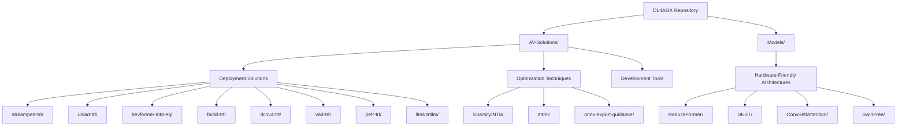
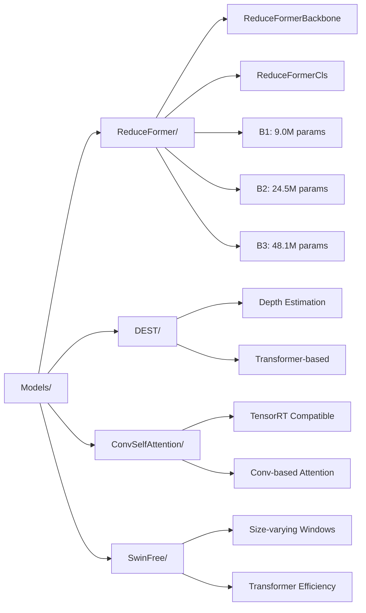
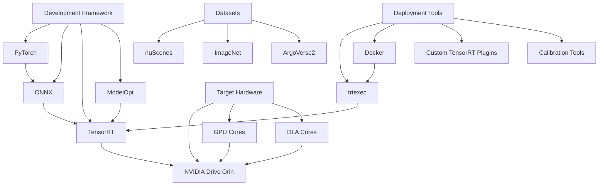
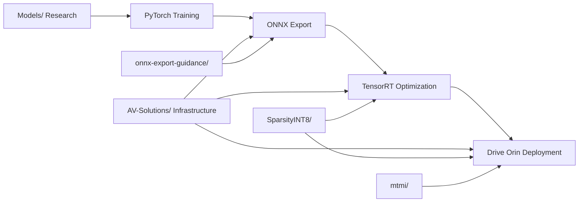

<!-- source: DeepWiki mcp.deepwiki.com · repo NVIDIA/DL4AGX · page 1 Overview · fetched 2026-10-26 -->

# Overview

Relevant source files

The following files were used as context for generating this wiki page:

- [AV-Solutions/README.md](AV-Solutions/README.md)
- [README.md](README.md)

## Purpose and Scope

This document provides an overview of the DL4AGX repository, which contains model designs, deployment solutions for state-of-the-art networks, and inference samples for Autonomous Vehicle (AV) applications on NVIDIA DRIVE platforms. The repository is organized into two main components: deployment solutions (`AV-Solutions/`) and hardware-friendly model architectures (`Models/`).

For detailed information about specific deployment solutions, see [AV-Solutions: Deployment Solutions](#2). For information about efficient model architectures, see [Models: Efficient Architectures](#3).

## Repository Architecture

DL4AGX follows a two-branch architecture that separates research from deployment, enabling both the development of efficient models and their practical deployment on automotive hardware.

### High-Level Architecture

**Sources:** [README.md:1-27](), [AV-Solutions/README.md:1-37]()

## AV-Solutions: Deployment Branch

The `AV-Solutions/` directory contains deployment solutions for state-of-the-art autonomous vehicle models, focusing on TensorRT optimization and NVIDIA Drive platform deployment. This branch implements a common deployment pipeline that transforms PyTorch models into optimized TensorRT engines.

### Deployment Categories

| Category | Solutions | Purpose |
|----------|-----------|---------|
| 3D Object Detection | `far3d-trt/`, `vad-trt/`, `petr-trt/`, `streampetr-trt/` | Deploy 3D detection models with TensorRT |
| BEV Perception | `bevformer-int8-eq/` | BEV perception with explicit quantization |
| End-to-End Driving | `uniad-trt/` | Unified autonomous driving pipeline |
| Language Models | `llms-trtllm/` | LLM deployment with TensorRT-LLM |
| Specialized Components | `dcnv4-trt/` | Deformable convolution optimization |

### Optimization Techniques

| Technique | Implementation | Description |
|-----------|----------------|-------------|
| Quantization | `SparsityINT8/`, `bevformer-int8-eq/` | INT8 quantization and explicit quantization |
| Multi-device Inference | `mtmi/` | GPU and DLA parallel execution |
| ONNX Export | `onnx-export-guidance/` | TensorRT-friendly model export |

**Sources:** [AV-Solutions/README.md:1-37](), [README.md:8-20]()

## Models: Efficient Architectures Branch

The `Models/` directory provides hardware-friendly model architectures designed for improved accuracy, faster inference, and better resource utilization on edge devices.

### Model Architecture Overview

**Sources:** [README.md:21-25]()

## Target Platform and Technology Stack

### Hardware Platform

The repository primarily targets **NVIDIA Drive Orin** platforms, which provide:
- GPU cores for FP16/FP32 inference
- DLA (Deep Learning Accelerator) cores for INT8 inference
- Multi-device parallel execution capabilities

### Technology Stack

**Sources:** [AV-Solutions/README.md:1-37]()

## Development Workflow

### Standard Deployment Pipeline

The repository implements a consistent workflow across all deployment solutions:

1. **Model Development**: Start with PyTorch implementations
2. **ONNX Export**: Convert models using TorchScript-based ONNX exporter
3. **Optimization**: Apply quantization, sparsity, and other optimizations
4. **TensorRT Conversion**: Build optimized TensorRT engines
5. **Platform Deployment**: Deploy on NVIDIA Drive Orin hardware

### Cross-System Integration

This workflow enables seamless integration between the research-focused `Models/` directory and the deployment-focused `AV-Solutions/` directory, providing a complete development and deployment ecosystem for autonomous vehicle deep learning applications.

**Sources:** [README.md:1-27](), [AV-Solutions/README.md:4-11]()

---

