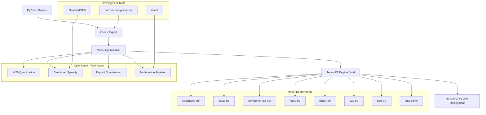
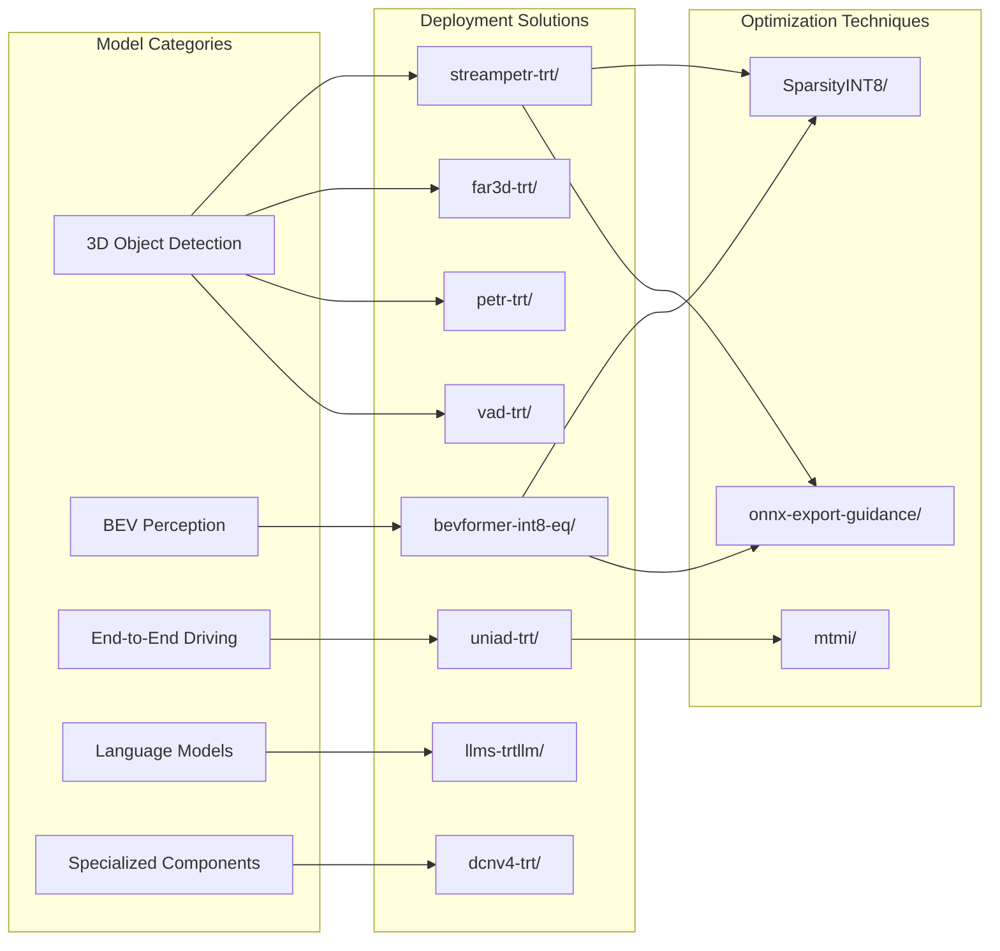
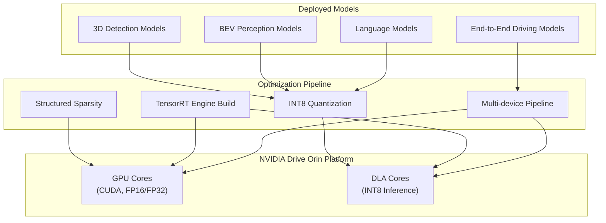

<!-- source: DeepWiki mcp.deepwiki.com · repo NVIDIA/DL4AGX · page 2 AV-Solutions: Deployment Solutions · fetched 2026-10-26 -->

# AV-Solutions: Deployment Solutions

Relevant source files

The following files were used as context for generating this wiki page:

- [AV-Solutions/README.md](AV-Solutions/README.md)
- [README.md](README.md)

## Purpose and Scope

The AV-Solutions directory provides deployment solutions for state-of-the-art autonomous vehicle models on NVIDIA DRIVE platforms using TensorRT. This system encompasses model optimization techniques, hardware-specific deployment pipelines, and inference applications designed for production autonomous vehicle systems.

This document covers the overall architecture and organization of deployment solutions. For detailed information about efficient model architectures designed for deployment, see [Models: Efficient Architectures](#3). For specific deployment workflows and implementation details of individual solutions, refer to the respective subsection pages [2.1](#2.1) through [2.7](#2.7).

## System Architecture

### Overall Deployment Pipeline

Sources: [AV-Solutions/README.md:1-37](), [README.md:8-19]()

### Model Categories and Solutions Mapping

Sources: [AV-Solutions/README.md:13-35]()

## Deployment Solutions Overview

The AV-Solutions system is organized into three main categories: model-specific deployment solutions, optimization techniques, and development tools.

### Model-Specific Deployments

| Solution | Target Model | Primary Focus | Hardware Target |
|----------|--------------|---------------|-----------------|
| `streampetr-trt/` | [StreamPETR](https://github.com/exiawsh/StreamPETR) | 3D Object Detection | NVIDIA Drive Orin |
| `uniad-trt/` | [UniAD](https://arxiv.org/abs/2212.10156) | End-to-End Autonomous Driving | NVIDIA Drive Orin |
| `dcnv4-trt/` | [DCNv4](https://github.com/OpenGVLab/DCNv4) | Deformable Convolution Optimization | NVIDIA Drive Orin |
| `bevformer-int8-eq/` | [BEVFormer](https://github.com/fundamentalvision/BEVFormer) | BEV Perception with INT8 | NVIDIA GPUs |
| `far3d-trt/` | [Far3D](https://github.com/megvii-research/Far3D) | 3D Object Detection | NVIDIA Drive Orin |
| `llms-trtllm/` | Llama-3.1-8B, DeepSeek-R1 | Large Language Models | NVIDIA Drive Orin |
| `vad-trt/` | [VADv1](https://github.com/hustvl/VAD) | Vector-based Autonomous Driving | NVIDIA Drive Orin |
| `petr-trt/` | [PETRv1&v2](https://github.com/megvii-research/PETR) | 3D Object Detection | NVIDIA Drive Orin |

Sources: [AV-Solutions/README.md:13-35]()

### Optimization Techniques and Tools

| Component | Purpose | Key Features |
|-----------|---------|--------------|
| `SparsityINT8/` | Combines structured sparsity with INT8 quantization | PyTorch training workflow, TensorRT inference |
| `mtmi/` | Multi-task model inference across GPU and DLA | Simultaneous GPU/DLA deployment |
| `onnx-export-guidance/` | ONNX export best practices | TorchScript-based export guidance |

Sources: [AV-Solutions/README.md:4-11]()

## Hardware Architecture and Optimization

### NVIDIA Drive Orin Deployment Strategy

Sources: [AV-Solutions/README.md:10-11](), [AV-Solutions/README.md:22-35]()

## Technology Stack Integration

The deployment solutions leverage a consistent technology stack across all model implementations:

- **Framework Pipeline**: PyTorch → ONNX → TensorRT → NVIDIA Drive Orin
- **Optimization Methods**: INT8 quantization, structured sparsity, explicit quantization
- **Hardware Utilization**: GPU and DLA acceleration with multi-device inference
- **Development Support**: Docker environments, custom TensorRT plugins, calibration tools

The system provides both model-specific optimization examples and general-purpose tools for deploying autonomous vehicle deep learning models in production environments.

Sources: [AV-Solutions/README.md:1-37](), [README.md:5-19]()

---

