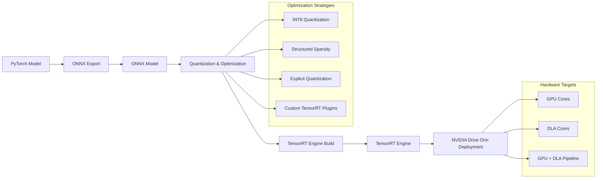
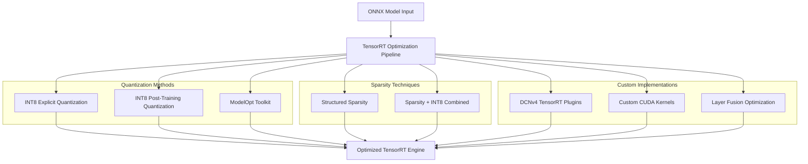
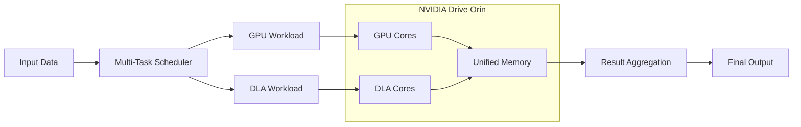

<!-- source: DeepWiki mcp.deepwiki.com · repo NVIDIA/DL4AGX · page 2.1 Deployment Architecture and Workflow · fetched 2026-10-26 -->

# Deployment Architecture and Workflow

Relevant source files

The following files were used as context for generating this wiki page:

- [AV-Solutions/README.md](AV-Solutions/README.md)
- [README.md](README.md)

## Purpose and Scope

This document describes the common deployment architecture and workflow used across all AV-Solutions in the DL4AGX repository. It covers the standardized pipeline for converting PyTorch models to TensorRT engines optimized for NVIDIA Drive Orin platforms, including optimization strategies, hardware targeting approaches, and supporting infrastructure.

For specific deployment implementations, see the individual solution pages under section 2. For hardware-friendly model architectures that can be deployed using this workflow, see [Models: Efficient Architectures](#3).

## Overall Deployment Architecture

The deployment architecture follows a standardized pipeline that transforms PyTorch models into optimized TensorRT engines for autonomous vehicle applications.

### Core Deployment Pipeline

Sources: [AV-Solutions/README.md:1-37](), [README.md:1-27]()

## Core Workflow Stages

### PyTorch to ONNX Export

The first stage converts PyTorch models to ONNX format using TorchScript-based exporters. This critical step requires careful handling of complex AV model architectures to ensure TensorRT compatibility.

| Component | Description | Reference |
|-----------|-------------|-----------|
| Export Guidance | Comprehensive tips for TensorRT-friendly ONNX export | `onnx-export-guidance/` |
| TorchScript Exporter | PyTorch's built-in ONNX exporter | External dependency |
| Model Preprocessing | Architecture-specific preparations | Per-solution implementation |

**Common Export Challenges:**
- Complex attention mechanisms in transformer-based models
- Custom layer implementations requiring plugin support
- Dynamic shape handling for variable input sizes
- Maintaining numerical precision during conversion

Sources: [AV-Solutions/README.md:4-5]()

### TensorRT Optimization

The optimization stage applies various techniques to improve inference performance while maintaining model accuracy.

Sources: [AV-Solutions/README.md:7-8](), [AV-Solutions/README.md:19-20](), [AV-Solutions/README.md:22-23]()

### Hardware Deployment

The final stage deploys optimized engines to NVIDIA Drive Orin hardware, targeting specific compute units based on model requirements and performance constraints.

| Deployment Target | Use Cases | Optimization Focus |
|------------------|-----------|-------------------|
| GPU Cores | High-throughput inference, FP16/FP32 precision | Memory bandwidth, compute intensity |
| DLA Cores | Power-efficient INT8 inference | Energy efficiency, structured operations |
| Multi-device Pipeline | Complex multi-task models | Load balancing, synchronization |

Sources: [AV-Solutions/README.md:10-11]()

## Optimization Strategies

### Quantization Approaches

The repository implements multiple quantization strategies depending on model architecture and accuracy requirements:

**INT8 Explicit Quantization**: Used in solutions like `bevformer-int8-eq` for precise control over quantization parameters.

**Sparsity with INT8**: Combines structured sparsity and quantization as demonstrated in `SparsityINT8/` for maximum efficiency.

**ModelOpt Integration**: Leverages NVIDIA's ModelOpt toolkit for automated quantization workflows.

Sources: [AV-Solutions/README.md:22-23](), [AV-Solutions/README.md:7-8]()

### Custom Plugin Development

Several solutions implement custom TensorRT plugins for operations not natively supported:

| Solution | Custom Plugin | Purpose |
|----------|---------------|---------|
| `dcnv4-trt` | Deformable Convolution v4 | Optimized DCNv4 operations |
| `streampetr-trt` | StreamPETR-specific | Temporal feature aggregation |
| `uniad-trt` | UniAD components | End-to-end driving pipeline |

Sources: [AV-Solutions/README.md:19-20](), [AV-Solutions/README.md:13-14](), [AV-Solutions/README.md:16-17]()

## Hardware Targeting

### NVIDIA Drive Orin Platform

All deployment solutions target the NVIDIA Drive Orin platform, which provides:

- **GPU Cores**: High-performance compute for complex models
- **DLA Cores**: Dedicated deep learning accelerators for efficient inference
- **Unified Memory Architecture**: Optimized data movement between compute units

### Multi-Device Inference

The `mtmi/` solution demonstrates advanced multi-device deployment:

Sources: [AV-Solutions/README.md:10-11]()

## Infrastructure Components

### Development Environment

The deployment workflow relies on several infrastructure components:

| Component | Purpose | Implementation |
|-----------|---------|----------------|
| Docker Environments | Consistent build environments | Per-solution Dockerfiles |
| `trtexec` Tool | TensorRT engine building and benchmarking | NVIDIA TensorRT toolkit |
| Calibration Data | INT8 quantization calibration | Dataset-specific implementations |
| Build Systems | Automated compilation and deployment | CMake-based build scripts |

### Model-Specific Solutions

Each AV-Solution provides a complete implementation of this deployment architecture:

- **3D Object Detection**: `far3d-trt`, `vad-trt`, `petr-trt`
- **BEV Perception**: `bevformer-int8-eq`
- **End-to-End Driving**: `uniad-trt`
- **Language Models**: `llms-trtllm`
- **Temporal Processing**: `streampetr-trt`

Sources: [AV-Solutions/README.md:25-36](), [AV-Solutions/README.md:28-29]()

The deployment architecture provides a standardized yet flexible framework that accommodates the diverse requirements of autonomous vehicle deep learning models while maintaining consistent optimization and deployment practices across all solutions.

---

