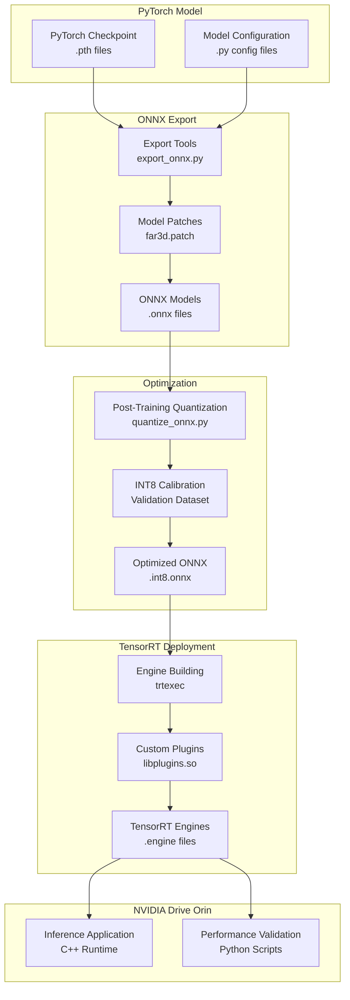
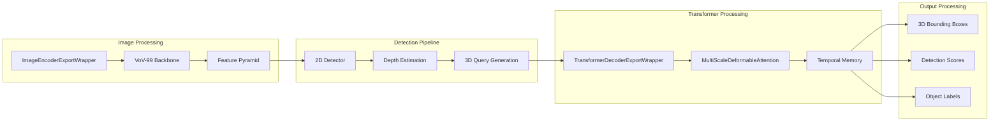
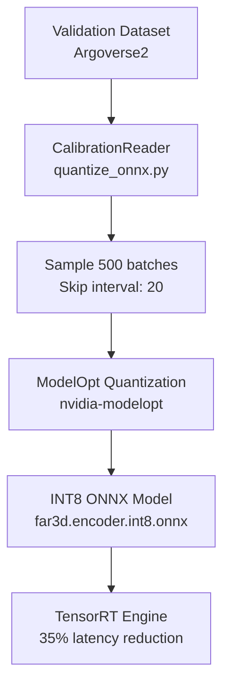
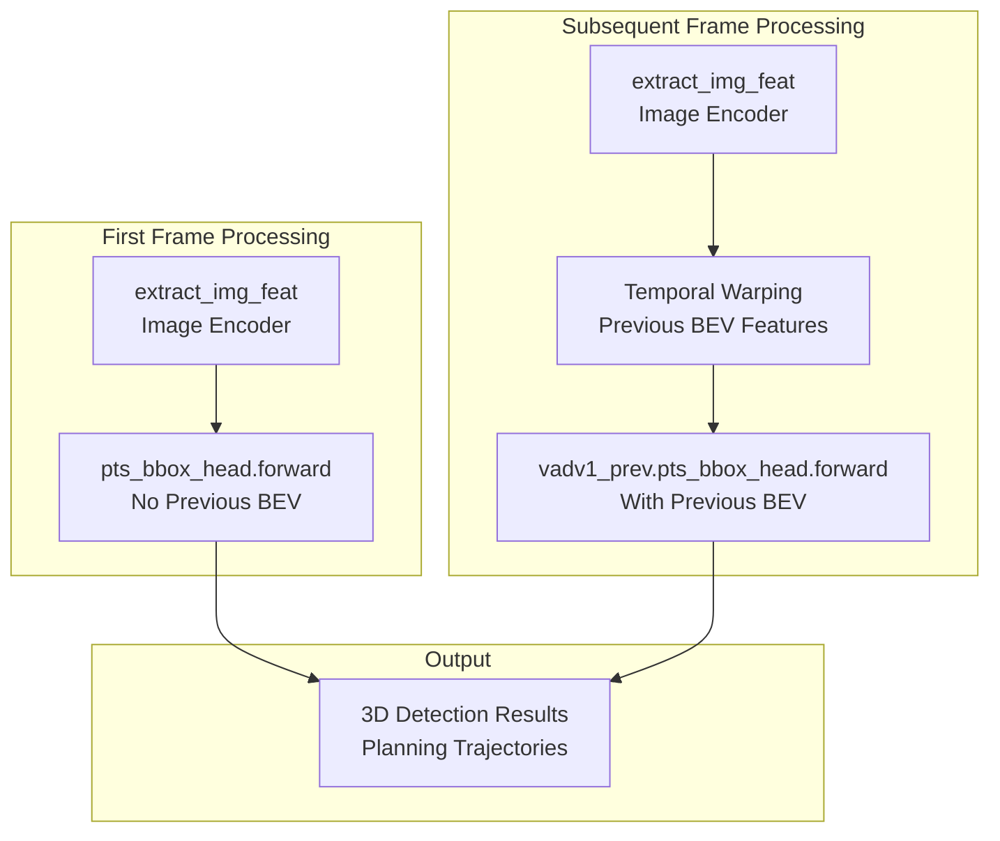
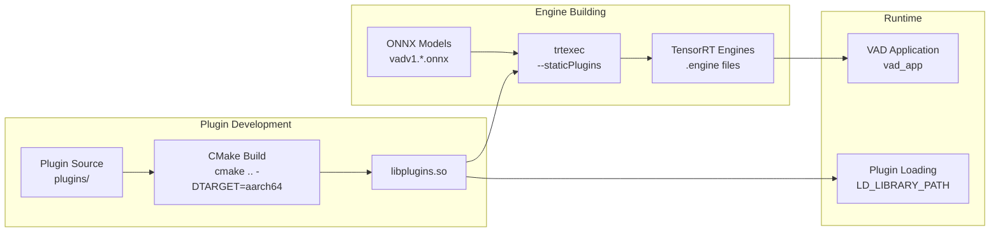
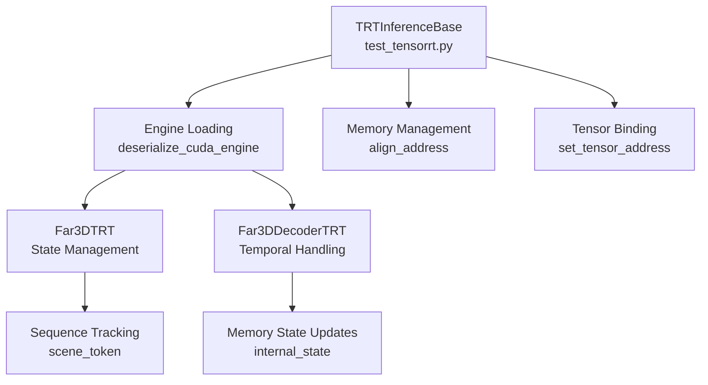

<!-- source: DeepWiki mcp.deepwiki.com · repo NVIDIA/DL4AGX · page 2.2 3D Object Detection Solutions · fetched 2026-10-26 -->

# 3D Object Detection Solutions

Relevant source files

The following files were used as context for generating this wiki page:

- [AV-Solutions/far3d-trt/README.md](AV-Solutions/far3d-trt/README.md)
- [AV-Solutions/far3d-trt/docker/Dockerfile](AV-Solutions/far3d-trt/docker/Dockerfile)
- [AV-Solutions/far3d-trt/patch/far3d.patch](AV-Solutions/far3d-trt/patch/far3d.patch)
- [AV-Solutions/far3d-trt/tools/export_onnx.py](AV-Solutions/far3d-trt/tools/export_onnx.py)
- [AV-Solutions/far3d-trt/tools/quantize_onnx.py](AV-Solutions/far3d-trt/tools/quantize_onnx.py)
- [AV-Solutions/far3d-trt/tools/test_tensorrt.py](AV-Solutions/far3d-trt/tools/test_tensorrt.py)
- [AV-Solutions/vad-trt/.gitignore](AV-Solutions/vad-trt/.gitignore)
- [AV-Solutions/vad-trt/LICENSE](AV-Solutions/vad-trt/LICENSE)
- [AV-Solutions/vad-trt/README.md](AV-Solutions/vad-trt/README.md)
- [AV-Solutions/vad-trt/app/.gitignore](AV-Solutions/vad-trt/app/.gitignore)
- [AV-Solutions/vad-trt/app/CMakeLists.txt](AV-Solutions/vad-trt/app/CMakeLists.txt)
- [AV-Solutions/vad-trt/app/demo/.gitignore](AV-Solutions/vad-trt/app/demo/.gitignore)
- [AV-Solutions/vad-trt/app/demo/config.json](AV-Solutions/vad-trt/app/demo/config.json)
- [AV-Solutions/vad-trt/app/demo/data/.gitkeep](AV-Solutions/vad-trt/app/demo/data/.gitkeep)
- [AV-Solutions/vad-trt/app/demo/onnx_files/.gitkeep](AV-Solutions/vad-trt/app/demo/onnx_files/.gitkeep)
- [AV-Solutions/vad-trt/app/lib/check.hpp](AV-Solutions/vad-trt/app/lib/check.hpp)

This page documents the deployment solutions for 3D object detection models in the AV-Solutions directory. The solutions provide optimized TensorRT implementations of state-of-the-art 3D detection models for deployment on NVIDIA Drive Orin platforms.

For general deployment architecture and workflow information, see [Deployment Architecture and Workflow](#2.1). For end-to-end driving solutions that include planning capabilities, see [End-to-End Driving Solutions](#2.4).

## Overview

The 3D object detection solutions implement two primary models:

| Model | Type | Key Features | Target Dataset |
|-------|------|--------------|----------------|
| Far3D | Camera-only 3D Detection | 2D detector initialization, perspective-aware feature aggregation | Argoverse2 |
| VAD | End-to-end Vectorized Detection | Temporal modeling, vectorized scene representation | nuScenes |

Both solutions follow the standard deployment pipeline from PyTorch models to optimized TensorRT engines running on NVIDIA Drive Orin hardware.

## Deployment Architecture

The 3D object detection deployment follows a common multi-stage architecture:

**Sources:** [AV-Solutions/far3d-trt/README.md:25-89](), [AV-Solutions/vad-trt/README.md:47-64]()

## Far3D TensorRT Implementation

Far3D implements camera-only 3D object detection using adaptive query mechanisms and multi-scale deformable attention.

### Model Architecture Components

**Sources:** [AV-Solutions/far3d-trt/tools/export_onnx.py:186-236](), [AV-Solutions/far3d-trt/tools/export_onnx.py:239-303]()

### Export Workflow

The Far3D export process involves two main wrapper classes:

- **`ImageEncoderExportWrapper`**: Handles image feature extraction and 2D detection
- **`TransformerDecoderExportWrapper`**: Manages 3D query processing and temporal memory

Key export steps:

1. **Model Preparation**: Load checkpoint and apply patches from [AV-Solutions/far3d-trt/patch/far3d.patch:1-28327]()
2. **ONNX Export**: Export encoder and decoder separately using [AV-Solutions/far3d-trt/tools/export_onnx.py:452-504]()
3. **MSDA Plugin Patching**: Apply multi-scale deformable attention fixes via [AV-Solutions/far3d-trt/tools/export_onnx.py:353-393]()

### Quantization Support

Far3D supports INT8 quantization for the image encoder:

**Sources:** [AV-Solutions/far3d-trt/tools/quantize_onnx.py:64-80](), [AV-Solutions/far3d-trt/tools/quantize_onnx.py:143-149]()

### Performance Results

| Precision | Framework | GPU Compute Time (ms) | Accuracy (mAP) |
|-----------|-----------|----------------------|----------------|
| FP32 + FP32 | PyTorch 1.13.1 | 730.0 | 0.241 |
| FP16 + FP32 | TensorRT 8.6 | 367.4 | 0.233 |
| FP16 + FP16 | TensorRT 10.9 | 203.9 | 0.232 |
| INT8 + FP16 | TensorRT 10.9 | 132.3 | 0.230 |

**Sources:** [AV-Solutions/far3d-trt/README.md:177-185]()

## VAD TensorRT Implementation

VAD (Vectorized Scene Representation for Efficient Autonomous Driving) implements an end-to-end approach with temporal modeling.

### Temporal Model Architecture

VAD handles temporal sequences differently for first and subsequent frames:

**Sources:** [AV-Solutions/vad-trt/README.md:54-64]()

### Custom Plugin System

VAD requires custom TensorRT plugins for specialized operations:

**Sources:** [AV-Solutions/vad-trt/README.md:134-143](), [AV-Solutions/vad-trt/README.md:204-221]()

### Demo Application

VAD includes a complete C++ inference application:

- **Configuration**: JSON-based setup via [AV-Solutions/vad-trt/app/demo/config.json:1-33]()
- **Visualization**: Integration with cuOSD for result rendering
- **Multi-engine Support**: Separate backbone and head engines

## Common Code Patterns

### TensorRT Inference Base Class

Both solutions utilize common inference patterns through the `TRTInferenceBase` class:

**Sources:** [AV-Solutions/far3d-trt/tools/test_tensorrt.py:142-230](), [AV-Solutions/far3d-trt/tools/test_tensorrt.py:232-296]()

### Memory State Management

Both Far3D and VAD implement temporal memory management:

- **State Variables**: `memory_embedding`, `memory_reference_point`, `memory_timestamp`, `memory_egopose`, `memory_velo`
- **Sequence Reset**: Triggered by scene token changes
- **State Persistence**: Maintained across frames within sequences

**Sources:** [AV-Solutions/far3d-trt/tools/export_onnx.py:237](), [AV-Solutions/far3d-trt/tools/test_tensorrt.py:244-246]()

## Deployment Considerations

### Hardware Requirements
- **Target Platform**: NVIDIA Drive Orin
- **TensorRT Versions**: 8.6.13.3 (VAD), 8.6/10.9 (Far3D)
- **Memory Alignment**: 256-byte boundary requirements for tensor addresses

### Build Dependencies
- **Cross-compilation**: NVIDIA DRIVE SDK docker images
- **Plugin Support**: Custom operation implementations
- **Dataset Access**: Argoverse2 (Far3D), nuScenes (VAD)

**Sources:** [AV-Solutions/far3d-trt/README.md:99-114](), [AV-Solutions/vad-trt/README.md:122-133]()

---

