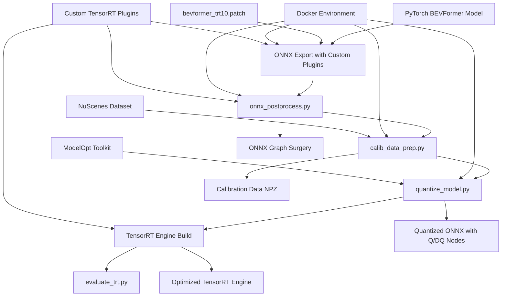
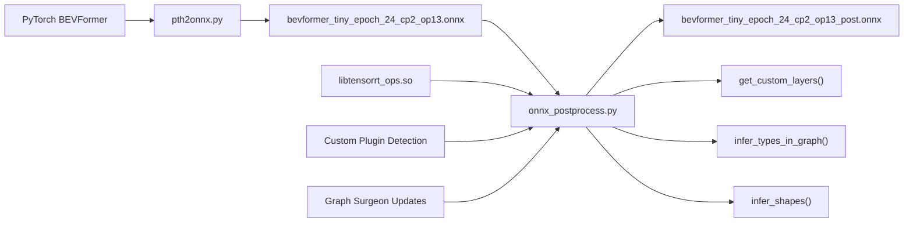
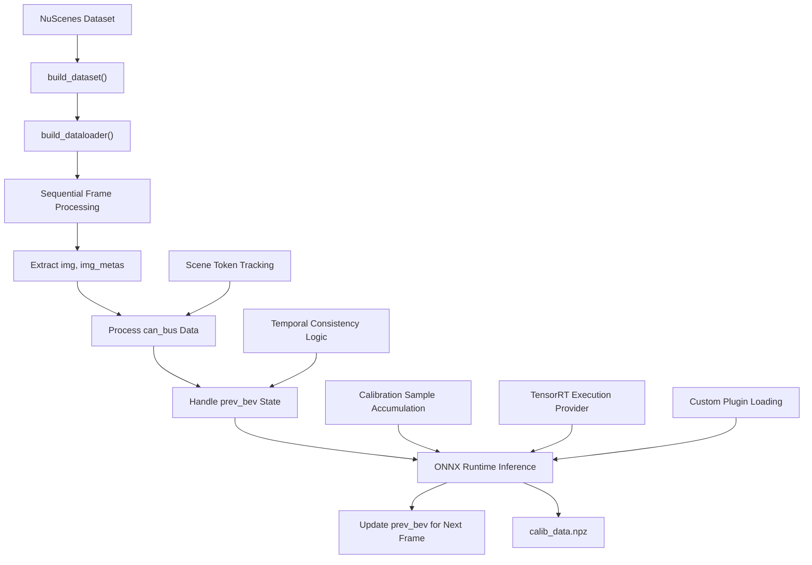
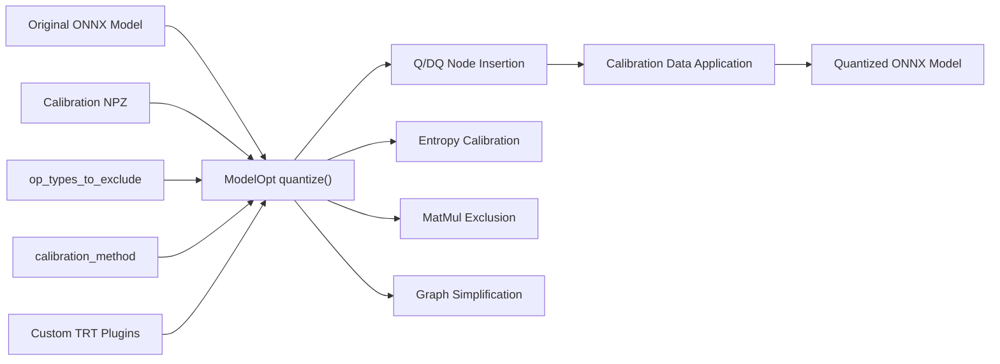
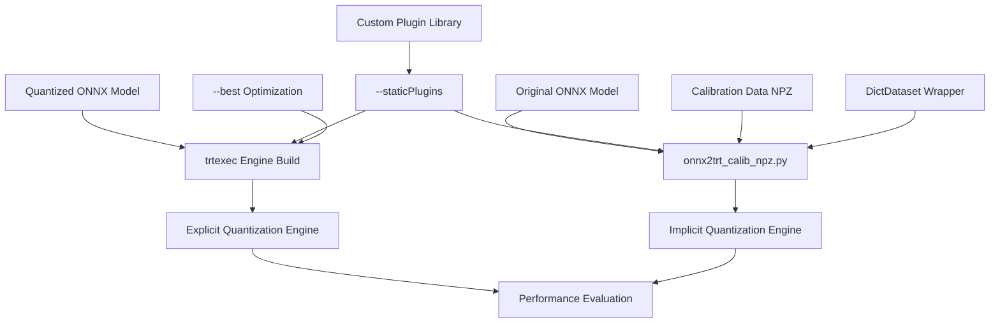
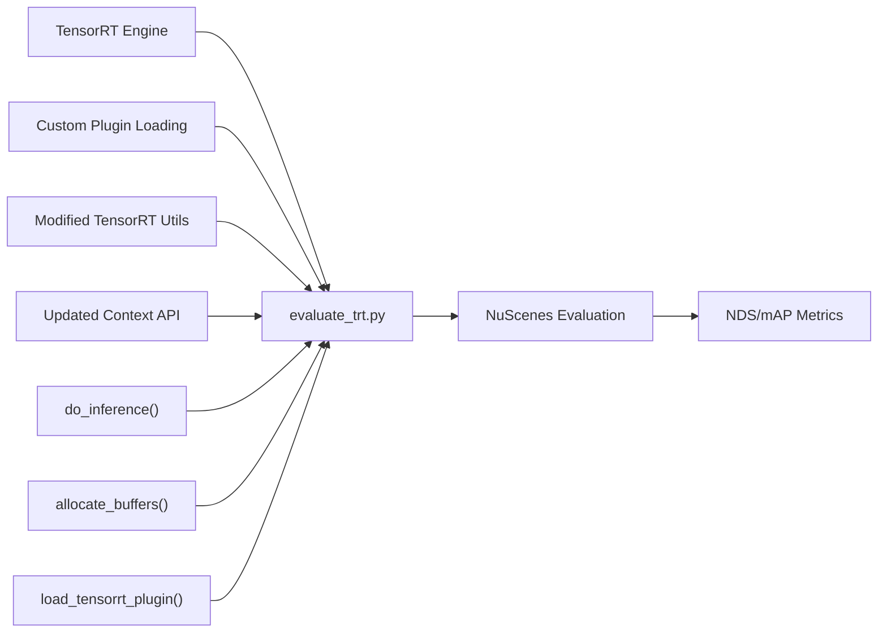

<!-- source: DeepWiki mcp.deepwiki.com · repo NVIDIA/DL4AGX · page 2.3 BEV Perception Solutions · fetched 2026-10-26 -->

# BEV Perception Solutions

Relevant source files

The following files were used as context for generating this wiki page:

- [AV-Solutions/bevformer-int8-eq/LICENSE](AV-Solutions/bevformer-int8-eq/LICENSE)
- [AV-Solutions/bevformer-int8-eq/README.md](AV-Solutions/bevformer-int8-eq/README.md)
- [AV-Solutions/bevformer-int8-eq/bevformer_trt10.patch](AV-Solutions/bevformer-int8-eq/bevformer_trt10.patch)
- [AV-Solutions/bevformer-int8-eq/docker/tensorrt.Dockerfile](AV-Solutions/bevformer-int8-eq/docker/tensorrt.Dockerfile)
- [AV-Solutions/bevformer-int8-eq/results/deploy_trt.sh](AV-Solutions/bevformer-int8-eq/results/deploy_trt.sh)
- [AV-Solutions/bevformer-int8-eq/results/evaluate_trt.sh](AV-Solutions/bevformer-int8-eq/results/evaluate_trt.sh)
- [AV-Solutions/bevformer-int8-eq/results/onnx2trt_calib_npz.py](AV-Solutions/bevformer-int8-eq/results/onnx2trt_calib_npz.py)
- [AV-Solutions/bevformer-int8-eq/tools/calib_data_prep.py](AV-Solutions/bevformer-int8-eq/tools/calib_data_prep.py)
- [AV-Solutions/bevformer-int8-eq/tools/onnx_postprocess.py](AV-Solutions/bevformer-int8-eq/tools/onnx_postprocess.py)
- [AV-Solutions/bevformer-int8-eq/tools/quantize_model.py](AV-Solutions/bevformer-int8-eq/tools/quantize_model.py)

This document covers the deployment of BEVFormer models using explicit quantization techniques with NVIDIA's ModelOpt Toolkit for TensorRT optimization. The solution provides an end-to-end workflow from PyTorch model export to TensorRT engine deployment with INT8 quantization for improved inference performance on NVIDIA Drive platforms.

For information about other 3D object detection solutions, see [3D Object Detection Solutions](#2.2). For end-to-end driving solutions, see [End-to-End Driving Solutions](#2.4).

## Overview and Architecture

The BEV Perception Solutions system implements a comprehensive deployment pipeline for BEVFormer models, focusing on explicit quantization using the ModelOpt toolkit. This approach provides better control over quantization placement compared to implicit TensorRT quantization methods.

### Deployment Workflow

Sources: [AV-Solutions/bevformer-int8-eq/README.md:1-152]()

### Key Components and Dependencies

The system relies on several critical components working together:

| Component | Purpose | Key Files |
|-----------|---------|-----------|
| ONNX Post-processing | Handle custom TensorRT plugins and graph updates | `tools/onnx_postprocess.py` |
| Calibration Data Preparation | Generate representative data for quantization | `tools/calib_data_prep.py` |
| Model Quantization | Apply explicit quantization with ModelOpt | `tools/quantize_model.py` |
| TensorRT Engine Building | Create optimized inference engines | `results/onnx2trt_calib_npz.py` |
| Accuracy Evaluation | Validate deployment results | Modified evaluation scripts |

Sources: [AV-Solutions/bevformer-int8-eq/README.md:5-11](), [AV-Solutions/bevformer-int8-eq/tools/onnx_postprocess.py:1-266](), [AV-Solutions/bevformer-int8-eq/tools/calib_data_prep.py:1-165]()

## ONNX Export and Post-processing

### Custom Plugin Integration

The ONNX export process requires careful handling of custom TensorRT plugins used in BEVFormer architecture. The `onnx_postprocess.py` tool automatically detects and configures these plugins for ONNX Runtime compatibility.

The `get_custom_layers()` function in `onnx_postprocess.py` performs TensorRT network parsing to identify custom plugin layers:

- Loads custom plugin libraries using `ctypes.CDLL()`
- Creates TensorRT builder and network for ONNX parsing
- Identifies layers with `"PLUGIN"` type designation
- Extracts tensor shapes and names for graph surgery

Sources: [AV-Solutions/bevformer-int8-eq/tools/onnx_postprocess.py:43-91](), [AV-Solutions/bevformer-int8-eq/README.md:58-69]()

### Graph Surgery Operations

The post-processing pipeline performs three critical operations:

1. **Custom Op Domain Assignment**: Updates custom operations to use `trt.plugins` domain for ONNX Runtime compatibility
2. **Type Inference**: Ensures all tensors have appropriate data types using `infer_types_in_graph()`
3. **Shape Inference**: Updates tensor shapes throughout the graph using `infer_shapes()`

Sources: [AV-Solutions/bevformer-int8-eq/tools/onnx_postprocess.py:94-200](), [AV-Solutions/bevformer-int8-eq/tools/onnx_postprocess.py:217-246]()

## Calibration Data Generation

### Dataset Processing Pipeline

The calibration data preparation uses the NuScenes dataset to generate representative input samples for quantization. The `calib_data_prep.py` script implements a sophisticated data processing pipeline that maintains temporal consistency across BEV sequences.

The calibration process maintains temporal consistency by tracking scene tokens and managing `prev_bev` state transitions:

- Uses `use_prev_bev` flag to handle scene boundaries
- Processes CAN bus data for ego vehicle motion
- Accumulates 600 calibration samples by default
- Executes ONNX Runtime to maintain BEV feature continuity

Sources: [AV-Solutions/bevformer-int8-eq/tools/calib_data_prep.py:63-161](), [AV-Solutions/bevformer-int8-eq/README.md:71-78]()

### Data Format and Structure

The calibration data is stored in NPZ format containing the following tensors:

| Input Name | Shape | Description |
|------------|-------|-------------|
| `image` | `[N, 6, 3, 256, 704]` | Multi-camera input images |
| `prev_bev` | `[N, 40000, 1, 256]` | Previous BEV feature embeddings |
| `use_prev_bev` | `[N, 1]` | Flag for temporal continuity |
| `can_bus` | `[N, 18]` | Vehicle motion and pose data |
| `lidar2img` | `[N, 1, 6, 4, 4]` | Camera calibration matrices |

Sources: [AV-Solutions/bevformer-int8-eq/tools/calib_data_prep.py:130-136]()

## ModelOpt Quantization Process

### Explicit Quantization Workflow

The `quantize_model.py` script implements explicit quantization using NVIDIA's ModelOpt toolkit, providing precise control over quantization placement through Q/DQ (Quantize/Dequantize) node insertion.

Key quantization parameters:

- **Calibration Method**: Uses entropy-based calibration for optimal threshold selection
- **Operation Exclusion**: Excludes `MatMul` operations from quantization to preserve transformer accuracy
- **Plugin Support**: Maintains compatibility with custom TensorRT plugins
- **Graph Simplification**: Optional ONNX graph optimization

Sources: [AV-Solutions/bevformer-int8-eq/tools/quantize_model.py:84-102](), [AV-Solutions/bevformer-int8-eq/README.md:84-103]()

### Quantization Strategy

The explicit quantization approach provides several advantages over implicit TensorRT quantization:

1. **Controlled Placement**: Q/DQ nodes explicitly define quantization boundaries
2. **Operator Selection**: Fine-grained control over which operations to quantize
3. **Calibration Transparency**: Clear visibility into calibration data usage
4. **Cross-platform Compatibility**: Quantized models work across different TensorRT versions

The system specifically excludes `MatMul` operations from quantization based on NVIDIA's recommendation for transformer-based models, where multi-head attention blocks perform better in FP16 precision.

Sources: [AV-Solutions/bevformer-int8-eq/README.md:95-98]()

## TensorRT Engine Optimization

### Engine Building Process

The TensorRT engine building process supports both explicit and implicit quantization approaches for performance comparison:

The explicit quantization path uses standard `trtexec` with the pre-quantized ONNX model, while implicit quantization uses a custom calibrator implementation in `onnx2trt_calib_npz.py`.

Sources: [AV-Solutions/bevformer-int8-eq/README.md:105-114](), [AV-Solutions/bevformer-int8-eq/results/onnx2trt_calib_npz.py:104-153]()

### Custom Calibrator Implementation

The `DictDataset` class in `onnx2trt_calib_npz.py` wraps calibration data for TensorRT's implicit quantization:

- Implements PyTorch `Dataset` interface for TensorRT calibrator
- Handles dynamic batch sizing based on input shapes
- Manages multi-input tensor formatting for BEVFormer requirements
- Provides data streaming for calibration process

The calibrator decodes input tensors with specific handling for BEVFormer's multi-modal inputs: `image`, `prev_bev`, `use_prev_bev`, `can_bus`, and `lidar2img`.

Sources: [AV-Solutions/bevformer-int8-eq/results/onnx2trt_calib_npz.py:77-133]()

## Performance Results and Evaluation

### Quantization Performance Comparison

The deployment achieves significant performance improvements through quantization while maintaining accuracy:

| Precision | GPU Compute Time (ms) | Accuracy (NDS / mAP) |
|-----------|----------------------|---------------------|
| FP32 | 18.82 | NDS: 0.354, mAP: 0.252 |
| FP16 | 9.36 | NDS: 0.354, mAP: 0.251 |
| TensorRT PTQ (Implicit) | 6.20 | NDS: 0.353, mAP: 0.250 |
| ModelOpt PTQ (Explicit) | 6.02 | NDS: 0.352, mAP: 0.251 |

The explicit quantization approach achieves slightly better performance than implicit quantization while maintaining comparable accuracy.

Sources: [AV-Solutions/bevformer-int8-eq/README.md:126-147]()

### Evaluation Infrastructure

The accuracy evaluation uses modified scripts that integrate with the TensorRT deployment:

The evaluation infrastructure includes updates for TensorRT 10 compatibility, with modified memory allocation and execution APIs in the utility functions.

Sources: [AV-Solutions/bevformer-int8-eq/results/evaluate_trt.sh:1-56](), [AV-Solutions/bevformer-int8-eq/bevformer_trt10.patch:509-620]()

## TensorRT 10 Compatibility

### Plugin Interface Updates

The `bevformer_trt10.patch` file addresses compatibility changes in TensorRT 10, primarily related to data type handling and plugin interfaces:

- Updates integer type definitions using conditional compilation
- Modifies plugin kernel signatures for TensorRT 10 compatibility
- Handles changes in tensor address management
- Updates execution context API usage

Key changes include the introduction of `TRT_INT_TYPE` typedef for handling int32/int64 differences across TensorRT versions and updates to plugin kernel function signatures.

Sources: [AV-Solutions/bevformer-int8-eq/bevformer_trt10.patch:1-620]()

### Docker Environment

The Docker environment provides a controlled deployment platform with all necessary dependencies:

- TensorRT 24.08 base image with CUDA 12 support
- ModelOpt toolkit 0.27.1 for quantization
- Custom compilation of BEVFormer TensorRT plugins
- Integration with MMDetection and MMCV frameworks

The environment ensures reproducible deployment across different systems while managing complex dependency requirements.

Sources: [AV-Solutions/bevformer-int8-eq/docker/tensorrt.Dockerfile:1-101]()

---

