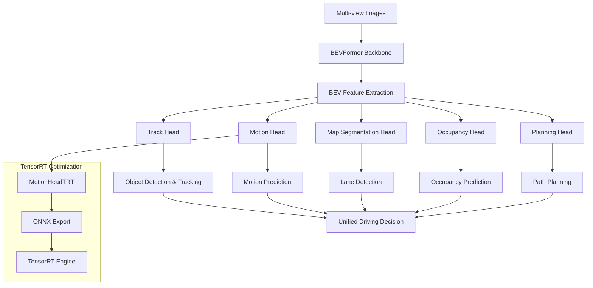
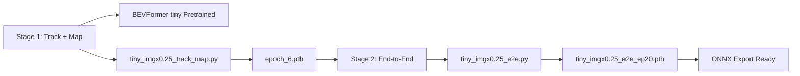
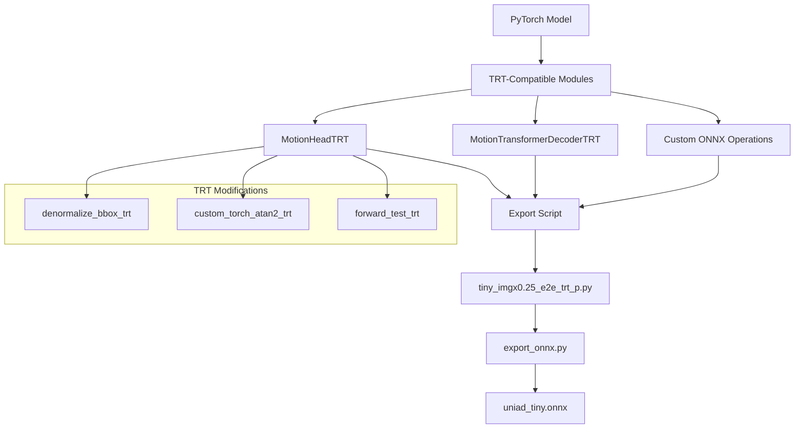
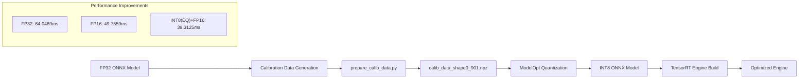
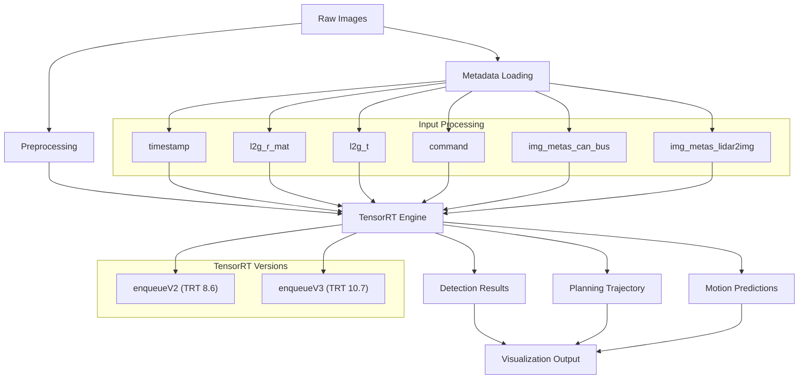

<!-- source: DeepWiki mcp.deepwiki.com · repo NVIDIA/DL4AGX · page 2.4 End-to-End Driving Solutions · fetched 2026-10-26 -->

# End-to-End Driving Solutions

<details>
<summary>Relevant source files</summary>

The following files were used as context for generating this wiki page:

- [.gitattributes](.gitattributes)
- [.gitignore](.gitignore)
- [AV-Solutions/uniad-trt/README.md](AV-Solutions/uniad-trt/README.md)
- [AV-Solutions/uniad-trt/assets/uniad_best_eq_video.gif](AV-Solutions/uniad-trt/assets/uniad_best_eq_video.gif)
- [AV-Solutions/uniad-trt/assets/uniad_fp32_video.gif](AV-Solutions/uniad-trt/assets/uniad_fp32_video.gif)
- [AV-Solutions/uniad-trt/docker/requirements.txt](AV-Solutions/uniad-trt/docker/requirements.txt)
- [AV-Solutions/uniad-trt/documents/data_prep.md](AV-Solutions/uniad-trt/documents/data_prep.md)
- [AV-Solutions/uniad-trt/documents/env_prep.md](AV-Solutions/uniad-trt/documents/env_prep.md)
- [AV-Solutions/uniad-trt/documents/explicit_quantization.md](AV-Solutions/uniad-trt/documents/explicit_quantization.md)
- [AV-Solutions/uniad-trt/documents/proj_setup.md](AV-Solutions/uniad-trt/documents/proj_setup.md)
- [AV-Solutions/uniad-trt/documents/train_export.md](AV-Solutions/uniad-trt/documents/train_export.md)
- [AV-Solutions/uniad-trt/inference_app/README.md](AV-Solutions/uniad-trt/inference_app/README.md)
- [AV-Solutions/uniad-trt/patch/uniad-onnx-export.patch](AV-Solutions/uniad-trt/patch/uniad-onnx-export.patch)
- [AV-Solutions/uniad-trt/patch/uniad-tiny-training-support.patch](AV-Solutions/uniad-trt/patch/uniad-tiny-training-support.patch)
- [AV-Solutions/uniad-trt/tools/add_onnx_export_support.sh](AV-Solutions/uniad-trt/tools/add_onnx_export_support.sh)
- [AV-Solutions/uniad-trt/tools/postprocess_bevformer_tiny_epoch_24_pth.py](AV-Solutions/uniad-trt/tools/postprocess_bevformer_tiny_epoch_24_pth.py)

</details>


This document covers the deployment of UniAD (Unified Autonomous Driving) models on NVIDIA Drive Orin platforms using TensorRT. The solution provides a complete end-to-end pipeline from multi-view vision input to planning outputs, encompassing detection, tracking, motion prediction, occupancy estimation, and path planning in a unified framework.

For Bird's Eye View perception deployment without end-to-end planning, see [BEV Perception Solutions](#2.3). For general deployment architecture patterns, see [Deployment Architecture and Workflow](#2.1).

## UniAD Architecture Overview

UniAD implements a unified autonomous driving framework that processes multi-view camera inputs through several interconnected modules to produce final driving decisions.

### System Architecture



**UniAD End-to-End Pipeline Architecture**

Sources: [AV-Solutions/uniad-trt/README.md:1-8](), [AV-Solutions/uniad-trt/patch/uniad-onnx-export.patch:24-25]()

### Core Components

The UniAD system consists of several key detector classes and head modules:

| Component | Class Name | Purpose |
|-----------|------------|---------|
| Main Detector | `UniAD` | End-to-end driving with all modules |
| Base Detector | `UniADTrack` | Detection and tracking foundation |
| Motion Prediction | `MotionHead` / `MotionHeadTRT` | Trajectory forecasting |
| Occupancy Estimation | `OccHead` | Scene occupancy prediction |
| Path Planning | `PlanningHeadSingleMode` | Ego vehicle planning |

Sources: [AV-Solutions/uniad-trt/patch/uniad-onnx-export.patch:144-146](), [AV-Solutions/uniad-trt/patch/uniad-onnx-export.patch:535-538]()

## UniAD-Tiny Model Configuration

For efficient deployment on NVIDIA Drive Orin, a reduced-complexity variant called UniAD-tiny is trained with the following specifications:

### Model Specifications

| Component | UniAD (Original) | UniAD-tiny |
|-----------|------------------|------------|
| Image Backbone | ResNet-101 | ResNet-50 |
| BEV Size | 200×200 | 50×50 |
| Image Size | 1600×928 | 400×256 |
| BEV Slicer | Yes | No |
| BEV Upsample | Yes | No |

### Training Configuration

The training process involves two stages with specific configuration files:



**UniAD-Tiny Training Pipeline**

Sources: [AV-Solutions/uniad-trt/documents/train_export.md:4-8](), [AV-Solutions/uniad-trt/documents/train_export.md:15-16]()

## Training Pipeline

### Environment Setup

The training process requires a separate Docker environment with PyTorch 1.12 compatibility:

```bash
# Create training environment
mkdir UniAD_train && cd UniAD_train
git clone https://github.com/OpenDriveLab/UniAD.git
cd UniAD && git checkout 02fa68c5
git apply <path_to_uniad-trt/patch/uniad-tiny-training-support.patch>
```

### Training Execution

The training follows a two-stage approach:

1. **Stage 1**: Detection and tracking with map segmentation using `tiny_imgx0.25_track_map.py`
2. **Stage 2**: Full end-to-end training using `tiny_imgx0.25_e2e.py`

Sources: [AV-Solutions/uniad-trt/documents/train_export.md:20-53]()

## ONNX Export Process

### Export Configuration

The ONNX export process utilizes specialized TensorRT-compatible model variants and configuration files:



**ONNX Export Process with TensorRT Optimizations**

### Key Export Modifications

The export process includes several TensorRT-specific modifications:

- **Custom ATAN2 Implementation**: `custom_torch_atan2_trt()` function replaces standard PyTorch atan2 for TensorRT compatibility
- **Bbox Denormalization**: `denormalize_bbox_trt()` provides TensorRT-optimized bounding box processing
- **Motion Head Variants**: `MotionHeadTRT` and `MotionHeadTRTP` classes with TensorRT-specific forward methods

Sources: [AV-Solutions/uniad-trt/patch/uniad-onnx-export.patch:83-105](), [AV-Solutions/uniad-trt/patch/uniad-onnx-export.patch:144-276]()

### Export Command

```bash
cd /workspace/UniAD
CUDA_VISIBLE_DEVICES=0 ./tools/uniad_export_onnx.sh \
    ./projects/configs/stage2_e2e/tiny_imgx0.25_e2e_trt_p.py \
    ./ckpts/tiny_imgx0.25_e2e_ep20.pth 1
```

Sources: [AV-Solutions/uniad-trt/documents/train_export.md:84-88]()

## TensorRT Optimization

### Explicit Quantization

The solution supports INT8 quantization using NVIDIA's ModelOpt toolkit:



**TensorRT Optimization Pipeline**

### Quantization Process

The quantization workflow involves:

1. **Calibration Data Preparation**: Cherry-pick samples with `minShape 901` based on `prev_track_intances0` input shapes
2. **ModelOpt Application**: Apply explicit quantization with specific operator exclusions
3. **Engine Generation**: Build optimized TensorRT engines for NVIDIA Drive Orin

```bash
# Quantization command
python -m modelopt.onnx.quantization \
    --onnx_path=<path_to_onnx_model> \
    --trt_plugins=/workspace/UniAD/plugins/lib/lib_uniad_plugins_trt10.9_x86_cu118.so \
    --calibration_eps trt cuda:0 cpu \
    --op_types_to_exclude MatMul \
    --calibration_data_path=/workspace/UniAD/calib_data_shape0_901.npz \
    --output_path=<path_to_quantized_onnx_model> \
    --dq_only
```

Sources: [AV-Solutions/uniad-trt/documents/explicit_quantization.md:46-60](), [AV-Solutions/uniad-trt/documents/explicit_quantization.md:93-98]()

## Inference Pipeline

### C++ Application Architecture

The inference application implements a complete pipeline from raw sensor data to visualization:



**C++ Inference Application Pipeline**

### Required Plugins

The inference requires custom TensorRT plugins for unsupported operations:

- **MultiScaleDeformableAttnTRT**: Multi-scale deformable attention
- **InverseTRT**: Matrix inversion operations  
- **RotateTRT**: Rotation transformations

### Build Process

```bash
cd enqueueV<2 or 3>/
mkdir ./build && cd ./build/
cmake .. -DTENSORRT_PATH=<path_to_TensorRT> -DTARGET_GPU_SM=<GPU_compute_capability>
make -j$(nproc)
```

Sources: [AV-Solutions/uniad-trt/inference_app/README.md:17-27](), [AV-Solutions/uniad-trt/inference_app/README.md:53-75]()

## Performance Results

### Latency and Accuracy Metrics

| Model | Framework | Precision | Latency (ms) | FPS | Planning MSE |
|-------|-----------|-----------|--------------|-----|--------------|
| UniAD-tiny | PyTorch-1.12 | FP32 | 843.5172 | 1.18 | 0 |
| UniAD-tiny | TensorRT-10.7 | FP32 | 64.0469 | 15.61 | 9.2417e-07 |
| UniAD-tiny | TensorRT-10.7 | FP16 | 49.7559 | 20.10 | 0.0458 |
| UniAD-tiny | TensorRT-10.7 | INT8(EQ)+FP16 | 39.3125 | 25.44 | 0.0502 |

### Key Performance Improvements

- **13.2x speedup** from PyTorch FP32 to TensorRT FP32
- **21.5x speedup** with INT8 quantization while maintaining accuracy
- Minimal planning trajectory deviation (MSE < 0.1) across all optimizations

Sources: [AV-Solutions/uniad-trt/documents/explicit_quantization.md:93-98]()

## File Structure

The complete UniAD-TensorRT solution maintains the following organization:

```
UniAD/
├── ckpts/
│   ├── tiny_imgx0.25_e2e_ep20.pth
├── projects/configs/stage2_e2e/
│   ├── tiny_imgx0.25_e2e_trt_p.py
├── tools/
│   ├── export_onnx.py
│   ├── prepare_calib_data.py
├── inference_app/
│   ├── enqueueV2/
│   ├── enqueueV3/
├── plugins/
│   ├── lib/
│   │   ├── libuniad_plugin.so
```

Sources: [AV-Solutions/uniad-trt/documents/train_export.md:57-81](), [AV-Solutions/uniad-trt/inference_app/README.md:63-95]()

---

