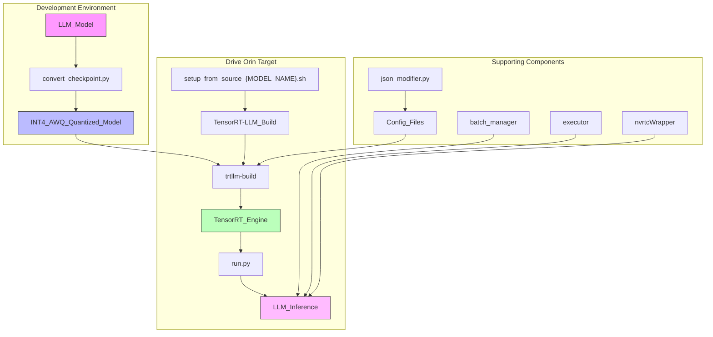
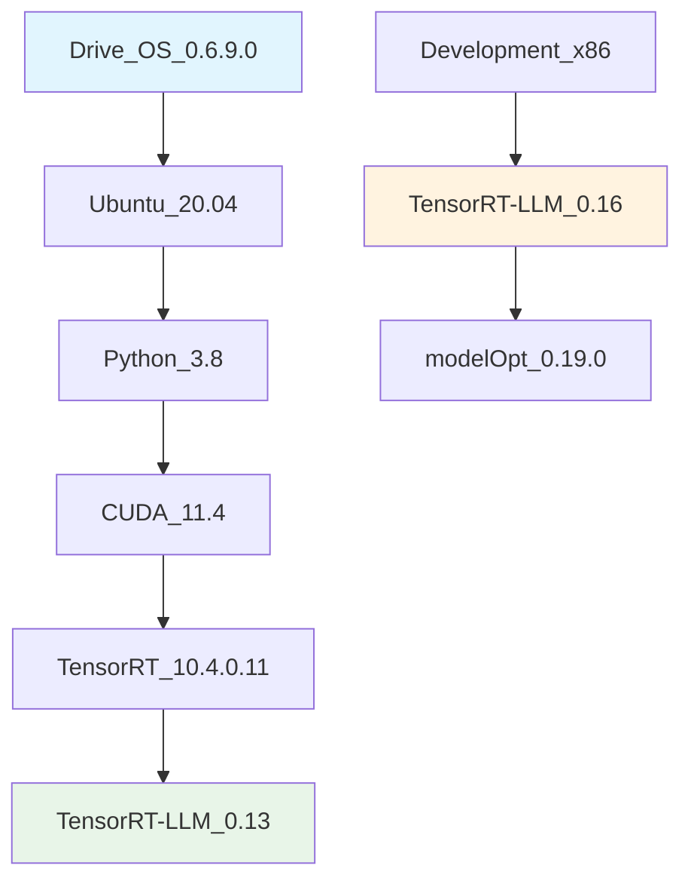
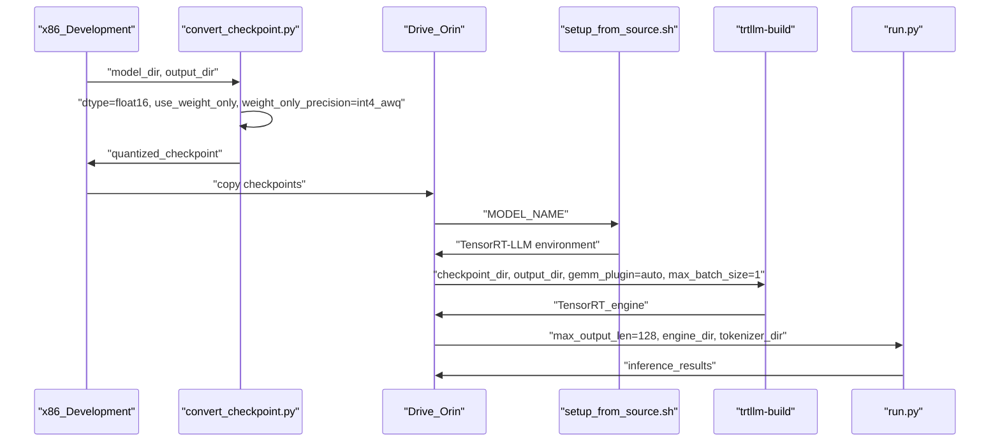
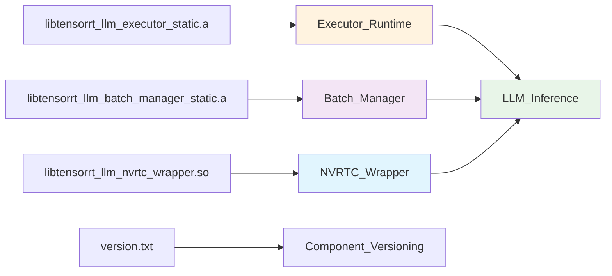

<!-- source: DeepWiki mcp.deepwiki.com · repo NVIDIA/DL4AGX · page 2.5 Language Model Deployment · fetched 2026-10-26 -->

# Language Model Deployment

<details>
<summary>Relevant source files</summary>

The following files were used as context for generating this wiki page:

- [AV-Solutions/llms-trtllm/LICENSE](AV-Solutions/llms-trtllm/LICENSE)
- [AV-Solutions/llms-trtllm/README.md](AV-Solutions/llms-trtllm/README.md)
- [AV-Solutions/llms-trtllm/batch_manager/aarch64-linux-gnu/libtensorrt_llm_batch_manager_static.a](AV-Solutions/llms-trtllm/batch_manager/aarch64-linux-gnu/libtensorrt_llm_batch_manager_static.a)
- [AV-Solutions/llms-trtllm/batch_manager/aarch64-linux-gnu/libtensorrt_llm_batch_manager_static.pre_cxx11.a](AV-Solutions/llms-trtllm/batch_manager/aarch64-linux-gnu/libtensorrt_llm_batch_manager_static.pre_cxx11.a)
- [AV-Solutions/llms-trtllm/batch_manager/aarch64-linux-gnu/version.txt](AV-Solutions/llms-trtllm/batch_manager/aarch64-linux-gnu/version.txt)
- [AV-Solutions/llms-trtllm/build_from_source_changes.patch](AV-Solutions/llms-trtllm/build_from_source_changes.patch)
- [AV-Solutions/llms-trtllm/executor/aarch64-linux-gnu/libtensorrt_llm_executor_static.a](AV-Solutions/llms-trtllm/executor/aarch64-linux-gnu/libtensorrt_llm_executor_static.a)
- [AV-Solutions/llms-trtllm/executor/aarch64-linux-gnu/libtensorrt_llm_executor_static.pre_cxx11.a](AV-Solutions/llms-trtllm/executor/aarch64-linux-gnu/libtensorrt_llm_executor_static.pre_cxx11.a)
- [AV-Solutions/llms-trtllm/json_modifier.py](AV-Solutions/llms-trtllm/json_modifier.py)
- [AV-Solutions/llms-trtllm/nvrtcWrapper/aarch64-linux-gnu/libtensorrt_llm_nvrtc_wrapper.so](AV-Solutions/llms-trtllm/nvrtcWrapper/aarch64-linux-gnu/libtensorrt_llm_nvrtc_wrapper.so)

</details>


This document covers the deployment of Large Language Models (LLMs) using TensorRT-LLM on NVIDIA Drive Orin platforms. The system provides optimized inference for automotive applications through INT4 quantization and custom runtime optimizations. For general deployment architecture patterns, see [Deployment Architecture and Workflow](#2.1). For other model types, see [3D Object Detection Solutions](#2.2) and [BEV Perception Solutions](#2.3).

## System Architecture

The LLM deployment system follows a two-stage approach: quantization on x86 development systems followed by engine compilation and deployment on Drive Orin targets. The architecture separates model preparation from runtime execution to optimize for the resource constraints of automotive platforms.



**Sources:** [AV-Solutions/llms-trtllm/README.md:1-83](), [AV-Solutions/llms-trtllm/json_modifier.py:1-47]()

## Supported Models and Environment Requirements

The system currently supports two LLM variants optimized for automotive deployment:

| Model | Hugging Face ID | Quantization Support |
|-------|----------------|---------------------|
| Llama-3.1-8B | `meta-llama/Llama-3.1-8B` | INT4_AWQ |
| DeepSeek-R1-Distill-Llama-8B | `deepseek-ai/DeepSeek-R1-Distill-Llama-8B` | INT4_AWQ |

### Drive Orin Environment Specifications

The deployment requires a specific software stack on the target platform:



**Sources:** [AV-Solutions/llms-trtllm/README.md:10-18](), [AV-Solutions/llms-trtllm/README.md:23-32]()

## Deployment Workflow

The LLM deployment process consists of distinct phases executed across different environments to optimize for both development efficiency and runtime performance.



**Sources:** [AV-Solutions/llms-trtllm/README.md:34-38](), [AV-Solutions/llms-trtllm/README.md:66-75]()

## Quantization Process

### INT4_AWQ Quantization

The system employs INT4 Activation-aware Weight Quantization (AWQ) to reduce model size and improve inference speed while maintaining accuracy. This quantization is performed on x86 systems with sufficient GPU memory.

**Required Environment:**
- x86 system with ≥16GB GPU memory
- TensorRT-LLM 0.16
- modelOpt 0.19.0

**Quantization Command:**
```bash
python convert_checkpoint.py \
    --model_dir $input_model \
    --output_dir $output_model \
    --dtype float16 \
    --use_weight_only \
    --weight_only_precision=int4_awq
```

**Sources:** [AV-Solutions/llms-trtllm/README.md:21-38]()

## TensorRT-LLM Build System

### Source Build Configuration

The `setup_from_source_{MODEL_NAME}.sh` script configures the TensorRT-LLM build environment specifically for Drive Orin. The build system applies platform-specific patches through `build_from_source_changes.patch`.

**Build Output Structure:**
```
work_dir/
├── batch_manager/
├── executor/
├── build_from_source_changes.patch
├── setup_from_source.sh
├── TensorRT-LLM/
├── TensorRT-10.4.0.11/
├── {MODEL_NAME}/
├── {MODEL_NAME}_int4_awq/
├── trtllm_0.13/
├── nccl/
└── json_modifier.py
```

**Sources:** [AV-Solutions/llms-trtllm/README.md:43-62](), [AV-Solutions/llms-trtllm/build_from_source_changes.patch:1-16]()

### Configuration Management

The `json_modifier.py` utility handles model configuration adjustments required for Drive Orin deployment:

```python
def modify_json(file_path):
    with open(file_path, 'r') as file:
        data = json.load(file)
    data['rotary_scaling'] = None
    with open(file_path, 'w') as file:
        json.dump(data, file, indent=4)
```

**Sources:** [AV-Solutions/llms-trtllm/json_modifier.py:20-32]()

## Engine Building and Optimization

### TensorRT Engine Generation

The `trtllm-build` command compiles the quantized checkpoint into an optimized TensorRT engine for Drive Orin:

```bash
trtllm-build \
    --checkpoint_dir $path_engine \
    --output_dir $path_engine/1-gpu/ \
    --gemm_plugin auto \
    --max_batch_size 1
```

**Key Build Parameters:**
- `gemm_plugin auto`: Enables automatic GEMM plugin selection
- `max_batch_size 1`: Optimizes for single-request inference
- Output directory structure: `{model}/1-gpu/`

**Sources:** [AV-Solutions/llms-trtllm/README.md:66-69]()

## Runtime Inference System

### Inference Execution

The runtime system uses the compiled TensorRT engine for LLM inference through the `run.py` script:

```bash
python run.py \
    --max_output_len 128 \
    --engine_dir $path_engine/1-gpu/ \
    --tokenizer_dir $path_model
```

### Performance Characteristics

**Sample Inference Output:**
```
[11/21/2024-16:10:58] [TRT-LLM] [I] Load engine takes: 62.147863149642944 sec
Input [Text 0]: "<|begin_of_text|>Born in north-east France, Soyer trained as a"
Output [Text 0 Beam 0]: " chef in Paris before moving to London in 1848..."
```

**Sources:** [AV-Solutions/llms-trtllm/README.md:71-82]()

## Runtime Components

The deployment system includes several key runtime components that provide the execution environment:



**Component Functions:**
- **Executor**: Manages model execution and inference scheduling
- **Batch Manager**: Handles request batching and memory management  
- **NVRTC Wrapper**: Provides runtime compilation capabilities for custom kernels

**Sources:** [AV-Solutions/llms-trtllm/executor/](), [AV-Solutions/llms-trtllm/batch_manager/](), [AV-Solutions/llms-trtllm/nvrtcWrapper/]()

---

