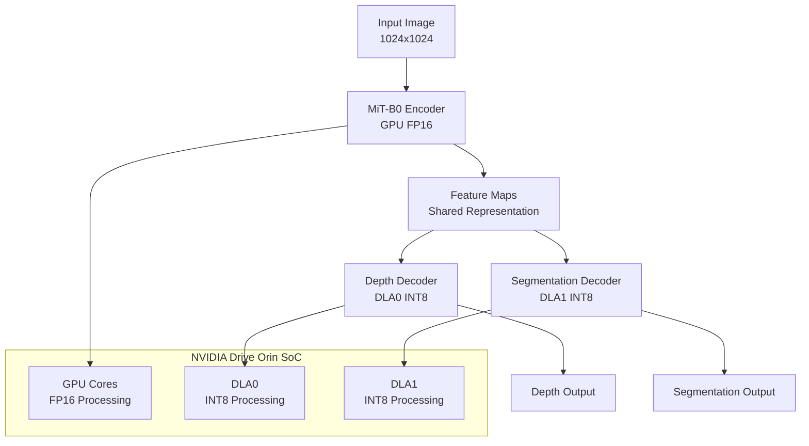
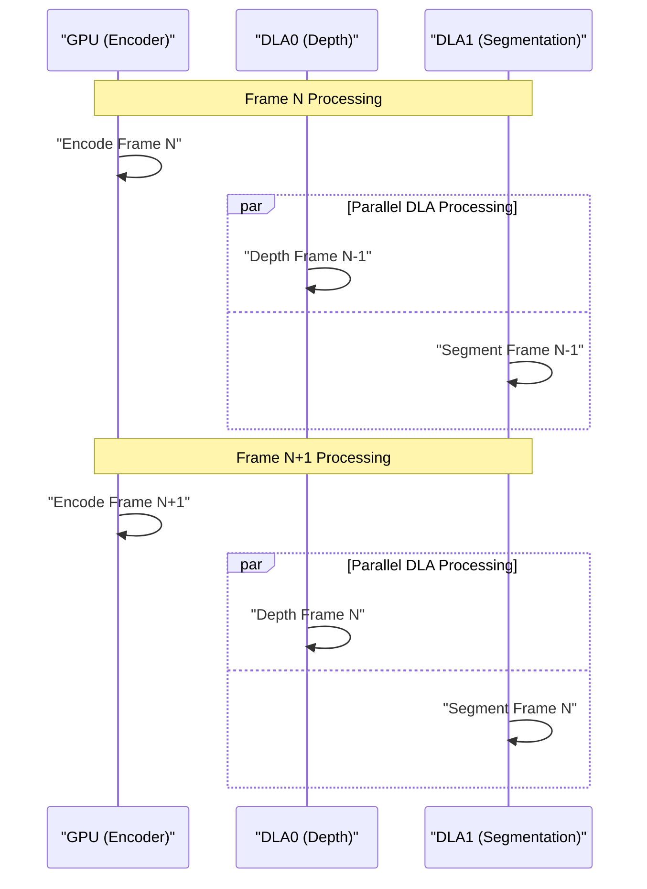
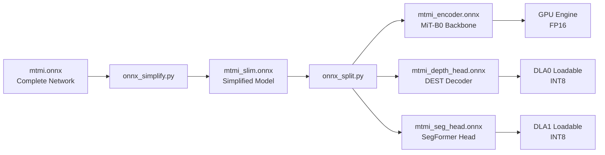
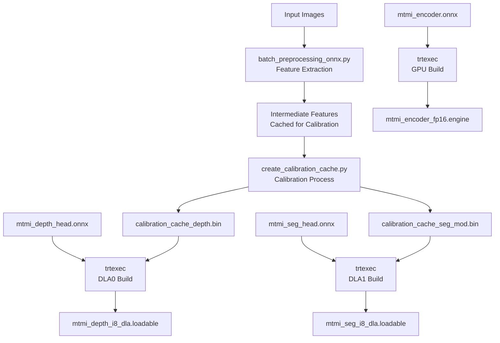
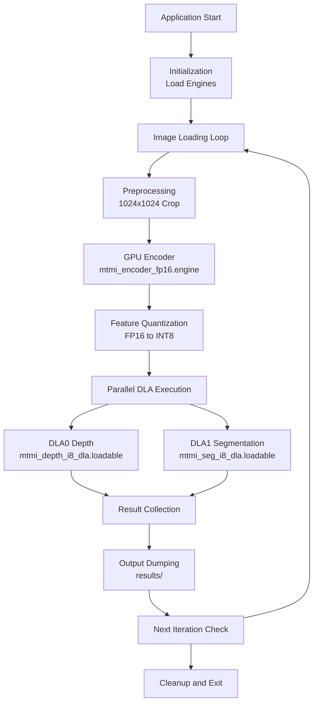

<!-- source: DeepWiki mcp.deepwiki.com · repo NVIDIA/DL4AGX · page 2.6 Multi-task Inference and Optimization · fetched 2026-10-26 -->

# Multi-task Inference and Optimization

<details>
<summary>Relevant source files</summary>

The following files were used as context for generating this wiki page:

- [AV-Solutions/mtmi/.gitattributes](AV-Solutions/mtmi/.gitattributes)
- [AV-Solutions/mtmi/.gitignore](AV-Solutions/mtmi/.gitignore)
- [AV-Solutions/mtmi/README.md](AV-Solutions/mtmi/README.md)
- [AV-Solutions/mtmi/onnx_files/mtmi.onnx](AV-Solutions/mtmi/onnx_files/mtmi.onnx)
- [AV-Solutions/mtmi/onnx_files/mtmi_depth_head.onnx](AV-Solutions/mtmi/onnx_files/mtmi_depth_head.onnx)
- [AV-Solutions/mtmi/onnx_files/mtmi_encoder.onnx](AV-Solutions/mtmi/onnx_files/mtmi_encoder.onnx)
- [AV-Solutions/mtmi/onnx_files/mtmi_seg_head.onnx](AV-Solutions/mtmi/onnx_files/mtmi_seg_head.onnx)
- [AV-Solutions/mtmi/onnx_files/mtmi_slim.onnx](AV-Solutions/mtmi/onnx_files/mtmi_slim.onnx)
- [AV-Solutions/streampetr-trt/conversion/pth2onnx.py](AV-Solutions/streampetr-trt/conversion/pth2onnx.py)

</details>


This document covers the Multi-task Model Inference (MTMI) system, which demonstrates deployment of multi-task networks on NVIDIA Drive Orin platform using heterogeneous compute resources. The system leverages GPU and DLA cores to achieve optimal latency and throughput through strategic task assignment and pipelined execution.

For deployment of individual model types, see [3D Object Detection Solutions](#2.2), [BEV Perception Solutions](#2.3), and [End-to-End Driving Solutions](#2.4). For general deployment architecture, see [Deployment Architecture and Workflow](#2.1).

## System Architecture Overview

The MTMI system implements a multi-task network that performs both depth estimation and semantic segmentation using a shared encoder backbone. The key innovation lies in the strategic assignment of different network components to heterogeneous compute units on the NVIDIA Drive Orin SoC.

### Compute Resource Assignment


**Resource Assignment Architecture**

Sources: [AV-Solutions/mtmi/README.md:1-10]()

### Pipelined Execution Model

The system achieves higher throughput through overlapped execution, where GPU processing for the current frame occurs simultaneously with DLA processing of the previous frame's features.


**Pipelined Execution Timeline**

Sources: [AV-Solutions/mtmi/README.md:6-8]()

## Model Architecture and Components

The MTMI system is built upon a multi-task network with three main components that can be deployed independently.

### Network Components

| Component | Purpose | Target Device | Precision | ONNX Model |
|-----------|---------|---------------|-----------|------------|
| `mtmi_encoder` | Feature extraction using MiT-B0 backbone | GPU | FP16 | `mtmi_encoder.onnx` |
| `mtmi_depth_head` | Progressive depth decoder from DEST | DLA0 | INT8 | `mtmi_depth_head.onnx` |
| `mtmi_seg_head` | Slim SegFormer-B0 segmentation head | DLA1 | INT8 | `mtmi_seg_head.onnx` |

Sources: [AV-Solutions/mtmi/README.md:12-29]()

### ONNX Model Pipeline


**ONNX Model Processing Pipeline**

Sources: [AV-Solutions/mtmi/README.md:31-39](), [AV-Solutions/mtmi/onnx_files/]()

## Deployment Pipeline

### Post-training Quantization Workflow

The deployment process involves careful quantization to enable INT8 execution on DLA cores while maintaining accuracy.


**Quantization and Engine Building Workflow**

Sources: [AV-Solutions/mtmi/README.md:41-97]()

### TensorRT Engine Configuration

The system uses specific TensorRT configurations optimized for each compute target:

#### GPU Encoder Configuration
```bash
trtexec --onnx=onnx_files/mtmi_encoder.onnx \
        --fp16 \
        --saveEngine=engines/mtmi_encoder_fp16.engine \
        --outputIOFormats=fp16:chw32
```

#### DLA Decoder Configuration  
```bash
trtexec --onnx=onnx_files/mtmi_depth_head.onnx \
        --int8 \
        --saveEngine=loadables/mtmi_depth_i8_dla.loadable \
        --useDLACore=0 \
        --inputIOFormats=int8:chw32 \
        --outputIOFormats=int8:dla_linear \
        --buildDLAStandalone \
        --calib=calibration/calibration_cache_depth.bin
```

Sources: [AV-Solutions/mtmi/README.md:65-96]()

## Optimization Techniques

### I/O Scale Optimization

The system implements manual I/O scale adjustment for the segmentation head to achieve optimal DLA kernel selection:

> "In order to achieve best INT8 resize perf on DLA, we carefully change the I/O scale manually for segmentation head while keeping the accuracy. TensorRT will choose a better DLA kernel with modified scales."

Sources: [AV-Solutions/mtmi/README.md:60-61]()

### Memory Layout Optimization

The deployment uses specific memory formats optimized for inter-device data transfer:
- GPU output: `fp16:chw32` format for efficient GPU-to-DLA transfer
- DLA input: `int8:chw32` format for optimal DLA ingestion  
- DLA output: `int8:dla_linear` format for DLA-optimized memory layout

Sources: [AV-Solutions/mtmi/README.md:67-96]()

## Implementation Details

### Inference Application Architecture


**Inference Application Flow**

The application implements the following execution steps:
1. **Initialization**: Load TensorRT engines and DLA loadables
2. **Image Processing Loop**: 
   - Load and preprocess input images (1024x1024 crop)
   - Execute encoder on GPU in FP16
   - Quantize feature maps for DLA input
   - Run depth and segmentation decoders in parallel on DLA0/DLA1
   - Collect and dump results for visualization

Sources: [AV-Solutions/mtmi/README.md:100-109]()

### Build and Deployment Environment

The system uses Docker-based cross-compilation for NVIDIA Drive Orin deployment:

**Docker Environment**: `nvcr.io/drive-priority/driveos-pdk/drive-agx-orin-linux-aarch64-pdk-build-x86:6.0.8.1-0006`

**Build Process**:
```bash
cd /DL4AGX/mtmi/inference_app
sh build.sh
```

**Runtime Requirements**:
- Engine files: `mtmi_encoder_fp16.engine`, `mtmi_depth_i8_dla.loadable`, `mtmi_seg_i8_dla.loadable`
- Input images: 1024x1024 PNG format in `tests/` directory
- Results directory for output visualization

Sources: [AV-Solutions/mtmi/README.md:111-157]()

### Visualization and Results

The system includes visualization tools for result analysis:
- `visualize.py`: Processes binary output data into visual results
- Output format: Overlaid depth and segmentation results on input images

Sources: [AV-Solutions/mtmi/README.md:152-158]()

---

