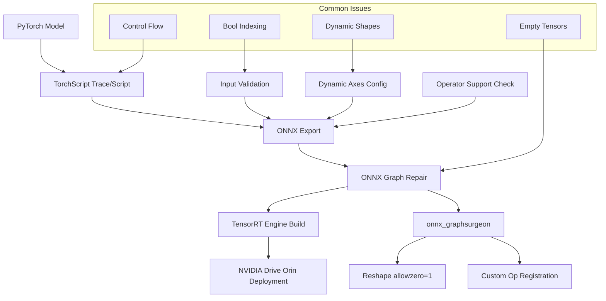
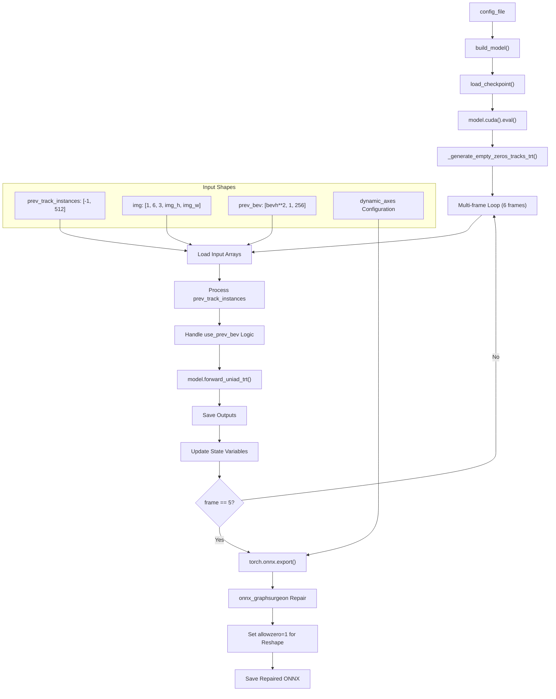
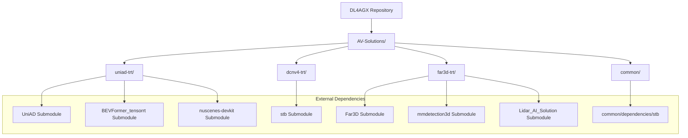

<!-- source: DeepWiki mcp.deepwiki.com · repo NVIDIA/DL4AGX · page 2.7 Development Tools and Guidance · fetched 2026-10-26 -->

# Development Tools and Guidance

<details>
<summary>Relevant source files</summary>

The following files were used as context for generating this wiki page:

- [.gitmodules](.gitmodules)
- [AV-Solutions/onnx-export-guidance/README.md](AV-Solutions/onnx-export-guidance/README.md)
- [AV-Solutions/uniad-trt/.gitignore](AV-Solutions/uniad-trt/.gitignore)
- [AV-Solutions/uniad-trt/onnx/uniad_tiny_dummy.onnx](AV-Solutions/uniad-trt/onnx/uniad_tiny_dummy.onnx)
- [AV-Solutions/uniad-trt/tools/export_onnx.py](AV-Solutions/uniad-trt/tools/export_onnx.py)

</details>


This document covers the development tools, guidance, and infrastructure provided within the DL4AGX repository for model deployment workflows. The primary focus is on ONNX export guidance for TensorRT deployment, along with supporting development infrastructure including Docker environments and build systems.

For information about specific model deployment solutions, see the individual solution pages under sections [2.2](#2.2) through [2.6](#2.6). For details about efficient model architectures, see section [3](#3).

## ONNX Export Guidance

The repository provides comprehensive guidance for exporting PyTorch models to ONNX format for TensorRT deployment. This guidance addresses common issues encountered when using the TorchScript-based ONNX exporter with TensorRT.

### TorchScript-Based ONNX Export Overview

The TorchScript-based ONNX exporter leverages `torch.jit.trace()` to capture static computation graphs and supports `torch.jit.script()` for data-dependent control flow. The basic export pattern follows this structure:

```python
torch.onnx.export(
    model,
    input_tuple,
    "model.onnx",
    opset_version=13,
    do_constant_folding=True,
    input_names=["input"],
    output_names=["output"]
)
```

**Export Workflow Diagram**



Sources: [AV-Solutions/onnx-export-guidance/README.md:21-48]()

### Control Flow Handling

The guidance provides specific strategies for handling control flow constructs that are problematic for TensorRT deployment.

#### If-Else Vectorization

Static if-else statements are preserved during export, but dynamic if-else requires vectorization:

```python
# Dynamic if-else vectorization pattern
condC = ~(condA|condB) 
a = condA*funcA(...) + condB*funcB(...) + condC*funcC(...)
```

For cases involving string comparisons or None tensor checks, the guidance recommends moving comparisons outside the ONNX graph and passing indicator tensors as auxiliary inputs.

#### Loop Handling

Parallelizable loops can be vectorized, while non-parallelizable loops require different approaches:
- Static loop counts: Keep as-is for unfolding during export
- Dynamic loop counts: Use `@torch.jit.script` for separate TorchScript functions

Sources: [AV-Solutions/onnx-export-guidance/README.md:57-239]()

### Tensor Operations and Data Types

#### Squeeze/Unsqueeze Operations

The guidance specifically addresses issues with `torch.Tensor.squeeze()` which creates problematic conditional nodes:

```python
# Avoid: x.squeeze(0)
# Use: x[0] or explicit reshaping
x = y[:,:,0,:,:]  # for known shapes
```

#### Dynamic Shape Handling

TensorRT has limitations with dynamic shape tensor assignments. The recommended approach uses broadcasting operations:

```python
# Avoid: A[_mask] = B[_mask]
# Use: A = A*(~_mask) + B*(_mask)
```

Sources: [AV-Solutions/onnx-export-guidance/README.md:149-334]()

### Operator Support and Workarounds

#### Missing Operators

The guidance provides implementations for unsupported operators:

- `torch.unique()` replacement using sort and diff operations
- `torch.atan2()` implementation using basic math operations
- `NonZero` operation replacement with `topK`

#### Custom Operators and Plugins

For operators that cannot be rewritten, the standard solution involves ONNX custom operators with corresponding TensorRT plugins.

Sources: [AV-Solutions/onnx-export-guidance/README.md:394-460]()

## Model Export Implementation

### UniAD Export Example

The UniAD deployment solution demonstrates practical application of the ONNX export guidance. The export script implements a multi-frame inference pattern with dynamic input handling.

**UniAD Export Process Diagram**



The script handles dynamic batch dimensions and complex state management across multiple inference frames, demonstrating real-world application of the ONNX export patterns.

Sources: [AV-Solutions/uniad-trt/tools/export_onnx.py:152-544]()

### Input and Output Management

The export process manages complex input/output structures with dynamic shapes:

| Input Category | Example Fields | Dynamic Axes | Purpose |
|---|---|---|---|
| Track Instances | `prev_track_intances0` to `prev_track_intances13` | `[0]` | Object tracking state |
| BEV Features | `prev_bev`, `bev_embed` | Static | Bird's eye view representation |
| Camera Data | `img`, `img_metas_lidar2img` | Static/Dynamic | Multi-camera inputs |
| Scene Context | `timestamp`, `l2g_r_mat`, `command` | Static | Temporal and spatial context |

The dynamic axes configuration enables variable numbers of tracked objects while maintaining static shapes for image and spatial tensors.

Sources: [AV-Solutions/uniad-trt/tools/export_onnx.py:271-371]()

## Development Infrastructure

### Repository Structure and Submodules

The development infrastructure includes external dependencies managed through Git submodules:



The submodule configuration enables integration of upstream repositories while maintaining deployment-specific modifications and TensorRT optimization code.

Sources: [.gitmodules:1-28]()

### Build and Development Environment

The development workflow includes standardized ignore patterns and build directories:

- Build artifacts: `build/`, `engines/`, `*.engine`
- Data directories: `data/`, `docker/nuscenes`
- Development files: `.vscode`, `*.log`, `*.npy`, `*.bin`
- Media outputs: `*.jpg`, `*.mp4`

This structure supports iterative development with TensorRT engine building and inference testing.

Sources: [AV-Solutions/uniad-trt/.gitignore:1-17]()

### Graph Surgery and Post-Processing

The ONNX export workflow includes automated graph repair using `onnx_graphsurgeon`:

```python
import onnx_graphsurgeon as gs

graph = gs.import_onnx(onnx.load(onnx_file_name))
for node in graph.nodes:
    if node.op == "Reshape":
        node.attrs["allowzero"] = 1
onnx.save(gs.export_onnx(graph), onnx_file_name[:-4]+'repaired.onnx')
```

This post-processing step addresses TensorRT compatibility issues, particularly for empty tensor reshaping operations.

Sources: [AV-Solutions/onnx-export-guidance/README.md:310-322](), [AV-Solutions/uniad-trt/tools/export_onnx.py:536-540]()

## Constant Folding and Device Management

### Device Migration Issues

A common issue during ONNX export involves tensors residing on different devices during constant folding. The guidance provides multiple solutions:

1. **Manual Unrolling**: Convert range-based indexing to element-wise operations
2. **Broadcasting Reformulation**: Replace broadcasting with explicit tensor operations  
3. **Device-side Index Generation**: Create indices directly on the target device
4. **Post-export Constant Folding**: Defer optimization to TensorRT engine build

These patterns address the fundamental issue where CPU-side indexing operations don't properly migrate to GPU during ONNX export.

Sources: [AV-Solutions/onnx-export-guidance/README.md:461-518]()

### Best Practices Summary

The development guidance establishes key practices for successful TensorRT deployment:

- Use real input data for ONNX export, especially for dynamic shapes
- Avoid Python built-in functions and data types within ONNX graphs
- Replace `torch.where` with multiplication/addition patterns
- Convert bool indexing to long indexing when TensorRT compatibility issues arise
- Leverage `@torch.jit.script` for unavoidable dynamic control flow

These practices ensure reliable conversion from PyTorch research models to production-ready TensorRT engines for NVIDIA Drive platforms.

Sources: [AV-Solutions/onnx-export-guidance/README.md:520-580]()

---

