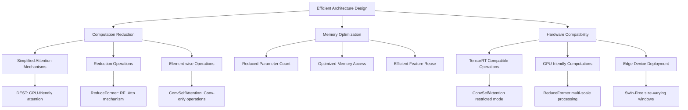
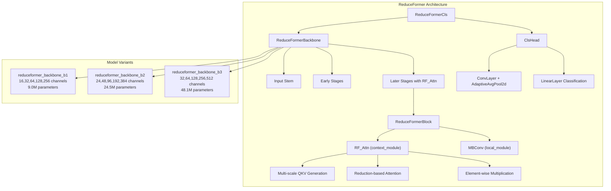
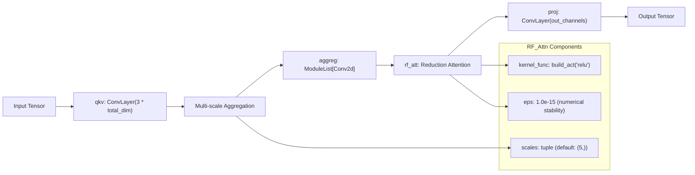
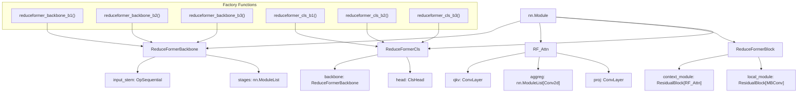
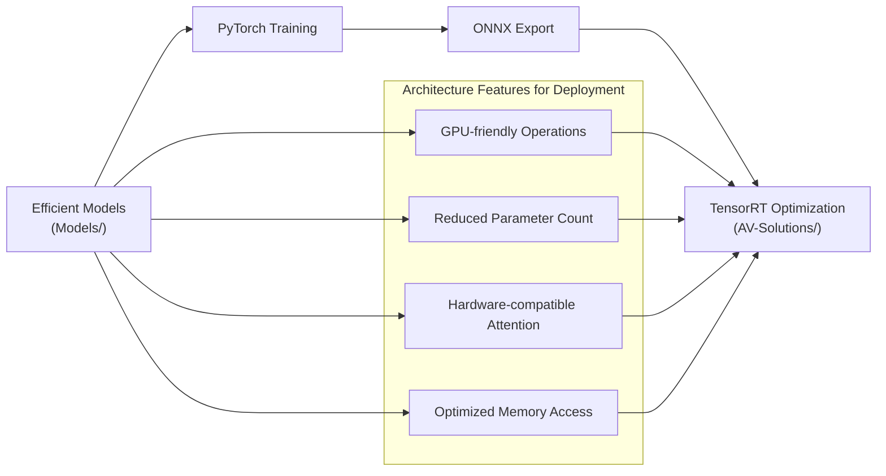

<!-- source: DeepWiki mcp.deepwiki.com · repo NVIDIA/DL4AGX · page 3 Models: Efficient Architectures · fetched 2026-10-26 -->

# Models: Efficient Architectures

Relevant source files

The following files were used as context for generating this wiki page:

- [Models/README.md](Models/README.md)
- [Models/ReduceFormer/reduceformer/backbone.py](Models/ReduceFormer/reduceformer/backbone.py)
- [Models/ReduceFormer/reduceformer/cls.py](Models/ReduceFormer/reduceformer/cls.py)

## Purpose and Scope

This document provides an overview of the efficient model architectures implemented in the Models directory, designed to achieve improved accuracy, faster inference speed, and better resource utilization for edge device deployment in autonomous vehicle applications. These architectures focus on hardware-friendly designs that can be effectively deployed using the solutions documented in [AV-Solutions: Deployment Solutions](#2).

For detailed implementation specifics of individual architectures, see [Design Philosophy and Architecture Overview](#3.1), [ReduceFormer Architecture](#3.2), and [Swin-Free and Additional Models](#3.3).

## Architecture Portfolio

The Models directory contains four distinct efficient architecture families, each targeting different aspects of model optimization:

| Architecture | Primary Focus | Key Innovation | Target Application |
|--------------|---------------|----------------|-------------------|
| **DEST** | Depth Estimation | GPU-friendly simplified attention | Depth estimation, semantic segmentation |
| **ConvSelfAttention** | TensorRT Compatibility | Convolution-only attention emulation | Safety-critical autonomous systems |
| **ReduceFormer** | Transformer Simplification | Reduction operations + element-wise multiplication | General vision tasks, edge deployment |
| **Swin-Free** | Window Attention | Size-varying windows without shifting | High-throughput inference |

**Sources:** [Models/README.md:1-18]()

## Design Philosophy

### Hardware-Friendly Optimization Strategies

The efficient architectures implement several core optimization strategies:

**Sources:** [Models/README.md:2-18]()

## ReduceFormer Implementation Architecture

ReduceFormer represents the most comprehensive implementation in the Models directory, featuring a modular backbone-head architecture:

**Sources:** [Models/ReduceFormer/reduceformer/backbone.py:188-338](), [Models/ReduceFormer/reduceformer/cls.py:58-109]()

## Core Implementation Components

### RF_Attn Mechanism

The `RF_Attn` class implements the core attention mechanism using reduction operations:

**Sources:** [Models/ReduceFormer/reduceformer/backbone.py:40-149]()

### Model Variant Configurations

The three ReduceFormer variants provide different parameter-accuracy trade-offs:

| Variant | Width List | Depth List | Dim | Parameters | Use Case |
|---------|------------|------------|-----|------------|----------|
| **B1** | [16,32,64,128,256] | [1,2,3,3,4] | 16 | 9.0M | Ultra-lightweight edge |
| **B2** | [24,48,96,192,384] | [1,3,4,4,6] | 32 | 24.5M | Balanced efficiency |
| **B3** | [32,64,128,256,512] | [1,4,6,6,9] | 32 | 48.1M | High accuracy applications |

**Sources:** [Models/ReduceFormer/reduceformer/backbone.py:313-338]()

## Code Entity Relationships

### Class Inheritance and Composition

**Sources:** [Models/ReduceFormer/reduceformer/backbone.py:32-37](), [Models/ReduceFormer/reduceformer/cls.py:23-29]()

## Integration with Deployment Pipeline

The efficient architectures are designed to integrate seamlessly with the TensorRT deployment pipeline:

**Sources:** [Models/README.md:2-18]()

---

