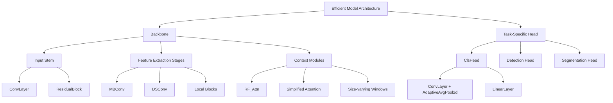
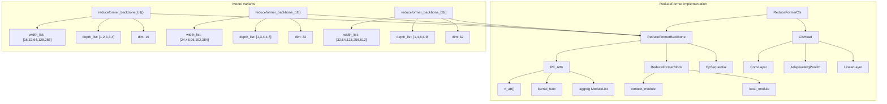
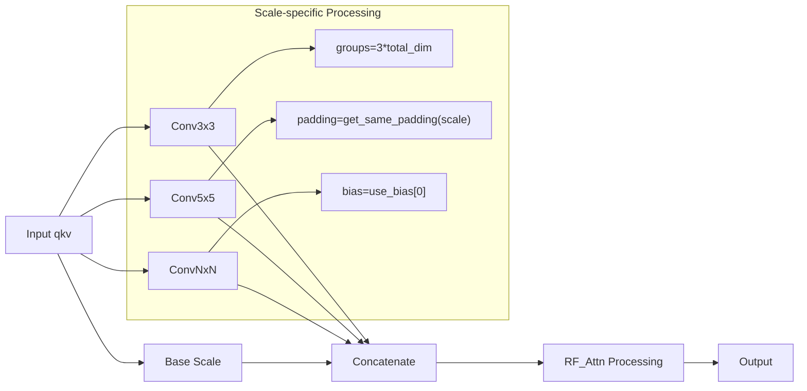
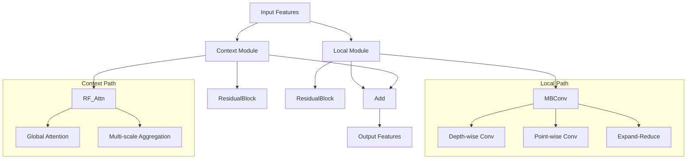
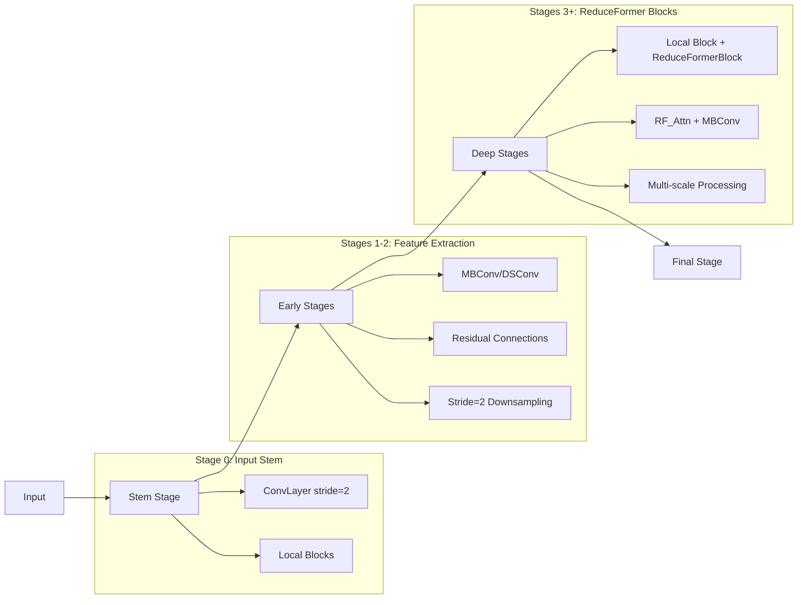
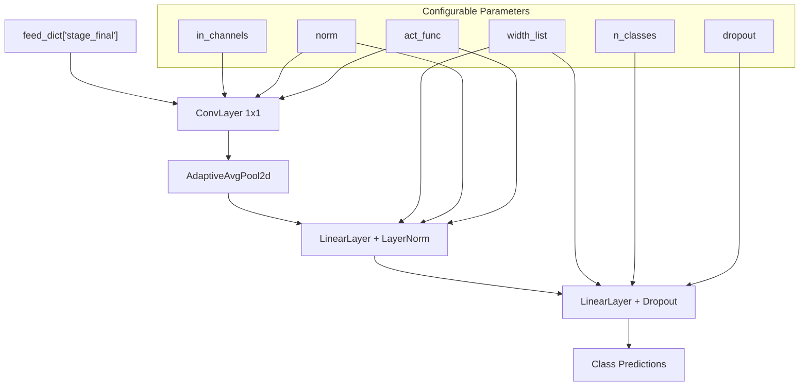

<!-- source: DeepWiki mcp.deepwiki.com · repo NVIDIA/DL4AGX · page 3.1 Design Philosophy and Architecture Overview · fetched 2026-10-26 -->

# Design Philosophy and Architecture Overview

<details>
<summary>Relevant source files</summary>

The following files were used as context for generating this wiki page:

- [Models/README.md](Models/README.md)
- [Models/ReduceFormer/reduceformer/backbone.py](Models/ReduceFormer/reduceformer/backbone.py)
- [Models/ReduceFormer/reduceformer/cls.py](Models/ReduceFormer/reduceformer/cls.py)

</details>


## Purpose and Scope

This document explains the design principles and architectural patterns underlying the efficient model implementations in the Models directory. It covers the common design philosophy, modular architecture patterns, and key components shared across all efficient models including ReduceFormer, DEST, Convolutional Self-Attention, and Swin-Free.

For detailed implementation of specific models, see [ReduceFormer Architecture](#3.2) and [Swin-Free and Additional Models](#3.3). For deployment and optimization of these models, see [AV-Solutions: Deployment Solutions](#2).

## Design Philosophy

The efficient model architectures in this repository follow four core design principles:

### Hardware-First Design Approach

All models prioritize **hardware compatibility** and **inference efficiency** over architectural complexity. This manifests in several key design decisions:

- **TensorRT compatibility**: Operations are chosen to work seamlessly in TensorRT's restricted mode, critical for safety-critical autonomous vehicle applications
- **GPU-friendly operations**: Emphasis on operations that leverage GPU parallel processing capabilities effectively
- **Reduced memory footprint**: Architectures designed for edge devices with limited memory resources
- **Simplified attention mechanisms**: Replacing complex self-attention with more efficient alternatives

### Modular Component Design

The architecture follows a **modular building block** approach that enables:

- **Reusable components**: Common building blocks shared across different model variants
- **Configurable architectures**: Easy scaling through parameter adjustment rather than architectural changes
- **Composable designs**: Mix-and-match components for different use cases

### Efficiency Through Simplification

Rather than adding complexity, these models achieve better performance through **strategic simplification**:

- **Reduction operations**: Using mathematical reductions instead of complex attention computations
- **Element-wise operations**: Leveraging simple mathematical operations that are highly optimized on modern hardware
- **Fewer normalization layers**: Reducing computational overhead while maintaining model stability

### Edge-Cloud Versatility

Models are designed to perform well across different deployment scenarios:

- **Edge device deployment**: Optimized for resource-constrained automotive computing platforms
- **High-throughput cloud**: Efficient batch processing for large-scale inference
- **Multi-scale deployment**: Single architecture family that scales from mobile to server

Sources: [Models/README.md:1-18]()

## Architectural Patterns and Components

### Core Component Hierarchy



This diagram illustrates the hierarchical component structure where specialized attention mechanisms and efficient building blocks replace traditional transformer components.

Sources: [Models/ReduceFormer/reduceformer/backbone.py:188-272](), [Models/ReduceFormer/reduceformer/cls.py:32-56]()

### Code Entity Architecture Map



This diagram maps the conceptual architecture to actual code entities, showing how the `ReduceFormerBackbone` class implements the modular design through specific components like `RF_Attn` and `ReduceFormerBlock`.

Sources: [Models/ReduceFormer/reduceformer/backbone.py:32-37](), [Models/ReduceFormer/reduceformer/backbone.py:313-338](), [Models/ReduceFormer/reduceformer/cls.py:23-29]()

## Key Architectural Innovations

### Simplified Attention Mechanism

The `RF_Attn` class implements a novel attention mechanism that replaces traditional self-attention:

| Traditional Self-Attention | ReduceFormer Attention |
|----------------------------|------------------------|
| Matrix multiplication heavy | Element-wise operations |
| Quadratic complexity | Linear complexity |
| High memory usage | Reduced memory footprint |
| Complex gradient flow | Simplified gradients |

The core innovation is in the `rf_att()` method which implements attention through reduction operations:

```python
# From RF_Attn.rf_att() method
sum_k = torch.sum(k, (-1, -2), keepdim=True) 
sum_v = torch.sum(v * sum_k, (-1, -2), keepdim=True) 
sum_kv = torch.sum(k * sum_v, (-1, -2), keepdim=True)          
sum_q = torch.sum(q, 1, keepdim=True)

out = (q * sum_kv) / (sum_q * sum_k + 1.0e-15)
```

Sources: [Models/ReduceFormer/reduceformer/backbone.py:40-149](), [Models/ReduceFormer/reduceformer/backbone.py:103-128]()

### Multi-Scale Feature Aggregation

The architecture implements multi-scale processing through the `aggreg` ModuleList:



This approach allows the model to capture features at different spatial scales while maintaining computational efficiency.

Sources: [Models/ReduceFormer/reduceformer/backbone.py:76-90](), [Models/ReduceFormer/reduceformer/backbone.py:131-140]()

### Hierarchical Block Structure

The `ReduceFormerBlock` combines two complementary processing paths:

1. **Context Module**: Global feature relationships via `RF_Attn`
2. **Local Module**: Local feature refinement via `MBConv`



Sources: [Models/ReduceFormer/reduceformer/backbone.py:151-185]()

## Model Scaling and Variants

### Parameterized Architecture Design

The architecture supports systematic scaling through configuration parameters:

| Variant | Parameters | Width List | Depth List | Dimension |
|---------|------------|------------|------------|-----------|
| B1 | 9.0M | [16,32,64,128,256] | [1,2,3,3,4] | 16 |
| B2 | 24.5M | [24,48,96,192,384] | [1,3,4,4,6] | 32 |
| B3 | 48.1M | [32,64,128,256,512] | [1,4,6,6,9] | 32 |

### Stage-wise Architecture Progression



The architecture transitions from simple convolutions in early stages to sophisticated ReduceFormer blocks in deeper stages, balancing efficiency with representational power.

Sources: [Models/ReduceFormer/reduceformer/backbone.py:313-338](), [Models/ReduceFormer/reduceformer/backbone.py:226-272]()

## Integration and Extensibility Patterns

### Modular Head Architecture

The `ClsHead` demonstrates the extensible head design pattern:



This pattern enables easy adaptation to different tasks by swapping heads while maintaining the same backbone.

### Model Factory Pattern

The codebase implements a factory pattern for model instantiation:

- `reduceformer_cls_b1()`, `reduceformer_cls_b2()`, `reduceformer_cls_b3()` factory functions
- `build_kwargs_from_config()` utility for configuration management
- Consistent parameter passing and model construction

This pattern ensures consistent model creation across different variants and simplifies hyperparameter management.

Sources: [Models/ReduceFormer/reduceformer/cls.py:70-109](), [Models/ReduceFormer/reduceformer/backbone.py:313-338]()

---

