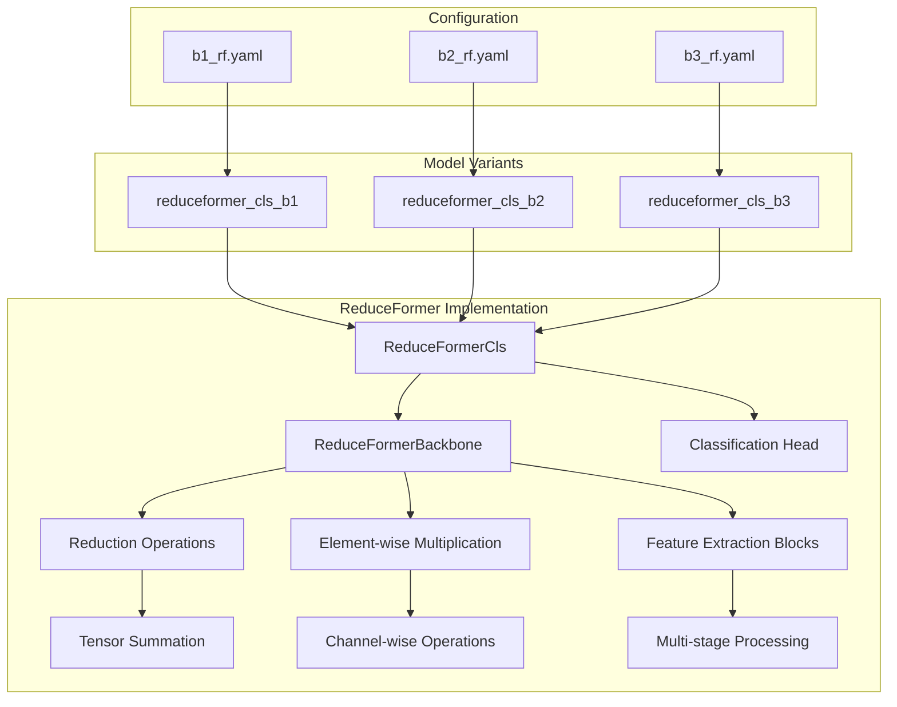
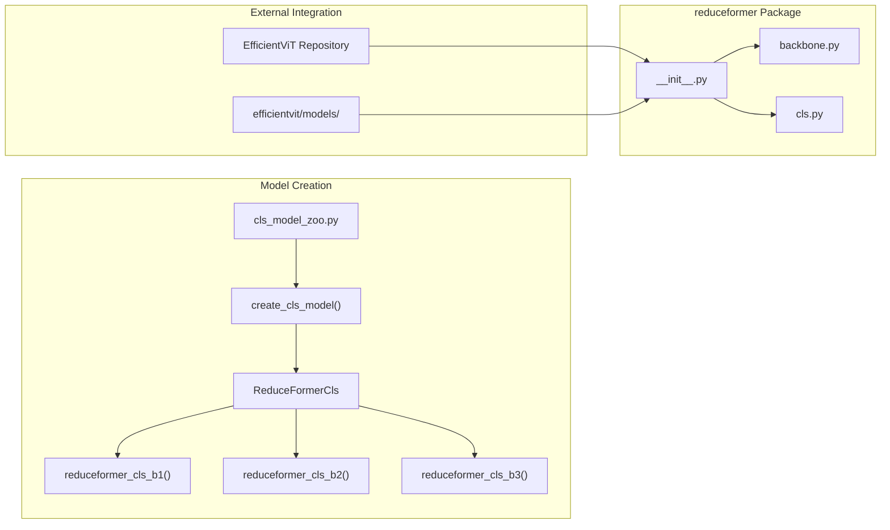
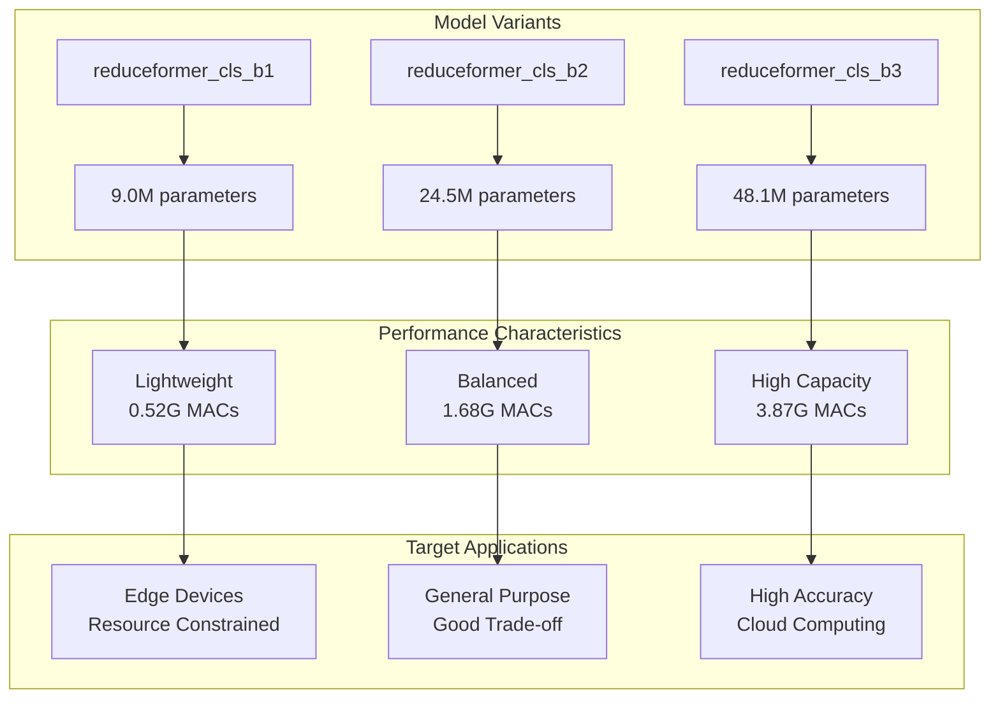
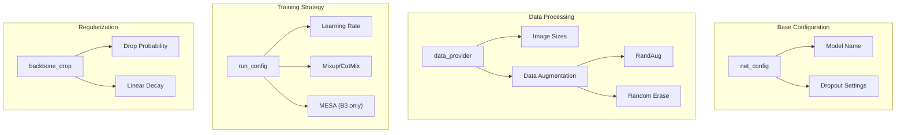
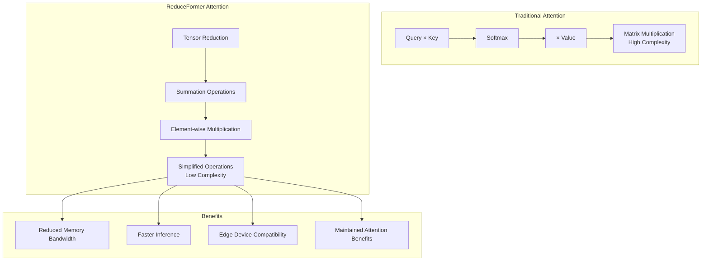

<!-- source: DeepWiki mcp.deepwiki.com · repo NVIDIA/DL4AGX · page 3.2 ReduceFormer Architecture · fetched 2026-10-26 -->

# ReduceFormer Architecture

<details>
<summary>Relevant source files</summary>

The following files were used as context for generating this wiki page:

- [Models/ReduceFormer/README.md](Models/ReduceFormer/README.md)
- [Models/ReduceFormer/cls_model_zoo.py](Models/ReduceFormer/cls_model_zoo.py)
- [Models/ReduceFormer/configs/b1_rf.yaml](Models/ReduceFormer/configs/b1_rf.yaml)
- [Models/ReduceFormer/configs/b2_rf.yaml](Models/ReduceFormer/configs/b2_rf.yaml)
- [Models/ReduceFormer/configs/b3_rf.yaml](Models/ReduceFormer/configs/b3_rf.yaml)
- [Models/ReduceFormer/docker/Dockerfile](Models/ReduceFormer/docker/Dockerfile)
- [Models/ReduceFormer/reduceformer/__init__.py](Models/ReduceFormer/reduceformer/__init__.py)
- [Models/ReduceFormer/resources/ReduceFormer_CVPRW_2024_Poster.pdf](Models/ReduceFormer/resources/ReduceFormer_CVPRW_2024_Poster.pdf)
- [Models/ReduceFormer/resources/reduceformer_attn.png](Models/ReduceFormer/resources/reduceformer_attn.png)

</details>


## Purpose and Scope

This document provides a comprehensive technical overview of the ReduceFormer architecture implementation, covering the core architectural components, model variants, and implementation details. ReduceFormer is a vision transformer that replaces traditional attention mechanisms with tensor reduction operations to achieve improved computational efficiency while maintaining competitive accuracy.

For information about deployment and optimization of ReduceFormer models, see [AV-Solutions: Deployment Solutions](#2). For broader context on efficient model architectures in the repository, see [Models: Efficient Architectures](#3).

## Architecture Overview

ReduceFormer introduces a novel attention mechanism that uses tensor reduction by summation instead of traditional matrix multiplication and Softmax operations. This approach significantly reduces computational complexity while maintaining the benefits of attention mechanisms for vision tasks.

**ReduceFormer Architecture Overview**


Sources: [Models/ReduceFormer/README.md:11-15](), [Models/ReduceFormer/cls_model_zoo.py:16-22]()

## Core Components

### Module Structure

The ReduceFormer implementation follows a modular design with clear separation between backbone feature extraction and classification components.

**Component Organization**


Sources: [Models/ReduceFormer/reduceformer/__init__.py:16-17](), [Models/ReduceFormer/cls_model_zoo.py:28-41]()

### Model Factory Pattern

The `create_cls_model` function implements a factory pattern for instantiating different ReduceFormer variants:

```python
def create_cls_model(name: str, pretrained=True, weight_url: str or None = None, **kwargs) -> ReduceFormerCls:
    model_dict = {
        "b1_rf": reduceformer_cls_b1,
        "b2_rf": reduceformer_cls_b2,
        "b3_rf": reduceformer_cls_b3,
    }
```

The factory maps model identifiers to their corresponding constructor functions and handles model instantiation with optional pretrained weights.

Sources: [Models/ReduceFormer/cls_model_zoo.py:28-41]()

## Model Variants

ReduceFormer provides three model variants with different computational complexities and performance characteristics:

| Variant | Parameters | MACs (224×224) | MACs (288×288) | Orin Latency (bs1) |
|---------|------------|----------------|----------------|-------------------|
| ReduceFormer-B1 | 9.0M | 0.52G | 0.85G | 0.68ms |
| ReduceFormer-B2 | 24.5M | 1.68G | 2.77G | 1.29ms |
| ReduceFormer-B3 | 48.1M | 3.87G | 6.40G | 2.22ms |

**Model Variant Relationships**


Sources: [Models/ReduceFormer/README.md:103-115]()

### Performance Scaling

The models demonstrate consistent accuracy improvements with increased model size:

- **ReduceFormer-B1**: 79.3% → 80.6% (224×224 → 288×288)
- **ReduceFormer-B2**: 81.9% → 83.0% (224×224 → 288×288)  
- **ReduceFormer-B3**: 83.4% → 84.2% (224×224 → 288×288)

Sources: [Models/ReduceFormer/README.md:103-115]()

## Configuration System

### Training Configurations

Each model variant has dedicated configuration files that specify training hyperparameters and data augmentation strategies:

**Configuration Hierarchy**


Sources: [Models/ReduceFormer/configs/b1_rf.yaml:1-8](), [Models/ReduceFormer/configs/b2_rf.yaml:1-27](), [Models/ReduceFormer/configs/b3_rf.yaml:1-29]()

### Configuration Differences

The model variants use progressively more sophisticated training strategies:

- **B1**: Minimal configuration with basic dropout
- **B2**: Adds data augmentation (RandAug, Random Erase) and advanced regularization
- **B3**: Includes all B2 features plus MESA optimization and advanced mixup strategies

Sources: [Models/ReduceFormer/configs/b1_rf.yaml:1-8](), [Models/ReduceFormer/configs/b2_rf.yaml:6-27](), [Models/ReduceFormer/configs/b3_rf.yaml:6-29]()

## Implementation Architecture

### Computational Approach

ReduceFormer replaces the computationally expensive components of traditional transformers:

**Traditional vs ReduceFormer Attention**


Sources: [Models/ReduceFormer/README.md:11-15]()

### Integration with EfficientViT

ReduceFormer builds upon the EfficientViT framework, requiring specific integration steps:

1. Clone EfficientViT repository
2. Copy ReduceFormer modules to `efficientvit/models/reduceformer/`
3. Copy configuration files to `configs/cls/imagenet/`
4. Replace `cls_model_zoo.py` in the EfficientViT root

This integration approach leverages EfficientViT's training infrastructure while introducing the novel ReduceFormer architecture.

Sources: [Models/ReduceFormer/README.md:20-57]()

## Development and Deployment

### Training Infrastructure

ReduceFormer uses the EfficientViT training pipeline with multi-GPU distributed training support:

```bash
torchpack dist-run -np 8 \
python train_cls_model.py configs/cls/imagenet/b1_rf.yaml \
    --data_provider.image_size "[128,160,192,224,256,288]" \
    --run_config.eval_image_size "[288]" \
    --path .exp/cls/imagenet/b1_r288/
```

The training supports progressive image size scaling and flexible evaluation resolutions.

Sources: [Models/ReduceFormer/README.md:67-86]()

### Hardware Optimization

ReduceFormer is specifically optimized for NVIDIA DRIVE Orin deployment with TensorRT-8.6 in FP16 precision. The simplified operations (reduction and element-wise multiplication) are well-suited for efficient hardware acceleration compared to traditional matrix multiplication operations.

Sources: [Models/ReduceFormer/README.md:117-118]()

---

