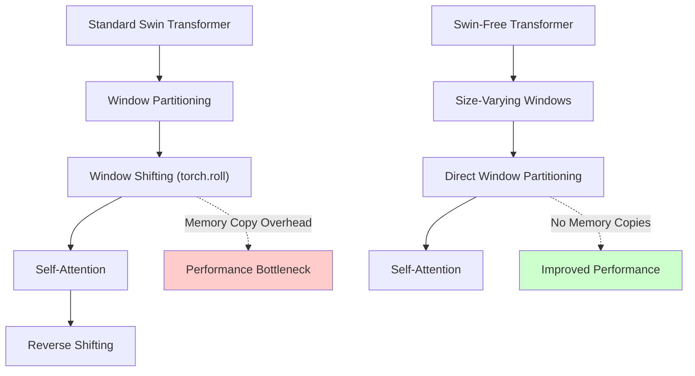
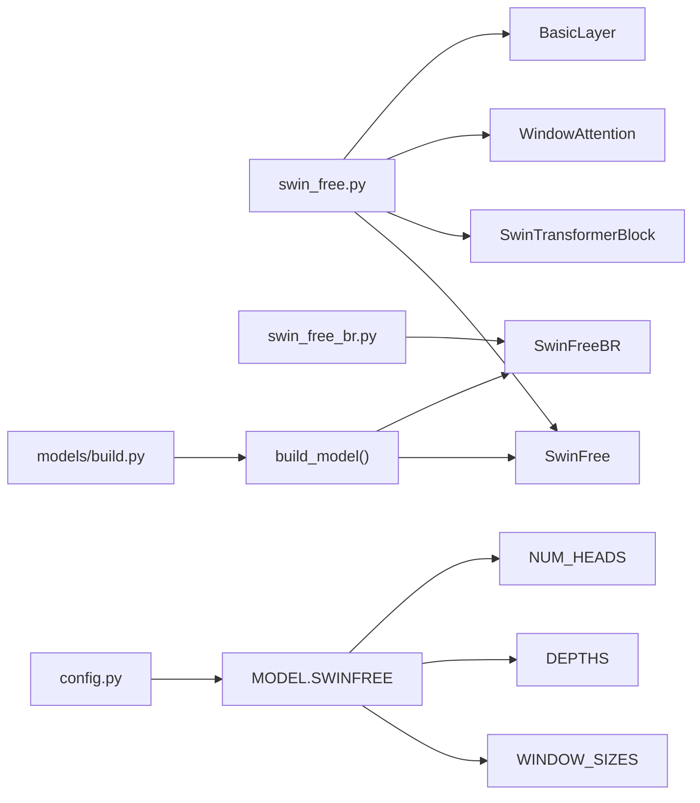
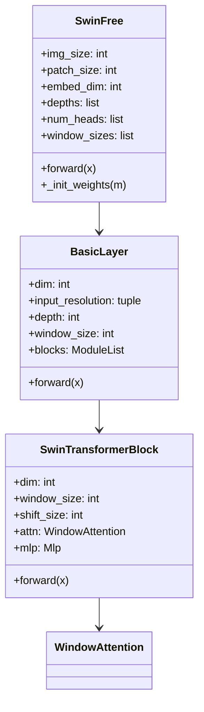
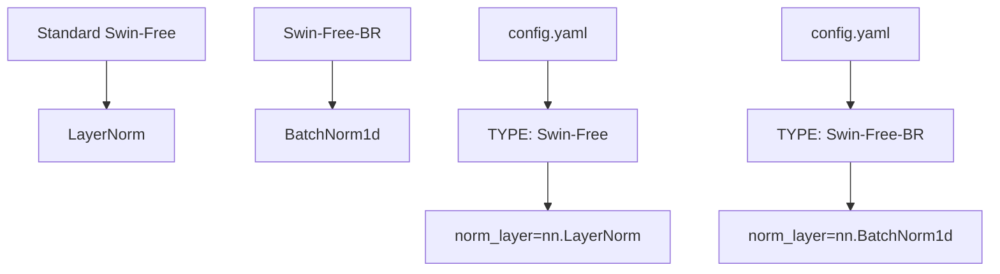
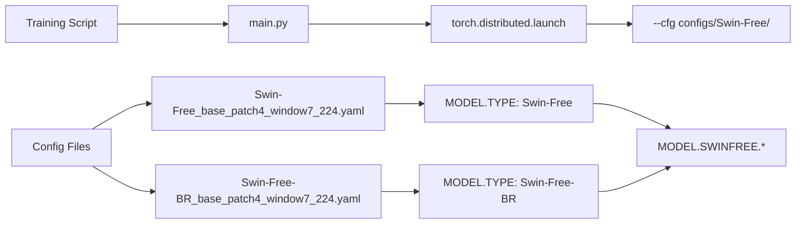
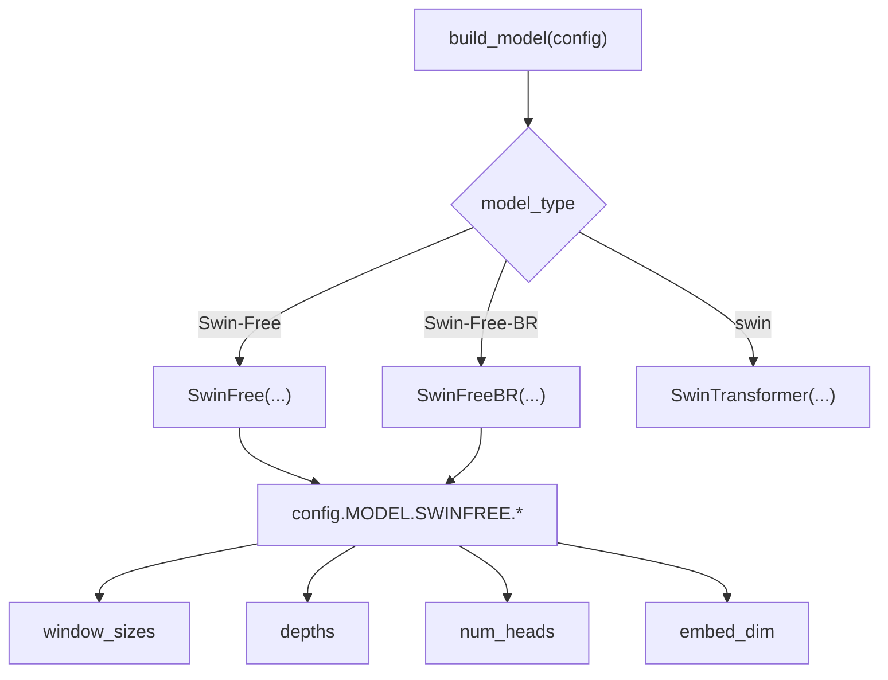

<!-- source: DeepWiki mcp.deepwiki.com · repo NVIDIA/DL4AGX · page 3.3 Swin-Free and Additional Models · fetched 2026-10-26 -->

# Swin-Free and Additional Models

Relevant source files

The following files were used as context for generating this wiki page:

- [Models/SwinFree/LICENSE-NSCLv1](Models/SwinFree/LICENSE-NSCLv1)
- [Models/SwinFree/README.md](Models/SwinFree/README.md)
- [Models/SwinFree/Swin-Free.patch](Models/SwinFree/Swin-Free.patch)
- [Models/SwinFree/swin-free.png](Models/SwinFree/swin-free.png)

This document covers the Swin-Free Transformer architecture and other additional efficient model implementations in the DL4AGX repository beyond the core ReduceFormer architecture. The Swin-Free Transformer represents an alternative approach to achieving cross-window attention in vision transformers while eliminating the computational overhead of window shifting operations found in standard Swin Transformers.

For information about the core efficient model design philosophy, see [Design Philosophy and Architecture Overview](#3.1). For details about the main ReduceFormer implementation, see [ReduceFormer Architecture](#3.2).

## Swin-Free Transformer Overview

The Swin-Free Transformer addresses a key performance bottleneck in the standard Swin Transformer: memory copy operations required for window shifting. Instead of using shifted windows to enable cross-window connections, Swin-Free employs size-varying windows across different stages while maintaining the same computational benefits.

### Key Design Differences

The fundamental innovation of Swin-Free lies in replacing the shift mechanism with stage-specific window sizes. This eliminates the need for `torch.roll` operations and their associated memory copies while preserving cross-window attention capabilities.

**Sources:** [Models/SwinFree/README.md:8-12](), [Models/SwinFree/Swin-Free.patch:628-629]()

## Implementation Architecture

The Swin-Free implementation is structured as a patch applied to the Microsoft Swin Transformer codebase, introducing new model classes and configuration parameters.

### Core Components

**Sources:** [Models/SwinFree/Swin-Free.patch:224-229](), [Models/SwinFree/Swin-Free.patch:9-21](), [Models/SwinFree/Swin-Free.patch:166-220]()

### Key Code Entities

The implementation centers around these primary classes and functions:

- `SwinFree` class: Main transformer model with size-varying windows
- `SwinFreeBR` class: Variant using BatchNorm instead of LayerNorm  
- `BasicLayer` class: Modified to disable window shifting (`shift_size=0`)
- `WindowAttention` class: Unchanged attention mechanism
- `build_model()` function: Factory method for instantiating model variants

**Sources:** [Models/SwinFree/Swin-Free.patch:713-796](), [Models/SwinFree/Swin-Free.patch:592-662](), [Models/SwinFree/Swin-Free.patch:403-541]()

## Model Variants and Configuration

Swin-Free provides multiple model variants optimized for different computational requirements and accuracy targets.

### Standard Variants

| Variant | Embed Dim | Depths | Num Heads | Window Sizes |
|---------|-----------|--------|-----------|--------------|
| Swin-Free-T | 96 | [2,2,6,2] | [3,6,12,24] | [7,14,14,7] |
| Swin-Free-S | 96 | [2,2,18,2] | [3,6,12,24] | [7,14,14,7] |
| Swin-Free-B | 128 | [2,2,18,2] | [4,8,16,32] | [7,14,14,7] |

### Depth-Reduced (DR) Variants

| Variant | Embed Dim | Depths | Num Heads | Window Sizes |
|---------|-----------|--------|-----------|--------------|
| Swin-Free-DR12-B | 128 | [2,2,12,2] | [4,8,16,32] | [7,14,14,7] |

### BatchNorm (BR) Variants

The BR variants replace LayerNorm with BatchNorm1d for potentially improved inference performance:

**Sources:** [Models/SwinFree/Swin-Free.patch:26-88](), [Models/SwinFree/Swin-Free.patch:216-219]()

## Training and Evaluation Configuration

The Swin-Free models use the same training infrastructure as standard Swin Transformers but with modified configuration files.

### Configuration Structure

**Sources:** [Models/SwinFree/README.md:29-102](), [Models/SwinFree/Swin-Free.patch:104-151]()

### Key Training Parameters

The models share common training parameters with standard Swin Transformers:

- Batch size: 128 per GPU
- Drop path rates: 0.2 (Tiny), 0.3 (Small), 0.5 (Base)
- Window sizes: Stage-specific [7,14,14,7] pattern
- Patch size: 4x4 with stride 4

## Integration with Build System

The Swin-Free models integrate into the existing model factory through the `build_model()` function:

**Sources:** [Models/SwinFree/Swin-Free.patch:182-220](), [Models/SwinFree/Swin-Free.patch:173-174]()

The key modification to support Swin-Free variants is the addition of `find_unused_parameters=True` to the DistributedDataParallel wrapper, which accommodates the different parameter usage patterns compared to standard Swin Transformers.

**Sources:** [Models/SwinFree/Swin-Free.patch:160-161]()