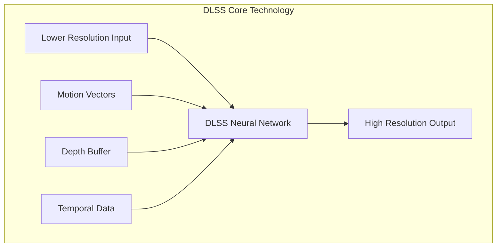
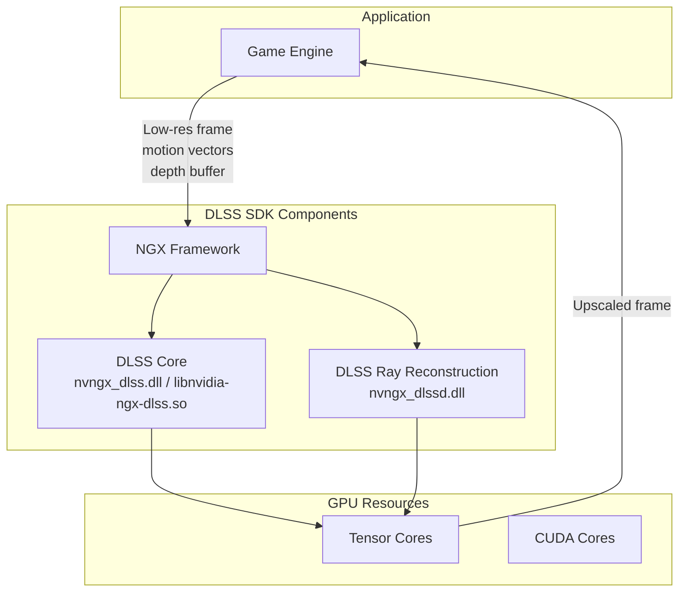
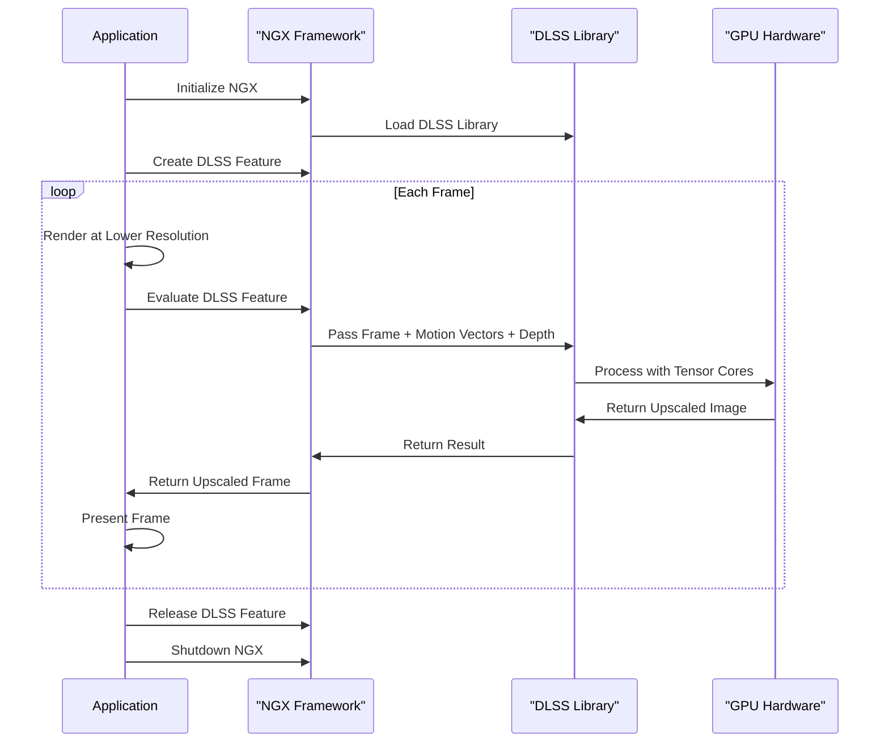
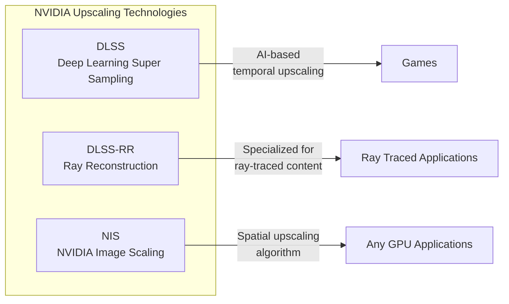

<!-- source: DeepWiki mcp.deepwiki.com · repo NVIDIA/DLSS · page 1 DLSS Overview · fetched 2026-10-26 -->

# DLSS Overview

Relevant source files

The following files were used as context for generating this wiki page:

- [.gitmodules](.gitmodules)
- [README.md](README.md)
- [doc/DLSS_Programming_Guide_Release.pdf](doc/DLSS_Programming_Guide_Release.pdf)
- [lib/Windows_x86_64/dev/nvngx_dlss.dll](lib/Windows_x86_64/dev/nvngx_dlss.dll)
- [lib/Windows_x86_64/rel/nvngx_dlss.dll](lib/Windows_x86_64/rel/nvngx_dlss.dll)

NVIDIA Deep Learning Super Sampling (DLSS) is an AI-powered upscaling technology that enhances gaming performance while maintaining high image quality. This document provides an overview of the DLSS technology, its core components, architecture, and implementation within the NVIDIA DLSS SDK.

For detailed integration instructions, see [NGX SDK Integration](#4), and for information about DLSS Ray Reconstruction, see [DLSS Ray Reconstruction](#3).

## What is DLSS?

DLSS is a neural network-based image upscaling technology that allows games to render at a lower internal resolution and then upscale to a higher output resolution. This approach provides significant performance improvements while maintaining visual quality comparable to native resolution rendering.

Sources: doc/DLSS_Programming_Guide_Release.pdf

Key benefits of DLSS include:

- **Performance Gains**: Rendering at lower resolution reduces GPU workload
- **Quality Preservation**: AI upscaling maintains visual fidelity
- **Temporal Stability**: Uses data from multiple frames for better image quality
- **Anti-aliasing**: Provides built-in anti-aliasing effects

## DLSS Architecture

DLSS is implemented as part of NVIDIA's NGX technology stack, which provides a framework for AI-assisted graphics features.

Sources: lib/Windows_x86_64/dev/nvngx_dlss.dll, lib/Windows_x86_64/rel/nvngx_dlss.dll

## Core Components

### NGX Framework

The NGX framework provides the interface between applications and DLSS, handling initialization, feature creation, and evaluation. It manages the loading of the appropriate DLSS libraries based on the platform and graphics API.

### DLSS Core Libraries

DLSS functionality is implemented in platform-specific libraries:

| Platform | Graphics API | Library File |
|----------|--------------|-------------|
| Windows  | DirectX 11, DirectX 12, Vulkan | nvngx_dlss.dll |
| Linux    | Vulkan       | libnvidia-ngx-dlss.so |

These libraries contain the trained neural networks and algorithms that perform the upscaling process.

### DLSS Quality Modes

DLSS supports multiple quality modes that offer different trade-offs between performance and image quality:

| Mode | Resolution Scale | Performance Impact |
|------|------------------|-------------------|
| Quality | ~1.5x | Lower performance gain, highest quality |
| Balanced | ~1.7x | Medium performance gain, good quality |
| Performance | ~2x | High performance gain, slightly reduced quality |
| Ultra Performance | ~3-4x | Maximum performance gain, most quality compromise |

Sources: doc/DLSS_Programming_Guide_Release.pdf

## Integration Process

Sources: doc/DLSS_Programming_Guide_Release.pdf

The basic flow for integrating DLSS into an application involves:

1. **Initialization**: Initialize the NGX library
2. **Feature Creation**: Create the DLSS feature with desired parameters
3. **Per-Frame Evaluation**: For each frame, render at lower resolution and provide the necessary inputs to DLSS
4. **Cleanup**: Release resources when done

## Hardware Requirements

DLSS requires NVIDIA RTX GPUs with Tensor Cores:
- RTX 20 Series or newer for DLSS 2.0+
- RTX 30 Series or newer recommended for optimal performance

## Relationship to Other Technologies

Sources: README.md, .gitmodules

- **DLSS**: The primary AI-based temporal upscaling technology
- **DLSS Ray Reconstruction (DLSS-RR)**: A specialized version optimized for ray-traced content
- **NVIDIA Image Scaling (NIS)**: A separate, cross-platform spatial upscaling solution included as a submodule in the repository

## Platform and API Support

DLSS supports the following platforms and graphics APIs:

| Platform | Graphics API |
|----------|--------------|
| Windows  | DirectX 11   |
| Windows  | DirectX 12   |
| Windows  | Vulkan       |
| Linux    | Vulkan       |

Sources: doc/DLSS_Programming_Guide_Release.pdf

## Summary

DLSS represents a significant advancement in real-time rendering technology, using AI to enable higher performance without sacrificing visual quality. The DLSS SDK provides developers with the tools needed to integrate this technology into their applications across multiple platforms and graphics APIs.

For detailed implementation guidance, refer to the [NGX SDK Integration](#4) section, and for information about DLSS quality settings and performance considerations, see [Quality Settings and Performance](#4.2).

---

