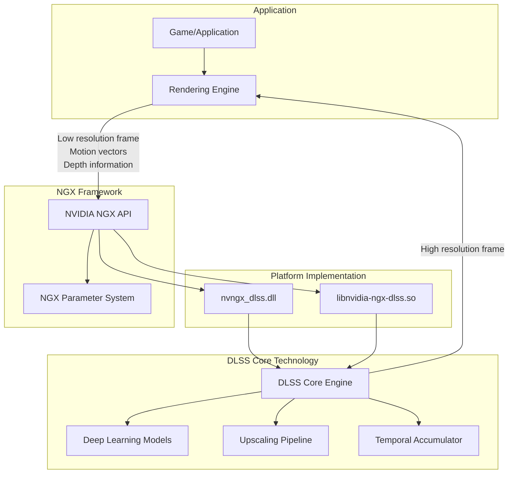
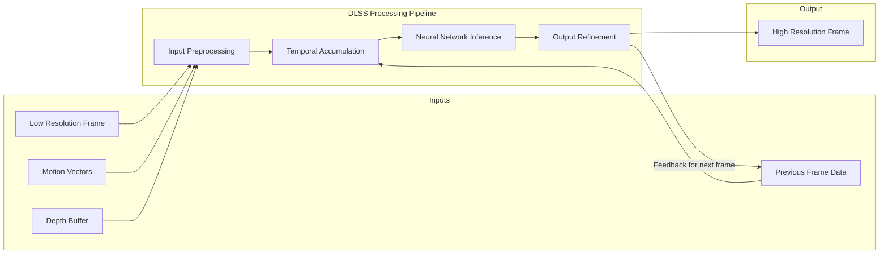
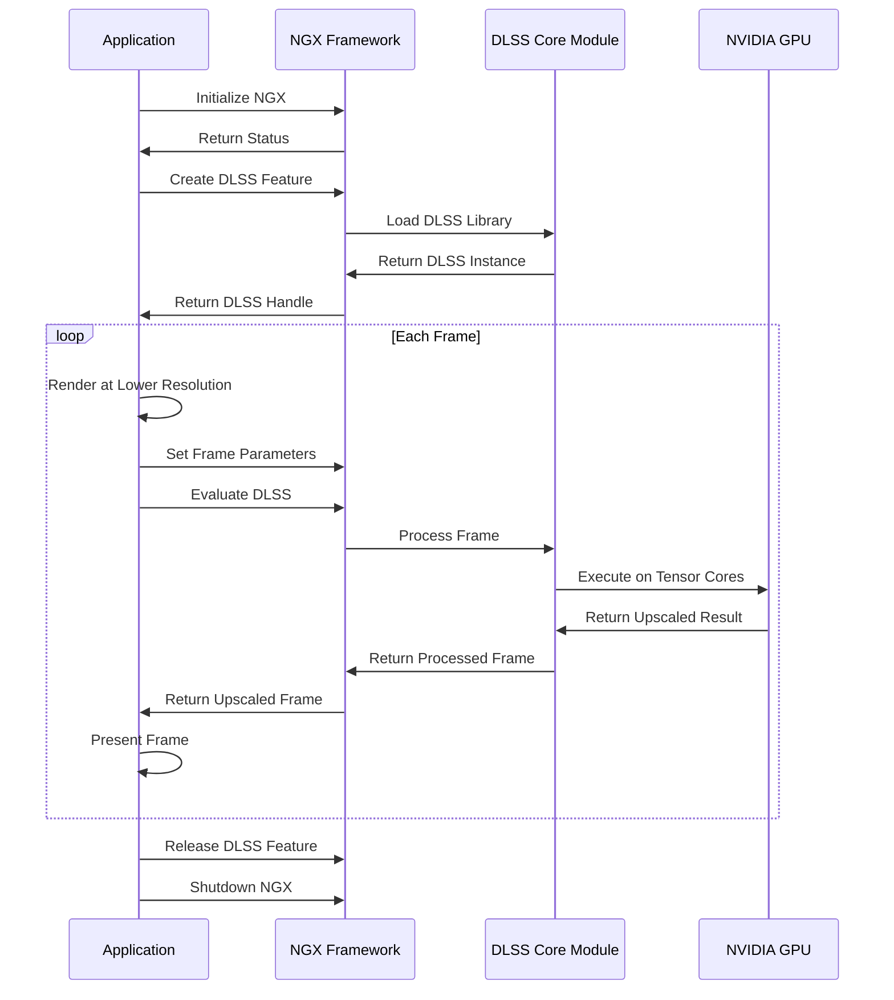
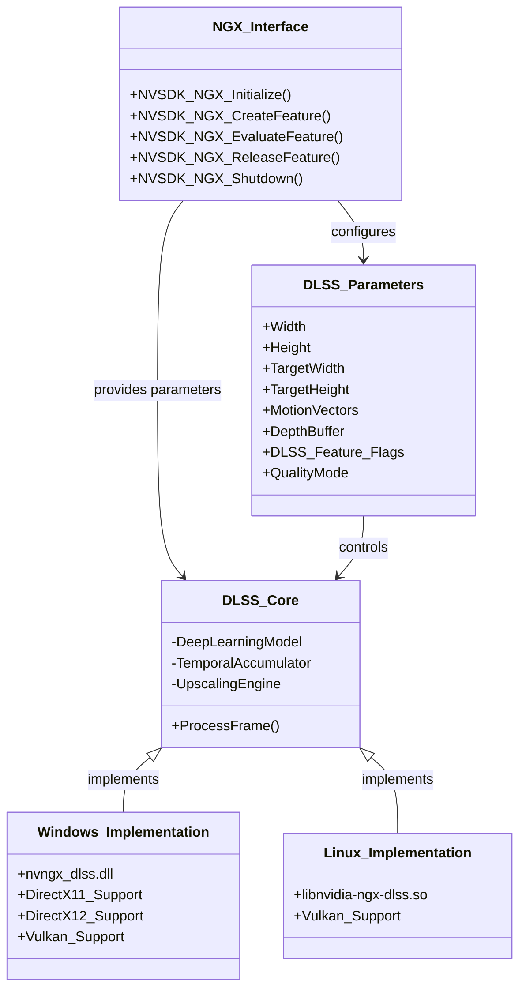
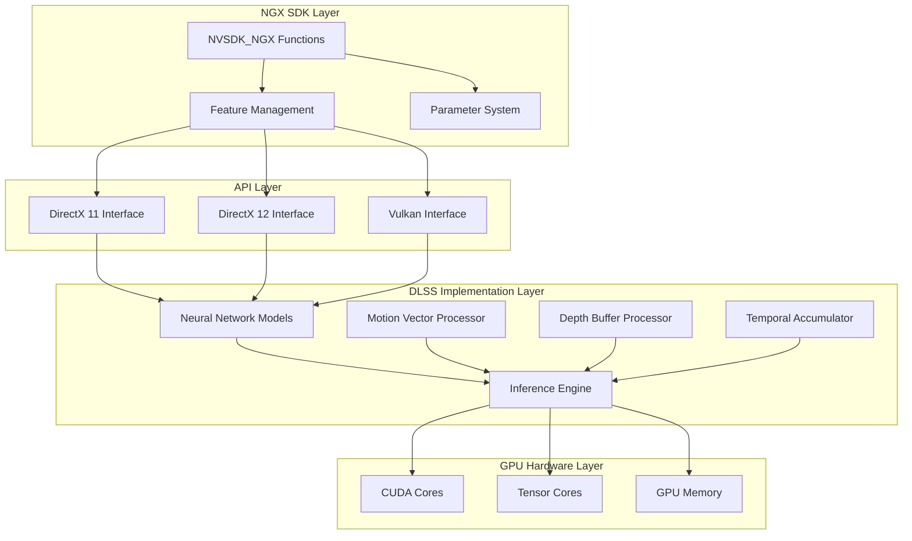

<!-- source: DeepWiki mcp.deepwiki.com · repo NVIDIA/DLSS · page 2 DLSS Core Technology · fetched 2026-10-26 -->

# DLSS Core Technology

Relevant source files

The following files were used as context for generating this wiki page:

- [doc/DLSS_Programming_Guide_Release.pdf](doc/DLSS_Programming_Guide_Release.pdf)
- [lib/Windows_x86_64/dev/nvngx_dlss.dll](lib/Windows_x86_64/dev/nvngx_dlss.dll)
- [lib/Windows_x86_64/rel/nvngx_dlss.dll](lib/Windows_x86_64/rel/nvngx_dlss.dll)

DLSS (Deep Learning Super Sampling) is NVIDIA's AI-based upscaling technology that enhances gaming performance while maintaining high visual quality. This document focuses on the core technology behind DLSS, its architecture, and how it functions at a technical level.

For information about DLSS Ray Reconstruction (DLSS-RR), see [DLSS Ray Reconstruction](#3).
For platform-specific implementation details, see [Windows Implementation](#2.1) or [Linux Implementation](#2.2).
For details on how to integrate DLSS into applications, see [NGX SDK Integration](#4).

## Core Technology Overview

DLSS Core Technology is implemented in platform-specific libraries that utilize NVIDIA's NGX framework. The technology uses neural networks to upscale lower-resolution frames to higher resolutions with image quality comparable to native rendering, allowing games to run at higher framerates while maintaining visual fidelity.

### DLSS Core Technology Architecture

Sources: lib/Windows_x86_64/dev/nvngx_dlss.dll

## Technical Principles

DLSS operates on several key technical principles that enable its high-quality, real-time upscaling capabilities:

1. **Neural Network Based Upscaling**: Uses deep learning models trained on high-quality game images to recognize patterns and reconstruct high-resolution output
2. **Temporal Feedback**: Incorporates information from previous frames to enhance detail and stability
3. **Motion Vector Utilization**: Uses motion vectors to track how pixels move between frames
4. **Depth Information Processing**: Leverages depth information to improve object boundary handling

### DLSS Processing Pipeline

Sources: lib/Windows_x86_64/dev/nvngx_dlss.dll

## Performance and Quality Modes

DLSS offers multiple quality presets that provide different tradeoffs between performance and visual quality:

| Quality Mode | Typical Upscaling Ratio | Performance Impact | Use Case |
|--------------|-----------------|-------------------|----------|
| Quality | 1.5x | Lowest performance gain | Maximum image quality |
| Balanced | 1.7x | Moderate performance gain | Good balance of quality and performance |
| Performance | 2x | High performance gain | Better performance with acceptable quality |
| Ultra Performance | 3-4x | Maximum performance gain | Maximum performance for compatible games |

The quality mode determines the internal rendering resolution before DLSS upscaling occurs. For example, in Performance mode with a target 4K output (3840x2160), the game would render at 1920x1080 and DLSS would upscale to 4K.

Sources: lib/Windows_x86_64/dev/nvngx_dlss.dll

## Integration Flow

Applications integrate with DLSS through the NVIDIA NGX framework, which provides a standardized interface for AI-enhanced features.

### DLSS Integration Sequence

Sources: lib/Windows_x86_64/dev/nvngx_dlss.dll

## Component Architecture

The DLSS Core Technology is implemented through several key components that work together to provide the upscaling functionality:

### DLSS Component Architecture

Sources: lib/Windows_x86_64/dev/nvngx_dlss.dll

## Technical Requirements

DLSS has specific hardware and software requirements to function properly:

### Hardware Requirements
- NVIDIA RTX GPU (or newer GPU with Tensor Cores)
- Sufficient GPU memory to store AI models and frame data

### Software Requirements
- Supported graphics API: DirectX 11, DirectX 12, or Vulkan
- Properly integrated NGX SDK
- Appropriate graphics driver version

### Input Requirements
For each frame, DLSS requires:
- Current low-resolution color buffer
- Motion vectors (pixel velocity data between frames)
- Depth buffer
- Exposure value (optional)

Sources: lib/Windows_x86_64/dev/nvngx_dlss.dll

## Implementation Details

The DLSS implementation consists of platform-specific libraries that contain the neural network models and processing code that performs the upscaling.

### Implementation Structure

Sources: lib/Windows_x86_64/dev/nvngx_dlss.dll

## Performance Considerations

When implementing DLSS, several factors affect performance and quality:

1. **Input Quality**: Higher quality motion vectors and depth buffers produce better upscaling results
2. **Resolution Scaling**: Different quality modes have different performance characteristics
3. **Temporal Stability**: Static scenes generally benefit from temporal accumulation
4. **GPU Load**: DLSS processing runs on dedicated Tensor Cores to minimize impact on graphics rendering

For optimal performance, applications should:
- Ensure accurate motion vectors
- Provide clean depth buffers
- Balance DLSS quality settings with target performance
- Consider jitter patterns for improved sub-pixel detail

Sources: lib/Windows_x86_64/dev/nvngx_dlss.dll

## Summary

DLSS Core Technology represents a significant advancement in real-time graphics rendering, using AI to enable higher performance while maintaining visual quality. By leveraging deep learning models and temporal data, DLSS can effectively upscale lower resolution frames to higher resolutions with minimal quality loss.

For platform-specific implementation details, refer to the [Windows Implementation](#2.1) and [Linux Implementation](#2.2) documentation. For integration guidance, see the [NGX SDK Integration](#4) page.

---

