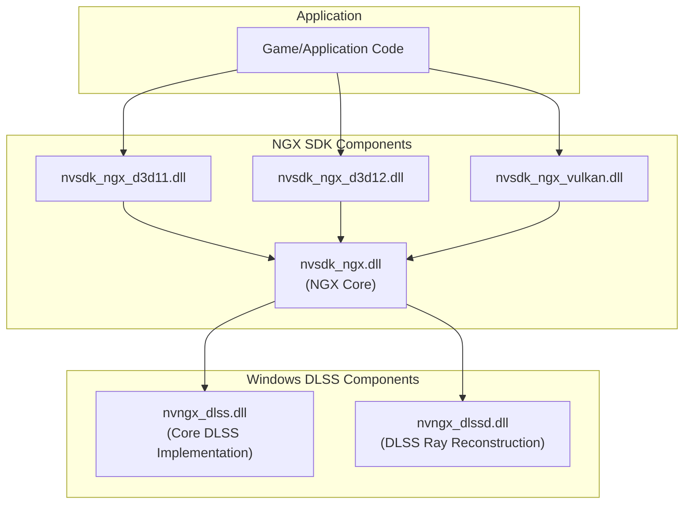
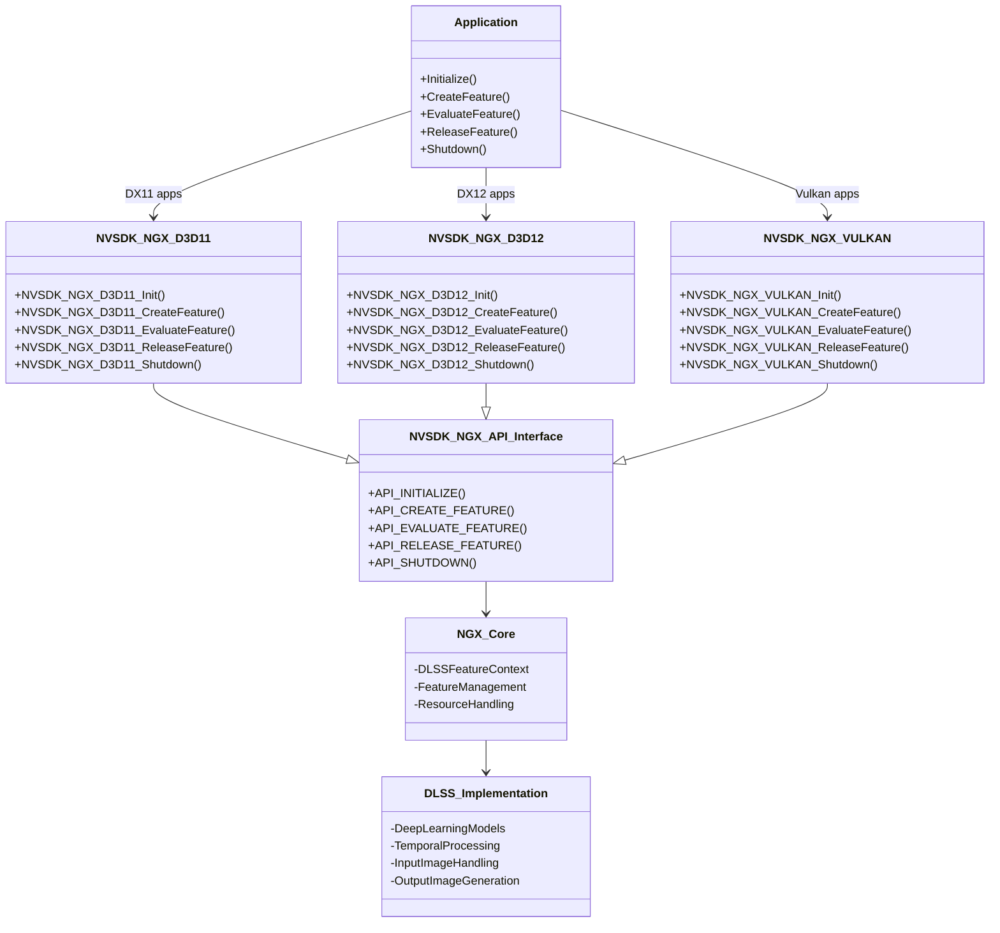
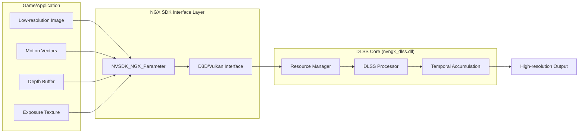
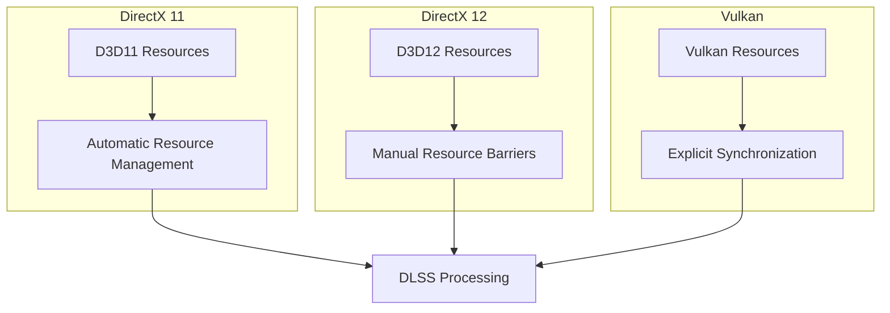
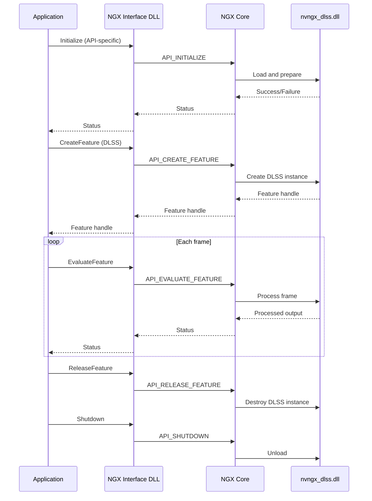

<!-- source: DeepWiki mcp.deepwiki.com · repo NVIDIA/DLSS · page 2.1 Windows Implementation · fetched 2026-10-26 -->

# Windows Implementation

Relevant source files

The following files were used as context for generating this wiki page:

- [lib/Windows_x86_64/dev/nvngx_dlss.dll](lib/Windows_x86_64/dev/nvngx_dlss.dll)
- [lib/Windows_x86_64/rel/nvngx_dlss.dll](lib/Windows_x86_64/rel/nvngx_dlss.dll)

## Purpose and Scope

This document provides technical details about the Windows implementation of NVIDIA DLSS, focusing on the dynamic-link library (DLL) architecture, interface mechanisms, and Windows-specific considerations. For information about the Linux implementation, see [Linux Implementation](#2.2).

## Core Windows DLL Components

The Windows implementation of DLSS revolves around several key DLL components that work together to provide AI-enhanced upscaling functionality:

### Key DLL Components

| Component | Description | Primary Function |
|-----------|-------------|------------------|
| `nvngx_dlss.dll` | Core DLSS implementation | Contains the AI models and processing logic for DLSS upscaling |
| `nvngx_dlssd.dll` | DLSS Ray Reconstruction | Specialized AI models for ray-traced scenes |
| `nvsdk_ngx.dll` | NGX Core functionality | Handles feature management and common operations |
| `nvsdk_ngx_d3d11.dll` | DirectX 11 interface | Provides DX11-specific implementation |
| `nvsdk_ngx_d3d12.dll` | DirectX 12 interface | Provides DX12-specific implementation |
| `nvsdk_ngx_vulkan.dll` | Vulkan interface | Provides Vulkan-specific implementation |

## Implementation Architecture

The Windows implementation follows a layered architecture that separates API-specific code from the core AI functionality:

## Data Flow in Windows DLSS Implementation

The following diagram illustrates how data flows through the Windows DLSS implementation, from the application to the final upscaled output:

## Windows-Specific Implementation Details

### Operating System and Driver Requirements

The Windows implementation of DLSS requires:

- Windows 10 64-bit or Windows 11
- NVIDIA RTX GPU (GeForce RTX 20-series or newer)
- NVIDIA Game Ready or Studio Drivers (minimum version varies by DLSS version)

### Graphics API Support

DLSS on Windows supports three main graphics APIs through dedicated interface DLLs:

| Graphics API | Interface DLL | Supported Versions |
|--------------|---------------|-------------------|
| DirectX 11 | `nvsdk_ngx_d3d11.dll` | DirectX 11.0+ |
| DirectX 12 | `nvsdk_ngx_d3d12.dll` | DirectX 12.0+ |
| Vulkan | `nvsdk_ngx_vulkan.dll` | Vulkan 1.1+ |

### Resource Management Differences

Resource management differs between graphics APIs:

## Integration Process for Windows Applications

Windows applications integrate DLSS through the following typical workflow:

1. Initialize the appropriate NGX API (DX11, DX12, or Vulkan)
2. Create DLSS feature with desired parameters
3. Evaluate DLSS feature each frame with current input resources
4. Release resources when finished

## DLL Loading and Versioning

The Windows implementation uses the following DLL search and loading approach:

1. Application directory is searched first
2. Then Windows system paths are searched
3. DLSS version is determined by the DLL version

To maintain compatibility and prevent conflicts:

1. Each application should ship with the specific DLSS DLL version it was tested with
2. Multiple applications can use different DLSS versions on the same system
3. The NGX SDK handles version compatibility checks

## Windows-Specific Performance Considerations

On Windows systems, several factors can influence DLSS performance:

- Driver overhead for different graphics APIs
- Memory allocation and management strategies
- Windows OS background processes
- GPU power states and thermal management

## Debugging DLSS on Windows

Windows developers can debug DLSS integration using:

1. Debug versions of the DLSS DLLs
2. NVIDIA Nsight Graphics for GPU profiling
3. Environment variables for logging and diagnostic output

## Conclusion

The Windows implementation of DLSS provides a robust framework for AI-powered upscaling across multiple graphics APIs. The multi-layered DLL architecture isolates graphics API specifics from the core AI functionality while maintaining high performance and compatibility across the Windows ecosystem.

---

