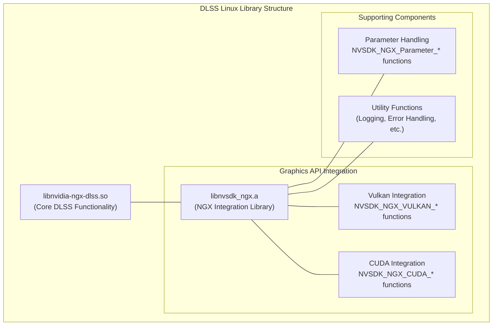
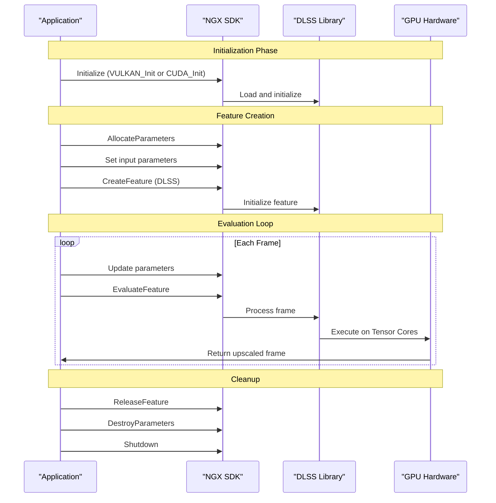
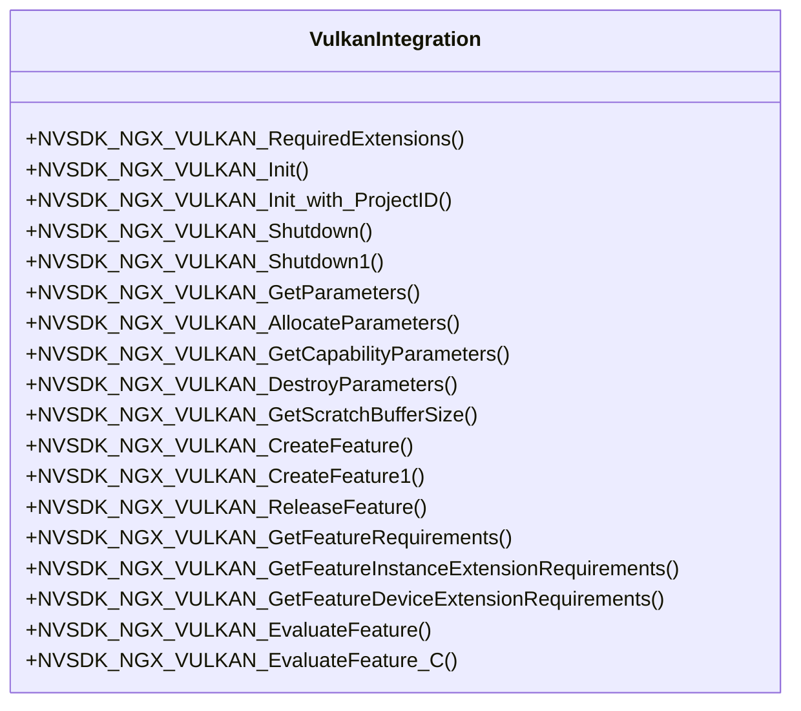
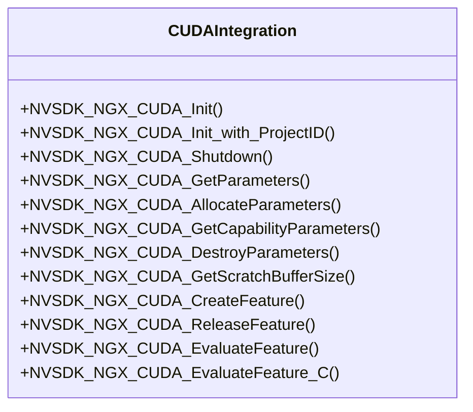
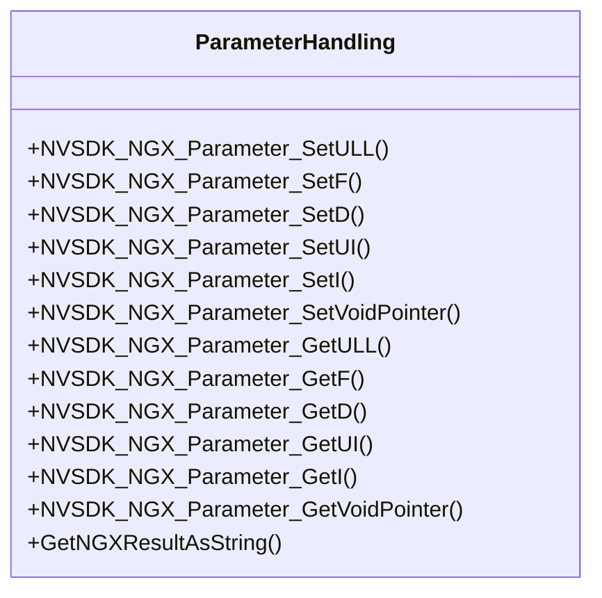
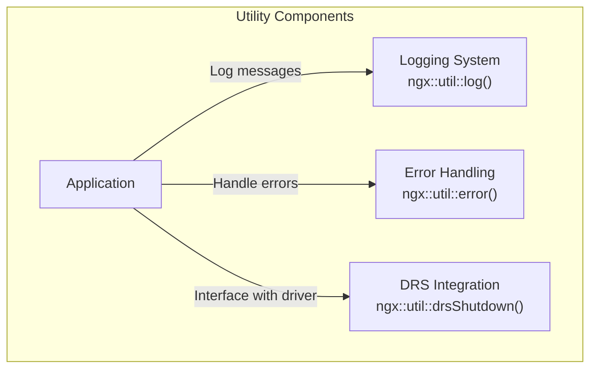

<!-- source: DeepWiki mcp.deepwiki.com · repo NVIDIA/DLSS · page 2.2 Linux Implementation · fetched 2026-10-26 -->

# Linux Implementation

<details>
<summary>Relevant source files</summary>

The following files were used as context for generating this wiki page:

- [lib/Linux_x86_64/dev/libnvidia-ngx-dlss.so.310.2.1](lib/Linux_x86_64/dev/libnvidia-ngx-dlss.so.310.2.1)
- [lib/Linux_x86_64/dev/libnvidia-ngx-dlssd.so.310.2.1](lib/Linux_x86_64/dev/libnvidia-ngx-dlssd.so.310.2.1)
- [lib/Linux_x86_64/libnvsdk_ngx.a](lib/Linux_x86_64/libnvsdk_ngx.a)

</details>


## Purpose and Scope

This document details the Linux implementation of NVIDIA DLSS (Deep Learning Super Sampling), focusing on the shared library architecture, platform-specific interfaces, and integration points available to Linux developers. The Linux implementation provides the same core functionality as the Windows version (covered in [Windows Implementation](#2.1)) but with Linux-specific integration patterns and considerations.

## Library Structure

DLSS for Linux is primarily delivered as a shared library (`libnvidia-ngx-dlss.so`), which implements the core DLSS functionality. This library is accompanied by a set of supporting libraries and header files that facilitate integration with various graphics APIs on Linux.



Sources: [lib/Linux_x86_64/libnvsdk_ngx.a]()

## Integration APIs

The Linux implementation provides two primary integration paths through Vulkan and CUDA. Both APIs follow a similar initialization, feature management, and evaluation workflow.



Sources: [lib/Linux_x86_64/libnvsdk_ngx.a]()

## Vulkan Integration

The Vulkan integration provides the primary graphics API interface for DLSS on Linux. It requires specific Vulkan extensions and follows a structured initialization and evaluation process.

### Required Extensions

The Linux implementation requires several Vulkan extensions to function properly:

| Extension Name | Purpose |
|----------------|---------|
| VK_KHR_get_physical_device_properties2 | Access to advanced device properties |
| VK_NVX_binary_import | Import binary data for neural network models |
| VK_NVX_image_view_handle | Access to image view handles for processing |
| VK_EXT_buffer_device_address | Access buffer addresses for efficient memory operations |
| VK_KHR_push_descriptor | Efficient descriptor management |

Sources: [lib/Linux_x86_64/libnvsdk_ngx.a]()

### Vulkan API Functions

The Vulkan integration provides a comprehensive set of functions for the entire DLSS lifecycle:



Sources: [lib/Linux_x86_64/libnvsdk_ngx.a]()

## CUDA Integration

The CUDA integration provides an alternative path for applications already using NVIDIA's CUDA platform for general-purpose GPU computing.



Sources: [lib/Linux_x86_64/libnvsdk_ngx.a]()

## Parameter Handling

Both integration paths use a common parameter handling system to set up and configure DLSS features:



Note that while the Windows implementation includes functions for Direct3D resources (`NVSDK_NGX_Parameter_SetD3d11Resource`, `NVSDK_NGX_Parameter_SetD3d12Resource`, etc.), these are present in the Linux library for compatibility but are non-functional as Direct3D is not supported on Linux.

Sources: [lib/Linux_x86_64/libnvsdk_ngx.a]()

## Utility Components

The Linux implementation includes several utility components that handle common tasks:

1. **Logging System** (`util-log.o`): Provides functions for debug and error logging
2. **Error Handling** (`util-err.o`): Manages error conditions and reporting
3. **DRS Integration** (`util-drs.o`): Interfaces with NVIDIA's Driver Reference System



Sources: [lib/Linux_x86_64/libnvsdk_ngx.a]()

## Platform-Specific Considerations

### Library Dependencies

The Linux implementation has several system dependencies that must be present:

- NVIDIA GPU driver with CUDA support
- Vulkan loader (for Vulkan integration)
- CUDA runtime (for CUDA integration)

### Environment Variables

The Linux implementation recognizes several environment variables to control behavior:

| Environment Variable | Purpose |
|----------------------|---------|
| `__NGX_LOG_LEVEL` | Controls verbosity of logging |
| `__NGX_LOG_PATH_OVERRIDE` | Overrides the default log file path |
| `__NGX_ENABLE_OVERRIDE_LOG_PATH` | Enables log path overriding |

Sources: [lib/Linux_x86_64/libnvsdk_ngx.a]()

## Integration Example

Below is a simplified integration example for Vulkan-based applications on Linux:

1. **Initialization**:
   ```cpp
   // Check for required Vulkan extensions
   const char** requiredExtensions;
   uint32_t extensionCount;
   NVSDK_NGX_VULKAN_RequiredExtensions(&requiredExtensions, &extensionCount);
   
   // Enable required extensions when creating Vulkan instance
   
   // Initialize DLSS
   NVSDK_NGX_Result result = NVSDK_NGX_VULKAN_Init(
       applicationId,
       applicationDataPath,
       instance,
       physicalDevice,
       device,
       commandQueue,
       NVSDK_NGX_Version_Latest
   );
   ```

2. **Feature Creation**:
   ```cpp
   // Allocate parameters
   NVSDK_NGX_Parameter* params = nullptr;
   NVSDK_NGX_VULKAN_AllocateParameters(&params);
   
   // Set parameters
   NVSDK_NGX_Parameter_SetUI(params, NVSDK_NGX_Parameter_Width, inputWidth);
   NVSDK_NGX_Parameter_SetUI(params, NVSDK_NGX_Parameter_Height, inputHeight);
   NVSDK_NGX_Parameter_SetUI(params, NVSDK_NGX_Parameter_OutWidth, outputWidth);
   NVSDK_NGX_Parameter_SetUI(params, NVSDK_NGX_Parameter_OutHeight, outputHeight);
   
   // Create DLSS feature
   NVSDK_NGX_Handle dlssFeature = nullptr;
   result = NVSDK_NGX_VULKAN_CreateFeature(
       commandBuffer,
       NVSDK_NGX_Feature_SuperSampling,
       params,
       &dlssFeature
   );
   ```

3. **Feature Evaluation (per frame)**:
   ```cpp
   // Update parameters for this frame
   NVSDK_NGX_Parameter_SetVoidPointer(params, NVSDK_NGX_Parameter_Color, inputColorResource);
   NVSDK_NGX_Parameter_SetVoidPointer(params, NVSDK_NGX_Parameter_Output, outputResource);
   NVSDK_NGX_Parameter_SetVoidPointer(params, NVSDK_NGX_Parameter_MotionVectors, motionVectorsResource);
   NVSDK_NGX_Parameter_SetVoidPointer(params, NVSDK_NGX_Parameter_Depth, depthResource);
   NVSDK_NGX_Parameter_SetF(params, NVSDK_NGX_Parameter_Jitter_Offset_X, jitterX);
   NVSDK_NGX_Parameter_SetF(params, NVSDK_NGX_Parameter_Jitter_Offset_Y, jitterY);
   
   // Evaluate DLSS
   result = NVSDK_NGX_VULKAN_EvaluateFeature(
       commandBuffer,
       dlssFeature,
       params
   );
   ```

4. **Cleanup**:
   ```cpp
   // Release resources
   NVSDK_NGX_VULKAN_ReleaseFeature(dlssFeature);
   NVSDK_NGX_VULKAN_DestroyParameters(params);
   NVSDK_NGX_VULKAN_Shutdown();
   ```

Sources: [lib/Linux_x86_64/libnvsdk_ngx.a]()

## Performance Considerations

The Linux implementation leverages the same underlying AI models and upscaling technology as the Windows version, offering similar performance characteristics. However, there may be slight differences in driver optimizations between platforms.

The same quality presets are available on Linux:

| Preset Name | Upscaling Ratio | Performance Impact |
|-------------|-----------------|-------------------|
| DLSS.Hint.Render.Preset.Quality | 1.5x | Highest quality, lowest performance gain |
| DLSS.Hint.Render.Preset.Balanced | 1.7x | Balanced quality and performance |
| DLSS.Hint.Render.Preset.Performance | 2x | Higher performance gain |
| DLSS.Hint.Render.Preset.UltraPerformance | 3-4x | Maximum performance gain |

Sources: [lib/Linux_x86_64/libnvsdk_ngx.a]()

## Limitations

The Linux implementation has a few platform-specific limitations to be aware of:

1. **Direct3D Support**: As expected, Direct3D-specific interfaces are not functional on Linux
2. **Driver Requirements**: Requires the NVIDIA proprietary driver; won't work with open-source alternatives
3. **Distribution Considerations**: Applications must account for the need to distribute or install the DLSS library with their application

Sources: [lib/Linux_x86_64/libnvsdk_ngx.a]()

---

