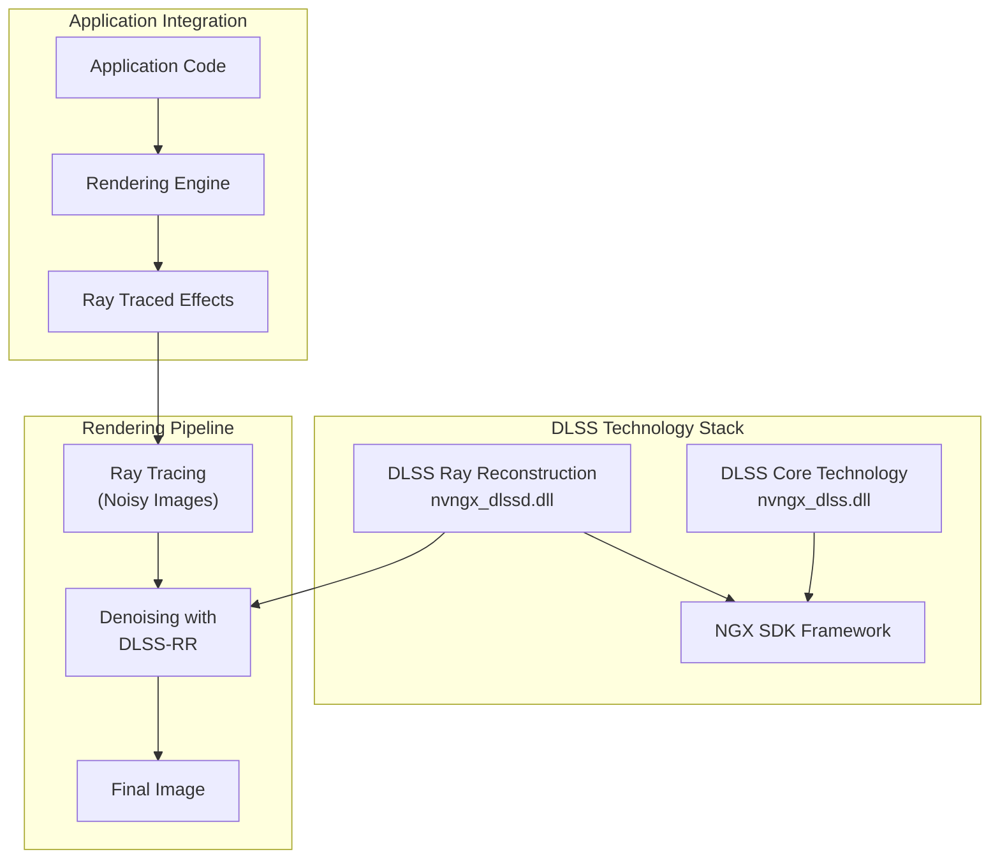
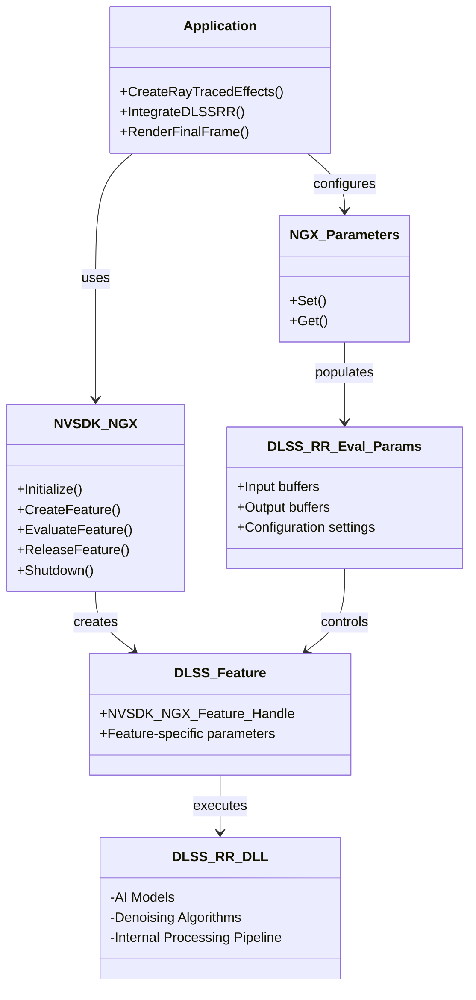
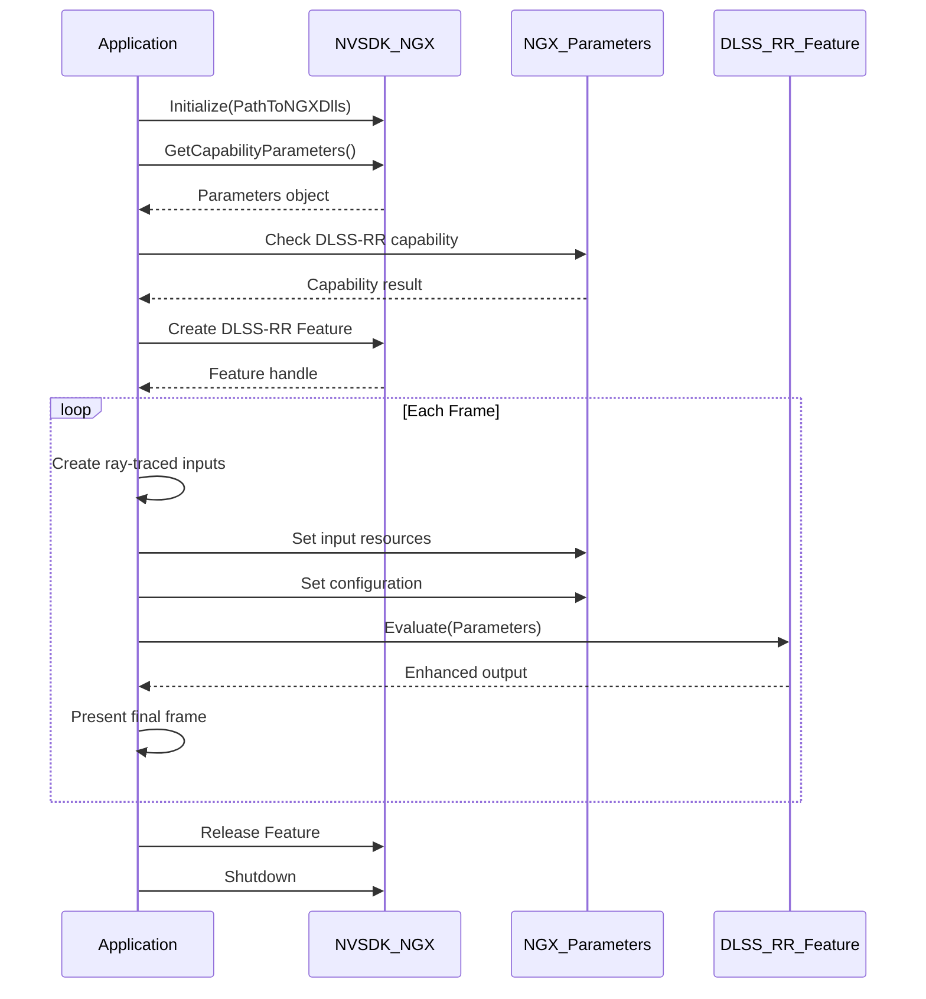
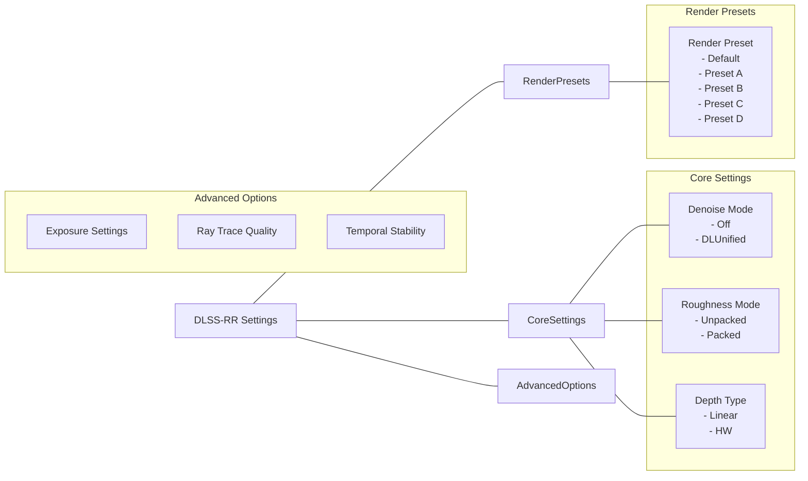
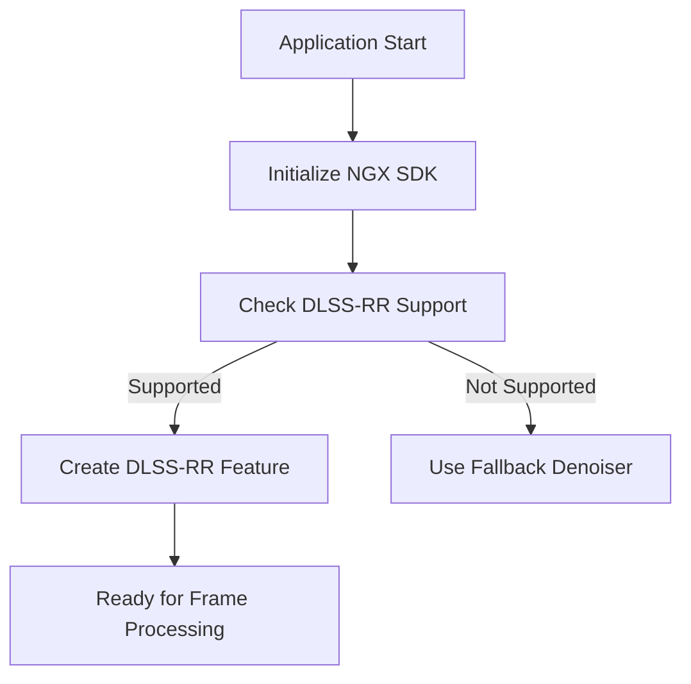
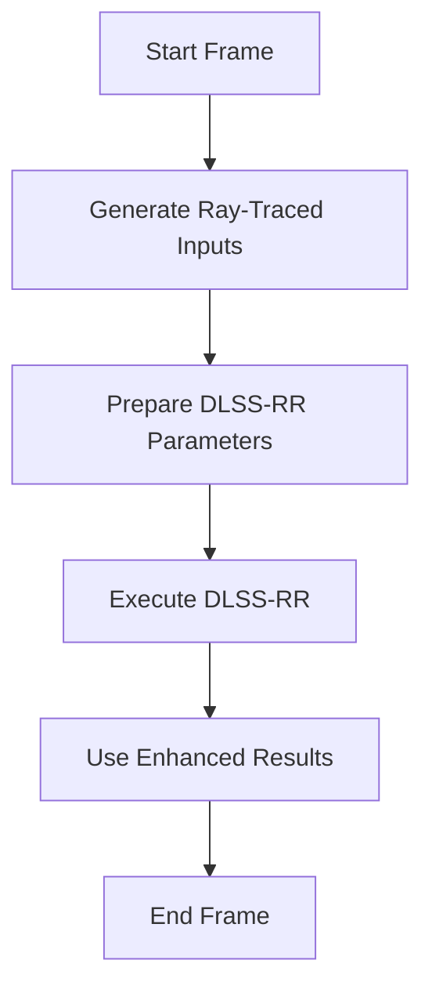
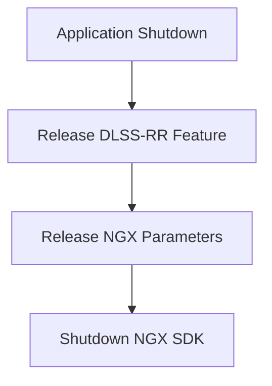

<!-- source: DeepWiki mcp.deepwiki.com · repo NVIDIA/DLSS · page 3 DLSS Ray Reconstruction · fetched 2026-10-26 -->

# DLSS Ray Reconstruction

<details>
<summary>Relevant source files</summary>

The following files were used as context for generating this wiki page:

- [doc/DLSS-RR Integration Guide API.pdf](doc/DLSS-RR Integration Guide API.pdf)
- [doc/DLSS_Programming_Guide_Release.pdf](doc/DLSS_Programming_Guide_Release.pdf)
- [include/nvsdk_ngx_defs_dlssd.h](include/nvsdk_ngx_defs_dlssd.h)
- [include/nvsdk_ngx_helpers_dlssd.h](include/nvsdk_ngx_helpers_dlssd.h)
- [include/nvsdk_ngx_helpers_dlssd_vk.h](include/nvsdk_ngx_helpers_dlssd_vk.h)
- [lib/Linux_x86_64/dev/libnvidia-ngx-dlss.so.310.2.1](lib/Linux_x86_64/dev/libnvidia-ngx-dlss.so.310.2.1)
- [lib/Linux_x86_64/dev/libnvidia-ngx-dlssd.so.310.2.1](lib/Linux_x86_64/dev/libnvidia-ngx-dlssd.so.310.2.1)
- [lib/Windows_x86_64/dev/nvngx_dlssd.dll](lib/Windows_x86_64/dev/nvngx_dlssd.dll)

</details>


## Purpose and Scope

This document describes NVIDIA's DLSS Ray Reconstruction (DLSS-RR) technology, a specialized variant of DLSS designed to enhance ray-traced renderings. DLSS-RR uses AI to improve the quality of ray-traced effects while maintaining high performance. This document covers the architecture, integration, and API details of DLSS-RR.

For general information about DLSS technology, please see [DLSS Overview](#1). For specific implementation details about the main DLSS technology, see [DLSS Core Technology](#2).

Sources: [doc/DLSS-RR Integration Guide API.pdf](), [doc/DLSS_Programming_Guide_Release.pdf]()

## Technical Overview

DLSS Ray Reconstruction is a specialized AI-powered denoising and reconstruction technology that works alongside ray-traced rendering to improve image quality and performance. Unlike standard DLSS which primarily focuses on upscaling, DLSS-RR specifically addresses the visual noise and artifacts common in ray-traced effects.



DLSS-RR provides several key benefits for ray-traced rendering:

1. **Noise reduction** - Removes visual noise from ray-traced effects with fewer samples
2. **Detail preservation** - Maintains fine details that might be lost in traditional denoising
3. **Performance improvement** - Achieves high-quality results with fewer rays
4. **Temporal stability** - Reduces flickering and improves consistency between frames

Sources: [doc/DLSS-RR Integration Guide API.pdf](), [include/nvsdk_ngx_defs_dlssd.h]()

## System Architecture

DLSS-RR functions as part of the NVIDIA NGX framework and works alongside other DLSS components. The system is structured as follows:



The core component is the `nvngx_dlssd.dll` (on Windows) which contains the AI models and algorithms specific to ray reconstruction. This DLL is loaded by the NGX framework when the DLSS-RR feature is requested by an application.

Sources: [lib/Windows_x86_64/dev/nvngx_dlssd.dll](), [include/nvsdk_ngx_helpers_dlssd.h]()

## Integration Flow

Integrating DLSS-RR into an application follows a specific sequence of operations:



Sources: [include/nvsdk_ngx_helpers_dlssd.h:23-66](), [doc/DLSS-RR Integration Guide API.pdf]()

## Required Resources and Inputs

DLSS-RR requires a comprehensive set of input resources to effectively enhance ray-traced effects. The exact requirements depend on the rendering API (DirectX or Vulkan) and the specific effects being enhanced.

Here's a breakdown of the core resources needed:

| Input Category | Resources | Purpose |
|----------------|-----------|---------|
| G-Buffer       | Diffuse Albedo, Specular Albedo, Normals, Roughness | Material information |
| Motion Data    | Motion Vectors | Temporal information |
| Depth Information | Depth Buffer | Scene geometry information |
| Ray Data       | Hit Distances, Ray Directions | Ray tracing result information |
| Intermediate Results | Before/After effect renders | For specific effects like transparency, fog, etc. |

The primary structure for organizing these inputs is the `NVSDK_NGX_D3D11_DLSSD_Eval_Params` (for DirectX) or `NVSDK_NGX_VK_DLSSD_Eval_Params` (for Vulkan).

Sources: [include/nvsdk_ngx_helpers_dlssd.h:121-223](), [include/nvsdk_ngx_helpers_dlssd_vk.h:21-122]()

## Configuration and Settings

DLSS-RR provides several configuration options to fine-tune the reconstruction process:



Key configuration settings include:

1. **Denoise Mode** - Controls the denoising algorithm used
2. **Roughness Mode** - Specifies how roughness data is provided
3. **Depth Type** - Indicates the format of depth information
4. **Render Presets** - Pre-configured settings for different quality/performance targets

Sources: [include/nvsdk_ngx_defs_dlssd.h:17-54]()

## Helper Functions

The DLSS-RR API provides several helper functions to simplify integration:

1. **NGX_DLSSD_GET_STATS** - Retrieves memory usage and other statistics
2. **NGX_DLSSD_GET_OPTIMAL_SETTINGS** - Provides recommended settings based on display resolution and quality preset

Example of retrieving DLSS-RR statistics:

```cpp
unsigned long long vramAllocatedBytes = 0;
unsigned int optLevel = 0;
NVSDK_NGX_Result result = NGX_DLSSD_GET_STATS(
    pInParams,
    &vramAllocatedBytes
);
```

Sources: [include/nvsdk_ngx_helpers_dlssd.h:23-66]()

## Integration Process

The complete integration process for DLSS-RR involves the following steps:

### 1. Initialization



### 2. Per-Frame Processing



### 3. Cleanup



Sources: [doc/DLSS-RR Integration Guide API.pdf]()

## API Data Structures

The primary data structures used for DLSS-RR integration are:

### Evaluation Parameters

This structure contains all the inputs and configuration needed for DLSS-RR processing. Two variants exist for different graphics APIs:

- **DirectX**: `NVSDK_NGX_D3D11_DLSSD_Eval_Params` 
- **Vulkan**: `NVSDK_NGX_VK_DLSSD_Eval_Params`

Both contain similar fields for:
- G-buffer components (diffuse albedo, specular albedo, normals, roughness)
- Input and output color/alpha buffers
- Depth and motion vector buffers
- Ray-traced effect buffers (hit distances, ray directions)
- Intermediate render targets for complex effects
- Configuration parameters (jitter, exposure, etc.)

Sources: [include/nvsdk_ngx_helpers_dlssd.h:121-223](), [include/nvsdk_ngx_helpers_dlssd_vk.h:21-122]()

### Enumerations

Several enumerations control the behavior of DLSS-RR:

1. **NVSDK_NGX_DLSS_Denoise_Mode** - Controls the denoising approach
   - `NVSDK_NGX_DLSS_Denoise_Mode_Off` - No denoising
   - `NVSDK_NGX_DLSS_Denoise_Mode_DLUnified` - Deep learning unified upscaler

2. **NVSDK_NGX_DLSS_Roughness_Mode** - Specifies roughness data format
   - `NVSDK_NGX_DLSS_Roughness_Mode_Unpacked` - Separate roughness texture
   - `NVSDK_NGX_DLSS_Roughness_Mode_Packed` - Roughness in normal map alpha channel

3. **NVSDK_NGX_DLSS_Depth_Type** - Specifies depth format
   - `NVSDK_NGX_DLSS_Depth_Type_Linear` - Linear depth values
   - `NVSDK_NGX_DLSS_Depth_Type_HW` - Hardware depth buffer values

Sources: [include/nvsdk_ngx_defs_dlssd.h:17-33]()

## Performance Considerations

When implementing DLSS-RR, keep these performance considerations in mind:

1. **Resource Reuse** - Where possible, reuse existing G-buffer resources from your rendering pipeline
2. **Resolution** - Consider using lower resolution ray tracing with DLSS-RR for better performance
3. **Ray Counts** - Reduce ray counts when using DLSS-RR as it can reconstruct details from fewer samples
4. **Memory Management** - Be aware of VRAM usage, especially with multiple ray-traced effects

Sources: [doc/DLSS-RR Integration Guide API.pdf]()

## Common Integration Challenges

Some common challenges when integrating DLSS-RR include:

1. **G-Buffer Format Compatibility** - Ensuring your engine's G-buffer formats are compatible with DLSS-RR
2. **Temporal Jitter** - Correctly handling temporal jitter patterns between frames
3. **Memory Management** - Balancing VRAM usage with other rendering features
4. **Effect Ordering** - Determining where in the rendering pipeline to apply DLSS-RR

Sources: [doc/DLSS-RR Integration Guide API.pdf]()

## Comparison with Standard DLSS

While DLSS and DLSS-RR are related technologies, they serve different purposes:

| Feature | Standard DLSS | DLSS Ray Reconstruction |
|---------|--------------|-------------------------|
| Primary Purpose | Image upscaling | Ray-traced effect enhancement |
| Main Focus | Resolution and detail | Noise reduction and detail reconstruction |
| Input Requirements | Color, depth, motion vectors | Multiple G-buffer elements and ray data |
| Target Workloads | General rendering | Ray-traced effects |
| Implementation DLL | nvngx_dlss.dll | nvngx_dlssd.dll |

Sources: [doc/DLSS_Programming_Guide_Release.pdf](), [doc/DLSS-RR Integration Guide API.pdf]()

## Summary

DLSS Ray Reconstruction is a specialized AI-powered technology designed to enhance ray-traced rendering. By providing high-quality denoising and detail reconstruction specifically for ray-traced effects, it enables developers to achieve better visual quality with fewer rays, improving performance while maintaining image quality.

The integration process involves initializing the NGX SDK, creating the DLSS-RR feature, providing appropriate G-buffer and ray-traced data, and evaluating the feature each frame. The technology works with both DirectX and Vulkan rendering APIs and supports a variety of ray-traced effects.

---

