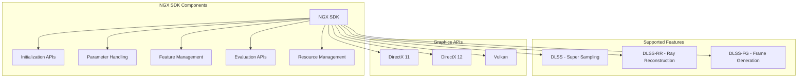
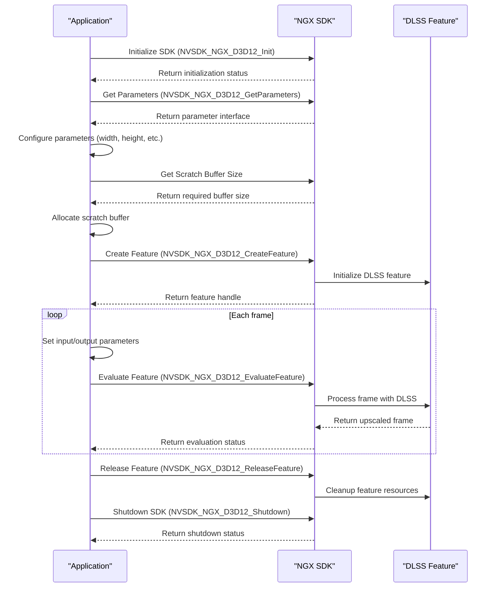
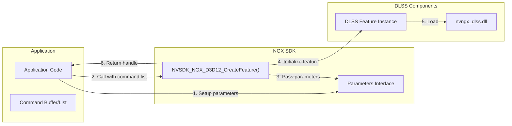
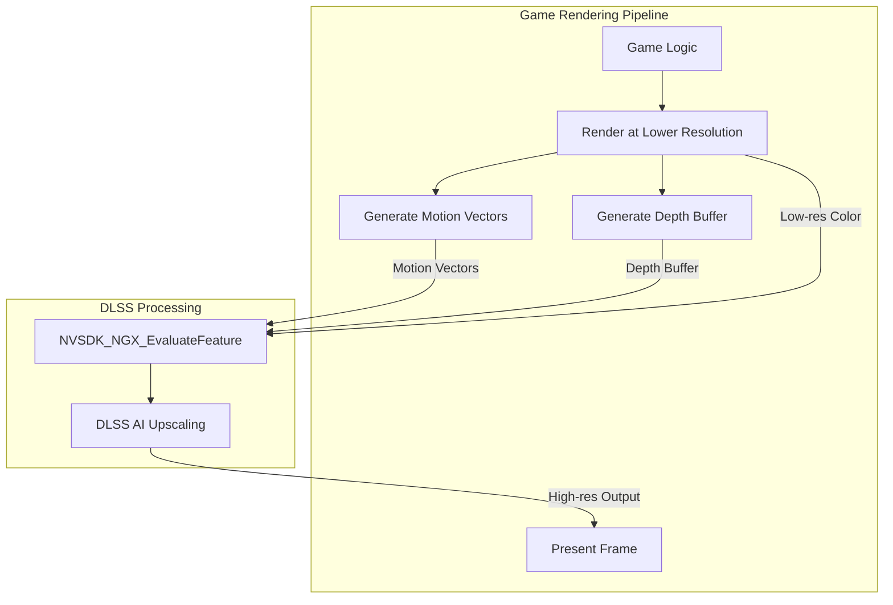

<!-- source: DeepWiki mcp.deepwiki.com · repo NVIDIA/DLSS · page 4 NGX SDK Integration · fetched 2026-10-26 -->

# NGX SDK Integration

<details>
<summary>Relevant source files</summary>

The following files were used as context for generating this wiki page:

- [doc/DLSS_Programming_Guide_Release.pdf](doc/DLSS_Programming_Guide_Release.pdf)
- [include/nvsdk_ngx.h](include/nvsdk_ngx.h)
- [include/nvsdk_ngx_defs.h](include/nvsdk_ngx_defs.h)
- [lib/Windows_x86_64/dev/nvngx_dlss.dll](lib/Windows_x86_64/dev/nvngx_dlss.dll)

</details>


This document provides comprehensive guidance on integrating NVIDIA's NGX Software Development Kit (SDK) into applications to leverage DLSS (Deep Learning Super Sampling) technology. It covers the initialization process, parameter configuration, feature creation, evaluation, and resource management for NGX SDK.

For information about DLSS Ray Reconstruction specifically, see [DLSS Ray Reconstruction](#3).

## 1. Introduction to NGX SDK

NVIDIA NGX SDK is the framework that enables integration of AI-powered features like DLSS into applications. The SDK provides a consistent interface for initializing, creating, and evaluating various NVIDIA features across different graphics APIs (DirectX 11, DirectX 12, and Vulkan).

The key components of the NGX SDK include:
- Core initialization and management functions
- Parameter handling interfaces
- Feature creation and evaluation APIs
- Resource management utilities



Sources:
- [include/nvsdk_ngx.h:20-68]()
- [include/nvsdk_ngx_defs.h:147-195]()

## 2. Integration Workflow

The NGX SDK integration follows a specific workflow pattern that consists of initialization, feature creation, evaluation, and cleanup phases. The diagram below illustrates the typical integration flow:



Sources:
- [include/nvsdk_ngx.h:13-68]()
- [include/nvsdk_ngx.h:118-225]()

## 3. SDK Initialization

The first step in integrating the NGX SDK is initialization. This establishes communication with NVIDIA's driver components and prepares the system for using DLSS features.

### 3.1 Initialization Functions

Depending on the graphics API used in your application, you'll need to call one of the following initialization functions:

| Graphics API | Initialization Function |
|--------------|-------------------------|
| DirectX 11   | `NVSDK_NGX_D3D11_Init` |
| DirectX 12   | `NVSDK_NGX_D3D12_Init` |
| Vulkan       | `NVSDK_NGX_CUDA_Init` (for Vulkan via CUDA interop) |

### 3.2 Initialization Parameters

The initialization functions require several parameters:

- **Application ID**: Unique identifier provided by NVIDIA for your application
- **Application Data Path**: Directory for storing temporary files and logs (requires write access)
- **Device**: Graphics device pointer (for DirectX APIs)
- **Feature Info**: Optional structure containing common feature information
- **SDK Version**: The SDK version being used (default is `NVSDK_NGX_Version_API`)

### 3.3 Initialization Example

```
// DirectX 12 initialization example
NVSDK_NGX_Result result = NVSDK_NGX_D3D12_Init(
    applicationId,              // Your NVIDIA-provided application ID
    applicationDataPath,        // Path to store logs and temp files
    d3d12Device,                // Your DirectX 12 device
    &featureCommonInfo,         // Optional feature common info
    NVSDK_NGX_Version_API       // SDK version
);
```

Sources:
- [include/nvsdk_ngx.h:119-166]()
- [include/nvsdk_ngx_defs.h:366-375]()

## 4. Parameter Configuration

After initializing the SDK, you need to configure parameters for the DLSS feature. This is done through the parameter interface that allows setting various inputs and options.

### 4.1 Obtaining the Parameter Interface

```
// Get parameter interface
NVSDK_NGX_Parameter* params = nullptr;
NVSDK_NGX_Result result = NVSDK_NGX_D3D12_GetParameters(&params);
```

### 4.2 Setting Required Parameters

DLSS requires several essential parameters to function correctly:

| Parameter | Description | Required |
|-----------|-------------|----------|
| `NVSDK_NGX_Parameter_Width` | Input width | Yes |
| `NVSDK_NGX_Parameter_Height` | Input height | Yes |
| `NVSDK_NGX_Parameter_OutWidth` | Output width | Yes |
| `NVSDK_NGX_Parameter_OutHeight` | Output height | Yes |
| `NVSDK_NGX_Parameter_PerfQualityValue` | Quality setting | Yes |
| `NVSDK_NGX_Parameter_DLSS_Feature_Create_Flags` | Feature flags | Yes |
| `NVSDK_NGX_Parameter_Scratch` | Scratch buffer pointer | Yes, if needed |
| `NVSDK_NGX_Parameter_Scratch_SizeInBytes` | Scratch buffer size | Yes, if needed |

### 4.3 Quality Settings

DLSS offers several quality modes that balance performance and visual quality:

| Quality Mode | Constant | Typical Scale Factor |
|--------------|----------|----------------------|
| Ultra Performance | `NVSDK_NGX_PerfQuality_Value_UltraPerformance` | 3.0x |
| Performance | `NVSDK_NGX_PerfQuality_Value_MaxPerf` | 2.0x |
| Balanced | `NVSDK_NGX_PerfQuality_Value_Balanced` | 1.7x |
| Quality | `NVSDK_NGX_PerfQuality_Value_MaxQuality` | 1.5x |
| DLAA (no upscaling) | `NVSDK_NGX_PerfQuality_Value_DLAA` | 1.0x |

### 4.4 Feature Flags

DLSS supports various feature flags that can be combined using bitwise OR operations:

```
// Example of setting feature flags
unsigned int flags = NVSDK_NGX_DLSS_Feature_Flags_None;
if (isHDRContent) {
    flags |= NVSDK_NGX_DLSS_Feature_Flags_IsHDR;
}
if (useSharpening) {
    flags |= NVSDK_NGX_DLSS_Feature_Flags_DoSharpening;
}
params->Set(NVSDK_NGX_Parameter_DLSS_Feature_Create_Flags, flags);
```

Sources:
- [include/nvsdk_ngx_defs.h:209-218]() // Quality settings
- [include/nvsdk_ngx_defs.h:254-267]() // Feature flags
- [include/nvsdk_ngx.h:227-243]() // Parameter interface

## 5. Scratch Buffer Allocation

DLSS requires a temporary scratch buffer for internal computations. The size of this buffer depends on the resolution and feature configuration.

### 5.1 Determining Buffer Size

```
// Get required scratch buffer size
size_t scratchBufferSize = 0;
NVSDK_NGX_Result result = NVSDK_NGX_D3D12_GetScratchBufferSize(
    NVSDK_NGX_Feature_SuperSampling,
    params,
    &scratchBufferSize
);
```

### 5.2 Allocating and Setting the Buffer

After determining the required size, you need to allocate the buffer and provide it to the SDK:

```
// Allocate scratch buffer (implementation depends on your rendering API)
void* scratchBuffer = AllocateScratchBuffer(scratchBufferSize);

// Set scratch buffer parameters
params->Set(NVSDK_NGX_Parameter_Scratch, scratchBuffer);
params->Set(NVSDK_NGX_Parameter_Scratch_SizeInBytes, scratchBufferSize);
```

Sources:
- [include/nvsdk_ngx.h:42-50]()

## 6. Feature Creation

Once parameters are configured, you can create the DLSS feature instance.

### 6.1 Creating DLSS Feature

```
// Create DLSS feature
NVSDK_NGX_Handle dlssHandle = {};
NVSDK_NGX_Result result = NVSDK_NGX_D3D12_CreateFeature(
    commandList,                     // Command list/buffer for your API
    NVSDK_NGX_Feature_SuperSampling, // Feature type (DLSS)
    params,                          // Parameter interface
    &dlssHandle                      // Output handle
);
```

### 6.2 Feature Creation Diagram



Sources:
- [include/nvsdk_ngx.h:51-55]()
- [include/nvsdk_ngx_defs.h:234]() // Handle definition

## 7. Feature Evaluation

After creating the DLSS feature, you can evaluate it each frame to perform upscaling.

### 7.1 Setting Input Resources

Before evaluation, you need to set the input resources for the current frame:

| Parameter | Description | Required |
|-----------|-------------|----------|
| `NVSDK_NGX_Parameter_Color` | Input color buffer | Yes |
| `NVSDK_NGX_Parameter_Output` | Output upscaled buffer | Yes |
| `NVSDK_NGX_Parameter_MotionVectors` | Motion vectors | Yes |
| `NVSDK_NGX_Parameter_Depth` | Depth buffer | Recommended |
| `NVSDK_NGX_Parameter_ExposureTexture` | Exposure data | Optional |
| `NVSDK_NGX_Parameter_Jitter_Offset_X` | Jitter X offset | Optional |
| `NVSDK_NGX_Parameter_Jitter_Offset_Y` | Jitter Y offset | Optional |

### 7.2 Evaluating the Feature

```
// Evaluate DLSS (upscale the current frame)
NVSDK_NGX_Result result = NVSDK_NGX_D3D12_EvaluateFeature(
    commandList,  // Command list/buffer
    dlssHandle,   // Feature handle from CreateFeature
    params,       // Parameter interface with inputs set
    nullptr       // Optional callback
);
```

### 7.3 DLSS Integration in Rendering Pipeline



Sources:
- [include/nvsdk_ngx.h:57-62]()

## 8. Resource Management

Proper resource management is essential for integrating DLSS efficiently into your application.

### 8.1 Releasing Features

When a DLSS feature is no longer needed, it should be released to free resources:

```
// Release DLSS feature
NVSDK_NGX_Result result = NVSDK_NGX_D3D12_ReleaseFeature(dlssHandle);
```

### 8.2 Shutting Down the SDK

When your application is terminating or no longer needs NGX functionality, shut down the SDK:

```
// Shutdown NGX SDK
NVSDK_NGX_Result result = NVSDK_NGX_D3D12_Shutdown1(d3d12Device);
```

Sources:
- [include/nvsdk_ngx.h:61-65]()
- [include/nvsdk_ngx.h:210-225]()

## 9. Error Handling

The NGX SDK provides comprehensive error reporting through return values. Always check return values from SDK functions to ensure proper operation.

### 9.1 Common Error Codes

| Error Code | Description |
|------------|-------------|
| `NVSDK_NGX_Result_Success` | Operation completed successfully |
| `NVSDK_NGX_Result_FAIL_FeatureNotSupported` | Feature not supported on current hardware |
| `NVSDK_NGX_Result_FAIL_PlatformError` | Error in the underlying platform |
| `NVSDK_NGX_Result_FAIL_InvalidParameter` | One or more parameters are invalid |
| `NVSDK_NGX_Result_FAIL_OutOfDate` | NGX system libraries need an update |
| `NVSDK_NGX_Result_FAIL_OutOfGPUMemory` | Insufficient GPU memory |
| `NVSDK_NGX_Result_FAIL_UnsupportedFormat` | Input format not supported |

### 9.2 Error Checking Macros

The SDK provides convenient macros for checking result values:

```
NVSDK_NGX_Result result = NVSDK_NGX_D3D12_Init(...);
if (NVSDK_NGX_FAILED(result)) {
    // Handle initialization failure
}
```

Sources:
- [include/nvsdk_ngx_defs.h:84-143]()
- [include/nvsdk_ngx_defs.h:145-146]()

## 10. Platform-Specific Considerations

### 10.1 DirectX 11 Integration

For DirectX 11 applications, use the `NVSDK_NGX_D3D11_*` family of functions.

Key considerations:
- Ensure resources have appropriate read/write flags
- Use `D3D11_RESOURCE_MISC_GENERATE_MIPS` for mipmap generation if needed

### 10.2 DirectX 12 Integration

For DirectX 12 applications, use the `NVSDK_NGX_D3D12_*` family of functions.

Key considerations:
- Manage resource states explicitly before passing to NGX
- Ensure resources are in the correct state after NGX returns

### 10.3 Vulkan Integration

For Vulkan applications, integration is handled through CUDA interop with `NVSDK_NGX_CUDA_*` functions.

Key considerations:
- Set up CUDA-Vulkan interoperation first
- Create external memory objects that can be shared between Vulkan and CUDA

Sources:
- [include/nvsdk_ngx.h:87-108]() // Resource handling functions

## 11. Integration Checklist

To ensure a successful integration of DLSS using the NGX SDK, follow this checklist:

1. Initialize NGX SDK with valid application ID and paths
2. Configure parameters correctly, particularly resolution and quality settings
3. Allocate and set scratch buffer if required
4. Create DLSS feature with appropriate flags
5. For each frame:
   - Set input resources (color, motion vectors, depth)
   - Evaluate DLSS feature
   - Use upscaled output in your rendering pipeline
6. Release resources when no longer needed
7. Shut down SDK on application termination

This checklist helps ensure that all necessary steps are completed in the proper sequence for optimal DLSS integration.

Sources:
- [include/nvsdk_ngx.h:13-68]()

## Conclusion

The NGX SDK provides a powerful and flexible way to integrate DLSS technology into applications. By following the steps outlined in this document, developers can enhance their applications with NVIDIA's AI-powered upscaling technology, delivering superior image quality at higher performance.

For more detailed information about specific DLSS features and optimizations, refer to the DLSS Programming Guide and other related documentation provided by NVIDIA.

---

