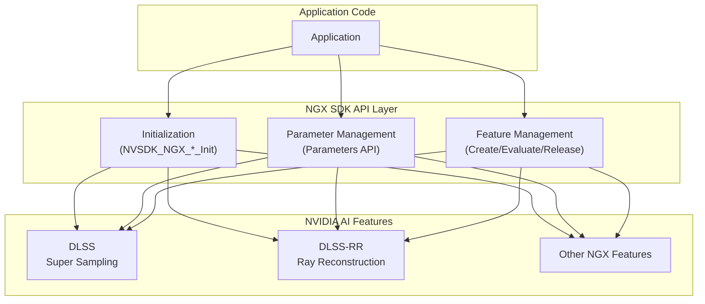
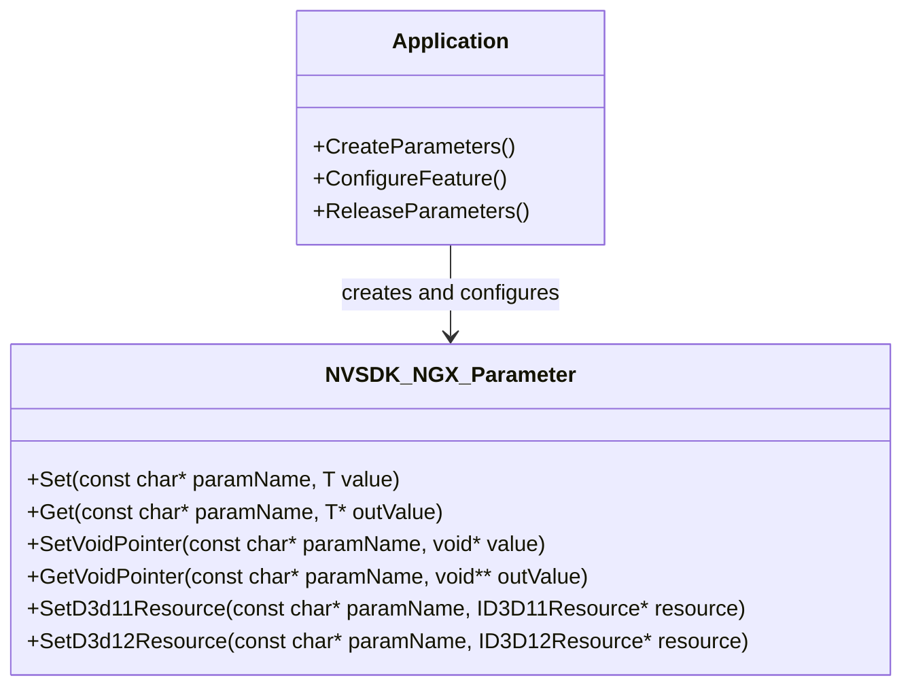
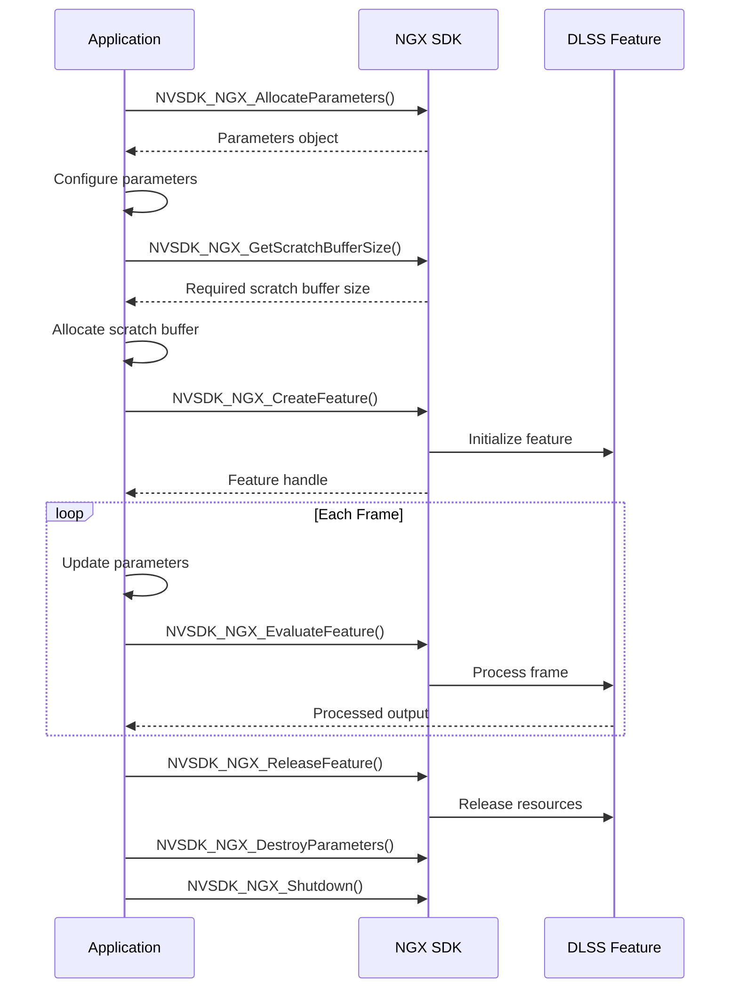
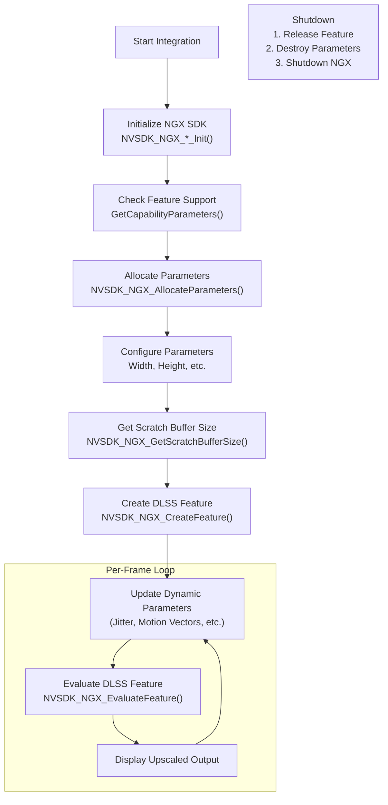

<!-- source: DeepWiki mcp.deepwiki.com · repo NVIDIA/DLSS · page 4.1 API Reference · fetched 2026-10-26 -->

# API Reference

<details>
<summary>Relevant source files</summary>

The following files were used as context for generating this wiki page:

- [doc/DLSS-RR Integration Guide API.pdf](doc/DLSS-RR Integration Guide API.pdf)
- [include/nvsdk_ngx.h](include/nvsdk_ngx.h)
- [include/nvsdk_ngx_defs.h](include/nvsdk_ngx_defs.h)
- [include/nvsdk_ngx_defs_dlssd.h](include/nvsdk_ngx_defs_dlssd.h)
- [include/nvsdk_ngx_helpers_dlssd.h](include/nvsdk_ngx_helpers_dlssd.h)
- [include/nvsdk_ngx_helpers_dlssd_vk.h](include/nvsdk_ngx_helpers_dlssd_vk.h)
- [lib/Windows_x86_64/dev/nvngx_dlssd.dll](lib/Windows_x86_64/dev/nvngx_dlssd.dll)

</details>


This page provides a comprehensive reference of the NVIDIA DLSS SDK's Application Programming Interface (API), focusing on the functions, parameters, and data structures used to integrate DLSS capabilities into applications. For information about DLSS Core Technology, see [DLSS Core Technology](#2), or for DLSS Ray Reconstruction (DLSS-RR) details, see [DLSS Ray Reconstruction](#3).

## API Overview

The NVIDIA NGX API provides a unified interface for accessing NVIDIA's AI-based features, including DLSS (Deep Learning Super Sampling) and DLSS-RR (Ray Reconstruction). The API is designed to be graphics API-agnostic with specialized implementations for DirectX 11, DirectX 12, and Vulkan.



Sources: [include/nvsdk_ngx.h:12-68](), [include/nvsdk_ngx_defs.h:148-195]()

## API Initialization and Shutdown

The first step in using the DLSS SDK is initializing the NGX framework for your graphics API. The SDK provides specialized initialization functions for each supported graphics API.

### Initialization Functions

| Function | Graphics API | Description |
|----------|--------------|-------------|
| `NVSDK_NGX_D3D11_Init` | DirectX 11 | Initializes NGX with a DirectX 11 device |
| `NVSDK_NGX_D3D12_Init` | DirectX 12 | Initializes NGX with a DirectX 12 device |
| `NVSDK_NGX_CUDA_Init` | CUDA | Initializes NGX for CUDA implementation |
| `NVSDK_NGX_D3D11_Init_with_ProjectID` | DirectX 11 | Initializes with engine-specific project ID |
| `NVSDK_NGX_D3D12_Init_with_ProjectID` | DirectX 12 | Initializes with engine-specific project ID |
| `NVSDK_NGX_CUDA_Init_with_ProjectID` | CUDA | Initializes with engine-specific project ID |

Each initialization function requires:
- A unique application identifier or project ID
- Path to store application data (logs, etc.)
- A graphics device
- Optional feature information

### Shutdown Functions

| Function | Graphics API | Description |
|----------|--------------|-------------|
| `NVSDK_NGX_D3D11_Shutdown1` | DirectX 11 | Shuts down NGX for a specific D3D11 device |
| `NVSDK_NGX_D3D12_Shutdown1` | DirectX 12 | Shuts down NGX for a specific D3D12 device |
| `NVSDK_NGX_CUDA_Shutdown` | CUDA | Shuts down NGX CUDA implementation |

Sources: [include/nvsdk_ngx.h:120-225]()

## Parameter Management

NGX uses a parameter system to configure features. The SDK provides functions to create, manage, and destroy parameter objects.



### Parameter Functions

| Function | Description |
|----------|-------------|
| `NVSDK_NGX_AllocateParameters` | Allocates a new parameter object |
| `NVSDK_NGX_GetCapabilityParameters` | Creates parameters populated with NGX capabilities |
| `NVSDK_NGX_DestroyParameters` | Destroys a parameter object |

### Key Parameter Constants

The SDK defines numerous parameter constants for configuring DLSS and other features. Some essential parameters include:

| Parameter Constant | Description |
|----------|-------------|
| `NVSDK_NGX_Parameter_Width` | Input width |
| `NVSDK_NGX_Parameter_Height` | Input height |
| `NVSDK_NGX_Parameter_OutWidth` | Output width |
| `NVSDK_NGX_Parameter_OutHeight` | Output height |
| `NVSDK_NGX_Parameter_Sharpness` | DLSS sharpness value |
| `NVSDK_NGX_Parameter_PerfQualityValue` | Quality mode (performance vs. quality) |
| `NVSDK_NGX_Parameter_DLSS_Feature_Create_Flags` | DLSS creation flags |
| `NVSDK_NGX_Parameter_Jitter_Offset_X` | Jitter offset X for temporal techniques |
| `NVSDK_NGX_Parameter_Jitter_Offset_Y` | Jitter offset Y for temporal techniques |

Sources: [include/nvsdk_ngx.h:257-339](), [include/nvsdk_ngx_defs.h:512-772]()

## Feature Management

After initialization and parameter setup, you can create, evaluate, and release NGX features like DLSS.

### Feature Lifecycle



### Feature Functions

| Function | Description |
|----------|-------------|
| `NVSDK_NGX_GetScratchBufferSize` | Gets required size for scratch buffer |
| `NVSDK_NGX_CreateFeature` | Creates an instance of a feature (DLSS, etc.) |
| `NVSDK_NGX_EvaluateFeature` | Processes input using the feature |
| `NVSDK_NGX_ReleaseFeature` | Releases a feature instance |

### Feature Types

The `NVSDK_NGX_Feature` enum defines the available AI features:

| Feature | Value | Description |
|---------|-------|-------------|
| `NVSDK_NGX_Feature_SuperSampling` | 1 | DLSS upscaling feature |
| `NVSDK_NGX_Feature_InPainting` | 2 | AI inpainting |
| `NVSDK_NGX_Feature_ImageSuperResolution` | 3 | Image upscaling |
| `NVSDK_NGX_Feature_DeepResolve` | 10 | Deep resolve feature |
| `NVSDK_NGX_Feature_FrameGeneration` | 11 | Frame generation (DLSS 3) |
| `NVSDK_NGX_Feature_RayReconstruction` | 13 | DLSS Ray Reconstruction |

Sources: [include/nvsdk_ngx.h:342-487](), [include/nvsdk_ngx_defs.h:148-195]()

## DLSS-Specific API

The DLSS feature provides specialized helper functions and data structures for easier integration.

### DLSS-RR Helper Functions

Helper functions for DLSS Ray Reconstruction (DLSS-RR) simplify common operations:

| Function | Description |
|----------|-------------|
| `NGX_DLSSD_GET_OPTIMAL_SETTINGS` | Gets optimal render resolution and settings |
| `NGX_DLSSD_GET_STATS` | Retrieves statistics about DLSS-RR usage |
| `NGX_D3D11_CREATE_DLSSD_EXT` | Helper to create DLSS-RR with D3D11 |
| `NGX_D3D11_EVALUATE_DLSSD_EXT` | Helper to evaluate DLSS-RR with D3D11 |

Similar helpers exist for DirectX 12 and Vulkan implementations.

### DLSS-RR Parameters Structure

The `NVSDK_NGX_DLSSD_Create_Params` structure contains parameters for creating a DLSS-RR instance:

```
typedef struct NVSDK_NGX_DLSSD_Create_Params
{
    unsigned int InWidth;                // Input resolution width
    unsigned int InHeight;               // Input resolution height
    unsigned int InTargetWidth;          // Output resolution width
    unsigned int InTargetHeight;         // Output resolution height
    NVSDK_NGX_PerfQuality_Value InPerfQualityValue; // Quality mode
    NVSDK_NGX_DLSS_Feature_Flags InFeatureCreateFlags; // Feature flags
    unsigned int InInternalAllocations;  // Internal allocations control
    bool InEnableOutputSubrects;         // Enable output subrectangles
    NVSDK_NGX_DLSS_Roughness_Mode InRoughnessMode; // Roughness mode
    unsigned int InUseHWDepth;           // Use hardware depth
} NVSDK_NGX_DLSSD_Create_Params;
```

### DLSS-RR Evaluation Parameters

The `NVSDK_NGX_D3D11_DLSSD_Eval_Params` structure (and equivalent structures for other APIs) contains parameters for evaluating DLSS-RR on each frame:

```
typedef struct NVSDK_NGX_D3D11_DLSSD_Eval_Params
{
    // Main inputs
    ID3D11Resource* pInDiffuseAlbedo;
    ID3D11Resource* pInSpecularAlbedo;
    ID3D11Resource* pInNormals;
    ID3D11Resource* pInRoughness;
    ID3D11Resource* pInColor;
    ID3D11Resource* pInDepth;
    ID3D11Resource* pInMotionVectors;
    
    // Output
    ID3D11Resource* pInOutput;
    
    // Camera/View parameters
    float InJitterOffsetX;
    float InJitterOffsetY;
    
    // Optional inputs and parameters
    // (Many additional fields omitted for brevity)
} NVSDK_NGX_D3D11_DLSSD_Eval_Params;
```

Sources: [include/nvsdk_ngx_helpers_dlssd.h:22-119](), [include/nvsdk_ngx_helpers_dlssd.h:121-227](), [include/nvsdk_ngx_defs_dlssd.h:17-54]()

## Integration Workflow

The following diagram shows the typical workflow for integrating DLSS into an application:



Sources: [include/nvsdk_ngx.h:12-68](), [include/nvsdk_ngx.h:367-417]()

## Error Handling

The API uses the `NVSDK_NGX_Result` enum for error codes and provides macros to check for success or failure.

| Function/Macro | Description |
|----------------|-------------|
| `NVSDK_NGX_SUCCEED(value)` | Checks if a result code indicates success |
| `NVSDK_NGX_FAILED(value)` | Checks if a result code indicates failure |
| `GetNGXResultAsString()` | Converts result code to human-readable string |

Common result codes:

| Result Code | Description |
|-------------|-------------|
| `NVSDK_NGX_Result_Success` | Operation succeeded |
| `NVSDK_NGX_Result_FAIL_FeatureNotSupported` | Feature not supported on current hardware |
| `NVSDK_NGX_Result_FAIL_PlatformError` | Platform-specific error occurred |
| `NVSDK_NGX_Result_FAIL_OutOfDate` | NGX system libraries need updating |
| `NVSDK_NGX_Result_FAIL_OutOfGPUMemory` | Not enough GPU memory for the feature |
| `NVSDK_NGX_Result_FAIL_Denied` | Feature or application was denied |

Sources: [include/nvsdk_ngx_defs.h:84-146](), [include/nvsdk_ngx.h:496-497]()

## Platform-Specific Considerations

The API provides platform-specific implementations for different graphics APIs:

### DirectX 11
- Uses `ID3D11Device` and `ID3D11DeviceContext` for initialization and evaluation
- Resources are passed as `ID3D11Resource` pointers
- Uses immediate context for command execution

### DirectX 12
- Uses `ID3D12Device` and `ID3D12GraphicsCommandList` for operations
- Command lists must be open and recording when passed to API functions
- Resources are passed as `ID3D12Resource` pointers

### Vulkan
- Resources are wrapped in `NVSDK_NGX_Resource_VK` structures
- Requires careful synchronization with Vulkan command buffers
- Special considerations for resource state transitions

Sources: [include/nvsdk_ngx.h:89-107](), [include/nvsdk_ngx_helpers_dlssd_vk.h:21-125]()

## Memory Management

The SDK provides tools to understand and manage memory usage:

| Function | Description |
|----------|-------------|
| `NGX_DLSSD_GET_STATS` | Gets statistics including VRAM usage |
| `NVSDK_NGX_GetScratchBufferSize` | Determines required scratch buffer size |

Important memory considerations:
- Parameter objects must be properly destroyed with `NVSDK_NGX_DestroyParameters`
- Features must be released with `NVSDK_NGX_ReleaseFeature`
- Scratch buffers can be reused across different features if size requirements are met

Sources: [include/nvsdk_ngx_helpers_dlssd.h:51-66](), [include/nvsdk_ngx.h:342-365]()

## Threading and Synchronization

The DLSS SDK has important thread-safety considerations:

- Methods in the library are **NOT** thread safe
- It is the application's responsibility to ensure thread safety
- API functions should generally be called from the rendering thread
- Parameter objects should not be modified while a feature is being evaluated

Sources: [include/nvsdk_ngx.h:18-20]()

## DLSS Feature Flags

The DLSS feature supports various flags to control its behavior:

| Flag | Description |
|------|-------------|
| `NVSDK_NGX_DLSS_Feature_Flags_IsHDR` | Input is HDR content |
| `NVSDK_NGX_DLSS_Feature_Flags_MVLowRes` | Motion vectors are at render resolution |
| `NVSDK_NGX_DLSS_Feature_Flags_MVJittered` | Motion vectors include camera jitter |
| `NVSDK_NGX_DLSS_Feature_Flags_DepthInverted` | Depth buffer is inverted |
| `NVSDK_NGX_DLSS_Feature_Flags_DoSharpening` | Enable DLSS sharpening |
| `NVSDK_NGX_DLSS_Feature_Flags_AutoExposure` | Allow DLSS to perform auto exposure |
| `NVSDK_NGX_DLSS_Feature_Flags_AlphaUpscaling` | Enable alpha channel upscaling |

Sources: [include/nvsdk_ngx_defs.h:254-267]()

## Performance Quality Values

The `NVSDK_NGX_PerfQuality_Value` enum defines available quality modes:

| Quality Mode | Description |
|--------------|-------------|
| `NVSDK_NGX_PerfQuality_Value_MaxPerf` | Performance mode (higher performance, lower quality) |
| `NVSDK_NGX_PerfQuality_Value_Balanced` | Balanced mode (balance of performance and quality) |
| `NVSDK_NGX_PerfQuality_Value_MaxQuality` | Quality mode (higher quality, lower performance) |
| `NVSDK_NGX_PerfQuality_Value_UltraPerformance` | Ultra Performance mode (maximum performance) |
| `NVSDK_NGX_PerfQuality_Value_UltraQuality` | Ultra Quality mode (maximum quality) |
| `NVSDK_NGX_PerfQuality_Value_DLAA` | DLSS Anti-Aliasing mode (1:1 scaling with AA) |

Sources: [include/nvsdk_ngx_defs.h:209-218]()

## API Version Information

The SDK uses version constants to ensure compatibility:

```cpp
#define NVSDK_NGX_VERSION_API_MACRO 0x0000015  // NGX_VERSION_DOT 1.5.0
```

When initializing NGX, you can specify the API version:

```cpp
NVSDK_NGX_Result result = NVSDK_NGX_D3D11_Init(
    applicationId,
    applicationDataPath,
    device,
    featureInfo,
    NVSDK_NGX_Version_API);
```

Sources: [include/nvsdk_ngx_defs.h:50-56](), [include/nvsdk_ngx_defs.h:82]()

---

