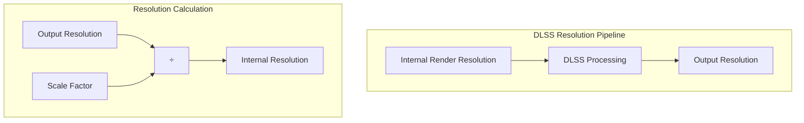
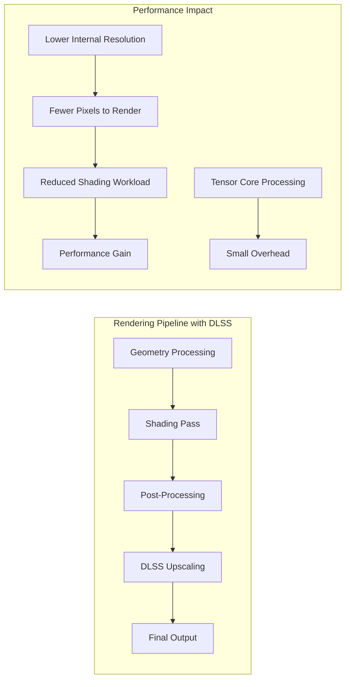
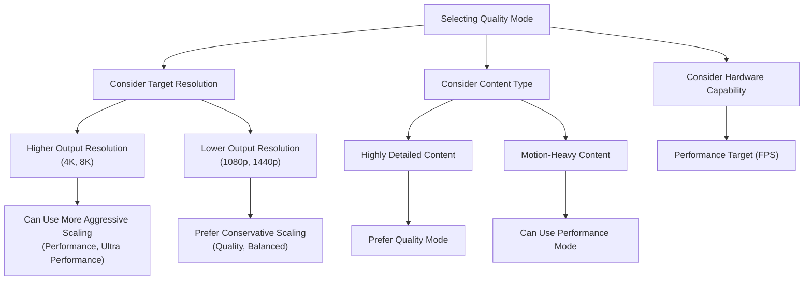
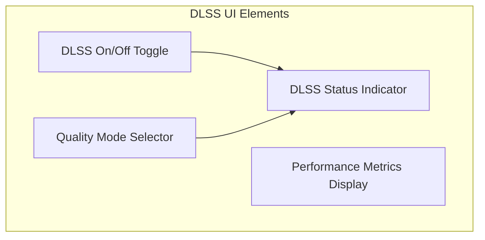
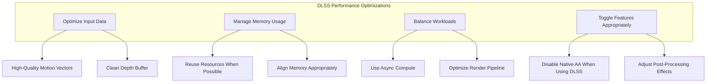
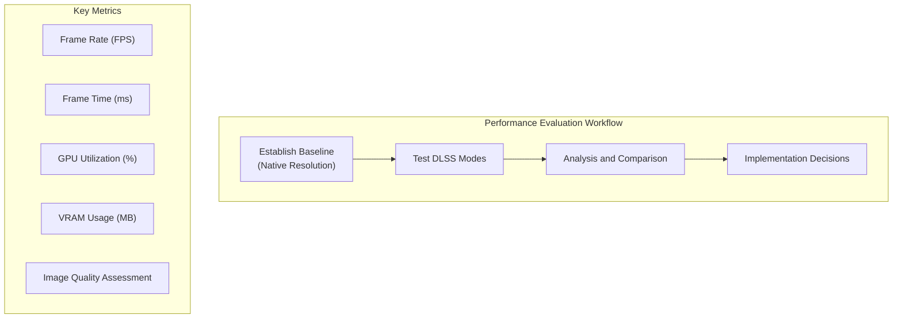
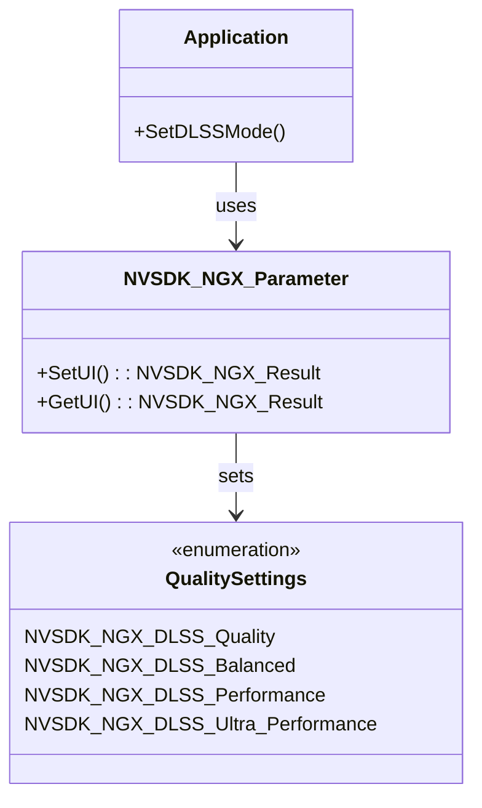

<!-- source: DeepWiki mcp.deepwiki.com · repo NVIDIA/DLSS · page 4.2 Quality Settings and Performance · fetched 2026-10-26 -->

# Quality Settings and Performance

<details>
<summary>Relevant source files</summary>

The following files were used as context for generating this wiki page:

- [doc/DLSS_Programming_Guide_Release.pdf](doc/DLSS_Programming_Guide_Release.pdf)
- [lib/Windows_x86_64/rel/nvngx_dlss.dll](lib/Windows_x86_64/rel/nvngx_dlss.dll)

</details>


## Purpose and Scope

This document provides comprehensive information about NVIDIA DLSS quality settings, their impact on performance, and optimization strategies for developers. It covers the available quality modes, resolution scaling factors, performance characteristics, and best practices for implementation. For information about the NGX SDK API integration, see [API Reference](#4.1).

## DLSS Quality Modes Overview

DLSS offers multiple quality modes that provide different tradeoffs between performance and image quality. Each mode uses a different internal rendering resolution before upscaling to the target output resolution.

```mermaid
flowchart TD
    subgraph "DLSS Quality Modes"
        Quality["Quality Mode
        ~1.5x Scale Factor"]
        
        Balanced["Balanced Mode
        ~1.7x Scale Factor"]
        
        Performance["Performance Mode
        ~2.0x Scale Factor"]
        
        UltraPerformance["Ultra Performance Mode
        ~3.0x Scale Factor"]
    end
    
    InputRes["Input Resolution"] --> DLSS["DLSS Processing"]
    DLSS --> OutputRes["Output Resolution"]
    
    Quality -.- DLSS
    Balanced -.- DLSS
    Performance -.- DLSS
    UltraPerformance -.- DLSS
    
    subgraph "Performance vs Quality"
        direction LR
        HighQ["Higher Quality"] --- MidQ[""] --- LowQ["Higher Performance"]
    end
    
    Quality -.- HighQ
    UltraPerformance -.- LowQ
```

The quality mode determines the scale factor applied to the target resolution, which in turn affects both performance and image quality:

| Quality Mode | Scale Factor | Example (for 4K output) | Performance Impact | Quality Impact |
|--------------|--------------|-------------------------|-------------------|----------------|
| Quality | ~1.5x | 1440p → 2160p | Good | Best |
| Balanced | ~1.7x | 1270p → 2160p | Better | Good |
| Performance | ~2.0x | 1080p → 2160p | Great | Acceptable |
| Ultra Performance | ~3.0x | 720p → 2160p | Best | Lowest |

Additionally, DLSS 3 introduces a special "DLAA" (Deep Learning Anti-Aliasing) mode which doesn't upscale but applies DLSS's temporal techniques purely for anti-aliasing purposes.

Sources: 

## Resolution Calculations and Scaling Factors

DLSS operates by rendering at a lower internal resolution and then upscaling to the target output resolution. The scaling factor determines this internal resolution.



The internal rendering resolution is calculated as:
- Width: Output Width ÷ Scale Factor
- Height: Output Height ÷ Scale Factor

For example, with a 4K target (3840×2160) and Performance mode (2.0x):
- Internal Width: 3840 ÷ 2 = 1920
- Internal Height: 2160 ÷ 2 = 1080

The actual scale factors may vary slightly from the nominal values to ensure the internal resolution falls on pixel boundaries.

Sources:

## Performance Characteristics

The performance benefit of DLSS comes from rendering fewer pixels while achieving similar visual quality to native resolution rendering.



Key performance characteristics include:

1. **Geometric Scaling**: Performance generally scales with the square of the resolution factor. A 2x scale factor (Performance mode) typically requires rendering only ~25% of the pixels.

2. **Tensor Core Utilization**: DLSS processing is primarily performed on Tensor Cores, which has minimal impact on graphics workloads running on traditional CUDA cores.

3. **Memory Bandwidth**: Lower internal resolution reduces memory bandwidth requirements, which can be a significant performance bottleneck at high resolutions.

The following table shows typical performance improvements:

| Quality Mode | Scale Factor | Pixels Rendered (vs Native) | Typical Performance Improvement |
|--------------|--------------|------------------------------|--------------------------------|
| Quality | ~1.5x | ~44% | 30-45% |
| Balanced | ~1.7x | ~35% | 45-60% |
| Performance | ~2.0x | 25% | 60-80% |
| Ultra Performance | ~3.0x | ~11% | 100-150% |

Sources:

## Optimizing Quality Mode Selection

Selecting the appropriate quality mode depends on several factors:



Guidelines for selecting quality modes:

1. **Resolution-Based Selection**:
   - For 4K displays: All modes are viable, with Performance and Balanced often providing the best balance
   - For 1440p displays: Quality and Balanced modes are recommended
   - For 1080p displays: Quality mode is strongly recommended

2. **Content-Based Selection**:
   - Games with fine detail and text: Prefer Quality or Balanced modes
   - Fast-paced or motion-heavy games: Performance mode may be acceptable
   - VR applications: Performance or Ultra Performance modes for high frame rates

3. **Hardware Considerations**:
   - Lower-end RTX GPUs: More aggressive scaling may be needed
   - High-end RTX GPUs: Quality mode may provide sufficient performance
   - Target frame rate: Higher targets may require more aggressive scaling

Sources:

## DLSS Status and Quality Indicators

Applications should provide users with clear information about DLSS status and quality settings.



Best practices for UI integration:

1. **Clear Labeling**: Clearly indicate when DLSS is active and which quality mode is selected
2. **Performance Metrics**: Consider displaying relevant performance metrics like FPS
3. **Accessibility**: Make DLSS settings easily accessible in graphics or performance menus
4. **Defaults**: Set sensible defaults based on display resolution and GPU capability
5. **Tooltips**: Provide explanatory tooltips about different DLSS modes

Sources:

## Implementation Performance Optimizations

To achieve optimal performance with DLSS, developers should consider the following optimizations:



Key optimization strategies:

1. **Input Data Quality**:
   - Provide accurate motion vectors
   - Clean depth buffers without artifacts
   - Consider jittered sampling for optimal results

2. **Efficient Resource Management**:
   - Use resource reuse where possible
   - Ensure proper memory alignment for optimal performance
   - Manage resource transitions efficiently

3. **Workload Distribution**:
   - Utilize async compute where appropriate
   - Balance GPU workloads between graphics and compute pipelines
   - Consider DLSS evaluation timing in your rendering pipeline

4. **Feature Adjustment**:
   - Disable traditional anti-aliasing methods when DLSS is active
   - Adjust post-processing effects for the lower internal resolution
   - Consider shading rate adjustments in combination with DLSS

Sources:

## Measuring and Evaluating Performance

To properly evaluate DLSS performance, developers should employ a systematic approach:



Performance evaluation guidelines:

1. **Establish Baselines**:
   - Measure performance at native resolution without DLSS
   - Test at multiple resolutions and with varying content complexity

2. **Comprehensive Testing**:
   - Test all DLSS quality modes
   - Measure across different scenes and scenarios
   - Consider both average and worst-case performance

3. **Key Metrics**:
   - Frame rate (FPS) and frame time (ms)
   - GPU utilization percentage
   - Memory bandwidth utilization
   - Image quality comparison (subjective and objective)

4. **Bottleneck Identification**:
   - Identify if your application is GPU compute-bound, memory-bound, or otherwise
   - Determine if DLSS is addressing your specific performance bottlenecks

Sources:

## Recommended Settings by Resolution

The following table provides recommended quality settings based on target output resolution:

| Output Resolution | Recommended Primary Mode | Alternative Mode | Notes |
|-------------------|--------------------------|-----------------|-------|
| 8K (7680x4320) | Ultra Performance | Performance | Ultra Performance provides the best experience at 8K |
| 4K (3840x2160) | Performance | Balanced | Good balance of quality and performance for 4K |
| 1440p (2560x1440) | Balanced | Quality | Quality mode recommended if performance allows |
| 1080p (1920x1080) | Quality | Balanced | Lower upscaling ratios preferred at 1080p |

For VR applications, the recommended settings depend on the VR headset resolution and performance requirements:

| VR Headset Type | Target FPS | Recommended Mode |
|-----------------|------------|------------------|
| High-resolution (2K+ per eye) | 90+ FPS | Performance or Ultra Performance |
| Standard resolution | 90 FPS | Balanced or Quality |
| Low-resolution | 120+ FPS | Quality |

Sources:

## Quality Settings Programmatic Control

Applications can programmatically control DLSS quality settings through the NGX SDK. The quality mode is set through the `NVSDK_NGX_Parameter` interface:



The code pattern for setting quality modes involves setting the appropriate parameter value when evaluating the DLSS feature:

```cpp
// Example setting DLSS quality mode
NVSDK_NGX_Parameter_SetUI(params, NVSDK_NGX_Parameter_DLSS_Quality, NVSDK_NGX_DLSS_Quality);
```

For dynamic quality adjustment, applications can change the quality setting between frames without recreating the DLSS feature.

Sources:

## Conclusion

DLSS quality settings provide developers with flexible options to balance performance and image quality. By understanding the characteristics of each quality mode and following the optimization guidelines in this document, developers can achieve optimal results with DLSS integration.

For more information on SDK integration, refer to [API Reference](#4.1). For overall best practices and developer guidelines, see [Developer Guidelines](#6).

---

