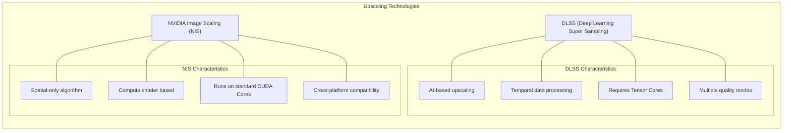
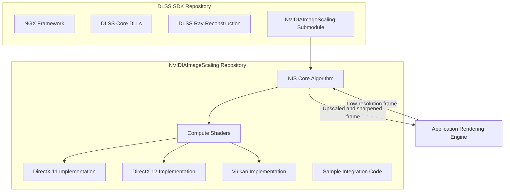
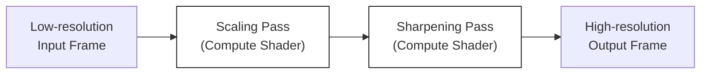
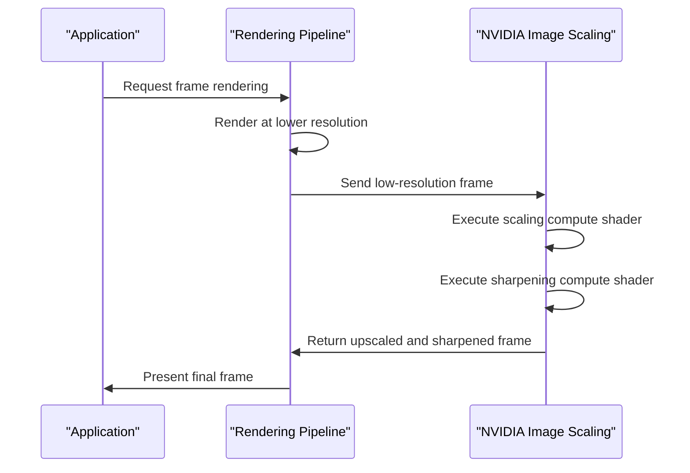

<!-- source: DeepWiki mcp.deepwiki.com · repo NVIDIA/DLSS · page 5 NVIDIA Image Scaling · fetched 2026-10-26 -->

# NVIDIA Image Scaling

<details>
<summary>Relevant source files</summary>

The following files were used as context for generating this wiki page:

- [.gitmodules](.gitmodules)
- [README.md](README.md)
- [doc/DLSS_Programming_Guide_Release.pdf](doc/DLSS_Programming_Guide_Release.pdf)

</details>


## Purpose and Scope

NVIDIA Image Scaling (NIS) is a spatial upscaling and sharpening technology integrated within the DLSS SDK as a complementary solution to DLSS. While DLSS utilizes AI and temporal data through Tensor Cores, NIS provides a simpler, compute shader-based spatial scaling solution that works across multiple graphics APIs without requiring specialized hardware. This document covers the architecture, integration methods, and technical aspects of the NVIDIA Image Scaling technology.

For information about DLSS core technology, see [DLSS Core Technology](#2), and for information about the NGX SDK integration, see [NGX SDK Integration](#4).

Sources: [README.md:5-6]()

## Overview and Relationship to DLSS

NVIDIA Image Scaling is a single spatial scaling and sharpening algorithm designed for cross-platform support. Unlike DLSS, which is a temporal, AI-based upscaling solution that requires NVIDIA's Tensor Cores, NIS is a spatial-only algorithm that runs on standard CUDA cores. This makes it suitable for a wider range of hardware and use cases where DLSS may not be applicable.



Key differences between DLSS and NVIDIA Image Scaling:

| Feature | DLSS | NVIDIA Image Scaling |
|---------|------|----------------------|
| Algorithm Type | AI-based temporal upscaling | Spatial upscaling and sharpening |
| Hardware Requirements | NVIDIA RTX GPUs with Tensor Cores | Any GPU supporting compute shaders |
| Input Data | Low-res frame, motion vectors, depth | Low-res frame only |
| Processing Cores | Tensor Cores | CUDA Cores |
| API Support | DirectX 11, DirectX 12, Vulkan | DirectX 11, DirectX 12, Vulkan |
| Integration Complexity | Higher (requires NGX framework) | Lower (direct shader integration) |

Sources: [README.md:5-6](), [.gitmodules:1-3]()

## Architecture and Components

NVIDIA Image Scaling is available as a separate GitHub repository included as a submodule within the DLSS SDK. This architecture allows developers to use NIS independently or alongside DLSS to provide flexible upscaling solutions.



The NVIDIA Image Scaling processing pipeline:



Sources: [README.md:5-6](), [.gitmodules:1-3]()

## Integration

NVIDIA Image Scaling is designed to be easily integrated into rendering pipelines through compute shaders. The SDK provides implementations for the three major graphics APIs used in modern game development.

### Getting the SDK

To access the NVIDIA Image Scaling SDK, you can either:

1. Clone the DLSS repository with submodules:
```
git clone --recurse-submodules https://github.com/NVIDIA/DLSS.git
```

2. If you've already cloned the DLSS repository without submodules:
```
git submodule update --init --recursive
```

### Integration with Graphics APIs

NVIDIA Image Scaling provides compute shader implementations for three major graphics APIs:

| Graphics API | Integration Path | Implementation Details |
|--------------|------------------|------------------------|
| DirectX 11 | NVIDIAImageScaling/DX11 | Uses DirectCompute shaders |
| DirectX 12 | NVIDIAImageScaling/DX12 | Uses DirectX 12 compute pipelines |
| Vulkan | NVIDIAImageScaling/Vulkan | Uses Vulkan compute shaders |

Basic integration workflow:

1. Initialize the appropriate graphics API-specific NIS implementation
2. Set up rendering resources (input/output textures, constant buffers)
3. Configure scaling and sharpening parameters
4. Execute the compute shaders on your low-resolution input
5. Use the resulting high-resolution output in your rendering pipeline

Sources: [README.md:7-15]()

## Implementation Details

NVIDIA Image Scaling uses a two-pass algorithm:

1. **Scaling Pass**: Upscales the low-resolution input image to the target resolution using a high-quality scaling algorithm
2. **Sharpening Pass**: Applies an adaptive sharpening filter to enhance detail in the upscaled image

The algorithm is designed to perform both operations efficiently on GPU compute hardware, making it suitable for real-time applications like games.



### Performance Considerations

- NIS is designed to be lightweight and efficient, with minimal performance overhead
- The spatial-only nature of the algorithm means it doesn't need to maintain temporal buffers
- Compute shader implementation allows for efficient parallel processing on the GPU
- As a spatial-only technique, it has lower quality than DLSS but broader hardware compatibility

Sources: [README.md:5-6]()

## Usage Scenarios and Best Practices

### When to Use NVIDIA Image Scaling vs. DLSS

| Scenario | Recommended Technology |
|----------|------------------------|
| Latest NVIDIA RTX hardware available | DLSS (better quality) |
| Mixed hardware environment | NIS (broader compatibility) |
| No motion vectors available | NIS (requires only color buffer) |
| Maximum performance critical | DLSS (better quality-to-performance ratio) |
| Simple integration needed | NIS (lower integration complexity) |

### Integration Best Practices

1. **Render at appropriate resolution**: Choose a source resolution that balances performance and quality
2. **Tune sharpening strength**: Adjust based on content type and artistic direction
3. **Configure appropriate filter coefficients**: Different scaling ratios work best with different filter parameters
4. **Pipeline integration**: Position NIS at the appropriate point in your post-processing chain
5. **UI considerations**: Apply NIS before rendering UI elements to maintain crisp text and interface elements

Sources: [README.md:5-6]()

## Conclusion

NVIDIA Image Scaling provides a valuable alternative to DLSS for scenarios where AI-based upscaling isn't suitable or available. With its cross-platform support and simple integration through compute shaders, it offers developers an efficient way to implement high-quality spatial upscaling and sharpening in their applications.

For more comprehensive documentation and detailed API references, refer to the [NVIDIA Image Scaling GitHub repository](https://github.com/NVIDIAGameWorks/NVIDIAImageScaling).

Sources: [README.md:5-6](), [.gitmodules:1-3]()

---

