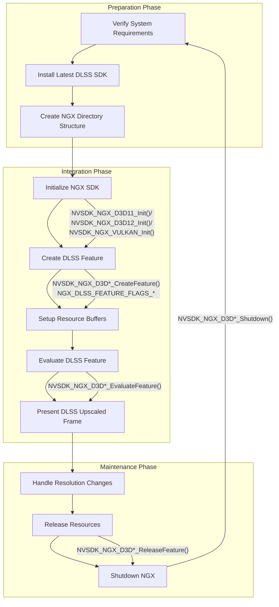
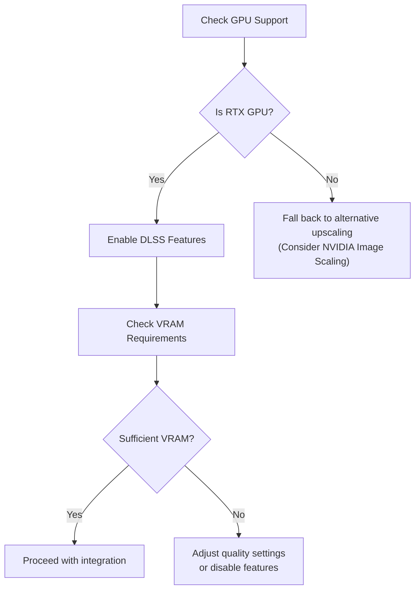
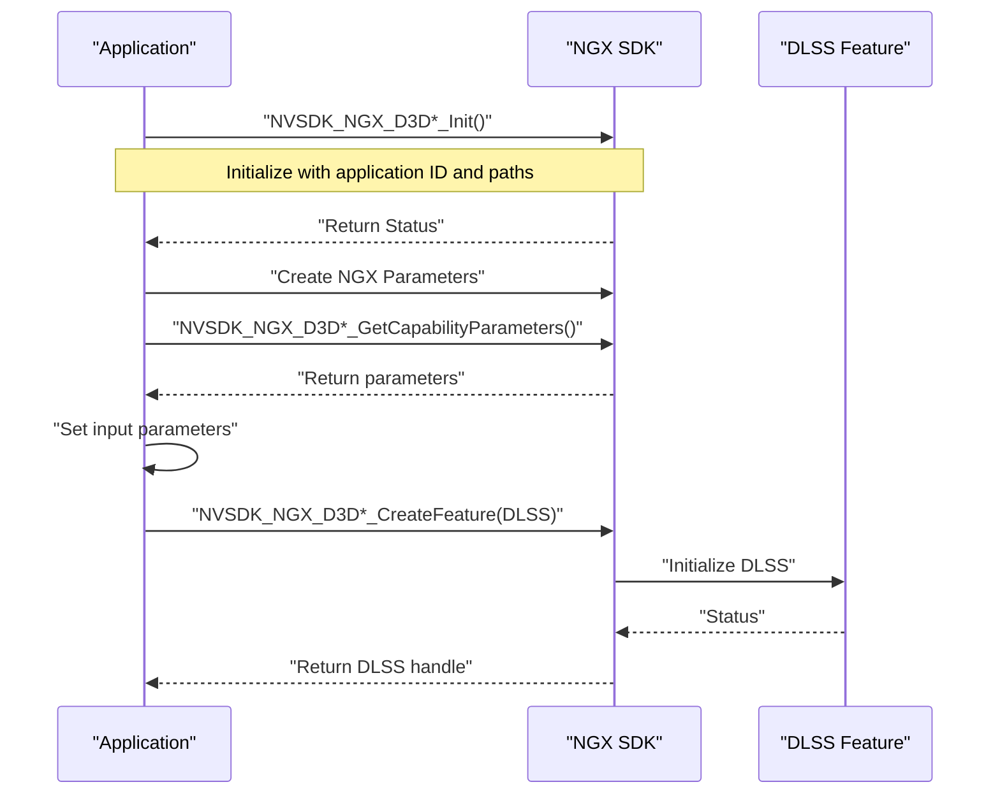
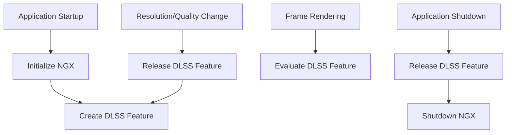
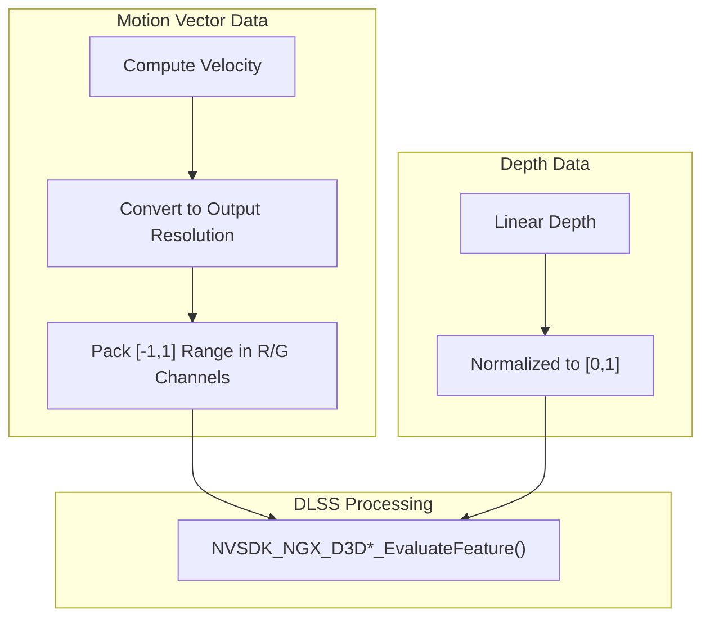
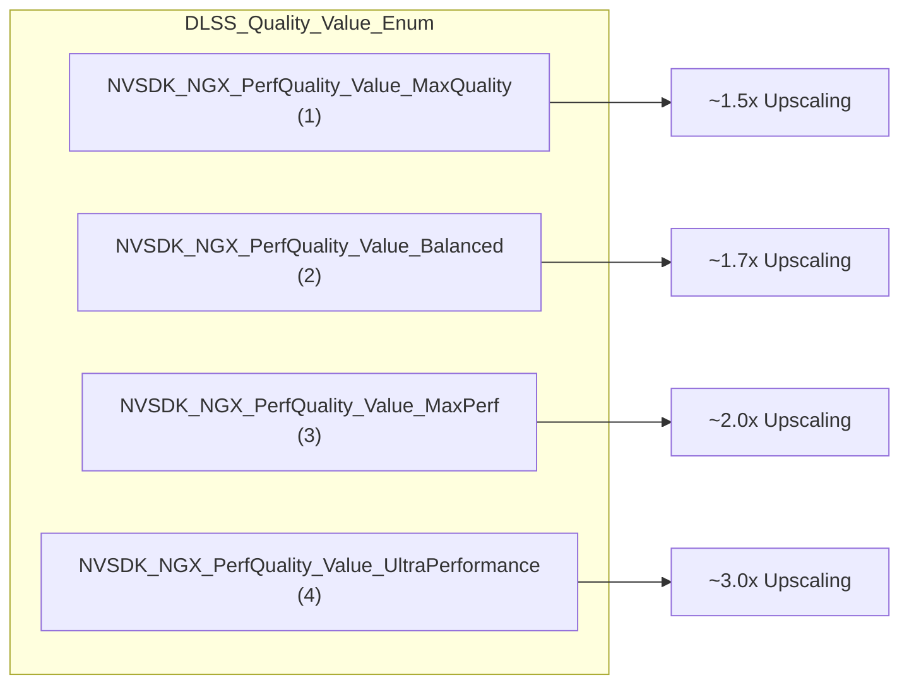
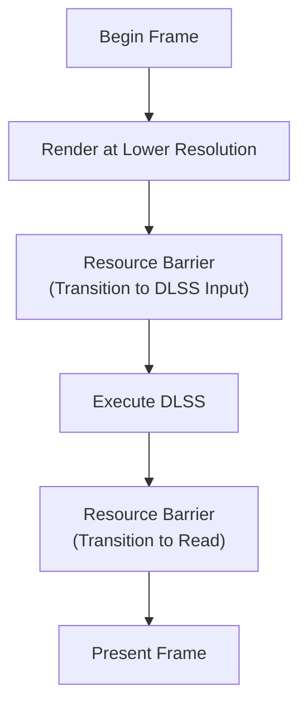
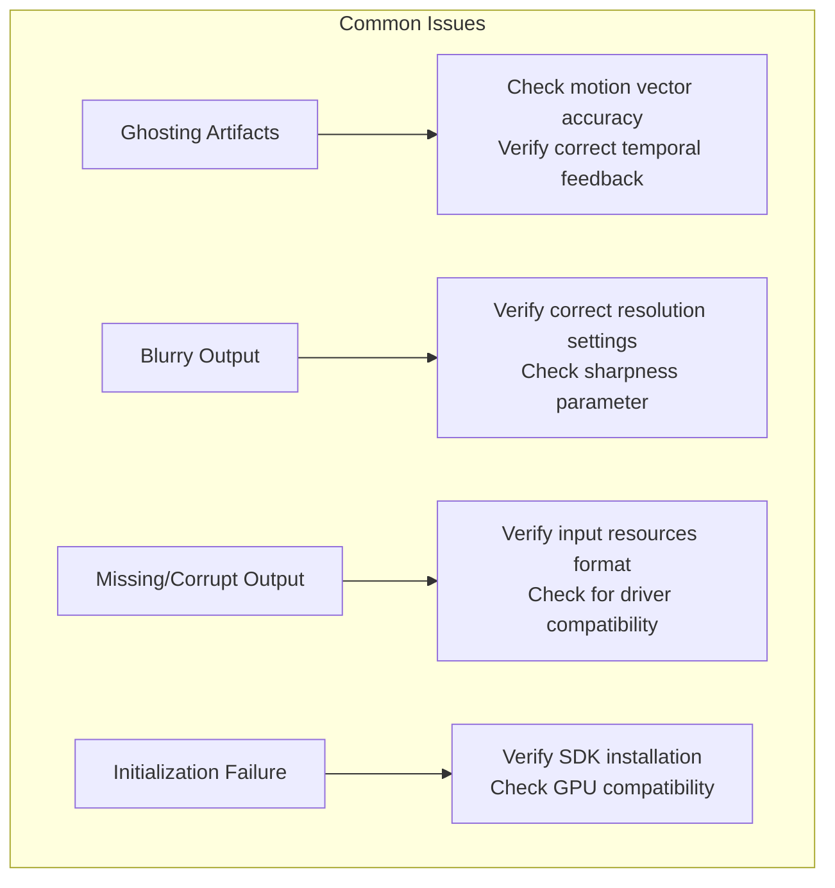
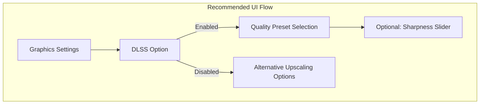
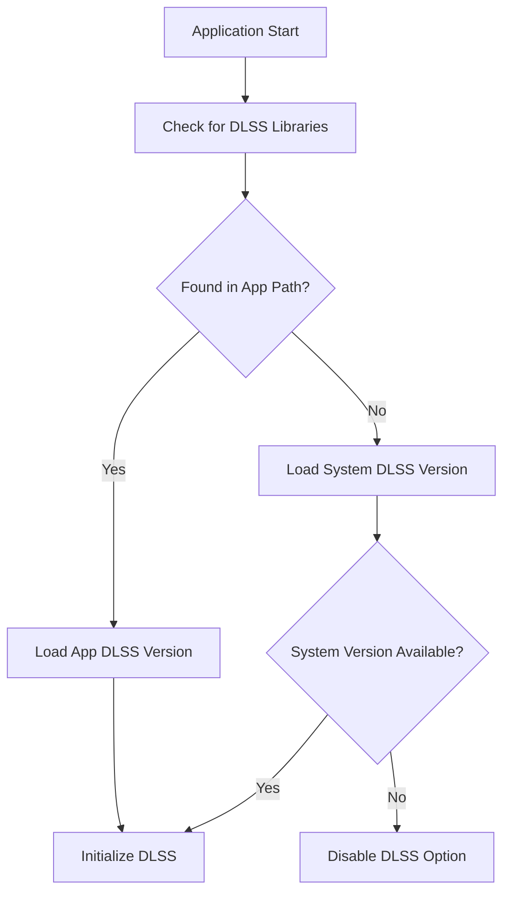

<!-- source: DeepWiki mcp.deepwiki.com · repo NVIDIA/DLSS · page 6 Developer Guidelines · fetched 2026-10-26 -->

# Developer Guidelines

<details>
<summary>Relevant source files</summary>

The following files were used as context for generating this wiki page:

- [doc/DLSS_Programming_Guide_Release.pdf](doc/DLSS_Programming_Guide_Release.pdf)
- [doc/RTX UI Developer Guidelines.pdf](doc/RTX UI Developer Guidelines.pdf)

</details>


## Purpose and Scope

This document provides comprehensive guidelines, best practices, and recommendations for developers integrating NVIDIA DLSS technology into their applications. It covers integration workflows, quality optimization, performance considerations, and platform-specific recommendations. For UI-specific guidelines, see [RTX UI Guidelines](#6.1). For detailed API reference information, see [API Reference](#4.1).

Sources: doc/DLSS_Programming_Guide_Release.pdf

## Integration Workflow Overview

The successful integration of DLSS into your application follows a structured workflow to ensure optimal performance and quality. The diagram below outlines the recommended implementation process:



Sources: doc/DLSS_Programming_Guide_Release.pdf

## System Requirements

### Hardware Requirements

DLSS requires NVIDIA RTX GPUs to function properly. Ensure your implementation validates hardware support before enabling DLSS options.



Sources: doc/DLSS_Programming_Guide_Release.pdf

### Software Requirements

Ensure the following dependencies are available:

| Requirement | Windows | Linux |
|-------------|---------|-------|
| DirectX | DirectX 11/12 | N/A |
| Vulkan | Vulkan 1.1+ | Vulkan 1.1+ |
| DLSS DLL/SO | nvngx_dlss.dll | libnvidia-ngx-dlss.so |
| Minimum Driver | 452.39+ | 455.23+ |

Sources: doc/DLSS_Programming_Guide_Release.pdf

## Initialization and Resource Management

### Proper DLSS Feature Initialization

DLSS initialization follows a specific sequence to ensure proper setup:



Key initialization parameters include:

```
NVSDK_NGX_Parameter_Width             // Render width
NVSDK_NGX_Parameter_Height            // Render height
NVSDK_NGX_Parameter_OutWidth          // Display width
NVSDK_NGX_Parameter_OutHeight         // Display height
NVSDK_NGX_Parameter_PerfQualityValue  // Quality preset
```

Sources: doc/DLSS_Programming_Guide_Release.pdf

### Resource Management Best Practices

Proper resource management is critical for optimal DLSS performance:

1. **Feature Creation and Destruction**: Create DLSS features during initialization or quality setting changes, not every frame.
2. **Buffer Management**: Reuse input/output buffers when possible.
3. **Memory Considerations**: Account for DLSS memory overhead in your resource budgeting.



Sources: doc/DLSS_Programming_Guide_Release.pdf

## Input Requirements and Recommendations

### Required Inputs

DLSS requires specific inputs to perform optimally:

| Input Resource | Required | Description |
|----------------|----------|-------------|
| Low-resolution color buffer | Yes | Rendered at the lower internal resolution |
| Motion vectors | Yes | Screen-space motion vectors in [x,y] units of the output pixels |
| Depth buffer | Yes | Linear depth or hardware Z-buffer |
| Exposure | No | Exposure value for HDR content |

### Motion Vector Guidelines

Motion vectors should:
- Be in screen-space
- Represent motion in pixels per frame
- Include camera and object motion
- Represent motion from previous to current frame



Sources: doc/DLSS_Programming_Guide_Release.pdf

## Quality Settings and Performance

### Quality Presets

DLSS offers predefined quality modes that balance quality and performance:

| Quality Mode | Internal Resolution Scale | Recommended Use Case |
|--------------|---------------------------|----------------------|
| Quality | ~1.5x | When highest image quality is preferred |
| Balanced | ~1.7x | Default setting for most applications |
| Performance | ~2.0x | For performance-critical scenarios |
| Ultra Performance | ~3.0x | For maximum performance gain |

The quality preset is set with `NVSDK_NGX_Parameter_PerfQualityValue` parameter:



Sources: doc/DLSS_Programming_Guide_Release.pdf

### Recommended Resolution Pairs

For optimal quality, follow these recommended resolution pairs:

| Output Resolution | Quality | Balanced | Performance | Ultra Performance |
|-------------------|---------|----------|-------------|-------------------|
| 3840×2160 (4K) | 2560×1440 | 2227×1253 | 1920×1080 | 1280×720 |
| 2560×1440 (QHD) | 1706×960 | 1484×834 | 1280×720 | 854×480 |
| 1920×1080 (FHD) | 1280×720 | 1117×628 | 960×540 | 640×360 |

Sources: doc/DLSS_Programming_Guide_Release.pdf

## Platform-Specific Guidelines

### DirectX 11 Integration

For DirectX 11 applications, follow these specific guidelines:

1. Use the `NVSDK_NGX_D3D11_Init()` function for initialization
2. Ensure correct texture formats for input and output resources
3. Properly synchronize resource access

### DirectX 12 Integration

For DirectX 12 applications:

1. Use `NVSDK_NGX_D3D12_Init()` for initialization
2. Properly manage resource states and barriers
3. Ensure command list synchronization



### Vulkan Integration

For Vulkan applications:

1. Use `NVSDK_NGX_VULKAN_Init()` for initialization
2. Ensure proper synchronization with Vulkan barriers
3. Manage resource layout transitions appropriately

Sources: doc/DLSS_Programming_Guide_Release.pdf

## Debug and Development Recommendations

### DLSS Feature Flags

Use appropriate feature flags during development:

| Flag | Description | Recommendation |
|------|-------------|----------------|
| `NGX_DLSS_FEATURE_FLAGS_NONE` | Standard DLSS operation | Default for production |
| `NGX_DLSS_FEATURE_FLAGS_MVS` | Enable motion vector visualization | For debugging motion vectors |
| `NGX_DLSS_FEATURE_FLAGS_DEPTH` | Enable depth visualization | For debugging depth buffer issues |
| `NGX_DLSS_FEATURE_FLAGS_PARTIAL_MVS` | Enable partial motion vector visualization | For advanced debugging |

### Common Issues and Solutions



Sources: doc/DLSS_Programming_Guide_Release.pdf

## UI Integration Recommendations

For user interface elements related to DLSS:

1. Provide clear DLSS quality preset options
2. Include DLSS on/off toggle
3. Consider exposing sharpness slider (0.0-1.0)
4. Follow the detailed [RTX UI Guidelines](#6.1)



Sources: doc/DLSS_Programming_Guide_Release.pdf

## Version Management and Updates

DLSS is continually improved through model updates. Implement proper versioning support:

1. Always check for and use the latest DLSS version available on the system
2. Support dynamic updates of DLSS libraries
3. Include the NGX directory structure in your application deployment



Sources: doc/DLSS_Programming_Guide_Release.pdf

## Performance Optimization Tips

To achieve the best performance with DLSS:

1. **Optimize Low-Resolution Rendering**: Since you're rendering at a lower resolution, optimize your base rendering pipeline
2. **Minimize Resource Transitions**: Excessive resource state transitions can impact performance
3. **Balance Internal Resolution**: Lower internal resolution increases performance but may reduce quality
4. **Consider Feature Costs**: Features like ray tracing benefit greatly from DLSS by offsetting their performance cost

Sources: doc/DLSS_Programming_Guide_Release.pdf

## Testing Guidelines

### Testing Environments

Test your DLSS integration across:

1. Different GPU models (RTX 2000, 3000, and 4000 series)
2. Various resolutions and quality settings
3. Different display aspect ratios
4. With ray tracing enabled and disabled

### Quality Validation

Verify DLSS quality:

1. Compare against native resolution rendering
2. Test with both static and dynamic scenes
3. Validate across different lighting conditions
4. Test with various texture complexities

Sources: doc/DLSS_Programming_Guide_Release.pdf

## Summary

By following these developer guidelines, you can successfully integrate NVIDIA DLSS into your application with optimal quality and performance. Remember to:

1. Validate hardware and software requirements
2. Follow the proper initialization sequence
3. Provide accurate input resources
4. Test across multiple configurations
5. Implement appropriate UI options

For additional information, refer to the API Reference section and RTX UI Guidelines.

Sources: doc/DLSS_Programming_Guide_Release.pdf

---

