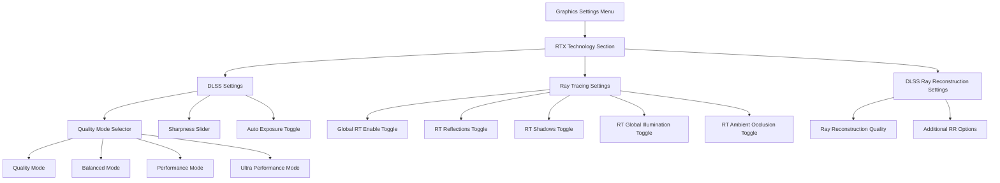
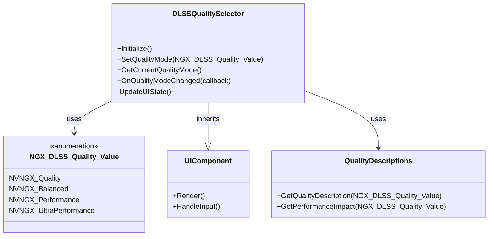
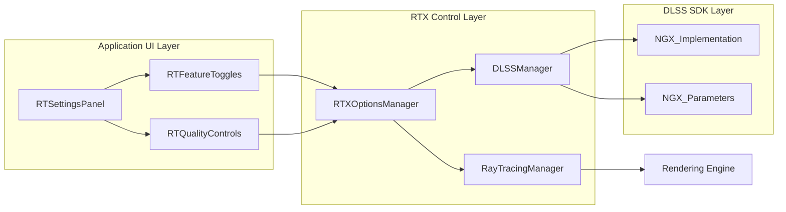
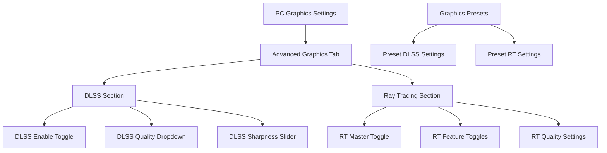
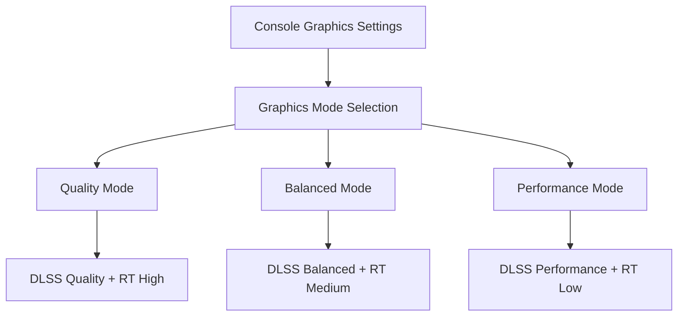
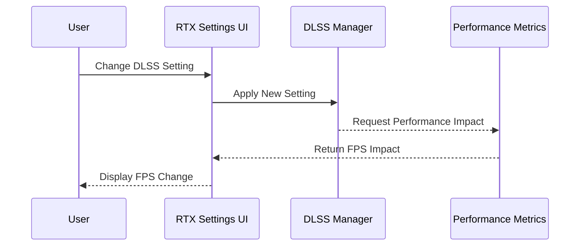
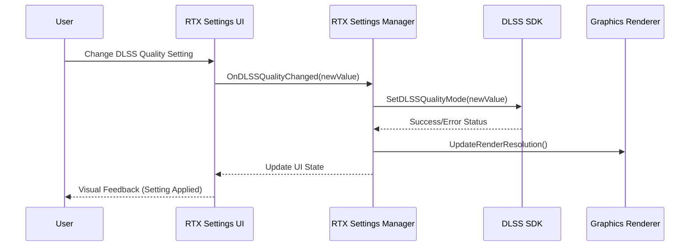

<!-- source: DeepWiki mcp.deepwiki.com · repo NVIDIA/DLSS · page 6.1 RTX UI Guidelines · fetched 2026-10-26 -->

# RTX UI Guidelines

Relevant source files

The following files were used as context for generating this wiki page:

- [doc/RTX UI Developer Guidelines Chinese Version.pdf](doc/RTX UI Developer Guidelines Chinese Version.pdf)
- [doc/RTX UI Developer Guidelines.pdf](doc/RTX UI Developer Guidelines.pdf)

## Purpose and Scope

This document provides technical guidelines for implementing user interface elements in applications that integrate NVIDIA RTX technologies, specifically DLSS (Deep Learning Super Sampling) and ray tracing features. These guidelines ensure consistent representation of RTX settings across applications and help developers effectively communicate performance/quality tradeoffs to users.

For information about DLSS API implementation details, see [API Reference](#4.1). For technical information on DLSS quality modes and performance characteristics, see [Quality Settings and Performance](#4.2).

## RTX Settings Menu Architecture

The following diagram illustrates the recommended organization of RTX settings in application graphics menus:

Sources: General RTX UI guidelines based on DLSS repository overview

## DLSS UI Implementation Guidelines

### Terminology and Presentation

When referring to DLSS technology in user interfaces, consistent terminology should be used:

| UI Term | Description | User Presentation |
|---------|-------------|-------------------|
| NVIDIA DLSS | The full product name for the technology | Main settings menu label |
| DLSS | Acceptable abbreviation | Secondary references |
| Quality | 1.5x scale factor mode, highest image quality | Quality mode selector option |
| Balanced | 1.7x scale factor, balanced quality/performance | Quality mode selector option |
| Performance | 2x scale factor, prioritizes performance | Quality mode selector option |
| Ultra Performance | 3-4x scale factor, maximum performance | Quality mode selector option |

### Quality Mode Selector Implementation

The following diagram illustrates the recommended implementation of the DLSS quality mode selector component:

Sources: DLSS quality mode architecture derived from DLSS SDK components

### DLSS UI Visual Requirements

DLSS UI elements should follow these technical requirements:

1. Quality mode selector must display all available modes for the user's GPU
2. Sharpness slider should range from 0 to 1.0 with 0.5 as the default value
3. Setting changes should apply immediately when in windowed mode
4. A descriptive tooltip should be displayed explaining each quality mode's impact

## RTX Features UI Framework

The following diagram illustrates the recommended framework for implementing ray tracing settings UI components:

Sources: RTX settings architecture based on DLSS repository structure

## RTX UI Technical Integration Requirements

When implementing RTX UI elements, applications should adhere to these technical requirements:

1. **Responsive UI Updates**: UI state should reflect the current DLSS and ray tracing configuration
2. **GPU Capability Detection**: Only display RTX options supported by the user's hardware
3. **Parameter Validation**: Validate user inputs before passing to NGX APIs
4. **Presets Integration**: Include RTX settings in graphics quality presets (Low, Medium, High, etc.)
5. **Performance Metrics**: Optionally display FPS impact when changing RTX settings

## Platform-Specific UI Implementation Guidelines

### PC Implementation

### Console Implementation

Sources: Platform-specific UI guidelines based on DLSS repository overview

## Accessibility Requirements for RTX UI

When implementing RTX UI components, ensure the following accessibility requirements are met:

1. **Screen Reader Support**: All RTX settings must have proper text labels accessible to screen readers
2. **Keyboard Navigation**: Allow full keyboard control of all RTX settings
3. **Text Size Scaling**: RTX UI elements must support system text scaling
4. **High Contrast Support**: Ensure RTX UI is readable in high contrast modes
5. **Color Blindness Considerations**: Do not rely solely on color to indicate states or settings

## Displaying Performance Impact

It is recommended to provide users with real-time feedback on the performance impact of RTX settings:

Sources: Performance measurement guidelines based on DLSS technology overview

## Standardized Icons and Visual Elements

When implementing RTX UI, use consistent iconography:

| Feature | Icon Description | Placement |
|---------|------------------|-----------|
| DLSS | NVIDIA DLSS logo (trademark guidelines apply) | Next to DLSS settings |
| Ray Tracing | Ray icon with light bounce illustration | Next to RT settings |
| DLSS-RR | Combined DLSS and ray icon | Next to DLSS-RR settings |
| Performance Impact | Up/down arrow with percentage | Beside quality mode selections |

## UI Callbacks and Event Handling

The following diagram illustrates the recommended event flow for handling RTX setting changes in the UI:

Sources: UI event handling recommendations based on DLSS SDK architecture

## RTX Settings Persistence

Applications should implement proper persistence for RTX settings:

1. Save user RTX preferences to configuration files
2. Apply saved settings during application startup
3. Validate settings against current hardware capabilities on startup
4. Revert to safe defaults if previously saved settings are not compatible

## Summary

These guidelines provide a comprehensive framework for implementing RTX UI elements in applications that utilize NVIDIA DLSS and ray tracing technologies. Following these guidelines ensures consistency, usability, and proper technical integration of RTX features in application user interfaces.

When implementing RTX UI components, developers should focus on clarity, performance transparency, and accessibility while adhering to the technical requirements outlined in this document.

---

