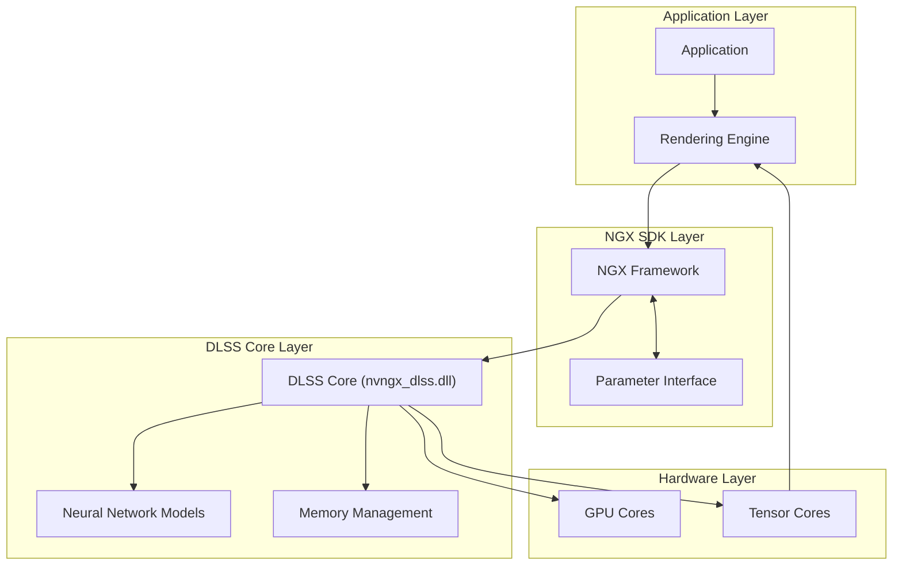
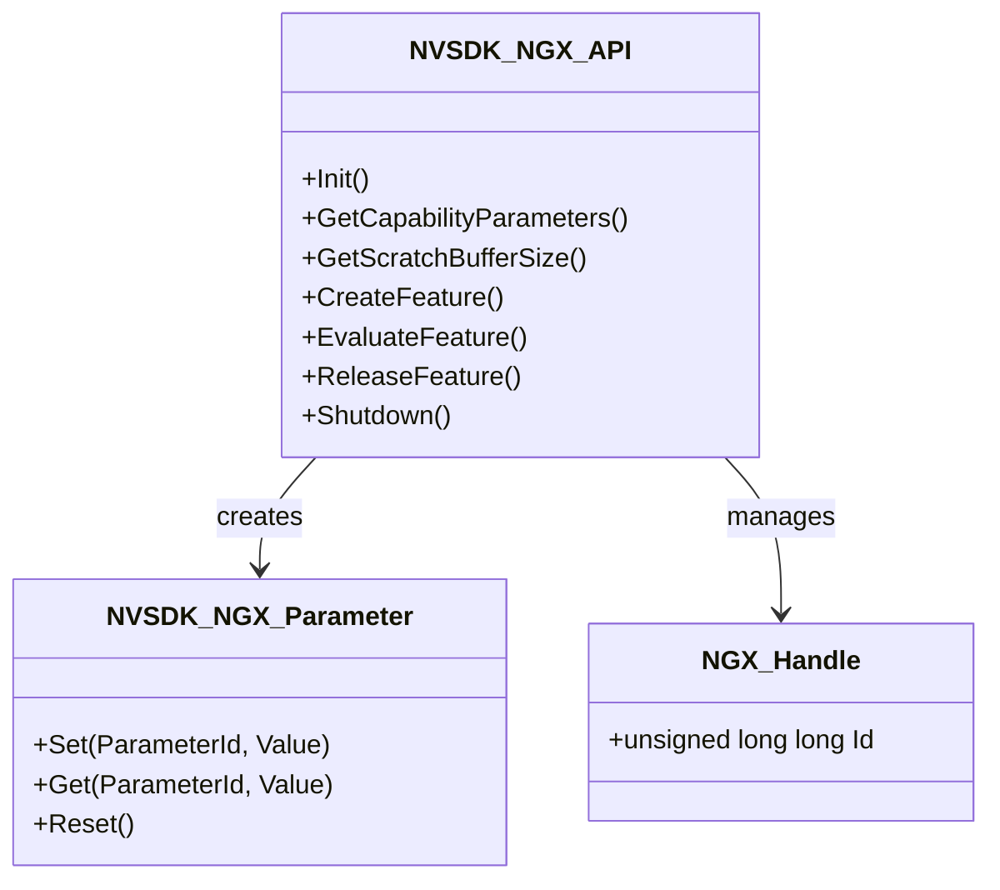
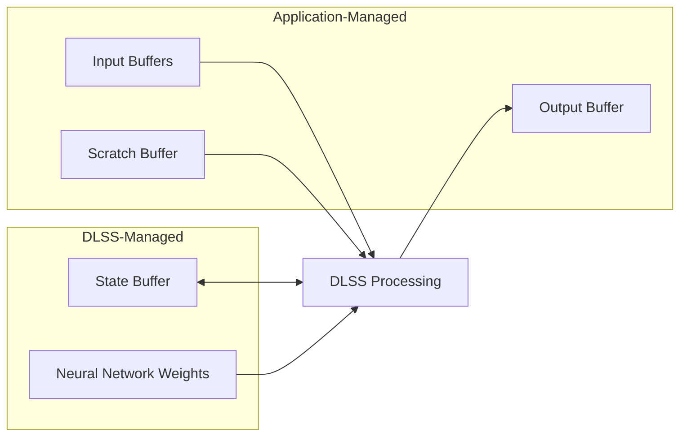
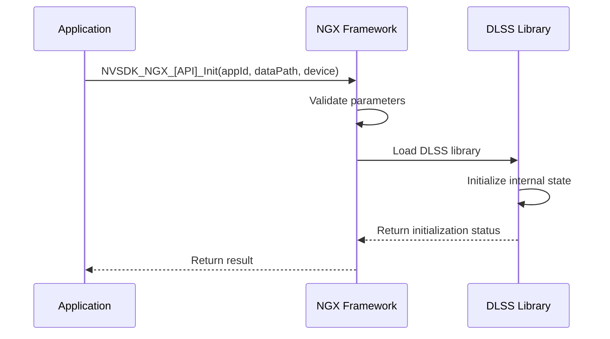
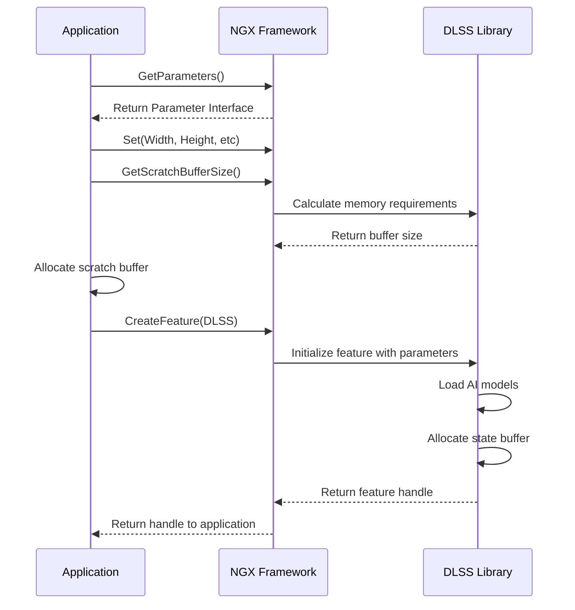
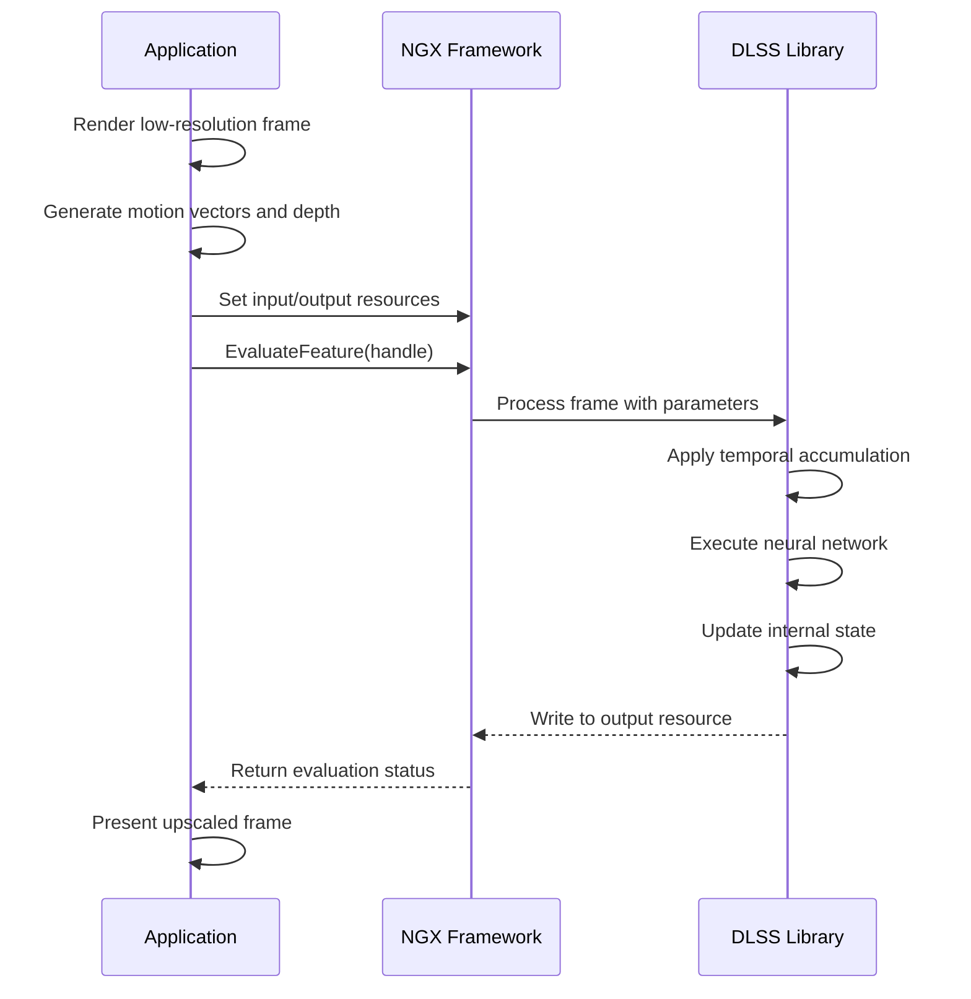
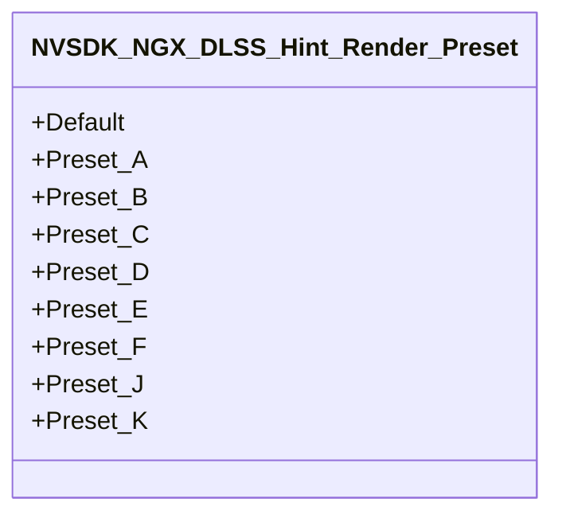
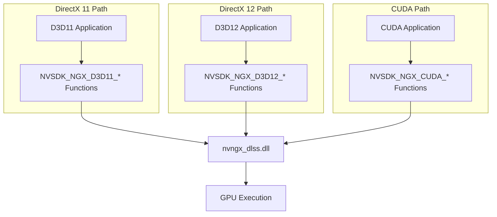
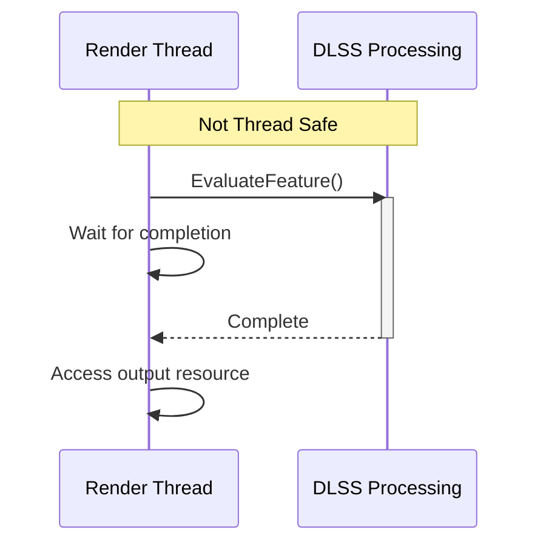
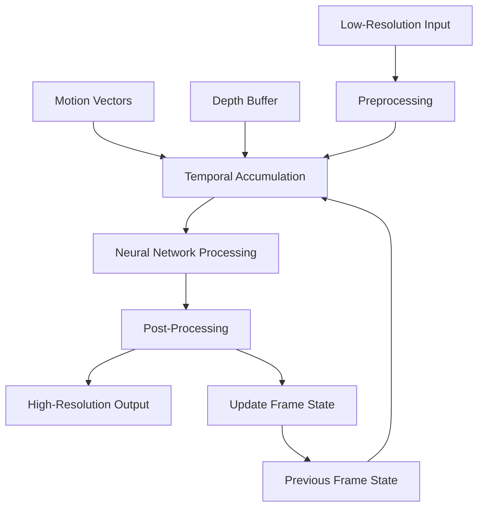

<!-- source: DeepWiki mcp.deepwiki.com · repo NVIDIA/DLSS · page 7 Implementation Details · fetched 2026-10-26 -->

# Implementation Details

Relevant source files

The following files were used as context for generating this wiki page:

- [include/nvsdk_ngx.h](include/nvsdk_ngx.h)
- [include/nvsdk_ngx_defs.h](include/nvsdk_ngx_defs.h)
- [lib/Windows_x86_64/dev/nvngx_dlss.dll](lib/Windows_x86_64/dev/nvngx_dlss.dll)
- [lib/Windows_x86_64/rel/nvngx_dlss.dll](lib/Windows_x86_64/rel/nvngx_dlss.dll)

This page provides in-depth technical information on the internal workings of NVIDIA DLSS (Deep Learning Super Sampling) for engineers and technical leads implementing or optimizing DLSS in their applications. For general integration guidance, see [NGX SDK Integration](#4), and for debugging tools, see [Debugging Tools](#7.1).

## DLSS Implementation Architecture

DLSS follows a layered architecture that separates the application interface from the core deep learning implementation. This architecture enables consistent performance across different graphics APIs while maintaining a clean integration path.

Sources: [include/nvsdk_ngx.h:14-67](), [lib/Windows_x86_64/dev/nvngx_dlss.dll]()

## Core Components

### Dynamic Libraries

DLSS functionality is primarily implemented in platform-specific binaries:

| Platform | Core Library | Description |
|----------|-------------|-------------|
| Windows | nvngx_dlss.dll | Core DLSS implementation for DirectX and CUDA |
| Linux | libnvidia-ngx-dlss.so | Core DLSS implementation for Vulkan |

These libraries contain the neural network models, inference code, and platform-specific optimizations needed to perform DLSS upscaling.

Sources: [lib/Windows_x86_64/dev/nvngx_dlss.dll](), [lib/Windows_x86_64/rel/nvngx_dlss.dll]()

### NGX Framework Interface

The NGX framework provides a consistent API across all NVIDIA AI features. For DLSS, the key interfaces are:

Sources: [include/nvsdk_ngx.h:72-146](), [include/nvsdk_ngx_params.h]()

## Memory Model

DLSS requires several types of memory resources to function efficiently:

### Memory Buffer Types

1. **Input Buffers**: Low-resolution color buffer, motion vectors, depth buffer, and optional exposure textures
2. **Output Buffer**: High-resolution result texture
3. **Scratch Buffer**: Temporary workspace for computations
4. **State Buffer**: Internal persistent state maintaining temporal information between frames

Sources: [include/nvsdk_ngx.h:42-49]()

### Memory Requirements

DLSS memory requirements scale with resolution. The scratch buffer size needed can be queried via `NVSDK_NGX_[API]_GetScratchBufferSize()`. The internal state buffers are managed by the DLSS library itself.

## Execution Flow

### Initialization Sequence

Sources: [include/nvsdk_ngx.h:119-146]()

### Feature Creation

Sources: [include/nvsdk_ngx.h:51-55]()

### Per-Frame Evaluation

Sources: [include/nvsdk_ngx.h:57-60]()

## Technical Details

### Quality Presets

DLSS provides several quality presets that determine the internal scaling ratio:

| Quality Preset | Approximate Scaling Ratio | Use Case |
|----------------|---------------------------|----------|
| Ultra Quality | ~1.3x | Maximum image quality with modest performance gain |
| Quality | ~1.5x | High image quality with good performance gain |
| Balanced | ~1.7x | Balance between quality and performance |
| Performance | ~2.0x | Prioritize performance |
| Ultra Performance | ~3.0x | Maximum performance gain |

Sources: Repository overview diagrams

### Render Presets

DLSS also supports render presets that affect the internal processing pipeline:

Sources: [include/nvsdk_ngx_defs.h:60-77]()

### Supported Features

The `NVSDK_NGX_Feature` enumeration defines the feature ID for DLSS as `NVSDK_NGX_Feature_SuperSampling` (value 1) in the NGX framework.

Sources: [include/nvsdk_ngx_defs.h:148-184]()

## Platform-Specific Implementation

### Windows Implementation

On Windows, DLSS supports DirectX 11, DirectX 12, and CUDA through respective API functions:

The Windows implementation makes extensive use of DirectX resource sharing mechanisms for efficient memory handling between the application and DLSS.

Sources: [lib/Windows_x86_64/dev/nvngx_dlss.dll]()

### Linux Implementation

On Linux, DLSS primarily supports Vulkan through the `NVSDK_NGX_VULKAN_*` functions, with similar functionality to the Windows implementation but adapted for Vulkan resource handling.

## Thread Safety and Synchronization

DLSS functions are not thread-safe. Applications must ensure:

1. No concurrent calls to NGX functions
2. Input resources are not modified during DLSS evaluation
3. Output resources are not read until DLSS evaluation completes

Sources: [include/nvsdk_ngx.h:18-20]()

## Error Handling

DLSS uses a comprehensive error code system defined in the `NVSDK_NGX_Result` enumeration:

| Result Category | Description | Example |
|-----------------|-------------|---------|
| Success | Operation completed successfully | `NVSDK_NGX_Result_Success` |
| Hardware Error | Hardware doesn't support DLSS | `NVSDK_NGX_Result_FAIL_FeatureNotSupported` |
| Memory Error | Insufficient memory available | `NVSDK_NGX_Result_FAIL_OutOfGPUMemory` |
| Parameter Error | Invalid or unsupported parameters | `NVSDK_NGX_Result_FAIL_InvalidParameter` |
| Initialization Error | SDK not properly initialized | `NVSDK_NGX_Result_FAIL_NotInitialized` |

Helper macros `NVSDK_NGX_SUCCEED()` and `NVSDK_NGX_FAILED()` are provided to simplify error checking.

Sources: [include/nvsdk_ngx_defs.h:84-143](), [include/nvsdk_ngx_defs.h:145-146]()

## Internal Processing Pipeline

DLSS uses a sophisticated processing pipeline that combines temporal accumulation with deep learning inference:

The internal pipeline includes specialized handling for anti-aliasing, detail reconstruction, and stability across frames.

Sources: [lib/Windows_x86_64/dev/nvngx_dlss.dll](), [lib/Windows_x86_64/rel/nvngx_dlss.dll]()

## Advanced Configuration

### Key Parameters

| Parameter | Description | Default |
|-----------|-------------|---------|
| `NVSDK_NGX_Parameter_Width` | Output width | Required |
| `NVSDK_NGX_Parameter_Height` | Output height | Required |
| `NVSDK_NGX_Parameter_OutWidth` | Input width | Required |
| `NVSDK_NGX_Parameter_OutHeight` | Input height | Required |
| `NVSDK_NGX_Parameter_Sharpness` | Sharpness control (0.0-1.0) | 0.0 |
| `NVSDK_NGX_Parameter_DLSS_Hint_Render_Preset` | Rendering preset | Default |
| `NVSDK_NGX_Parameter_Hint_HDR` | HDR content flag | 0 (SDR) |

Sources: [include/nvsdk_ngx_params.h]()

### Memory Optimization

For optimal performance, applications should:

1. Reuse scratch buffers across frames when possible
2. Create DLSS features at initialization rather than per-frame
3. Use appropriate quality settings for target hardware

## Compatibility Considerations

### Hardware Requirements

DLSS requires NVIDIA RTX GPUs with Tensor Cores. The library includes internal detection and fallback mechanisms for unsupported hardware, returning appropriate error codes.

### Driver Requirements

DLSS has specific driver version requirements. The NGX framework will return `NVSDK_NGX_Result_FAIL_OutOfDate` if driver updates are needed.

Sources: [include/nvsdk_ngx_defs.h:123-124]()

## Conclusion

NVIDIA DLSS employs a sophisticated multi-layer architecture that combines traditional rendering techniques with deep learning. The implementation balances performance, memory usage, and image quality through carefully designed processing pipelines and neural network models. Understanding these implementation details is crucial for optimal integration and performance tuning in applications.

For specific integration guidelines, see [NGX SDK Integration](#4), and for quality settings information, see [Quality Settings and Performance](#4.2).

---

