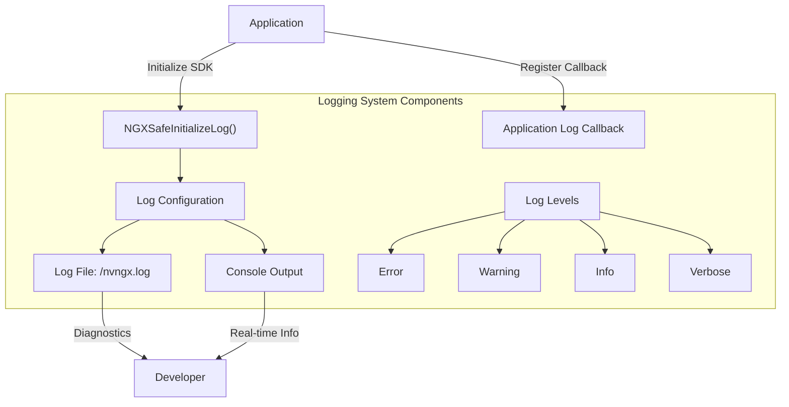
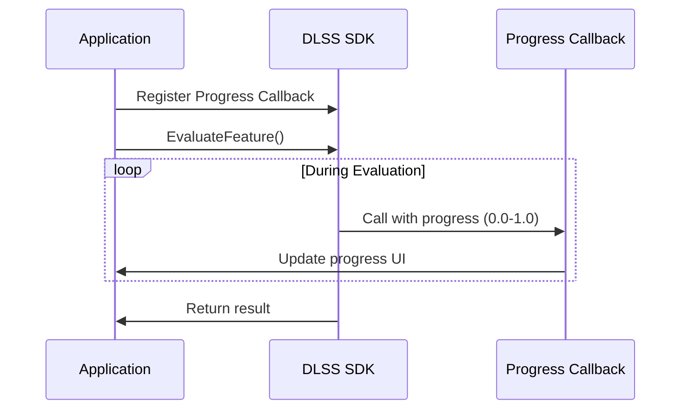
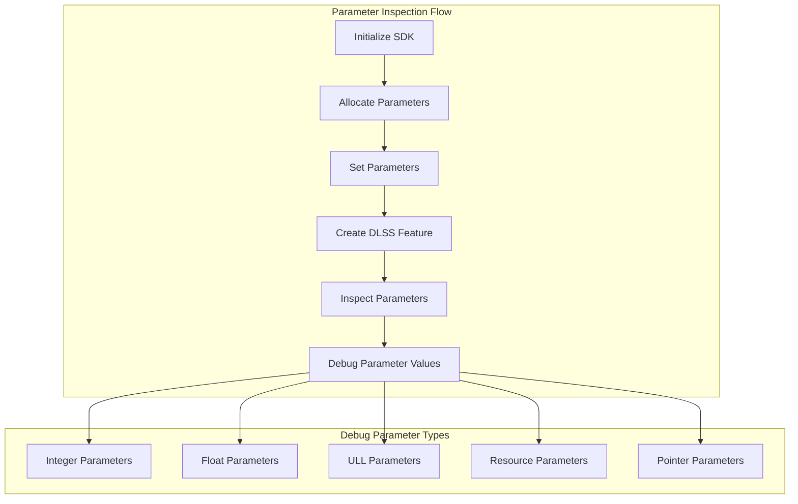
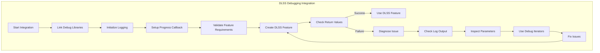

<!-- source: DeepWiki mcp.deepwiki.com · repo NVIDIA/DLSS · page 7.1 Debugging Tools · fetched 2026-10-26 -->

# Debugging Tools

<details>
<summary>Relevant source files</summary>

The following files were used as context for generating this wiki page:

- [lib/Windows_x86_64/x64/nvsdk_ngx_d_dbg_iterator0.lib](lib/Windows_x86_64/x64/nvsdk_ngx_d_dbg_iterator0.lib)
- [lib/Windows_x86_64/x64/nvsdk_ngx_d_dbg_iterator1.lib](lib/Windows_x86_64/x64/nvsdk_ngx_d_dbg_iterator1.lib)
- [lib/Windows_x86_64/x64/nvsdk_ngx_d_iterator1.lib](lib/Windows_x86_64/x64/nvsdk_ngx_d_iterator1.lib)
- [lib/Windows_x86_64/x64/nvsdk_ngx_s_dbg_iterator0.lib](lib/Windows_x86_64/x64/nvsdk_ngx_s_dbg_iterator0.lib)
- [lib/Windows_x86_64/x64/nvsdk_ngx_s_dbg_iterator1.lib](lib/Windows_x86_64/x64/nvsdk_ngx_s_dbg_iterator1.lib)
- [lib/Windows_x86_64/x64/nvsdk_ngx_s_iterator1.lib](lib/Windows_x86_64/x64/nvsdk_ngx_s_iterator1.lib)

</details>


This page documents the debugging tools available within the NVIDIA DLSS SDK that help developers troubleshoot integration issues, monitor performance, and validate proper implementation. These tools provide visibility into the inner workings of DLSS and assist in diagnosing problems that may arise during development and deployment.

## Overview

The NVIDIA DLSS SDK includes several debugging mechanisms designed to help developers verify their implementations and diagnose issues. These tools range from logging facilities to debug iterators and parameter inspection utilities.

```mermaid
flowchart TD
    subgraph "DLSS SDK Debugging Tools"
        Logging["Logging System"] --> LogFile["Log File Output"]
        Logging --> ConsoleLog["Console Output"]
        
        DebugLibs["Debug Libraries"] --> DbgIterators["Debug Iterators"]
        DebugLibs --> DbgParameters["Debug Parameters"]
        
        ProgressTracking["Progress Tracking"] --> Callbacks["Progress Callbacks"]
        
        ErrorHandling["Error Handling"] --> ErrorBreak["Error Breakpoints"]
        ErrorHandling --> ErrorCallback["Error Callbacks"]
        
        CapabilityInspection["Capability Inspection"] --> FeatureReqs["Feature Requirements"]
        CapabilityInspection --> ScratchBuffer["Scratch Buffer Size"]
    end
    
    Developer -- "Integrates" --> DLSS["DLSS Implementation"]
    DLSS -- "Issues" --> "DLSS SDK Debugging Tools"
    "DLSS SDK Debugging Tools" -- "Diagnostics" --> Developer
```

Sources: [lib/Windows_x86_64/x64/nvsdk_ngx_d_dbg_iterator0.lib](), [lib/Windows_x86_64/x64/nvsdk_ngx_d_dbg_iterator1.lib]()

## Debug Libraries

The DLSS SDK provides special debug libraries that expose additional functionality for debugging purposes. These libraries are recognizable by the inclusion of `dbg` in their filenames.

| Library | Purpose |
|---------|---------|
| nvsdk_ngx_d_dbg_iterator0.lib | Provides iterator access to internal DLSS state for debugging (first iteration) |
| nvsdk_ngx_d_dbg_iterator1.lib | Provides iterator access to internal DLSS state for debugging (second iteration) |
| nvsdk_ngx_s_dbg_iterator0.lib | Static library version of debug iterator (first iteration) |
| nvsdk_ngx_s_dbg_iterator1.lib | Static library version of debug iterator (second iteration) |

To use these debug libraries instead of the release versions, link against them in your build system when creating debug builds. These libraries expose the same API as the release libraries but with additional diagnostic information.

Sources: [lib/Windows_x86_64/x64/nvsdk_ngx_d_dbg_iterator0.lib](), [lib/Windows_x86_64/x64/nvsdk_ngx_d_dbg_iterator1.lib](), [lib/Windows_x86_64/x64/nvsdk_ngx_s_dbg_iterator0.lib](), [lib/Windows_x86_64/x64/nvsdk_ngx_s_dbg_iterator1.lib]()

## Logging System

The DLSS SDK includes a comprehensive logging system that can output detailed information about SDK operations, errors, and warnings.



### Configuring Logging

The logging system can be configured through several parameters:

1. **Log Path** - Set using registry key or API parameter
   - Registry: `LogPath`
   - Enable override: `EnableLogPathOverride`

2. **Log Level** - Controls verbosity of logging output
   - Registry: `LogLevel`
   - Values range from errors only to verbose debugging information

3. **Console Logging** - Enable/disable console output
   - Registry: `EnableConsoleLogging`

### Log Callback

Applications can register a callback function to receive logging information directly:

```cpp
// Example log callback registration
// The callback receives the log message, log level, and feature
void MyLogCallback(const char* message, NVSDK_NGX_Logging_Level level, NVSDK_NGX_Feature feature);

// Initialize SDK with logging
NVSDK_NGX_Result result = NGXSafeInitializeLog(
    appPath,                  // Application path
    logPath,                  // Log file path
    logLevel,                 // Log level
    MyLogCallback,            // Log callback function
    enableConsoleLogging      // Enable console output
);
```

Sources: [lib/Windows_x86_64/x64/nvsdk_ngx_d_dbg_iterator0.lib](), [lib/Windows_x86_64/x64/nvsdk_ngx_d_dbg_iterator1.lib]()

## Progress Tracking

DLSS operations can be monitored in real-time using progress callback mechanisms. This is especially useful for tracking the progression of long-running operations like feature initialization.

### Progress Callback Mechanism

The `NGXProgressCallbackHelper` provides functionality to track the progress of DLSS operations:



To implement progress tracking:

1. Define a callback function that receives a progress value between 0.0 and 1.0
2. Pass this callback to the appropriate DLSS functions that support progress monitoring

Sources: [lib/Windows_x86_64/x64/nvsdk_ngx_d_dbg_iterator0.lib](), [lib/Windows_x86_64/x64/nvsdk_ngx_d_dbg_iterator1.lib]()

## Error Handling and Diagnostics

The DLSS SDK provides several mechanisms for error handling and diagnostics:

1. **Error Codes** - All DLSS functions return `NVSDK_NGX_Result` values indicating success or specific failure reasons
2. **Error Descriptions** - The `GetNGXResultAsString` function converts error codes to readable strings
3. **Error Callbacks** - Register callbacks to be notified when errors occur
4. **Break on Error** - Configure the SDK to trigger debugger breakpoints on errors

### Common Diagnostic Functions

The following functions are particularly useful for diagnostic purposes:

| Function | Purpose |
|----------|---------|
| NVSDK_NGX_D3D12_GetFeatureRequirements | Check if the system meets requirements for a specific feature |
| NVSDK_NGX_D3D12_GetScratchBufferSize | Determine memory requirements for a DLSS feature |
| NVSDK_NGX_D3D12_GetCapabilityParameters | Get capability parameters for diagnostics |

Similar functions exist for other APIs (D3D11, Vulkan, CUDA).

### Debug Parameter Inspection

The debug libraries provide extended parameter inspection capabilities:



Sources: [lib/Windows_x86_64/x64/nvsdk_ngx_d_dbg_iterator0.lib](), [lib/Windows_x86_64/x64/nvsdk_ngx_d_dbg_iterator1.lib]()

## Feature Requirements Validation

The DLSS SDK provides mechanisms to validate whether the system meets the requirements for specific features:

```cpp
// Example of feature requirements validation
NVSDK_NGX_Parameter* pParams = nullptr;
NVSDK_NGX_Result result = NVSDK_NGX_D3D12_AllocateParameters(&pParams);

if (NVSDK_NGX_SUCCEED(result))
{
    // Get feature requirements for DLSS
    result = NVSDK_NGX_D3D12_GetFeatureRequirements(
        device,                    // D3D12 Device
        pParams,                   // Parameter object
        NVSDK_NGX_Feature_SuperSampling // Feature to check
    );
    
    if (NVSDK_NGX_SUCCEED(result))
    {
        // Check requirements in pParams
        // ...
    }
}
```

This allows developers to check if DLSS features can run on the current system and identify specific missing requirements.

Sources: [lib/Windows_x86_64/x64/nvsdk_ngx_d_dbg_iterator0.lib](), [lib/Windows_x86_64/x64/nvsdk_ngx_d_dbg_iterator1.lib]()

## Debug-only Parameters

Several parameters are only available in debug builds and can help diagnose issues:

| Parameter | Type | Purpose |
|-----------|------|---------|
| LogLevel | Integer | Control verbosity of logging (0-3) |
| EnableConsoleLogging | Integer | Enable/disable console output (0/1) |
| LogPath | String | Custom path for log file |
| EnableLogPathOverride | Integer | Allow override of default log path (0/1) |

To set these parameters:

```cpp
// Example of setting debug parameters
NVSDK_NGX_Parameter* pParams = nullptr;
NVSDK_NGX_D3D12_AllocateParameters(&pParams);

// Set debug parameters
pParams->Set(L"LogLevel", 3); // Verbose logging
pParams->Set(L"EnableConsoleLogging", 1); // Enable console output
```

Sources: [lib/Windows_x86_64/x64/nvsdk_ngx_d_dbg_iterator0.lib](), [lib/Windows_x86_64/x64/nvsdk_ngx_d_dbg_iterator1.lib]()

## Debug Iterators

The debug iterator libraries provide mechanisms to iterate through internal DLSS state for debugging purposes. While the specific functionality of these iterators is not fully documented in the provided sources, they enable inspection of DLSS internal data structures during development.

The iterators appear to be provided in two different versions (iterator0 and iterator1), suggesting they may provide access to different aspects of the DLSS state or represent different versions of the iteration functionality.

Sources: [lib/Windows_x86_64/x64/nvsdk_ngx_d_dbg_iterator0.lib](), [lib/Windows_x86_64/x64/nvsdk_ngx_d_dbg_iterator1.lib]()

## Best Practices for Debugging

1. **Use Debug Libraries**: Link against debug libraries when troubleshooting integration issues.

2. **Enable Verbose Logging**: Set LogLevel to maximum (3) to get detailed information.

3. **Check Feature Requirements**: Always validate feature requirements before attempting to create DLSS features.

4. **Monitor Progress**: Implement progress callbacks to track long-running operations.

5. **Inspect Parameters**: Examine parameter values before and after feature creation to identify configuration issues.

6. **API-Specific Implementations**: Be aware that debugging tools might have different implementations across APIs (DirectX 11, DirectX 12, Vulkan, CUDA).

7. **Registry Settings**: Some debugging settings can be configured through registry keys for persistent configuration.

Sources: [lib/Windows_x86_64/x64/nvsdk_ngx_d_dbg_iterator0.lib](), [lib/Windows_x86_64/x64/nvsdk_ngx_d_dbg_iterator1.lib]()

## Code Integration Flowchart



Sources: [lib/Windows_x86_64/x64/nvsdk_ngx_d_dbg_iterator0.lib](), [lib/Windows_x86_64/x64/nvsdk_ngx_d_dbg_iterator1.lib]()

## Summary

The DLSS SDK provides a comprehensive set of debugging tools to assist developers in successfully integrating and troubleshooting DLSS features. By utilizing these debugging capabilities—including logging, parameter inspection, feature requirement validation, and progress tracking—developers can more easily identify and resolve issues in their DLSS integration.

For information about specific DLSS features and their implementation details, refer to the [DLSS Core Technology](#2) page.

Sources: [lib/Windows_x86_64/x64/nvsdk_ngx_d_dbg_iterator0.lib](), [lib/Windows_x86_64/x64/nvsdk_ngx_d_dbg_iterator1.lib]()