# Page: DLSS Overview

# DLSS Overview

<details>
<summary>Relevant source files</summary>

The following files were used as context for generating this wiki page:

- [.gitmodules](.gitmodules)
- [README.md](README.md)
- [doc/DLSS_Programming_Guide_Release.pdf](doc/DLSS_Programming_Guide_Release.pdf)
- [lib/Windows_x86_64/dev/nvngx_dlss.dll](lib/Windows_x86_64/dev/nvngx_dlss.dll)
- [lib/Windows_x86_64/rel/nvngx_dlss.dll](lib/Windows_x86_64/rel/nvngx_dlss.dll)

</details>


NVIDIA Deep Learning Super Sampling (DLSS) is an AI-powered upscaling technology that enhances gaming performance while maintaining high image quality. This document provides an overview of the DLSS technology, its core components, architecture, and implementation within the NVIDIA DLSS SDK.

For detailed integration instructions, see [NGX SDK Integration](#4), and for information about DLSS Ray Reconstruction, see [DLSS Ray Reconstruction](#3).

## What is DLSS?

DLSS is a neural network-based image upscaling technology that allows games to render at a lower internal resolution and then upscale to a higher output resolution. This approach provides significant performance improvements while maintaining visual quality comparable to native resolution rendering.

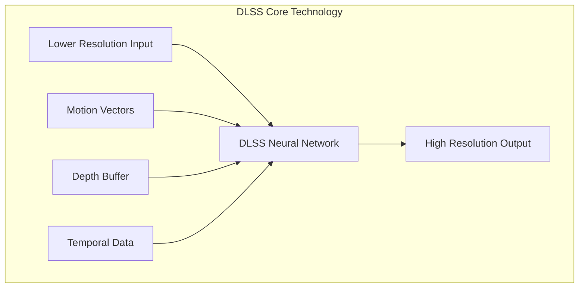

Sources: doc/DLSS_Programming_Guide_Release.pdf

Key benefits of DLSS include:

- **Performance Gains**: Rendering at lower resolution reduces GPU workload
- **Quality Preservation**: AI upscaling maintains visual fidelity
- **Temporal Stability**: Uses data from multiple frames for better image quality
- **Anti-aliasing**: Provides built-in anti-aliasing effects

## DLSS Architecture

DLSS is implemented as part of NVIDIA's NGX technology stack, which provides a framework for AI-assisted graphics features.

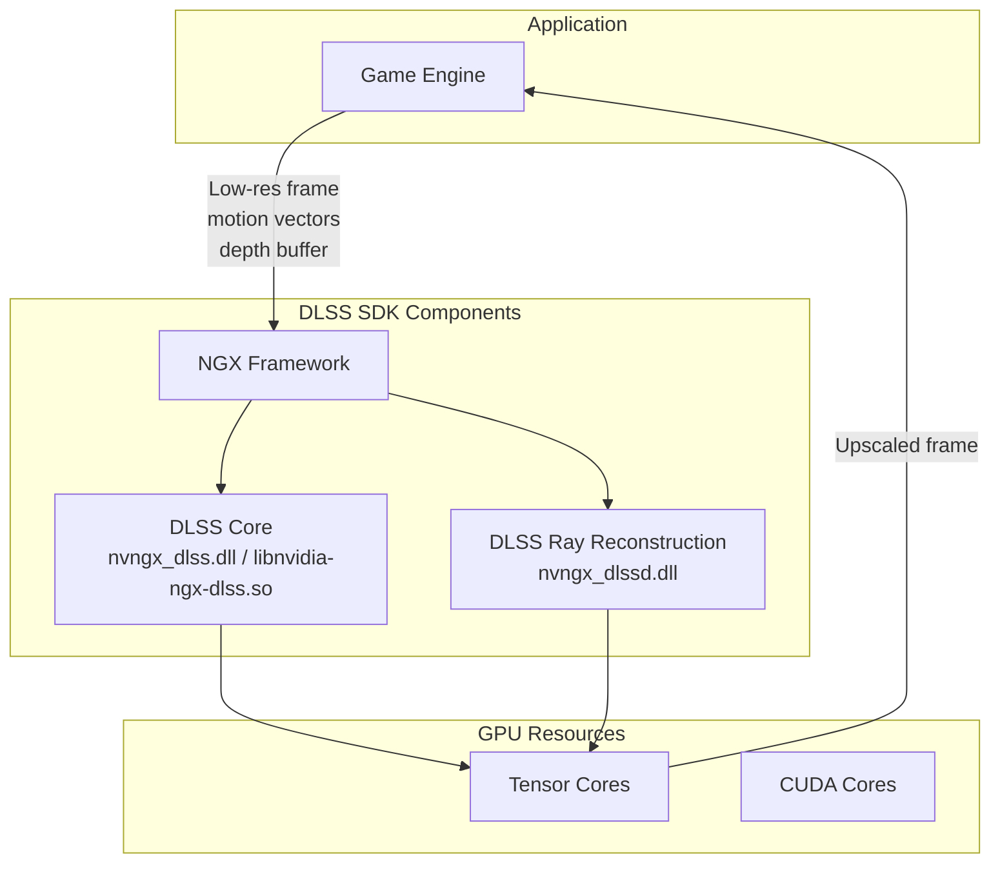

Sources: lib/Windows_x86_64/dev/nvngx_dlss.dll, lib/Windows_x86_64/rel/nvngx_dlss.dll

## Core Components

### NGX Framework

The NGX framework provides the interface between applications and DLSS, handling initialization, feature creation, and evaluation. It manages the loading of the appropriate DLSS libraries based on the platform and graphics API.

### DLSS Core Libraries

DLSS functionality is implemented in platform-specific libraries:

| Platform | Graphics API | Library File |
|----------|--------------|-------------|
| Windows  | DirectX 11, DirectX 12, Vulkan | nvngx_dlss.dll |
| Linux    | Vulkan       | libnvidia-ngx-dlss.so |

These libraries contain the trained neural networks and algorithms that perform the upscaling process.

### DLSS Quality Modes

DLSS supports multiple quality modes that offer different trade-offs between performance and image quality:

| Mode | Resolution Scale | Performance Impact |
|------|------------------|-------------------|
| Quality | ~1.5x | Lower performance gain, highest quality |
| Balanced | ~1.7x | Medium performance gain, good quality |
| Performance | ~2x | High performance gain, slightly reduced quality |
| Ultra Performance | ~3-4x | Maximum performance gain, most quality compromise |

Sources: doc/DLSS_Programming_Guide_Release.pdf

## Integration Process

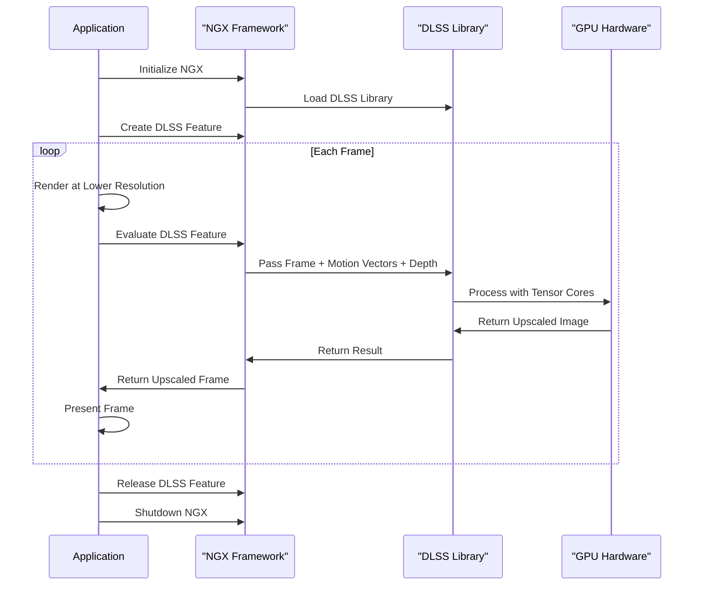

Sources: doc/DLSS_Programming_Guide_Release.pdf

The basic flow for integrating DLSS into an application involves:

1. **Initialization**: Initialize the NGX library
2. **Feature Creation**: Create the DLSS feature with desired parameters
3. **Per-Frame Evaluation**: For each frame, render at lower resolution and provide the necessary inputs to DLSS
4. **Cleanup**: Release resources when done

## Hardware Requirements

DLSS requires NVIDIA RTX GPUs with Tensor Cores:
- RTX 20 Series or newer for DLSS 2.0+
- RTX 30 Series or newer recommended for optimal performance

## Relationship to Other Technologies

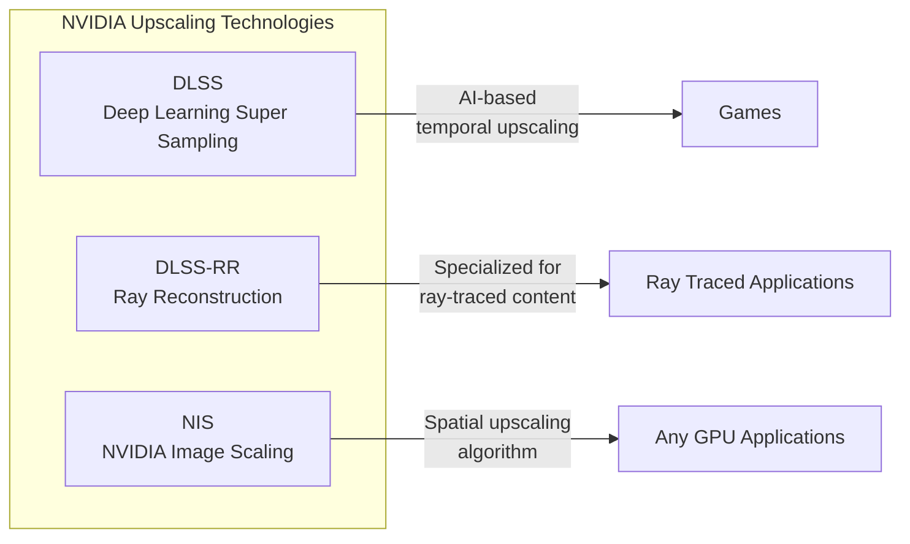

Sources: README.md, .gitmodules

- **DLSS**: The primary AI-based temporal upscaling technology
- **DLSS Ray Reconstruction (DLSS-RR)**: A specialized version optimized for ray-traced content
- **NVIDIA Image Scaling (NIS)**: A separate, cross-platform spatial upscaling solution included as a submodule in the repository

## Platform and API Support

DLSS supports the following platforms and graphics APIs:

| Platform | Graphics API |
|----------|--------------|
| Windows  | DirectX 11   |
| Windows  | DirectX 12   |
| Windows  | Vulkan       |
| Linux    | Vulkan       |

Sources: doc/DLSS_Programming_Guide_Release.pdf

## Summary

DLSS represents a significant advancement in real-time rendering technology, using AI to enable higher performance without sacrificing visual quality. The DLSS SDK provides developers with the tools needed to integrate this technology into their applications across multiple platforms and graphics APIs.

For detailed implementation guidance, refer to the [NGX SDK Integration](#4) section, and for information about DLSS quality settings and performance considerations, see [Quality Settings and Performance](#4.2).

---

# Page: DLSS Core Technology

# DLSS Core Technology

<details>
<summary>Relevant source files</summary>

The following files were used as context for generating this wiki page:

- [doc/DLSS_Programming_Guide_Release.pdf](doc/DLSS_Programming_Guide_Release.pdf)
- [lib/Windows_x86_64/dev/nvngx_dlss.dll](lib/Windows_x86_64/dev/nvngx_dlss.dll)
- [lib/Windows_x86_64/rel/nvngx_dlss.dll](lib/Windows_x86_64/rel/nvngx_dlss.dll)

</details>


DLSS (Deep Learning Super Sampling) is NVIDIA's AI-based upscaling technology that enhances gaming performance while maintaining high visual quality. This document focuses on the core technology behind DLSS, its architecture, and how it functions at a technical level.

For information about DLSS Ray Reconstruction (DLSS-RR), see [DLSS Ray Reconstruction](#3).
For platform-specific implementation details, see [Windows Implementation](#2.1) or [Linux Implementation](#2.2).
For details on how to integrate DLSS into applications, see [NGX SDK Integration](#4).

## Core Technology Overview

DLSS Core Technology is implemented in platform-specific libraries that utilize NVIDIA's NGX framework. The technology uses neural networks to upscale lower-resolution frames to higher resolutions with image quality comparable to native rendering, allowing games to run at higher framerates while maintaining visual fidelity.

### DLSS Core Technology Architecture

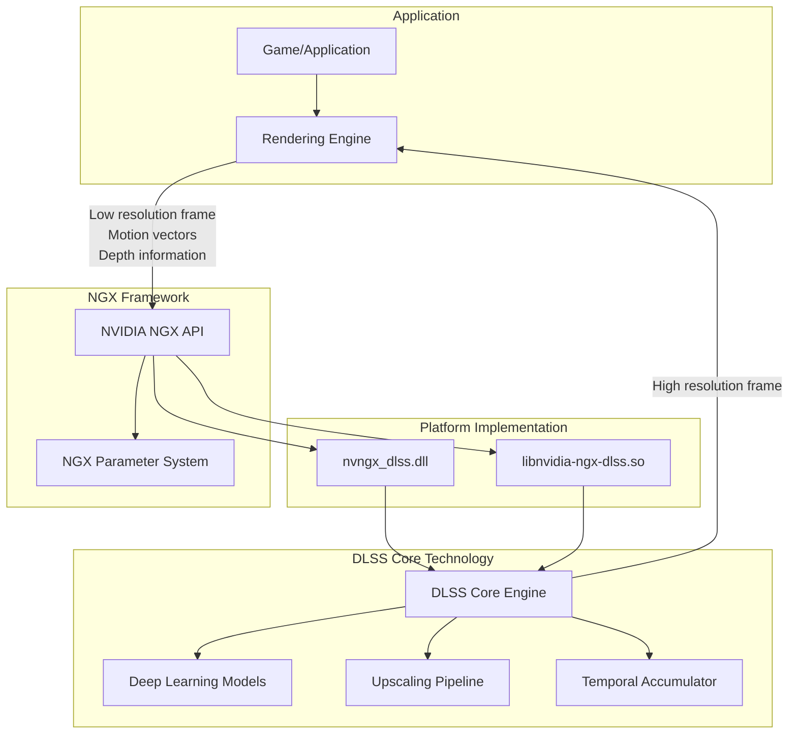

Sources: lib/Windows_x86_64/dev/nvngx_dlss.dll

## Technical Principles

DLSS operates on several key technical principles that enable its high-quality, real-time upscaling capabilities:

1. **Neural Network Based Upscaling**: Uses deep learning models trained on high-quality game images to recognize patterns and reconstruct high-resolution output
2. **Temporal Feedback**: Incorporates information from previous frames to enhance detail and stability
3. **Motion Vector Utilization**: Uses motion vectors to track how pixels move between frames
4. **Depth Information Processing**: Leverages depth information to improve object boundary handling

### DLSS Processing Pipeline

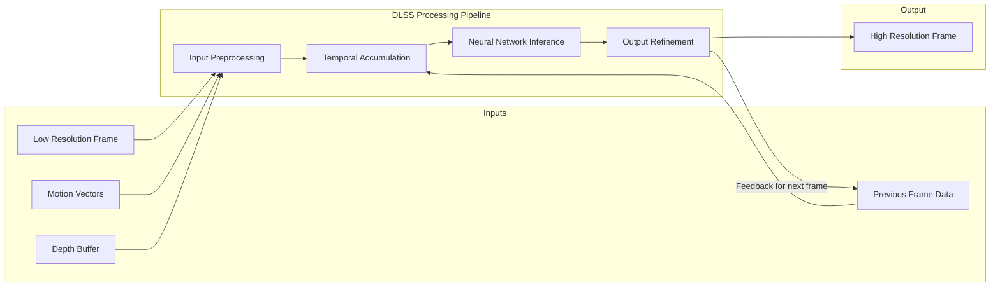

Sources: lib/Windows_x86_64/dev/nvngx_dlss.dll

## Performance and Quality Modes

DLSS offers multiple quality presets that provide different tradeoffs between performance and visual quality:

| Quality Mode | Typical Upscaling Ratio | Performance Impact | Use Case |
|--------------|-----------------|-------------------|----------|
| Quality | 1.5x | Lowest performance gain | Maximum image quality |
| Balanced | 1.7x | Moderate performance gain | Good balance of quality and performance |
| Performance | 2x | High performance gain | Better performance with acceptable quality |
| Ultra Performance | 3-4x | Maximum performance gain | Maximum performance for compatible games |

The quality mode determines the internal rendering resolution before DLSS upscaling occurs. For example, in Performance mode with a target 4K output (3840x2160), the game would render at 1920x1080 and DLSS would upscale to 4K.

Sources: lib/Windows_x86_64/dev/nvngx_dlss.dll

## Integration Flow

Applications integrate with DLSS through the NVIDIA NGX framework, which provides a standardized interface for AI-enhanced features.

### DLSS Integration Sequence

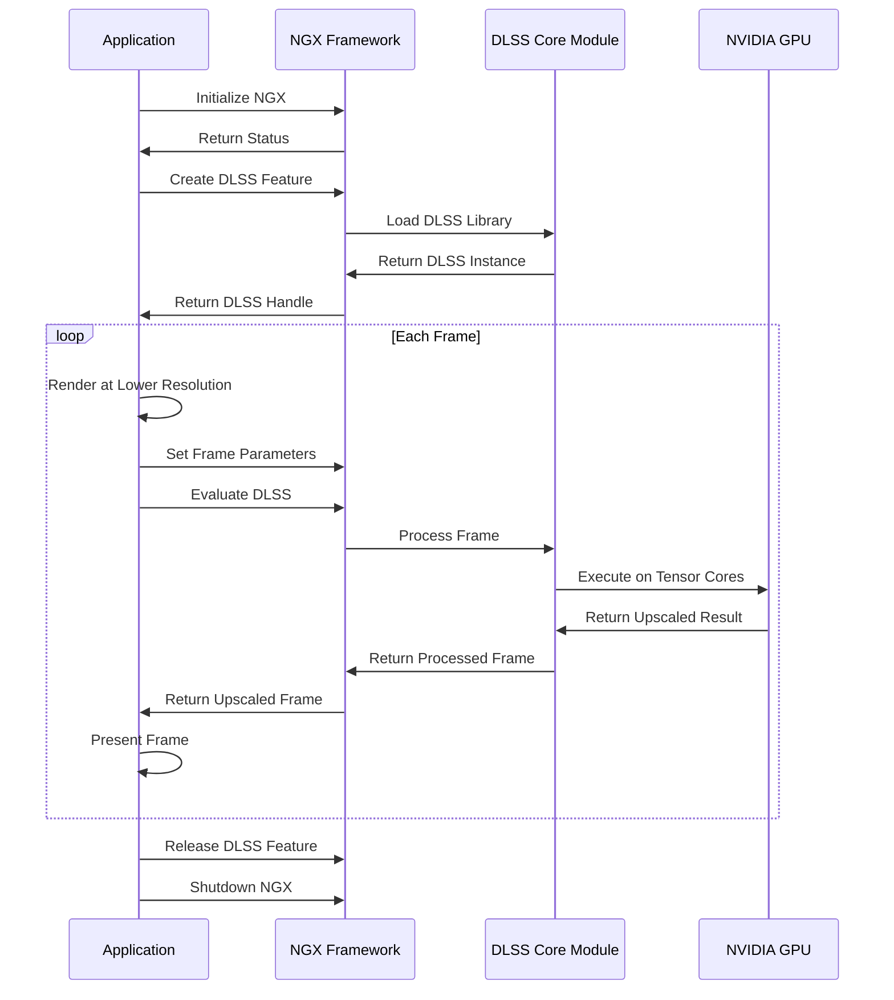

Sources: lib/Windows_x86_64/dev/nvngx_dlss.dll

## Component Architecture

The DLSS Core Technology is implemented through several key components that work together to provide the upscaling functionality:

### DLSS Component Architecture

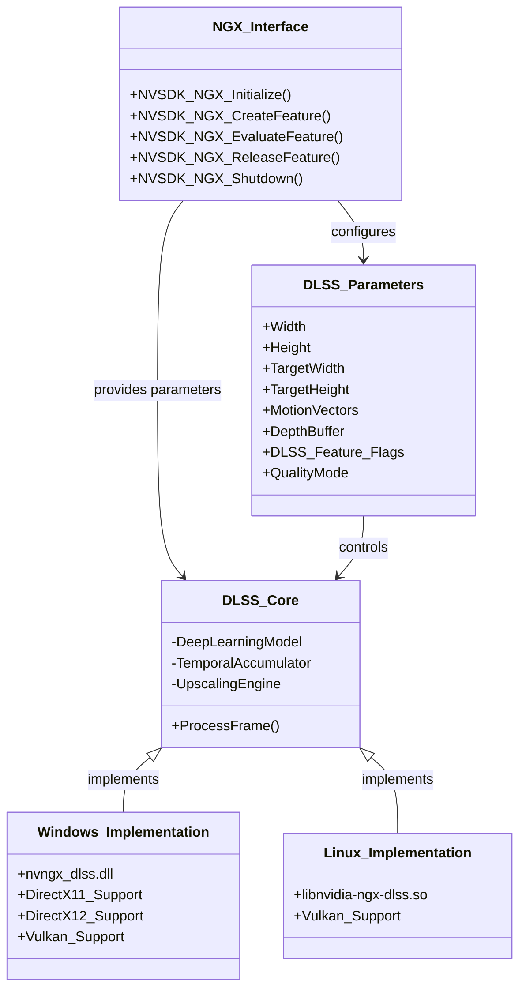

Sources: lib/Windows_x86_64/dev/nvngx_dlss.dll

## Technical Requirements

DLSS has specific hardware and software requirements to function properly:

### Hardware Requirements
- NVIDIA RTX GPU (or newer GPU with Tensor Cores)
- Sufficient GPU memory to store AI models and frame data

### Software Requirements
- Supported graphics API: DirectX 11, DirectX 12, or Vulkan
- Properly integrated NGX SDK
- Appropriate graphics driver version

### Input Requirements
For each frame, DLSS requires:
- Current low-resolution color buffer
- Motion vectors (pixel velocity data between frames)
- Depth buffer
- Exposure value (optional)

Sources: lib/Windows_x86_64/dev/nvngx_dlss.dll

## Implementation Details

The DLSS implementation consists of platform-specific libraries that contain the neural network models and processing code that performs the upscaling.

### Implementation Structure

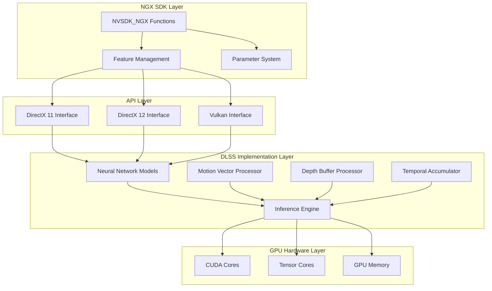

Sources: lib/Windows_x86_64/dev/nvngx_dlss.dll

## Performance Considerations

When implementing DLSS, several factors affect performance and quality:

1. **Input Quality**: Higher quality motion vectors and depth buffers produce better upscaling results
2. **Resolution Scaling**: Different quality modes have different performance characteristics
3. **Temporal Stability**: Static scenes generally benefit from temporal accumulation
4. **GPU Load**: DLSS processing runs on dedicated Tensor Cores to minimize impact on graphics rendering

For optimal performance, applications should:
- Ensure accurate motion vectors
- Provide clean depth buffers
- Balance DLSS quality settings with target performance
- Consider jitter patterns for improved sub-pixel detail

Sources: lib/Windows_x86_64/dev/nvngx_dlss.dll

## Summary

DLSS Core Technology represents a significant advancement in real-time graphics rendering, using AI to enable higher performance while maintaining visual quality. By leveraging deep learning models and temporal data, DLSS can effectively upscale lower resolution frames to higher resolutions with minimal quality loss.

For platform-specific implementation details, refer to the [Windows Implementation](#2.1) and [Linux Implementation](#2.2) documentation. For integration guidance, see the [NGX SDK Integration](#4) page.

---

# Page: Windows Implementation

# Windows Implementation

<details>
<summary>Relevant source files</summary>

The following files were used as context for generating this wiki page:

- [lib/Windows_x86_64/dev/nvngx_dlss.dll](lib/Windows_x86_64/dev/nvngx_dlss.dll)
- [lib/Windows_x86_64/rel/nvngx_dlss.dll](lib/Windows_x86_64/rel/nvngx_dlss.dll)

</details>


## Purpose and Scope

This document provides technical details about the Windows implementation of NVIDIA DLSS, focusing on the dynamic-link library (DLL) architecture, interface mechanisms, and Windows-specific considerations. For information about the Linux implementation, see [Linux Implementation](#2.2).

## Core Windows DLL Components

The Windows implementation of DLSS revolves around several key DLL components that work together to provide AI-enhanced upscaling functionality:

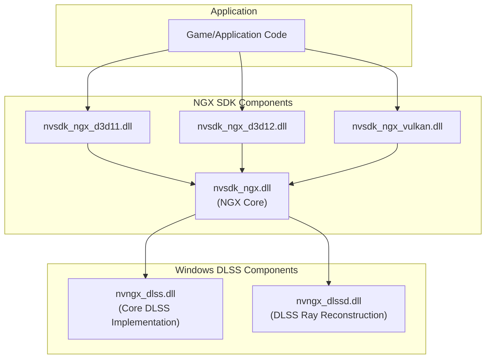

### Key DLL Components

| Component | Description | Primary Function |
|-----------|-------------|------------------|
| `nvngx_dlss.dll` | Core DLSS implementation | Contains the AI models and processing logic for DLSS upscaling |
| `nvngx_dlssd.dll` | DLSS Ray Reconstruction | Specialized AI models for ray-traced scenes |
| `nvsdk_ngx.dll` | NGX Core functionality | Handles feature management and common operations |
| `nvsdk_ngx_d3d11.dll` | DirectX 11 interface | Provides DX11-specific implementation |
| `nvsdk_ngx_d3d12.dll` | DirectX 12 interface | Provides DX12-specific implementation |
| `nvsdk_ngx_vulkan.dll` | Vulkan interface | Provides Vulkan-specific implementation |

## Implementation Architecture

The Windows implementation follows a layered architecture that separates API-specific code from the core AI functionality:

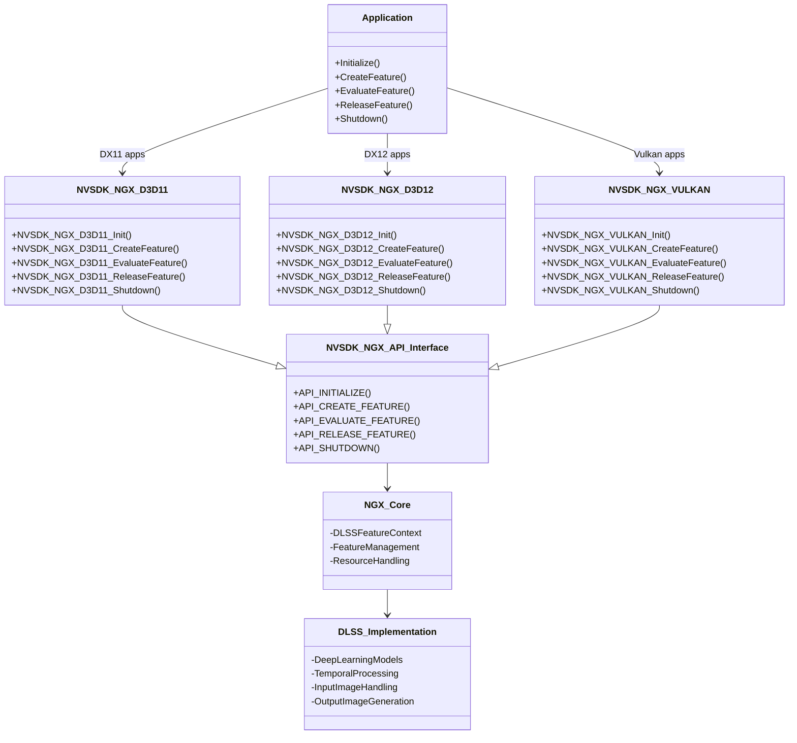

## Data Flow in Windows DLSS Implementation

The following diagram illustrates how data flows through the Windows DLSS implementation, from the application to the final upscaled output:

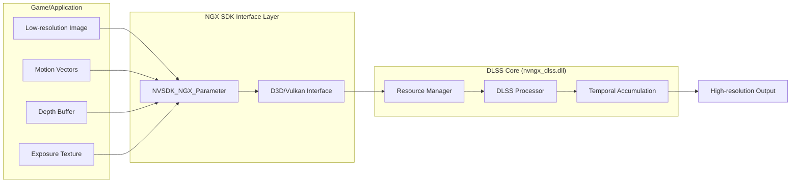

## Windows-Specific Implementation Details

### Operating System and Driver Requirements

The Windows implementation of DLSS requires:

- Windows 10 64-bit or Windows 11
- NVIDIA RTX GPU (GeForce RTX 20-series or newer)
- NVIDIA Game Ready or Studio Drivers (minimum version varies by DLSS version)

### Graphics API Support

DLSS on Windows supports three main graphics APIs through dedicated interface DLLs:

| Graphics API | Interface DLL | Supported Versions |
|--------------|---------------|-------------------|
| DirectX 11 | `nvsdk_ngx_d3d11.dll` | DirectX 11.0+ |
| DirectX 12 | `nvsdk_ngx_d3d12.dll` | DirectX 12.0+ |
| Vulkan | `nvsdk_ngx_vulkan.dll` | Vulkan 1.1+ |

### Resource Management Differences

Resource management differs between graphics APIs:

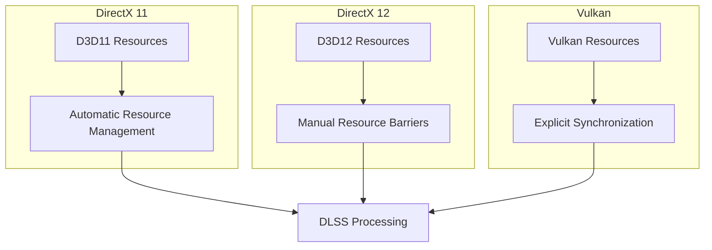

## Integration Process for Windows Applications

Windows applications integrate DLSS through the following typical workflow:

1. Initialize the appropriate NGX API (DX11, DX12, or Vulkan)
2. Create DLSS feature with desired parameters
3. Evaluate DLSS feature each frame with current input resources
4. Release resources when finished

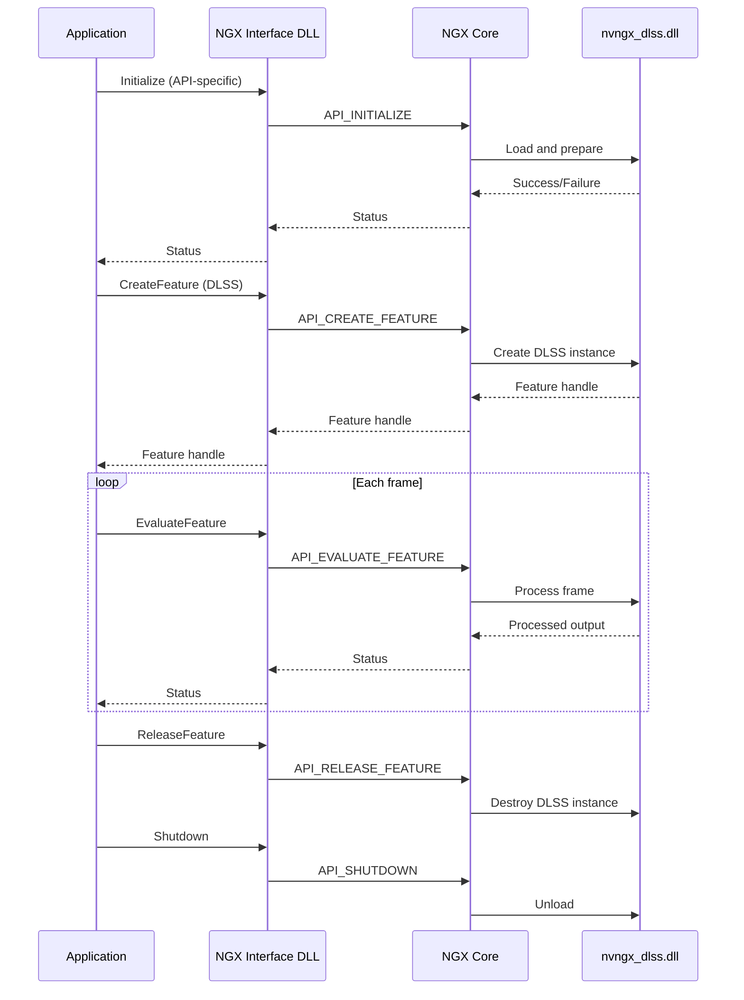

## DLL Loading and Versioning

The Windows implementation uses the following DLL search and loading approach:

1. Application directory is searched first
2. Then Windows system paths are searched
3. DLSS version is determined by the DLL version

To maintain compatibility and prevent conflicts:

1. Each application should ship with the specific DLSS DLL version it was tested with
2. Multiple applications can use different DLSS versions on the same system
3. The NGX SDK handles version compatibility checks

## Windows-Specific Performance Considerations

On Windows systems, several factors can influence DLSS performance:

- Driver overhead for different graphics APIs
- Memory allocation and management strategies
- Windows OS background processes
- GPU power states and thermal management

## Debugging DLSS on Windows

Windows developers can debug DLSS integration using:

1. Debug versions of the DLSS DLLs
2. NVIDIA Nsight Graphics for GPU profiling
3. Environment variables for logging and diagnostic output

## Conclusion

The Windows implementation of DLSS provides a robust framework for AI-powered upscaling across multiple graphics APIs. The multi-layered DLL architecture isolates graphics API specifics from the core AI functionality while maintaining high performance and compatibility across the Windows ecosystem.

---

# Page: Linux Implementation

# Linux Implementation

<details>
<summary>Relevant source files</summary>

The following files were used as context for generating this wiki page:

- [lib/Linux_x86_64/dev/libnvidia-ngx-dlss.so.310.2.1](lib/Linux_x86_64/dev/libnvidia-ngx-dlss.so.310.2.1)
- [lib/Linux_x86_64/dev/libnvidia-ngx-dlssd.so.310.2.1](lib/Linux_x86_64/dev/libnvidia-ngx-dlssd.so.310.2.1)
- [lib/Linux_x86_64/libnvsdk_ngx.a](lib/Linux_x86_64/libnvsdk_ngx.a)

</details>


## Purpose and Scope

This document details the Linux implementation of NVIDIA DLSS (Deep Learning Super Sampling), focusing on the shared library architecture, platform-specific interfaces, and integration points available to Linux developers. The Linux implementation provides the same core functionality as the Windows version (covered in [Windows Implementation](#2.1)) but with Linux-specific integration patterns and considerations.

## Library Structure

DLSS for Linux is primarily delivered as a shared library (`libnvidia-ngx-dlss.so`), which implements the core DLSS functionality. This library is accompanied by a set of supporting libraries and header files that facilitate integration with various graphics APIs on Linux.

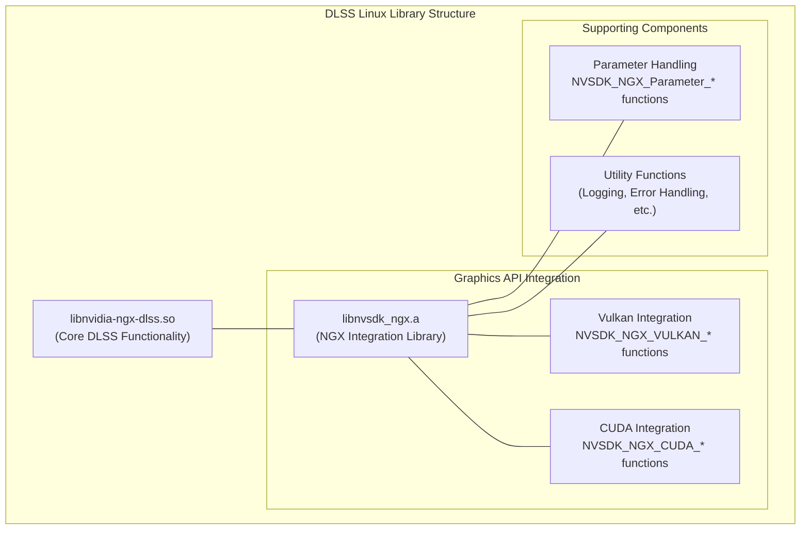

Sources: [lib/Linux_x86_64/libnvsdk_ngx.a]()

## Integration APIs

The Linux implementation provides two primary integration paths through Vulkan and CUDA. Both APIs follow a similar initialization, feature management, and evaluation workflow.

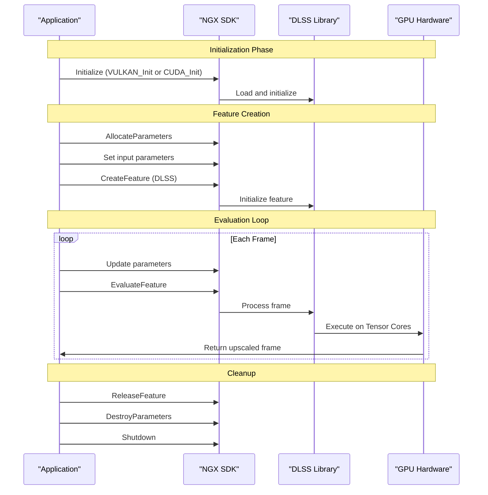

Sources: [lib/Linux_x86_64/libnvsdk_ngx.a]()

## Vulkan Integration

The Vulkan integration provides the primary graphics API interface for DLSS on Linux. It requires specific Vulkan extensions and follows a structured initialization and evaluation process.

### Required Extensions

The Linux implementation requires several Vulkan extensions to function properly:

| Extension Name | Purpose |
|----------------|---------|
| VK_KHR_get_physical_device_properties2 | Access to advanced device properties |
| VK_NVX_binary_import | Import binary data for neural network models |
| VK_NVX_image_view_handle | Access to image view handles for processing |
| VK_EXT_buffer_device_address | Access buffer addresses for efficient memory operations |
| VK_KHR_push_descriptor | Efficient descriptor management |

Sources: [lib/Linux_x86_64/libnvsdk_ngx.a]()

### Vulkan API Functions

The Vulkan integration provides a comprehensive set of functions for the entire DLSS lifecycle:

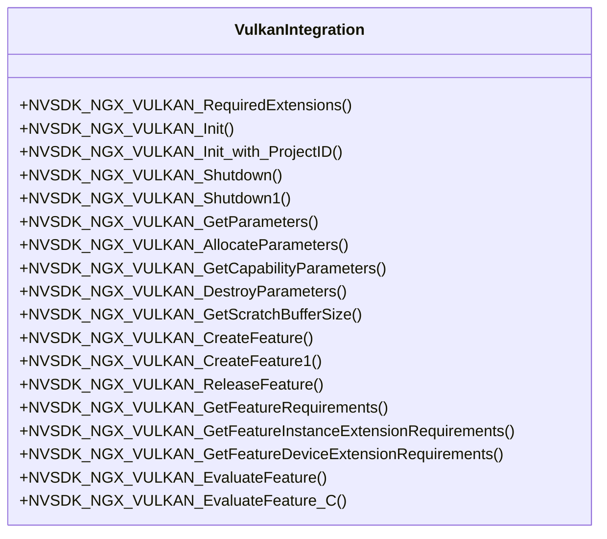

Sources: [lib/Linux_x86_64/libnvsdk_ngx.a]()

## CUDA Integration

The CUDA integration provides an alternative path for applications already using NVIDIA's CUDA platform for general-purpose GPU computing.

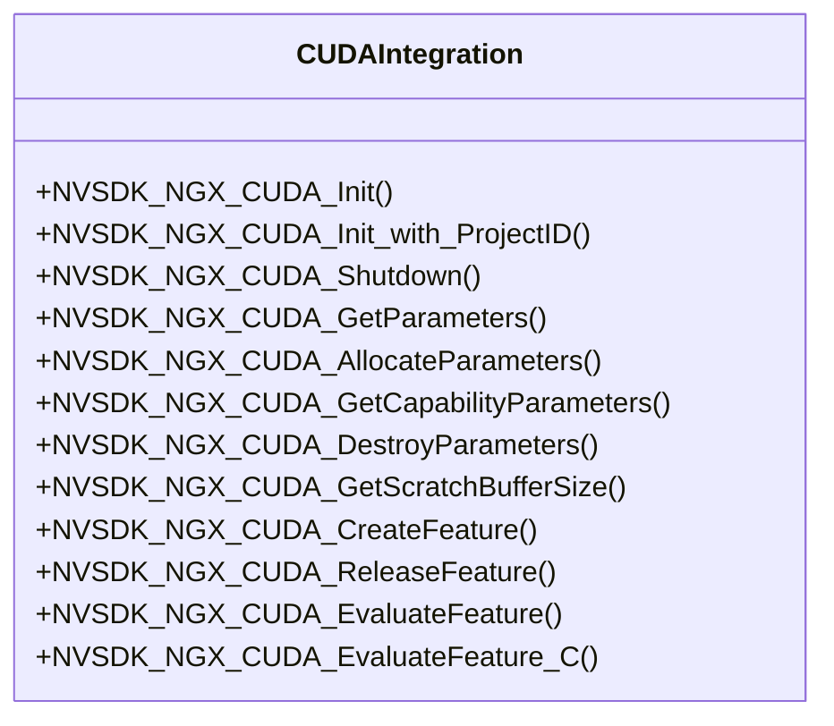

Sources: [lib/Linux_x86_64/libnvsdk_ngx.a]()

## Parameter Handling

Both integration paths use a common parameter handling system to set up and configure DLSS features:

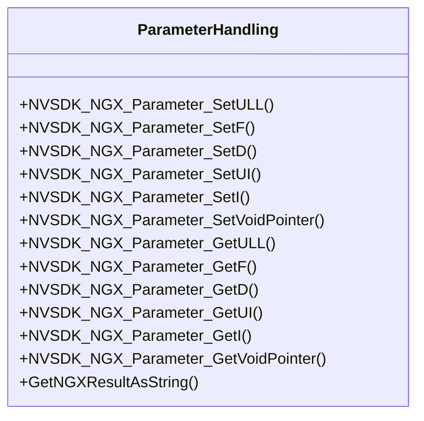

Note that while the Windows implementation includes functions for Direct3D resources (`NVSDK_NGX_Parameter_SetD3d11Resource`, `NVSDK_NGX_Parameter_SetD3d12Resource`, etc.), these are present in the Linux library for compatibility but are non-functional as Direct3D is not supported on Linux.

Sources: [lib/Linux_x86_64/libnvsdk_ngx.a]()

## Utility Components

The Linux implementation includes several utility components that handle common tasks:

1. **Logging System** (`util-log.o`): Provides functions for debug and error logging
2. **Error Handling** (`util-err.o`): Manages error conditions and reporting
3. **DRS Integration** (`util-drs.o`): Interfaces with NVIDIA's Driver Reference System

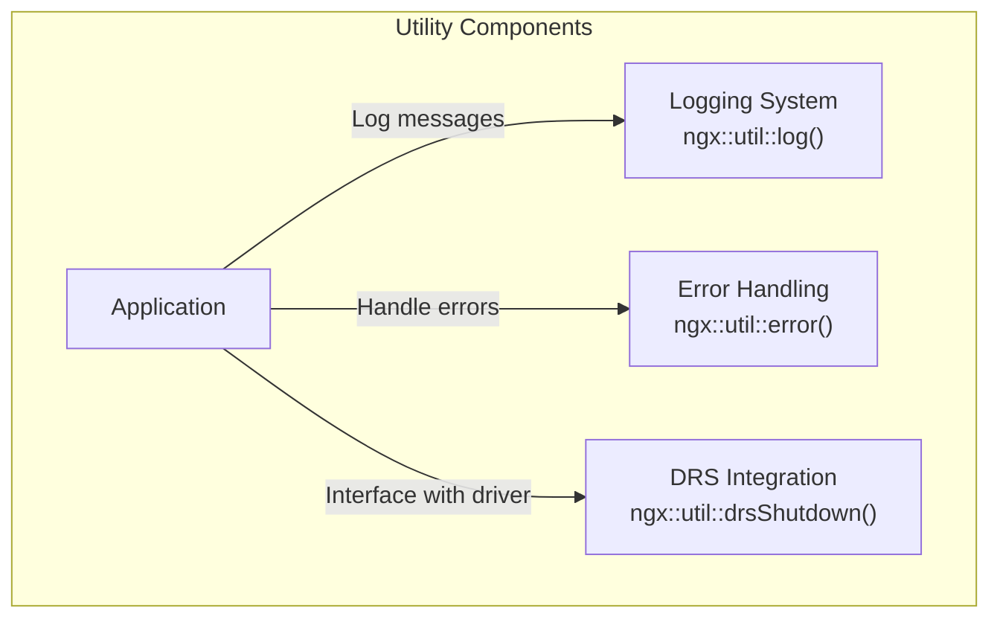

Sources: [lib/Linux_x86_64/libnvsdk_ngx.a]()

## Platform-Specific Considerations

### Library Dependencies

The Linux implementation has several system dependencies that must be present:

- NVIDIA GPU driver with CUDA support
- Vulkan loader (for Vulkan integration)
- CUDA runtime (for CUDA integration)

### Environment Variables

The Linux implementation recognizes several environment variables to control behavior:

| Environment Variable | Purpose |
|----------------------|---------|
| `__NGX_LOG_LEVEL` | Controls verbosity of logging |
| `__NGX_LOG_PATH_OVERRIDE` | Overrides the default log file path |
| `__NGX_ENABLE_OVERRIDE_LOG_PATH` | Enables log path overriding |

Sources: [lib/Linux_x86_64/libnvsdk_ngx.a]()

## Integration Example

Below is a simplified integration example for Vulkan-based applications on Linux:

1. **Initialization**:
   ```cpp
   // Check for required Vulkan extensions
   const char** requiredExtensions;
   uint32_t extensionCount;
   NVSDK_NGX_VULKAN_RequiredExtensions(&requiredExtensions, &extensionCount);
   
   // Enable required extensions when creating Vulkan instance
   
   // Initialize DLSS
   NVSDK_NGX_Result result = NVSDK_NGX_VULKAN_Init(
       applicationId,
       applicationDataPath,
       instance,
       physicalDevice,
       device,
       commandQueue,
       NVSDK_NGX_Version_Latest
   );
   ```

2. **Feature Creation**:
   ```cpp
   // Allocate parameters
   NVSDK_NGX_Parameter* params = nullptr;
   NVSDK_NGX_VULKAN_AllocateParameters(&params);
   
   // Set parameters
   NVSDK_NGX_Parameter_SetUI(params, NVSDK_NGX_Parameter_Width, inputWidth);
   NVSDK_NGX_Parameter_SetUI(params, NVSDK_NGX_Parameter_Height, inputHeight);
   NVSDK_NGX_Parameter_SetUI(params, NVSDK_NGX_Parameter_OutWidth, outputWidth);
   NVSDK_NGX_Parameter_SetUI(params, NVSDK_NGX_Parameter_OutHeight, outputHeight);
   
   // Create DLSS feature
   NVSDK_NGX_Handle dlssFeature = nullptr;
   result = NVSDK_NGX_VULKAN_CreateFeature(
       commandBuffer,
       NVSDK_NGX_Feature_SuperSampling,
       params,
       &dlssFeature
   );
   ```

3. **Feature Evaluation (per frame)**:
   ```cpp
   // Update parameters for this frame
   NVSDK_NGX_Parameter_SetVoidPointer(params, NVSDK_NGX_Parameter_Color, inputColorResource);
   NVSDK_NGX_Parameter_SetVoidPointer(params, NVSDK_NGX_Parameter_Output, outputResource);
   NVSDK_NGX_Parameter_SetVoidPointer(params, NVSDK_NGX_Parameter_MotionVectors, motionVectorsResource);
   NVSDK_NGX_Parameter_SetVoidPointer(params, NVSDK_NGX_Parameter_Depth, depthResource);
   NVSDK_NGX_Parameter_SetF(params, NVSDK_NGX_Parameter_Jitter_Offset_X, jitterX);
   NVSDK_NGX_Parameter_SetF(params, NVSDK_NGX_Parameter_Jitter_Offset_Y, jitterY);
   
   // Evaluate DLSS
   result = NVSDK_NGX_VULKAN_EvaluateFeature(
       commandBuffer,
       dlssFeature,
       params
   );
   ```

4. **Cleanup**:
   ```cpp
   // Release resources
   NVSDK_NGX_VULKAN_ReleaseFeature(dlssFeature);
   NVSDK_NGX_VULKAN_DestroyParameters(params);
   NVSDK_NGX_VULKAN_Shutdown();
   ```

Sources: [lib/Linux_x86_64/libnvsdk_ngx.a]()

## Performance Considerations

The Linux implementation leverages the same underlying AI models and upscaling technology as the Windows version, offering similar performance characteristics. However, there may be slight differences in driver optimizations between platforms.

The same quality presets are available on Linux:

| Preset Name | Upscaling Ratio | Performance Impact |
|-------------|-----------------|-------------------|
| DLSS.Hint.Render.Preset.Quality | 1.5x | Highest quality, lowest performance gain |
| DLSS.Hint.Render.Preset.Balanced | 1.7x | Balanced quality and performance |
| DLSS.Hint.Render.Preset.Performance | 2x | Higher performance gain |
| DLSS.Hint.Render.Preset.UltraPerformance | 3-4x | Maximum performance gain |

Sources: [lib/Linux_x86_64/libnvsdk_ngx.a]()

## Limitations

The Linux implementation has a few platform-specific limitations to be aware of:

1. **Direct3D Support**: As expected, Direct3D-specific interfaces are not functional on Linux
2. **Driver Requirements**: Requires the NVIDIA proprietary driver; won't work with open-source alternatives
3. **Distribution Considerations**: Applications must account for the need to distribute or install the DLSS library with their application

Sources: [lib/Linux_x86_64/libnvsdk_ngx.a]()

---

# Page: DLSS Ray Reconstruction

# DLSS Ray Reconstruction

<details>
<summary>Relevant source files</summary>

The following files were used as context for generating this wiki page:

- [doc/DLSS-RR Integration Guide API.pdf](doc/DLSS-RR Integration Guide API.pdf)
- [doc/DLSS_Programming_Guide_Release.pdf](doc/DLSS_Programming_Guide_Release.pdf)
- [include/nvsdk_ngx_defs_dlssd.h](include/nvsdk_ngx_defs_dlssd.h)
- [include/nvsdk_ngx_helpers_dlssd.h](include/nvsdk_ngx_helpers_dlssd.h)
- [include/nvsdk_ngx_helpers_dlssd_vk.h](include/nvsdk_ngx_helpers_dlssd_vk.h)
- [lib/Linux_x86_64/dev/libnvidia-ngx-dlss.so.310.2.1](lib/Linux_x86_64/dev/libnvidia-ngx-dlss.so.310.2.1)
- [lib/Linux_x86_64/dev/libnvidia-ngx-dlssd.so.310.2.1](lib/Linux_x86_64/dev/libnvidia-ngx-dlssd.so.310.2.1)
- [lib/Windows_x86_64/dev/nvngx_dlssd.dll](lib/Windows_x86_64/dev/nvngx_dlssd.dll)

</details>


## Purpose and Scope

This document describes NVIDIA's DLSS Ray Reconstruction (DLSS-RR) technology, a specialized variant of DLSS designed to enhance ray-traced renderings. DLSS-RR uses AI to improve the quality of ray-traced effects while maintaining high performance. This document covers the architecture, integration, and API details of DLSS-RR.

For general information about DLSS technology, please see [DLSS Overview](#1). For specific implementation details about the main DLSS technology, see [DLSS Core Technology](#2).

Sources: [doc/DLSS-RR Integration Guide API.pdf](), [doc/DLSS_Programming_Guide_Release.pdf]()

## Technical Overview

DLSS Ray Reconstruction is a specialized AI-powered denoising and reconstruction technology that works alongside ray-traced rendering to improve image quality and performance. Unlike standard DLSS which primarily focuses on upscaling, DLSS-RR specifically addresses the visual noise and artifacts common in ray-traced effects.

```mermaid
flowchart TD
    subgraph "DLSS Technology Stack"
        DLSS["DLSS Core Technology\nnvngx_dlss.dll"]
        DLSSRR["DLSS Ray Reconstruction\nnvngx_dlssd.dll"]

        NGX["NGX SDK Framework"]
        
        DLSS --> NGX
        DLSSRR --> NGX
    end

    subgraph "Application Integration"
        AppCode["Application Code"]
        Renderer["Rendering Engine"]
        RTEffects["Ray Traced Effects"]
    end

    subgraph "Rendering Pipeline"
        RayTracing["Ray Tracing\n(Noisy Images)"]
        Denoising["Denoising with\nDLSS-RR"]
        FinalImage["Final Image"]
    end

    AppCode --> Renderer
    Renderer --> RTEffects
    RTEffects --> RayTracing
    RayTracing --> Denoising
    Denoising --> FinalImage
    DLSSRR --> Denoising
```

DLSS-RR provides several key benefits for ray-traced rendering:

1. **Noise reduction** - Removes visual noise from ray-traced effects with fewer samples
2. **Detail preservation** - Maintains fine details that might be lost in traditional denoising
3. **Performance improvement** - Achieves high-quality results with fewer rays
4. **Temporal stability** - Reduces flickering and improves consistency between frames

Sources: [doc/DLSS-RR Integration Guide API.pdf](), [include/nvsdk_ngx_defs_dlssd.h]()

## System Architecture

DLSS-RR functions as part of the NVIDIA NGX framework and works alongside other DLSS components. The system is structured as follows:

```mermaid
classDiagram
    class NVSDK_NGX {
        +Initialize()
        +CreateFeature()
        +EvaluateFeature()
        +ReleaseFeature()
        +Shutdown()
    }
    
    class DLSS_RR_DLL {
        -AI Models
        -Denoising Algorithms
        -Internal Processing Pipeline
    }
    
    class DLSS_Feature {
        +NVSDK_NGX_Feature_Handle
        +Feature-specific parameters
    }
    
    class Application {
        +CreateRayTracedEffects()
        +IntegrateDLSSRR()
        +RenderFinalFrame()
    }
    
    class NGX_Parameters {
        +Set()
        +Get()
    }
    
    class DLSS_RR_Eval_Params {
        +Input buffers
        +Output buffers
        +Configuration settings
    }
    
    Application --> NVSDK_NGX : uses
    NVSDK_NGX --> DLSS_Feature : creates
    DLSS_Feature --> DLSS_RR_DLL : executes
    Application --> NGX_Parameters : configures
    NGX_Parameters --> DLSS_RR_Eval_Params : populates
    DLSS_RR_Eval_Params --> DLSS_Feature : controls
```

The core component is the `nvngx_dlssd.dll` (on Windows) which contains the AI models and algorithms specific to ray reconstruction. This DLL is loaded by the NGX framework when the DLSS-RR feature is requested by an application.

Sources: [lib/Windows_x86_64/dev/nvngx_dlssd.dll](), [include/nvsdk_ngx_helpers_dlssd.h]()

## Integration Flow

Integrating DLSS-RR into an application follows a specific sequence of operations:

```mermaid
sequenceDiagram
    participant App as Application
    participant NGX as NVSDK_NGX
    participant Params as NGX_Parameters
    participant DLSSRR as DLSS_RR_Feature
    
    App->>NGX: Initialize(PathToNGXDlls)
    App->>NGX: GetCapabilityParameters()
    NGX-->>App: Parameters object
    
    App->>Params: Check DLSS-RR capability
    Params-->>App: Capability result
    
    App->>NGX: Create DLSS-RR Feature
    NGX-->>App: Feature handle
    
    loop Each Frame
        App->>App: Create ray-traced inputs
        App->>Params: Set input resources
        App->>Params: Set configuration
        App->>DLSSRR: Evaluate(Parameters)
        DLSSRR-->>App: Enhanced output
        App->>App: Present final frame
    end
    
    App->>NGX: Release Feature
    App->>NGX: Shutdown
```

Sources: [include/nvsdk_ngx_helpers_dlssd.h:23-66](), [doc/DLSS-RR Integration Guide API.pdf]()

## Required Resources and Inputs

DLSS-RR requires a comprehensive set of input resources to effectively enhance ray-traced effects. The exact requirements depend on the rendering API (DirectX or Vulkan) and the specific effects being enhanced.

Here's a breakdown of the core resources needed:

| Input Category | Resources | Purpose |
|----------------|-----------|---------|
| G-Buffer       | Diffuse Albedo, Specular Albedo, Normals, Roughness | Material information |
| Motion Data    | Motion Vectors | Temporal information |
| Depth Information | Depth Buffer | Scene geometry information |
| Ray Data       | Hit Distances, Ray Directions | Ray tracing result information |
| Intermediate Results | Before/After effect renders | For specific effects like transparency, fog, etc. |

The primary structure for organizing these inputs is the `NVSDK_NGX_D3D11_DLSSD_Eval_Params` (for DirectX) or `NVSDK_NGX_VK_DLSSD_Eval_Params` (for Vulkan).

Sources: [include/nvsdk_ngx_helpers_dlssd.h:121-223](), [include/nvsdk_ngx_helpers_dlssd_vk.h:21-122]()

## Configuration and Settings

DLSS-RR provides several configuration options to fine-tune the reconstruction process:

```mermaid
flowchart LR
    subgraph "Core Settings"
        DenoiseMode["Denoise Mode\n- Off\n- DLUnified"]
        RoughnessMode["Roughness Mode\n- Unpacked\n- Packed"]
        DepthType["Depth Type\n- Linear\n- HW"]
    end
    
    subgraph "Render Presets"
        RenderPreset["Render Preset\n- Default\n- Preset A\n- Preset B\n- Preset C\n- Preset D"]
    end
    
    Settings["DLSS-RR Settings"] --- CoreSettings
    Settings --- RenderPresets
    Settings --- AdvancedOptions
    
    CoreSettings --- DenoiseMode
    CoreSettings --- RoughnessMode
    CoreSettings --- DepthType
    
    RenderPresets --- RenderPreset
    
    subgraph "Advanced Options"
        ExposureSettings["Exposure Settings"]
        RayTraceSettings["Ray Trace Quality"]
        TemporalSettings["Temporal Stability"]
    end
```

Key configuration settings include:

1. **Denoise Mode** - Controls the denoising algorithm used
2. **Roughness Mode** - Specifies how roughness data is provided
3. **Depth Type** - Indicates the format of depth information
4. **Render Presets** - Pre-configured settings for different quality/performance targets

Sources: [include/nvsdk_ngx_defs_dlssd.h:17-54]()

## Helper Functions

The DLSS-RR API provides several helper functions to simplify integration:

1. **NGX_DLSSD_GET_STATS** - Retrieves memory usage and other statistics
2. **NGX_DLSSD_GET_OPTIMAL_SETTINGS** - Provides recommended settings based on display resolution and quality preset

Example of retrieving DLSS-RR statistics:

```cpp
unsigned long long vramAllocatedBytes = 0;
unsigned int optLevel = 0;
NVSDK_NGX_Result result = NGX_DLSSD_GET_STATS(
    pInParams,
    &vramAllocatedBytes
);
```

Sources: [include/nvsdk_ngx_helpers_dlssd.h:23-66]()

## Integration Process

The complete integration process for DLSS-RR involves the following steps:

### 1. Initialization

```mermaid
flowchart TD
    Start["Application Start"] --> InitNGX["Initialize NGX SDK"]
    InitNGX --> CheckSupport["Check DLSS-RR Support"]
    CheckSupport -- "Supported" --> CreateFeature["Create DLSS-RR Feature"]
    CheckSupport -- "Not Supported" --> Fallback["Use Fallback Denoiser"]
    CreateFeature --> ReadyForUse["Ready for Frame Processing"]
```

### 2. Per-Frame Processing

```mermaid
flowchart TD
    StartFrame["Start Frame"] --> CreateInputs["Generate Ray-Traced Inputs"]
    CreateInputs --> PrepareParams["Prepare DLSS-RR Parameters"]
    PrepareParams --> Execute["Execute DLSS-RR"]
    Execute --> UseResults["Use Enhanced Results"]
    UseResults --> EndFrame["End Frame"]
```

### 3. Cleanup

```mermaid
flowchart TD
    Shutdown["Application Shutdown"] --> ReleaseFeature["Release DLSS-RR Feature"]
    ReleaseFeature --> ReleaseParams["Release NGX Parameters"]
    ReleaseParams --> ShutdownNGX["Shutdown NGX SDK"]
```

Sources: [doc/DLSS-RR Integration Guide API.pdf]()

## API Data Structures

The primary data structures used for DLSS-RR integration are:

### Evaluation Parameters

This structure contains all the inputs and configuration needed for DLSS-RR processing. Two variants exist for different graphics APIs:

- **DirectX**: `NVSDK_NGX_D3D11_DLSSD_Eval_Params` 
- **Vulkan**: `NVSDK_NGX_VK_DLSSD_Eval_Params`

Both contain similar fields for:
- G-buffer components (diffuse albedo, specular albedo, normals, roughness)
- Input and output color/alpha buffers
- Depth and motion vector buffers
- Ray-traced effect buffers (hit distances, ray directions)
- Intermediate render targets for complex effects
- Configuration parameters (jitter, exposure, etc.)

Sources: [include/nvsdk_ngx_helpers_dlssd.h:121-223](), [include/nvsdk_ngx_helpers_dlssd_vk.h:21-122]()

### Enumerations

Several enumerations control the behavior of DLSS-RR:

1. **NVSDK_NGX_DLSS_Denoise_Mode** - Controls the denoising approach
   - `NVSDK_NGX_DLSS_Denoise_Mode_Off` - No denoising
   - `NVSDK_NGX_DLSS_Denoise_Mode_DLUnified` - Deep learning unified upscaler

2. **NVSDK_NGX_DLSS_Roughness_Mode** - Specifies roughness data format
   - `NVSDK_NGX_DLSS_Roughness_Mode_Unpacked` - Separate roughness texture
   - `NVSDK_NGX_DLSS_Roughness_Mode_Packed` - Roughness in normal map alpha channel

3. **NVSDK_NGX_DLSS_Depth_Type** - Specifies depth format
   - `NVSDK_NGX_DLSS_Depth_Type_Linear` - Linear depth values
   - `NVSDK_NGX_DLSS_Depth_Type_HW` - Hardware depth buffer values

Sources: [include/nvsdk_ngx_defs_dlssd.h:17-33]()

## Performance Considerations

When implementing DLSS-RR, keep these performance considerations in mind:

1. **Resource Reuse** - Where possible, reuse existing G-buffer resources from your rendering pipeline
2. **Resolution** - Consider using lower resolution ray tracing with DLSS-RR for better performance
3. **Ray Counts** - Reduce ray counts when using DLSS-RR as it can reconstruct details from fewer samples
4. **Memory Management** - Be aware of VRAM usage, especially with multiple ray-traced effects

Sources: [doc/DLSS-RR Integration Guide API.pdf]()

## Common Integration Challenges

Some common challenges when integrating DLSS-RR include:

1. **G-Buffer Format Compatibility** - Ensuring your engine's G-buffer formats are compatible with DLSS-RR
2. **Temporal Jitter** - Correctly handling temporal jitter patterns between frames
3. **Memory Management** - Balancing VRAM usage with other rendering features
4. **Effect Ordering** - Determining where in the rendering pipeline to apply DLSS-RR

Sources: [doc/DLSS-RR Integration Guide API.pdf]()

## Comparison with Standard DLSS

While DLSS and DLSS-RR are related technologies, they serve different purposes:

| Feature | Standard DLSS | DLSS Ray Reconstruction |
|---------|--------------|-------------------------|
| Primary Purpose | Image upscaling | Ray-traced effect enhancement |
| Main Focus | Resolution and detail | Noise reduction and detail reconstruction |
| Input Requirements | Color, depth, motion vectors | Multiple G-buffer elements and ray data |
| Target Workloads | General rendering | Ray-traced effects |
| Implementation DLL | nvngx_dlss.dll | nvngx_dlssd.dll |

Sources: [doc/DLSS_Programming_Guide_Release.pdf](), [doc/DLSS-RR Integration Guide API.pdf]()

## Summary

DLSS Ray Reconstruction is a specialized AI-powered technology designed to enhance ray-traced rendering. By providing high-quality denoising and detail reconstruction specifically for ray-traced effects, it enables developers to achieve better visual quality with fewer rays, improving performance while maintaining image quality.

The integration process involves initializing the NGX SDK, creating the DLSS-RR feature, providing appropriate G-buffer and ray-traced data, and evaluating the feature each frame. The technology works with both DirectX and Vulkan rendering APIs and supports a variety of ray-traced effects.

---

# Page: NGX SDK Integration

# NGX SDK Integration

<details>
<summary>Relevant source files</summary>

The following files were used as context for generating this wiki page:

- [doc/DLSS_Programming_Guide_Release.pdf](doc/DLSS_Programming_Guide_Release.pdf)
- [include/nvsdk_ngx.h](include/nvsdk_ngx.h)
- [include/nvsdk_ngx_defs.h](include/nvsdk_ngx_defs.h)
- [lib/Windows_x86_64/dev/nvngx_dlss.dll](lib/Windows_x86_64/dev/nvngx_dlss.dll)

</details>


This document provides comprehensive guidance on integrating NVIDIA's NGX Software Development Kit (SDK) into applications to leverage DLSS (Deep Learning Super Sampling) technology. It covers the initialization process, parameter configuration, feature creation, evaluation, and resource management for NGX SDK.

For information about DLSS Ray Reconstruction specifically, see [DLSS Ray Reconstruction](#3).

## 1. Introduction to NGX SDK

NVIDIA NGX SDK is the framework that enables integration of AI-powered features like DLSS into applications. The SDK provides a consistent interface for initializing, creating, and evaluating various NVIDIA features across different graphics APIs (DirectX 11, DirectX 12, and Vulkan).

The key components of the NGX SDK include:
- Core initialization and management functions
- Parameter handling interfaces
- Feature creation and evaluation APIs
- Resource management utilities

```mermaid
flowchart TD
    subgraph "NGX SDK Components"
        direction TB
        NGX["NGX SDK"] --> Init["Initialization APIs"]
        NGX --> Params["Parameter Handling"]
        NGX --> Features["Feature Management"]
        NGX --> Eval["Evaluation APIs"]
        NGX --> Resource["Resource Management"]
    end

    subgraph "Supported Features"
        direction TB
        DLSS["DLSS - Super Sampling"]
        RR["DLSS-RR - Ray Reconstruction"]
        FG["DLSS-FG - Frame Generation"]
    end

    subgraph "Graphics APIs"
        direction TB
        DX11["DirectX 11"]
        DX12["DirectX 12"]
        VK["Vulkan"]
    end

    NGX --> DLSS
    NGX --> RR
    NGX --> FG
    NGX --> DX11
    NGX --> DX12
    NGX --> VK
```

Sources:
- [include/nvsdk_ngx.h:20-68]()
- [include/nvsdk_ngx_defs.h:147-195]()

## 2. Integration Workflow

The NGX SDK integration follows a specific workflow pattern that consists of initialization, feature creation, evaluation, and cleanup phases. The diagram below illustrates the typical integration flow:

```mermaid
sequenceDiagram
    participant App as "Application"
    participant NGX as "NGX SDK"
    participant DLSS as "DLSS Feature"
    
    App->>NGX: Initialize SDK (NVSDK_NGX_D3D12_Init)
    NGX-->>App: Return initialization status
    
    App->>NGX: Get Parameters (NVSDK_NGX_D3D12_GetParameters)
    NGX-->>App: Return parameter interface
    
    App->>App: Configure parameters (width, height, etc.)
    
    App->>NGX: Get Scratch Buffer Size
    NGX-->>App: Return required buffer size
    
    App->>App: Allocate scratch buffer
    
    App->>NGX: Create Feature (NVSDK_NGX_D3D12_CreateFeature)
    NGX->>DLSS: Initialize DLSS feature
    NGX-->>App: Return feature handle
    
    loop Each frame
        App->>App: Set input/output parameters
        App->>NGX: Evaluate Feature (NVSDK_NGX_D3D12_EvaluateFeature)
        NGX->>DLSS: Process frame with DLSS
        DLSS-->>NGX: Return upscaled frame
        NGX-->>App: Return evaluation status
    end
    
    App->>NGX: Release Feature (NVSDK_NGX_D3D12_ReleaseFeature)
    NGX->>DLSS: Cleanup feature resources
    
    App->>NGX: Shutdown SDK (NVSDK_NGX_D3D12_Shutdown)
    NGX-->>App: Return shutdown status
```

Sources:
- [include/nvsdk_ngx.h:13-68]()
- [include/nvsdk_ngx.h:118-225]()

## 3. SDK Initialization

The first step in integrating the NGX SDK is initialization. This establishes communication with NVIDIA's driver components and prepares the system for using DLSS features.

### 3.1 Initialization Functions

Depending on the graphics API used in your application, you'll need to call one of the following initialization functions:

| Graphics API | Initialization Function |
|--------------|-------------------------|
| DirectX 11   | `NVSDK_NGX_D3D11_Init` |
| DirectX 12   | `NVSDK_NGX_D3D12_Init` |
| Vulkan       | `NVSDK_NGX_CUDA_Init` (for Vulkan via CUDA interop) |

### 3.2 Initialization Parameters

The initialization functions require several parameters:

- **Application ID**: Unique identifier provided by NVIDIA for your application
- **Application Data Path**: Directory for storing temporary files and logs (requires write access)
- **Device**: Graphics device pointer (for DirectX APIs)
- **Feature Info**: Optional structure containing common feature information
- **SDK Version**: The SDK version being used (default is `NVSDK_NGX_Version_API`)

### 3.3 Initialization Example

```
// DirectX 12 initialization example
NVSDK_NGX_Result result = NVSDK_NGX_D3D12_Init(
    applicationId,              // Your NVIDIA-provided application ID
    applicationDataPath,        // Path to store logs and temp files
    d3d12Device,                // Your DirectX 12 device
    &featureCommonInfo,         // Optional feature common info
    NVSDK_NGX_Version_API       // SDK version
);
```

Sources:
- [include/nvsdk_ngx.h:119-166]()
- [include/nvsdk_ngx_defs.h:366-375]()

## 4. Parameter Configuration

After initializing the SDK, you need to configure parameters for the DLSS feature. This is done through the parameter interface that allows setting various inputs and options.

### 4.1 Obtaining the Parameter Interface

```
// Get parameter interface
NVSDK_NGX_Parameter* params = nullptr;
NVSDK_NGX_Result result = NVSDK_NGX_D3D12_GetParameters(&params);
```

### 4.2 Setting Required Parameters

DLSS requires several essential parameters to function correctly:

| Parameter | Description | Required |
|-----------|-------------|----------|
| `NVSDK_NGX_Parameter_Width` | Input width | Yes |
| `NVSDK_NGX_Parameter_Height` | Input height | Yes |
| `NVSDK_NGX_Parameter_OutWidth` | Output width | Yes |
| `NVSDK_NGX_Parameter_OutHeight` | Output height | Yes |
| `NVSDK_NGX_Parameter_PerfQualityValue` | Quality setting | Yes |
| `NVSDK_NGX_Parameter_DLSS_Feature_Create_Flags` | Feature flags | Yes |
| `NVSDK_NGX_Parameter_Scratch` | Scratch buffer pointer | Yes, if needed |
| `NVSDK_NGX_Parameter_Scratch_SizeInBytes` | Scratch buffer size | Yes, if needed |

### 4.3 Quality Settings

DLSS offers several quality modes that balance performance and visual quality:

| Quality Mode | Constant | Typical Scale Factor |
|--------------|----------|----------------------|
| Ultra Performance | `NVSDK_NGX_PerfQuality_Value_UltraPerformance` | 3.0x |
| Performance | `NVSDK_NGX_PerfQuality_Value_MaxPerf` | 2.0x |
| Balanced | `NVSDK_NGX_PerfQuality_Value_Balanced` | 1.7x |
| Quality | `NVSDK_NGX_PerfQuality_Value_MaxQuality` | 1.5x |
| DLAA (no upscaling) | `NVSDK_NGX_PerfQuality_Value_DLAA` | 1.0x |

### 4.4 Feature Flags

DLSS supports various feature flags that can be combined using bitwise OR operations:

```
// Example of setting feature flags
unsigned int flags = NVSDK_NGX_DLSS_Feature_Flags_None;
if (isHDRContent) {
    flags |= NVSDK_NGX_DLSS_Feature_Flags_IsHDR;
}
if (useSharpening) {
    flags |= NVSDK_NGX_DLSS_Feature_Flags_DoSharpening;
}
params->Set(NVSDK_NGX_Parameter_DLSS_Feature_Create_Flags, flags);
```

Sources:
- [include/nvsdk_ngx_defs.h:209-218]() // Quality settings
- [include/nvsdk_ngx_defs.h:254-267]() // Feature flags
- [include/nvsdk_ngx.h:227-243]() // Parameter interface

## 5. Scratch Buffer Allocation

DLSS requires a temporary scratch buffer for internal computations. The size of this buffer depends on the resolution and feature configuration.

### 5.1 Determining Buffer Size

```
// Get required scratch buffer size
size_t scratchBufferSize = 0;
NVSDK_NGX_Result result = NVSDK_NGX_D3D12_GetScratchBufferSize(
    NVSDK_NGX_Feature_SuperSampling,
    params,
    &scratchBufferSize
);
```

### 5.2 Allocating and Setting the Buffer

After determining the required size, you need to allocate the buffer and provide it to the SDK:

```
// Allocate scratch buffer (implementation depends on your rendering API)
void* scratchBuffer = AllocateScratchBuffer(scratchBufferSize);

// Set scratch buffer parameters
params->Set(NVSDK_NGX_Parameter_Scratch, scratchBuffer);
params->Set(NVSDK_NGX_Parameter_Scratch_SizeInBytes, scratchBufferSize);
```

Sources:
- [include/nvsdk_ngx.h:42-50]()

## 6. Feature Creation

Once parameters are configured, you can create the DLSS feature instance.

### 6.1 Creating DLSS Feature

```
// Create DLSS feature
NVSDK_NGX_Handle dlssHandle = {};
NVSDK_NGX_Result result = NVSDK_NGX_D3D12_CreateFeature(
    commandList,                     // Command list/buffer for your API
    NVSDK_NGX_Feature_SuperSampling, // Feature type (DLSS)
    params,                          // Parameter interface
    &dlssHandle                      // Output handle
);
```

### 6.2 Feature Creation Diagram

```mermaid
flowchart LR
    subgraph "Application"
        APP["Application Code"]
        CMD["Command Buffer/List"]
    end
    
    subgraph "NGX SDK"
        CREATE["NVSDK_NGX_D3D12_CreateFeature()"]
        PARAMS["Parameters Interface"]
    end
    
    subgraph "DLSS Components"
        DLSS["DLSS Feature Instance"]
        DLL["nvngx_dlss.dll"]
    end
    
    APP -->|"1. Setup parameters"| PARAMS
    APP -->|"2. Call with command list"| CREATE
    CREATE -->|"3. Pass parameters"| PARAMS
    CREATE -->|"4. Initialize feature"| DLSS
    DLSS -->|"5. Load"| DLL
    CREATE -->|"6. Return handle"| APP
```

Sources:
- [include/nvsdk_ngx.h:51-55]()
- [include/nvsdk_ngx_defs.h:234]() // Handle definition

## 7. Feature Evaluation

After creating the DLSS feature, you can evaluate it each frame to perform upscaling.

### 7.1 Setting Input Resources

Before evaluation, you need to set the input resources for the current frame:

| Parameter | Description | Required |
|-----------|-------------|----------|
| `NVSDK_NGX_Parameter_Color` | Input color buffer | Yes |
| `NVSDK_NGX_Parameter_Output` | Output upscaled buffer | Yes |
| `NVSDK_NGX_Parameter_MotionVectors` | Motion vectors | Yes |
| `NVSDK_NGX_Parameter_Depth` | Depth buffer | Recommended |
| `NVSDK_NGX_Parameter_ExposureTexture` | Exposure data | Optional |
| `NVSDK_NGX_Parameter_Jitter_Offset_X` | Jitter X offset | Optional |
| `NVSDK_NGX_Parameter_Jitter_Offset_Y` | Jitter Y offset | Optional |

### 7.2 Evaluating the Feature

```
// Evaluate DLSS (upscale the current frame)
NVSDK_NGX_Result result = NVSDK_NGX_D3D12_EvaluateFeature(
    commandList,  // Command list/buffer
    dlssHandle,   // Feature handle from CreateFeature
    params,       // Parameter interface with inputs set
    nullptr       // Optional callback
);
```

### 7.3 DLSS Integration in Rendering Pipeline

```mermaid
flowchart TB
    subgraph "Game Rendering Pipeline"
        direction LR
        GAME["Game Logic"]
        RENDER["Render at Lower Resolution"]
        GEN_MV["Generate Motion Vectors"]
        GEN_DEPTH["Generate Depth Buffer"]
        PRESENT["Present Frame"]
    end
    
    subgraph "DLSS Processing"
        direction LR
        EVAL["NVSDK_NGX_EvaluateFeature"]
        DLSS["DLSS AI Upscaling"]
    end
    
    GAME --> RENDER
    RENDER --> GEN_MV
    RENDER --> GEN_DEPTH
    
    GEN_MV -->|"Motion Vectors"| EVAL
    GEN_DEPTH -->|"Depth Buffer"| EVAL
    RENDER -->|"Low-res Color"| EVAL
    
    EVAL --> DLSS
    DLSS -->|"High-res Output"| PRESENT
```

Sources:
- [include/nvsdk_ngx.h:57-62]()

## 8. Resource Management

Proper resource management is essential for integrating DLSS efficiently into your application.

### 8.1 Releasing Features

When a DLSS feature is no longer needed, it should be released to free resources:

```
// Release DLSS feature
NVSDK_NGX_Result result = NVSDK_NGX_D3D12_ReleaseFeature(dlssHandle);
```

### 8.2 Shutting Down the SDK

When your application is terminating or no longer needs NGX functionality, shut down the SDK:

```
// Shutdown NGX SDK
NVSDK_NGX_Result result = NVSDK_NGX_D3D12_Shutdown1(d3d12Device);
```

Sources:
- [include/nvsdk_ngx.h:61-65]()
- [include/nvsdk_ngx.h:210-225]()

## 9. Error Handling

The NGX SDK provides comprehensive error reporting through return values. Always check return values from SDK functions to ensure proper operation.

### 9.1 Common Error Codes

| Error Code | Description |
|------------|-------------|
| `NVSDK_NGX_Result_Success` | Operation completed successfully |
| `NVSDK_NGX_Result_FAIL_FeatureNotSupported` | Feature not supported on current hardware |
| `NVSDK_NGX_Result_FAIL_PlatformError` | Error in the underlying platform |
| `NVSDK_NGX_Result_FAIL_InvalidParameter` | One or more parameters are invalid |
| `NVSDK_NGX_Result_FAIL_OutOfDate` | NGX system libraries need an update |
| `NVSDK_NGX_Result_FAIL_OutOfGPUMemory` | Insufficient GPU memory |
| `NVSDK_NGX_Result_FAIL_UnsupportedFormat` | Input format not supported |

### 9.2 Error Checking Macros

The SDK provides convenient macros for checking result values:

```
NVSDK_NGX_Result result = NVSDK_NGX_D3D12_Init(...);
if (NVSDK_NGX_FAILED(result)) {
    // Handle initialization failure
}
```

Sources:
- [include/nvsdk_ngx_defs.h:84-143]()
- [include/nvsdk_ngx_defs.h:145-146]()

## 10. Platform-Specific Considerations

### 10.1 DirectX 11 Integration

For DirectX 11 applications, use the `NVSDK_NGX_D3D11_*` family of functions.

Key considerations:
- Ensure resources have appropriate read/write flags
- Use `D3D11_RESOURCE_MISC_GENERATE_MIPS` for mipmap generation if needed

### 10.2 DirectX 12 Integration

For DirectX 12 applications, use the `NVSDK_NGX_D3D12_*` family of functions.

Key considerations:
- Manage resource states explicitly before passing to NGX
- Ensure resources are in the correct state after NGX returns

### 10.3 Vulkan Integration

For Vulkan applications, integration is handled through CUDA interop with `NVSDK_NGX_CUDA_*` functions.

Key considerations:
- Set up CUDA-Vulkan interoperation first
- Create external memory objects that can be shared between Vulkan and CUDA

Sources:
- [include/nvsdk_ngx.h:87-108]() // Resource handling functions

## 11. Integration Checklist

To ensure a successful integration of DLSS using the NGX SDK, follow this checklist:

1. Initialize NGX SDK with valid application ID and paths
2. Configure parameters correctly, particularly resolution and quality settings
3. Allocate and set scratch buffer if required
4. Create DLSS feature with appropriate flags
5. For each frame:
   - Set input resources (color, motion vectors, depth)
   - Evaluate DLSS feature
   - Use upscaled output in your rendering pipeline
6. Release resources when no longer needed
7. Shut down SDK on application termination

This checklist helps ensure that all necessary steps are completed in the proper sequence for optimal DLSS integration.

Sources:
- [include/nvsdk_ngx.h:13-68]()

## Conclusion

The NGX SDK provides a powerful and flexible way to integrate DLSS technology into applications. By following the steps outlined in this document, developers can enhance their applications with NVIDIA's AI-powered upscaling technology, delivering superior image quality at higher performance.

For more detailed information about specific DLSS features and optimizations, refer to the DLSS Programming Guide and other related documentation provided by NVIDIA.

---

# Page: API Reference

# API Reference

<details>
<summary>Relevant source files</summary>

The following files were used as context for generating this wiki page:

- [doc/DLSS-RR Integration Guide API.pdf](doc/DLSS-RR Integration Guide API.pdf)
- [include/nvsdk_ngx.h](include/nvsdk_ngx.h)
- [include/nvsdk_ngx_defs.h](include/nvsdk_ngx_defs.h)
- [include/nvsdk_ngx_defs_dlssd.h](include/nvsdk_ngx_defs_dlssd.h)
- [include/nvsdk_ngx_helpers_dlssd.h](include/nvsdk_ngx_helpers_dlssd.h)
- [include/nvsdk_ngx_helpers_dlssd_vk.h](include/nvsdk_ngx_helpers_dlssd_vk.h)
- [lib/Windows_x86_64/dev/nvngx_dlssd.dll](lib/Windows_x86_64/dev/nvngx_dlssd.dll)

</details>


This page provides a comprehensive reference of the NVIDIA DLSS SDK's Application Programming Interface (API), focusing on the functions, parameters, and data structures used to integrate DLSS capabilities into applications. For information about DLSS Core Technology, see [DLSS Core Technology](#2), or for DLSS Ray Reconstruction (DLSS-RR) details, see [DLSS Ray Reconstruction](#3).

## API Overview

The NVIDIA NGX API provides a unified interface for accessing NVIDIA's AI-based features, including DLSS (Deep Learning Super Sampling) and DLSS-RR (Ray Reconstruction). The API is designed to be graphics API-agnostic with specialized implementations for DirectX 11, DirectX 12, and Vulkan.

```mermaid
flowchart TB
    subgraph "Application Code"
        AppCode["Application"]
    end
    
    subgraph "NGX SDK API Layer"
        Init["Initialization<br>(NVSDK_NGX_*_Init)"]
        Params["Parameter Management<br>(Parameters API)"]
        Features["Feature Management<br>(Create/Evaluate/Release)"]
    end
    
    subgraph "NVIDIA AI Features"
        DLSS["DLSS<br>Super Sampling"]
        DLSSRR["DLSS-RR<br>Ray Reconstruction"]
        Other["Other NGX Features"]
    end
    
    AppCode --> Init
    AppCode --> Params
    AppCode --> Features
    
    Init --> DLSS
    Init --> DLSSRR
    Init --> Other
    
    Params --> DLSS
    Params --> DLSSRR
    Params --> Other
    
    Features --> DLSS
    Features --> DLSSRR
    Features --> Other
```

Sources: [include/nvsdk_ngx.h:12-68](), [include/nvsdk_ngx_defs.h:148-195]()

## API Initialization and Shutdown

The first step in using the DLSS SDK is initializing the NGX framework for your graphics API. The SDK provides specialized initialization functions for each supported graphics API.

### Initialization Functions

| Function | Graphics API | Description |
|----------|--------------|-------------|
| `NVSDK_NGX_D3D11_Init` | DirectX 11 | Initializes NGX with a DirectX 11 device |
| `NVSDK_NGX_D3D12_Init` | DirectX 12 | Initializes NGX with a DirectX 12 device |
| `NVSDK_NGX_CUDA_Init` | CUDA | Initializes NGX for CUDA implementation |
| `NVSDK_NGX_D3D11_Init_with_ProjectID` | DirectX 11 | Initializes with engine-specific project ID |
| `NVSDK_NGX_D3D12_Init_with_ProjectID` | DirectX 12 | Initializes with engine-specific project ID |
| `NVSDK_NGX_CUDA_Init_with_ProjectID` | CUDA | Initializes with engine-specific project ID |

Each initialization function requires:
- A unique application identifier or project ID
- Path to store application data (logs, etc.)
- A graphics device
- Optional feature information

### Shutdown Functions

| Function | Graphics API | Description |
|----------|--------------|-------------|
| `NVSDK_NGX_D3D11_Shutdown1` | DirectX 11 | Shuts down NGX for a specific D3D11 device |
| `NVSDK_NGX_D3D12_Shutdown1` | DirectX 12 | Shuts down NGX for a specific D3D12 device |
| `NVSDK_NGX_CUDA_Shutdown` | CUDA | Shuts down NGX CUDA implementation |

Sources: [include/nvsdk_ngx.h:120-225]()

## Parameter Management

NGX uses a parameter system to configure features. The SDK provides functions to create, manage, and destroy parameter objects.

```mermaid
classDiagram
    class NVSDK_NGX_Parameter {
        +Set(const char* paramName, T value)
        +Get(const char* paramName, T* outValue)
        +SetVoidPointer(const char* paramName, void* value)
        +GetVoidPointer(const char* paramName, void** outValue)
        +SetD3d11Resource(const char* paramName, ID3D11Resource* resource)
        +SetD3d12Resource(const char* paramName, ID3D12Resource* resource)
    }
    
    class Application {
        +CreateParameters()
        +ConfigureFeature()
        +ReleaseParameters()
    }
    
    Application --> NVSDK_NGX_Parameter : creates and configures
```

### Parameter Functions

| Function | Description |
|----------|-------------|
| `NVSDK_NGX_AllocateParameters` | Allocates a new parameter object |
| `NVSDK_NGX_GetCapabilityParameters` | Creates parameters populated with NGX capabilities |
| `NVSDK_NGX_DestroyParameters` | Destroys a parameter object |

### Key Parameter Constants

The SDK defines numerous parameter constants for configuring DLSS and other features. Some essential parameters include:

| Parameter Constant | Description |
|----------|-------------|
| `NVSDK_NGX_Parameter_Width` | Input width |
| `NVSDK_NGX_Parameter_Height` | Input height |
| `NVSDK_NGX_Parameter_OutWidth` | Output width |
| `NVSDK_NGX_Parameter_OutHeight` | Output height |
| `NVSDK_NGX_Parameter_Sharpness` | DLSS sharpness value |
| `NVSDK_NGX_Parameter_PerfQualityValue` | Quality mode (performance vs. quality) |
| `NVSDK_NGX_Parameter_DLSS_Feature_Create_Flags` | DLSS creation flags |
| `NVSDK_NGX_Parameter_Jitter_Offset_X` | Jitter offset X for temporal techniques |
| `NVSDK_NGX_Parameter_Jitter_Offset_Y` | Jitter offset Y for temporal techniques |

Sources: [include/nvsdk_ngx.h:257-339](), [include/nvsdk_ngx_defs.h:512-772]()

## Feature Management

After initialization and parameter setup, you can create, evaluate, and release NGX features like DLSS.

### Feature Lifecycle

```mermaid
sequenceDiagram
    participant App as Application
    participant NGX as NGX SDK
    participant DLSS as DLSS Feature
    
    App->>NGX: NVSDK_NGX_AllocateParameters()
    NGX-->>App: Parameters object
    App->>App: Configure parameters
    App->>NGX: NVSDK_NGX_GetScratchBufferSize()
    NGX-->>App: Required scratch buffer size
    App->>App: Allocate scratch buffer
    App->>NGX: NVSDK_NGX_CreateFeature()
    NGX->>DLSS: Initialize feature
    NGX-->>App: Feature handle
    
    loop Each Frame
        App->>App: Update parameters
        App->>NGX: NVSDK_NGX_EvaluateFeature()
        NGX->>DLSS: Process frame
        DLSS-->>App: Processed output
    end
    
    App->>NGX: NVSDK_NGX_ReleaseFeature()
    NGX->>DLSS: Release resources
    App->>NGX: NVSDK_NGX_DestroyParameters()
    App->>NGX: NVSDK_NGX_Shutdown()
```

### Feature Functions

| Function | Description |
|----------|-------------|
| `NVSDK_NGX_GetScratchBufferSize` | Gets required size for scratch buffer |
| `NVSDK_NGX_CreateFeature` | Creates an instance of a feature (DLSS, etc.) |
| `NVSDK_NGX_EvaluateFeature` | Processes input using the feature |
| `NVSDK_NGX_ReleaseFeature` | Releases a feature instance |

### Feature Types

The `NVSDK_NGX_Feature` enum defines the available AI features:

| Feature | Value | Description |
|---------|-------|-------------|
| `NVSDK_NGX_Feature_SuperSampling` | 1 | DLSS upscaling feature |
| `NVSDK_NGX_Feature_InPainting` | 2 | AI inpainting |
| `NVSDK_NGX_Feature_ImageSuperResolution` | 3 | Image upscaling |
| `NVSDK_NGX_Feature_DeepResolve` | 10 | Deep resolve feature |
| `NVSDK_NGX_Feature_FrameGeneration` | 11 | Frame generation (DLSS 3) |
| `NVSDK_NGX_Feature_RayReconstruction` | 13 | DLSS Ray Reconstruction |

Sources: [include/nvsdk_ngx.h:342-487](), [include/nvsdk_ngx_defs.h:148-195]()

## DLSS-Specific API

The DLSS feature provides specialized helper functions and data structures for easier integration.

### DLSS-RR Helper Functions

Helper functions for DLSS Ray Reconstruction (DLSS-RR) simplify common operations:

| Function | Description |
|----------|-------------|
| `NGX_DLSSD_GET_OPTIMAL_SETTINGS` | Gets optimal render resolution and settings |
| `NGX_DLSSD_GET_STATS` | Retrieves statistics about DLSS-RR usage |
| `NGX_D3D11_CREATE_DLSSD_EXT` | Helper to create DLSS-RR with D3D11 |
| `NGX_D3D11_EVALUATE_DLSSD_EXT` | Helper to evaluate DLSS-RR with D3D11 |

Similar helpers exist for DirectX 12 and Vulkan implementations.

### DLSS-RR Parameters Structure

The `NVSDK_NGX_DLSSD_Create_Params` structure contains parameters for creating a DLSS-RR instance:

```
typedef struct NVSDK_NGX_DLSSD_Create_Params
{
    unsigned int InWidth;                // Input resolution width
    unsigned int InHeight;               // Input resolution height
    unsigned int InTargetWidth;          // Output resolution width
    unsigned int InTargetHeight;         // Output resolution height
    NVSDK_NGX_PerfQuality_Value InPerfQualityValue; // Quality mode
    NVSDK_NGX_DLSS_Feature_Flags InFeatureCreateFlags; // Feature flags
    unsigned int InInternalAllocations;  // Internal allocations control
    bool InEnableOutputSubrects;         // Enable output subrectangles
    NVSDK_NGX_DLSS_Roughness_Mode InRoughnessMode; // Roughness mode
    unsigned int InUseHWDepth;           // Use hardware depth
} NVSDK_NGX_DLSSD_Create_Params;
```

### DLSS-RR Evaluation Parameters

The `NVSDK_NGX_D3D11_DLSSD_Eval_Params` structure (and equivalent structures for other APIs) contains parameters for evaluating DLSS-RR on each frame:

```
typedef struct NVSDK_NGX_D3D11_DLSSD_Eval_Params
{
    // Main inputs
    ID3D11Resource* pInDiffuseAlbedo;
    ID3D11Resource* pInSpecularAlbedo;
    ID3D11Resource* pInNormals;
    ID3D11Resource* pInRoughness;
    ID3D11Resource* pInColor;
    ID3D11Resource* pInDepth;
    ID3D11Resource* pInMotionVectors;
    
    // Output
    ID3D11Resource* pInOutput;
    
    // Camera/View parameters
    float InJitterOffsetX;
    float InJitterOffsetY;
    
    // Optional inputs and parameters
    // (Many additional fields omitted for brevity)
} NVSDK_NGX_D3D11_DLSSD_Eval_Params;
```

Sources: [include/nvsdk_ngx_helpers_dlssd.h:22-119](), [include/nvsdk_ngx_helpers_dlssd.h:121-227](), [include/nvsdk_ngx_defs_dlssd.h:17-54]()

## Integration Workflow

The following diagram shows the typical workflow for integrating DLSS into an application:

```mermaid
flowchart TD
    Start["Start Integration"] --> Init["Initialize NGX SDK<br>NVSDK_NGX_*_Init()"]
    Init --> CheckSupport["Check Feature Support<br>GetCapabilityParameters()"]
    CheckSupport --> AllocParams["Allocate Parameters<br>NVSDK_NGX_AllocateParameters()"]
    AllocParams --> ConfigParams["Configure Parameters<br>Width, Height, etc."]
    ConfigParams --> GetBuffer["Get Scratch Buffer Size<br>NVSDK_NGX_GetScratchBufferSize()"]
    GetBuffer --> CreateFeature["Create DLSS Feature<br>NVSDK_NGX_CreateFeature()"]
    
    subgraph "Per-Frame Loop"
        UpdateParams["Update Dynamic Parameters<br>(Jitter, Motion Vectors, etc.)"]
        Evaluate["Evaluate DLSS Feature<br>NVSDK_NGX_EvaluateFeature()"]
        DisplayOutput["Display Upscaled Output"]
    end
    
    CreateFeature --> UpdateParams
    UpdateParams --> Evaluate
    Evaluate --> DisplayOutput
    DisplayOutput --> UpdateParams
    
    Shutdown["Shutdown<br>1. Release Feature<br>2. Destroy Parameters<br>3. Shutdown NGX"]
```

Sources: [include/nvsdk_ngx.h:12-68](), [include/nvsdk_ngx.h:367-417]()

## Error Handling

The API uses the `NVSDK_NGX_Result` enum for error codes and provides macros to check for success or failure.

| Function/Macro | Description |
|----------------|-------------|
| `NVSDK_NGX_SUCCEED(value)` | Checks if a result code indicates success |
| `NVSDK_NGX_FAILED(value)` | Checks if a result code indicates failure |
| `GetNGXResultAsString()` | Converts result code to human-readable string |

Common result codes:

| Result Code | Description |
|-------------|-------------|
| `NVSDK_NGX_Result_Success` | Operation succeeded |
| `NVSDK_NGX_Result_FAIL_FeatureNotSupported` | Feature not supported on current hardware |
| `NVSDK_NGX_Result_FAIL_PlatformError` | Platform-specific error occurred |
| `NVSDK_NGX_Result_FAIL_OutOfDate` | NGX system libraries need updating |
| `NVSDK_NGX_Result_FAIL_OutOfGPUMemory` | Not enough GPU memory for the feature |
| `NVSDK_NGX_Result_FAIL_Denied` | Feature or application was denied |

Sources: [include/nvsdk_ngx_defs.h:84-146](), [include/nvsdk_ngx.h:496-497]()

## Platform-Specific Considerations

The API provides platform-specific implementations for different graphics APIs:

### DirectX 11
- Uses `ID3D11Device` and `ID3D11DeviceContext` for initialization and evaluation
- Resources are passed as `ID3D11Resource` pointers
- Uses immediate context for command execution

### DirectX 12
- Uses `ID3D12Device` and `ID3D12GraphicsCommandList` for operations
- Command lists must be open and recording when passed to API functions
- Resources are passed as `ID3D12Resource` pointers

### Vulkan
- Resources are wrapped in `NVSDK_NGX_Resource_VK` structures
- Requires careful synchronization with Vulkan command buffers
- Special considerations for resource state transitions

Sources: [include/nvsdk_ngx.h:89-107](), [include/nvsdk_ngx_helpers_dlssd_vk.h:21-125]()

## Memory Management

The SDK provides tools to understand and manage memory usage:

| Function | Description |
|----------|-------------|
| `NGX_DLSSD_GET_STATS` | Gets statistics including VRAM usage |
| `NVSDK_NGX_GetScratchBufferSize` | Determines required scratch buffer size |

Important memory considerations:
- Parameter objects must be properly destroyed with `NVSDK_NGX_DestroyParameters`
- Features must be released with `NVSDK_NGX_ReleaseFeature`
- Scratch buffers can be reused across different features if size requirements are met

Sources: [include/nvsdk_ngx_helpers_dlssd.h:51-66](), [include/nvsdk_ngx.h:342-365]()

## Threading and Synchronization

The DLSS SDK has important thread-safety considerations:

- Methods in the library are **NOT** thread safe
- It is the application's responsibility to ensure thread safety
- API functions should generally be called from the rendering thread
- Parameter objects should not be modified while a feature is being evaluated

Sources: [include/nvsdk_ngx.h:18-20]()

## DLSS Feature Flags

The DLSS feature supports various flags to control its behavior:

| Flag | Description |
|------|-------------|
| `NVSDK_NGX_DLSS_Feature_Flags_IsHDR` | Input is HDR content |
| `NVSDK_NGX_DLSS_Feature_Flags_MVLowRes` | Motion vectors are at render resolution |
| `NVSDK_NGX_DLSS_Feature_Flags_MVJittered` | Motion vectors include camera jitter |
| `NVSDK_NGX_DLSS_Feature_Flags_DepthInverted` | Depth buffer is inverted |
| `NVSDK_NGX_DLSS_Feature_Flags_DoSharpening` | Enable DLSS sharpening |
| `NVSDK_NGX_DLSS_Feature_Flags_AutoExposure` | Allow DLSS to perform auto exposure |
| `NVSDK_NGX_DLSS_Feature_Flags_AlphaUpscaling` | Enable alpha channel upscaling |

Sources: [include/nvsdk_ngx_defs.h:254-267]()

## Performance Quality Values

The `NVSDK_NGX_PerfQuality_Value` enum defines available quality modes:

| Quality Mode | Description |
|--------------|-------------|
| `NVSDK_NGX_PerfQuality_Value_MaxPerf` | Performance mode (higher performance, lower quality) |
| `NVSDK_NGX_PerfQuality_Value_Balanced` | Balanced mode (balance of performance and quality) |
| `NVSDK_NGX_PerfQuality_Value_MaxQuality` | Quality mode (higher quality, lower performance) |
| `NVSDK_NGX_PerfQuality_Value_UltraPerformance` | Ultra Performance mode (maximum performance) |
| `NVSDK_NGX_PerfQuality_Value_UltraQuality` | Ultra Quality mode (maximum quality) |
| `NVSDK_NGX_PerfQuality_Value_DLAA` | DLSS Anti-Aliasing mode (1:1 scaling with AA) |

Sources: [include/nvsdk_ngx_defs.h:209-218]()

## API Version Information

The SDK uses version constants to ensure compatibility:

```cpp
#define NVSDK_NGX_VERSION_API_MACRO 0x0000015  // NGX_VERSION_DOT 1.5.0
```

When initializing NGX, you can specify the API version:

```cpp
NVSDK_NGX_Result result = NVSDK_NGX_D3D11_Init(
    applicationId,
    applicationDataPath,
    device,
    featureInfo,
    NVSDK_NGX_Version_API);
```

Sources: [include/nvsdk_ngx_defs.h:50-56](), [include/nvsdk_ngx_defs.h:82]()

---

# Page: Quality Settings and Performance

# Quality Settings and Performance

<details>
<summary>Relevant source files</summary>

The following files were used as context for generating this wiki page:

- [doc/DLSS_Programming_Guide_Release.pdf](doc/DLSS_Programming_Guide_Release.pdf)
- [lib/Windows_x86_64/rel/nvngx_dlss.dll](lib/Windows_x86_64/rel/nvngx_dlss.dll)

</details>


## Purpose and Scope

This document provides comprehensive information about NVIDIA DLSS quality settings, their impact on performance, and optimization strategies for developers. It covers the available quality modes, resolution scaling factors, performance characteristics, and best practices for implementation. For information about the NGX SDK API integration, see [API Reference](#4.1).

## DLSS Quality Modes Overview

DLSS offers multiple quality modes that provide different tradeoffs between performance and image quality. Each mode uses a different internal rendering resolution before upscaling to the target output resolution.

```mermaid
flowchart TD
    subgraph "DLSS Quality Modes"
        Quality["Quality Mode
        ~1.5x Scale Factor"]
        
        Balanced["Balanced Mode
        ~1.7x Scale Factor"]
        
        Performance["Performance Mode
        ~2.0x Scale Factor"]
        
        UltraPerformance["Ultra Performance Mode
        ~3.0x Scale Factor"]
    end
    
    InputRes["Input Resolution"] --> DLSS["DLSS Processing"]
    DLSS --> OutputRes["Output Resolution"]
    
    Quality -.- DLSS
    Balanced -.- DLSS
    Performance -.- DLSS
    UltraPerformance -.- DLSS
    
    subgraph "Performance vs Quality"
        direction LR
        HighQ["Higher Quality"] --- MidQ[""] --- LowQ["Higher Performance"]
    end
    
    Quality -.- HighQ
    UltraPerformance -.- LowQ
```

The quality mode determines the scale factor applied to the target resolution, which in turn affects both performance and image quality:

| Quality Mode | Scale Factor | Example (for 4K output) | Performance Impact | Quality Impact |
|--------------|--------------|-------------------------|-------------------|----------------|
| Quality | ~1.5x | 1440p → 2160p | Good | Best |
| Balanced | ~1.7x | 1270p → 2160p | Better | Good |
| Performance | ~2.0x | 1080p → 2160p | Great | Acceptable |
| Ultra Performance | ~3.0x | 720p → 2160p | Best | Lowest |

Additionally, DLSS 3 introduces a special "DLAA" (Deep Learning Anti-Aliasing) mode which doesn't upscale but applies DLSS's temporal techniques purely for anti-aliasing purposes.

Sources: 

## Resolution Calculations and Scaling Factors

DLSS operates by rendering at a lower internal resolution and then upscaling to the target output resolution. The scaling factor determines this internal resolution.

```mermaid
graph TD
    subgraph "DLSS Resolution Pipeline"
        IR["Internal Render Resolution"]
        DLSS["DLSS Processing"]
        OR["Output Resolution"]
    end
    
    IR --> DLSS
    DLSS --> OR
    
    subgraph "Resolution Calculation"
        OutputRes["Output Resolution"] --> Divide["÷"]
        ScaleFactor["Scale Factor"] --> Divide
        Divide --> InternalRes["Internal Resolution"]
    end
```

The internal rendering resolution is calculated as:
- Width: Output Width ÷ Scale Factor
- Height: Output Height ÷ Scale Factor

For example, with a 4K target (3840×2160) and Performance mode (2.0x):
- Internal Width: 3840 ÷ 2 = 1920
- Internal Height: 2160 ÷ 2 = 1080

The actual scale factors may vary slightly from the nominal values to ensure the internal resolution falls on pixel boundaries.

Sources:

## Performance Characteristics

The performance benefit of DLSS comes from rendering fewer pixels while achieving similar visual quality to native resolution rendering.

```mermaid
graph LR
    subgraph "Rendering Pipeline with DLSS"
        GeometryProcessing["Geometry Processing"] --> ShadingPass["Shading Pass"]
        ShadingPass --> PostProcessing["Post-Processing"]
        PostProcessing --> DLSS["DLSS Upscaling"]
        DLSS --> Display["Final Output"]
    end
    
    subgraph "Performance Impact"
        LowerResolution["Lower Internal Resolution"] --> FewerPixels["Fewer Pixels to Render"]
        FewerPixels --> ReducedShading["Reduced Shading Workload"]
        ReducedShading --> PerformanceGain["Performance Gain"]
        
        TensorCores["Tensor Core Processing"] --> SmallOverhead["Small Overhead"]
    end
```

Key performance characteristics include:

1. **Geometric Scaling**: Performance generally scales with the square of the resolution factor. A 2x scale factor (Performance mode) typically requires rendering only ~25% of the pixels.

2. **Tensor Core Utilization**: DLSS processing is primarily performed on Tensor Cores, which has minimal impact on graphics workloads running on traditional CUDA cores.

3. **Memory Bandwidth**: Lower internal resolution reduces memory bandwidth requirements, which can be a significant performance bottleneck at high resolutions.

The following table shows typical performance improvements:

| Quality Mode | Scale Factor | Pixels Rendered (vs Native) | Typical Performance Improvement |
|--------------|--------------|------------------------------|--------------------------------|
| Quality | ~1.5x | ~44% | 30-45% |
| Balanced | ~1.7x | ~35% | 45-60% |
| Performance | ~2.0x | 25% | 60-80% |
| Ultra Performance | ~3.0x | ~11% | 100-150% |

Sources:

## Optimizing Quality Mode Selection

Selecting the appropriate quality mode depends on several factors:

```mermaid
flowchart TD
    Start["Selecting Quality Mode"] --> TargetRes["Consider Target Resolution"]
    TargetRes --> HighRes["Higher Output Resolution
    (4K, 8K)"]
    TargetRes --> LowRes["Lower Output Resolution
    (1080p, 1440p)"]
    
    HighRes --> AggressiveScaling["Can Use More Aggressive Scaling
    (Performance, Ultra Performance)"]
    LowRes --> ConservativeScaling["Prefer Conservative Scaling
    (Quality, Balanced)"]
    
    Start --> ContentType["Consider Content Type"]
    ContentType --> DetailedContent["Highly Detailed Content"]
    ContentType --> MotionHeavy["Motion-Heavy Content"]
    
    DetailedContent --> QualityMode["Prefer Quality Mode"]
    MotionHeavy --> PerformanceMode["Can Use Performance Mode"]
    
    Start --> HardwareCapability["Consider Hardware Capability"]
    HardwareCapability --> PerformanceTarget["Performance Target (FPS)"]
```

Guidelines for selecting quality modes:

1. **Resolution-Based Selection**:
   - For 4K displays: All modes are viable, with Performance and Balanced often providing the best balance
   - For 1440p displays: Quality and Balanced modes are recommended
   - For 1080p displays: Quality mode is strongly recommended

2. **Content-Based Selection**:
   - Games with fine detail and text: Prefer Quality or Balanced modes
   - Fast-paced or motion-heavy games: Performance mode may be acceptable
   - VR applications: Performance or Ultra Performance modes for high frame rates

3. **Hardware Considerations**:
   - Lower-end RTX GPUs: More aggressive scaling may be needed
   - High-end RTX GPUs: Quality mode may provide sufficient performance
   - Target frame rate: Higher targets may require more aggressive scaling

Sources:

## DLSS Status and Quality Indicators

Applications should provide users with clear information about DLSS status and quality settings.

```mermaid
graph TD
    subgraph "DLSS UI Elements"
        Toggle["DLSS On/Off Toggle"]
        QualitySelector["Quality Mode Selector"]
        PerformanceDisplay["Performance Metrics Display"]
        StatusIndicator["DLSS Status Indicator"]
    end
    
    Toggle --> StatusIndicator
    QualitySelector --> StatusIndicator
```

Best practices for UI integration:

1. **Clear Labeling**: Clearly indicate when DLSS is active and which quality mode is selected
2. **Performance Metrics**: Consider displaying relevant performance metrics like FPS
3. **Accessibility**: Make DLSS settings easily accessible in graphics or performance menus
4. **Defaults**: Set sensible defaults based on display resolution and GPU capability
5. **Tooltips**: Provide explanatory tooltips about different DLSS modes

Sources:

## Implementation Performance Optimizations

To achieve optimal performance with DLSS, developers should consider the following optimizations:

```mermaid
flowchart TD
    subgraph "DLSS Performance Optimizations"
        InputData["Optimize Input Data"]
        MemoryUsage["Manage Memory Usage"]
        LoadBalancing["Balance Workloads"]
        FeatureToggling["Toggle Features Appropriately"]
    end
    
    InputData --> MotionVectors["High-Quality Motion Vectors"]
    InputData --> DepthBuffer["Clean Depth Buffer"]
    
    MemoryUsage --> ResourceReuse["Reuse Resources When Possible"]
    MemoryUsage --> MemoryAlignment["Align Memory Appropriately"]
    
    LoadBalancing --> AsyncCompute["Use Async Compute"]
    LoadBalancing --> PipelineOptimization["Optimize Render Pipeline"]
    
    FeatureToggling --> DisableAA["Disable Native AA When Using DLSS"]
    FeatureToggling --> AdjustPostFX["Adjust Post-Processing Effects"]
```

Key optimization strategies:

1. **Input Data Quality**:
   - Provide accurate motion vectors
   - Clean depth buffers without artifacts
   - Consider jittered sampling for optimal results

2. **Efficient Resource Management**:
   - Use resource reuse where possible
   - Ensure proper memory alignment for optimal performance
   - Manage resource transitions efficiently

3. **Workload Distribution**:
   - Utilize async compute where appropriate
   - Balance GPU workloads between graphics and compute pipelines
   - Consider DLSS evaluation timing in your rendering pipeline

4. **Feature Adjustment**:
   - Disable traditional anti-aliasing methods when DLSS is active
   - Adjust post-processing effects for the lower internal resolution
   - Consider shading rate adjustments in combination with DLSS

Sources:

## Measuring and Evaluating Performance

To properly evaluate DLSS performance, developers should employ a systematic approach:

```mermaid
flowchart TD
    subgraph "Performance Evaluation Workflow"
        Baseline["Establish Baseline
        (Native Resolution)"]
        
        DLSSModes["Test DLSS Modes"]
        
        Analysis["Analysis and Comparison"]
        
        Implementation["Implementation Decisions"]
    end
    
    Baseline --> DLSSModes
    DLSSModes --> Analysis
    Analysis --> Implementation
    
    subgraph "Key Metrics"
        FPS["Frame Rate (FPS)"]
        FrameTime["Frame Time (ms)"]
        GPU["GPU Utilization (%)"]
        VRAM["VRAM Usage (MB)"]
        Quality["Image Quality Assessment"]
    end
```

Performance evaluation guidelines:

1. **Establish Baselines**:
   - Measure performance at native resolution without DLSS
   - Test at multiple resolutions and with varying content complexity

2. **Comprehensive Testing**:
   - Test all DLSS quality modes
   - Measure across different scenes and scenarios
   - Consider both average and worst-case performance

3. **Key Metrics**:
   - Frame rate (FPS) and frame time (ms)
   - GPU utilization percentage
   - Memory bandwidth utilization
   - Image quality comparison (subjective and objective)

4. **Bottleneck Identification**:
   - Identify if your application is GPU compute-bound, memory-bound, or otherwise
   - Determine if DLSS is addressing your specific performance bottlenecks

Sources:

## Recommended Settings by Resolution

The following table provides recommended quality settings based on target output resolution:

| Output Resolution | Recommended Primary Mode | Alternative Mode | Notes |
|-------------------|--------------------------|-----------------|-------|
| 8K (7680x4320) | Ultra Performance | Performance | Ultra Performance provides the best experience at 8K |
| 4K (3840x2160) | Performance | Balanced | Good balance of quality and performance for 4K |
| 1440p (2560x1440) | Balanced | Quality | Quality mode recommended if performance allows |
| 1080p (1920x1080) | Quality | Balanced | Lower upscaling ratios preferred at 1080p |

For VR applications, the recommended settings depend on the VR headset resolution and performance requirements:

| VR Headset Type | Target FPS | Recommended Mode |
|-----------------|------------|------------------|
| High-resolution (2K+ per eye) | 90+ FPS | Performance or Ultra Performance |
| Standard resolution | 90 FPS | Balanced or Quality |
| Low-resolution | 120+ FPS | Quality |

Sources:

## Quality Settings Programmatic Control

Applications can programmatically control DLSS quality settings through the NGX SDK. The quality mode is set through the `NVSDK_NGX_Parameter` interface:

```mermaid
classDiagram
    class NVSDK_NGX_Parameter {
        +SetUI() : NVSDK_NGX_Result
        +GetUI() : NVSDK_NGX_Result
    }
    
    class Application {
        +SetDLSSMode()
    }
    
    class QualitySettings {
        <<enumeration>>
        NVSDK_NGX_DLSS_Quality
        NVSDK_NGX_DLSS_Balanced
        NVSDK_NGX_DLSS_Performance
        NVSDK_NGX_DLSS_Ultra_Performance
    }
    
    Application --> NVSDK_NGX_Parameter : uses
    NVSDK_NGX_Parameter --> QualitySettings : sets
```

The code pattern for setting quality modes involves setting the appropriate parameter value when evaluating the DLSS feature:

```cpp
// Example setting DLSS quality mode
NVSDK_NGX_Parameter_SetUI(params, NVSDK_NGX_Parameter_DLSS_Quality, NVSDK_NGX_DLSS_Quality);
```

For dynamic quality adjustment, applications can change the quality setting between frames without recreating the DLSS feature.

Sources:

## Conclusion

DLSS quality settings provide developers with flexible options to balance performance and image quality. By understanding the characteristics of each quality mode and following the optimization guidelines in this document, developers can achieve optimal results with DLSS integration.

For more information on SDK integration, refer to [API Reference](#4.1). For overall best practices and developer guidelines, see [Developer Guidelines](#6).

---

# Page: NVIDIA Image Scaling

# NVIDIA Image Scaling

<details>
<summary>Relevant source files</summary>

The following files were used as context for generating this wiki page:

- [.gitmodules](.gitmodules)
- [README.md](README.md)
- [doc/DLSS_Programming_Guide_Release.pdf](doc/DLSS_Programming_Guide_Release.pdf)

</details>


## Purpose and Scope

NVIDIA Image Scaling (NIS) is a spatial upscaling and sharpening technology integrated within the DLSS SDK as a complementary solution to DLSS. While DLSS utilizes AI and temporal data through Tensor Cores, NIS provides a simpler, compute shader-based spatial scaling solution that works across multiple graphics APIs without requiring specialized hardware. This document covers the architecture, integration methods, and technical aspects of the NVIDIA Image Scaling technology.

For information about DLSS core technology, see [DLSS Core Technology](#2), and for information about the NGX SDK integration, see [NGX SDK Integration](#4).

Sources: [README.md:5-6]()

## Overview and Relationship to DLSS

NVIDIA Image Scaling is a single spatial scaling and sharpening algorithm designed for cross-platform support. Unlike DLSS, which is a temporal, AI-based upscaling solution that requires NVIDIA's Tensor Cores, NIS is a spatial-only algorithm that runs on standard CUDA cores. This makes it suitable for a wider range of hardware and use cases where DLSS may not be applicable.

```mermaid
flowchart TD
    subgraph "Upscaling Technologies"
        direction TB
        DLSS["DLSS (Deep Learning Super Sampling)"]
        NIS["NVIDIA Image Scaling (NIS)"]
        
        subgraph "DLSS Characteristics"
            DLSS_AI["AI-based upscaling"]
            DLSS_Temporal["Temporal data processing"]
            DLSS_Tensor["Requires Tensor Cores"]
            DLSS_Quality["Multiple quality modes"]
        end
        
        subgraph "NIS Characteristics"
            NIS_Spatial["Spatial-only algorithm"]
            NIS_Shader["Compute shader based"]
            NIS_Hardware["Runs on standard CUDA Cores"]
            NIS_CrossPlatform["Cross-platform compatibility"]
        end
        
        DLSS --- DLSS_AI
        DLSS --- DLSS_Temporal
        DLSS --- DLSS_Tensor
        DLSS --- DLSS_Quality
        
        NIS --- NIS_Spatial
        NIS --- NIS_Shader
        NIS --- NIS_Hardware
        NIS --- NIS_CrossPlatform
    end
```

Key differences between DLSS and NVIDIA Image Scaling:

| Feature | DLSS | NVIDIA Image Scaling |
|---------|------|----------------------|
| Algorithm Type | AI-based temporal upscaling | Spatial upscaling and sharpening |
| Hardware Requirements | NVIDIA RTX GPUs with Tensor Cores | Any GPU supporting compute shaders |
| Input Data | Low-res frame, motion vectors, depth | Low-res frame only |
| Processing Cores | Tensor Cores | CUDA Cores |
| API Support | DirectX 11, DirectX 12, Vulkan | DirectX 11, DirectX 12, Vulkan |
| Integration Complexity | Higher (requires NGX framework) | Lower (direct shader integration) |

Sources: [README.md:5-6](), [.gitmodules:1-3]()

## Architecture and Components

NVIDIA Image Scaling is available as a separate GitHub repository included as a submodule within the DLSS SDK. This architecture allows developers to use NIS independently or alongside DLSS to provide flexible upscaling solutions.

```mermaid
flowchart TD
    subgraph "DLSS SDK Repository"
        NGX["NGX Framework"]
        DLSS["DLSS Core DLLs"]
        DLSSRR["DLSS Ray Reconstruction"]
        NISModule["NVIDIAImageScaling Submodule"]
    end
    
    subgraph "NVIDIAImageScaling Repository"
        NISCore["NIS Core Algorithm"]
        Shaders["Compute Shaders"]
        
        DX11Impl["DirectX 11 Implementation"]
        DX12Impl["DirectX 12 Implementation"]
        VulkanImpl["Vulkan Implementation"]
        
        SampleCode["Sample Integration Code"]
        
        NISCore --> Shaders
        Shaders --> DX11Impl
        Shaders --> DX12Impl
        Shaders --> VulkanImpl
    end
    
    NISModule --> NISCore
    
    RenderEngine["Application Rendering Engine"]
    RenderEngine -- "Low-resolution frame" --> NISCore
    NISCore -- "Upscaled and sharpened frame" --> RenderEngine
```

The NVIDIA Image Scaling processing pipeline:

```mermaid
flowchart LR
    InputFrame["Low-resolution\nInput Frame"]
    ScalingPass["Scaling Pass\n(Compute Shader)"]
    SharpeningPass["Sharpening Pass\n(Compute Shader)"]
    OutputFrame["High-resolution\nOutput Frame"]
    
    InputFrame --> ScalingPass
    ScalingPass --> SharpeningPass
    SharpeningPass --> OutputFrame
    
    classDef process fill:#fff,stroke:#000
    class ScalingPass,SharpeningPass process
```

Sources: [README.md:5-6](), [.gitmodules:1-3]()

## Integration

NVIDIA Image Scaling is designed to be easily integrated into rendering pipelines through compute shaders. The SDK provides implementations for the three major graphics APIs used in modern game development.

### Getting the SDK

To access the NVIDIA Image Scaling SDK, you can either:

1. Clone the DLSS repository with submodules:
```
git clone --recurse-submodules https://github.com/NVIDIA/DLSS.git
```

2. If you've already cloned the DLSS repository without submodules:
```
git submodule update --init --recursive
```

### Integration with Graphics APIs

NVIDIA Image Scaling provides compute shader implementations for three major graphics APIs:

| Graphics API | Integration Path | Implementation Details |
|--------------|------------------|------------------------|
| DirectX 11 | NVIDIAImageScaling/DX11 | Uses DirectCompute shaders |
| DirectX 12 | NVIDIAImageScaling/DX12 | Uses DirectX 12 compute pipelines |
| Vulkan | NVIDIAImageScaling/Vulkan | Uses Vulkan compute shaders |

Basic integration workflow:

1. Initialize the appropriate graphics API-specific NIS implementation
2. Set up rendering resources (input/output textures, constant buffers)
3. Configure scaling and sharpening parameters
4. Execute the compute shaders on your low-resolution input
5. Use the resulting high-resolution output in your rendering pipeline

Sources: [README.md:7-15]()

## Implementation Details

NVIDIA Image Scaling uses a two-pass algorithm:

1. **Scaling Pass**: Upscales the low-resolution input image to the target resolution using a high-quality scaling algorithm
2. **Sharpening Pass**: Applies an adaptive sharpening filter to enhance detail in the upscaled image

The algorithm is designed to perform both operations efficiently on GPU compute hardware, making it suitable for real-time applications like games.

```mermaid
sequenceDiagram
    participant App as "Application"
    participant Renderer as "Rendering Pipeline"
    participant NIS as "NVIDIA Image Scaling"
    
    App->>Renderer: Request frame rendering
    Renderer->>Renderer: Render at lower resolution
    Renderer->>NIS: Send low-resolution frame
    NIS->>NIS: Execute scaling compute shader
    NIS->>NIS: Execute sharpening compute shader
    NIS->>Renderer: Return upscaled and sharpened frame
    Renderer->>App: Present final frame
```

### Performance Considerations

- NIS is designed to be lightweight and efficient, with minimal performance overhead
- The spatial-only nature of the algorithm means it doesn't need to maintain temporal buffers
- Compute shader implementation allows for efficient parallel processing on the GPU
- As a spatial-only technique, it has lower quality than DLSS but broader hardware compatibility

Sources: [README.md:5-6]()

## Usage Scenarios and Best Practices

### When to Use NVIDIA Image Scaling vs. DLSS

| Scenario | Recommended Technology |
|----------|------------------------|
| Latest NVIDIA RTX hardware available | DLSS (better quality) |
| Mixed hardware environment | NIS (broader compatibility) |
| No motion vectors available | NIS (requires only color buffer) |
| Maximum performance critical | DLSS (better quality-to-performance ratio) |
| Simple integration needed | NIS (lower integration complexity) |

### Integration Best Practices

1. **Render at appropriate resolution**: Choose a source resolution that balances performance and quality
2. **Tune sharpening strength**: Adjust based on content type and artistic direction
3. **Configure appropriate filter coefficients**: Different scaling ratios work best with different filter parameters
4. **Pipeline integration**: Position NIS at the appropriate point in your post-processing chain
5. **UI considerations**: Apply NIS before rendering UI elements to maintain crisp text and interface elements

Sources: [README.md:5-6]()

## Conclusion

NVIDIA Image Scaling provides a valuable alternative to DLSS for scenarios where AI-based upscaling isn't suitable or available. With its cross-platform support and simple integration through compute shaders, it offers developers an efficient way to implement high-quality spatial upscaling and sharpening in their applications.

For more comprehensive documentation and detailed API references, refer to the [NVIDIA Image Scaling GitHub repository](https://github.com/NVIDIAGameWorks/NVIDIAImageScaling).

Sources: [README.md:5-6](), [.gitmodules:1-3]()

---

# Page: Developer Guidelines

# Developer Guidelines

<details>
<summary>Relevant source files</summary>

The following files were used as context for generating this wiki page:

- [doc/DLSS_Programming_Guide_Release.pdf](doc/DLSS_Programming_Guide_Release.pdf)
- [doc/RTX UI Developer Guidelines.pdf](doc/RTX UI Developer Guidelines.pdf)

</details>


## Purpose and Scope

This document provides comprehensive guidelines, best practices, and recommendations for developers integrating NVIDIA DLSS technology into their applications. It covers integration workflows, quality optimization, performance considerations, and platform-specific recommendations. For UI-specific guidelines, see [RTX UI Guidelines](#6.1). For detailed API reference information, see [API Reference](#4.1).

Sources: doc/DLSS_Programming_Guide_Release.pdf

## Integration Workflow Overview

The successful integration of DLSS into your application follows a structured workflow to ensure optimal performance and quality. The diagram below outlines the recommended implementation process:

```mermaid
flowchart TD
    subgraph "Preparation Phase"
        A["Verify System Requirements"] --> B["Install Latest DLSS SDK"]
        B --> C["Create NGX Directory Structure"]
    end

    subgraph "Integration Phase"
        C --> D["Initialize NGX SDK"]
        D --> E["Create DLSS Feature"]
        E --> F["Setup Resource Buffers"]
        F --> G["Evaluate DLSS Feature"]
        G --> H["Present DLSS Upscaled Frame"]
    end

    subgraph "Maintenance Phase"
        H --> I["Handle Resolution Changes"]
        I --> J["Release Resources"]
        J --> K["Shutdown NGX"]
    end

    D -- "NVSDK_NGX_D3D11_Init()/\nNVSDK_NGX_D3D12_Init()/\nNVSDK_NGX_VULKAN_Init()" --> E
    E -- "NVSDK_NGX_D3D*_CreateFeature()\nNGX_DLSS_FEATURE_FLAGS_*" --> F
    G -- "NVSDK_NGX_D3D*_EvaluateFeature()" --> H
    J -- "NVSDK_NGX_D3D*_ReleaseFeature()" --> K
    K -- "NVSDK_NGX_D3D*_Shutdown()" --> A
```

Sources: doc/DLSS_Programming_Guide_Release.pdf

## System Requirements

### Hardware Requirements

DLSS requires NVIDIA RTX GPUs to function properly. Ensure your implementation validates hardware support before enabling DLSS options.

```mermaid
graph TD
    A["Check GPU Support"] --> B{"Is RTX GPU?"}
    B -- "Yes" --> C["Enable DLSS Features"]
    B -- "No" --> D["Fall back to alternative upscaling\n(Consider NVIDIA Image Scaling)"]
    
    C --> E["Check VRAM Requirements"]
    E --> F{"Sufficient VRAM?"}
    F -- "Yes" --> G["Proceed with integration"]
    F -- "No" --> H["Adjust quality settings\nor disable features"]
```

Sources: doc/DLSS_Programming_Guide_Release.pdf

### Software Requirements

Ensure the following dependencies are available:

| Requirement | Windows | Linux |
|-------------|---------|-------|
| DirectX | DirectX 11/12 | N/A |
| Vulkan | Vulkan 1.1+ | Vulkan 1.1+ |
| DLSS DLL/SO | nvngx_dlss.dll | libnvidia-ngx-dlss.so |
| Minimum Driver | 452.39+ | 455.23+ |

Sources: doc/DLSS_Programming_Guide_Release.pdf

## Initialization and Resource Management

### Proper DLSS Feature Initialization

DLSS initialization follows a specific sequence to ensure proper setup:

```mermaid
sequenceDiagram
    participant App as "Application"
    participant NGX as "NGX SDK"
    participant DLSS as "DLSS Feature"
    
    App->>NGX: "NVSDK_NGX_D3D*_Init()"
    Note over App,NGX: Initialize with application ID and paths
    NGX-->>App: "Return Status"
    
    App->>NGX: "Create NGX Parameters"
    App->>NGX: "NVSDK_NGX_D3D*_GetCapabilityParameters()"
    NGX-->>App: "Return parameters"
    
    App->>App: "Set input parameters"
    App->>NGX: "NVSDK_NGX_D3D*_CreateFeature(DLSS)"
    NGX->>DLSS: "Initialize DLSS"
    DLSS-->>NGX: "Status"
    NGX-->>App: "Return DLSS handle"
```

Key initialization parameters include:

```
NVSDK_NGX_Parameter_Width             // Render width
NVSDK_NGX_Parameter_Height            // Render height
NVSDK_NGX_Parameter_OutWidth          // Display width
NVSDK_NGX_Parameter_OutHeight         // Display height
NVSDK_NGX_Parameter_PerfQualityValue  // Quality preset
```

Sources: doc/DLSS_Programming_Guide_Release.pdf

### Resource Management Best Practices

Proper resource management is critical for optimal DLSS performance:

1. **Feature Creation and Destruction**: Create DLSS features during initialization or quality setting changes, not every frame.
2. **Buffer Management**: Reuse input/output buffers when possible.
3. **Memory Considerations**: Account for DLSS memory overhead in your resource budgeting.

```mermaid
graph TD
    A["Application Startup"] --> B["Initialize NGX"]
    B --> C["Create DLSS Feature"]
    
    D["Resolution/Quality Change"] --> E["Release DLSS Feature"]
    E --> C
    
    F["Frame Rendering"] --> G["Evaluate DLSS Feature"]
    
    H["Application Shutdown"] --> I["Release DLSS Feature"]
    I --> J["Shutdown NGX"]
```

Sources: doc/DLSS_Programming_Guide_Release.pdf

## Input Requirements and Recommendations

### Required Inputs

DLSS requires specific inputs to perform optimally:

| Input Resource | Required | Description |
|----------------|----------|-------------|
| Low-resolution color buffer | Yes | Rendered at the lower internal resolution |
| Motion vectors | Yes | Screen-space motion vectors in [x,y] units of the output pixels |
| Depth buffer | Yes | Linear depth or hardware Z-buffer |
| Exposure | No | Exposure value for HDR content |

### Motion Vector Guidelines

Motion vectors should:
- Be in screen-space
- Represent motion in pixels per frame
- Include camera and object motion
- Represent motion from previous to current frame

```mermaid
graph TD
    subgraph "Motion Vector Data"
        MV1["Compute Velocity"] --> MV2["Convert to Output Resolution"]
        MV2 --> MV3["Pack [-1,1] Range in R/G Channels"]
    end
    
    subgraph "Depth Data"
        D1["Linear Depth"] --> D2["Normalized to [0,1]"]
    end
    
    subgraph "DLSS Processing"
        MV3 --> DLSS["NVSDK_NGX_D3D*_EvaluateFeature()"]
        D2 --> DLSS
    end
```

Sources: doc/DLSS_Programming_Guide_Release.pdf

## Quality Settings and Performance

### Quality Presets

DLSS offers predefined quality modes that balance quality and performance:

| Quality Mode | Internal Resolution Scale | Recommended Use Case |
|--------------|---------------------------|----------------------|
| Quality | ~1.5x | When highest image quality is preferred |
| Balanced | ~1.7x | Default setting for most applications |
| Performance | ~2.0x | For performance-critical scenarios |
| Ultra Performance | ~3.0x | For maximum performance gain |

The quality preset is set with `NVSDK_NGX_Parameter_PerfQualityValue` parameter:

```mermaid
graph LR
    subgraph "DLSS_Quality_Value_Enum"
        DLSS_Quality["NVSDK_NGX_PerfQuality_Value_MaxQuality\n(1)"]
        DLSS_Balanced["NVSDK_NGX_PerfQuality_Value_Balanced\n(2)"]
        DLSS_Performance["NVSDK_NGX_PerfQuality_Value_MaxPerf\n(3)"]
        DLSS_UltraPerformance["NVSDK_NGX_PerfQuality_Value_UltraPerformance\n(4)"]
    end
    
    DLSS_Quality --> RenderScale1["~1.5x Upscaling"]
    DLSS_Balanced --> RenderScale2["~1.7x Upscaling"]
    DLSS_Performance --> RenderScale3["~2.0x Upscaling"]
    DLSS_UltraPerformance --> RenderScale4["~3.0x Upscaling"]
```

Sources: doc/DLSS_Programming_Guide_Release.pdf

### Recommended Resolution Pairs

For optimal quality, follow these recommended resolution pairs:

| Output Resolution | Quality | Balanced | Performance | Ultra Performance |
|-------------------|---------|----------|-------------|-------------------|
| 3840×2160 (4K) | 2560×1440 | 2227×1253 | 1920×1080 | 1280×720 |
| 2560×1440 (QHD) | 1706×960 | 1484×834 | 1280×720 | 854×480 |
| 1920×1080 (FHD) | 1280×720 | 1117×628 | 960×540 | 640×360 |

Sources: doc/DLSS_Programming_Guide_Release.pdf

## Platform-Specific Guidelines

### DirectX 11 Integration

For DirectX 11 applications, follow these specific guidelines:

1. Use the `NVSDK_NGX_D3D11_Init()` function for initialization
2. Ensure correct texture formats for input and output resources
3. Properly synchronize resource access

### DirectX 12 Integration

For DirectX 12 applications:

1. Use `NVSDK_NGX_D3D12_Init()` for initialization
2. Properly manage resource states and barriers
3. Ensure command list synchronization

```mermaid
graph TD
    D12Begin["Begin Frame"] --> D12Render["Render at Lower Resolution"]
    D12Render --> D12Barrier1["Resource Barrier\n(Transition to DLSS Input)"]
    D12Barrier1 --> D12DLSS["Execute DLSS"]
    D12DLSS --> D12Barrier2["Resource Barrier\n(Transition to Read)"]
    D12Barrier2 --> D12Present["Present Frame"]
```

### Vulkan Integration

For Vulkan applications:

1. Use `NVSDK_NGX_VULKAN_Init()` for initialization
2. Ensure proper synchronization with Vulkan barriers
3. Manage resource layout transitions appropriately

Sources: doc/DLSS_Programming_Guide_Release.pdf

## Debug and Development Recommendations

### DLSS Feature Flags

Use appropriate feature flags during development:

| Flag | Description | Recommendation |
|------|-------------|----------------|
| `NGX_DLSS_FEATURE_FLAGS_NONE` | Standard DLSS operation | Default for production |
| `NGX_DLSS_FEATURE_FLAGS_MVS` | Enable motion vector visualization | For debugging motion vectors |
| `NGX_DLSS_FEATURE_FLAGS_DEPTH` | Enable depth visualization | For debugging depth buffer issues |
| `NGX_DLSS_FEATURE_FLAGS_PARTIAL_MVS` | Enable partial motion vector visualization | For advanced debugging |

### Common Issues and Solutions

```mermaid
flowchart TD
    subgraph "Common Issues"
        I1["Ghosting Artifacts"] --> S1["Check motion vector accuracy\nVerify correct temporal feedback"]
        I2["Blurry Output"] --> S2["Verify correct resolution settings\nCheck sharpness parameter"]
        I3["Missing/Corrupt Output"] --> S3["Verify input resources format\nCheck for driver compatibility"]
        I4["Initialization Failure"] --> S4["Verify SDK installation\nCheck GPU compatibility"]
    end
```

Sources: doc/DLSS_Programming_Guide_Release.pdf

## UI Integration Recommendations

For user interface elements related to DLSS:

1. Provide clear DLSS quality preset options
2. Include DLSS on/off toggle
3. Consider exposing sharpness slider (0.0-1.0)
4. Follow the detailed [RTX UI Guidelines](#6.1)

```mermaid
graph TD
    subgraph "Recommended UI Flow"
        UI1["Graphics Settings"] --> UI2["DLSS Option"]
        UI2 -- "Enabled" --> UI3["Quality Preset Selection"]
        UI3 --> UI4["Optional: Sharpness Slider"]
        UI2 -- "Disabled" --> UI5["Alternative Upscaling Options"]
    end
```

Sources: doc/DLSS_Programming_Guide_Release.pdf

## Version Management and Updates

DLSS is continually improved through model updates. Implement proper versioning support:

1. Always check for and use the latest DLSS version available on the system
2. Support dynamic updates of DLSS libraries
3. Include the NGX directory structure in your application deployment

```mermaid
graph TD
    A["Application Start"] --> B["Check for DLSS Libraries"]
    B --> C{"Found in App Path?"}
    C -- "Yes" --> D["Load App DLSS Version"]
    C -- "No" --> E["Load System DLSS Version"]
    E --> F{"System Version Available?"}
    F -- "Yes" --> G["Initialize DLSS"]
    F -- "No" --> H["Disable DLSS Option"]
    D --> G
```

Sources: doc/DLSS_Programming_Guide_Release.pdf

## Performance Optimization Tips

To achieve the best performance with DLSS:

1. **Optimize Low-Resolution Rendering**: Since you're rendering at a lower resolution, optimize your base rendering pipeline
2. **Minimize Resource Transitions**: Excessive resource state transitions can impact performance
3. **Balance Internal Resolution**: Lower internal resolution increases performance but may reduce quality
4. **Consider Feature Costs**: Features like ray tracing benefit greatly from DLSS by offsetting their performance cost

Sources: doc/DLSS_Programming_Guide_Release.pdf

## Testing Guidelines

### Testing Environments

Test your DLSS integration across:

1. Different GPU models (RTX 2000, 3000, and 4000 series)
2. Various resolutions and quality settings
3. Different display aspect ratios
4. With ray tracing enabled and disabled

### Quality Validation

Verify DLSS quality:

1. Compare against native resolution rendering
2. Test with both static and dynamic scenes
3. Validate across different lighting conditions
4. Test with various texture complexities

Sources: doc/DLSS_Programming_Guide_Release.pdf

## Summary

By following these developer guidelines, you can successfully integrate NVIDIA DLSS into your application with optimal quality and performance. Remember to:

1. Validate hardware and software requirements
2. Follow the proper initialization sequence
3. Provide accurate input resources
4. Test across multiple configurations
5. Implement appropriate UI options

For additional information, refer to the API Reference section and RTX UI Guidelines.

Sources: doc/DLSS_Programming_Guide_Release.pdf

---

# Page: RTX UI Guidelines

# RTX UI Guidelines

<details>
<summary>Relevant source files</summary>

The following files were used as context for generating this wiki page:

- [doc/RTX UI Developer Guidelines Chinese Version.pdf](doc/RTX UI Developer Guidelines Chinese Version.pdf)
- [doc/RTX UI Developer Guidelines.pdf](doc/RTX UI Developer Guidelines.pdf)

</details>


## Purpose and Scope

This document provides technical guidelines for implementing user interface elements in applications that integrate NVIDIA RTX technologies, specifically DLSS (Deep Learning Super Sampling) and ray tracing features. These guidelines ensure consistent representation of RTX settings across applications and help developers effectively communicate performance/quality tradeoffs to users.

For information about DLSS API implementation details, see [API Reference](#4.1). For technical information on DLSS quality modes and performance characteristics, see [Quality Settings and Performance](#4.2).

## RTX Settings Menu Architecture

The following diagram illustrates the recommended organization of RTX settings in application graphics menus:

```mermaid
flowchart TD
    GSettings["Graphics Settings Menu"] --> RTXSection["RTX Technology Section"]
    RTXSection --> DLSSSettings["DLSS Settings"]
    RTXSection --> RTSettings["Ray Tracing Settings"]
    RTXSection --> DLSSRRSettings["DLSS Ray Reconstruction Settings"]
    
    DLSSSettings --> QualitySelector["Quality Mode Selector"]
    DLSSSettings --> SharpnessSlider["Sharpness Slider"]
    DLSSSettings --> AutoExposureToggle["Auto Exposure Toggle"]
    
    QualitySelector --> QualityMode["Quality Mode"]
    QualitySelector --> BalancedMode["Balanced Mode"]
    QualitySelector --> PerformanceMode["Performance Mode"]
    QualitySelector --> UltraPerformanceMode["Ultra Performance Mode"]
    
    RTSettings --> GlobalRTToggle["Global RT Enable Toggle"]
    RTSettings --> RTReflections["RT Reflections Toggle"]
    RTSettings --> RTShadows["RT Shadows Toggle"]
    RTSettings --> RTGlobalIllumination["RT Global Illumination Toggle"]
    RTSettings --> RTAmbientOcclusion["RT Ambient Occlusion Toggle"]
    
    DLSSRRSettings --> RRQualitySelector["Ray Reconstruction Quality"]
    DLSSRRSettings --> RRAdditionalOptions["Additional RR Options"]
```

Sources: General RTX UI guidelines based on DLSS repository overview

## DLSS UI Implementation Guidelines

### Terminology and Presentation

When referring to DLSS technology in user interfaces, consistent terminology should be used:

| UI Term | Description | User Presentation |
|---------|-------------|-------------------|
| NVIDIA DLSS | The full product name for the technology | Main settings menu label |
| DLSS | Acceptable abbreviation | Secondary references |
| Quality | 1.5x scale factor mode, highest image quality | Quality mode selector option |
| Balanced | 1.7x scale factor, balanced quality/performance | Quality mode selector option |
| Performance | 2x scale factor, prioritizes performance | Quality mode selector option |
| Ultra Performance | 3-4x scale factor, maximum performance | Quality mode selector option |

### Quality Mode Selector Implementation

The following diagram illustrates the recommended implementation of the DLSS quality mode selector component:

```mermaid
classDiagram
    class DLSSQualitySelector {
        +Initialize()
        +SetQualityMode(NGX_DLSS_Quality_Value)
        +GetCurrentQualityMode()
        +OnQualityModeChanged(callback)
        -UpdateUIState()
    }
    
    class NGX_DLSS_Quality_Value {
        <<enumeration>>
        NVNGX_Quality
        NVNGX_Balanced
        NVNGX_Performance
        NVNGX_UltraPerformance
    }
    
    class UIComponent {
        +Render()
        +HandleInput()
    }
    
    class QualityDescriptions {
        +GetQualityDescription(NGX_DLSS_Quality_Value)
        +GetPerformanceImpact(NGX_DLSS_Quality_Value)
    }
    
    DLSSQualitySelector --> NGX_DLSS_Quality_Value : uses
    DLSSQualitySelector --|> UIComponent : inherits
    DLSSQualitySelector --> QualityDescriptions : uses
```

Sources: DLSS quality mode architecture derived from DLSS SDK components

### DLSS UI Visual Requirements

DLSS UI elements should follow these technical requirements:

1. Quality mode selector must display all available modes for the user's GPU
2. Sharpness slider should range from 0 to 1.0 with 0.5 as the default value
3. Setting changes should apply immediately when in windowed mode
4. A descriptive tooltip should be displayed explaining each quality mode's impact

## RTX Features UI Framework

The following diagram illustrates the recommended framework for implementing ray tracing settings UI components:

```mermaid
flowchart LR
    subgraph "Application UI Layer"
        RTSettingsPanel["RTSettingsPanel"]
        RTFeatureToggles["RTFeatureToggles"]
        RTQualityControls["RTQualityControls"]
    end
    
    subgraph "RTX Control Layer"
        RTXOptionsManager["RTXOptionsManager"]
        DLSSManager["DLSSManager"]
        RayTracingManager["RayTracingManager"]
    end
    
    subgraph "DLSS SDK Layer"
        NGXImpl["NGX_Implementation"]
        NGXParameters["NGX_Parameters"]
    end
    
    RTSettingsPanel --> RTFeatureToggles
    RTSettingsPanel --> RTQualityControls
    
    RTFeatureToggles --> RTXOptionsManager
    RTQualityControls --> RTXOptionsManager
    
    RTXOptionsManager --> DLSSManager
    RTXOptionsManager --> RayTracingManager
    
    DLSSManager --> NGXImpl
    DLSSManager --> NGXParameters
    
    RayTracingManager --> RenderingEngine["Rendering Engine"]
```

Sources: RTX settings architecture based on DLSS repository structure

## RTX UI Technical Integration Requirements

When implementing RTX UI elements, applications should adhere to these technical requirements:

1. **Responsive UI Updates**: UI state should reflect the current DLSS and ray tracing configuration
2. **GPU Capability Detection**: Only display RTX options supported by the user's hardware
3. **Parameter Validation**: Validate user inputs before passing to NGX APIs
4. **Presets Integration**: Include RTX settings in graphics quality presets (Low, Medium, High, etc.)
5. **Performance Metrics**: Optionally display FPS impact when changing RTX settings

## Platform-Specific UI Implementation Guidelines

### PC Implementation

```mermaid
flowchart TD
    PCSettings["PC Graphics Settings"] --> Advanced["Advanced Graphics Tab"]
    Advanced --> DLSS["DLSS Section"]
    Advanced --> RayTracing["Ray Tracing Section"]
    
    DLSS --> DLSSToggle["DLSS Enable Toggle"]
    DLSS --> DLSSQuality["DLSS Quality Dropdown"]
    DLSS --> DLSSSharpness["DLSS Sharpness Slider"]
    
    RayTracing --> RTMasterToggle["RT Master Toggle"]
    RayTracing --> RTFeatureToggles["RT Feature Toggles"]
    RayTracing --> RTQualitySettings["RT Quality Settings"]
    
    Presets["Graphics Presets"] --> PresetDLSS["Preset DLSS Settings"]
    Presets --> PresetRT["Preset RT Settings"]
```

### Console Implementation

```mermaid
flowchart TD
    ConsoleSettings["Console Graphics Settings"] --> GraphicsMode["Graphics Mode Selection"]
    GraphicsMode --> QualityMode["Quality Mode"]
    GraphicsMode --> BalancedMode["Balanced Mode"]
    GraphicsMode --> PerformanceMode["Performance Mode"]
    
    QualityMode --> QualityDLSS["DLSS Quality + RT High"]
    BalancedMode --> BalancedDLSS["DLSS Balanced + RT Medium"]
    PerformanceMode --> PerformanceDLSS["DLSS Performance + RT Low"]
```

Sources: Platform-specific UI guidelines based on DLSS repository overview

## Accessibility Requirements for RTX UI

When implementing RTX UI components, ensure the following accessibility requirements are met:

1. **Screen Reader Support**: All RTX settings must have proper text labels accessible to screen readers
2. **Keyboard Navigation**: Allow full keyboard control of all RTX settings
3. **Text Size Scaling**: RTX UI elements must support system text scaling
4. **High Contrast Support**: Ensure RTX UI is readable in high contrast modes
5. **Color Blindness Considerations**: Do not rely solely on color to indicate states or settings

## Displaying Performance Impact

It is recommended to provide users with real-time feedback on the performance impact of RTX settings:

```mermaid
sequenceDiagram
    participant User
    participant UI as RTX Settings UI
    participant DLSS as DLSS Manager
    participant Metrics as Performance Metrics
    
    User->>UI: Change DLSS Setting
    UI->>DLSS: Apply New Setting
    DLSS-->>Metrics: Request Performance Impact
    Metrics-->>UI: Return FPS Impact
    UI-->>User: Display FPS Change
```

Sources: Performance measurement guidelines based on DLSS technology overview

## Standardized Icons and Visual Elements

When implementing RTX UI, use consistent iconography:

| Feature | Icon Description | Placement |
|---------|------------------|-----------|
| DLSS | NVIDIA DLSS logo (trademark guidelines apply) | Next to DLSS settings |
| Ray Tracing | Ray icon with light bounce illustration | Next to RT settings |
| DLSS-RR | Combined DLSS and ray icon | Next to DLSS-RR settings |
| Performance Impact | Up/down arrow with percentage | Beside quality mode selections |

## UI Callbacks and Event Handling

The following diagram illustrates the recommended event flow for handling RTX setting changes in the UI:

```mermaid
sequenceDiagram
    participant User
    participant UI as RTX Settings UI
    participant Manager as RTX Settings Manager
    participant SDK as DLSS SDK
    participant Renderer as Graphics Renderer
    
    User->>UI: Change DLSS Quality Setting
    UI->>Manager: OnDLSSQualityChanged(newValue)
    Manager->>SDK: SetDLSSQualityMode(newValue)
    SDK-->>Manager: Success/Error Status
    Manager->>Renderer: UpdateRenderResolution()
    Manager-->>UI: Update UI State
    UI-->>User: Visual Feedback (Setting Applied)
```

Sources: UI event handling recommendations based on DLSS SDK architecture

## RTX Settings Persistence

Applications should implement proper persistence for RTX settings:

1. Save user RTX preferences to configuration files
2. Apply saved settings during application startup
3. Validate settings against current hardware capabilities on startup
4. Revert to safe defaults if previously saved settings are not compatible

## Summary

These guidelines provide a comprehensive framework for implementing RTX UI elements in applications that utilize NVIDIA DLSS and ray tracing technologies. Following these guidelines ensures consistency, usability, and proper technical integration of RTX features in application user interfaces.

When implementing RTX UI components, developers should focus on clarity, performance transparency, and accessibility while adhering to the technical requirements outlined in this document.

---

# Page: Implementation Details

# Implementation Details

<details>
<summary>Relevant source files</summary>

The following files were used as context for generating this wiki page:

- [include/nvsdk_ngx.h](include/nvsdk_ngx.h)
- [include/nvsdk_ngx_defs.h](include/nvsdk_ngx_defs.h)
- [lib/Windows_x86_64/dev/nvngx_dlss.dll](lib/Windows_x86_64/dev/nvngx_dlss.dll)
- [lib/Windows_x86_64/rel/nvngx_dlss.dll](lib/Windows_x86_64/rel/nvngx_dlss.dll)

</details>


This page provides in-depth technical information on the internal workings of NVIDIA DLSS (Deep Learning Super Sampling) for engineers and technical leads implementing or optimizing DLSS in their applications. For general integration guidance, see [NGX SDK Integration](#4), and for debugging tools, see [Debugging Tools](#7.1).

## DLSS Implementation Architecture

DLSS follows a layered architecture that separates the application interface from the core deep learning implementation. This architecture enables consistent performance across different graphics APIs while maintaining a clean integration path.

```mermaid
flowchart TD
    subgraph "Application Layer"
        App["Application"]
        RenderEngine["Rendering Engine"]
    end
    
    subgraph "NGX SDK Layer"
        NGX["NGX Framework"]
        Parameters["Parameter Interface"]
    end
    
    subgraph "DLSS Core Layer"
        DLSS["DLSS Core (nvngx_dlss.dll)"]
        Models["Neural Network Models"]
        Memory["Memory Management"]
    end
    
    subgraph "Hardware Layer"
        GPU["GPU Cores"]
        TensorCores["Tensor Cores"]
    end
    
    App --> RenderEngine
    RenderEngine --> NGX
    NGX <--> Parameters
    NGX --> DLSS
    DLSS --> Models
    DLSS --> Memory
    DLSS --> GPU
    DLSS --> TensorCores
    TensorCores --> RenderEngine
```

Sources: [include/nvsdk_ngx.h:14-67](), [lib/Windows_x86_64/dev/nvngx_dlss.dll]()

## Core Components

### Dynamic Libraries

DLSS functionality is primarily implemented in platform-specific binaries:

| Platform | Core Library | Description |
|----------|-------------|-------------|
| Windows | nvngx_dlss.dll | Core DLSS implementation for DirectX and CUDA |
| Linux | libnvidia-ngx-dlss.so | Core DLSS implementation for Vulkan |

These libraries contain the neural network models, inference code, and platform-specific optimizations needed to perform DLSS upscaling.

Sources: [lib/Windows_x86_64/dev/nvngx_dlss.dll](), [lib/Windows_x86_64/rel/nvngx_dlss.dll]()

### NGX Framework Interface

The NGX framework provides a consistent API across all NVIDIA AI features. For DLSS, the key interfaces are:

```mermaid
classDiagram
    class NVSDK_NGX_Parameter {
        +Set(ParameterId, Value)
        +Get(ParameterId, Value)
        +Reset()
    }
    
    class NGX_Handle {
        +unsigned long long Id
    }
    
    class NVSDK_NGX_API {
        +Init()
        +GetCapabilityParameters()
        +GetScratchBufferSize()
        +CreateFeature()
        +EvaluateFeature()
        +ReleaseFeature()
        +Shutdown()
    }
    
    NVSDK_NGX_API --> NVSDK_NGX_Parameter : creates
    NVSDK_NGX_API --> NGX_Handle : manages
```

Sources: [include/nvsdk_ngx.h:72-146](), [include/nvsdk_ngx_params.h]()

## Memory Model

DLSS requires several types of memory resources to function efficiently:

### Memory Buffer Types

1. **Input Buffers**: Low-resolution color buffer, motion vectors, depth buffer, and optional exposure textures
2. **Output Buffer**: High-resolution result texture
3. **Scratch Buffer**: Temporary workspace for computations
4. **State Buffer**: Internal persistent state maintaining temporal information between frames

```mermaid
flowchart LR
    subgraph "Application-Managed"
        InputBuffers["Input Buffers"]
        OutputBuffer["Output Buffer"]
        ScratchBuffer["Scratch Buffer"]
    end
    
    subgraph "DLSS-Managed"
        StateBuffer["State Buffer"]
        NetworkWeights["Neural Network Weights"]
    end
    
    InputBuffers --> DLSSProcessing["DLSS Processing"]
    ScratchBuffer --> DLSSProcessing
    StateBuffer <--> DLSSProcessing
    NetworkWeights --> DLSSProcessing
    DLSSProcessing --> OutputBuffer
```

Sources: [include/nvsdk_ngx.h:42-49]()

### Memory Requirements

DLSS memory requirements scale with resolution. The scratch buffer size needed can be queried via `NVSDK_NGX_[API]_GetScratchBufferSize()`. The internal state buffers are managed by the DLSS library itself.

## Execution Flow

### Initialization Sequence

```mermaid
sequenceDiagram
    participant App as Application
    participant NGX as NGX Framework
    participant DLSS as DLSS Library
    
    App->>NGX: NVSDK_NGX_[API]_Init(appId, dataPath, device)
    NGX->>NGX: Validate parameters
    NGX->>DLSS: Load DLSS library
    DLSS->>DLSS: Initialize internal state
    DLSS-->>NGX: Return initialization status
    NGX-->>App: Return result
```

Sources: [include/nvsdk_ngx.h:119-146]()

### Feature Creation

```mermaid
sequenceDiagram
    participant App as Application
    participant NGX as NGX Framework
    participant DLSS as DLSS Library
    
    App->>NGX: GetParameters()
    NGX-->>App: Return Parameter Interface
    App->>NGX: Set(Width, Height, etc)
    App->>NGX: GetScratchBufferSize()
    NGX->>DLSS: Calculate memory requirements
    DLSS-->>NGX: Return buffer size
    App->>App: Allocate scratch buffer
    App->>NGX: CreateFeature(DLSS)
    NGX->>DLSS: Initialize feature with parameters
    DLSS->>DLSS: Load AI models
    DLSS->>DLSS: Allocate state buffer
    DLSS-->>NGX: Return feature handle
    NGX-->>App: Return handle to application
```

Sources: [include/nvsdk_ngx.h:51-55]()

### Per-Frame Evaluation

```mermaid
sequenceDiagram
    participant App as Application
    participant NGX as NGX Framework
    participant DLSS as DLSS Library
    
    App->>App: Render low-resolution frame
    App->>App: Generate motion vectors and depth
    App->>NGX: Set input/output resources
    App->>NGX: EvaluateFeature(handle)
    NGX->>DLSS: Process frame with parameters
    DLSS->>DLSS: Apply temporal accumulation
    DLSS->>DLSS: Execute neural network
    DLSS->>DLSS: Update internal state
    DLSS-->>NGX: Write to output resource
    NGX-->>App: Return evaluation status
    App->>App: Present upscaled frame
```

Sources: [include/nvsdk_ngx.h:57-60]()

## Technical Details

### Quality Presets

DLSS provides several quality presets that determine the internal scaling ratio:

| Quality Preset | Approximate Scaling Ratio | Use Case |
|----------------|---------------------------|----------|
| Ultra Quality | ~1.3x | Maximum image quality with modest performance gain |
| Quality | ~1.5x | High image quality with good performance gain |
| Balanced | ~1.7x | Balance between quality and performance |
| Performance | ~2.0x | Prioritize performance |
| Ultra Performance | ~3.0x | Maximum performance gain |

Sources: Repository overview diagrams

### Render Presets

DLSS also supports render presets that affect the internal processing pipeline:

```mermaid
classDiagram
    class NVSDK_NGX_DLSS_Hint_Render_Preset {
        +Default
        +Preset_A
        +Preset_B
        +Preset_C
        +Preset_D
        +Preset_E
        +Preset_F
        +Preset_J
        +Preset_K
    }
```

Sources: [include/nvsdk_ngx_defs.h:60-77]()

### Supported Features

The `NVSDK_NGX_Feature` enumeration defines the feature ID for DLSS as `NVSDK_NGX_Feature_SuperSampling` (value 1) in the NGX framework.

Sources: [include/nvsdk_ngx_defs.h:148-184]()

## Platform-Specific Implementation

### Windows Implementation

On Windows, DLSS supports DirectX 11, DirectX 12, and CUDA through respective API functions:

```mermaid
flowchart TD
    subgraph "DirectX 11 Path"
        D3D11App["D3D11 Application"]
        D3D11Funcs["NVSDK_NGX_D3D11_* Functions"]
    end
    
    subgraph "DirectX 12 Path"
        D3D12App["D3D12 Application"]
        D3D12Funcs["NVSDK_NGX_D3D12_* Functions"]
    end
    
    subgraph "CUDA Path"
        CUDAApp["CUDA Application"]
        CUDAFuncs["NVSDK_NGX_CUDA_* Functions"]
    end
    
    D3D11App --> D3D11Funcs
    D3D12App --> D3D12Funcs
    CUDAApp --> CUDAFuncs
    
    D3D11Funcs --> DLSSDLL["nvngx_dlss.dll"]
    D3D12Funcs --> DLSSDLL
    CUDAFuncs --> DLSSDLL
    
    DLSSDLL --> GPUExecution["GPU Execution"]
```

The Windows implementation makes extensive use of DirectX resource sharing mechanisms for efficient memory handling between the application and DLSS.

Sources: [lib/Windows_x86_64/dev/nvngx_dlss.dll]()

### Linux Implementation

On Linux, DLSS primarily supports Vulkan through the `NVSDK_NGX_VULKAN_*` functions, with similar functionality to the Windows implementation but adapted for Vulkan resource handling.

## Thread Safety and Synchronization

DLSS functions are not thread-safe. Applications must ensure:

1. No concurrent calls to NGX functions
2. Input resources are not modified during DLSS evaluation
3. Output resources are not read until DLSS evaluation completes

```mermaid
sequenceDiagram
    participant RT as Render Thread
    participant DLSS as DLSS Processing
    
    Note over RT,DLSS: Not Thread Safe
    RT->>DLSS: EvaluateFeature()
    activate DLSS
    RT->>RT: Wait for completion
    DLSS-->>RT: Complete
    deactivate DLSS
    RT->>RT: Access output resource
```

Sources: [include/nvsdk_ngx.h:18-20]()

## Error Handling

DLSS uses a comprehensive error code system defined in the `NVSDK_NGX_Result` enumeration:

| Result Category | Description | Example |
|-----------------|-------------|---------|
| Success | Operation completed successfully | `NVSDK_NGX_Result_Success` |
| Hardware Error | Hardware doesn't support DLSS | `NVSDK_NGX_Result_FAIL_FeatureNotSupported` |
| Memory Error | Insufficient memory available | `NVSDK_NGX_Result_FAIL_OutOfGPUMemory` |
| Parameter Error | Invalid or unsupported parameters | `NVSDK_NGX_Result_FAIL_InvalidParameter` |
| Initialization Error | SDK not properly initialized | `NVSDK_NGX_Result_FAIL_NotInitialized` |

Helper macros `NVSDK_NGX_SUCCEED()` and `NVSDK_NGX_FAILED()` are provided to simplify error checking.

Sources: [include/nvsdk_ngx_defs.h:84-143](), [include/nvsdk_ngx_defs.h:145-146]()

## Internal Processing Pipeline

DLSS uses a sophisticated processing pipeline that combines temporal accumulation with deep learning inference:

```mermaid
flowchart TD
    Input["Low-Resolution Input"] --> Preprocess["Preprocessing"]
    MotionVectors["Motion Vectors"] --> TemporalAccum["Temporal Accumulation"]
    Depth["Depth Buffer"] --> TemporalAccum
    Preprocess --> TemporalAccum
    PrevState["Previous Frame State"] --> TemporalAccum
    TemporalAccum --> NeuralNetwork["Neural Network Processing"]
    NeuralNetwork --> PostProcess["Post-Processing"]
    PostProcess --> Output["High-Resolution Output"]
    PostProcess --> UpdateState["Update Frame State"]
    UpdateState --> PrevState
```

The internal pipeline includes specialized handling for anti-aliasing, detail reconstruction, and stability across frames.

Sources: [lib/Windows_x86_64/dev/nvngx_dlss.dll](), [lib/Windows_x86_64/rel/nvngx_dlss.dll]()

## Advanced Configuration

### Key Parameters

| Parameter | Description | Default |
|-----------|-------------|---------|
| `NVSDK_NGX_Parameter_Width` | Output width | Required |
| `NVSDK_NGX_Parameter_Height` | Output height | Required |
| `NVSDK_NGX_Parameter_OutWidth` | Input width | Required |
| `NVSDK_NGX_Parameter_OutHeight` | Input height | Required |
| `NVSDK_NGX_Parameter_Sharpness` | Sharpness control (0.0-1.0) | 0.0 |
| `NVSDK_NGX_Parameter_DLSS_Hint_Render_Preset` | Rendering preset | Default |
| `NVSDK_NGX_Parameter_Hint_HDR` | HDR content flag | 0 (SDR) |

Sources: [include/nvsdk_ngx_params.h]()

### Memory Optimization

For optimal performance, applications should:

1. Reuse scratch buffers across frames when possible
2. Create DLSS features at initialization rather than per-frame
3. Use appropriate quality settings for target hardware

## Compatibility Considerations

### Hardware Requirements

DLSS requires NVIDIA RTX GPUs with Tensor Cores. The library includes internal detection and fallback mechanisms for unsupported hardware, returning appropriate error codes.

### Driver Requirements

DLSS has specific driver version requirements. The NGX framework will return `NVSDK_NGX_Result_FAIL_OutOfDate` if driver updates are needed.

Sources: [include/nvsdk_ngx_defs.h:123-124]()

## Conclusion

NVIDIA DLSS employs a sophisticated multi-layer architecture that combines traditional rendering techniques with deep learning. The implementation balances performance, memory usage, and image quality through carefully designed processing pipelines and neural network models. Understanding these implementation details is crucial for optimal integration and performance tuning in applications.

For specific integration guidelines, see [NGX SDK Integration](#4), and for quality settings information, see [Quality Settings and Performance](#4.2).

---

# Page: Debugging Tools

# Debugging Tools

<details>
<summary>Relevant source files</summary>

The following files were used as context for generating this wiki page:

- [lib/Windows_x86_64/x64/nvsdk_ngx_d_dbg_iterator0.lib](lib/Windows_x86_64/x64/nvsdk_ngx_d_dbg_iterator0.lib)
- [lib/Windows_x86_64/x64/nvsdk_ngx_d_dbg_iterator1.lib](lib/Windows_x86_64/x64/nvsdk_ngx_d_dbg_iterator1.lib)
- [lib/Windows_x86_64/x64/nvsdk_ngx_d_iterator1.lib](lib/Windows_x86_64/x64/nvsdk_ngx_d_iterator1.lib)
- [lib/Windows_x86_64/x64/nvsdk_ngx_s_dbg_iterator0.lib](lib/Windows_x86_64/x64/nvsdk_ngx_s_dbg_iterator0.lib)
- [lib/Windows_x86_64/x64/nvsdk_ngx_s_dbg_iterator1.lib](lib/Windows_x86_64/x64/nvsdk_ngx_s_dbg_iterator1.lib)
- [lib/Windows_x86_64/x64/nvsdk_ngx_s_iterator1.lib](lib/Windows_x86_64/x64/nvsdk_ngx_s_iterator1.lib)

</details>


This page documents the debugging tools available within the NVIDIA DLSS SDK that help developers troubleshoot integration issues, monitor performance, and validate proper implementation. These tools provide visibility into the inner workings of DLSS and assist in diagnosing problems that may arise during development and deployment.

## Overview

The NVIDIA DLSS SDK includes several debugging mechanisms designed to help developers verify their implementations and diagnose issues. These tools range from logging facilities to debug iterators and parameter inspection utilities.

```mermaid
flowchart TD
    subgraph "DLSS SDK Debugging Tools"
        Logging["Logging System"] --> LogFile["Log File Output"]
        Logging --> ConsoleLog["Console Output"]
        
        DebugLibs["Debug Libraries"] --> DbgIterators["Debug Iterators"]
        DebugLibs --> DbgParameters["Debug Parameters"]
        
        ProgressTracking["Progress Tracking"] --> Callbacks["Progress Callbacks"]
        
        ErrorHandling["Error Handling"] --> ErrorBreak["Error Breakpoints"]
        ErrorHandling --> ErrorCallback["Error Callbacks"]
        
        CapabilityInspection["Capability Inspection"] --> FeatureReqs["Feature Requirements"]
        CapabilityInspection --> ScratchBuffer["Scratch Buffer Size"]
    end
    
    Developer -- "Integrates" --> DLSS["DLSS Implementation"]
    DLSS -- "Issues" --> "DLSS SDK Debugging Tools"
    "DLSS SDK Debugging Tools" -- "Diagnostics" --> Developer
```

Sources: [lib/Windows_x86_64/x64/nvsdk_ngx_d_dbg_iterator0.lib](), [lib/Windows_x86_64/x64/nvsdk_ngx_d_dbg_iterator1.lib]()

## Debug Libraries

The DLSS SDK provides special debug libraries that expose additional functionality for debugging purposes. These libraries are recognizable by the inclusion of `dbg` in their filenames.

| Library | Purpose |
|---------|---------|
| nvsdk_ngx_d_dbg_iterator0.lib | Provides iterator access to internal DLSS state for debugging (first iteration) |
| nvsdk_ngx_d_dbg_iterator1.lib | Provides iterator access to internal DLSS state for debugging (second iteration) |
| nvsdk_ngx_s_dbg_iterator0.lib | Static library version of debug iterator (first iteration) |
| nvsdk_ngx_s_dbg_iterator1.lib | Static library version of debug iterator (second iteration) |

To use these debug libraries instead of the release versions, link against them in your build system when creating debug builds. These libraries expose the same API as the release libraries but with additional diagnostic information.

Sources: [lib/Windows_x86_64/x64/nvsdk_ngx_d_dbg_iterator0.lib](), [lib/Windows_x86_64/x64/nvsdk_ngx_d_dbg_iterator1.lib](), [lib/Windows_x86_64/x64/nvsdk_ngx_s_dbg_iterator0.lib](), [lib/Windows_x86_64/x64/nvsdk_ngx_s_dbg_iterator1.lib]()

## Logging System

The DLSS SDK includes a comprehensive logging system that can output detailed information about SDK operations, errors, and warnings.

```mermaid
flowchart TD
    subgraph "Logging System Components"
        LogInit["NGXSafeInitializeLog()"] --> LogConfig["Log Configuration"]
        LogConfig --> LogFile["Log File: /nvngx.log"]
        LogConfig --> ConsoleOutput["Console Output"]
        
        LogLevel["Log Levels"] --> Error["Error"]
        LogLevel --> Warning["Warning"]
        LogLevel --> Info["Info"]
        LogLevel --> Verbose["Verbose"]
        
        LogCallback["Application Log Callback"]
    end
    
    Application -- "Initialize SDK" --> LogInit
    Application -- "Register Callback" --> LogCallback
    LogFile -- "Diagnostics" --> Developer["Developer"]
    ConsoleOutput -- "Real-time Info" --> Developer
```

### Configuring Logging

The logging system can be configured through several parameters:

1. **Log Path** - Set using registry key or API parameter
   - Registry: `LogPath`
   - Enable override: `EnableLogPathOverride`

2. **Log Level** - Controls verbosity of logging output
   - Registry: `LogLevel`
   - Values range from errors only to verbose debugging information

3. **Console Logging** - Enable/disable console output
   - Registry: `EnableConsoleLogging`

### Log Callback

Applications can register a callback function to receive logging information directly:

```cpp
// Example log callback registration
// The callback receives the log message, log level, and feature
void MyLogCallback(const char* message, NVSDK_NGX_Logging_Level level, NVSDK_NGX_Feature feature);

// Initialize SDK with logging
NVSDK_NGX_Result result = NGXSafeInitializeLog(
    appPath,                  // Application path
    logPath,                  // Log file path
    logLevel,                 // Log level
    MyLogCallback,            // Log callback function
    enableConsoleLogging      // Enable console output
);
```

Sources: [lib/Windows_x86_64/x64/nvsdk_ngx_d_dbg_iterator0.lib](), [lib/Windows_x86_64/x64/nvsdk_ngx_d_dbg_iterator1.lib]()

## Progress Tracking

DLSS operations can be monitored in real-time using progress callback mechanisms. This is especially useful for tracking the progression of long-running operations like feature initialization.

### Progress Callback Mechanism

The `NGXProgressCallbackHelper` provides functionality to track the progress of DLSS operations:

```mermaid
sequenceDiagram
    participant App as Application
    participant DLSS as DLSS SDK
    participant Callback as Progress Callback
    
    App->>DLSS: Register Progress Callback
    App->>DLSS: EvaluateFeature()
    
    loop During Evaluation
        DLSS->>Callback: Call with progress (0.0-1.0)
        Callback->>App: Update progress UI
    end
    
    DLSS->>App: Return result
```

To implement progress tracking:

1. Define a callback function that receives a progress value between 0.0 and 1.0
2. Pass this callback to the appropriate DLSS functions that support progress monitoring

Sources: [lib/Windows_x86_64/x64/nvsdk_ngx_d_dbg_iterator0.lib](), [lib/Windows_x86_64/x64/nvsdk_ngx_d_dbg_iterator1.lib]()

## Error Handling and Diagnostics

The DLSS SDK provides several mechanisms for error handling and diagnostics:

1. **Error Codes** - All DLSS functions return `NVSDK_NGX_Result` values indicating success or specific failure reasons
2. **Error Descriptions** - The `GetNGXResultAsString` function converts error codes to readable strings
3. **Error Callbacks** - Register callbacks to be notified when errors occur
4. **Break on Error** - Configure the SDK to trigger debugger breakpoints on errors

### Common Diagnostic Functions

The following functions are particularly useful for diagnostic purposes:

| Function | Purpose |
|----------|---------|
| NVSDK_NGX_D3D12_GetFeatureRequirements | Check if the system meets requirements for a specific feature |
| NVSDK_NGX_D3D12_GetScratchBufferSize | Determine memory requirements for a DLSS feature |
| NVSDK_NGX_D3D12_GetCapabilityParameters | Get capability parameters for diagnostics |

Similar functions exist for other APIs (D3D11, Vulkan, CUDA).

### Debug Parameter Inspection

The debug libraries provide extended parameter inspection capabilities:

```mermaid
flowchart TD
    subgraph "Parameter Inspection Flow"
        Init["Initialize SDK"] --> CreateParams["Allocate Parameters"]
        CreateParams --> SetParams["Set Parameters"]
        SetParams --> CreateFeature["Create DLSS Feature"]
        CreateFeature --> InspectParams["Inspect Parameters"]
        InspectParams --> DebugParams["Debug Parameter Values"]
    end
    
    subgraph "Debug Parameter Types"
        IntParams["Integer Parameters"]
        FloatParams["Float Parameters"]
        ULLParams["ULL Parameters"]
        ResourceParams["Resource Parameters"]
        PointerParams["Pointer Parameters"]
    end
    
    DebugParams --> IntParams
    DebugParams --> FloatParams
    DebugParams --> ULLParams
    DebugParams --> ResourceParams
    DebugParams --> PointerParams
```

Sources: [lib/Windows_x86_64/x64/nvsdk_ngx_d_dbg_iterator0.lib](), [lib/Windows_x86_64/x64/nvsdk_ngx_d_dbg_iterator1.lib]()

## Feature Requirements Validation

The DLSS SDK provides mechanisms to validate whether the system meets the requirements for specific features:

```cpp
// Example of feature requirements validation
NVSDK_NGX_Parameter* pParams = nullptr;
NVSDK_NGX_Result result = NVSDK_NGX_D3D12_AllocateParameters(&pParams);

if (NVSDK_NGX_SUCCEED(result))
{
    // Get feature requirements for DLSS
    result = NVSDK_NGX_D3D12_GetFeatureRequirements(
        device,                    // D3D12 Device
        pParams,                   // Parameter object
        NVSDK_NGX_Feature_SuperSampling // Feature to check
    );
    
    if (NVSDK_NGX_SUCCEED(result))
    {
        // Check requirements in pParams
        // ...
    }
}
```

This allows developers to check if DLSS features can run on the current system and identify specific missing requirements.

Sources: [lib/Windows_x86_64/x64/nvsdk_ngx_d_dbg_iterator0.lib](), [lib/Windows_x86_64/x64/nvsdk_ngx_d_dbg_iterator1.lib]()

## Debug-only Parameters

Several parameters are only available in debug builds and can help diagnose issues:

| Parameter | Type | Purpose |
|-----------|------|---------|
| LogLevel | Integer | Control verbosity of logging (0-3) |
| EnableConsoleLogging | Integer | Enable/disable console output (0/1) |
| LogPath | String | Custom path for log file |
| EnableLogPathOverride | Integer | Allow override of default log path (0/1) |

To set these parameters:

```cpp
// Example of setting debug parameters
NVSDK_NGX_Parameter* pParams = nullptr;
NVSDK_NGX_D3D12_AllocateParameters(&pParams);

// Set debug parameters
pParams->Set(L"LogLevel", 3); // Verbose logging
pParams->Set(L"EnableConsoleLogging", 1); // Enable console output
```

Sources: [lib/Windows_x86_64/x64/nvsdk_ngx_d_dbg_iterator0.lib](), [lib/Windows_x86_64/x64/nvsdk_ngx_d_dbg_iterator1.lib]()

## Debug Iterators

The debug iterator libraries provide mechanisms to iterate through internal DLSS state for debugging purposes. While the specific functionality of these iterators is not fully documented in the provided sources, they enable inspection of DLSS internal data structures during development.

The iterators appear to be provided in two different versions (iterator0 and iterator1), suggesting they may provide access to different aspects of the DLSS state or represent different versions of the iteration functionality.

Sources: [lib/Windows_x86_64/x64/nvsdk_ngx_d_dbg_iterator0.lib](), [lib/Windows_x86_64/x64/nvsdk_ngx_d_dbg_iterator1.lib]()

## Best Practices for Debugging

1. **Use Debug Libraries**: Link against debug libraries when troubleshooting integration issues.

2. **Enable Verbose Logging**: Set LogLevel to maximum (3) to get detailed information.

3. **Check Feature Requirements**: Always validate feature requirements before attempting to create DLSS features.

4. **Monitor Progress**: Implement progress callbacks to track long-running operations.

5. **Inspect Parameters**: Examine parameter values before and after feature creation to identify configuration issues.

6. **API-Specific Implementations**: Be aware that debugging tools might have different implementations across APIs (DirectX 11, DirectX 12, Vulkan, CUDA).

7. **Registry Settings**: Some debugging settings can be configured through registry keys for persistent configuration.

Sources: [lib/Windows_x86_64/x64/nvsdk_ngx_d_dbg_iterator0.lib](), [lib/Windows_x86_64/x64/nvsdk_ngx_d_dbg_iterator1.lib]()

## Code Integration Flowchart

```mermaid
flowchart TD
    subgraph "DLSS Debugging Integration"
        Start["Start Integration"] --> EnableDebug["Link Debug Libraries"]
        EnableDebug --> InitLogging["Initialize Logging"]
        InitLogging --> SetupCallback["Setup Progress Callback"]
        SetupCallback --> ValidateReqs["Validate Feature Requirements"]
        ValidateReqs --> CreateFeature["Create DLSS Feature"]
        CreateFeature --> CheckResults["Check Return Values"]
        CheckResults -->|Success| UseFeature["Use DLSS Feature"]
        CheckResults -->|Failure| DiagnoseIssue["Diagnose Issue"]
        DiagnoseIssue --> CheckLogs["Check Log Output"]
        CheckLogs --> InspectParams["Inspect Parameters"]
        InspectParams --> UseIterators["Use Debug Iterators"]
        UseIterators --> FixIssue["Fix Issues"]
        FixIssue --> CreateFeature
    end
```

Sources: [lib/Windows_x86_64/x64/nvsdk_ngx_d_dbg_iterator0.lib](), [lib/Windows_x86_64/x64/nvsdk_ngx_d_dbg_iterator1.lib]()

## Summary

The DLSS SDK provides a comprehensive set of debugging tools to assist developers in successfully integrating and troubleshooting DLSS features. By utilizing these debugging capabilities—including logging, parameter inspection, feature requirement validation, and progress tracking—developers can more easily identify and resolve issues in their DLSS integration.

For information about specific DLSS features and their implementation details, refer to the [DLSS Core Technology](#2) page.

Sources: [lib/Windows_x86_64/x64/nvsdk_ngx_d_dbg_iterator0.lib](), [lib/Windows_x86_64/x64/nvsdk_ngx_d_dbg_iterator1.lib]()