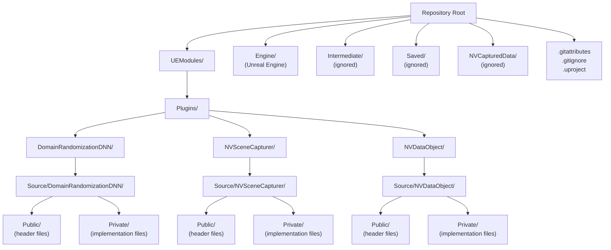
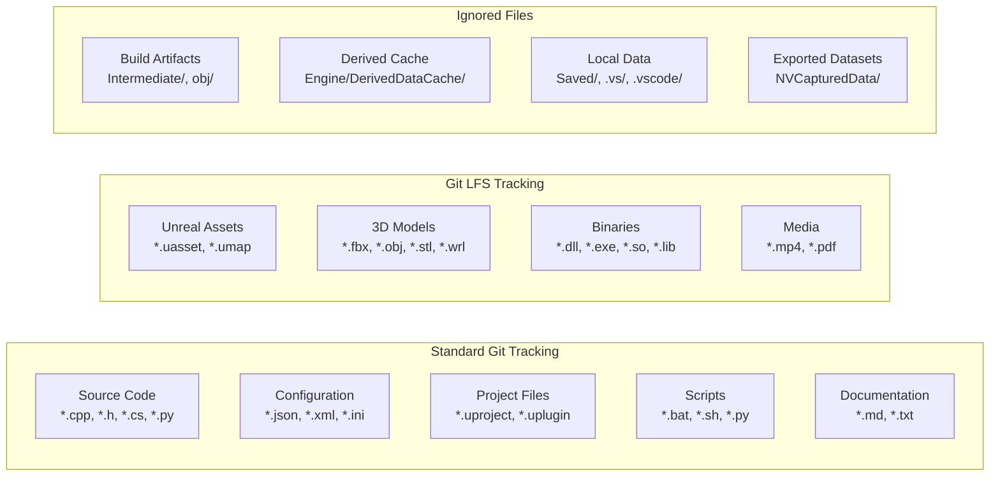
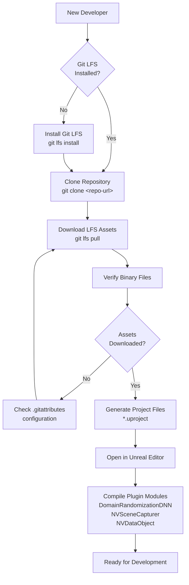

<!-- source: DeepWiki mcp.deepwiki.com · repo NVIDIA/Dataset_Synthesizer · page 2 Getting Started · fetched 2026-10-26 -->

# Getting Started

<details>
<summary>Relevant source files</summary>

The following files were used as context for generating this wiki page:

- [.gitattributes](.gitattributes)
- [.gitignore](.gitignore)

</details>


This guide covers the initial setup and configuration required to work with the NVIDIA Dataset_Synthesizer repository. It explains how to clone the repository, configure Git Large File Storage (LFS) for binary assets, and understand the basic project structure. For detailed information about the repository organization, see [Repository Structure](#2.1). For in-depth Git LFS configuration details, see [Git LFS Configuration](#2.2).

## Purpose and Prerequisites

The Dataset_Synthesizer is an Unreal Engine plugin system that requires proper version control setup to handle both source code and large binary assets (meshes, textures, pre-built binaries). This page guides you through:

- Cloning the repository with Git LFS support
- Understanding which files are tracked by Git vs Git LFS
- Verifying your local setup
- Initial repository structure orientation

### Prerequisites

Before proceeding, ensure you have:

- **Git** (version 2.x or later) with **Git LFS extension** installed
- **Unreal Engine** (compatible version as specified in the `.uproject` file)
- Sufficient disk space for binary assets (meshes, textures, videos)

## Repository Layout

The repository follows Unreal Engine project conventions with custom plugin modules organized under `UEModules/Plugins/`.



**Sources:** [.gitignore:164-176]()

## Version Control Strategy

The repository uses a hybrid approach combining standard Git for source code and Git LFS for large binary assets. This ensures fast clone operations while supporting the large asset libraries required for synthetic dataset generation.

### File Categorization



**Sources:** [.gitattributes:1-14](), [.gitignore:16-181]()

## Initial Setup Workflow

The following diagram shows the complete workflow for setting up the repository on a new machine:



**Sources:** [.gitattributes:1-14](), [.gitignore:1-181]()

### Step-by-Step Instructions

#### 1. Install Git LFS

If not already installed, configure Git LFS globally:

```bash
git lfs install
```

Verify installation:

```bash
git lfs version
```

#### 2. Clone the Repository

Clone the repository using standard Git commands. Git LFS will automatically detect LFS-tracked files based on [.gitattributes:1-14]():

```bash
git clone https://github.com/NVIDIA/Dataset_Synthesizer
cd Dataset_Synthesizer
```

#### 3. Verify LFS Assets

Ensure binary assets were downloaded correctly. Git LFS should have automatically pulled assets during clone. Verify by checking file sizes:

```bash
git lfs ls-files
```

This should list all LFS-tracked files (`.uasset`, `.umap`, `.fbx`, `.dll`, `.exe`, etc.).

If assets weren't pulled, manually fetch them:

```bash
git lfs pull
```

#### 4. Verify File Tracking

The following table shows which file types are tracked by which system:

| File Extension | Tracking Method | Purpose | Configuration |
|----------------|-----------------|---------|---------------|
| `.cpp`, `.h`, `.cs` | Standard Git | Source code | [.gitignore:20-49]() |
| `.json`, `.xml`, `.ini` | Standard Git | Configuration | [.gitignore:74-89]() |
| `.uproject`, `.uplugin` | Standard Git | Project definitions | [.gitignore:80-81]() |
| `.uasset`, `.umap` | Git LFS | Unreal Engine assets | [.gitattributes:1-2]() |
| `.fbx`, `.obj`, `.stl` | Git LFS | 3D models | [.gitattributes:3-6]() |
| `.dll`, `.exe`, `.so` | Git LFS | Binaries | [.gitattributes:10-11]() |
| `.mp4`, `.pdf` | Git LFS | Media files | [.gitattributes:13-14]() |

**Sources:** [.gitattributes:1-14](), [.gitignore:20-89]()

## Ignored Files and Directories

Several directories are excluded from version control to prevent tracking generated or user-specific files:

### Build Artifacts

- `Intermediate/` - Temporary build outputs ([.gitignore:164]())
- `obj/` - Object files ([.gitignore:165]())
- `Engine/DerivedDataCache/` - Cached derived data ([.gitignore:161]())

### User-Specific Files

- `Saved/` - User preferences and local saves ([.gitignore:168]())
- `.vs/`, `.vscode/` - IDE configurations ([.gitignore:179-180]())
- `.DS_Store` - macOS metadata ([.gitignore:173]())

### Exported Data

- `NVCapturedData/` - Exported synthetic datasets ([.gitignore:176]())

This directory is where captured images and annotations are saved during dataset generation. It should remain untracked as datasets can be very large.

**Sources:** [.gitignore:160-180]()

## Special Binaries

The repository includes specific pre-built binaries required for cross-platform functionality, which are exceptions to the ignore rules:

### Mono Runtime (Mac)

For running `GitDependencies.exe` on macOS, the following Mono binaries are explicitly tracked via Git LFS:

- `Engine/Binaries/ThirdParty/Mono/Mac/bin/*` ([.gitignore:134]())
- `Engine/Binaries/ThirdParty/Mono/Mac/lib/libMonoPosixHelper.dylib` ([.gitignore:137]())
- Mono assemblies in `Engine/Binaries/ThirdParty/Mono/Mac/lib/mono/` ([.gitignore:138-144]())

### GitDependencies

- `Engine/Binaries/DotNET/GitDependencies.exe` ([.gitignore:150]())
- `Engine/Binaries/DotNET/GitDependencies.exe.config` ([.gitignore:151]())

These binaries enable the Unreal Engine dependency management system to function across platforms.

**Sources:** [.gitignore:133-151]()

## Next Steps

After successfully setting up the repository:

1. **Understand the Architecture** - See [Architecture Overview](#3) for details on the three plugin modules
2. **Explore Repository Structure** - See [Repository Structure](#2.1) for detailed directory organization
3. **Configure Git LFS** - See [Git LFS Configuration](#2.2) for advanced LFS settings
4. **Build and Run** - Generate Unreal Engine project files and compile the plugins
5. **Create Scenes** - Use `ADRSceneManager` to set up randomized scenes (see [Scene Manager](#4.1))
6. **Capture Data** - Use `UNVSceneCaptureComponent2D` to export datasets (see [Scene Capture Component](#5.2))

## Troubleshooting

### LFS Assets Not Downloaded

If binary files appear as text pointers (small files containing LFS metadata):

```bash
git lfs pull
```

Verify LFS configuration:

```bash
cat .gitattributes
```

### Large Clone Time

Initial clone may take time due to binary assets. To reduce download size:

```bash
# Clone without LFS assets
GIT_LFS_SKIP_SMUDGE=1 git clone <repo-url>

# Selectively pull only required assets
git lfs pull --include="path/to/specific/assets"
```

### Platform-Specific Issues

- **Windows**: Ensure long path support is enabled (`git config --system core.longpaths true`)
- **Mac**: Verify Mono binaries are executable ([.gitignore:134-144]())
- **Linux**: Check file permissions for `.so` libraries ([.gitattributes:9]())

**Sources:** [.gitattributes:1-14](), [.gitignore:133-151]()

---

