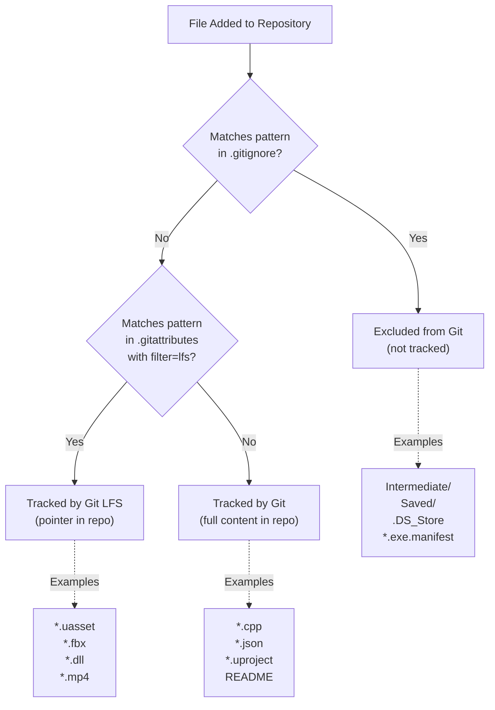
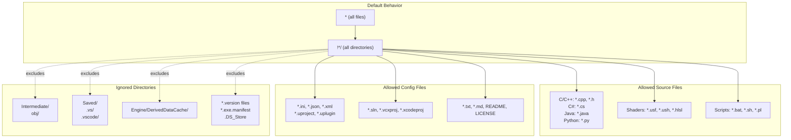
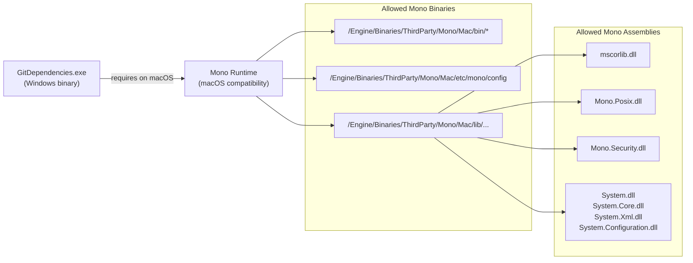
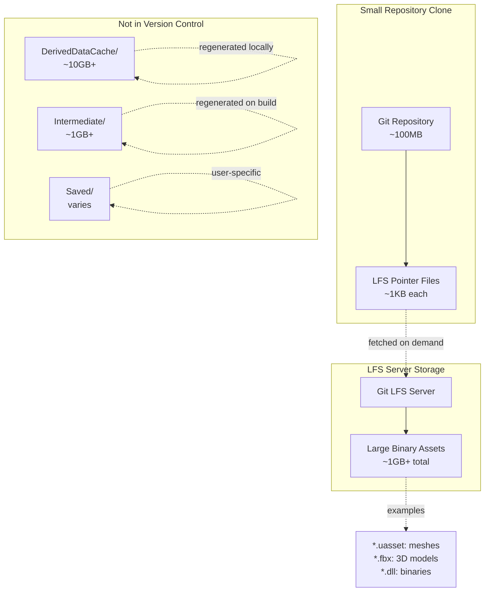

<!-- source: DeepWiki mcp.deepwiki.com · repo NVIDIA/Dataset_Synthesizer · page 2.2 Git LFS Configuration · fetched 2026-10-26 -->

# Git LFS Configuration

<details>
<summary>Relevant source files</summary>

The following files were used as context for generating this wiki page:

- [.gitattributes](.gitattributes)
- [.gitignore](.gitignore)

</details>


## Purpose and Scope

This page documents the Git Large File Storage (LFS) configuration for the NVIDIA Dataset_Synthesizer repository. It explains which binary assets are managed by Git LFS, which files are tracked in standard Git, and which files are excluded from version control entirely.

For information about the overall repository structure and plugin organization, see [Repository Structure](#2.1).

## Overview

The repository uses Git LFS to efficiently manage large binary files that would otherwise bloat the Git repository and slow down clone operations. Without LFS, cloning a repository containing gigabytes of 3D models, compiled binaries, and Unreal Engine assets would be impractical.

Git LFS stores large file contents on a separate server while keeping lightweight pointer files in the Git repository. When files matching LFS patterns are committed, Git LFS intercepts the operation and uploads the file contents to the LFS server, replacing the working directory file with a small text pointer.

**Sources:** [.gitattributes:1-15]()

## File Tracking Strategy



**Sources:** [.gitignore:1-181](), [.gitattributes:1-15]()

## LFS-Tracked File Categories

The [.gitattributes:1-15]() file configures Git LFS to manage the following file types:

### Unreal Engine Assets

| Extension | Type | Purpose |
|-----------|------|---------|
| `.uasset` | Unreal Asset | Actor blueprints, materials, textures, static meshes |
| `.umap` | Unreal Map | Level files containing scene layouts |

These are the native Unreal Engine binary formats. Every actor, material, and level in the `UEModules/Plugins/` directory uses these formats.

### 3D Model Formats

| Extension | Type | Purpose |
|-----------|------|---------|
| `.fbx` | Autodesk FBX | Interchange format for meshes with materials and animations |
| `.stl` | Stereolithography | CAD format for simple triangle meshes |
| `.obj` | Wavefront OBJ | Simple mesh format with optional materials |
| `.wrl` | VRML | Virtual Reality Modeling Language format |

These formats are used by the domain randomization system (see [Domain Randomization System](#4)) to provide mesh variation for synthetic dataset generation.

### Binary Libraries and Executables

| Extension | Type | Platform | Purpose |
|-----------|------|----------|---------|
| `.a` | Static Library | Unix/Linux | Compiled code archives |
| `.lib` | Static Library | Windows | Compiled code archives |
| `.so` | Shared Library | Unix/Linux | Dynamic libraries |
| `.dll` | Dynamic Library | Windows | Dynamic libraries |
| `.exe` | Executable | Windows | Binary executables |
| `.pdb` | Program Database | Windows | Debug symbol files |

These are used for third-party dependencies, including the Mono runtime required by `GitDependencies.exe`.

### Media Files

| Extension | Type | Purpose |
|-----------|------|---------|
| `.mp4` | Video | Documentation and example videos |
| `.pdf` | Document | Documentation and reference materials |

**Sources:** [.gitattributes:1-15]()

## Git Ignore Strategy

The [.gitignore:16-181]() file uses a "deny-all, allow-specific" approach:



### Key Ignored Paths

The following directories and files are excluded from version control:

**Build Artifacts:**
- `Intermediate/` - Unreal Engine intermediate build files
- `obj/` - C# and C++ object files
- `/Engine/DerivedDataCache/` - Cached shader and texture data

**User-Specific Data:**
- `Saved/` - User preferences, logs, crash reports
- `.vs/` and `.vscode/` - IDE configuration
- `.DS_Store` - macOS folder metadata
- `LocalBuilds/` - Local build outputs

**Generated Files:**
- `*.exe.manifest` and `*.vshost.exe.manifest` - Visual Studio host manifests
- `*.version` files in `/Engine/Binaries/` - Auto-generated version tracking
- `NVCapturedData/` - Exported dataset files (see [Data Export](#7))

**Sources:** [.gitignore:16-181]()

## Special Exceptions for Dependencies

The `.gitignore` file includes explicit exceptions for platform-specific binaries required to run `GitDependencies.exe`, which manages additional dependencies not included in the repository.

### Mono Runtime (macOS)



**Key Exceptions:**

The following paths are explicitly allowed in [.gitignore:133-148]():

- `/Engine/Binaries/ThirdParty/Mono/Mac/bin/*` - Mono executable binaries
- `/Engine/Binaries/ThirdParty/Mono/Mac/etc/mono/config` - Mono configuration
- `/Engine/Binaries/ThirdParty/Mono/Mac/etc/mono/4.5/machine.config` - Machine-level configuration
- `/Engine/Binaries/ThirdParty/Mono/Mac/lib/libMonoPosixHelper.dylib` - POSIX helper library
- `/Engine/Binaries/ThirdParty/Mono/Mac/lib/mono/4.5/mscorlib.dll` - Core runtime library
- GAC (Global Assembly Cache) assemblies for `Mono.Posix`, `Mono.Security`, `System`, and related DLLs

### GitDependencies Executable

The following Windows executables are allowed in [.gitignore:149-151]():

- `/Engine/Binaries/DotNET/GitDependencies.exe` - Dependency management tool
- `/Engine/Binaries/DotNET/GitDependencies.exe.config` - Configuration for GitDependencies

**Note:** The symbolic link `/Engine/Binaries/ThirdParty/Mono/Mac/bin/mono` is explicitly ignored in [.gitignore:146-147]() as it's auto-generated.

**Sources:** [.gitignore:133-151]()

## Repository Size Management

The combination of Git LFS and strategic `.gitignore` patterns keeps the repository efficient:



| Category | Storage Location | Typical Size | Versioned |
|----------|------------------|--------------|-----------|
| Source code (C++, C#, Python) | Git repository | ~50MB | Yes |
| Configuration files (JSON, XML, INI) | Git repository | ~10MB | Yes |
| LFS pointer files | Git repository | ~1MB | Yes |
| Binary assets (meshes, textures) | LFS server | ~1GB+ | Via LFS |
| Compiled binaries (DLLs, EXEs) | LFS server | ~500MB | Via LFS |
| Derived data cache | Local only | ~10GB+ | No |
| Build intermediates | Local only | ~1GB+ | No |
| Captured datasets | Local only | ~100GB+ | No |

**Sources:** [.gitignore:160-176](), [.gitattributes:1-15]()

## Workflow Implications

### Initial Clone

When cloning the repository, Git LFS automatically downloads pointer files but not the full binary assets. To fetch all LFS objects:

```bash
git lfs fetch --all
git lfs checkout
```

### Adding New Assets

When adding files that match LFS patterns in `.gitattributes`, Git LFS automatically handles them:

```bash
git add Content/NewMesh.fbx  # Automatically tracked via LFS
git commit -m "Add new mesh for randomization"
```

### Captured Dataset Export

The `NVCapturedData/` directory is ignored in [.gitignore:175-176](), preventing accidentally committing large generated datasets. Exported images and annotations (see [Data Export](#7)) are intended for local storage or separate archival.

**Sources:** [.gitignore:175-176]()

## Summary Table

| File Pattern | Tracking Method | Location | Reason |
|-------------|----------------|----------|--------|
| `*.cpp`, `*.h`, `*.cs` | Standard Git | Repository | Source code, text-diffable |
| `*.json`, `*.ini`, `*.xml` | Standard Git | Repository | Configuration, text-diffable |
| `*.uproject`, `*.uplugin` | Standard Git | Repository | Project definitions |
| `*.uasset`, `*.umap` | Git LFS | LFS server | Large binary Unreal assets |
| `*.fbx`, `*.obj`, `*.stl` | Git LFS | LFS server | 3D model files |
| `*.dll`, `*.exe`, `*.so` | Git LFS | LFS server | Binary executables and libraries |
| `*.mp4`, `*.pdf` | Git LFS | LFS server | Media and documentation |
| `Intermediate/*` | Ignored | Local only | Build artifacts, regenerable |
| `Saved/*` | Ignored | Local only | User settings and logs |
| `NVCapturedData/*` | Ignored | Local only | Exported datasets |
| `.vs/*`, `.vscode/*` | Ignored | Local only | IDE-specific settings |

**Sources:** [.gitattributes:1-15](), [.gitignore:1-181]()

---

