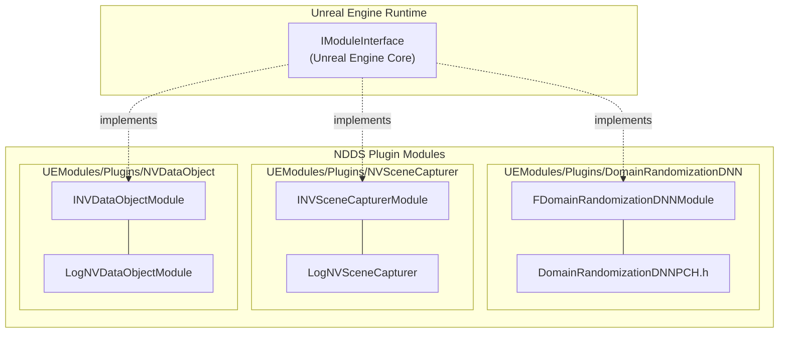
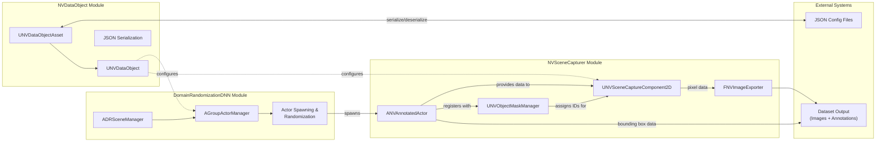
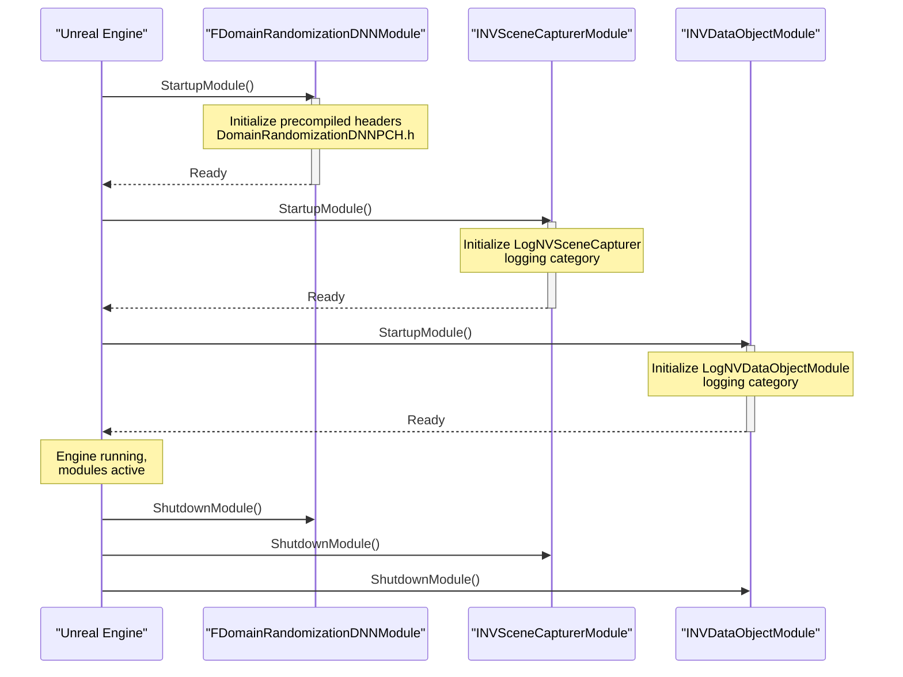

<!-- source: DeepWiki mcp.deepwiki.com · repo NVIDIA/Dataset_Synthesizer · page 3 Architecture Overview · fetched 2026-10-26 -->

# Architecture Overview

<details>
<summary>Relevant source files</summary>

The following files were used as context for generating this wiki page:

- [Documentation/ClassDetails/_domain_randomization_d_n_n_module_8h_source.html](Documentation/ClassDetails/_domain_randomization_d_n_n_module_8h_source.html)
- [Documentation/ClassDetails/_n_v_data_object_module_8h_source.html](Documentation/ClassDetails/_n_v_data_object_module_8h_source.html)
- [Documentation/ClassDetails/_n_v_scene_capturer_module_8h_source.html](Documentation/ClassDetails/_n_v_scene_capturer_module_8h_source.html)

</details>


## Purpose and Scope

This document describes the high-level architecture of the NVIDIA Dataset_Synthesizer (NDDS), focusing on the three core Unreal Engine plugin modules and their interaction patterns. The architecture is designed to separate concerns between scene randomization, capture/annotation, and data-driven configuration.

For detailed information about each module's internal structure and components, see:
- DomainRandomizationDNN Module: [3.1](#3.1)
- NVSceneCapturer Module: [3.2](#3.2)  
- NVDataObject Module: [3.3](#3.3)

For information about the complete domain randomization workflow, see [4](#4). For scene capture and data export pipelines, see [5](#5) and [7](#7).

---

## Plugin Module Structure

NDDS is implemented as three Unreal Engine plugin modules, each residing in the `UEModules/Plugins/` directory structure. All modules implement the `IModuleInterface` contract, providing `StartupModule()` and `ShutdownModule()` lifecycle methods.

### Module Organization Diagram



**Sources:**
- [Documentation/ClassDetails/_domain_randomization_d_n_n_module_8h_source.html:17]()
- [Documentation/ClassDetails/_n_v_scene_capturer_module_8h_source.html:18]()
- [Documentation/ClassDetails/_n_v_data_object_module_8h_source.html:18]()

---

## Module Responsibilities

Each module has distinct responsibilities in the synthetic dataset generation pipeline:

| Module | Class Name | Primary Responsibility | Key Components |
|--------|-----------|----------------------|----------------|
| **DomainRandomizationDNN** | `FDomainRandomizationDNNModule` | Scene setup, actor spawning, and randomization of object properties | `ADRSceneManager`, `AGroupActorManager`, `DRUtils` randomization structs |
| **NVSceneCapturer** | `INVSceneCapturerModule` | Scene capture, object annotation, segmentation masking, and image export | `UNVSceneCaptureComponent2D`, `ANVAnnotatedActor`, `UNVObjectMaskManager`, `FNVImageExporter` |
| **NVDataObject** | `INVDataObjectModule` | Data-driven object configuration via JSON serialization/deserialization | `UNVDataObject`, `UNVDataObjectAsset`, `INVDataObjectOwner` interface |

**Sources:**
- [Documentation/ClassDetails/_domain_randomization_d_n_n_module_8h_source.html:17-24]()
- [Documentation/ClassDetails/_n_v_scene_capturer_module_8h_source.html:18-24]()
- [Documentation/ClassDetails/_n_v_data_object_module_8h_source.html:18-24]()

---

## Inter-Module Dependencies and Data Flow

The three modules work together to create a complete synthetic dataset generation pipeline. The following diagram illustrates the runtime dependencies and data flow between modules:

### Module Interaction Diagram



**Sources:**
- [Documentation/ClassDetails/_domain_randomization_d_n_n_module_8h_source.html:13-15]()
- [Documentation/ClassDetails/_n_v_scene_capturer_module_8h_source.html:13-14]()
- [Documentation/ClassDetails/_n_v_data_object_module_8h_source.html:13-14]()

---

## Module Lifecycle and Initialization

All three modules follow the standard Unreal Engine plugin lifecycle pattern:

### Initialization Sequence



### Module Interface Implementation

Each module implements the `IModuleInterface` contract defined by Unreal Engine:

| Method | Purpose |
|--------|---------|
| `StartupModule()` | Called when the module is loaded; initializes module-specific resources (logging categories, precompiled headers, etc.) |
| `ShutdownModule()` | Called when the module is unloaded; performs cleanup of module resources |

**Sources:**
- [Documentation/ClassDetails/_domain_randomization_d_n_n_module_8h_source.html:21-23]()
- [Documentation/ClassDetails/_n_v_scene_capturer_module_8h_source.html:21-23]()
- [Documentation/ClassDetails/_n_v_data_object_module_8h_source.html:21-23]()

---

## Logging Infrastructure

The NVSceneCapturer and NVDataObject modules declare dedicated logging categories for runtime diagnostics:

| Module | Log Category | Declaration |
|--------|-------------|-------------|
| NVSceneCapturer | `LogNVSceneCapturer` | `DECLARE_LOG_CATEGORY_EXTERN(LogNVSceneCapturer, Log, All)` |
| NVDataObject | `LogNVDataObjectModule` | `DECLARE_LOG_CATEGORY_EXTERN(LogNVDataObjectModule, Log, All)` |

These logging categories enable module-specific log filtering and verbosity control during development and debugging.

**Sources:**
- [Documentation/ClassDetails/_n_v_scene_capturer_module_8h_source.html:16]()
- [Documentation/ClassDetails/_n_v_data_object_module_8h_source.html:16]()

---

## Precompiled Header Strategy

The DomainRandomizationDNN module uses a precompiled header file to optimize compilation times:

```cpp
#include "DomainRandomizationDNNPCH.h"
```

This header ([Documentation/ClassDetails/_domain_randomization_d_n_n_module_8h_source.html:13]()) centralizes common includes used throughout the module, reducing redundant parsing during compilation. The NVSceneCapturer and NVDataObject modules rely on `CoreMinimal.h` instead.

**Sources:**
- [Documentation/ClassDetails/_domain_randomization_d_n_n_module_8h_source.html:13]()
- [Documentation/ClassDetails/_n_v_scene_capturer_module_8h_source.html:13]()
- [Documentation/ClassDetails/_n_v_data_object_module_8h_source.html:13]()

---

## Module Directory Structure

Each module follows the standard Unreal Engine plugin directory layout:

```
UEModules/Plugins/
├── DomainRandomizationDNN/
│   └── Source/
│       └── DomainRandomizationDNN/
│           ├── Public/
│           │   └── DomainRandomizationDNNModule.h
│           └── Private/
├── NVSceneCapturer/
│   └── Source/
│       └── NVSceneCapturer/
│           ├── public/
│           │   └── NVSceneCapturerModule.h
│           └── private/
└── NVDataObject/
    └── Source/
        └── NVDataObject/
            ├── public/
            │   └── NVDataObjectModule.h
            └── private/
```

**Sources:**
- [Documentation/ClassDetails/_domain_randomization_d_n_n_module_8h_source.html:124]()
- [Documentation/ClassDetails/_n_v_scene_capturer_module_8h_source.html:123]()
- [Documentation/ClassDetails/_n_v_data_object_module_8h_source.html:123]()

---

## Design Principles

The modular architecture follows several key design principles:

1. **Separation of Concerns**: Each module has a single, well-defined responsibility (randomization, capture, or data management)

2. **Loose Coupling**: Modules interact through Unreal Engine's standard mechanisms (actors, components, interfaces) rather than direct dependencies

3. **Extensibility**: Each module can be extended independently without affecting other modules

4. **Unreal Engine Integration**: All modules implement standard Unreal Engine patterns (`IModuleInterface`, `AActor`, `UActorComponent`, etc.)

5. **Logging and Diagnostics**: Dedicated logging categories enable module-specific debugging and monitoring

For detailed information about how these modules work together to implement specific workflows, see the Domain Randomization System ([4](#4)) and Scene Capture & Annotation ([5](#5)) sections.

**Sources:**
- [Documentation/ClassDetails/_domain_randomization_d_n_n_module_8h_source.html:17-24]()
- [Documentation/ClassDetails/_n_v_scene_capturer_module_8h_source.html:18-24]()
- [Documentation/ClassDetails/_n_v_data_object_module_8h_source.html:18-24]()

---

