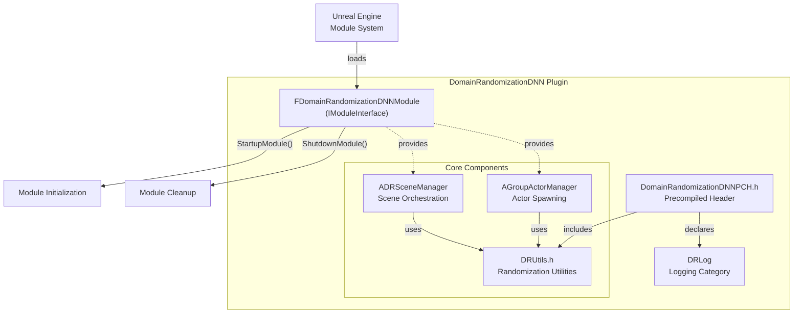
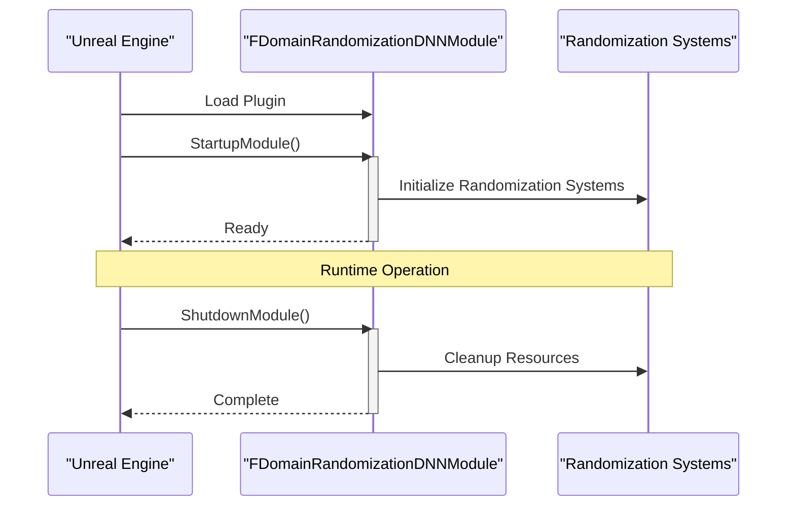
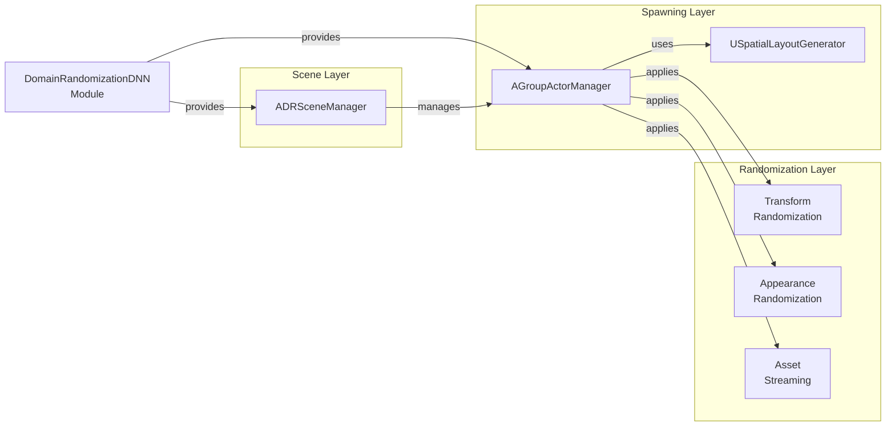
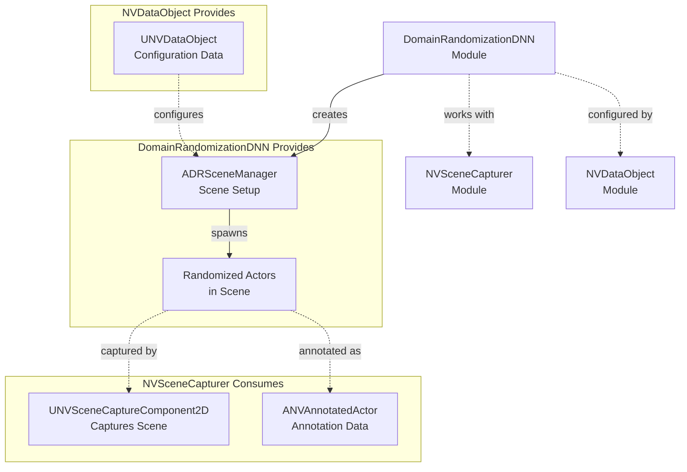

<!-- source: DeepWiki mcp.deepwiki.com · repo NVIDIA/Dataset_Synthesizer · page 3.1 DomainRandomizationDNN Module · fetched 2026-10-26 -->

# DomainRandomizationDNN Module

<details>
<summary>Relevant source files</summary>

The following files were used as context for generating this wiki page:

- [Documentation/ClassDetails/_domain_randomization_d_n_n_module_8h_source.html](Documentation/ClassDetails/_domain_randomization_d_n_n_module_8h_source.html)
- [Documentation/ClassDetails/_domain_randomization_d_n_n_p_c_h_8h_source.html](Documentation/ClassDetails/_domain_randomization_d_n_n_p_c_h_8h_source.html)

</details>


## Purpose and Scope

The DomainRandomizationDNN module is one of three primary Unreal Engine plugin modules in the NDDS system. It provides the core domain randomization functionality for generating diverse synthetic training datasets. This module is responsible for scene orchestration, actor spawning and management, and randomization of object properties including transforms, appearance, and geometry.

For details on the scene capture and annotation system, see [NVSceneCapturer Module](#3.2). For information on data-driven configuration, see [NVDataObject Module](#3.3). For detailed coverage of specific domain randomization workflows and utilities, see [Domain Randomization System](#4).

## Module Architecture

The DomainRandomizationDNN module follows Unreal Engine's standard plugin architecture, implementing the `IModuleInterface` to integrate with the engine's module loading system.



**Sources:**
- [Documentation/ClassDetails/_domain_randomization_d_n_n_module_8h_source.html:17-24]()
- [Documentation/ClassDetails/_domain_randomization_d_n_n_p_c_h_8h_source.html:11-20]()

## Module Class: FDomainRandomizationDNNModule

The `FDomainRandomizationDNNModule` class serves as the entry point for the DomainRandomizationDNN plugin. It inherits from Unreal Engine's `IModuleInterface` and implements the required lifecycle methods.

| Member | Type | Description |
|--------|------|-------------|
| `StartupModule()` | virtual void | Called when the module is loaded; performs initialization |
| `ShutdownModule()` | virtual void | Called when the module is unloaded; performs cleanup |

The module class is declared at [Documentation/ClassDetails/_domain_randomization_d_n_n_module_8h_source.html:17-24]() and located in the file path:

```
UEModules/Plugins/DomainRandomizationDNN/Source/DomainRandomizationDNN/Public/DomainRandomizationDNNModule.h
```

### Module Lifecycle



**Sources:**
- [Documentation/ClassDetails/_domain_randomization_d_n_n_module_8h_source.html:17-24]()

## Precompiled Header: DomainRandomizationDNNPCH.h

The precompiled header file centralizes frequently-used include files to improve compilation performance. It is referenced by the module class at [Documentation/ClassDetails/_domain_randomization_d_n_n_module_8h_source.html:13]().

### Included Dependencies

The PCH includes the following Unreal Engine core headers:

| Header | Purpose |
|--------|---------|
| `CoreUObject.h` | Unreal Object System (UObject) |
| `Core.h` | Core engine functionality |
| `CoreMisc.h` | Core miscellaneous utilities |
| `Engine.h` | Main engine classes and systems |
| `EngineUtils.h` | Engine utility functions and iterators |

Additionally, it includes `DRUtils.h`, which contains all domain randomization data structures and utilities (detailed in [Randomization Utilities](#4.3)).

### Logging Configuration

The PCH declares the module's logging category:

```cpp
DECLARE_LOG_CATEGORY_EXTERN(DRLog, Log, All);
```

This `DRLog` category is used throughout the module for diagnostic output and debugging. The category is configured with default verbosity level `Log` and maximum compile-time verbosity `All`.

**File Location:**
```
UEModules/Plugins/DomainRandomizationDNN/Source/DomainRandomizationDNN/Public/DomainRandomizationDNNPCH.h
```

**Sources:**
- [Documentation/ClassDetails/_domain_randomization_d_n_n_p_c_h_8h_source.html:13-20]()

## Core Responsibilities

The DomainRandomizationDNN module provides the following core functionality:

### 1. Scene Management

The module provides scene orchestration through `ADRSceneManager` (detailed in [Scene Manager](#4.1)), which coordinates the overall domain randomization workflow. This includes:

- Scene setup and configuration
- Management of training vs. noise/distractor actors
- Command-line argument parsing for automated workflows
- Scene lifecycle management

### 2. Actor Spawning

The module manages actor spawning and group management through `AGroupActorManager` (detailed in [Actor Spawning](#4.2)), which handles:

- Template-based actor instantiation
- Spatial layout generation
- Repetitive spawning with configurable timers
- Actor destruction and resource management

### 3. Randomization Utilities

The module provides comprehensive randomization capabilities through data structures defined in `DRUtils.h` (detailed in [Randomization Utilities](#4.3)):

- **Transform Randomization**: Rotation, location, and scale variations
- **Appearance Randomization**: Color and material modifications
- **Asset Streaming**: Dynamic mesh loading from large libraries



**Sources:**
- [Documentation/ClassDetails/_domain_randomization_d_n_n_p_c_h_8h_source.html:18]()

## Integration with Other Modules

The DomainRandomizationDNN module works in concert with the other NDDS modules to create a complete synthetic dataset generation pipeline.

### Module Dependencies



### Data Flow

The typical data flow in a domain randomization session:

1. **Configuration Phase**: `NVDataObject` module provides configuration data (if used)
2. **Setup Phase**: `FDomainRandomizationDNNModule` initializes, `ADRSceneManager` sets up scene
3. **Spawning Phase**: `AGroupActorManager` spawns actors with randomized properties
4. **Capture Phase**: `NVSceneCapturer` module captures the randomized scene
5. **Repetition**: If configured, actors are destroyed and respawned with new randomization

**Sources:**
- [Documentation/ClassDetails/_domain_randomization_d_n_n_module_8h_source.html:17-24]()
- [Documentation/ClassDetails/_domain_randomization_d_n_n_p_c_h_8h_source.html:13-20]()

## File Structure

The DomainRandomizationDNN module is organized in the standard Unreal Engine plugin structure:

```
UEModules/Plugins/DomainRandomizationDNN/
└── Source/
    └── DomainRandomizationDNN/
        ├── Public/
        │   ├── DomainRandomizationDNNModule.h      (Module interface)
        │   ├── DomainRandomizationDNNPCH.h        (Precompiled header)
        │   ├── DRUtils.h                          (Randomization utilities)
        │   ├── DRSceneManager.h                   (Scene orchestration)
        │   └── GroupActorManager.h                (Actor spawning)
        └── Private/
            └── (Implementation files)
```

The `Public/` directory contains headers exposed to other modules and user code, while `Private/` contains implementation details.

**Sources:**
- [Documentation/ClassDetails/_domain_randomization_d_n_n_module_8h_source.html:124]()
- [Documentation/ClassDetails/_domain_randomization_d_n_n_p_c_h_8h_source.html:118]()

---

