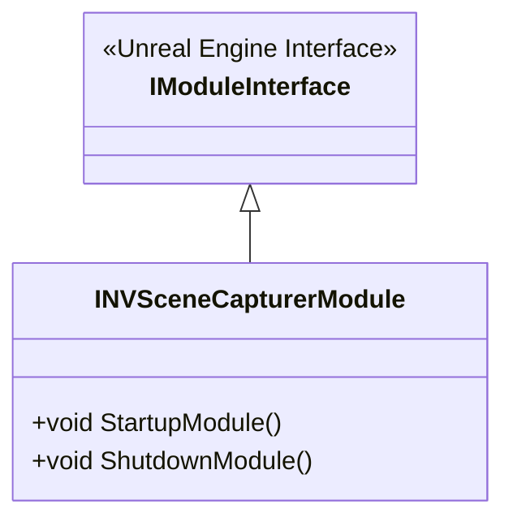
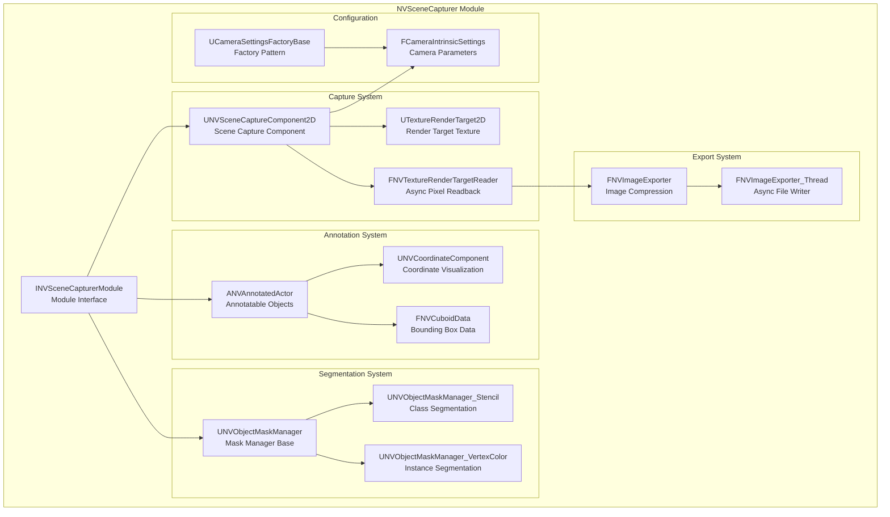
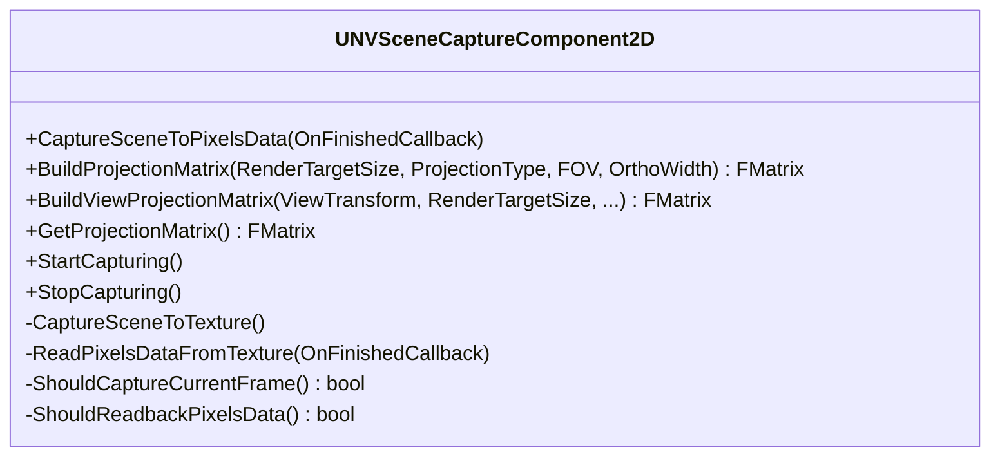
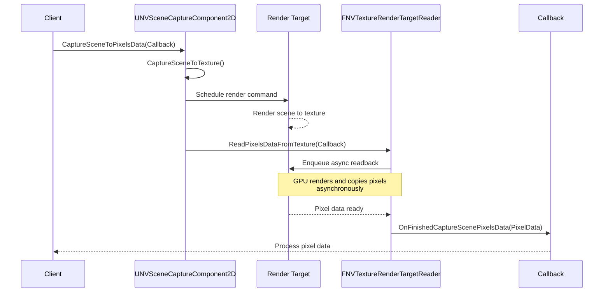
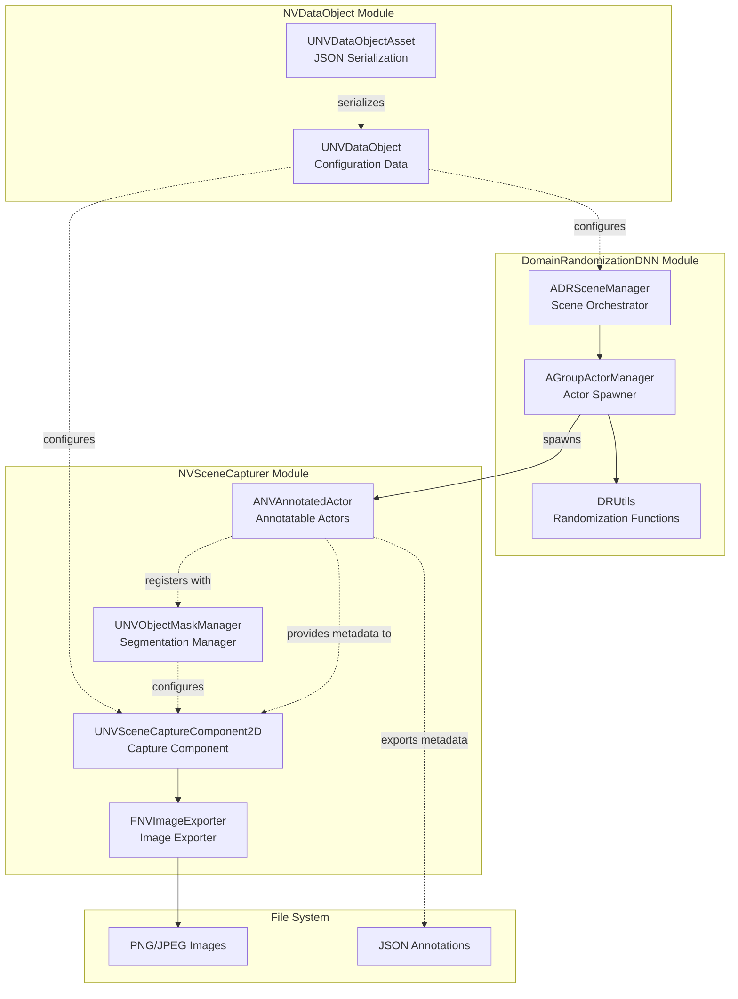

<!-- source: DeepWiki mcp.deepwiki.com · repo NVIDIA/Dataset_Synthesizer · page 3.2 NVSceneCapturer Module · fetched 2026-10-26 -->

# NVSceneCapturer Module

<details>
<summary>Relevant source files</summary>

The following files were used as context for generating this wiki page:

- [Documentation/ClassDetails/_n_v_scene_capture_component2_d_8h_source.html](Documentation/ClassDetails/_n_v_scene_capture_component2_d_8h_source.html)
- [Documentation/ClassDetails/_n_v_scene_capturer_module_8h_source.html](Documentation/ClassDetails/_n_v_scene_capturer_module_8h_source.html)

</details>


## Purpose and Scope

The **NVSceneCapturer Module** is one of the three primary plugin modules in NDDS, responsible for capturing rendered scenes, annotating objects with metadata, generating segmentation masks, and exporting the resulting datasets to the file system. This module transforms randomized 3D scenes created by the DomainRandomizationDNN module into structured datasets suitable for training deep learning models.

This document provides an architectural overview of the module, its core components, and how it integrates with other NDDS modules. For detailed information about specific subsystems:
- Scene capture implementation details: see [Scene Capture Component](#5.2)
- Annotation and bounding box calculation: see [Annotated Actors](#5.1)
- Segmentation mask generation: see [Segmentation & Masking](#6)
- Image export and compression: see [Image Export System](#7.1)

**Sources:** [Documentation/ClassDetails/_n_v_scene_capturer_module_8h_source.html:1-24]()

---

## Module Definition

The module is defined as an Unreal Engine plugin implementing the `IModuleInterface` standard interface pattern.



**Module Interface: INVSceneCapturerModule**

| Member Function | Purpose |
|----------------|---------|
| `StartupModule()` | Initializes the module when the plugin is loaded by Unreal Engine |
| `ShutdownModule()` | Cleans up module resources when the plugin is unloaded |

The module is registered with Unreal Engine's module management system and can be accessed via `FModuleManager::LoadModuleChecked<INVSceneCapturerModule>("NVSceneCapturer")`.

**Sources:** [Documentation/ClassDetails/_n_v_scene_capturer_module_8h_source.html:18-24]()

---

## Module Architecture

The NVSceneCapturer module contains several interconnected subsystems organized around capturing, annotating, and exporting scene data.



**Sources:** [Documentation/ClassDetails/_n_v_scene_capturer_module_8h_source.html:1-24](), [Documentation/ClassDetails/_n_v_scene_capture_component2_d_8h_source.html:28-114]()

---

## Core Components

The module provides several key classes organized by functionality:

### Capture Components

| Class | File Path | Purpose |
|-------|-----------|---------|
| `UNVSceneCaptureComponent2D` | [UEModules/Plugins/NVSceneCapturer/Source/NVSceneCapturer/public/NVSceneCaptureComponent2D.h:28]() | Extends `USceneCaptureComponent2D` to capture scenes to render targets and read back pixel data asynchronously |
| `FNVTextureRenderTargetReader` | Referenced in [UEModules/Plugins/NVSceneCapturer/Source/NVSceneCapturer/public/NVSceneCaptureComponent2D.h:112]() | Handles asynchronous readback of pixel data from render targets |
| `FNVTexturePixelData` | Referenced in [UEModules/Plugins/NVSceneCapturer/Source/NVSceneCapturer/public/NVSceneCaptureComponent2D.h:34]() | Struct containing captured pixel data and metadata |

### Annotation Components

| Class | File Path | Purpose |
|-------|-----------|---------|
| `ANVAnnotatedActor` | Referenced in architecture diagrams | Actor subclass that can be annotated with bounding boxes and segmentation IDs |
| `UNVCoordinateComponent` | Referenced in architecture diagrams | Visualizes coordinate axes for debugging PCA-based orientation |
| `FNVCuboidData` | Referenced in architecture diagrams | Stores oriented bounding box (OBB) data calculated via PCA |

### Segmentation Components

| Class | File Path | Purpose |
|-------|-----------|---------|
| `UNVObjectMaskManager` | Referenced in architecture diagrams | Base class for managing segmentation ID assignment |
| `UNVObjectMaskManager_Stencil` | Referenced in architecture diagrams | Implements class-level segmentation using stencil buffer (8-bit) |
| `UNVObjectMaskManager_VertexColor` | Referenced in architecture diagrams | Implements instance-level segmentation using vertex colors (32-bit) |

### Export Components

| Class | File Path | Purpose |
|-------|-----------|---------|
| `FNVImageExporter` | Referenced in architecture diagrams | Compresses images to PNG or JPEG format |
| `FNVImageExporter_Thread` | Referenced in architecture diagrams | Asynchronously writes compressed images to disk |

### Configuration Components

| Class | File Path | Purpose |
|-------|-----------|---------|
| `FCameraIntrinsicSettings` | Referenced in architecture diagrams | Stores camera intrinsic parameters (focal length, principal point) |
| `UCameraSettingsFactoryBase` | Referenced in architecture diagrams | Abstract factory for creating camera settings from different specifications |

**Sources:** [Documentation/ClassDetails/_n_v_scene_capture_component2_d_8h_source.html:28-114]()

---

## Scene Capture Pipeline

The primary workflow of the module follows a multi-stage pipeline from scene setup to file export.

```mermaid
flowchart LR
    subgraph "Input"
        Scene["Randomized Scene<br/>from DomainRandomizationDNN"]
    end
    
    subgraph "Capture Stage"
        Render["UNVSceneCaptureComponent2D<br/>CaptureSceneToTexture()"]
        RT["UTextureRenderTarget2D<br/>Render Target"]
        Readback["FNVTextureRenderTargetReader<br/>Async Pixel Readback"]
    end
    
    subgraph "Annotation Stage"
        CalcBBox["ANVAnnotatedActor<br/>GetCuboidData()"]
        CalcMask["UNVObjectMaskManager<br/>Assign Segmentation IDs"]
        Metadata["FNVTexturePixelData<br/>+ Bounding Box JSON"]
    end
    
    subgraph "Export Stage"
        Compress["FNVImageExporter<br/>Compress to PNG/JPEG"]
        AsyncWrite["FNVImageExporter_Thread<br/>Write to File System"]
        Output["Dataset Files<br/>Images + JSON"]
    end
    
    Scene --> Render
    Render --> RT
    RT --> Readback
    Readback --> CalcBBox
    Readback --> CalcMask
    CalcBBox --> Metadata
    CalcMask --> Metadata
    Metadata --> Compress
    Compress --> AsyncWrite
    AsyncWrite --> Output
```



**Sources:** [Documentation/ClassDetails/_n_v_scene_capture_component2_d_8h_source.html:59-87]()

---

## UNVSceneCaptureComponent2D: Primary Capture Interface

The `UNVSceneCaptureComponent2D` class is the central interface for scene capture functionality.

### Key Properties

| Property | Type | Purpose |
|----------|------|---------|
| `TextureTargetSize` | `FNVImageSize` | Resolution of the render target (width × height) |
| `TextureTargetFormat` | `ETextureRenderTargetFormat` | Pixel format of the render target |
| `OverrideTexturePixelFormat` | `EPixelFormat` | Optional override for pixel format |
| `bIgnoreReadbackAlpha` | `bool` | If true, set alpha to 1.0 instead of reading from render target |

**Sources:** [Documentation/ClassDetails/_n_v_scene_capture_component2_d_8h_source.html:95-110]()

### Key Methods



| Method | Return Type | Purpose |
|--------|-------------|---------|
| `CaptureSceneToPixelsData(Callback)` | `void` | Captures scene to render target and asynchronously reads pixel data, then invokes callback |
| `BuildProjectionMatrix(...)` | `FMatrix` | Constructs camera projection matrix from FOV, aspect ratio, and projection type |
| `GetProjectionMatrix()` | `FMatrix` | Returns the current projection matrix for this capture component |
| `StartCapturing()` | `void` | Begins continuous capture (Blueprint callable) |
| `StopCapturing()` | `void` | Stops continuous capture (Blueprint callable) |

**Sources:** [Documentation/ClassDetails/_n_v_scene_capture_component2_d_8h_source.html:43-67]()

### Asynchronous Capture Workflow

The component uses a callback-based asynchronous pattern to avoid blocking the game thread during pixel readback:



**Callback Signature:**
```cpp
typedef TFunction<void(const FNVTexturePixelData&)> OnFinishedCaptureScenePixelsDataCallback;
```

This pattern ensures the game thread remains responsive while GPU operations complete in the background.

**Sources:** [Documentation/ClassDetails/_n_v_scene_capture_component2_d_8h_source.html:32-87](), [Documentation/ClassDetails/_n_v_scene_capture_component2_d_8h_source.html:112-113]()

---

## Integration with Other Modules

The NVSceneCapturer module integrates with the other NDDS modules to form a complete dataset generation pipeline.



### Module Dependencies

| Module | Relationship | Purpose |
|--------|--------------|---------|
| **DomainRandomizationDNN** | Upstream Producer | Provides randomized scenes with `ANVAnnotatedActor` instances to capture |
| **NVDataObject** | Configuration Provider | Supplies data-driven configuration via `UNVDataObject` serialization |
| **Unreal Engine Core** | Platform | Provides rendering, component system, and file I/O infrastructure |

**Sources:** [Documentation/ClassDetails/_n_v_scene_capturer_module_8h_source.html:1-24]()

---

## Logging

The module defines a dedicated log category for debugging and diagnostics:

```cpp
DECLARE_LOG_CATEGORY_EXTERN(LogNVSceneCapturer, Log, All)
```

Component-specific log categories:
- `LogNVSceneCapturerComponent2D` - For `UNVSceneCaptureComponent2D` operations

These log categories can be used with standard Unreal Engine logging macros (`UE_LOG`) to output diagnostic information during scene capture, annotation, and export operations.

**Sources:** [Documentation/ClassDetails/_n_v_scene_capturer_module_8h_source.html:16](), [Documentation/ClassDetails/_n_v_scene_capture_component2_d_8h_source.html:19]()

---

## Summary

The **NVSceneCapturer Module** serves as the dataset generation backend for NDDS, providing:

1. **Scene Capture**: `UNVSceneCaptureComponent2D` captures rendered scenes to textures with configurable resolution and pixel formats
2. **Asynchronous Readback**: `FNVTextureRenderTargetReader` enables non-blocking pixel data extraction
3. **Object Annotation**: `ANVAnnotatedActor` provides bounding box metadata via PCA-based cuboid calculation
4. **Segmentation**: `UNVObjectMaskManager` assigns class and instance IDs for mask generation
5. **Export**: `FNVImageExporter` compresses and writes images asynchronously to prevent frame drops

The module integrates seamlessly with `DomainRandomizationDNN` (for scene randomization) and `NVDataObject` (for data-driven configuration), forming a complete pipeline from randomized 3D scenes to structured training datasets.

For implementation details of specific subsystems, refer to the dedicated pages listed in the Purpose and Scope section above.

**Sources:** [Documentation/ClassDetails/_n_v_scene_capturer_module_8h_source.html:1-24](), [Documentation/ClassDetails/_n_v_scene_capture_component2_d_8h_source.html:1-114]()

---

