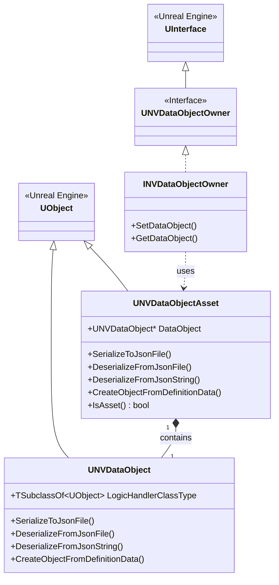
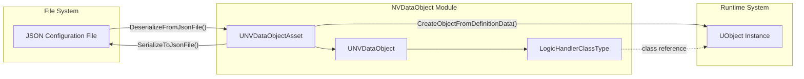
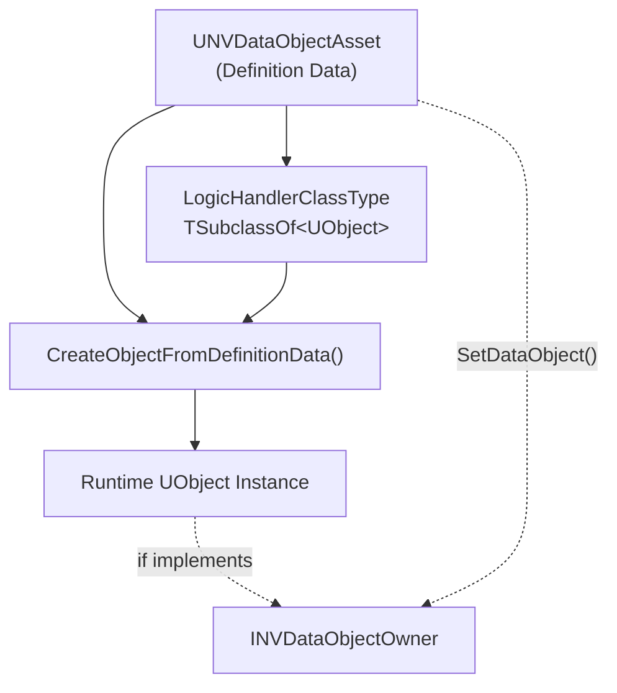
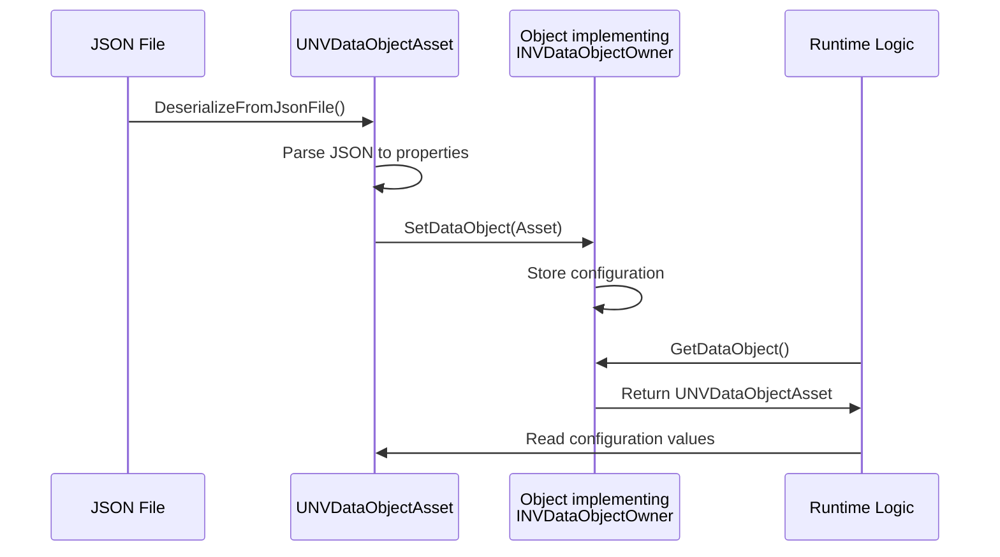
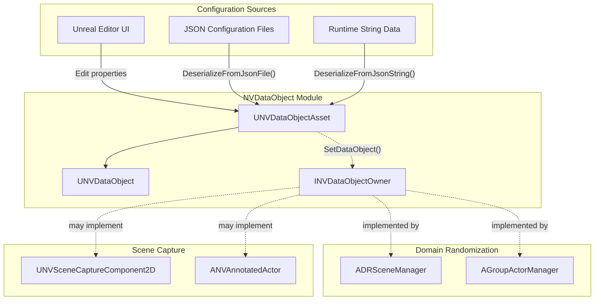

<!-- source: DeepWiki mcp.deepwiki.com · repo NVIDIA/Dataset_Synthesizer · page 3.3 NVDataObject Module · fetched 2026-10-26 -->

# NVDataObject Module

<details>
<summary>Relevant source files</summary>

The following files were used as context for generating this wiki page:

- [Documentation/ClassDetails/_n_v_data_object_8h_source.html](Documentation/ClassDetails/_n_v_data_object_8h_source.html)
- [Documentation/ClassDetails/_n_v_data_object_module_8h_source.html](Documentation/ClassDetails/_n_v_data_object_module_8h_source.html)

</details>


The NVDataObject module provides a data-driven configuration system for NDDS, enabling objects to be defined, serialized, and deserialized using JSON. This module implements a pattern where runtime objects can be created from JSON configuration files, allowing flexible scene composition and parameter management without code changes.

For information about how this module integrates with scene capture and annotation workflows, see [NVSceneCapturer Module](#3.2). For details on how this module is used in domain randomization configurations, see [Scene Manager (ADRSceneManager)](#4.1).

---

## Module Overview

The NVDataObject module is one of the three core plugin modules in NDDS, responsible for providing JSON-based configuration and data-driven object instantiation.

### Module Interface

The module implements the standard Unreal Engine plugin interface through `INVDataObjectModule`:

[UEModules/Plugins/NVDataObject/Source/NVDataObject/public/NVDataObjectModule.h:18-24]()

**Key Responsibilities:**
- Module initialization and shutdown
- Registration with Unreal Engine's module system
- Logging via `LogNVDataObjectModule` log category

**Sources:** `Documentation/ClassDetails/_n_v_data_object_module_8h_source.html`

---

## Core Classes

The module defines three primary classes and one interface that work together to provide data-driven configuration:



**Sources:** `Documentation/ClassDetails/_n_v_data_object_8h_source.html`

---

## Class Details

### UNVDataObjectAsset

`UNVDataObjectAsset` is the primary serializable container that wraps `UNVDataObject` instances for JSON import/export.

[UEModules/Plugins/NVDataObject/Source/NVDataObject/public/NVDataObject.h:22-55]()

| Property/Method | Description |
|----------------|-------------|
| `DataObject` | The wrapped `UNVDataObject` instance containing definition data |
| `SerializeToJsonFile()` | Static method to export data object to JSON file |
| `DeserializeFromJsonFile()` | Static method to import data object from JSON file |
| `DeserializeFromJsonString()` | Static method to import data object from JSON string |
| `CreateObjectFromDefinitionData()` | Static factory method to create runtime objects from definition data |
| `IsAsset()` | Returns `true`, marking this as an Unreal asset that can be saved |
| `AssetImportData` | Editor-only metadata tracking import source (line 50) |

**UPROPERTY Specifiers:**
- `EditAnywhere, SimpleDisplay` on `DataObject` - Allows editing in Unreal Editor's details panel
- `VisibleAnywhere, Instanced, AdvancedDisplay` on `AssetImportData` - Shows import metadata in advanced view

**Sources:** `Documentation/ClassDetails/_n_v_data_object_8h_source.html:22-55`

---

### UNVDataObject

`UNVDataObject` contains the actual definition data and the logic handler class type for polymorphic object creation.

[UEModules/Plugins/NVDataObject/Source/NVDataObject/public/NVDataObject.h:58-76]()

| Property/Method | Description |
|----------------|-------------|
| `LogicHandlerClassType` | `TSubclassOf<UObject>` specifying the runtime class to instantiate |
| Serialization methods | Identical static methods to `UNVDataObjectAsset` for JSON operations |
| `Serialize()` | Overrides Unreal's serialization for custom binary/text format handling |

**UCLASS Specifiers:**
- `DefaultToInstanced` - New instances created by default in editor
- `editinlinenew` - Allows inline editing in property details panel

**Key Design Pattern:**
The `LogicHandlerClassType` property at [line 75]() enables data-driven polymorphism. A JSON file can specify which UObject-derived class to instantiate, allowing different object types to be created from the same data structure.

**Sources:** `Documentation/ClassDetails/_n_v_data_object_8h_source.html:58-76`

---

### INVDataObjectOwner Interface

This interface allows objects to declare that they can be configured by `UNVDataObjectAsset` instances.

[UEModules/Plugins/NVDataObject/Source/NVDataObject/public/NVDataObject.h:79-91]()

**Interface Methods:**
- `SetDataObject(UNVDataObjectAsset* NewDataObject)` - Assigns configuration data to the implementing object
- `GetDataObject() const` - Retrieves the current configuration data

**Implementation Pattern:**
Classes implementing this interface can be dynamically configured at runtime or in the editor by assigning a `UNVDataObjectAsset`. This enables scene managers and actors to have their behavior defined by external JSON files.

**Sources:** `Documentation/ClassDetails/_n_v_data_object_8h_source.html:79-91`

---

## JSON Serialization System

The module provides a complete bidirectional JSON serialization system for data objects.



### Serialization Methods

Both `UNVDataObjectAsset` and `UNVDataObject` provide identical static serialization methods:

**Export to JSON:**
```cpp
static bool SerializeToJsonFile(const UNVDataObject* DataObject, const FString& OutputFilePath);
```
[Lines 29, 65]()

**Import from JSON File:**
```cpp
static UNVDataObjectAsset* DeserializeFromJsonFile(const FString& SourceFilePath, 
                                                    UObject* InParent, 
                                                    FName InName, 
                                                    EObjectFlags Flags);
```
[Lines 30, 66]()

**Import from JSON String:**
```cpp
static UNVDataObjectAsset* DeserializeFromJsonString(const FString& SourceJsonString,
                                                      UObject* InParent,
                                                      FName InName, 
                                                      EObjectFlags Flags);
```
[Lines 31, 67]()

### Custom Serialization Override

Both classes override Unreal's `Serialize()` method at [lines 34, 70]() to handle custom binary or text format serialization when saving/loading through Unreal's asset system.

**Sources:** `Documentation/ClassDetails/_n_v_data_object_8h_source.html:29-34,65-70`

---

## Object Creation Pattern

The module implements a factory pattern for creating runtime objects from definition data.



### Factory Method

```cpp
static UObject* CreateObjectFromDefinitionData(UNVDataObjectAsset* DefinitionDataObj);
```
[Lines 32, 68]()

**Creation Process:**
1. Retrieves the `LogicHandlerClassType` from the definition data
2. Instantiates a new UObject of that class type
3. If the new object implements `INVDataObjectOwner`, assigns the definition data to it
4. Returns the configured object instance

This pattern enables JSON files to specify not just configuration parameters, but also which class should be instantiated to handle those parameters.

**Sources:** `Documentation/ClassDetails/_n_v_data_object_8h_source.html:32,68,75`

---

## Data Object Ownership Pattern

Objects that implement `INVDataObjectOwner` can receive and store configuration data.



### Interface Implementation Requirements

Any class implementing `INVDataObjectOwner` must provide:

1. **SetDataObject()** - Store the configuration data
   ```cpp
   virtual void SetDataObject(UNVDataObjectAsset* NewDataObject) = 0;
   ```
   [Line 89]()

2. **GetDataObject()** - Retrieve the stored configuration
   ```cpp
   virtual const UNVDataObjectAsset* GetDataObject() const = 0;
   ```
   [Line 90]()

**Usage Example:**
Scene managers and actor spawners can implement this interface to receive their spawn configurations, randomization parameters, or behavior definitions from external JSON files.

**Sources:** `Documentation/ClassDetails/_n_v_data_object_8h_source.html:84-91`

---

## Integration with NDDS System

The NVDataObject module integrates with other NDDS modules to enable data-driven workflows.



### Common Integration Scenarios

| Scenario | Description |
|----------|-------------|
| **Scene Configuration** | `ADRSceneManager` can implement `INVDataObjectOwner` to load scene setup from JSON |
| **Actor Templates** | `AGroupActorManager` can use data objects to define actor spawning templates |
| **Capture Settings** | Camera capture components can be configured via data objects for batch processing |
| **Annotation Rules** | Annotation actors can load class IDs and metadata from JSON definitions |

### File System Organization

The module's location in the repository structure:

```
UEModules/
└── Plugins/
    └── NVDataObject/
        ├── NVDataObject.uplugin
        └── Source/
            └── NVDataObject/
                ├── private/          # Implementation files
                └── public/           # Public headers
                    ├── NVDataObjectModule.h
                    └── NVDataObject.h
```

**Sources:** `Documentation/ClassDetails/_n_v_data_object_8h_source.html:192-197`, `Documentation/ClassDetails/_n_v_data_object_module_8h_source.html:122-127`

---

## Logging

The module provides two log categories for debugging and monitoring:

| Log Category | Scope | Declaration |
|--------------|-------|-------------|
| `LogNVDataObjectModule` | Module-level operations (startup, shutdown) | [NVDataObjectModule.h:16]() |
| `LogNVDataObject` | Data object operations (serialization, creation) | [NVDataObject.h:18]() |

Both are declared with `DECLARE_LOG_CATEGORY_EXTERN` allowing verbose logging of all data object operations.

**Sources:** `Documentation/ClassDetails/_n_v_data_object_module_8h_source.html:16`, `Documentation/ClassDetails/_n_v_data_object_8h_source.html:18`

---

## Summary

The NVDataObject module provides the foundation for data-driven configuration in NDDS through:

- **JSON Serialization** - Bidirectional conversion between C++ objects and JSON files
- **Polymorphic Creation** - Factory pattern using `LogicHandlerClassType` to instantiate runtime objects
- **Interface Pattern** - `INVDataObjectOwner` for consistent data object integration
- **Asset Management** - Full Unreal Editor integration with `UNVDataObjectAsset`

This enables NDDS users to define complex scene configurations, randomization parameters, and capture settings in external JSON files, facilitating automated batch processing and experiment management without code recompilation.

---

