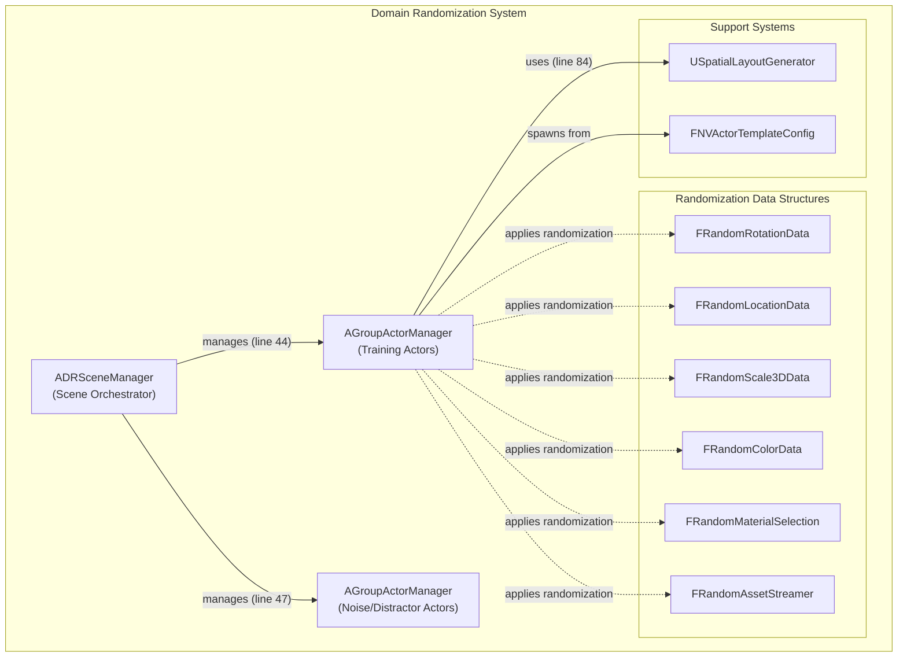
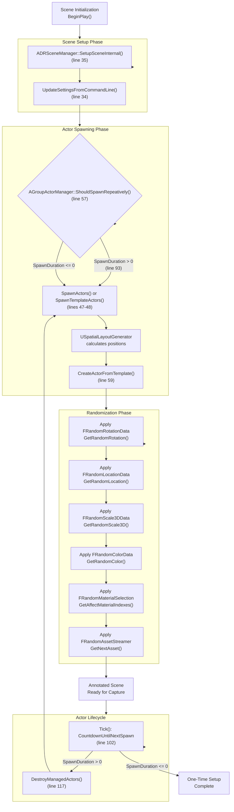
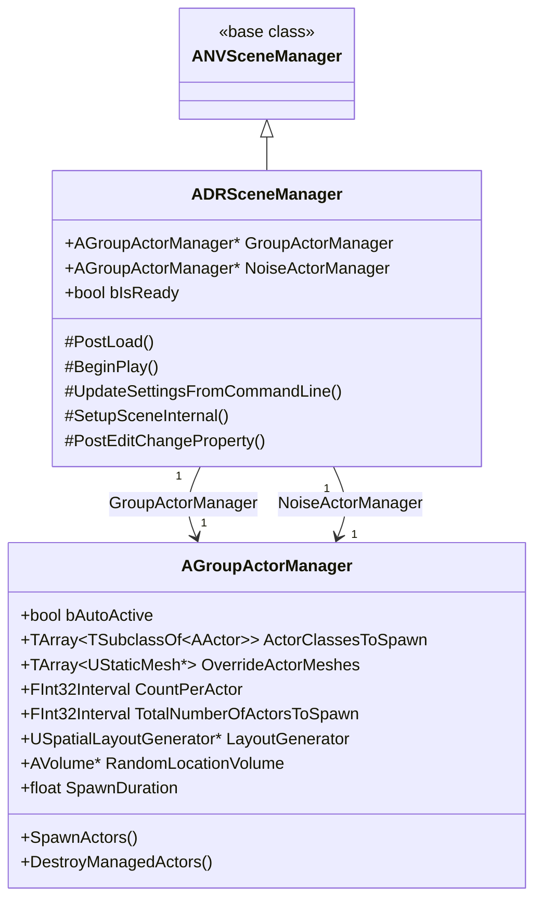
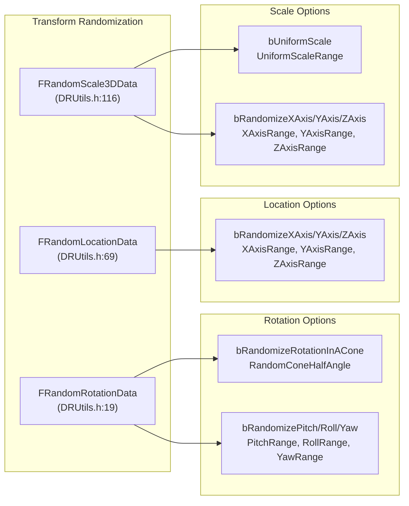
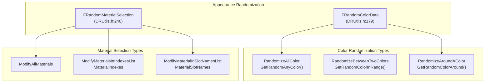
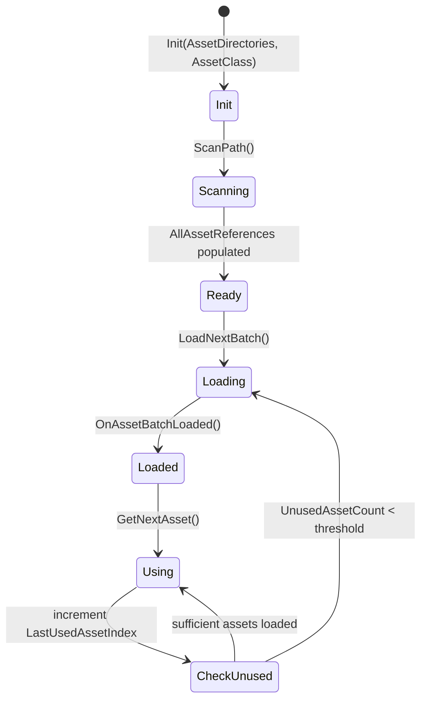

<!-- source: DeepWiki mcp.deepwiki.com · repo NVIDIA/Dataset_Synthesizer · page 4 Domain Randomization System · fetched 2026-10-26 -->

# Domain Randomization System

Relevant source files

The following files were used as context for generating this wiki page:

- [Documentation/ClassDetails/_d_r_scene_manager_8h_source.html](Documentation/ClassDetails/_d_r_scene_manager_8h_source.html)
- [Documentation/ClassDetails/_d_r_utils_8h_source.html](Documentation/ClassDetails/_d_r_utils_8h_source.html)
- [Documentation/ClassDetails/_group_actor_manager_8h_source.html](Documentation/ClassDetails/_group_actor_manager_8h_source.html)

## Purpose and Scope

The Domain Randomization System orchestrates the creation and randomization of synthetic scenes for deep learning dataset generation. It manages the entire lifecycle from scene setup through repetitive actor spawning, applying randomization to object transforms, appearances, and geometries. This system forms the core of the DomainRandomizationDNN module.

For details on how randomized scenes are captured and exported, see [Scene Capture & Annotation](#5). For module-level initialization and organization, see [DomainRandomizationDNN Module](#3.1).

**Sources:** [Documentation/ClassDetails/_d_r_scene_manager_8h_source.html:1-161](), [Documentation/ClassDetails/_group_actor_manager_8h_source.html:1-227](), [Documentation/ClassDetails/_d_r_utils_8h_source.html:1-509]()

---

## System Architecture

The Domain Randomization System consists of three primary components organized in a hierarchical structure:

**Component Responsibilities:**

| Component | File Location | Primary Responsibility |
|-----------|--------------|------------------------|
| `ADRSceneManager` | [DRSceneManager.h:24]() | Top-level orchestration, manages training and noise actor groups |
| `AGroupActorManager` | [GroupActorManager.h:40]() | Spawns and manages groups of actors with spatial layout |
| `FRandomRotationData` | [DRUtils.h:19]() | Generates random rotations (cone-based or per-axis) |
| `FRandomLocationData` | [DRUtils.h:69]() | Generates random positions (per-axis ranges) |
| `FRandomScale3DData` | [DRUtils.h:116]() | Generates random scales (uniform or per-axis) |
| `FRandomColorData` | [DRUtils.h:179]() | Generates random colors (HSV/RGB strategies) |
| `FRandomMaterialSelection` | [DRUtils.h:246]() | Selects materials to randomize (by index or slot name) |
| `FRandomAssetStreamer` | [DRUtils.h:303]() | Manages large asset libraries with circular buffer pattern |

**Sources:** [Documentation/ClassDetails/_d_r_scene_manager_8h_source.html:24-52](), [Documentation/ClassDetails/_group_actor_manager_8h_source.html:40-118](), [Documentation/ClassDetails/_d_r_utils_8h_source.html:19-385]()

---

## Complete Randomization Workflow

The Domain Randomization System follows a repeating workflow pattern that continuously generates diverse synthetic scenes:

**Workflow Phases:**

1. **Setup Phase**: `ADRSceneManager` initializes, loading configuration from command-line arguments or editor properties
2. **Spawning Phase**: `AGroupActorManager` creates actors using `FNVActorTemplateConfig` definitions and `USpatialLayoutGenerator` for positioning
3. **Randomization Phase**: Apply randomization data structures to transform, appearance, and geometry properties
4. **Lifecycle Phase**: If `SpawnDuration > 0`, actors are destroyed and respawned after the countdown expires, creating continuous variation

**Sources:** [Documentation/ClassDetails/_d_r_scene_manager_8h_source.html:32-35](), [Documentation/ClassDetails/_group_actor_manager_8h_source.html:47-118]()

---

## Key Component Overview

### ADRSceneManager - Scene Orchestration

`ADRSceneManager` inherits from `ANVSceneManager` and serves as the top-level orchestrator for the domain randomization workflow.

**Key Properties:**

- **`GroupActorManager`** ([line 44]()): Manages training/target actors that should be annotated and captured
- **`NoiseActorManager`** ([line 47]()): Manages distractor/noise actors for background variation
- **`bIsReady`** ([line 51]()): Transient flag indicating scene setup completion

For detailed documentation, see [Scene Manager (ADRSceneManager)](#4.1).

**Sources:** [Documentation/ClassDetails/_d_r_scene_manager_8h_source.html:24-52]()

---

### AGroupActorManager - Actor Spawning

`AGroupActorManager` handles the spawning, spatial layout, and lifecycle management of actor groups.

**Core Configuration Properties:**

| Property | Type | Purpose |
|----------|------|---------|
| `ActorClassesToSpawn` | `TArray<TSubclassOf<AActor>>` | List of actor classes to instantiate |
| `OverrideActorMeshes` | `TArray<UStaticMesh*>` | Optional mesh overrides for visual variation |
| `CountPerActor` | `FInt32Interval` | Number of instances per actor class |
| `TotalNumberOfActorsToSpawn` | `FInt32Interval` | Total actor count (alternative to CountPerActor) |
| `LayoutGenerator` | `USpatialLayoutGenerator*` | Calculates spatial positions for actors |
| `RandomLocationVolume` | `AVolume*` | Optional bounding volume for placement |
| `SpawnDuration` | `float` | Repetition interval (≤0 = one-time spawn) |

**Spawning Methods:**

- **`SpawnActors()`** ([line 47]()): Spawns actors from `ActorClassesToSpawn` list
- **`SpawnTemplateActors()`** ([line 48]()): Spawns actors from `FNVActorTemplateConfig` templates
- **`CreateActorFromTemplate()`** ([line 59]()): Creates individual actor from template and transform

For detailed documentation, see [Actor Spawning (AGroupActorManager)](#4.2).

**Sources:** [Documentation/ClassDetails/_group_actor_manager_8h_source.html:40-118]()

---

## Randomization Data Structures

The Domain Randomization System uses six specialized structures to control different aspects of randomization. Each structure provides methods to generate random values within configurable constraints.

### Transform Randomization Structures

**FRandomRotationData** ([DRUtils.h:19-66]()):

- **Cone Mode**: Generates rotation within a cone angle (`bRandomizeRotationInACone`, `RandomConeHalfAngle`)
- **Per-Axis Mode**: Independent randomization for pitch/roll/yaw with `FFloatInterval` ranges
- **Methods**: `GetRandomRotation()`, `GetRandomRotationRelative()`, `ShouldRandomized()`

**FRandomLocationData** ([DRUtils.h:69-113]()):

- **Per-Axis Ranges**: Independent X/Y/Z position randomization with `FFloatInterval` ranges
- **World/Local Space**: `GetRandomLocation()` vs `GetRandomLocationInLocalSpace()`
- **Relative Offsets**: `GetRandomLocationRelative()` for offset-based randomization

**FRandomScale3DData** ([DRUtils.h:116-167]()):

- **Uniform Scaling**: All axes use same scale value (`bUniformScale`, `UniformScaleRange`)
- **Non-Uniform Scaling**: Independent per-axis scaling with minimum value clamped at 0.001
- **Method**: `GetRandomScale3D()`

For detailed documentation, see [Transform Randomization](#4.3.1).

**Sources:** [Documentation/ClassDetails/_d_r_utils_8h_source.html:19-167]()

---

### Appearance Randomization Structures

**FRandomColorData** ([DRUtils.h:179-227]()):

Supports three randomization strategies via `ERandomColorType` enum:

1. **`RandomizeAllColor`**: Fully random color across entire RGB/HSV space
2. **`RandomizeBetweenTwoColors`**: Interpolate between `FirstColor` and `SecondColor` (optionally in HSV space via `bRandomizeInHSV`)
3. **`RandomizeAroundAColor`**: Randomize within HSV delta around `MainColor` (`MaxHueChange`, `MaxSaturationChange`, `MaxValueChange`)

**FRandomMaterialSelection** ([DRUtils.h:246-278]()):

Specifies which materials in a mesh to modify via `EMaterialSelectionType` enum:

1. **`ModifyAllMaterials`**: Affect all material slots
2. **`ModifyMaterialsInIndexesList`**: Affect materials at specific indices (`MaterialIndexes` array)
3. **`ModifyMaterialInSlotNamesList`**: Affect materials with specific slot names (`MaterialSlotNames` array)

**Key Method**: `GetAffectMaterialIndexes()` ([line 258]()) returns array of material indices to modify

For detailed documentation, see [Appearance Randomization](#4.3.2).

**Sources:** [Documentation/ClassDetails/_d_r_utils_8h_source.html:169-278]()

---

### Asset Streaming Structure

**FRandomAssetStreamer** ([DRUtils.h:303-385]()) manages large asset libraries (e.g., thousands of meshes) using a circular buffer pattern to avoid loading all assets into memory simultaneously.

**Key Properties:**

- **`AssetDirectories`** ([line 354]()): Array of directory paths to scan for assets
- **`ManagedAssetClass`** ([line 358]()): UClass type filter for assets (e.g., `UStaticMesh`)
- **`AllAssetReferences`** ([line 362]()): Complete list of asset soft references discovered during scan
- **`LoadedAssetReferences`** ([line 366]()): Circular buffer of currently loaded assets
- **`LoadingAssetReferences`** ([line 370]()): Assets currently being asynchronously loaded

**Key Methods:**

- **`Init()`** ([line 314]()): Initialize with asset directories and class filter
- **`ScanPath()`** ([line 315]()): Scan directories and populate `AllAssetReferences`
- **`GetNextAsset<AssetClassType>()`** ([line 321-327]()): Retrieve next asset, triggering batch loading if needed
- **`LoadNextBatch()`** ([line 332]()): Asynchronously load next batch of assets into circular buffer
- **`IsLoadingAssets()`** ([line 329]()): Check if async loading is in progress

**Circular Buffer Pattern:**

1. **Initialization**: Scan directories to build reference list
2. **Batch Loading**: Load subset of assets asynchronously into `LoadedAssetReferences`
3. **Usage**: Retrieve assets sequentially via `GetNextAsset()`
4. **Streaming**: When approaching buffer exhaustion, trigger next batch load
5. **Circular Wrap**: `LastUsedAssetIndex` wraps around to reuse loaded assets

For detailed documentation, see [Asset Streaming](#4.3.3).

**Sources:** [Documentation/ClassDetails/_d_r_utils_8h_source.html:301-385]()

---

## Helper Utilities

### DRUtils Namespace

The `DRUtils` namespace ([DRUtils.h:292-299]()) provides utility functions for working with actor components:

- **`GetFirstValidMeshComponent(AActor*)`** ([line 295]()): Returns first valid mesh component in an actor
- **`GetValidChildMeshComponents(AActor*)`** ([line 298]()): Returns array of all valid child mesh components

### FRandUtils Structure

`FRandUtils` ([DRUtils.h:281-289]()) provides Gaussian random number generation:

- **`RandGaussian(float mean, float variance)`** ([line 286]()): Generate single Gaussian random value
- **`RandGaussian2D(float mean, float variance)`** ([line 287]()): Generate 2D Gaussian random vector

**Sources:** [Documentation/ClassDetails/_d_r_utils_8h_source.html:281-299]()

---

## Configuration Sources

The Domain Randomization System supports multiple configuration input methods:

| Configuration Source | Used By | Method |
|---------------------|---------|--------|
| Command-line arguments | `ADRSceneManager` | `UpdateSettingsFromCommandLine()` ([line 34]()) |
| Editor properties (`UPROPERTY(EditAnywhere)`) | All components | Direct property editing in Unreal Editor |
| Runtime modification | All components | `PostEditChangeProperty()` ([line 38]()) |

**Editor-Only Features:**

- **Proxy Meshes**: `AGroupActorManager` displays proxy meshes in editor to visualize actor placement ([lines 109-113]())
- **Property Validation**: `PostEditChangeProperty()` callbacks ensure configuration consistency

**Sources:** [Documentation/ClassDetails/_d_r_scene_manager_8h_source.html:34-39](), [Documentation/ClassDetails/_group_actor_manager_8h_source.html:104-115]()

---

## Related Systems

- For detailed scene manager documentation, see [Scene Manager (ADRSceneManager)](#4.1)
- For actor spawning details, see [Actor Spawning (AGroupActorManager)](#4.2)
- For randomization structure details, see [Randomization Utilities](#4.3)
- For scene capture and annotation, see [Scene Capture & Annotation](#5)
- For module initialization, see [DomainRandomizationDNN Module](#3.1)

---

