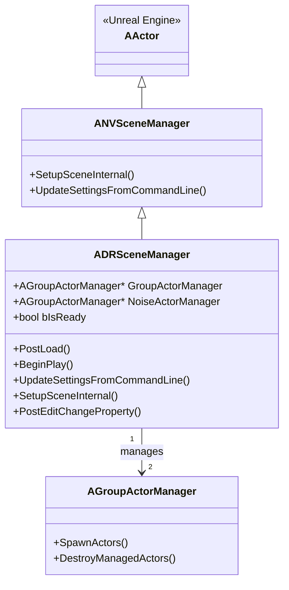
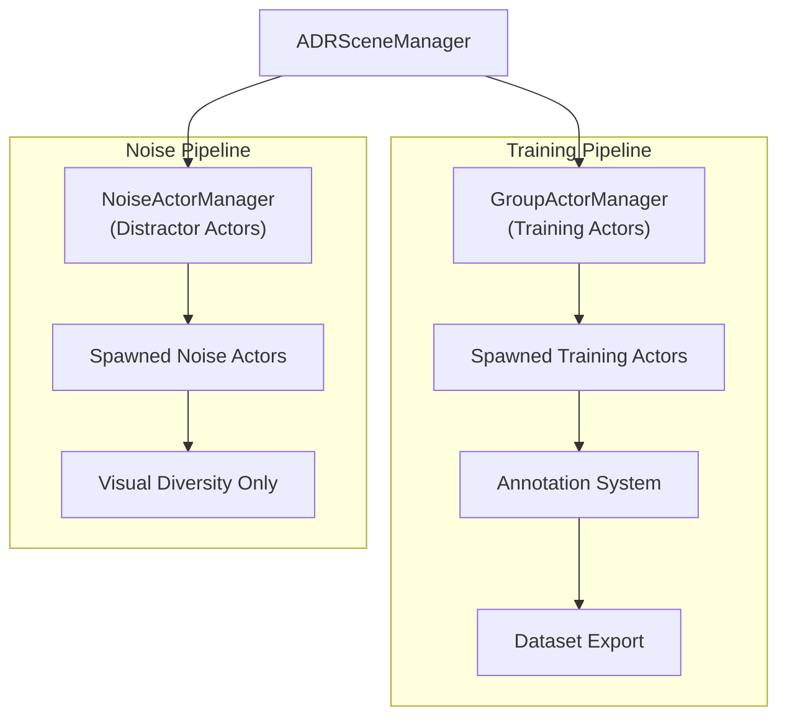
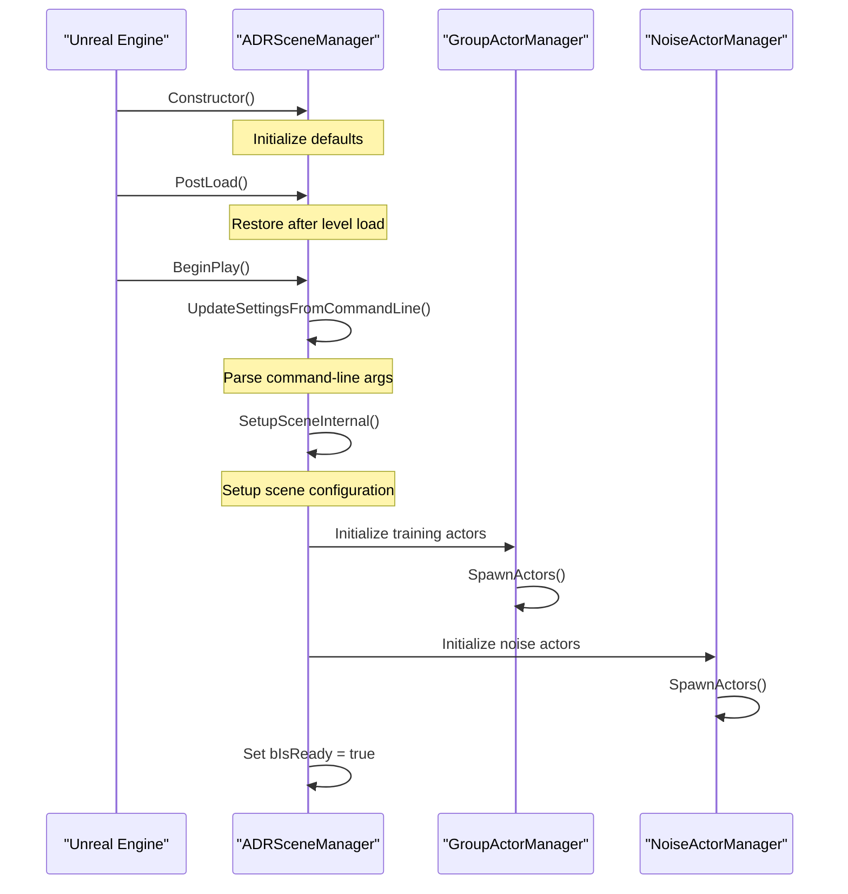

<!-- source: DeepWiki mcp.deepwiki.com · repo NVIDIA/Dataset_Synthesizer · page 4.1 Scene Manager (ADRSceneManager) · fetched 2026-10-26 -->

# Scene Manager (ADRSceneManager)

<details>
<summary>Relevant source files</summary>

The following files were used as context for generating this wiki page:

- [Documentation/ClassDetails/_d_r_scene_manager_8h_source.html](Documentation/ClassDetails/_d_r_scene_manager_8h_source.html)

</details>


## Purpose and Scope

`ADRSceneManager` is the top-level orchestrator for the domain randomization workflow in the NDDS system. It manages the scene setup, coordinates actor spawning, and handles lifecycle events during synthetic dataset generation. This class serves as the primary entry point for configuring and controlling randomized scene generation.

For details on the actor spawning mechanism managed by this class, see [Actor Spawning (AGroupActorManager)](#4.2). For the randomization utilities applied to spawned actors, see [Randomization Utilities](#4.3).

**Sources:** [Documentation/ClassDetails/_d_r_scene_manager_8h_source.html:1-161]()

---

## Class Hierarchy

`ADRSceneManager` inherits from `ANVSceneManager`, which provides base scene management functionality from the NVSceneCapturer module. This inheritance structure separates domain randomization concerns (handled by `ADRSceneManager`) from general scene capture concerns (handled by `ANVSceneManager`).



**Diagram: Class Hierarchy and Relationships**

The class hierarchy establishes clear separation of concerns:
- `AActor` provides Unreal Engine base functionality
- `ANVSceneManager` provides scene capture integration
- `ADRSceneManager` adds domain randomization orchestration

**Sources:** [Documentation/ClassDetails/_d_r_scene_manager_8h_source.html:22-52]()

---

## Core Components

`ADRSceneManager` manages two distinct actor groups through separate `AGroupActorManager` instances. This dual-manager design enables independent control over primary training objects and background noise/distractor objects.

### Manager Properties

| Property | Type | Purpose | UPROPERTY Flags |
|----------|------|---------|----------------|
| `GroupActorManager` | `AGroupActorManager*` | Manages primary training actors that will be annotated and exported | `EditInstanceOnly` |
| `NoiseActorManager` | `AGroupActorManager*` | Manages noise/distractor actors that add visual diversity without annotation | `EditInstanceOnly` |
| `bIsReady` | `bool` | Internal state flag indicating scene setup completion | `Transient` |

**Sources:** [Documentation/ClassDetails/_d_r_scene_manager_8h_source.html:41-52]()

### Training vs Noise Actor Managers

The two-manager design pattern provides functional separation:

**GroupActorManager (Training Actors)**:
- Primary objects of interest for dataset generation
- Fully annotated with bounding boxes and segmentation masks
- Exported in JSON annotations
- Subject to comprehensive randomization

**NoiseActorManager (Distractor Actors)**:
- Background clutter and environmental objects
- Provide visual diversity to improve model robustness
- Not included in annotations or exports
- Can use simpler or more aggressive randomization

This separation enables fine-grained control over scene composition. Training actors receive precise annotation while noise actors provide realistic visual context without complicating the annotation pipeline.



**Diagram: Dual Manager Architecture**

**Sources:** [Documentation/ClassDetails/_d_r_scene_manager_8h_source.html:42-47]()

---

## Lifecycle Management

`ADRSceneManager` overrides several Unreal Engine lifecycle methods to orchestrate scene setup at appropriate times. Understanding this lifecycle is critical for proper scene configuration and integration.

### Lifecycle Methods

| Method | When Called | Purpose |
|--------|-------------|---------|
| Constructor | Object instantiation | Initialize object with default values via `FObjectInitializer` |
| `PostLoad()` | After actor deserialized from disk | Restore state after level load |
| `BeginPlay()` | When gameplay begins | Trigger initial scene setup and actor spawning |
| `UpdateSettingsFromCommandLine()` | During initialization | Parse and apply command-line configuration overrides |
| `SetupSceneInternal()` | After settings configured | Execute scene setup including actor manager initialization |
| `PostEditChangeProperty()` | Editor property changed | React to property changes in Unreal Editor (editor-only) |

**Sources:** [Documentation/ClassDetails/_d_r_scene_manager_8h_source.html:29-39]()

### Lifecycle Flow Diagram



**Diagram: Scene Manager Lifecycle Sequence**

The lifecycle ensures proper initialization order:
1. Constructor establishes default state
2. `PostLoad()` handles deserialization
3. `BeginPlay()` triggers the setup sequence
4. `UpdateSettingsFromCommandLine()` applies runtime configuration
5. `SetupSceneInternal()` performs actual scene setup
6. Actor managers spawn and configure actors
7. `bIsReady` flag indicates completion

**Sources:** [Documentation/ClassDetails/_d_r_scene_manager_8h_source.html:32-35]()

---

## Configuration Mechanisms

`ADRSceneManager` supports multiple configuration pathways to enable both interactive editor-based workflows and automated command-line batch processing.

### Editor Configuration

The `EditInstanceOnly` UPROPERTY flags on `GroupActorManager` and `NoiseActorManager` enable per-instance configuration in the Unreal Editor. Users can:
- Place an `ADRSceneManager` actor in a level
- Assign specific `AGroupActorManager` instances through the Details panel
- Configure each manager's spawning parameters independently
- Preview and iterate on scene configurations interactively

**Sources:** [Documentation/ClassDetails/_d_r_scene_manager_8h_source.html:43-47]()

### Command-Line Configuration

The `UpdateSettingsFromCommandLine()` virtual method enables runtime configuration overrides via command-line arguments. This is essential for:
- Batch dataset generation with varying parameters
- CI/CD pipeline integration
- Automated testing with different scene configurations
- Headless rendering workflows

This method is called early in the `BeginPlay()` lifecycle, ensuring command-line settings take precedence over editor defaults.

**Sources:** [Documentation/ClassDetails/_d_r_scene_manager_8h_source.html:34]()

### Editor-Only Reactive Updates

```cpp
#if WITH_EDITORONLY_DATA
    virtual void PostEditChangeProperty(struct FPropertyChangedEvent& PropertyChangedEvent) override;
#endif //WITH_EDITORONLY_DATA
```

The `PostEditChangeProperty()` method (compiled only in editor builds) responds to property changes in real-time. This enables immediate feedback when adjusting scene parameters during development.

**Sources:** [Documentation/ClassDetails/_d_r_scene_manager_8h_source.html:37-39]()

### Configuration Priority

The configuration system follows this precedence order (highest to lowest):
1. Command-line arguments (`UpdateSettingsFromCommandLine()`)
2. Editor property changes (`PostEditChangeProperty()`)
3. Serialized level data (`PostLoad()`)
4. Constructor defaults

---

## Integration with Scene Capture

While `ADRSceneManager` focuses on scene setup and actor management, it integrates with the broader scene capture system through its `ANVSceneManager` base class. The typical workflow:

1. `ADRSceneManager` spawns and randomizes actors
2. Actor managers apply transforms, materials, and mesh variations
3. Scene reaches steady state (`bIsReady = true`)
4. `ANVSceneManager` base class coordinates scene capture
5. Capture components render the scene
6. Annotation system processes actor metadata
7. Export system writes images and JSON files

For details on the capture process, see [Scene Capture Component](#5.2). For annotation specifics, see [Annotated Actors](#5.1).

**Sources:** [Documentation/ClassDetails/_d_r_scene_manager_8h_source.html:15]()

---

## File Location and Module Organization

`ADRSceneManager` is defined in the DomainRandomizationDNN plugin module:

**File Path:**
```
UEModules/Plugins/DomainRandomizationDNN/Source/DomainRandomizationDNN/Public/DRSceneManager.h
```

**Module:** `DOMAINRANDOMIZATIONDNN_API` export macro indicates this class is part of the DomainRandomizationDNN module, making it available to other modules that depend on it.

**Dependencies:**
- `GameFramework/Actor.h` - Unreal Engine actor base class
- `DomainRandomizationDNNPCH.h` - Module precompiled header
- `NVSceneManager.h` - Parent class from NVSceneCapturer module
- `DRSceneManager.generated.h` - Unreal Header Tool generated code

**Sources:** [Documentation/ClassDetails/_d_r_scene_manager_8h_source.html:13-16](), [Documentation/ClassDetails/_d_r_scene_manager_8h_source.html:152-154]()

---

## Summary

`ADRSceneManager` serves as the domain randomization orchestrator, managing dual actor pipelines for training and noise objects. Key characteristics:

- **Inheritance**: Extends `ANVSceneManager` for capture integration
- **Dual Management**: Separate managers for training and distractor actors
- **Lifecycle Control**: Orchestrates setup through Unreal Engine lifecycle methods
- **Flexible Configuration**: Supports editor, command-line, and programmatic configuration
- **State Management**: Tracks readiness through `bIsReady` flag

The class provides a clean separation between scene randomization (its responsibility) and scene capture (handled by base class), enabling modular and maintainable synthetic dataset generation pipelines.

---

