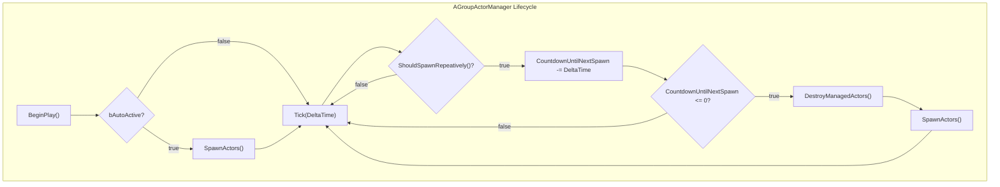
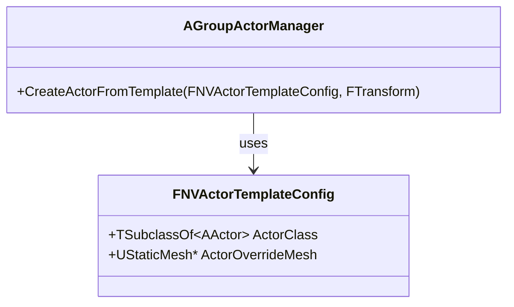
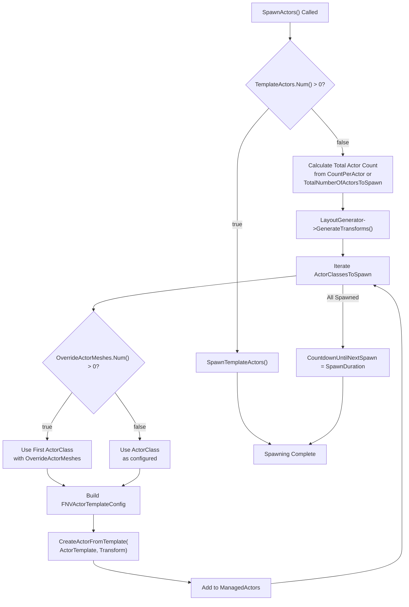
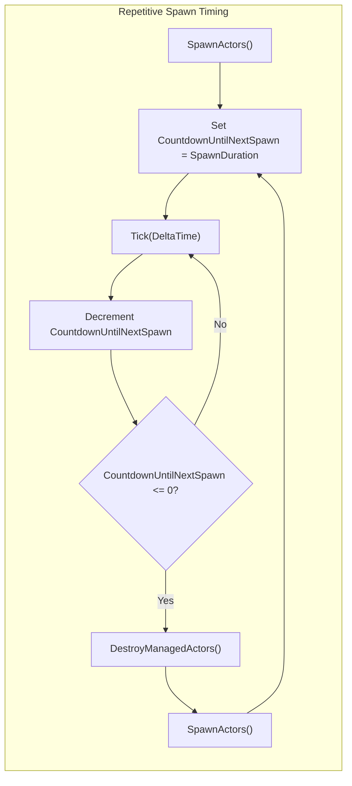
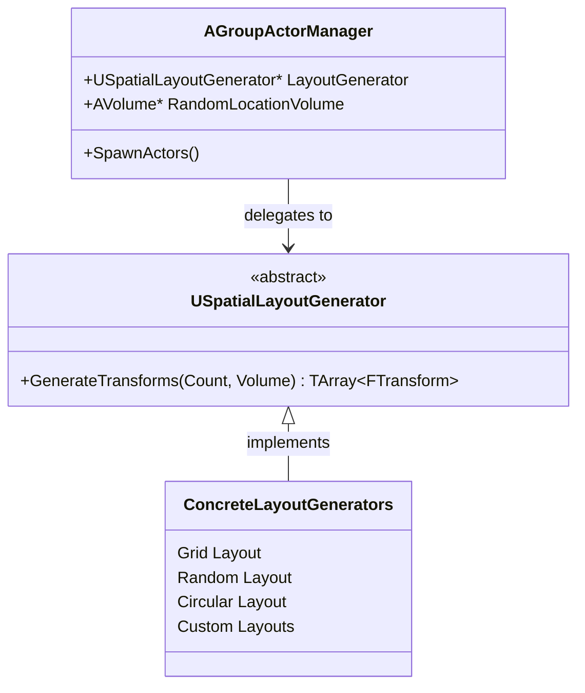
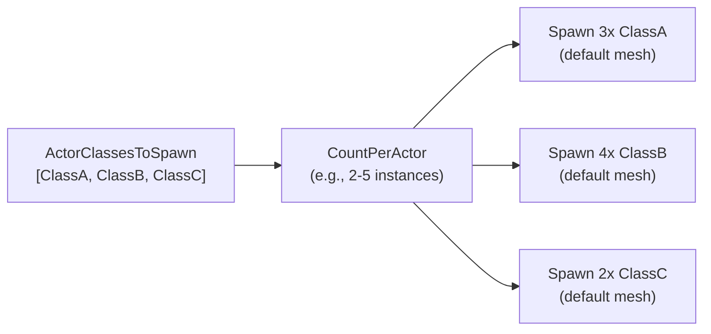
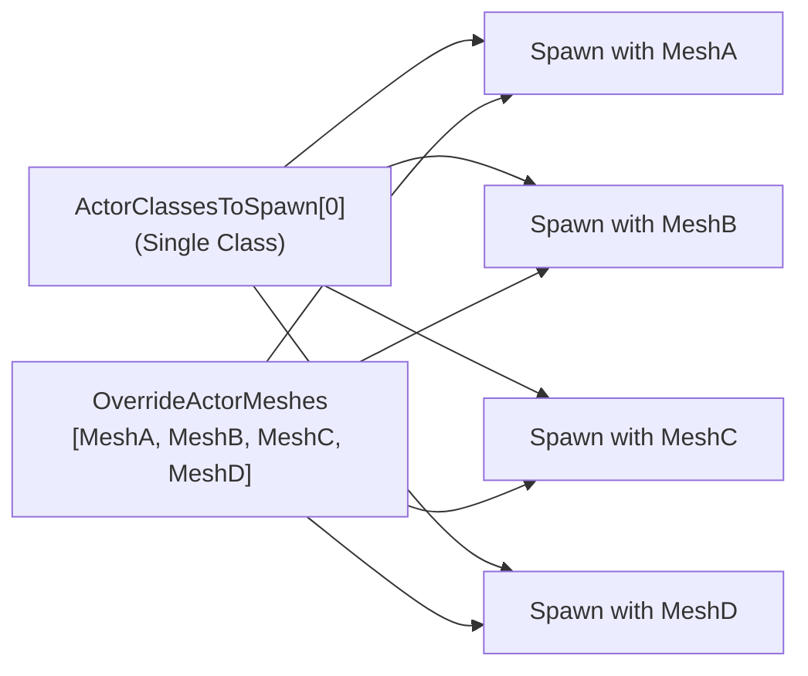
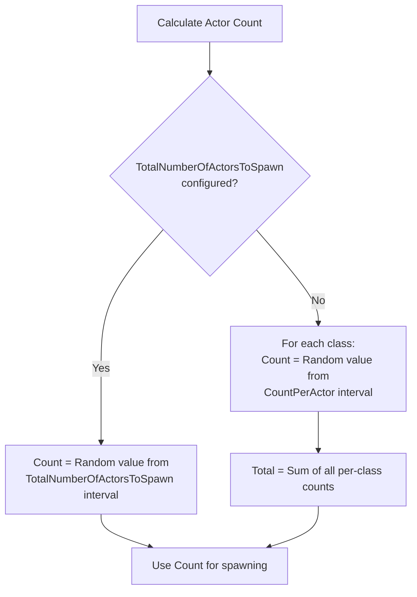
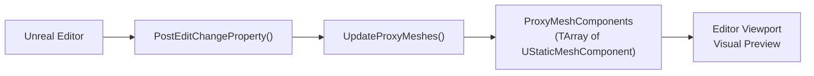
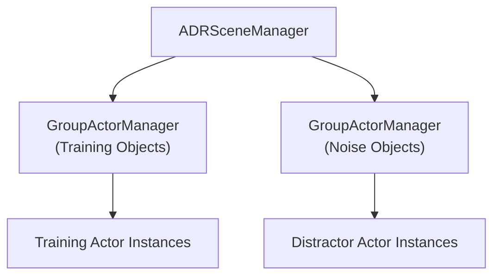

<!-- source: DeepWiki mcp.deepwiki.com · repo NVIDIA/Dataset_Synthesizer · page 4.2 Actor Spawning (AGroupActorManager) · fetched 2026-10-26 -->

# Actor Spawning (AGroupActorManager)

Relevant source files

The following files were used as context for generating this wiki page:

- [Documentation/ClassDetails/_group_actor_manager_8h_source.html](Documentation/ClassDetails/_group_actor_manager_8h_source.html)

This page documents the `AGroupActorManager` class, which is responsible for spawning and managing groups of actors in the scene with configurable spatial layouts, mesh randomization, and repetitive spawning capabilities. This manager is orchestrated by `ADRSceneManager` (see [Scene Manager (ADRSceneManager)](#4.1)) and applies randomization utilities (see [Randomization Utilities](#4.3)) to the spawned actors.

For information about the spatial layout algorithms used to position spawned actors, see the `USpatialLayoutGenerator` system referenced throughout this document.

**Sources:** [Documentation/ClassDetails/_group_actor_manager_8h_source.html:36-40]()

---

## Overview

The `AGroupActorManager` is an `AActor`-derived class that manages the lifecycle of groups of actors within a scene. It provides two primary modes of operation:

1. **One-time spawning**: Actors are spawned once during `BeginPlay()` and persist throughout the scene
2. **Repetitive spawning**: Actors are repeatedly spawned and destroyed at regular intervals defined by `SpawnDuration`

The manager supports two spawning strategies:
- **Template-based spawning**: Uses `FNVActorTemplateConfig` to define actor class and mesh combinations
- **Class-based spawning**: Uses lists of actor classes with optional mesh overrides

**Sources:** [Documentation/ClassDetails/_group_actor_manager_8h_source.html:45-118]()

---

## Actor Template Configuration

The `FNVActorTemplateConfig` struct defines the configuration for spawning individual actor instances. It specifies both the actor class to instantiate and an optional mesh override.

### FNVActorTemplateConfig Structure

| Property | Type | Description |
|----------|------|-------------|
| `ActorClass` | `TSubclassOf<AActor>` | The class to be used to spawn the new actor |
| `ActorOverrideMesh` | `UStaticMesh*` | The mesh to be used by the new actor |

The `CreateActorFromTemplate()` method uses this configuration to instantiate actors with the specified class and mesh at a given transform.

**Sources:** [Documentation/ClassDetails/_group_actor_manager_8h_source.html:19-34](), [Documentation/ClassDetails/_group_actor_manager_8h_source.html:59]()

---

## Spawning Configuration Properties

The `AGroupActorManager` exposes several `UPROPERTY` fields that control spawning behavior. These can be configured in the Unreal Editor or through code.

### Configuration Properties Table

| Property | Type | Category | Description |
|----------|------|----------|-------------|
| `bAutoActive` | `bool` | GroupActorManager | If `true`, spawns actors automatically during `BeginPlay()` |
| `ActorClassesToSpawn` | `TArray<TSubclassOf<AActor>>` | GroupActorManager | List of actor classes to spawn and manage |
| `OverrideActorMeshes` | `TArray<UStaticMesh*>` | GroupActorManager | List of meshes to use for managed actors; if populated, only the first class in `ActorClassesToSpawn` is used |
| `CountPerActor` | `FInt32Interval` | GroupActorManager | Number of instances to spawn per actor class (randomized within interval) |
| `TotalNumberOfActorsToSpawn` | `FInt32Interval` | GroupActorManager | Total number of actors to spawn across all classes (randomized within interval) |
| `LayoutGenerator` | `USpatialLayoutGenerator*` | GroupActorManager | The spatial layout algorithm used to determine actor positions |
| `RandomLocationVolume` | `AVolume*` | - | Volume within which managed actors can be randomly positioned |
| `SpawnDuration` | `float` | GroupActorManager | Time interval between spawning cycles; if ≤ 0, actors are spawned only once |

### Transient Runtime State

| Property | Type | Description |
|----------|------|-------------|
| `ManagedActors` | `TArray<AActor*>` | Runtime list of currently active managed actors |
| `TemplateActors` | `TArray<AActor*>` | Runtime list of template-based actors |
| `CountdownUntilNextSpawn` | `float` | Timer countdown for repetitive spawning |

**Sources:** [Documentation/ClassDetails/_group_actor_manager_8h_source.html:62-103]()

---

## Spawning Workflow

The actor spawning process follows a structured workflow that combines configuration, spatial layout generation, and actor instantiation.

### Key Methods

#### SpawnActors()

The primary method for spawning actors. It delegates to `SpawnTemplateActors()` if template actors exist, otherwise proceeds with class-based spawning using the `LayoutGenerator` to determine positions.

#### CreateActorFromTemplate()

Instantiates a single actor from an `FNVActorTemplateConfig` at a specified `FTransform`. This method handles:
- Actor class instantiation
- Mesh override application
- Transform assignment

**Sources:** [Documentation/ClassDetails/_group_actor_manager_8h_source.html:47-48](), [Documentation/ClassDetails/_group_actor_manager_8h_source.html:59]()

---

## Repetitive Spawning System

The repetitive spawning mechanism enables continuous regeneration of scene content for dataset diversity. This is controlled by the `SpawnDuration` property and managed through the `Tick()` method.

### Spawning Modes

| SpawnDuration Value | Behavior |
|---------------------|----------|
| `≤ 0` | **One-time spawning**: Actors spawn once and persist |
| `> 0` | **Repetitive spawning**: Actors respawn every `SpawnDuration` seconds |

### Implementation Details

The `ShouldSpawnRepeatively()` method returns `true` when `SpawnDuration > 0`, enabling the timer-based spawning loop in `Tick()`.

During each spawn cycle:
1. `DestroyManagedActors()` removes all actors in the `ManagedActors` array
2. `SpawnActors()` creates a new set of actors with potentially different configurations (due to randomization in layout, mesh selection, etc.)
3. `CountdownUntilNextSpawn` is reset to `SpawnDuration`

**Sources:** [Documentation/ClassDetails/_group_actor_manager_8h_source.html:55](), [Documentation/ClassDetails/_group_actor_manager_8h_source.html:57](), [Documentation/ClassDetails/_group_actor_manager_8h_source.html:90-93](), [Documentation/ClassDetails/_group_actor_manager_8h_source.html:102](), [Documentation/ClassDetails/_group_actor_manager_8h_source.html:117]()

---

## Spatial Layout Integration

The `AGroupActorManager` delegates spatial positioning to the `USpatialLayoutGenerator` component, which calculates `FTransform` arrays for actor placement.

### Layout Generation Process

1. `AGroupActorManager` determines the total number of actors to spawn
2. Calls `LayoutGenerator->GenerateTransforms(ActorCount, RandomLocationVolume)`
3. `USpatialLayoutGenerator` returns an array of `FTransform` objects
4. Each transform is used with `CreateActorFromTemplate()` to instantiate actors

The `RandomLocationVolume` property provides spatial bounds for layout algorithms that require bounded regions.

**Sources:** [Documentation/ClassDetails/_group_actor_manager_8h_source.html:84](), [Documentation/ClassDetails/_group_actor_manager_8h_source.html:87-88]()

---

## Class and Mesh Selection Strategies

The `AGroupActorManager` supports two distinct strategies for determining which actor classes and meshes to spawn.

### Strategy 1: Class-Based Spawning

When `OverrideActorMeshes` is empty, each class in `ActorClassesToSpawn` is instantiated with its default mesh configuration.

### Strategy 2: Mesh-Based Spawning

When `OverrideActorMeshes` contains meshes, only the **first** class from `ActorClassesToSpawn` is used, but each instance receives a different mesh from the `OverrideActorMeshes` array.

**Note:** The comment on [Documentation/ClassDetails/_group_actor_manager_8h_source.html:70-72]() states: "If there are meshes in this list, the system will only use the first class in" (text appears truncated but implies the first class in `ActorClassesToSpawn`).

**Sources:** [Documentation/ClassDetails/_group_actor_manager_8h_source.html:65-72]()

---

## Actor Count Calculation

The system provides two mechanisms for controlling how many actors are spawned:

### Count Per Actor

The `CountPerActor` property (`FInt32Interval`) specifies how many instances to create **per actor class**. For example:
- `CountPerActor = [2, 5]`
- 3 actor classes in `ActorClassesToSpawn`
- Total spawned: 3 classes × (2-5 random instances each) = 6-15 actors total

### Total Number Override

The `TotalNumberOfActorsToSpawn` property (`FInt32Interval`) overrides per-class counting and specifies the **absolute total** number of actors to spawn across all classes.

**Sources:** [Documentation/ClassDetails/_group_actor_manager_8h_source.html:74-80]()

---

## Editor-Only Features

The `AGroupActorManager` includes editor-specific functionality to visualize actor placement before runtime.

### Proxy Mesh Visualization

When running in the Unreal Editor (`WITH_EDITORONLY_DATA`), the manager maintains a collection of `UStaticMeshComponent` objects that preview where actors will spawn.

| Method | Purpose |
|--------|---------|
| `UpdateProxyMeshes()` | Regenerates proxy mesh components based on current configuration |
| `UpdateProxyMeshesVisibility()` | Controls the visibility of proxy meshes in the editor viewport |
| `PostEditChangeProperty()` | Called when properties are modified in the editor; triggers proxy mesh updates |
| `AddReferencedObjects()` | Ensures proxy mesh components are properly tracked by Unreal's garbage collection |

These proxy meshes are **not** present at runtime and serve purely as design-time visualization aids.

**Sources:** [Documentation/ClassDetails/_group_actor_manager_8h_source.html:104-115]()

---

## Lifecycle Methods

The `AGroupActorManager` overrides several `AActor` lifecycle methods to manage spawning and cleanup:

| Method | Purpose |
|--------|---------|
| `BeginPlay()` | Spawns initial actors if `bAutoActive` is `true` |
| `Tick(float DeltaTime)` | Updates spawn timer for repetitive spawning |
| `BeginDestroy()` | Cleanup before object destruction |
| `PostLoad()` | Called after object is loaded from disk |

The `DestroyManagedActors()` method iterates through the `ManagedActors` array and destroys each actor, clearing the array for the next spawn cycle.

**Sources:** [Documentation/ClassDetails/_group_actor_manager_8h_source.html:51-55](), [Documentation/ClassDetails/_group_actor_manager_8h_source.html:117]()

---

## Integration with ADRSceneManager

The `AGroupActorManager` is typically managed by `ADRSceneManager` (see [Scene Manager (ADRSceneManager)](#4.1)), which maintains separate instances for training objects and noise/distractor objects:

This separation allows different spawning configurations for primary dataset objects versus background/distractor elements.

**Sources:** Based on context from high-level architecture diagrams

---

## Summary

The `AGroupActorManager` provides a flexible system for spawning and managing groups of actors with the following key capabilities:

- **Template-based or class-based** actor spawning
- **Mesh override** support for visual randomization
- **Spatial layout integration** via `USpatialLayoutGenerator`
- **Repetitive spawning** with configurable intervals
- **Editor visualization** through proxy meshes
- **Flexible count control** via per-class or total count intervals

This system forms the foundation of the domain randomization workflow, creating diverse scene configurations that are subsequently randomized by the utilities described in [Randomization Utilities](#4.3) and captured by the systems described in [Scene Capture & Annotation](#5).

**Sources:** [Documentation/ClassDetails/_group_actor_manager_8h_source.html:1-227]()

---

