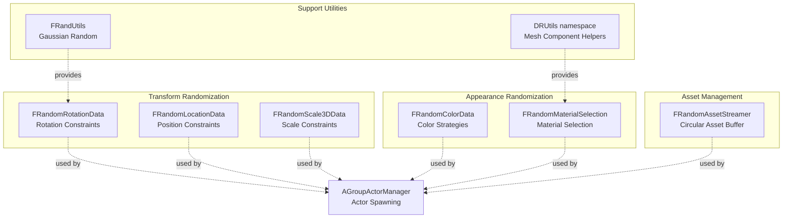
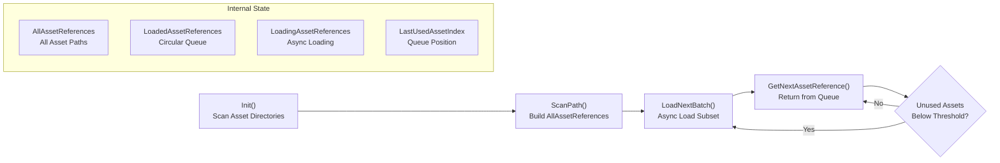
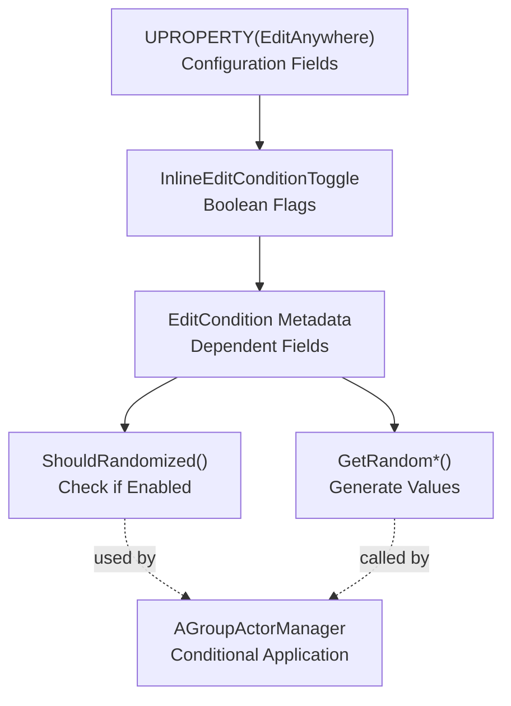

<!-- source: DeepWiki mcp.deepwiki.com · repo NVIDIA/Dataset_Synthesizer · page 4.3 Randomization Utilities · fetched 2026-10-26 -->

# Randomization Utilities

<details>
<summary>Relevant source files</summary>

The following files were used as context for generating this wiki page:

- [Documentation/ClassDetails/_d_r_utils_8h_source.html](Documentation/ClassDetails/_d_r_utils_8h_source.html)

</details>


This page documents the randomization utility data structures defined in `DRUtils.h`. These utilities provide configurable randomization constraints for object transforms, appearance, and asset streaming. They are primarily used by `AGroupActorManager` during actor spawning to create diverse synthetic scenes.

For information about how these utilities are applied during scene setup, see [Scene Manager](#4.1) and [Actor Spawning](#4.2). For detailed documentation on each randomization category, see the subsections:
- [Transform Randomization](#4.3.1) for rotation, location, and scale
- [Appearance Randomization](#4.3.2) for colors and materials
- [Asset Streaming](#4.3.3) for managing large mesh libraries

## Core Randomization Structures

The `DRUtils.h` header defines six primary randomization data structures, each exposed as `USTRUCT(BlueprintType)` for use in Unreal Engine's editor and Blueprint systems.



**Sources:** [Documentation/ClassDetails/_d_r_utils_8h_source.html:19-395]()

## Structure Categories

### Transform Randomization Structures

Three structures control geometric transformations applied to spawned actors:

| Structure | Purpose | Key Features |
|-----------|---------|--------------|
| `FRandomRotationData` | Rotation constraints | Cone-based or per-axis angle ranges (pitch/roll/yaw) |
| `FRandomLocationData` | Position constraints | Per-axis world-space position ranges (X/Y/Z) |
| `FRandomScale3DData` | Scale constraints | Uniform scale or per-axis scale ranges |

Each structure provides:
- A `ShouldRandomized()` method to check if any randomization is enabled
- One or more `GetRandom*()` methods to generate randomized values
- `UPROPERTY(EditAnywhere)` fields for editor configuration

**Sources:** [Documentation/ClassDetails/_d_r_utils_8h_source.html:19-167]()

### Appearance Randomization Structures

Two structures control visual appearance variations:

| Structure | Purpose | Configuration |
|-----------|---------|---------------|
| `FRandomColorData` | Color randomization | Three modes: random any color, interpolate between two colors (RGB or HSV), or vary around a base color |
| `FRandomMaterialSelection` | Material slot selection | Three modes: all materials, specific indices, or named slots |

**`FRandomColorData`** supports three randomization types via the `ERandomColorType` enum:
- `RandomizeAllColor` - Any random color
- `RandomizeBetweenTwoColors` - Interpolate between two specified colors
- `RandomizeAroundAColor` - Vary HSV components around a base color

**`FRandomMaterialSelection`** supports three selection types via the `EMaterialSelectionType` enum:
- `ModifyAllMaterials` - Affect all materials on the mesh
- `ModifyMaterialsInIndexesList` - Affect materials at specific indices
- `ModifyMaterialInSlotNamesList` - Affect materials with specific slot names

**Sources:** [Documentation/ClassDetails/_d_r_utils_8h_source.html:169-278]()

### Asset Streaming Structure

The `FRandomAssetStreamer` manages large asset libraries using a circular buffer pattern to prevent memory exhaustion.



**Key properties:**
- `AllAssetReferences` - Complete list of assets found in specified directories
- `LoadedAssetReferences` - Circular queue of currently loaded assets
- `LoadingAssetReferences` - Assets currently being streamed in asynchronously
- `LastUsedAssetIndex` / `LastLoadedAssetIndex` - Track position in circular queue

**Sources:** [Documentation/ClassDetails/_d_r_utils_8h_source.html:303-385]()

## Supporting Utilities

### FRandUtils

A utility struct providing Gaussian (normal) distribution random number generation:
- `RandGaussian(mean, variance)` - Returns a float from Gaussian distribution
- `RandGaussian2D(mean, variance)` - Returns a 2D vector from Gaussian distribution

**Sources:** [Documentation/ClassDetails/_d_r_utils_8h_source.html:281-289]()

### DRUtils Namespace

Provides helper functions for mesh component access:
- `GetFirstValidMeshComponent(AActor*)` - Returns the first valid mesh component in an actor
- `GetValidChildMeshComponents(AActor*)` - Returns all valid mesh components in an actor

These helpers are used by material randomization systems to locate target mesh components.

**Sources:** [Documentation/ClassDetails/_d_r_utils_8h_source.html:292-299]()

## Data Structure Design Pattern

All randomization structures follow a consistent design pattern:



This pattern provides:
1. **Editor Integration** - All fields are `UPROPERTY(EditAnywhere)` for inspector visibility
2. **Conditional Display** - Boolean flags with `InlineEditConditionToggle` show/hide dependent fields
3. **Runtime Query** - `ShouldRandomized()` checks if any randomization is enabled
4. **Value Generation** - `GetRandom*()` methods produce random values from constraints

**Sources:** [Documentation/ClassDetails/_d_r_utils_8h_source.html:19-278]()

## Usage Example Flow

```mermaid
sequenceDiagram
    participant GM as AGroupActorManager
    participant RD as FRandomRotationData
    participant LD as FRandomLocationData
    participant SD as FRandomScale3DData
    participant Actor as Spawned Actor
    
    GM->>RD: ShouldRandomized()
    RD-->>GM: true
    GM->>RD: GetRandomRotation()
    RD-->>GM: FRotator
    GM->>Actor: SetActorRotation()
    
    GM->>LD: ShouldRandomized()
    LD-->>GM: true
    GM->>LD: GetRandomLocation()
    LD-->>GM: FVector
    GM->>Actor: SetActorLocation()
    
    GM->>SD: ShouldRandomized()
    SD-->>GM: true
    GM->>SD: GetRandomScale3D()
    SD-->>GM: FVector
    GM->>Actor: SetActorScale3D()
```

The `AGroupActorManager` queries each randomization structure to check if randomization is enabled, generates random values from the constraints, and applies them to spawned actors.

**Sources:** [Documentation/ClassDetails/_d_r_utils_8h_source.html:19-167]()

## Enum Definitions

### ERandomColorType

Defines color randomization strategies:

| Enumerator | Value | Description |
|------------|-------|-------------|
| `RandomizeAllColor` | 0 | Generate any random color |
| `RandomizeBetweenTwoColors` | 1 | Interpolate between two specified colors |
| `RandomizeAroundAColor` | 2 | Vary HSV components around a base color |

**Sources:** [Documentation/ClassDetails/_d_r_utils_8h_source.html:170-176]()

### EMaterialSelectionType

Defines material selection strategies:

| Enumerator | Value | Description |
|------------|-------|-------------|
| `ModifyAllMaterials` | 0 | Affect all materials in the mesh |
| `ModifyMaterialsInIndexesList` | 1 | Affect materials at specific indices |
| `ModifyMaterialInSlotNamesList` | 2 | Affect materials with specific slot names |

**Sources:** [Documentation/ClassDetails/_d_r_utils_8h_source.html:230-242]()

### EAffectedMaterialOwnerComponentType

Defines which component types can have materials modified:

| Enumerator | Value | Description |
|------------|-------|-------------|
| `OnlyAffectMeshComponents` | 0 | Only modify mesh component materials |
| `OnlyAffectDecalComponents` | 1 | Only modify decal component materials |
| `AffectBothMeshAndDecalComponents` | 2 | Modify both mesh and decal materials |

**Sources:** [Documentation/ClassDetails/_d_r_utils_8h_source.html:389-395]()

## Module Location

All randomization utilities are defined in the DomainRandomizationDNN module:

**File Path:** `UEModules/Plugins/DomainRandomizationDNN/Source/DomainRandomizationDNN/Public/DRUtils.h`

**Module:** `DOMAINRANDOMIZATIONDNN_API` export macro indicates these are part of the DomainRandomizationDNN plugin module

**Dependencies:**
- `DomainRandomizationDNNPCH.h` - Precompiled header
- `DRUtils.generated.h` - Unreal Header Tool generated file for reflection support

**Sources:** [Documentation/ClassDetails/_d_r_utils_8h_source.html:1-14]()

---

