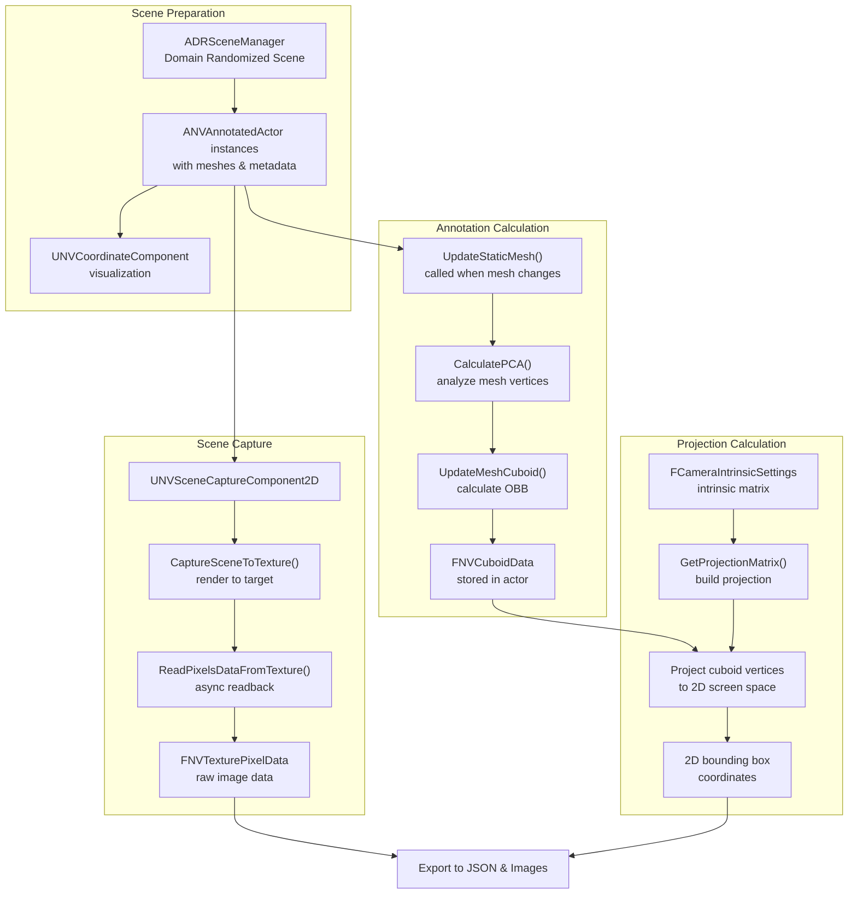
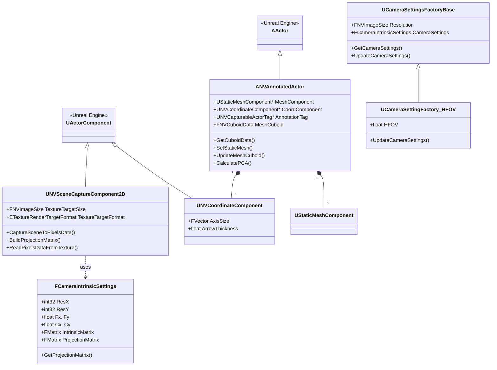
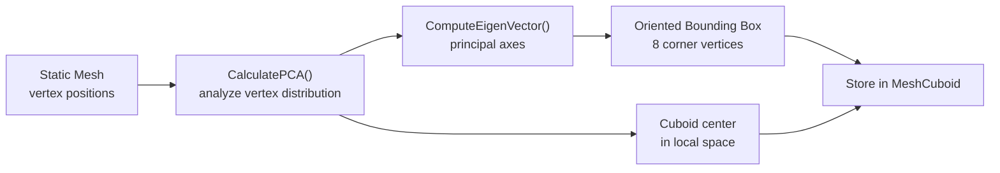
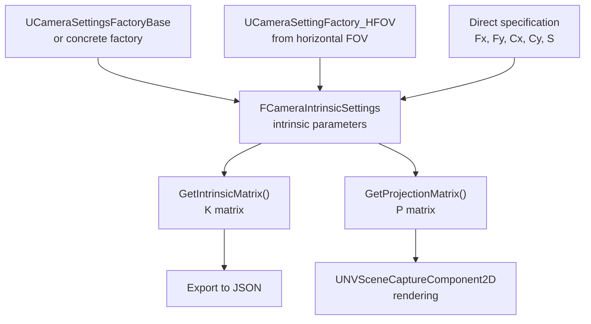
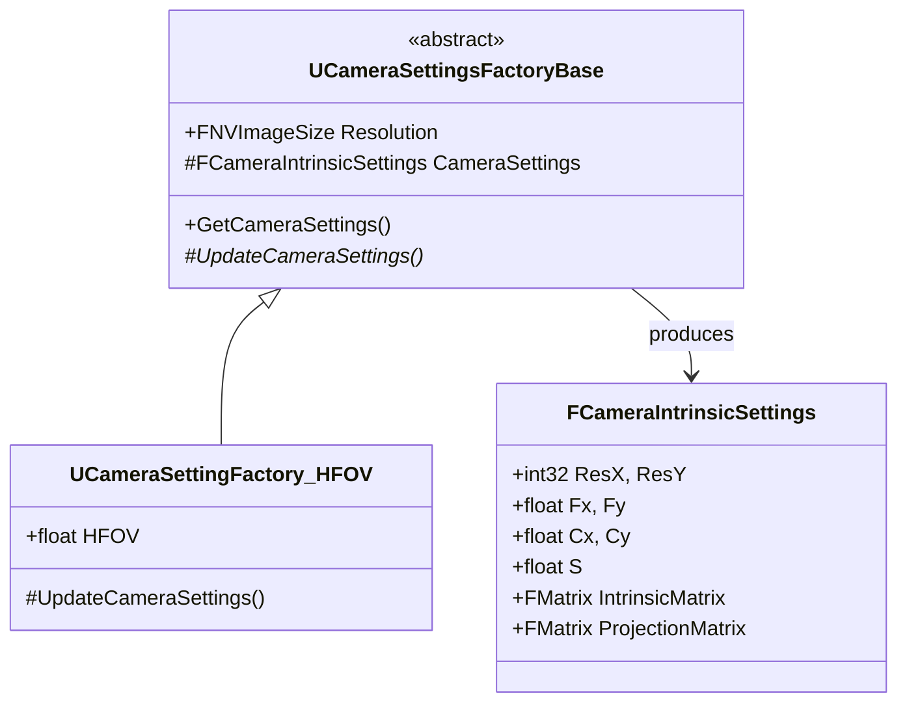
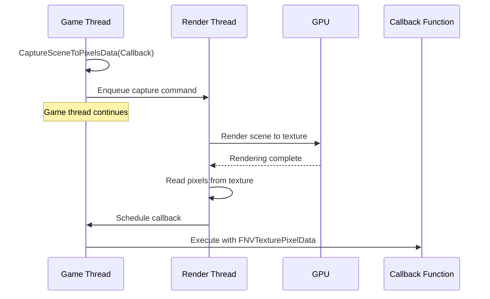

<!-- source: DeepWiki mcp.deepwiki.com · repo NVIDIA/Dataset_Synthesizer · page 5 Scene Capture & Annotation · fetched 2026-10-26 -->

# Scene Capture & Annotation

<details>
<summary>Relevant source files</summary>

The following files were used as context for generating this wiki page:

- [Documentation/ClassDetails/_n_v_annotated_actor_8h_source.html](Documentation/ClassDetails/_n_v_annotated_actor_8h_source.html)
- [Documentation/ClassDetails/_n_v_camera_settings_8h_source.html](Documentation/ClassDetails/_n_v_camera_settings_8h_source.html)
- [Documentation/ClassDetails/_n_v_scene_capture_component2_d_8h_source.html](Documentation/ClassDetails/_n_v_scene_capture_component2_d_8h_source.html)

</details>


This page documents the scene capture and annotation system, which transforms randomized 3D scenes into captured image data with corresponding annotation metadata. After the domain randomization system (see [Domain Randomization System](#4)) has prepared a scene with randomized actors, the capture system renders the scene and calculates annotation data such as oriented bounding boxes and cuboid projections.

For detailed information about specific components:
- Object annotation and cuboid calculation: see [Annotated Actors](#5.1)
- Scene rendering and pixel readback: see [Scene Capture Component](#5.2)
- Camera intrinsic parameters and projection matrices: see [Camera Configuration](#5.3)
- Segmentation mask generation: see [Segmentation & Masking](#6)
- Image export and file output: see [Data Export](#7)

## Overview

The scene capture and annotation system operates on scenes populated by the domain randomization system. Each object in the scene is represented by an `ANVAnnotatedActor`, which contains:
- A static mesh component for visual rendering
- Pre-calculated cuboid data based on PCA (Principal Component Analysis)
- Coordinate visualization components
- Annotation metadata (class names, segmentation IDs)

The `UNVSceneCaptureComponent2D` component captures these scenes to render targets and provides asynchronous pixel readback functionality. Camera intrinsic settings control the projection matrix and field of view, enabling accurate 3D-to-2D transformations for bounding box calculations.

**Sources:**
- [UEModules/Plugins/NVSceneCapturer/Source/NVSceneCapturer/public/NVAnnotatedActor.h:17-105]()
- [UEModules/Plugins/NVSceneCapturer/Source/NVSceneCapturer/public/NVSceneCaptureComponent2D.h:28-114]()

## Capture and Annotation Workflow

The following diagram illustrates the complete workflow from randomized scene to annotated capture data:



**Sources:**
- [UEModules/Plugins/NVSceneCapturer/Source/NVSceneCapturer/public/NVAnnotatedActor.h:54-60]()
- [UEModules/Plugins/NVSceneCapturer/Source/NVSceneCapturer/public/NVSceneCaptureComponent2D.h:62-86]()
- [UEModules/Plugins/NVSceneCapturer/Source/NVSceneCapturer/public/NVCameraSettings.h:49-93]()

## Key Components

The scene capture and annotation system consists of three primary component types:

| Component | Type | Purpose |
|-----------|------|---------|
| `ANVAnnotatedActor` | Actor | Individual annotated objects in the scene with mesh, cuboid data, and metadata |
| `UNVSceneCaptureComponent2D` | ActorComponent | Captures scene to render target and provides async pixel readback |
| `FCameraIntrinsicSettings` | Struct | Stores camera intrinsic parameters (focal length, principal point) |
| `UCameraSettingsFactoryBase` | UObject | Abstract factory for creating camera settings from various inputs |
| `UNVCoordinateComponent` | ActorComponent | Visualizes coordinate axes for debugging PCA orientation |

**Sources:**
- [UEModules/Plugins/NVSceneCapturer/Source/NVSceneCapturer/public/NVAnnotatedActor.h:23]()
- [UEModules/Plugins/NVSceneCapturer/Source/NVSceneCapturer/public/NVSceneCaptureComponent2D.h:28]()
- [UEModules/Plugins/NVSceneCapturer/Source/NVSceneCapturer/public/NVCameraSettings.h:49-139]()

## Component Relationships



**Sources:**
- [UEModules/Plugins/NVSceneCapturer/Source/NVSceneCapturer/public/NVAnnotatedActor.h:23-105]()
- [UEModules/Plugins/NVSceneCapturer/Source/NVSceneCapturer/public/NVSceneCaptureComponent2D.h:28-114]()
- [UEModules/Plugins/NVSceneCapturer/Source/NVSceneCapturer/public/NVCameraSettings.h:49-139]()

## Annotated Actor Structure

The `ANVAnnotatedActor` class serves as the primary container for objects that need annotation in synthetic datasets. It contains several key components and data structures:

### Core Components

| Component | Type | Purpose |
|-----------|------|---------|
| `MeshComponent` | `UStaticMeshComponent*` | Renders the visual geometry |
| `CoordComponent` | `UNVCoordinateComponent*` | Visualizes PCA-aligned coordinate frame |
| `BoxComponent` | `UBoxComponent*` | Simplified collision bounds |
| `AnnotationTag` | `UNVCapturableActorTag*` | Metadata for class name and segmentation |

### Annotation Data

The actor pre-calculates and stores annotation data that persists across frames:

| Property | Type | Description |
|----------|------|-------------|
| `MeshCuboid` | `FNVCuboidData` | PCA-based oriented bounding box with 8 corner vertices |
| `CuboidCenterLocal` | `FVector` | Local-space center of the cuboid |
| `PCACenter` | `FVector` | Center point from PCA analysis |
| `PCARotation` | `FRotator` | Rotation from PCA principal axes |
| `PCADirection` | `FVector` | Primary direction from PCA |

**Sources:**
- [UEModules/Plugins/NVSceneCapturer/Source/NVSceneCapturer/public/NVAnnotatedActor.h:63-105]()

## Cuboid Calculation via PCA

The cuboid annotation is calculated using Principal Component Analysis (PCA) to find an oriented bounding box (OBB) that tightly fits the mesh:



The PCA process:
1. `CalculatePCA()` [UEModules/Plugins/NVSceneCapturer/Source/NVSceneCapturer/public/NVAnnotatedActor.h:59]() analyzes mesh vertex distribution
2. `ComputeEigenVector()` [UEModules/Plugins/NVSceneCapturer/Source/NVSceneCapturer/public/NVAnnotatedActor.h:60]() finds principal component directions
3. `UpdateMeshCuboid()` [UEModules/Plugins/NVSceneCapturer/Source/NVSceneCapturer/public/NVAnnotatedActor.h:55]() constructs the oriented bounding box

This produces a tighter fit than axis-aligned bounding boxes (AABB), which is critical for training object pose estimation networks.

**Sources:**
- [UEModules/Plugins/NVSceneCapturer/Source/NVSceneCapturer/public/NVAnnotatedActor.h:54-60]()
- [UEModules/Plugins/NVSceneCapturer/Source/NVSceneCapturer/public/NVAnnotatedActor.h:88-104]()

## Scene Capture Component

The `UNVSceneCaptureComponent2D` extends Unreal Engine's `USceneCaptureComponent2D` to provide dataset-specific capture functionality:

### Key Properties

| Property | Type | Purpose |
|----------|------|---------|
| `TextureTargetSize` | `FNVImageSize` | Resolution of captured images (width × height) |
| `TextureTargetFormat` | `ETextureRenderTargetFormat` | Pixel format for render target |
| `OverrideTexturePixelFormat` | `EPixelFormat` | Override for specific pixel formats |
| `bIgnoreReadbackAlpha` | `bool` | Whether to force alpha=1 during readback |

### Capture Methods

The component provides both synchronous and asynchronous capture paths:

| Method | Behavior | Use Case |
|--------|----------|----------|
| `CaptureSceneToTexture()` | Commands scene capture to render target | Initiate capture in rendering phase |
| `ReadPixelsDataFromTexture(FNVTexturePixelData&)` | Synchronous readback with flush | Simple cases where hitches are acceptable |
| `ReadPixelsDataFromTexture(Callback)` | Asynchronous readback | Production use to avoid game thread stalls |
| `CaptureSceneToPixelsData(Callback)` | Combined capture + async readback | Convenience method for typical usage |

**Sources:**
- [UEModules/Plugins/NVSceneCapturer/Source/NVSceneCapturer/public/NVSceneCaptureComponent2D.h:95-110]()
- [UEModules/Plugins/NVSceneCapturer/Source/NVSceneCapturer/public/NVSceneCaptureComponent2D.h:78-86]()

## Projection Matrix Calculation

The scene capture component builds projection matrices using camera intrinsic parameters:



The `FCameraIntrinsicSettings` struct stores:
- **Resolution:** `ResX`, `ResY` (image dimensions in pixels)
- **Focal Lengths:** `Fx`, `Fy` (in pixels, often equal for square pixels)
- **Principal Point:** `Cx`, `Cy` (usually image center, but can offset)
- **Skew:** `S` (typically 0 for modern cameras)

The intrinsic matrix K is:
```
| Fx  S  Cx |
|  0 Fy  Cy |
|  0  0   1 |
```

**Sources:**
- [UEModules/Plugins/NVSceneCapturer/Source/NVSceneCapturer/public/NVCameraSettings.h:49-93]()
- [UEModules/Plugins/NVSceneCapturer/Source/NVSceneCapturer/public/NVCameraSettings.h:98-139]()
- [UEModules/Plugins/NVSceneCapturer/Source/NVSceneCapturer/public/NVSceneCaptureComponent2D.h:43-55]()

## Camera Settings Factory Pattern

The system uses a factory pattern to create camera settings from different input types:



The factory pattern allows camera settings to be specified in different ways:
- **HFOV Factory:** `UCameraSettingFactory_HFOV` [UEModules/Plugins/NVSceneCapturer/Source/NVSceneCapturer/public/NVCameraSettings.h:126-139]() creates settings from horizontal field-of-view (degrees)
- **Direct Factory:** Subclasses can create settings from other parameters (VFOV, focal length in mm, etc.)

This design enables users to configure cameras using the most convenient input format while maintaining consistent internal representation.

**Sources:**
- [UEModules/Plugins/NVSceneCapturer/Source/NVSceneCapturer/public/NVCameraSettings.h:96-139]()

## Asynchronous Pixel Readback

The component uses `FNVTextureRenderTargetReader` [UEModules/Plugins/NVSceneCapturer/Source/NVSceneCapturer/public/NVSceneCaptureComponent2D.h:112]() for asynchronous pixel readback to avoid stalling the game thread:



The asynchronous workflow:
1. `CaptureSceneToPixelsData()` enqueues capture command [UEModules/Plugins/NVSceneCapturer/Source/NVSceneCapturer/public/NVSceneCaptureComponent2D.h:62]()
2. Rendering thread captures scene to `TextureTarget`
3. Pixel readback occurs asynchronously via `FNVTextureRenderTargetReader`
4. Callback is invoked on game thread with pixel data

This prevents the common issue of `FlushRenderingCommands()` causing frame hitches during dataset generation.

**Sources:**
- [UEModules/Plugins/NVSceneCapturer/Source/NVSceneCapturer/public/NVSceneCaptureComponent2D.h:59-86]()
- [UEModules/Plugins/NVSceneCapturer/Source/NVSceneCapturer/public/NVSceneCaptureComponent2D.h:112]()

## Integration with Domain Randomization

The scene capture system integrates with the domain randomization system (see [Domain Randomization System](#4)) through a capture-on-tick workflow:

```mermaid
flowchart LR
    subgraph "Domain Randomization"
        DRScene["ADRSceneManager"]
        Spawn["Spawn randomized actors"]
        DRScene --> Spawn
    end
    
    subgraph "Annotation"
        AnnotActors["ANVAnnotatedActor<br/>with pre-calculated cuboids"]
        Spawn --> AnnotActors
    end
    
    subgraph "Capture"
        Tick["Component Tick"]
        Capture["CaptureSceneToPixelsData()"]
        Export["Export callback"]
        
        AnnotActors --> Tick
        Tick --> Capture
        Capture --> Export
    end
    
    Export --> NextFrame["Next randomization cycle"]
    NextFrame --> DRScene
```

The typical workflow:
1. `ADRSceneManager` spawns and randomizes actors
2. Each `ANVAnnotatedActor` has pre-calculated `MeshCuboid` data
3. `UNVSceneCaptureComponent2D` captures the scene during tick
4. Pixel data and annotation data are exported (see [Data Export](#7))
5. Cycle repeats for next frame

**Sources:**
- [UEModules/Plugins/NVSceneCapturer/Source/NVSceneCapturer/public/NVAnnotatedActor.h:23-105]()
- [UEModules/Plugins/NVSceneCapturer/Source/NVSceneCapturer/public/NVSceneCaptureComponent2D.h:72]()

## Configuration Options

The annotated actor provides several configuration flags:

| Property | Type | Default | Description |
|----------|------|---------|-------------|
| `bForceCenterOfBoundingBoxAtRoot` | `bool` | - | Centers mesh so cuboid center aligns with actor pivot |
| `bSetClassNameFromMesh` | `bool` | - | Automatically sets annotation tag from mesh asset name |

These flags enable flexible annotation workflows, supporting both manually-placed assets and programmatically-spawned randomized objects.

**Sources:**
- [UEModules/Plugins/NVSceneCapturer/Source/NVSceneCapturer/public/NVAnnotatedActor.h:78-86]()

---

