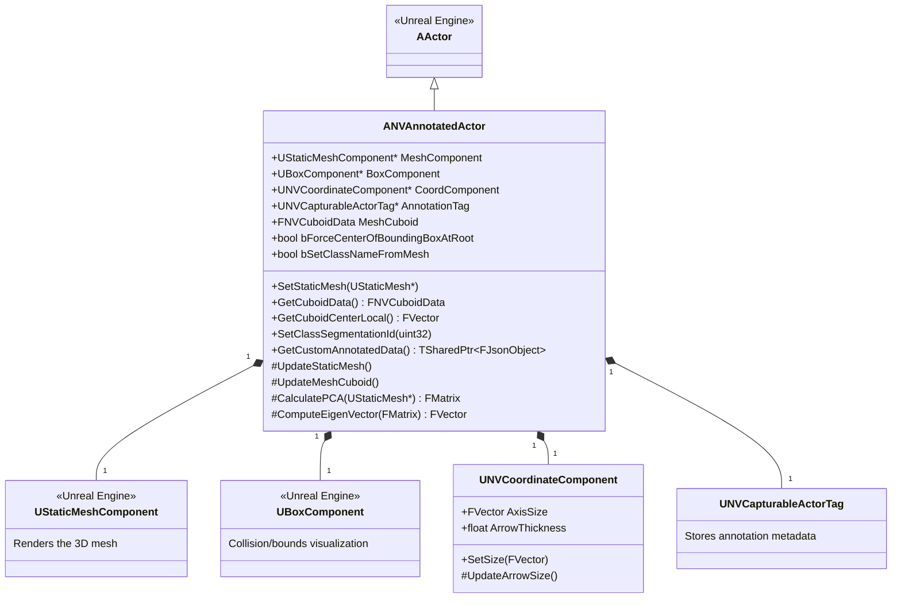
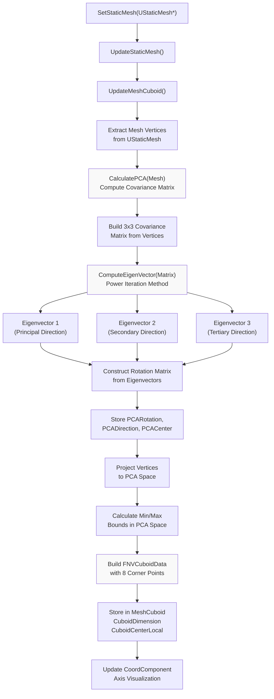
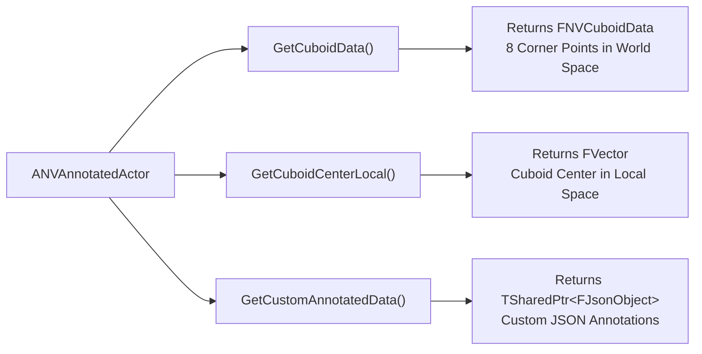

<!-- source: DeepWiki mcp.deepwiki.com · repo NVIDIA/Dataset_Synthesizer · page 5.1 Annotated Actors · fetched 2026-10-26 -->

# Annotated Actors

Relevant source files

The following files were used as context for generating this wiki page:

- [Documentation/ClassDetails/_n_v_annotated_actor_8h_source.html](Documentation/ClassDetails/_n_v_annotated_actor_8h_source.html)
- [Documentation/ClassDetails/_n_v_coordinate_component_8h_source.html](Documentation/ClassDetails/_n_v_coordinate_component_8h_source.html)

This document describes the `ANVAnnotatedActor` class and its associated components, which represent individual objects in the scene that are annotated with bounding box and segmentation metadata for dataset export. For information about how these actors are spawned and managed in groups, see [Actor Spawning (AGroupActorManager)](#4.2). For details on how annotation data is captured and exported, see [Scene Capture Component](#5.2).

## Purpose and Role

`ANVAnnotatedActor` is the fundamental building block for creating synthetic datasets in NDDS. Each instance represents a single object in the scene that will be:
- Rendered with a 3D mesh
- Annotated with an oriented bounding box (cuboid)
- Tagged with class and instance segmentation IDs
- Exported with metadata in JSON format

The actor automatically calculates a tight-fitting oriented bounding box using Principal Component Analysis (PCA) on the mesh vertices, providing accurate 3D cuboid annotations for deep learning training.

**Sources:** [Documentation/ClassDetails/_n_v_annotated_actor_8h_source.html:17-19]()

## Class Overview

**Diagram: ANVAnnotatedActor Class Structure**

The `ANVAnnotatedActor` class inherits from Unreal Engine's `AActor` base class and contains four primary components that work together to provide mesh rendering and annotation functionality.

**Sources:** [Documentation/ClassDetails/_n_v_annotated_actor_8h_source.html:23-105](), [Documentation/ClassDetails/_n_v_coordinate_component_8h_source.html:23-48]()

## Component Structure

Each `ANVAnnotatedActor` instance is composed of the following components:

| Component | Type | Purpose | Visibility |
|-----------|------|---------|------------|
| `MeshComponent` | `UStaticMeshComponent*` | Renders the 3D static mesh geometry | `VisibleAnywhere, BlueprintReadOnly` |
| `BoxComponent` | `UBoxComponent*` | Provides collision bounds and visualization | `VisibleAnywhere, BlueprintReadOnly` |
| `CoordComponent` | `UNVCoordinateComponent*` | Visualizes PCA-derived coordinate axes | `VisibleAnywhere, BlueprintReadOnly` |
| `AnnotationTag` | `UNVCapturableActorTag*` | Stores annotation metadata (class name, IDs) | `VisibleAnywhere, BlueprintReadOnly` |

### UStaticMeshComponent

The primary rendering component. The mesh can be set programmatically via `SetStaticMesh()` or overridden during actor spawning by `AGroupActorManager`. The mesh geometry is used as input for PCA-based cuboid calculation.

### UBoxComponent

Provides a simple axis-aligned bounding box visualization for debugging purposes. Not used for the final cuboid annotation, which is calculated via PCA.

### UNVCoordinateComponent

A custom visualization component that renders the three principal axes of the oriented bounding box. The axis sizes are derived from the cuboid dimensions and help visualize the PCA orientation. See [Coordinate Visualization](#8.1) for detailed documentation.

**Properties:**
- `AxisSize` (FVector): The length of each coordinate axis arrow
- `ArrowThickness` (float): Visual thickness of the arrows

### UNVCapturableActorTag

Stores the annotation metadata that will be exported to JSON, including the class name and segmentation IDs.

**Sources:** [Documentation/ClassDetails/_n_v_annotated_actor_8h_source.html:63-77](), [Documentation/ClassDetails/_n_v_coordinate_component_8h_source.html:43-47]()

## PCA-Based Cuboid Calculation

The core functionality of `ANVAnnotatedActor` is calculating a tight-fitting oriented bounding box (OBB) using Principal Component Analysis on the mesh vertices.

**Diagram: PCA-Based Cuboid Calculation Workflow**

### Algorithm Overview

The cuboid calculation follows these steps:

1. **Vertex Extraction**: Extract all vertices from the `UStaticMesh`
2. **PCA Computation**: Calculate the covariance matrix of vertex positions and compute eigenvectors via power iteration
3. **Rotation Matrix**: Construct a rotation matrix from the three principal eigenvectors
4. **Projection**: Transform vertices into the PCA-aligned coordinate space
5. **Bounding Calculation**: Find min/max extents in each PCA axis to determine cuboid dimensions
6. **Cuboid Construction**: Build the 8 corner points of the oriented bounding box

### Key Methods

| Method | Purpose | Location |
|--------|---------|----------|
| `CalculatePCA(const UStaticMesh*)` | Computes PCA rotation matrix from mesh vertices | [NVAnnotatedActor.h:59]() |
| `ComputeEigenVector(const FMatrix&)` | Power iteration to find dominant eigenvector | [NVAnnotatedActor.h:60]() |
| `UpdateMeshCuboid()` | Orchestrates the full cuboid calculation pipeline | [NVAnnotatedActor.h:55]() |
| `GetMeshInitialMatrix()` | Gets the initial transformation matrix for the mesh | [NVAnnotatedActor.h:57]() |

### Stored Results

The PCA calculation produces several stored properties:

| Property | Type | Description |
|----------|------|-------------|
| `MeshCuboid` | `FNVCuboidData` | Complete cuboid data with 8 corner points in world space |
| `CuboidDimension` | `FVector` | Dimensions (width, height, depth) of the cuboid |
| `CuboidCenterLocal` | `FVector` | Center of the cuboid in local actor space |
| `PCACenter` | `FVector` | Centroid of the mesh vertices |
| `PCARotation` | `FRotator` | Rotation of the PCA-aligned coordinate frame |
| `PCADirection` | `FVector` | Primary principal direction (first eigenvector) |

**Sources:** [Documentation/ClassDetails/_n_v_annotated_actor_8h_source.html:54-61](), [Documentation/ClassDetails/_n_v_annotated_actor_8h_source.html:88-104]()

## Annotation Metadata

Each `ANVAnnotatedActor` provides annotation metadata that is exported during scene capture.

### FNVCuboidData Structure

The `FNVCuboidData` structure (defined in `NVSceneCapturerUtils.h:128`) stores the complete oriented bounding box representation. It contains:
- 8 corner points in world-space coordinates
- Projection information for 2D bounding box calculation
- Visibility flags

### Accessing Cuboid Data

**Diagram: Cuboid Data Access Methods**

### Public API Methods

| Method | Return Type | Description |
|--------|-------------|-------------|
| `GetCuboidData()` | `FNVCuboidData` | Returns the complete cuboid data structure with 8 world-space corner points |
| `GetCuboidCenterLocal()` | `FVector` | Returns the cuboid center in the actor's local coordinate space |
| `GetCustomAnnotatedData()` | `TSharedPtr<FJsonObject>` | Virtual method for subclasses to provide additional custom annotation data |
| `SetClassSegmentationId(uint32)` | `void` | Sets the class segmentation ID for this actor (used by segmentation masks) |

**Sources:** [Documentation/ClassDetails/_n_v_annotated_actor_8h_source.html:32-42]()

## Configuration Properties

`ANVAnnotatedActor` exposes several configuration properties that control its behavior:

| Property | Type | Category | Description |
|----------|------|----------|-------------|
| `bForceCenterOfBoundingBoxAtRoot` | `bool` | AnnotatedActor | If true, automatically positions the mesh so the cuboid center aligns with the actor's root transform |
| `bSetClassNameFromMesh` | `bool` | AnnotatedActor | If true, automatically derives the annotation class name from the mesh asset name |

### bForceCenterOfBoundingBoxAtRoot

When enabled, this property ensures that the 3D bounding box center is at the actor's pivot point. This is useful for consistent placement and rotation behavior, especially when randomizing actor transforms via the Domain Randomization system.

### bSetClassNameFromMesh

When enabled, the actor automatically sets its annotation tag's class name to match the static mesh asset name. This simplifies workflows where each unique mesh represents a distinct object class.

**Sources:** [Documentation/ClassDetails/_n_v_annotated_actor_8h_source.html:78-85]()

## Lifecycle and Events

```mermaid
stateDiagram-v2
    [*] --> PostLoad: Actor Loaded
    PostLoad --> PostInitializeComponents: Components Created
    PostInitializeComponents --> BeginPlay: Play Started
    
    PostLoad --> UpdateStaticMesh
    PostInitializeComponents --> UpdateStaticMesh
    BeginPlay --> UpdateStaticMesh
    
    UpdateStaticMesh --> UpdateMeshCuboid
    UpdateMeshCuboid --> CalculatePCA
    CalculatePCA --> StoreResults: Store PCA Results
    
    state "Editor Events" as Editor {
        PostEditChangeProperty --> UpdateStaticMesh: Property Changed
        OnActorSelected --> UpdateStaticMesh: Selection Changed
    }
    
    [*] --> Editor: Editor Only
```

**Diagram: ANVAnnotatedActor Lifecycle**

### Lifecycle Methods

The actor hooks into several Unreal Engine lifecycle events to ensure cuboid data is always up-to-date:

| Method | When Called | Purpose |
|--------|-------------|---------|
| `PostLoad()` | After actor is loaded from disk | Initialize and update mesh/cuboid data |
| `PostInitializeComponents()` | After all components are initialized | Update mesh and ensure components are configured |
| `BeginPlay()` | When gameplay/simulation begins | Final update before scene capture |
| `PostEditChangeProperty()` | When a property is edited in the editor | Respond to configuration changes (editor only) |
| `OnActorSelected()` | When actor is selected in editor | Update visualization (editor only) |

All these methods eventually trigger `UpdateStaticMesh()` and `UpdateMeshCuboid()` to recalculate the oriented bounding box whenever the mesh or configuration changes.

**Sources:** [Documentation/ClassDetails/_n_v_annotated_actor_8h_source.html:45-52]()

## Integration with Scene Capture

When a scene capture is performed by `UNVSceneCaptureComponent2D` (see [Scene Capture Component](#5.2)), it queries all `ANVAnnotatedActor` instances in the scene to gather annotation data:

1. The capture component retrieves the `FNVCuboidData` via `GetCuboidData()`
2. The cuboid's 8 corner points are projected to 2D screen space
3. A 2D bounding box is calculated from the projected points
4. The annotation metadata (class name, cuboid coordinates, visibility) is serialized to JSON
5. Segmentation IDs are used to render class and instance masks (see [Segmentation & Masking](#6))

The PCA-based oriented bounding box provides more accurate annotations than axis-aligned bounding boxes, especially for rotated or elongated objects.

**Sources:** [Documentation/ClassDetails/_n_v_annotated_actor_8h_source.html:17-19]()

## Usage Example

Typical workflow for using `ANVAnnotatedActor`:

1. **Actor Spawning**: `AGroupActorManager` spawns instances of `ANVAnnotatedActor` based on configuration templates
2. **Mesh Assignment**: Either set manually via `SetStaticMesh()` or override via `AGroupActorManager::OverrideActorMeshes`
3. **Automatic Calculation**: The actor automatically calculates the PCA-based cuboid in `UpdateMeshCuboid()`
4. **Segmentation Setup**: `UNVObjectMaskManager` assigns class/instance segmentation IDs via `SetClassSegmentationId()`
5. **Scene Capture**: `UNVSceneCaptureComponent2D` captures the scene and exports cuboid annotations to JSON
6. **Visualization**: The `UNVCoordinateComponent` renders the PCA axes for debugging

For details on actor spawning and randomization, see [Actor Spawning (AGroupActorManager)](#4.2). For segmentation mask generation, see [Object Mask Manager](#6.1).

**Sources:** [Documentation/ClassDetails/_n_v_annotated_actor_8h_source.html:1-105]()

---

