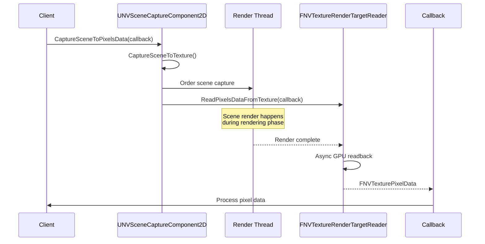
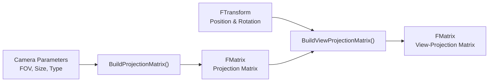
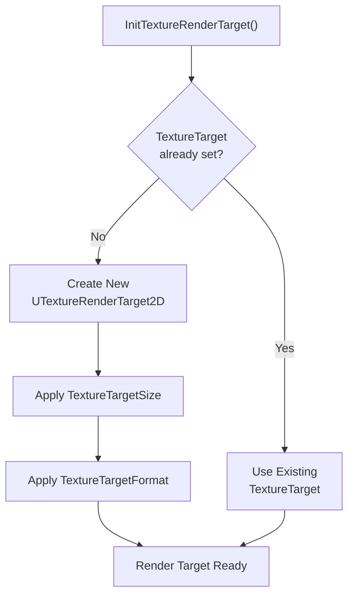
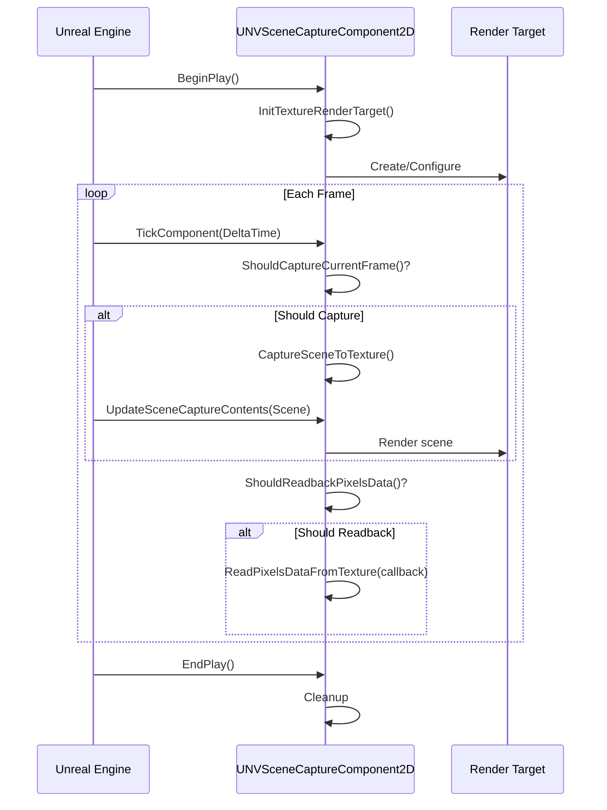
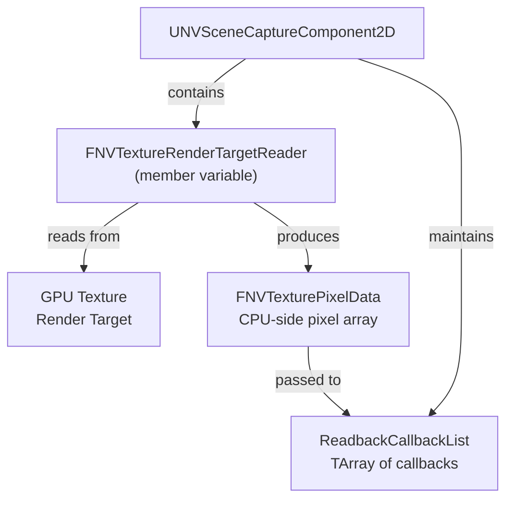
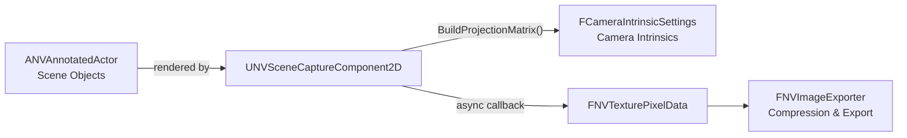

<!-- source: DeepWiki mcp.deepwiki.com · repo NVIDIA/Dataset_Synthesizer · page 5.2 Scene Capture Component · fetched 2026-10-26 -->

# Scene Capture Component

<details>
<summary>Relevant source files</summary>

The following files were used as context for generating this wiki page:

- [Documentation/ClassDetails/_n_v_scene_capture_component2_d_8h_source.html](Documentation/ClassDetails/_n_v_scene_capture_component2_d_8h_source.html)

</details>


The Scene Capture Component is responsible for rendering scenes from a specific viewpoint and reading back the captured pixel data asynchronously. It extends Unreal Engine's `USceneCaptureComponent2D` to provide specialized functionality for dataset generation, including camera projection matrix calculation, configurable render target formats, and non-blocking pixel readback.

For information about the objects being captured, see [Annotated Actors](#5.1). For details on camera intrinsic parameters and projection matrix factories, see [Camera Configuration](#5.3).

---

## Overview

The `UNVSceneCaptureComponent2D` class serves as the primary interface for capturing rendered scenes and extracting pixel data for export. It coordinates with Unreal's rendering pipeline to:

1. Render the scene to a texture render target
2. Asynchronously read back pixel data from the GPU
3. Provide projection matrices for camera intrinsics calculation
4. Support both Blueprint and C++ workflows

```mermaid
graph TB
    Component["UNVSceneCaptureComponent2D"]
    UEBase["USceneCaptureComponent2D<br/>(Unreal Engine Base)"]
    RenderTarget["Render Target Texture<br/>UTextureRenderTarget2D"]
    Reader["FNVTextureRenderTargetReader"]
    PixelData["FNVTexturePixelData"]
    
    Component --|"inherits from"--> UEBase
    Component --|"configures"--> RenderTarget
    Component --|"uses"--> Reader
    Reader --|"produces"--> PixelData
    Component --|"writes to"--> RenderTarget
    Reader --|"reads from"--> RenderTarget
    
    subgraph "Configuration"
        TextureSize["TextureTargetSize<br/>FNVImageSize"]
        Format["TextureTargetFormat<br/>ETextureRenderTargetFormat"]
        PixelFormat["OverrideTexturePixelFormat<br/>EPixelFormat"]
    end
    
    Component -.-> TextureSize
    Component -.-> Format
    Component -.-> PixelFormat
```

**Sources:** [Documentation/ClassDetails/_n_v_scene_capture_component2_d_8h_source.html:28-114]()

---

## Component Architecture

The scene capture component fits into the larger capture pipeline as follows:

```mermaid
flowchart LR
    Scene["Scene with<br/>ANVAnnotatedActor instances"]
    Component["UNVSceneCaptureComponent2D"]
    RenderThread["Rendering Thread<br/>Scene Capture"]
    RT["Render Target<br/>GPU Texture"]
    AsyncRead["Async Readback<br/>FNVTextureRenderTargetReader"]
    Callback["Callback Function<br/>OnFinishedCaptureScenePixelsDataCallback"]
    Export["Export System<br/>FNVImageExporter"]
    
    Scene --> Component
    Component -->|"UpdateSceneCaptureContents"| RenderThread
    RenderThread --> RT
    RT --> AsyncRead
    AsyncRead --> Callback
    Callback --> Export
```



**Sources:** [Documentation/ClassDetails/_n_v_scene_capture_component2_d_8h_source.html:40-86]()

---

## Core Functionality

### Capture Workflow

The component provides both immediate and deferred capture modes through the following methods:

| Method | Purpose | Execution Mode |
|--------|---------|----------------|
| `CaptureSceneToPixelsData()` | Capture scene and read pixels in one call | Asynchronous |
| `CaptureSceneToTexture()` | Order scene capture to render target | Deferred (rendering phase) |
| `ReadPixelsDataFromTexture()` (sync) | Block and read pixels immediately | Synchronous (causes hitches) |
| `ReadPixelsDataFromTexture()` (async) | Read pixels without blocking | Asynchronous |
| `StartCapturing()` | Begin continuous capture | Blueprint callable |
| `StopCapturing()` | End continuous capture | Blueprint callable |

The primary workflow uses `CaptureSceneToPixelsData()` with a callback function:



**Sources:** [Documentation/ClassDetails/_n_v_scene_capture_component2_d_8h_source.html:59-86]()

---

## Projection Matrix Calculation

The component provides static utility functions for building projection matrices that encode camera intrinsic parameters:

### Method: `BuildProjectionMatrix()`

Constructs a projection matrix from camera settings:

| Parameter | Type | Description |
|-----------|------|-------------|
| `RenderTargetSize` | `const FNVImageSize&` | Width and height in pixels |
| `ProjectionType` | `ECameraProjectionMode::Type` | Perspective or orthographic |
| `FOV` | `float` | Field of view angle (degrees) |
| `OrthoWidth` | `float` | Orthographic frustum width |

**Returns:** `FMatrix` - The camera projection matrix

**Sources:** [Documentation/ClassDetails/_n_v_scene_capture_component2_d_8h_source.html:43-44]()

### Method: `BuildViewProjectionMatrix()`

Combines view transform with projection to produce a complete view-projection matrix. Two overloads are provided:

**Overload 1:** Build from camera parameters
- Parameters: `ViewTransform`, `RenderTargetSize`, `ProjectionType`, `FOVAngle`, `OrthoWidth`, output `ProjectionMatrix`
- Returns: `FMatrix` - Combined view-projection matrix

**Overload 2:** Build from existing projection matrix
- Parameters: `ViewTransform`, `ProjectionMatrix`
- Returns: `FMatrix` - Combined view-projection matrix



**Sources:** [Documentation/ClassDetails/_n_v_scene_capture_component2_d_8h_source.html:47-55]()

---

## Configuration Properties

### Render Target Configuration

The component exposes the following UPROPERTY fields for configuring the render target:

| Property | Type | Category | Description |
|----------|------|----------|-------------|
| `TextureTargetSize` | `FNVImageSize` | SceneCapture | Width and height of captured texture (ignored if TextureTarget already set) |
| `TextureTargetFormat` | `TEnumAsByte<ETextureRenderTargetFormat>` | SceneCapture | Pixel format for render target (ignored if TextureTarget already set) |
| `OverrideTexturePixelFormat` | `TEnumAsByte<EPixelFormat>` | SceneCapture | Override pixel format for special capture modes |
| `bIgnoreReadbackAlpha` | `bool` | SceneCapture | If true, discard alpha channel and set to 1 during readback |

**Sources:** [Documentation/ClassDetails/_n_v_scene_capture_component2_d_8h_source.html:95-110]()

### Render Target Initialization

The component initializes its render target texture in `InitTextureRenderTarget()`. If no explicit `TextureTarget` is assigned, the component creates one automatically using the configured `TextureTargetSize` and `TextureTargetFormat`.



**Sources:** [Documentation/ClassDetails/_n_v_scene_capture_component2_d_8h_source.html:92-98]()

---

## Component Lifecycle

The component follows Unreal Engine's standard Actor Component lifecycle:

| Lifecycle Method | Purpose |
|-----------------|---------|
| `BeginPlay()` | Initialize component when gameplay begins |
| `TickComponent()` | Called each frame; determines if capture should occur |
| `EndPlay()` | Cleanup when gameplay ends |
| `UpdateSceneCaptureContents()` | Override of base class; performs actual scene capture |

The component uses `ShouldCaptureCurrentFrame()` and `ShouldReadbackPixelsData()` to determine when to perform capture operations.



**Sources:** [Documentation/ClassDetails/_n_v_scene_capture_component2_d_8h_source.html:40,70-72,88-91]()

---

## Async Pixel Readback System

### FNVTextureRenderTargetReader

The component maintains an `FNVTextureRenderTargetReader` instance to handle asynchronous GPU-to-CPU pixel data transfer:



### Callback Pattern

The component supports multiple concurrent readback operations by maintaining a `ReadbackCallbackList`. Each callback receives an `FNVTexturePixelData` structure when readback completes:

**Callback Type Definition:**
```
typedef TFunction<void(const FNVTexturePixelData&)> OnFinishedCaptureScenePixelsDataCallback;
```

The `FNVTexturePixelData` structure contains:
- Raw pixel data array
- Width and height
- Pixel format information
- Timestamp of capture

**Sources:** [Documentation/ClassDetails/_n_v_scene_capture_component2_d_8h_source.html:32-34,112-113]()

---

## Integration Points

### With Annotation System

The scene capture component captures whatever is currently in the scene, including all `ANVAnnotatedActor` instances with their configured segmentation IDs and materials. The component does not directly interact with annotated actors but relies on them being properly set up in the scene before capture.

See [Annotated Actors](#5.1) for details on object annotation.

### With Camera Configuration

The component's projection matrix methods are used by camera configuration factories to compute intrinsic parameters. The `FCameraIntrinsicSettings` structure uses these matrices to derive focal lengths and principal points.

See [Camera Configuration](#5.3) for details on camera intrinsic calculation.

### With Export System

The pixel data returned via callbacks is typically passed to `FNVImageExporter` for compression and file output. The asynchronous nature of the readback system prevents frame drops during export.

See [Image Export System](#7.1) for details on the export pipeline.



**Sources:** [Documentation/ClassDetails/_n_v_scene_capture_component2_d_8h_source.html:28-114]()

---

## Editor Support

The component includes editor-specific functionality:

### Preview in Editor

When `WITH_EDITOR` is defined, the component implements `GetEditorPreviewInfo()` to display a preview of what the capture component sees in the Unreal Editor viewport.

**Sources:** [Documentation/ClassDetails/_n_v_scene_capture_component2_d_8h_source.html:74-76]()

### Blueprint Support

The component is marked as `Blueprintable` and `BlueprintSpawnableComponent`, allowing it to be used in Blueprint visual scripting. The `StartCapturing()` and `StopCapturing()` methods are exposed as Blueprint callable functions.

**Sources:** [Documentation/ClassDetails/_n_v_scene_capture_component2_d_8h_source.html:22-26,64-67]()

---

## Summary

The `UNVSceneCaptureComponent2D` is the central component for scene rendering and pixel extraction in NDDS. Its key characteristics are:

- **Asynchronous Operation:** Non-blocking pixel readback prevents performance degradation
- **Flexible Configuration:** Supports custom render target formats and sizes
- **Projection Matrix Utilities:** Provides static methods for camera intrinsic calculation
- **Callback-Based API:** Allows multiple readback operations to be queued
- **Editor Integration:** Supports Blueprint workflows and editor preview

The component works in concert with annotated actors for object metadata, camera configuration for projection parameters, and the export system for file output.

**Sources:** [Documentation/ClassDetails/_n_v_scene_capture_component2_d_8h_source.html]()

---

