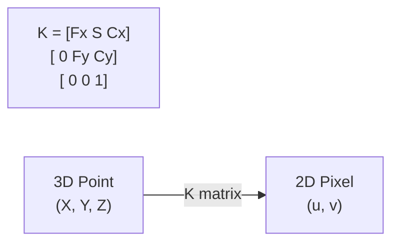
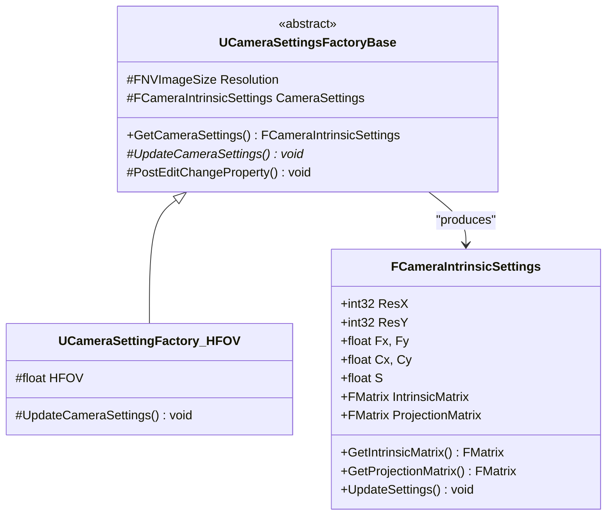
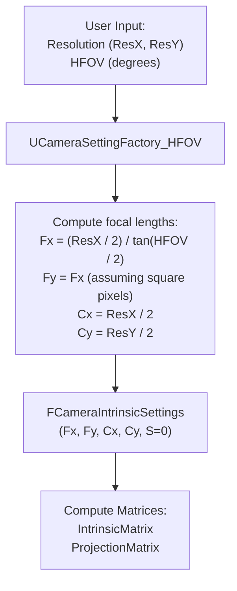
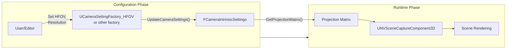
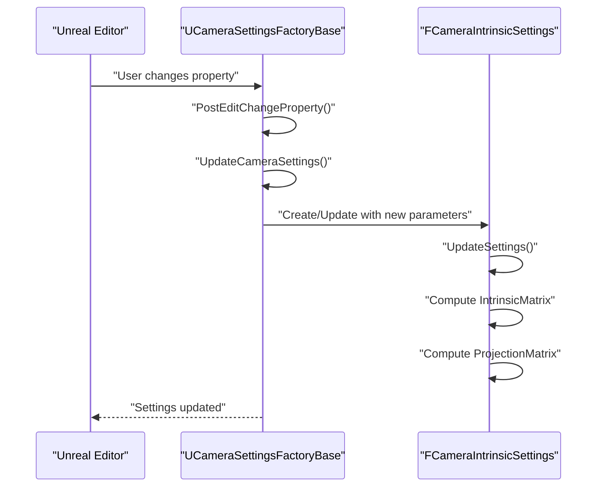

<!-- source: DeepWiki mcp.deepwiki.com · repo NVIDIA/Dataset_Synthesizer · page 5.3 Camera Configuration · fetched 2026-10-26 -->

# Camera Configuration

<details>
<summary>Relevant source files</summary>

The following files were used as context for generating this wiki page:

- [Documentation/ClassDetails/_n_v_camera_settings_8h_source.html](Documentation/ClassDetails/_n_v_camera_settings_8h_source.html)

</details>


This page documents the camera configuration system used by the scene capture components to define intrinsic camera parameters and projection matrices. Camera configuration determines how the 3D scene is projected onto the 2D capture plane, including focal lengths, principal point offsets, and resolution settings.

For information about how these camera settings are used during scene capture, see [Scene Capture Component](#5.2). For details on the actors being captured, see [Annotated Actors](#5.1).

## Overview

The camera configuration system provides two primary mechanisms for defining camera intrinsic parameters:

1. **Direct specification** of intrinsic parameters (focal lengths, principal point, skew coefficient)
2. **Factory-based construction** from higher-level parameters like horizontal field-of-view (HFOV)

Both approaches produce a `FCameraIntrinsicSettings` struct that encapsulates the complete intrinsic calibration and derived projection matrices.

**Sources:** [Documentation/ClassDetails/_n_v_camera_settings_8h_source.html:49-93]()

## Camera Intrinsic Parameters

### FCameraIntrinsicSettings Structure

The `FCameraIntrinsicSettings` struct stores the fundamental camera calibration parameters:

| Parameter | Type | Description | UPROPERTY |
|-----------|------|-------------|-----------|
| `ResX` | `int32` | Resolution width (pixels) | `EditAnywhere` |
| `ResY` | `int32` | Resolution height (pixels) | `EditAnywhere` |
| `Fx` | `float` | Focal length along X axis | `EditAnywhere` |
| `Fy` | `float` | Focal length along Y axis | `EditAnywhere` |
| `Cx` | `float` | Principal point X offset | `EditAnywhere` |
| `Cy` | `float` | Principal point Y offset | `EditAnywhere` |
| `S` | `float` | Skew coefficient | `EditAnywhere` |
| `IntrinsicMatrix` | `FMatrix` | Computed 3x3 intrinsic matrix | `VisibleAnywhere, AdvancedDisplay` |
| `ProjectionMatrix` | `FMatrix` | Computed projection matrix | `VisibleAnywhere, AdvancedDisplay` |

The struct provides two constructors:

```cpp
// Constructor from HFOV
FCameraIntrinsicSettings(int ResWidth = 640, int ResHeight = 480, float HFOV = 90.f);

// Constructor from explicit intrinsic parameters
FCameraIntrinsicSettings(int ResWidth, int ResHeight, float Fx, float Fy, float Cx, float Cy, float S = 0.f);
```

**Sources:** [Documentation/ClassDetails/_n_v_camera_settings_8h_source.html:49-93]()

### Intrinsic Matrix

The intrinsic matrix **K** is a 3x3 matrix that transforms 3D camera coordinates to 2D pixel coordinates:



The `GetIntrinsicMatrix()` method computes this matrix from the stored parameters.

**Sources:** [Documentation/ClassDetails/_n_v_camera_settings_8h_source.html:58]()

### Projection Matrix

The projection matrix extends the intrinsic matrix to handle perspective projection and normalization for rendering pipelines. The `GetProjectionMatrix()` method returns the full projection matrix used by Unreal Engine's rendering system.

**Sources:** [Documentation/ClassDetails/_n_v_camera_settings_8h_source.html:59]()

## Image Size Configuration

### FNVImageSize Structure

The `FNVImageSize` struct represents image dimensions with utility methods:

| Field | Type | Description |
|-------|------|-------------|
| `Width` | `int32` | Image width in pixels (min: 1) |
| `Height` | `int32` | Image height in pixels (min: 1) |

**Key Methods:**
- `ConvertToIntPoint()` - Converts to Unreal's `FIntPoint` type
- `GetAspectRatio()` - Returns width/height ratio

**Sources:** [Documentation/ClassDetails/_n_v_camera_settings_8h_source.html:16-33]()

### FNVNamedImageSizePreset

The `FNVNamedImageSizePreset` struct provides named resolution presets:

| Field | Type | Description |
|-------|------|-------------|
| `Name` | `FString` | Preset name (e.g., "1080p", "4K") |
| `ImageSize` | `FNVImageSize` | Associated resolution |

**Sources:** [Documentation/ClassDetails/_n_v_camera_settings_8h_source.html:36-46]()

## Factory Pattern for Camera Settings

The camera configuration system uses the **Factory Pattern** to support multiple methods of camera construction. This allows users to specify camera parameters in the most convenient format for their use case.



**Sources:** [Documentation/ClassDetails/_n_v_camera_settings_8h_source.html:98-139]()

### UCameraSettingsFactoryBase

The abstract base class for all camera settings factories defines the common interface:

- **`GetCameraSettings()`** - Returns the computed `FCameraIntrinsicSettings`
- **`UpdateCameraSettings()`** - Abstract method to recompute camera settings from factory-specific parameters
- **`PostEditChangeProperty()`** - Editor callback that triggers `UpdateCameraSettings()` when properties change

**Sources:** [Documentation/ClassDetails/_n_v_camera_settings_8h_source.html:98-122]()

### UCameraSettingFactory_HFOV

The HFOV factory creates camera intrinsics from horizontal field-of-view, which is often more intuitive than specifying focal lengths directly:



**Key Property:**
- **`HFOV`** (`float`) - Horizontal field-of-view in degrees

The factory automatically converts HFOV to focal lengths, assuming:
- Principal point at image center (`Cx = ResX/2`, `Cy = ResY/2`)
- Square pixels (`Fx = Fy`)
- No skew (`S = 0`)

**Sources:** [Documentation/ClassDetails/_n_v_camera_settings_8h_source.html:126-139]()

## Camera Configuration Workflow

The following diagram shows how camera configuration integrates with the scene capture system:



**Sources:** [Documentation/ClassDetails/_n_v_camera_settings_8h_source.html:98-139]()

## Usage Patterns

### Pattern 1: HFOV-based Configuration

This is the recommended approach for typical use cases:

1. Create `UCameraSettingFactory_HFOV` instance
2. Set `Resolution` (width/height)
3. Set `HFOV` (e.g., 90.0 for 90-degree horizontal FOV)
4. Factory automatically computes intrinsic parameters
5. Call `GetCameraSettings()` to retrieve `FCameraIntrinsicSettings`

**Sources:** [Documentation/ClassDetails/_n_v_camera_settings_8h_source.html:126-139]()

### Pattern 2: Direct Intrinsic Specification

For precise camera calibration matching real hardware:

1. Construct `FCameraIntrinsicSettings` directly with known intrinsic parameters
2. Specify `Fx`, `Fy`, `Cx`, `Cy`, and optionally `S`
3. Call `UpdateSettings()` to recompute matrices
4. Use `GetIntrinsicMatrix()` or `GetProjectionMatrix()` as needed

**Sources:** [Documentation/ClassDetails/_n_v_camera_settings_8h_source.html:55-62]()

## Camera Settings Update Mechanism



The `PostEditChangeProperty()` callback ensures that whenever properties are modified in the Unreal Editor, the camera settings are automatically recomputed. This provides immediate visual feedback when adjusting camera parameters.

**Sources:** [Documentation/ClassDetails/_n_v_camera_settings_8h_source.html:109-112]()

## Integration with Scene Capture

The `FCameraIntrinsicSettings` produced by these factories are consumed by `UNVSceneCaptureComponent2D` (documented in [Scene Capture Component](#5.2)). The component uses:

1. **Resolution** (`ResX`, `ResY`) to size render targets
2. **Projection Matrix** to configure the camera frustum for rendering
3. **Intrinsic Matrix** for coordinate transformations and annotation

This ensures that captured images and their annotations are geometrically consistent with the specified camera model.

**Sources:** [Documentation/ClassDetails/_n_v_camera_settings_8h_source.html:49-93]()

## Summary of Key Classes

| Class | Purpose | File Location |
|-------|---------|---------------|
| `FCameraIntrinsicSettings` | Stores camera intrinsic parameters and computed matrices | NVCameraSettings.h:49-93 |
| `FNVImageSize` | Represents image dimensions with utility methods | NVCameraSettings.h:16-33 |
| `UCameraSettingsFactoryBase` | Abstract factory base for creating camera settings | NVCameraSettings.h:98-122 |
| `UCameraSettingFactory_HFOV` | Concrete factory creating settings from HFOV | NVCameraSettings.h:126-139 |
| `FNVNamedImageSizePreset` | Named resolution presets | NVCameraSettings.h:36-46 |

**Sources:** [Documentation/ClassDetails/_n_v_camera_settings_8h_source.html]()

---

