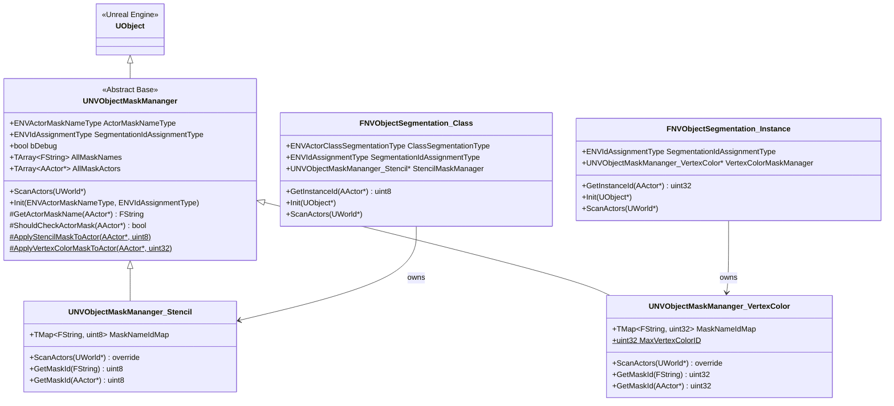
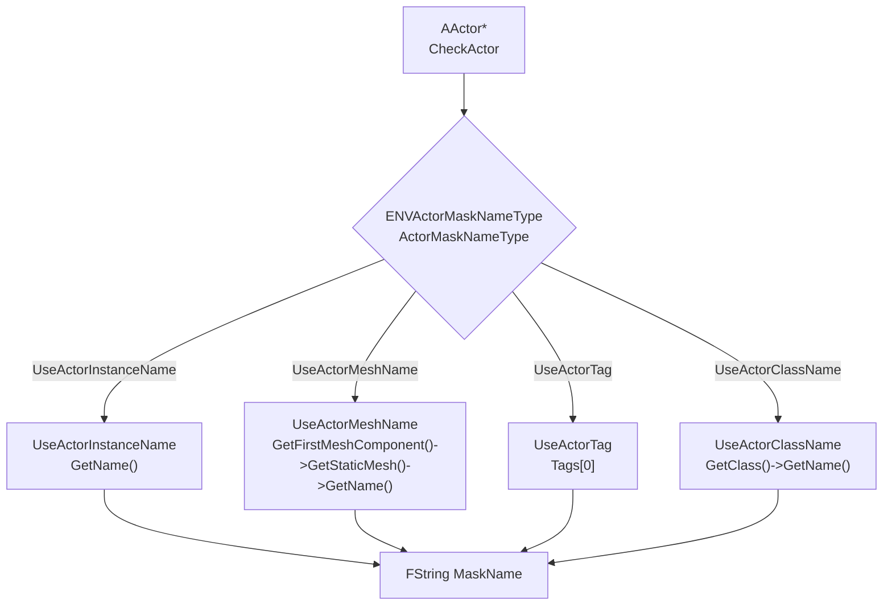
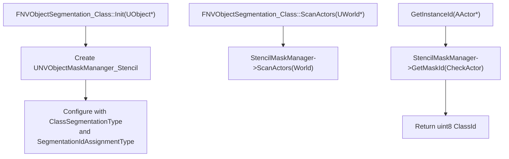

<!-- source: DeepWiki mcp.deepwiki.com · repo NVIDIA/Dataset_Synthesizer · page 6 Segmentation & Masking · fetched 2026-10-26 -->

# Segmentation & Masking

<details>
<summary>Relevant source files</summary>

The following files were used as context for generating this wiki page:

- [Documentation/ClassDetails/_n_v_object_mask_manager_8h_source.html](Documentation/ClassDetails/_n_v_object_mask_manager_8h_source.html)

</details>


## Overview

The segmentation and masking system assigns unique IDs to actors in the scene, enabling the generation of semantic segmentation masks during scene capture. These masks identify which pixels in the rendered image belong to which object or object class, providing ground truth labels for training deep learning models on tasks like instance segmentation and semantic segmentation.

This page documents the mask manager infrastructure and ID assignment strategies. For details on how mask managers are used during scene capture, see [Scene Capture Component](#5.2). For information on how annotated actors interact with the masking system, see [Annotated Actors](#5.1).

**Sources:** [UEModules/Plugins/NVSceneCapturer/Source/NVSceneCapturer/public/NVObjectMaskManager.h:1-222]()

## Segmentation Types

The system supports two fundamental segmentation types, each implemented by a different mask manager class:

| Segmentation Type | Mask Manager Class | Bit Depth | Max Objects | Use Case |
|-------------------|-------------------|-----------|-------------|----------|
| **Class Segmentation** | `UNVObjectMaskMananger_Stencil` | 8-bit | 255 | Semantic segmentation - grouping objects of the same class |
| **Instance Segmentation** | `UNVObjectMaskMananger_VertexColor` | 32-bit | ~4.2 billion | Instance segmentation - unique ID per object |

**Class Segmentation** uses the stencil buffer to assign class-level IDs. All actors of the same class (e.g., all "car" objects) receive the same ID. The 8-bit limitation means only 255 unique classes can be represented (ID 0 is reserved for ignored actors).

**Instance Segmentation** uses vertex colors to assign instance-level IDs. Each individual actor receives a unique ID encoded in the vertex color. The 32-bit color depth allows for billions of unique instances.

**Sources:** [UEModules/Plugins/NVSceneCapturer/Source/NVSceneCapturer/public/NVObjectMaskManager.h:111-152]()

## Mask Manager Architecture



### UNVObjectMaskMananger (Base Class)

The abstract base class `UNVObjectMaskMananger` provides the common infrastructure for both segmentation strategies:

- **`ScanActors(UWorld*)`**: Traverses all actors in the scene to build the mask name list
- **`GetActorMaskName(AActor*)`**: Derives the mask name from an actor based on `ActorMaskNameType`
- **`ShouldCheckActorMask(AActor*)`**: Determines if an actor should be included in masking
- **`ApplyStencilMaskToActor(AActor*, uint8)`**: Static method to apply stencil ID to actor's mesh components
- **`ApplyVertexColorMaskToActor(AActor*, uint32)`**: Static method to apply vertex color ID to actor's mesh components

The base class maintains two transient arrays:
- **`AllMaskNames`**: List of unique mask names discovered during scanning
- **`AllMaskActors`**: List of actors with assigned masks

**Sources:** [UEModules/Plugins/NVSceneCapturer/Source/NVSceneCapturer/public/NVObjectMaskManager.h:70-109]()

### UNVObjectMaskMananger_Stencil

The stencil-based implementation manages class-level segmentation using 8-bit stencil IDs:

- **`MaskNameIdMap`**: Maps mask names (e.g., "car", "pedestrian") to 8-bit IDs (1-255)
- **`GetMaskId(FString)`**: Retrieves the ID for a given mask name
- **`GetMaskId(AActor*)`**: Retrieves the ID for a given actor

The stencil approach modifies the `CustomDepthStencilValue` property of mesh components, which is rendered to a special stencil buffer during scene capture.

**Sources:** [UEModules/Plugins/NVSceneCapturer/Source/NVSceneCapturer/public/NVObjectMaskManager.h:111-130]()

### UNVObjectMaskMananger_VertexColor

The vertex color implementation manages instance-level segmentation using 32-bit color IDs:

- **`MaskNameIdMap`**: Maps mask names (typically unique actor names) to 32-bit IDs
- **`MaxVertexColorID`**: Static constant defining the maximum vertex color ID
- **`GetMaskId(FString)`**: Retrieves the ID for a given mask name
- **`GetMaskId(AActor*)`**: Retrieves the ID for a given actor

The vertex color approach writes the ID into the mesh's vertex color buffer, encoding the 32-bit ID across the RGBA channels. This requires mesh components to have vertex color data.

**Sources:** [UEModules/Plugins/NVSceneCapturer/Source/NVSceneCapturer/public/NVObjectMaskManager.h:132-152]()

## Mask Name Derivation

The `ENVActorMaskNameType` enum defines how mask names are derived from actors in the scene:

| Strategy | Enum Value | Description | Typical Use Case |
|----------|-----------|-------------|------------------|
| **Actor Instance Name** | `UseActorInstanceName` | Each actor's unique instance name (e.g., "Car_23") | Instance segmentation - every object gets unique ID |
| **Actor Mesh Name** | `UseActorMeshName` | First mesh component's asset name (e.g., "SM_Sedan") | Class segmentation by mesh type |
| **Actor Tag** | `UseActorTag` | First tag in actor's Tags array | Class segmentation by user-defined categories |
| **Actor Class Name** | `UseActorClassName` | C++ or Blueprint class name (e.g., "BP_Vehicle_C") | Class segmentation by actor type |



### Important Notes

- **UseActorInstanceName**: Should only be used with vertex color masking due to the potentially huge number of unique instances. Each actor in the scene has a unique name, so this creates one mask per actor.
  
- **UseActorMeshName**: Actors without visible mesh components are ignored. For actors with multiple mesh components, only the first valid mesh's name is used.

- **UseActorTag**: Actors without tags are ignored. For actors with multiple tags, only the first tag in the Tags array is used.

- **UseActorClassName**: Groups all instances of the same C++ class or Blueprint together under one mask ID.

**Sources:** [UEModules/Plugins/NVSceneCapturer/Source/NVSceneCapturer/public/NVObjectMaskManager.h:16-41]()

## ID Assignment Strategies

The `ENVIdAssignmentType` enum determines how numeric IDs are assigned to mask names:

| Strategy | Enum Value | ID Calculation | Purpose |
|----------|-----------|----------------|---------|
| **Sequential** | `Sequential` | IDs assigned sequentially: 1, 2, 3, ... | Predictable IDs, easier debugging, efficient ID space usage |

```mermaid
flowchart LR
    subgraph Sequential["Sequential Assignment"]
        S1["Mask 'car'"] -->|ID| S1V["1"]
        S2["Mask 'truck'"] -->|ID| S2V["2"]
        S3["Mask 'person'"] -->|ID| S3V["3"]
        S4["Mask 'bicycle'"] -->|ID| S4V["4"]
    end
    
    subgraph SpreadEvenly["Spread Evenly Assignment<br/>(4 masks, MaxValue=255)"]
        E1["Mask 'car'"] -->|ID| E1V["63"]
        E2["Mask 'truck'"] -->|ID| E2V["127"]
        E3["Mask 'person'"] -->|ID| E3V["191"]
        E4["Mask 'bicycle'"] -->|ID| E4V["255"]
    end
```

| **Spread Evenly** | `SpreadEvenly` | Gap = MaxMaskValue / NumberOfMasks<br/>IDs: Gap, 2×Gap, 3×Gap, ... | Better visualization - colors appear more distinct |



### When to Use Each Strategy

**Sequential**: 
- Default choice for deep learning training where the numeric value doesn't matter
- When manually assigning additional IDs (just increment from max)
- When ID space is limited (e.g., stencil's 255 max)

**Spread Evenly**:
- When visually inspecting segmentation masks
- When few objects exist and sequential IDs would appear as similar dark colors
- For debugging and visualization purposes

The spread evenly strategy improves visual distinguishability because the mask images are displayed as grayscale (for 8-bit stencil) or color (for 32-bit vertex color). When only a few objects exist with sequential IDs (1, 2, 3), they appear nearly black and hard to distinguish. Spreading them evenly (e.g., 50, 100, 150, 200) creates more visually distinct colors.

**Sources:** [UEModules/Plugins/NVSceneCapturer/Source/NVSceneCapturer/public/NVObjectMaskManager.h:43-66]()

## Segmentation Wrapper Structs

The system provides two wrapper structs that combine mask managers with specific configuration:

### FNVObjectSegmentation_Class

`FNVObjectSegmentation_Class` manages class-level segmentation:

- **`ClassSegmentationType`** (`ENVActorClassSegmentationType`): Determines how to derive class names from actors
- **`SegmentationIdAssignmentType`** (`ENVIdAssignmentType`): Controls ID assignment strategy
- **`StencilMaskManager`** (`UNVObjectMaskMananger_Stencil*`): Internal stencil mask manager instance



**Sources:** [UEModules/Plugins/NVSceneCapturer/Source/NVSceneCapturer/public/NVObjectMaskManager.h:178-222]()

### FNVObjectSegmentation_Instance

`FNVObjectSegmentation_Instance` manages instance-level segmentation:

- **`SegmentationIdAssignmentType`** (`ENVIdAssignmentType`): Controls ID assignment strategy
- **`VertexColorMaskManager`** (`UNVObjectMaskMananger_VertexColor*`): Internal vertex color mask manager instance

Instance segmentation always uses `UseActorInstanceName` for mask name derivation since each instance needs a unique ID.

**Sources:** [UEModules/Plugins/NVSceneCapturer/Source/NVSceneCapturer/public/NVObjectMaskManager.h:154-176]()

## Actor Class Segmentation Type

For class segmentation, the `ENVActorClassSegmentationType` enum provides additional options for deriving class names:

| Strategy | Enum Value | Description |
|----------|-----------|-------------|
| **Actor Mesh Name** | `UseActorMeshName` | First mesh component's asset name |
| **Actor Tag** | `UseActorTag` | First tag in actor's Tags array |
| **Actor Class Name** | `UseActorClassName` | C++ or Blueprint class name |

This enum is similar to `ENVActorMaskNameType` but excludes `UseActorInstanceName` since that option doesn't make sense for class-level segmentation (it would create one class per instance).

**Sources:** [UEModules/Plugins/NVSceneCapturer/Source/NVSceneCapturer/public/NVObjectMaskManager.h:178-196]()

## Typical Usage Workflow

```mermaid
sequenceDiagram
    participant SC as UNVSceneCaptureComponent2D
    participant SegClass as FNVObjectSegmentation_Class
    participant StencilMgr as UNVObjectMaskMananger_Stencil
    participant SegInst as FNVObjectSegmentation_Instance
    participant VColorMgr as UNVObjectMaskMananger_VertexColor
    participant World as UWorld
    participant Actor as AActor

    Note over SC: Scene Capture Initialization
    SC->>SegClass: Init(this)
    SegClass->>StencilMgr: Create instance
    SC->>SegInst: Init(this)
    SegInst->>VColorMgr: Create instance
    
    Note over SC: Before Capturing Frame
    SC->>SegClass: ScanActors(World)
    SegClass->>StencilMgr: ScanActors(World)
    StencilMgr->>World: Iterate all actors
    World-->>StencilMgr: AActor* instances
    loop For each actor
        StencilMgr->>Actor: GetActorMaskName(actor)
        Actor-->>StencilMgr: FString maskName
        StencilMgr->>StencilMgr: Assign ID to maskName
        StencilMgr->>Actor: ApplyStencilMaskToActor(actor, id)
    end
    
    SC->>SegInst: ScanActors(World)
    SegInst->>VColorMgr: ScanActors(World)
    VColorMgr->>World: Iterate all actors
    loop For each actor
        VColorMgr->>Actor: GetActorMaskName(actor)
        VColorMgr->>VColorMgr: Assign unique ID
        VColorMgr->>Actor: ApplyVertexColorMaskToActor(actor, id)
    end
    
    Note over SC: Render Scene
    SC->>SC: Capture with stencil/vertex color
```

The workflow typically proceeds as follows:

1. **Initialization**: Segmentation wrapper structs (`FNVObjectSegmentation_Class` and `FNVObjectSegmentation_Instance`) are initialized, creating their respective mask manager instances.

2. **Scanning**: Before rendering, `ScanActors(UWorld*)` is called to traverse all actors in the scene and assign IDs based on the configured strategies.

3. **ID Assignment**: For each actor:
   - Mask name is derived using `GetActorMaskName()`
   - If this is a new mask name, an ID is assigned (sequential or spread evenly)
   - The ID is applied to the actor's mesh components (stencil value or vertex color)

4. **Rendering**: During scene capture, the stencil buffer or vertex color buffer contains the segmentation IDs, which are captured as mask images.

**Sources:** [UEModules/Plugins/NVSceneCapturer/Source/NVSceneCapturer/public/NVObjectMaskManager.h:1-222]()

---

