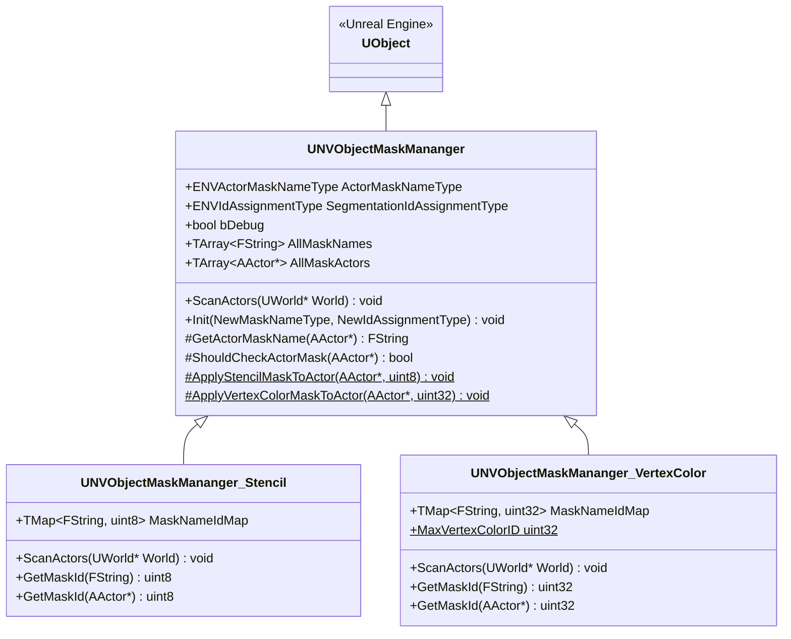
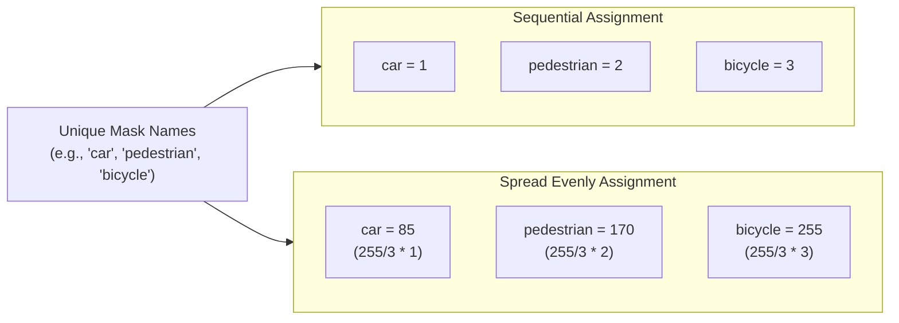
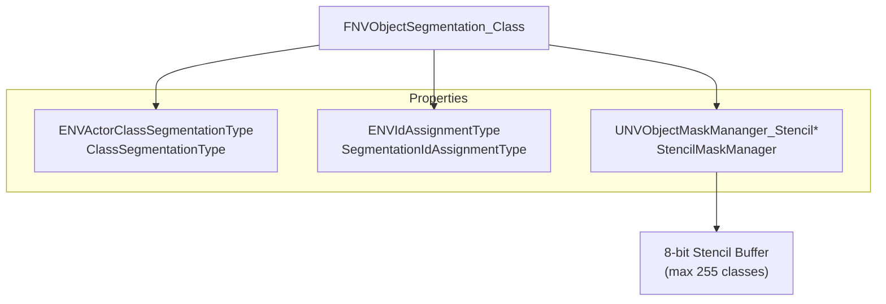
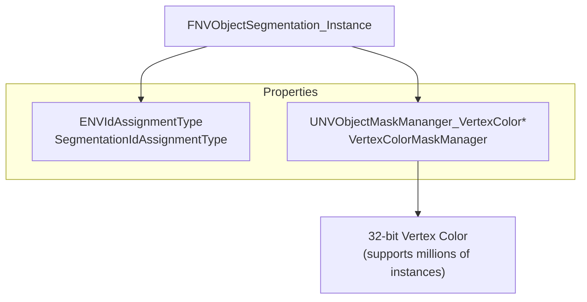
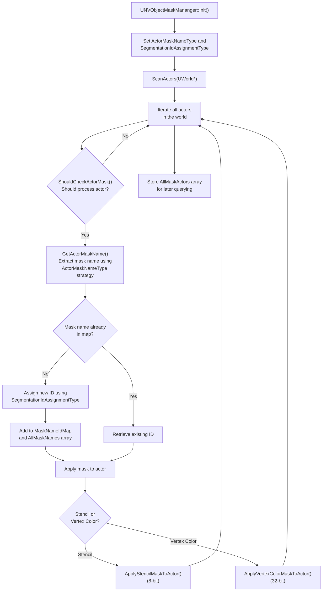
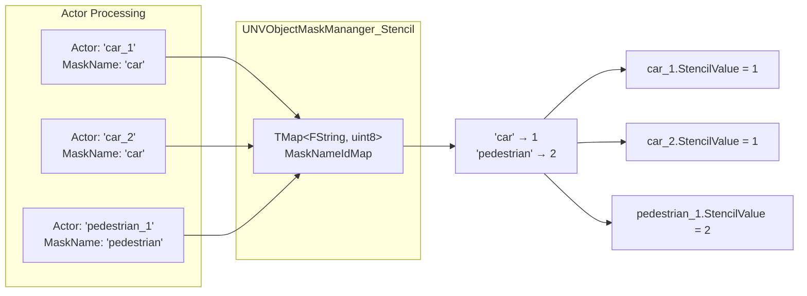
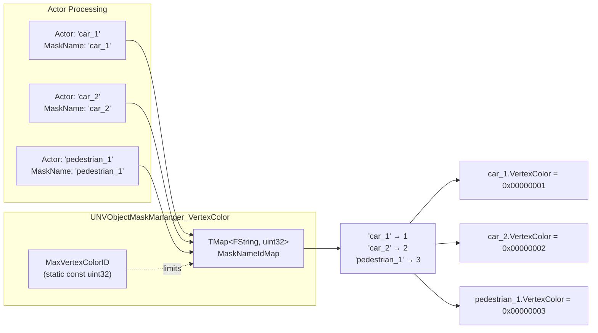
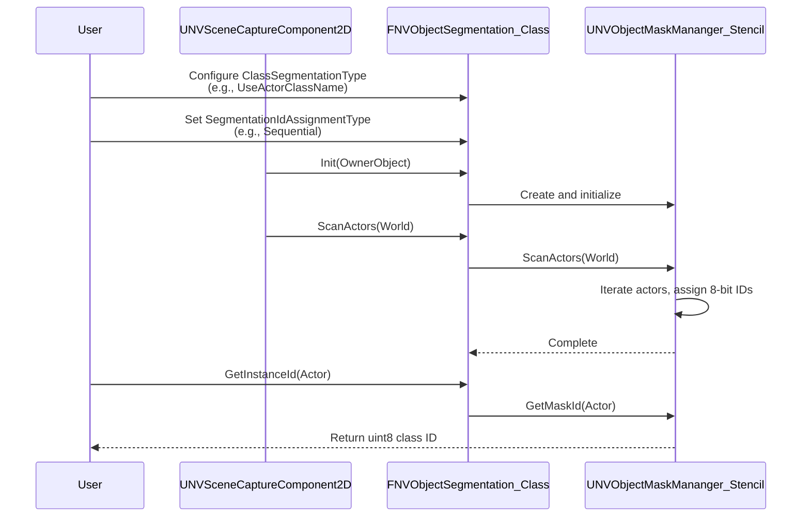
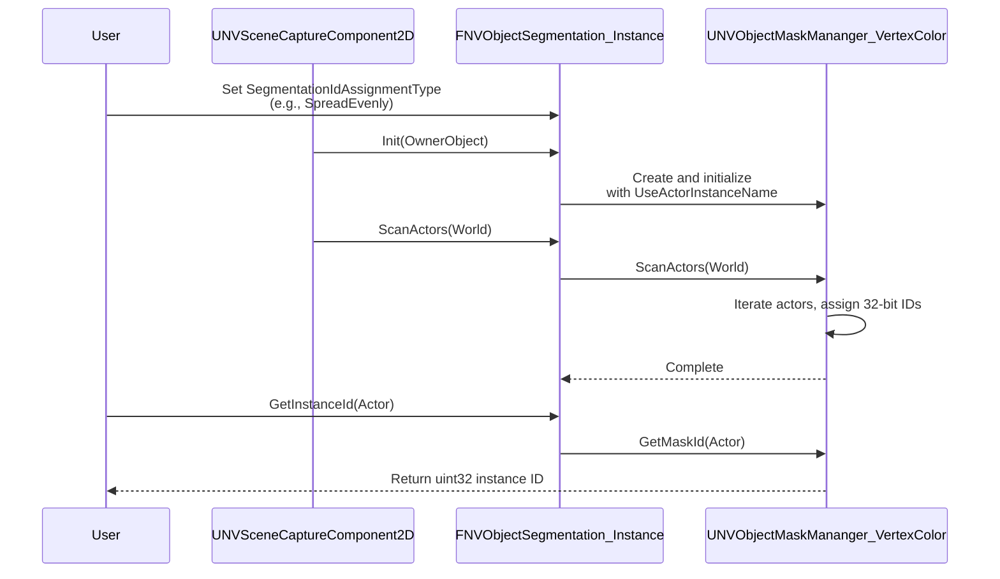

<!-- source: DeepWiki mcp.deepwiki.com · repo NVIDIA/Dataset_Synthesizer · page 6.1 Object Mask Manager · fetched 2026-10-26 -->

# Object Mask Manager

<details>
<summary>Relevant source files</summary>

The following files were used as context for generating this wiki page:

- [Documentation/ClassDetails/_n_v_object_mask_manager_8h_source.html](Documentation/ClassDetails/_n_v_object_mask_manager_8h_source.html)

</details>


The Object Mask Manager system is responsible for scanning actors in the Unreal Engine scene and assigning unique segmentation IDs to enable class-level and instance-level segmentation for synthetic dataset generation. This system forms the foundation for generating segmentation masks that accompany captured images.

For information about how segmentation masks are actually captured and exported, see [Segmentation Strategies](#6.2). For information about annotated actors that work with this system, see [Annotated Actors](#5.1).

---

## Purpose and Scope

The Object Mask Manager provides:

- **Actor scanning**: Iterates through all actors in a scene to identify which should receive segmentation IDs
- **Mask name derivation**: Determines how to extract a mask name from each actor (instance name, mesh name, tag, or class name)
- **ID assignment**: Maps mask names to numeric IDs using sequential or evenly-spread strategies
- **Dual masking modes**: Supports both 8-bit stencil-based masking (class segmentation) and 32-bit vertex-color masking (instance segmentation)

---

## Class Hierarchy



**Sources:** [Documentation/ClassDetails/_n_v_object_mask_manager_8h_source.html:72-152]()

---

## Mask Name Derivation Strategies

The `ENVActorMaskNameType` enum defines four strategies for extracting a mask name from an actor. The chosen strategy determines how actors are grouped for segmentation purposes.

### ENVActorMaskNameType Options

| Strategy | Enum Value | Description | Use Case |
|----------|------------|-------------|----------|
| **UseActorInstanceName** | 0 | Uses the actor's unique instance name | Instance segmentation where every actor gets a unique mask (requires vertex color) |
| **UseActorMeshName** | 1 | Uses the first visible mesh component's name | Grouping actors by their 3D model |
| **UseActorTag** | 2 | Uses the first tag from the actor's Tags array | Custom grouping via Unreal Editor tags |
| **UseActorClassName** | 3 | Uses the C++ or Blueprint class name | Class-level segmentation where all instances of the same type share a mask |

**Implementation Details:**

- Actors with no mesh (when using `UseActorMeshName`) are ignored
- Actors with no tags (when using `UseActorTag`) are ignored
- `UseActorInstanceName` should only be used with vertex color masking due to the potentially large number of unique masks (see warning at [Documentation/ClassDetails/_n_v_object_mask_manager_8h_source.html:22-23]())

**Sources:** [Documentation/ClassDetails/_n_v_object_mask_manager_8h_source.html:16-41]()

---

## ID Assignment Strategies

The `ENVIdAssignmentType` enum controls how numeric IDs are assigned to mask names after scanning.



### Assignment Type Comparison

| Type | Formula | Visual Appearance | Best For |
|------|---------|-------------------|----------|
| **Sequential** | `ID = 0, 1, 2, 3, ...` | Mask images appear mostly black (low pixel values) | Production training datasets, easier debugging |
| **SpreadEvenly** | `ID = MaxValue / NumMasks * index` | Mask colors visually distinct | Visualization and validation |

**Rationale:** When visualizing masks as grayscale images, sequential IDs (1, 2, 3, ...) produce nearly black images that are hard to distinguish. Spreading IDs evenly (e.g., 85, 170, 255) creates visually distinct gray levels for easier inspection. However, for deep learning training, the actual ID values don't matter, making sequential assignment simpler to debug.

**Sources:** [Documentation/ClassDetails/_n_v_object_mask_manager_8h_source.html:43-66]()

---

## Segmentation Types

The system supports two complementary segmentation approaches implemented via wrapper structs.

### Class-Level Segmentation (FNVObjectSegmentation_Class)



**Purpose:** Groups actors by class type (mesh name, tag, or class name) and assigns each class an 8-bit stencil ID.

**Key Characteristics:**
- Uses `UNVObjectMaskMananger_Stencil` internally
- Limited to 255 unique classes (8-bit stencil buffer)
- All instances of the same class receive the same ID
- Efficient for class segmentation in semantic segmentation tasks

**Public Methods:**
- `GetInstanceId(const AActor* CheckActor)`: Returns the 8-bit class ID for an actor
- `Init(UObject* OwnerObject)`: Initializes the stencil mask manager
- `ScanActors(UWorld* World)`: Scans the world and assigns class IDs

**Sources:** [Documentation/ClassDetails/_n_v_object_mask_manager_8h_source.html:178-222]()

### Instance-Level Segmentation (FNVObjectSegmentation_Instance)



**Purpose:** Assigns a unique 32-bit ID to each actor instance, enabling instance segmentation.

**Key Characteristics:**
- Uses `UNVObjectMaskMananger_VertexColor` internally
- Supports up to `MaxVertexColorID` unique instances (32-bit range)
- Each actor instance receives a unique ID
- Typically uses `UseActorInstanceName` mask name strategy

**Public Methods:**
- `GetInstanceId(const AActor* CheckActor)`: Returns the 32-bit instance ID for an actor
- `Init(UObject* OwnerObject)`: Initializes the vertex color mask manager
- `ScanActors(UWorld* World)`: Scans the world and assigns instance IDs

**Sources:** [Documentation/ClassDetails/_n_v_object_mask_manager_8h_source.html:154-176]()

---

## Core Workflow



**Sources:** [Documentation/ClassDetails/_n_v_object_mask_manager_8h_source.html:72-152]()

---

## Base Class: UNVObjectMaskMananger

The abstract base class provides common functionality for both stencil and vertex color masking.

### Key Properties

| Property | Type | Description |
|----------|------|-------------|
| `ActorMaskNameType` | `ENVActorMaskNameType` | Strategy for deriving mask names from actors |
| `SegmentationIdAssignmentType` | `ENVIdAssignmentType` | Strategy for assigning numeric IDs (sequential or spread evenly) |
| `bDebug` | `bool` | Enables debug logging of mask names and assignments |
| `AllMaskNames` | `TArray<FString>` | Transient list of all unique mask names found during scanning |
| `AllMaskActors` | `TArray<AActor*>` | Transient list of all actors that received mask IDs |

### Key Methods

**Public Methods:**
- `ScanActors(UWorld* World)`: Virtual method that scans actors and assigns IDs (overridden by subclasses)
- `Init(ENVActorMaskNameType, ENVIdAssignmentType)`: Configures the mask manager with name and ID strategies

**Protected Static Methods:**
- `GetActorMaskName(ENVActorMaskNameType, const AActor*)`: Extracts mask name from an actor using the specified strategy
- `ApplyStencilMaskToActor(AActor*, uint8)`: Applies an 8-bit stencil value to all mesh components
- `ApplyVertexColorMaskToActor(AActor*, uint32)`: Applies a 32-bit vertex color value to all mesh components

**Protected Instance Methods:**
- `GetActorMaskName(const AActor*)`: Convenience method using the instance's `ActorMaskNameType`
- `ShouldCheckActorMask(const AActor*)`: Determines if an actor should be processed for masking

**Sources:** [Documentation/ClassDetails/_n_v_object_mask_manager_8h_source.html:72-109]()

---

## Stencil Mask Manager

The `UNVObjectMaskMananger_Stencil` class implements 8-bit stencil buffer-based masking for class-level segmentation.

### Implementation Details



### Data Structures

**MaskNameIdMap:**
- Type: `TMap<FString, uint8>`
- Purpose: Maps unique mask names to 8-bit stencil IDs
- Constraint: Maximum 255 unique masks (ID 0 is reserved for "ignored")

### Public API

```cpp
// Get the stencil ID for a mask name
uint8 GetMaskId(const FString& MaskName) const;

// Get the stencil ID for an actor
uint8 GetMaskId(const AActor* CheckActor) const;

// Scan actors and assign stencil IDs (override)
void ScanActors(UWorld* World) override;
```

**Note:** MaskId 0 indicates the actor is ignored and will not appear in segmentation masks.

**Sources:** [Documentation/ClassDetails/_n_v_object_mask_manager_8h_source.html:111-130]()

---

## Vertex Color Mask Manager

The `UNVObjectMaskMananger_VertexColor` class implements 32-bit vertex color-based masking for instance-level segmentation.

### Implementation Details



### Data Structures

**MaskNameIdMap:**
- Type: `TMap<FString, uint32>`
- Purpose: Maps unique mask names to 32-bit vertex color IDs
- Constraint: Maximum `MaxVertexColorID` unique instances (typically in the millions)

### Public API

```cpp
// Get the vertex color ID for a mask name
uint32 GetMaskId(const FString& MaskName) const;

// Get the vertex color ID for an actor
uint32 GetMaskId(const AActor* CheckActor) const;

// Scan actors and assign vertex color IDs (override)
void ScanActors(UWorld* World) override;

// Maximum allowed vertex color ID value
static const uint32 MaxVertexColorID;
```

**Note:** MaskId 0 indicates the actor is ignored and will not appear in segmentation masks.

**Sources:** [Documentation/ClassDetails/_n_v_object_mask_manager_8h_source.html:132-152]()

---

## Usage Patterns

### Pattern 1: Class Segmentation Setup



### Pattern 2: Instance Segmentation Setup



**Sources:** [Documentation/ClassDetails/_n_v_object_mask_manager_8h_source.html:154-222]()

---

## Debug Logging

When `bDebug` is set to `true` on `UNVObjectMaskMananger`, the system logs detailed information during the scanning process via the `LogNVObjectMaskManager` log category.

### Typical Debug Output

- List of all unique mask names discovered
- Mapping of mask names to assigned IDs
- Number of actors processed
- Actors that were ignored and why

**Sources:** [Documentation/ClassDetails/_n_v_object_mask_manager_8h_source.html:99-101](), [Documentation/ClassDetails/_n_v_object_mask_manager_8h_source.html:68]()

---

## Integration with Scene Capture

The Object Mask Manager is typically invoked by `UNVSceneCaptureComponent2D` before capturing segmentation masks. The workflow is:

1. Scene capture component owns `FNVObjectSegmentation_Class` and/or `FNVObjectSegmentation_Instance`
2. During initialization, these structs create their respective mask managers
3. Before each capture, `ScanActors()` is called to update mask assignments
4. During rendering, the mask IDs are used to colorize segmentation outputs
5. After capture, `GetMaskId()` queries are used to populate annotation data

For more details on how these masks are rendered, see [Segmentation Strategies](#6.2).

**Sources:** [Documentation/ClassDetails/_n_v_object_mask_manager_8h_source.html:154-222]()

---

