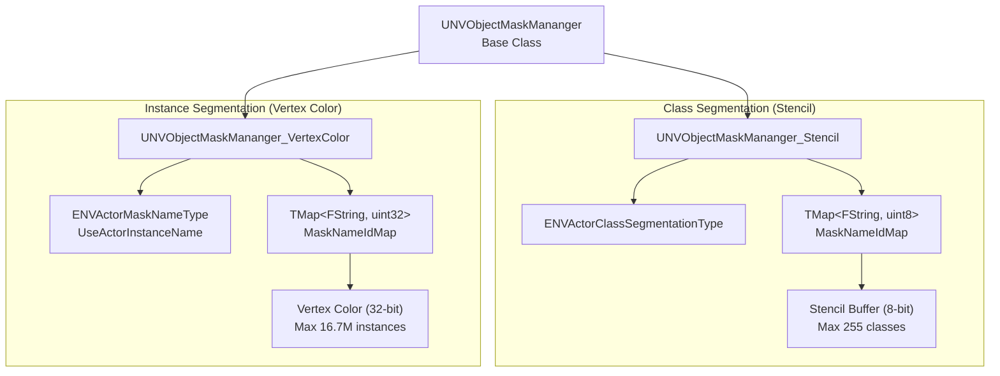
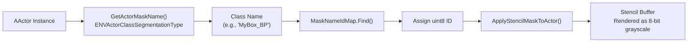
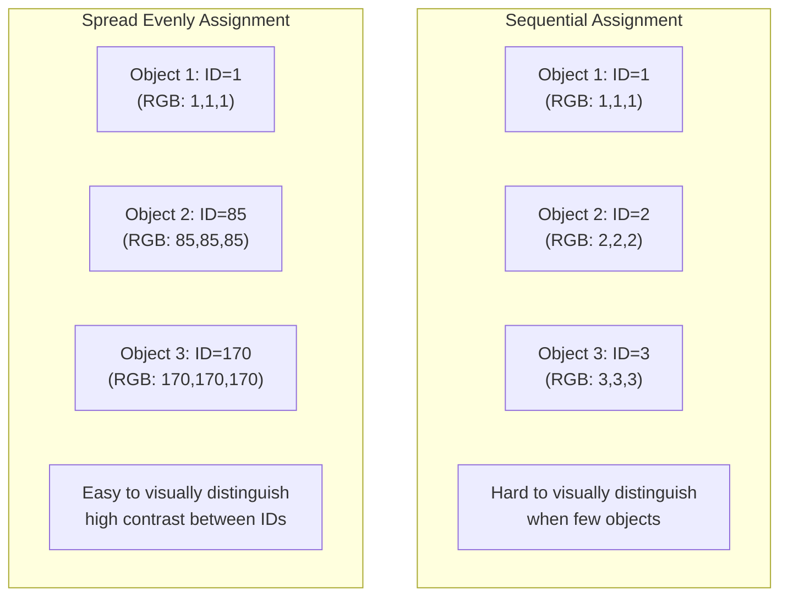
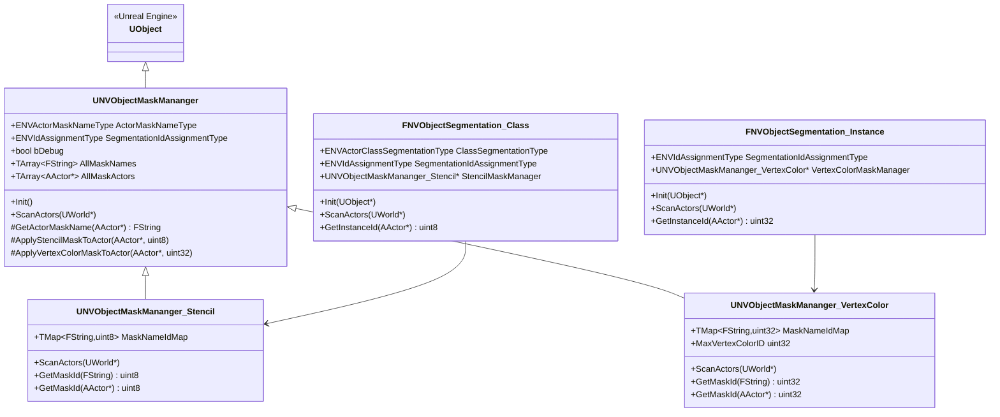
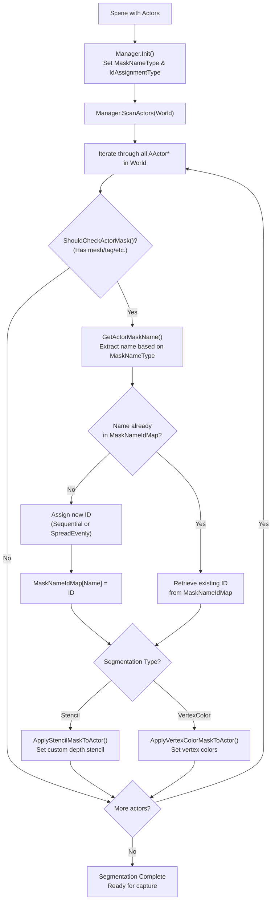

<!-- source: DeepWiki mcp.deepwiki.com · repo NVIDIA/Dataset_Synthesizer · page 6.2 Segmentation Strategies · fetched 2026-10-26 -->

# Segmentation Strategies

<details>
<summary>Relevant source files</summary>

The following files were used as context for generating this wiki page:

- [Documentation/ClassDetails/_n_v_object_mask_manager_8h_source.html](Documentation/ClassDetails/_n_v_object_mask_manager_8h_source.html)

</details>


This page documents the two primary segmentation strategies used for generating semantic and instance segmentation masks: **stencil-based class segmentation** (8-bit) and **vertex-color instance segmentation** (32-bit). These strategies determine how actors in the scene are assigned unique identifiers that are encoded in the exported mask images.

For information about the base object mask management system and ID assignment to actors, see [Object Mask Manager](#6.1). For details on the data export pipeline that writes these masks to disk, see [Data Export](#7).

## Overview of Segmentation Approaches

The NDDS system provides two distinct segmentation strategies, each optimized for different use cases:

| Strategy | Implementation Class | ID Type | Max Objects | Primary Use Case |
|----------|---------------------|---------|-------------|------------------|
| **Class Segmentation** | `UNVObjectMaskMananger_Stencil` | `uint8` | 255 | Semantic segmentation where all instances of the same class share an ID |
| **Instance Segmentation** | `UNVObjectMaskMananger_VertexColor` | `uint32` | 16,777,215 | Instance segmentation where each object gets a unique ID |

**Sources:** [UEModules/Plugins/NVSceneCapturer/Source/NVSceneCapturer/public/NVObjectMaskManager.h:111-152]()

## Segmentation Type Comparison



**Sources:** [UEModules/Plugins/NVSceneCapturer/Source/NVSceneCapturer/public/NVObjectMaskManager.h:72-152]()

## Class Segmentation (Stencil-Based)

Class segmentation uses the GPU's **stencil buffer** to assign an 8-bit ID (0-255) to each object class. All instances of the same class receive the same segmentation ID, making this approach suitable for semantic segmentation tasks where the goal is to identify object categories rather than individual instances.

### Implementation Details

The `UNVObjectMaskMananger_Stencil` class implements class segmentation through the following mechanism:

- **ID Range:** 8-bit unsigned integer (0-255)
- **ID 0 Reserved:** Actors with mask ID 0 are ignored and not included in segmentation
- **Storage:** `TMap<FString, uint8> MaskNameIdMap` maps class names to IDs
- **Application:** IDs are written to the stencil buffer via `ApplyStencilMaskToActor()`



**Sources:** [UEModules/Plugins/NVSceneCapturer/Source/NVSceneCapturer/public/NVObjectMaskManager.h:111-130]()

### Class Name Derivation

The `ENVActorClassSegmentationType` enum defines how class names are extracted from actors:

| Derivation Strategy | Enum Value | Description | Example |
|---------------------|------------|-------------|---------|
| **Actor Mesh Name** | `UseActorMeshName` | Uses the first valid mesh component's name | `"SM_Cube"` |
| **Actor Tag** | `UseActorTag` | Uses the first tag in the actor's Tags array | `"TrainingObject"` |
| **Actor Class Name** | `UseActorClassName` | Uses the C++ or Blueprint class name | `"BP_MyBox_C"` |

**Sources:** [UEModules/Plugins/NVSceneCapturer/Source/NVSceneCapturer/public/NVObjectMaskManager.h:178-196]()

### FNVObjectSegmentation_Class Structure

The `FNVObjectSegmentation_Class` struct encapsulates class segmentation configuration:

```cpp
struct FNVObjectSegmentation_Class
{
    ENVActorClassSegmentationType ClassSegmentationType;  // How to derive class name
    ENVIdAssignmentType SegmentationIdAssignmentType;     // Sequential or spread evenly
    UNVObjectMaskMananger_Stencil* StencilMaskManager;   // Transient manager instance
}
```

**Sources:** [UEModules/Plugins/NVSceneCapturer/Source/NVSceneCapturer/public/NVObjectMaskManager.h:198-222]()

## Instance Segmentation (Vertex-Color Based)

Instance segmentation uses **vertex color data** to assign a 32-bit ID to each individual object instance. This approach can handle millions of unique objects, making it suitable for instance segmentation tasks where every object needs a unique identifier.

### Implementation Details

The `UNVObjectMaskMananger_VertexColor` class implements instance segmentation:

- **ID Range:** 32-bit unsigned integer (0-16,777,215)
- **ID 0 Reserved:** Actors with mask ID 0 are ignored
- **Storage:** `TMap<FString, uint32> MaskNameIdMap` maps instance names to IDs
- **Application:** IDs are encoded in vertex color via `ApplyVertexColorMaskToActor()`
- **Maximum:** `MaxVertexColorID` constant defines the upper limit

```mermaid
flowchart LR
    Actor["AActor Instance"]
    GetName["GetActorMaskName()<br/>ENVActorMaskNameType::UseActorInstanceName"]
    InstName["Instance Name<br/>(e.g., 'Box_42')"]
    MapLookup["MaskNameIdMap.Find()"]
    AssignID["Assign uint32 ID"]
    ApplyVertex["ApplyVertexColorMaskToActor()"]
    VertexColor["Vertex Color Buffer<br/>Rendered as RGBA8"]
    
    Actor --> GetName
    GetName --> InstName
    InstName --> MapLookup
    MapLookup --> AssignID
    AssignID --> ApplyVertex
    ApplyVertex --> VertexColor
```



**Sources:** [UEModules/Plugins/NVSceneCapturer/Source/NVSceneCapturer/public/NVObjectMaskManager.h:132-152]()

### Instance Name Derivation

The `ENVActorMaskNameType` enum defines how instance names are extracted:

| Derivation Strategy | Enum Value | Description | Recommended For |
|---------------------|------------|-------------|-----------------|
| **Actor Instance Name** | `UseActorInstanceName` | Uses unique actor name in the scene | **Instance segmentation only** (creates unique ID per actor) |
| **Actor Mesh Name** | `UseActorMeshName` | Uses the first valid mesh component's name | Class-like grouping by mesh |
| **Actor Tag** | `UseActorTag` | Uses the first tag in the actor's Tags array | Custom grouping |
| **Actor Class Name** | `UseActorClassName` | Uses the C++ or Blueprint class name | Class-like grouping by type |

**Important:** For true instance segmentation, use `UseActorInstanceName` since each actor in Unreal Engine has a unique instance name. Other strategies may cause multiple actors to share the same ID.

**Sources:** [UEModules/Plugins/NVSceneCapturer/Source/NVSceneCapturer/public/NVObjectMaskManager.h:16-41]()

### FNVObjectSegmentation_Instance Structure

The `FNVObjectSegmentation_Instance` struct encapsulates instance segmentation configuration:

```cpp
struct FNVObjectSegmentation_Instance
{
    ENVIdAssignmentType SegmentationIdAssignmentType;           // Sequential or spread evenly
    UNVObjectMaskMananger_VertexColor* VertexColorMaskManager;  // Transient manager instance
}
```

**Sources:** [UEModules/Plugins/NVSceneCapturer/Source/NVSceneCapturer/public/NVObjectMaskManager.h:154-176]()

## ID Assignment Strategies

Both segmentation types support two ID assignment strategies via the `ENVIdAssignmentType` enum:

### Sequential Assignment

IDs are assigned sequentially starting from 1 (0 is reserved for ignored actors):
- **First object:** ID = 1
- **Second object:** ID = 2
- **Third object:** ID = 3
- etc.

This strategy is easier to debug and allows manual ID assignment by simply incrementing from the maximum ID.

### Spread Evenly Assignment

IDs are distributed evenly across the available range to maximize visual contrast in exported mask images:

**Formula:** `ID = (ObjectIndex * MaxMaskValue) / NumberOfMasks`

For example, with 3 objects and 8-bit stencil (max 255):
- **First object:** ID = (0 × 255) / 3 = 0 → adjusted to 1
- **Second object:** ID = (1 × 255) / 3 = 85
- **Third object:** ID = (2 × 255) / 3 = 170

This creates visually distinct grayscale values, making it easier to inspect segmentation masks during development.



**Sources:** [UEModules/Plugins/NVSceneCapturer/Source/NVSceneCapturer/public/NVObjectMaskManager.h:43-66]()

## Class Hierarchy



**Sources:** [UEModules/Plugins/NVSceneCapturer/Source/NVSceneCapturer/public/NVObjectMaskManager.h:72-222]()

## Segmentation Workflow

The complete workflow from actor scanning to mask application:



**Sources:** [UEModules/Plugins/NVSceneCapturer/Source/NVSceneCapturer/public/NVObjectMaskManager.h:79-90]()

## Choosing the Right Strategy

| Requirement | Recommended Strategy | Rationale |
|-------------|---------------------|-----------|
| Semantic segmentation (distinguish object classes) | **Stencil (Class)** | All instances of same class share ID; limited to 255 classes is usually sufficient |
| Instance segmentation (distinguish individual objects) | **Vertex Color (Instance)** | Each object gets unique ID; supports millions of instances |
| Small number of objects (<100) | Either, but **Stencil** is more efficient | Stencil is faster to render and process |
| Large number of objects (>255) | **Vertex Color (Instance)** | Stencil limited to 255 unique IDs |
| Need to visualize masks during development | Either with **SpreadEvenly** ID assignment | Maximizes visual contrast in exported images |
| Production dataset generation | Either with **Sequential** ID assignment | Simpler ID scheme, easier to debug |

**Sources:** [UEModules/Plugins/NVSceneCapturer/Source/NVSceneCapturer/public/NVObjectMaskManager.h:43-66, 111-152]()

## Integration with Scene Capture

Both segmentation strategies integrate with the scene capture system:

1. **Mask managers** scan the scene and assign IDs to actors
2. **Scene capture components** (see [Scene Capture Component](#5.2)) render the scene with custom depth/stencil or vertex color post-processing
3. **Image exporters** (see [Image Export System](#7.1)) write the mask buffers to disk as PNG images
4. **JSON annotations** include the mask name to ID mappings for downstream processing

The mask ID mappings are accessible via `GetMaskId()` methods on both `UNVObjectMaskMananger_Stencil` and `UNVObjectMaskMananger_VertexColor`, allowing other systems to query the ID assigned to a specific actor or mask name.

**Sources:** [UEModules/Plugins/NVSceneCapturer/Source/NVSceneCapturer/public/NVObjectMaskManager.h:123-145]()

---

