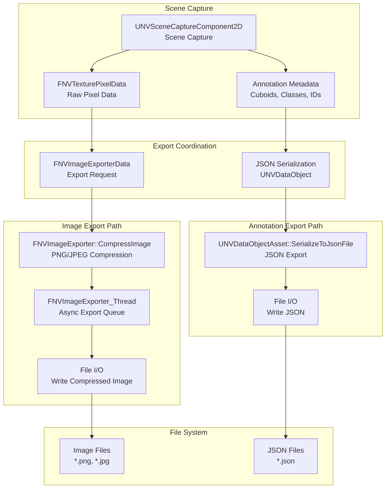
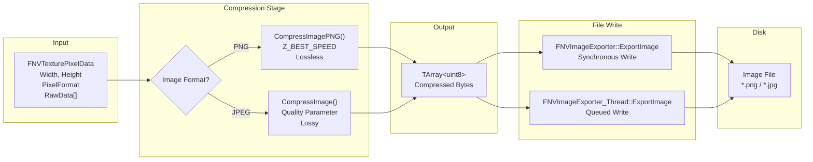
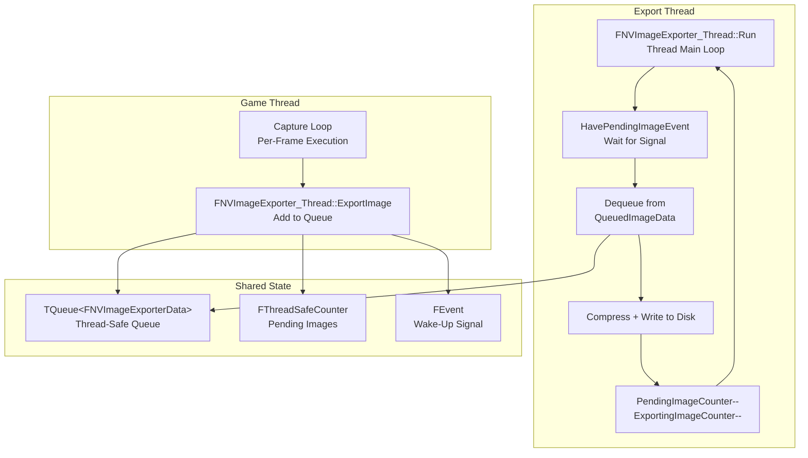
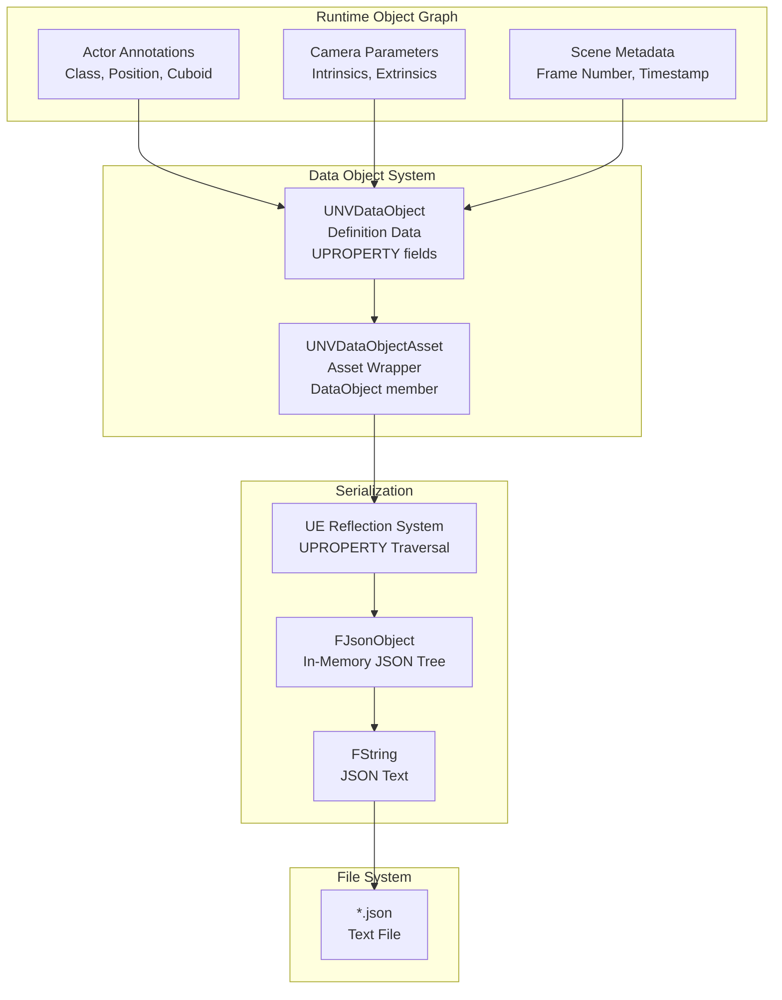
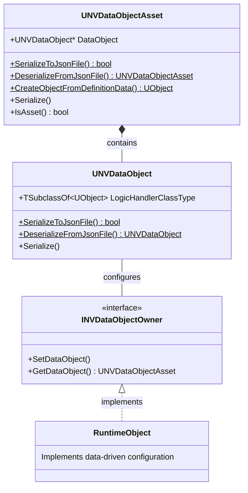
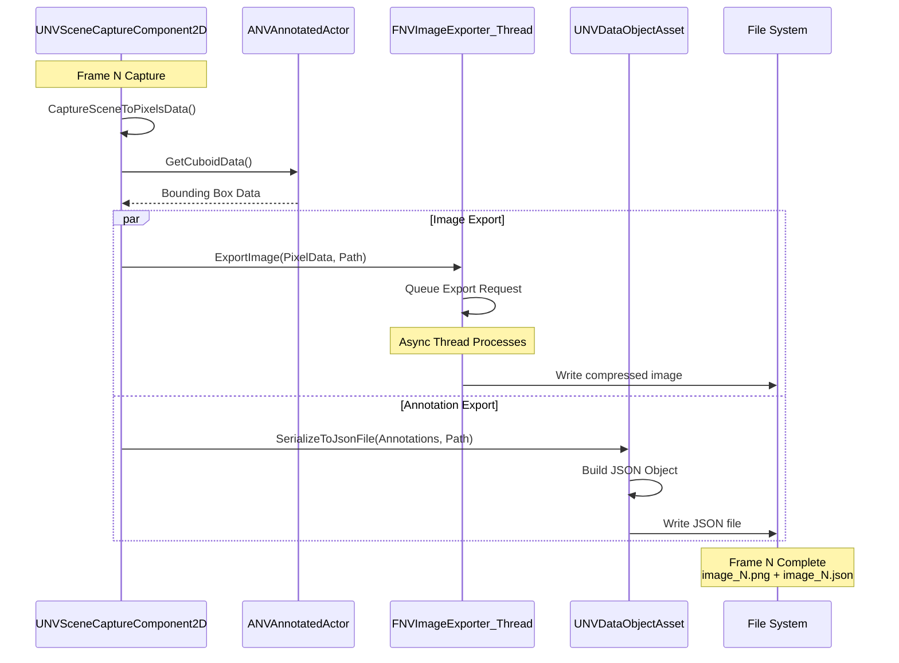

<!-- source: DeepWiki mcp.deepwiki.com · repo NVIDIA/Dataset_Synthesizer · page 7 Data Export · fetched 2026-10-26 -->

# Data Export

<details>
<summary>Relevant source files</summary>

The following files were used as context for generating this wiki page:

- [Documentation/ClassDetails/_n_v_data_object_8h_source.html](Documentation/ClassDetails/_n_v_data_object_8h_source.html)
- [Documentation/ClassDetails/_n_v_image_exporter_8h_source.html](Documentation/ClassDetails/_n_v_image_exporter_8h_source.html)

</details>


## Purpose and Scope

This document describes the complete data export pipeline in NDDS, covering how captured scene data is written to the file system. The export system handles two primary data types: rendered images (RGB, depth, segmentation masks) and JSON-based annotations (bounding boxes, camera parameters, object metadata).

For detailed information on image compression and asynchronous file writing, see [Image Export System](#7.1). For JSON serialization of configuration and annotation data, see [Data Object Serialization](#7.2).

## Export Pipeline Overview

The data export system transforms in-memory captured data into persistent files on disk. The pipeline involves two parallel paths: image data export and annotation data export.



**Sources:** [Documentation/ClassDetails/_n_v_image_exporter_8h_source.html:19-99](), [Documentation/ClassDetails/_n_v_data_object_8h_source.html:22-91]()

## Export Data Flow

The export system processes captured data through distinct stages, each handled by specialized components.

### Image Export Components

| Component | Purpose | Key Methods |
|-----------|---------|-------------|
| `FNVImageExporterData` | Encapsulates export request data | Constructor with pixel data, file path, format |
| `FNVImageExporter` | Synchronous image compression | `CompressImagePNG()`, `CompressImage()`, `ExportImage()` |
| `FNVImageExporter_Thread` | Asynchronous file I/O | `ExportImage()`, `Run()`, `GetPendingImagesCount()` |

**Sources:** [Documentation/ClassDetails/_n_v_image_exporter_8h_source.html:19-99]()

### JSON Export Components

| Component | Purpose | Key Methods |
|-----------|---------|-------------|
| `UNVDataObjectAsset` | Wrapper for serializable data | `SerializeToJsonFile()`, `DeserializeFromJsonFile()` |
| `UNVDataObject` | Core data definition | `Serialize()`, contains `LogicHandlerClassType` |
| `INVDataObjectOwner` | Interface for data-driven objects | `SetDataObject()`, `GetDataObject()` |

**Sources:** [Documentation/ClassDetails/_n_v_data_object_8h_source.html:22-91]()

## Image Export Process

The image export process transforms raw pixel data from render targets into compressed image files on disk. The system supports multiple image formats and uses asynchronous I/O to prevent frame drops during capture.



**Sources:** [Documentation/ClassDetails/_n_v_image_exporter_8h_source.html:40-99]()

### Compression Methods

The `FNVImageExporter` class provides static compression methods that can be called without instantiation:

- **`CompressImagePNG()`** [Documentation/ClassDetails/_n_v_image_exporter_8h_source.html:50](): Lossless PNG compression using `Z_BEST_SPEED` setting. Always produces bit-perfect output but with faster compression at the expense of larger file sizes compared to maximum compression.

- **`CompressImage()`** [Documentation/ClassDetails/_n_v_image_exporter_8h_source.html:58-61](): Generic compression supporting multiple formats (PNG, JPEG, etc.) with configurable quality parameter (0-100). JPEG compression trades quality for file size.

### Export Request Structure

The `FNVImageExporterData` struct [Documentation/ClassDetails/_n_v_image_exporter_8h_source.html:19-38]() packages all information needed for an export operation:

```
FNVImageExporterData
├── PixelDataToBeExported (FNVTexturePixelData)
├── ExportFilePath (FString)
└── ExportImageFormat (ENVImageFormat)
```

This structure is created when initiating an export and can be passed to either synchronous or asynchronous export paths.

**Sources:** [Documentation/ClassDetails/_n_v_image_exporter_8h_source.html:19-38]()

## Asynchronous Export Architecture

To prevent disk I/O from blocking the game thread and causing frame drops, NDDS uses a dedicated export thread that processes images from a queue.



**Sources:** [Documentation/ClassDetails/_n_v_image_exporter_8h_source.html:72-99]()

### Thread Synchronization Mechanism

The `FNVImageExporter_Thread` class [Documentation/ClassDetails/_n_v_image_exporter_8h_source.html:72-99]() uses several synchronization primitives:

- **`QueuedImageData`** [Documentation/ClassDetails/_n_v_image_exporter_8h_source.html:92](): Thread-safe queue (`TQueue`) holding export requests. The game thread enqueues, the export thread dequeues.

- **`HavePendingImageEvent`** [Documentation/ClassDetails/_n_v_image_exporter_8h_source.html:96](): Event object that wakes the export thread when new data arrives. Prevents busy-waiting and reduces CPU usage.

- **`PendingImageCounter`** [Documentation/ClassDetails/_n_v_image_exporter_8h_source.html:97](): Atomic counter tracking queued images. Used by `GetPendingImagesCount()` [Documentation/ClassDetails/_n_v_image_exporter_8h_source.html:85]() for monitoring.

- **`ExportingImageCounterPtr`** [Documentation/ClassDetails/_n_v_image_exporter_8h_source.html:98](): Shared pointer to atomic counter indicating active export operations. Used by `IsExportingImage()` [Documentation/ClassDetails/_n_v_image_exporter_8h_source.html:86]().

This architecture ensures that the game thread never blocks on disk I/O, maintaining consistent frame rates during dataset capture.

**Sources:** [Documentation/ClassDetails/_n_v_image_exporter_8h_source.html:88-98]()

## JSON Annotation Export

Scene annotations (bounding boxes, object classes, camera parameters, etc.) are exported as JSON files alongside the captured images. The system uses Unreal Engine's reflection system (UPROPERTY) to automatically serialize C++ structures to JSON.



**Sources:** [Documentation/ClassDetails/_n_v_data_object_8h_source.html:22-91]()

### Serialization API

The `UNVDataObjectAsset` class [Documentation/ClassDetails/_n_v_data_object_8h_source.html:22-55]() provides static methods for JSON export and import:

- **`SerializeToJsonFile()`** [Documentation/ClassDetails/_n_v_data_object_8h_source.html:29](): Writes a `UNVDataObjectAsset` instance to a JSON file at the specified path. Returns `bool` indicating success.

- **`DeserializeFromJsonFile()`** [Documentation/ClassDetails/_n_v_data_object_8h_source.html:30](): Reads a JSON file and constructs a `UNVDataObjectAsset` instance. Requires parent object, name, and flags for Unreal's object system.

- **`DeserializeFromJsonString()`** [Documentation/ClassDetails/_n_v_data_object_8h_source.html:31](): Similar to file deserialization but accepts JSON as an in-memory string.

These methods utilize Unreal Engine's `FJsonSerializer` to automatically convert UPROPERTY-marked fields to and from JSON format.

**Sources:** [Documentation/ClassDetails/_n_v_data_object_8h_source.html:29-31]()

### Data Object Hierarchy

The data object system uses a two-tier structure:



- **`UNVDataObjectAsset`** [Documentation/ClassDetails/_n_v_data_object_8h_source.html:22](): Asset-level wrapper that can be saved as a `.uasset` file or serialized to JSON. Contains a `DataObject` member [Documentation/ClassDetails/_n_v_data_object_8h_source.html:45]().

- **`UNVDataObject`** [Documentation/ClassDetails/_n_v_data_object_8h_source.html:58](): Core data definition with a `LogicHandlerClassType` field [Documentation/ClassDetails/_n_v_data_object_8h_source.html:75]() that specifies which runtime class to instantiate.

- **`INVDataObjectOwner`** [Documentation/ClassDetails/_n_v_data_object_8h_source.html:84](): Interface for objects that can be configured via data assets. Provides `SetDataObject()` and `GetDataObject()` methods [Documentation/ClassDetails/_n_v_data_object_8h_source.html:89-90]().

**Sources:** [Documentation/ClassDetails/_n_v_data_object_8h_source.html:22-91]()

## Export Coordination

The complete export process coordinates image and annotation export to ensure consistency between visual data and metadata.



**Sources:** [Documentation/ClassDetails/_n_v_image_exporter_8h_source.html:72-99](), [Documentation/ClassDetails/_n_v_data_object_8h_source.html:29]()

### File Naming Convention

Typical output structure pairs each image with a corresponding JSON file:

```
output_directory/
├── rgb_0000.png
├── rgb_0000.json
├── depth_0000.png
├── depth_0000.json
├── segmentation_0000.png
├── segmentation_0000.json
├── rgb_0001.png
├── rgb_0001.json
...
```

The JSON files contain frame-specific metadata such as camera pose, object locations, class labels, and bounding box coordinates that correspond to the objects visible in the associated image.

## Thread Safety Considerations

The export system must handle concurrent access from multiple threads:

| Scenario | Mechanism | Location |
|----------|-----------|----------|
| Game thread enqueues export | `TQueue` (lock-free) | [Documentation/ClassDetails/_n_v_image_exporter_8h_source.html:92]() |
| Export thread dequeues data | `TQueue` (lock-free) | [Documentation/ClassDetails/_n_v_image_exporter_8h_source.html:92]() |
| Counter updates | `FThreadSafeCounter` (atomic) | [Documentation/ClassDetails/_n_v_image_exporter_8h_source.html:97]() |
| Thread wake-up | `FEvent` (OS primitive) | [Documentation/ClassDetails/_n_v_image_exporter_8h_source.html:96]() |

The `FNVImageExporter_Thread::Run()` method [Documentation/ClassDetails/_n_v_image_exporter_8h_source.html:82]() implements the export thread's main loop, which continuously:

1. Waits on `HavePendingImageEvent` for new data
2. Dequeues from `QueuedImageData`
3. Calls `FNVImageExporter::ExportImage()` to compress and write
4. Decrements `PendingImageCounter`
5. Returns to step 1

This loop runs until `Stop()` [Documentation/ClassDetails/_n_v_image_exporter_8h_source.html:83]() is called, which sets `bIsRunning` to false [Documentation/ClassDetails/_n_v_image_exporter_8h_source.html:90]().

**Sources:** [Documentation/ClassDetails/_n_v_image_exporter_8h_source.html:82-90]()

## Summary

The NDDS data export pipeline provides a robust system for persisting synthetic dataset captures to disk:

- **Dual-path export**: Images and JSON annotations are exported in parallel
- **Asynchronous I/O**: Dedicated export thread prevents frame drops during high-throughput capture
- **Format flexibility**: Supports PNG (lossless) and JPEG (lossy) with configurable quality
- **Data-driven configuration**: JSON serialization enables external tools to read and modify capture parameters
- **Thread-safe design**: Lock-free queues and atomic counters enable safe concurrent access

For implementation details on image compression and threading, see [Image Export System](#7.1). For JSON schema and serialization internals, see [Data Object Serialization](#7.2).

---

