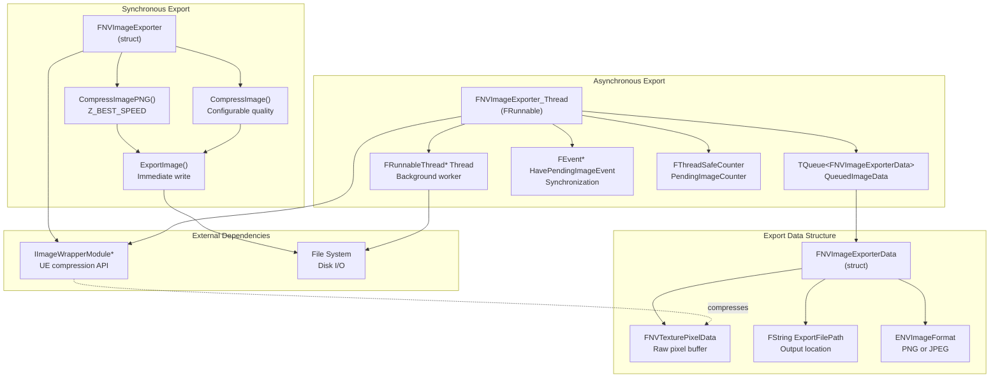
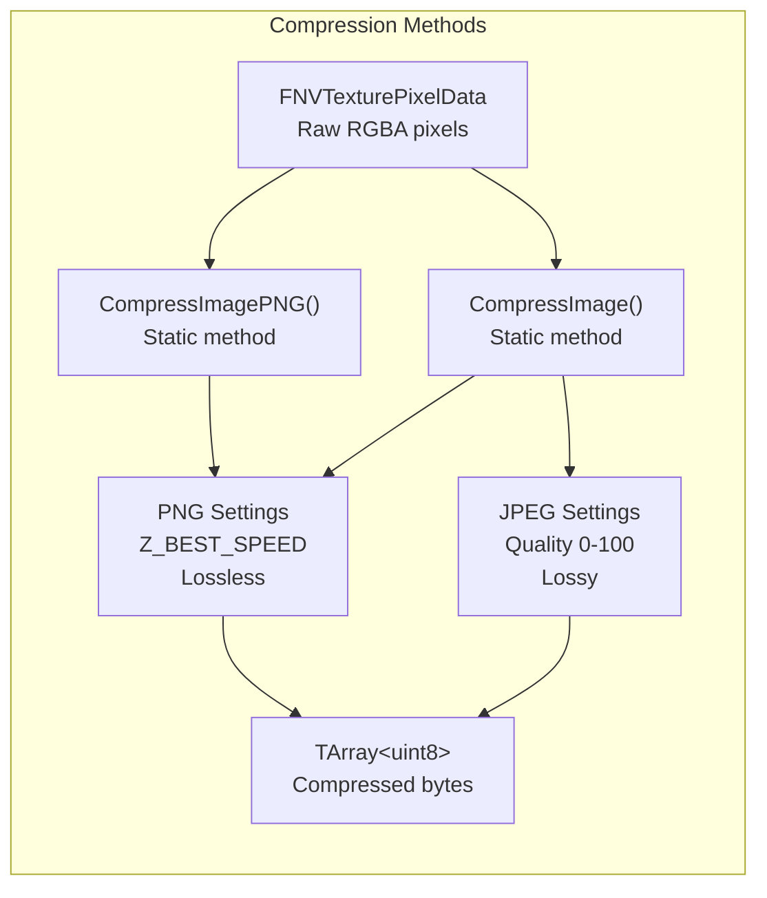
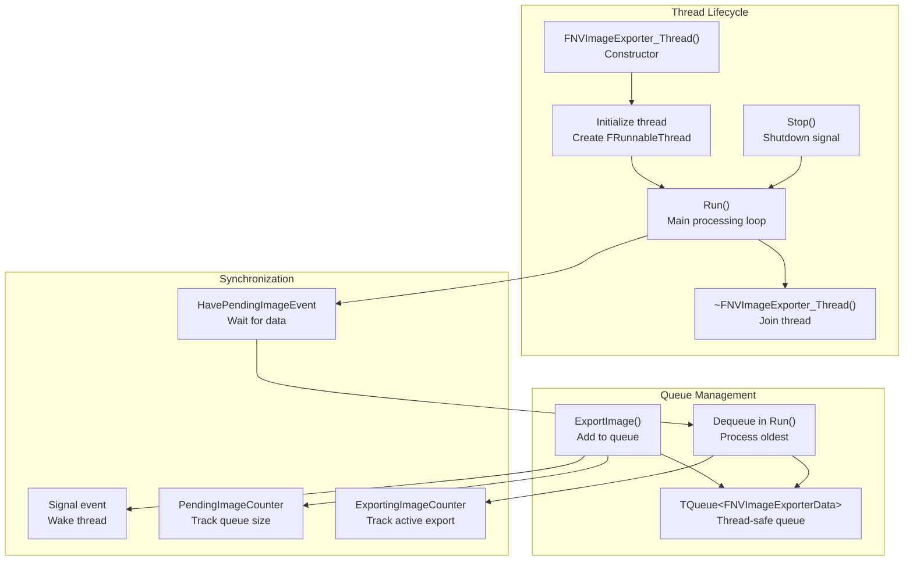

<!-- source: DeepWiki mcp.deepwiki.com · repo NVIDIA/Dataset_Synthesizer · page 7.1 Image Export System · fetched 2026-10-26 -->

# Image Export System

<details>
<summary>Relevant source files</summary>

The following files were used as context for generating this wiki page:

- [Documentation/ClassDetails/_n_v_image_exporter_8h_source.html](Documentation/ClassDetails/_n_v_image_exporter_8h_source.html)

</details>


## Purpose and Scope

The Image Export System handles the compression and writing of captured scene images to disk. It provides both synchronous and asynchronous export capabilities to prevent performance degradation during dataset generation. This system receives pixel data from the scene capture pipeline and outputs compressed image files (PNG or JPEG) to the file system.

For information about how pixel data is captured from render targets, see [Scene Capture Component](#5.2). For details on JSON annotation export, see [Data Object Serialization](#7.2).

---

## Architecture Overview

The image export system consists of three primary components that work together to transform in-memory pixel data into compressed image files on disk.



**Sources:** [UEModules/Plugins/NVSceneCapturer/Source/NVSceneCapturer/public/NVImageExporter.h:19-99]()

---

## Export Data Structure

### FNVImageExporterData

The `FNVImageExporterData` struct encapsulates all information needed to export a single image. It serves as the container for transferring export requests from the game thread to the background export thread.

| Member | Type | Description |
|--------|------|-------------|
| `PixelDataToBeExported` | `FNVTexturePixelData` | Raw pixel data captured from render target |
| `ExportFilePath` | `FString` | Full file path where image should be written |
| `ExportImageFormat` | `ENVImageFormat` | Target image format (PNG or JPEG) |

This structure is USTRUCT-marked and uses UPROPERTY macros for Unreal Engine's reflection system, enabling serialization and garbage collection support.

**Sources:** [UEModules/Plugins/NVSceneCapturer/Source/NVSceneCapturer/public/NVImageExporter.h:19-38]()

---

## Image Compression

### FNVImageExporter

The `FNVImageExporter` struct provides static and instance methods for compressing pixel data into various image formats. It wraps Unreal Engine's `IImageWrapperModule` to provide a simplified interface for dataset export.



### Compression Methods

#### CompressImagePNG()

```cpp
static TArray<uint8> CompressImagePNG(const FNVTexturePixelData& SourcePixelData)
```

Compresses pixel data to PNG format using `Z_BEST_SPEED` compression level. PNG is lossless, so quality cannot be adjusted. This method prioritizes speed over file size, which is appropriate for real-time dataset generation.

**Note:** The compression level is hardcoded to `Z_BEST_SPEED` and cannot be customized in the current implementation.

**Sources:** [UEModules/Plugins/NVSceneCapturer/Source/NVSceneCapturer/public/NVImageExporter.h:46-50]()

#### CompressImage()

```cpp
static TArray<uint8> CompressImage(
    IImageWrapperModule* ImageWrapperModule,
    const FNVTexturePixelData& SourcePixelData,
    ENVImageFormat ImageFormat,
    uint8 CompressionQuality = 100
)
```

Generic compression method that supports multiple image formats. The `CompressionQuality` parameter (0-100) affects JPEG compression but is ignored for PNG.

**Parameters:**
- `ImageWrapperModule`: Reference to UE's image compression module
- `SourcePixelData`: Raw pixel data to compress
- `ImageFormat`: Target format (PNG or JPEG)
- `CompressionQuality`: JPEG quality level (default: 100, maximum quality)

**Sources:** [UEModules/Plugins/NVSceneCapturer/Source/NVSceneCapturer/public/NVImageExporter.h:52-61]()

#### ExportImage()

```cpp
static bool ExportImage(
    IImageWrapperModule* ImageWrapperModule,
    const FNVImageExporterData& ImageExporterData
)
```

Synchronously compresses and writes an image to disk. This method blocks the calling thread until the file operation completes, which can cause frame rate drops if used on the game thread.

**Sources:** [UEModules/Plugins/NVSceneCapturer/Source/NVSceneCapturer/public/NVImageExporter.h:63-66]()

---

## Asynchronous Export Thread

### FNVImageExporter_Thread

The `FNVImageExporter_Thread` class implements asynchronous image export to prevent disk I/O operations from blocking the game thread. It inherits from `FRunnable` to execute on a dedicated background thread.



### Thread Members

| Member | Type | Purpose |
|--------|------|---------|
| `Thread` | `FRunnableThread*` | Handle to the background thread |
| `bIsRunning` | `bool` | Controls the main loop execution |
| `QueuedImageData` | `TQueue<FNVImageExporterData>` | Thread-safe FIFO queue of pending exports |
| `ImageWrapperModule` | `IImageWrapperModule*` | Compression module instance |
| `HavePendingImageEvent` | `FEvent*` | Event for signaling new data availability |
| `PendingImageCounter` | `FThreadSafeCounter` | Atomic counter for queued images |
| `ExportingImageCounterPtr` | `TSharedPtr<FThreadSafeCounter>` | Atomic counter for active exports |

**Sources:** [UEModules/Plugins/NVSceneCapturer/Source/NVSceneCapturer/public/NVImageExporter.h:88-98]()

### Thread Methods

#### ExportImage()

```cpp
bool ExportImage(
    const FNVTexturePixelData& ExportPixelData,
    const FString& ExportFilePath,
    const ENVImageFormat ExportImageFormat = ENVImageFormat::PNG
)
```

Enqueues an image for asynchronous export. This method returns immediately without blocking, allowing the game thread to continue rendering while the export happens in the background.

**Sources:** [UEModules/Plugins/NVSceneCapturer/Source/NVSceneCapturer/public/NVImageExporter.h:78-80]()

#### Run()

```cpp
virtual uint32 Run()
```

Main thread loop that processes queued export requests. This method runs continuously on the background thread, waiting for new data via the `HavePendingImageEvent` and processing exports sequentially.

**Sources:** [UEModules/Plugins/NVSceneCapturer/Source/NVSceneCapturer/public/NVImageExporter.h:82]()

#### GetPendingImagesCount() / IsExportingImage()

```cpp
uint32 GetPendingImagesCount() const
bool IsExportingImage() const
```

Query methods for monitoring export progress. These allow the main thread to check if the background thread is still processing exports, useful for graceful shutdown or progress tracking.

**Sources:** [UEModules/Plugins/NVSceneCapturer/Source/NVSceneCapturer/public/NVImageExporter.h:85-86]()

---

## Export Workflow

The following diagram illustrates the complete data flow from scene capture to file system output, highlighting the interaction between synchronous and asynchronous export paths.

```mermaid
sequenceDiagram
    participant Capture as "UNVSceneCaptureComponent2D"
    participant PixelData as "FNVTexturePixelData"
    participant ExporterData as "FNVImageExporterData"
    participant AsyncThread as "FNVImageExporter_Thread"
    participant Queue as "TQueue"
    participant Compressor as "IImageWrapperModule"
    participant FileSystem as "File System"
    
    Capture->>PixelData: CaptureSceneToPixelsData()
    PixelData->>ExporterData: Create export request
    Note over ExporterData: Contains pixel data<br/>file path, format
    
    ExporterData->>AsyncThread: ExportImage()
    AsyncThread->>Queue: Enqueue data
    AsyncThread->>AsyncThread: Signal HavePendingImageEvent
    Note over AsyncThread: Game thread continues<br/>without blocking
    
    loop Background Processing
        AsyncThread->>Queue: Dequeue oldest
        AsyncThread->>Compressor: CompressImage()
        Note over Compressor: PNG: Z_BEST_SPEED<br/>JPEG: Custom quality
        Compressor-->>AsyncThread: TArray&lt;uint8&gt;
        AsyncThread->>FileSystem: FFileHelper::SaveArrayToFile()
        Note over FileSystem: Write compressed<br/>image to disk
    end
```

### Workflow Steps

1. **Capture**: `UNVSceneCaptureComponent2D` renders the scene and extracts pixel data into `FNVTexturePixelData`

2. **Prepare**: Export data is packaged into `FNVImageExporterData` with destination path and format

3. **Enqueue**: `FNVImageExporter_Thread::ExportImage()` adds the request to the thread-safe queue and signals the background thread

4. **Process**: Background thread dequeues requests sequentially, compresses images via `IImageWrapperModule`, and writes compressed bytes to disk

5. **Complete**: Queue counters are decremented, allowing monitoring of export progress

### Performance Considerations

The asynchronous design prevents disk I/O from blocking frame rendering, which is critical for maintaining stable frame rates during dataset capture. The queue allows burst capturing of multiple frames while the background thread processes them at disk I/O speed.

**PNG Compression Trade-off**: `Z_BEST_SPEED` prioritizes throughput over file size. For archival datasets, consider post-processing with higher compression levels if disk space is constrained.

**Sources:** [UEModules/Plugins/NVSceneCapturer/Source/NVSceneCapturer/public/NVImageExporter.h:19-99]()

---

## Integration with Scene Capture

The image export system is invoked by the scene capture component after pixel data readback completes. The typical usage pattern is:

```cpp
// In UNVSceneCaptureComponent2D (conceptual flow)
FNVTexturePixelData CapturedPixels;
// ... capture scene to pixels ...

FNVImageExporterData ExportData(
    CapturedPixels,
    "/path/to/output/image_0001.png",
    ENVImageFormat::PNG
);

// Asynchronous export (non-blocking)
ImageExporterThread->ExportImage(ExportData);

// OR synchronous export (blocking)
FNVImageExporter::ExportImage(ImageWrapperModule, ExportData);
```

Most dataset generation workflows use the asynchronous path to maintain real-time performance during continuous scene randomization and capture.

**Sources:** [UEModules/Plugins/NVSceneCapturer/Source/NVSceneCapturer/public/NVImageExporter.h:40-99]()

---

