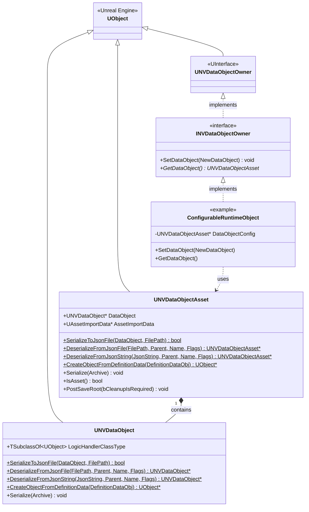
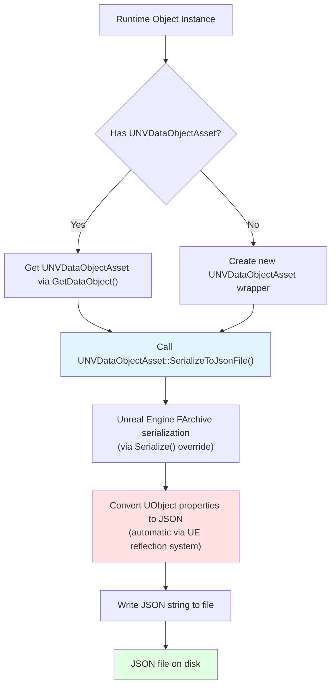
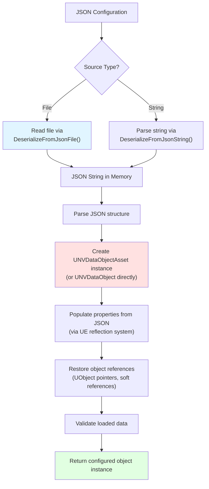
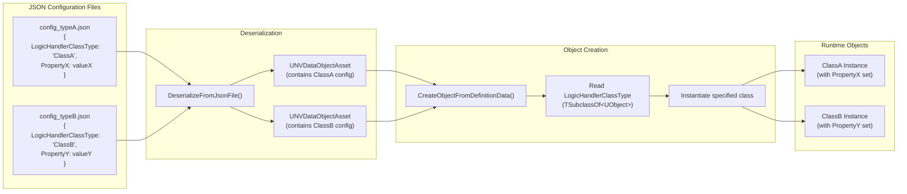
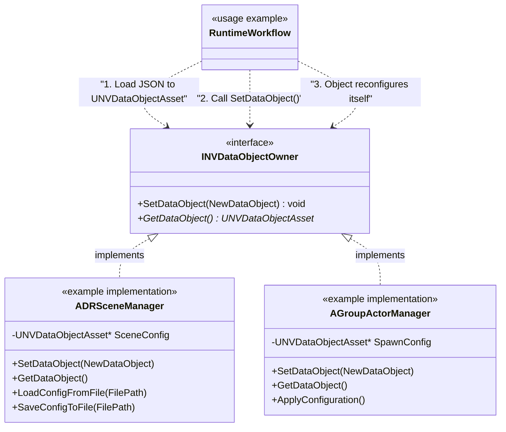
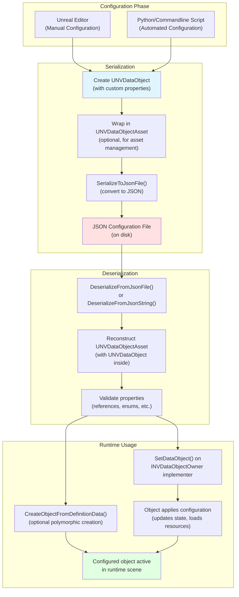

<!-- source: DeepWiki mcp.deepwiki.com · repo NVIDIA/Dataset_Synthesizer · page 7.2 Data Object Serialization · fetched 2026-10-26 -->

# Data Object Serialization

<details>
<summary>Relevant source files</summary>

The following files were used as context for generating this wiki page:

- [Documentation/ClassDetails/_n_v_data_object_8h_source.html](Documentation/ClassDetails/_n_v_data_object_8h_source.html)

</details>


## Purpose and Scope

This page documents the data object serialization system in the NVDataObject module, which enables JSON-based, data-driven configuration for runtime objects. The system provides a standardized pattern for serializing Unreal Engine objects to JSON files and deserializing them back, supporting both static configuration (loaded from files) and polymorphic object creation.

For information about how exported datasets are written to the file system, see [Image Export System](#7.1).

**Sources:** [UEModules/Plugins/NVDataObject/Source/NVDataObject/public/NVDataObject.h:1-91]()

---

## Core Components

The data object serialization system consists of three primary classes that work together to enable JSON-based configuration:

| Class | Role | Key Characteristics |
|-------|------|---------------------|
| `UNVDataObject` | Definition data container | Holds configuration properties; marked as `DefaultToInstanced, editinlinenew` for editor support |
| `UNVDataObjectAsset` | Serializable wrapper | Wraps `UNVDataObject`; provides JSON serialization/deserialization methods; marked as asset (`IsAsset()` returns true) |
| `INVDataObjectOwner` | Configuration interface | Defines contract for objects that can be configured via data objects; provides `SetDataObject()` and `GetDataObject()` methods |

### UNVDataObject

`UNVDataObject` [UEModules/Plugins/NVDataObject/Source/NVDataObject/public/NVDataObject.h:58-76]() is the base class for all data definition objects. It contains:

- **LogicHandlerClassType** [line 75](): A `TSubclassOf<UObject>` that specifies which class should be instantiated when creating an object from this definition data
- **Serialization methods**: Static methods for converting to/from JSON
- **Polymorphism support**: Subclasses can add custom properties that will be automatically serialized

### UNVDataObjectAsset

`UNVDataObjectAsset` [UEModules/Plugins/NVDataObject/Source/NVDataObject/public/NVDataObject.h:22-55]() wraps a `UNVDataObject` and provides:

- **DataObject property** [line 45](): Reference to the contained `UNVDataObject` instance
- **Asset import data** [line 50](): Editor-only metadata for tracking the JSON source file
- **Asset registration**: Overrides `IsAsset()` to return true, making it appear in the Content Browser
- **Post-save hooks** [line 41](): `PostSaveRoot()` for custom save behavior

### INVDataObjectOwner

`INVDataObjectOwner` [UEModules/Plugins/NVDataObject/Source/NVDataObject/public/NVDataObject.h:84-91]() is an interface that defines the contract for objects that can be configured via data objects:

```cpp
virtual void SetDataObject(UNVDataObjectAsset* NewDataObject) = 0;
virtual const UNVDataObjectAsset* GetDataObject() const = 0;
```

**Sources:** [UEModules/Plugins/NVDataObject/Source/NVDataObject/public/NVDataObject.h:22-91]()

---

## Class Structure and Relationships



**Diagram: Data Object Class Hierarchy**

The diagram shows how `UNVDataObjectAsset` wraps `UNVDataObject` to provide serialization capabilities, while `INVDataObjectOwner` defines the interface that runtime objects implement to become data-driven.

**Sources:** [UEModules/Plugins/NVDataObject/Source/NVDataObject/public/NVDataObject.h:22-91]()

---

## Serialization Process

The serialization process converts a `UNVDataObject` or `UNVDataObjectAsset` instance into a JSON representation and writes it to a file.



**Diagram: Serialization Workflow**

### Serialization Method Signatures

Both `UNVDataObject` and `UNVDataObjectAsset` provide static serialization methods:

- `UNVDataObject::SerializeToJsonFile()` [UEModules/Plugins/NVDataObject/Source/NVDataObject/public/NVDataObject.h:65]()
- `UNVDataObjectAsset::SerializeToJsonFile()` [UEModules/Plugins/NVDataObject/Source/NVDataObject/public/NVDataObject.h:29]()

Both methods have the same signature:
```cpp
static bool SerializeToJsonFile(const T* DataObject, const FString& OutputFilePath);
```

The methods leverage Unreal Engine's property reflection system to automatically convert all `UPROPERTY` marked fields into JSON format.

### Custom Serialization

The `Serialize(FArchive& Ar)` method [UEModules/Plugins/NVDataObject/Source/NVDataObject/public/NVDataObject.h:34,70]() is overridden in both classes to provide custom serialization behavior, allowing fine-grained control over what gets serialized and how.

**Sources:** [UEModules/Plugins/NVDataObject/Source/NVDataObject/public/NVDataObject.h:29-34,65-70]()

---

## Deserialization Process

Deserialization reconstructs object instances from JSON data, supporting both file-based and string-based input.



**Diagram: Deserialization Workflow**

### Deserialization Method Signatures

Multiple static methods support different deserialization scenarios:

**File-based deserialization:**
- `UNVDataObject::DeserializeFromJsonFile()` [UEModules/Plugins/NVDataObject/Source/NVDataObject/public/NVDataObject.h:66]()
- `UNVDataObjectAsset::DeserializeFromJsonFile()` [UEModules/Plugins/NVDataObject/Source/NVDataObject/public/NVDataObject.h:30]()

**String-based deserialization:**
- `UNVDataObject::DeserializeFromJsonString()` [UEModules/Plugins/NVDataObject/Source/NVDataObject/public/NVDataObject.h:67]()
- `UNVDataObjectAsset::DeserializeFromJsonString()` [UEModules/Plugins/NVDataObject/Source/NVDataObject/public/NVDataObject.h:31]()

All deserialization methods accept standard Unreal object creation parameters:
```cpp
static T* DeserializeFrom*(const FString& Source, UObject* InParent, 
                           FName InName, EObjectFlags Flags);
```

These parameters control object ownership, naming, and flags (e.g., transient, editor-only).

**Sources:** [UEModules/Plugins/NVDataObject/Source/NVDataObject/public/NVDataObject.h:30-31,66-67]()

---

## Polymorphic Object Creation

The `LogicHandlerClassType` property enables polymorphic object instantiation from data definitions, allowing different runtime object types to be created based on JSON configuration.



**Diagram: Polymorphic Object Creation Flow**

### CreateObjectFromDefinitionData

Both `UNVDataObject` and `UNVDataObjectAsset` provide the static method `CreateObjectFromDefinitionData()`:

- `UNVDataObject::CreateObjectFromDefinitionData()` [UEModules/Plugins/NVDataObject/Source/NVDataObject/public/NVDataObject.h:68]()
- `UNVDataObjectAsset::CreateObjectFromDefinitionData()` [UEModules/Plugins/NVDataObject/Source/NVDataObject/public/NVDataObject.h:32]()

This method:
1. Reads the `LogicHandlerClassType` property [line 75]()
2. Instantiates an object of that class type
3. Configures the new object with properties from the data object

This enables a factory pattern where the class type to instantiate is specified in the JSON configuration rather than hard-coded.

### LogicHandlerClassType Property

The `LogicHandlerClassType` [UEModules/Plugins/NVDataObject/Source/NVDataObject/public/NVDataObject.h:75]() is declared as:

```cpp
TSubclassOf<UObject> LogicHandlerClassType;
```

This property:
- Stores a reference to a UClass (Unreal's type information)
- Can reference any UObject-derived class
- Is serialized to/from JSON as a class name string
- Enables type-safe polymorphism at runtime

**Sources:** [UEModules/Plugins/NVDataObject/Source/NVDataObject/public/NVDataObject.h:32,68,75]()

---

## Data Object Owner Pattern

The `INVDataObjectOwner` interface establishes a standard pattern for objects that can be configured via data objects.



**Diagram: Data Object Owner Pattern Usage**

### Interface Methods

The interface defines two pure virtual methods [UEModules/Plugins/NVDataObject/Source/NVDataObject/public/NVDataObject.h:89-90]():

**SetDataObject()**
```cpp
virtual void SetDataObject(UNVDataObjectAsset* NewDataObject) = 0;
```
- Called to apply a new configuration to the implementing object
- The implementing object should read properties from `NewDataObject->DataObject` and reconfigure itself accordingly
- Typically triggers property updates, resource loading, or behavior changes

**GetDataObject()**
```cpp
virtual const UNVDataObjectAsset* GetDataObject() const = 0;
```
- Returns the currently active data object
- Enables external systems to inspect or serialize the current configuration
- Should return a const pointer to prevent unintended modifications

### Typical Implementation Pattern

Objects implementing `INVDataObjectOwner` typically:

1. **Store a reference** to the current `UNVDataObjectAsset`
2. **Implement SetDataObject()** to:
   - Store the new data object reference
   - Extract configuration values from `DataObject`
   - Apply those values to the object's state
   - Trigger any necessary updates or rebuilds
3. **Implement GetDataObject()** to simply return the stored reference
4. **Provide helper methods** for loading/saving configurations via JSON files

**Sources:** [UEModules/Plugins/NVDataObject/Source/NVDataObject/public/NVDataObject.h:79-91]()

---

## Complete Serialization Lifecycle

This diagram shows the complete lifecycle of a data object from creation through serialization to deserialization and runtime use.



**Diagram: Complete Data Object Lifecycle**

### Editor Integration

When `WITH_EDITORONLY_DATA` is defined, `UNVDataObjectAsset` includes additional editor support:

- **AssetImportData** [UEModules/Plugins/NVDataObject/Source/NVDataObject/public/NVDataObject.h:50](): Tracks the source JSON file for reimport
- **GetAssetRegistryTags()** [line 52](): Provides searchable metadata for the Content Browser
- **PostInitProperties()** [line 53](): Initializes editor-specific data after construction

These features enable seamless integration with Unreal's asset pipeline, allowing JSON configurations to be managed like any other asset type.

**Sources:** [UEModules/Plugins/NVDataObject/Source/NVDataObject/public/NVDataObject.h:22-91]()

---

## Summary

The data object serialization system provides a robust, type-safe mechanism for JSON-based configuration:

| Feature | Implementation | Benefit |
|---------|---------------|---------|
| JSON Serialization | `SerializeToJsonFile()`, `DeserializeFromJsonFile()` | Version-controllable, human-readable configurations |
| Polymorphism | `LogicHandlerClassType` property | Runtime object types determined by configuration |
| Interface Pattern | `INVDataObjectOwner` | Standardized configuration injection across diverse object types |
| Unreal Integration | Asset system, property reflection, editor UI | Seamless integration with existing Unreal workflows |
| Dual Access | Both `UNVDataObject` and `UNVDataObjectAsset` support serialization | Flexibility for asset-based or direct usage |

This system is foundational to NDDS's data-driven architecture, enabling complex scene configurations to be defined, versioned, and reused across different dataset generation scenarios. While this page focused on the serialization infrastructure, the actual export of captured scene data is handled by the image export system documented in [Image Export System](#7.1).

**Sources:** [UEModules/Plugins/NVDataObject/Source/NVDataObject/public/NVDataObject.h:1-91]()

---

