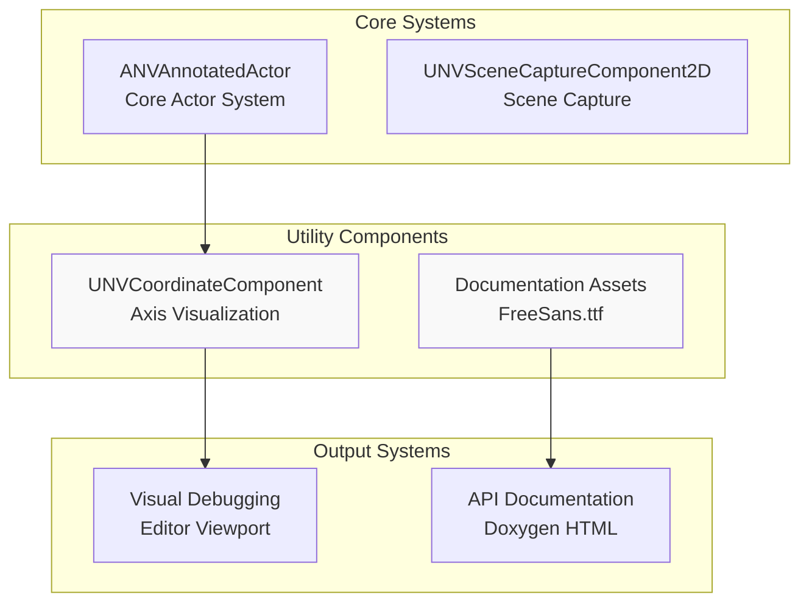
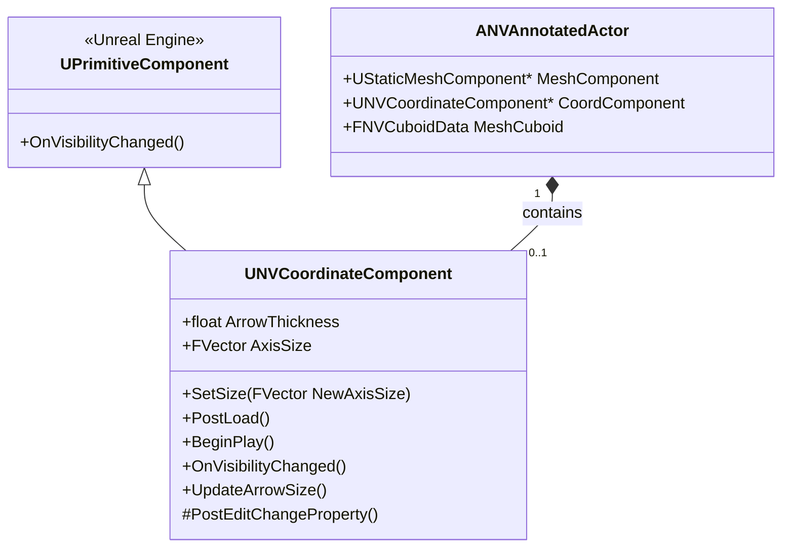
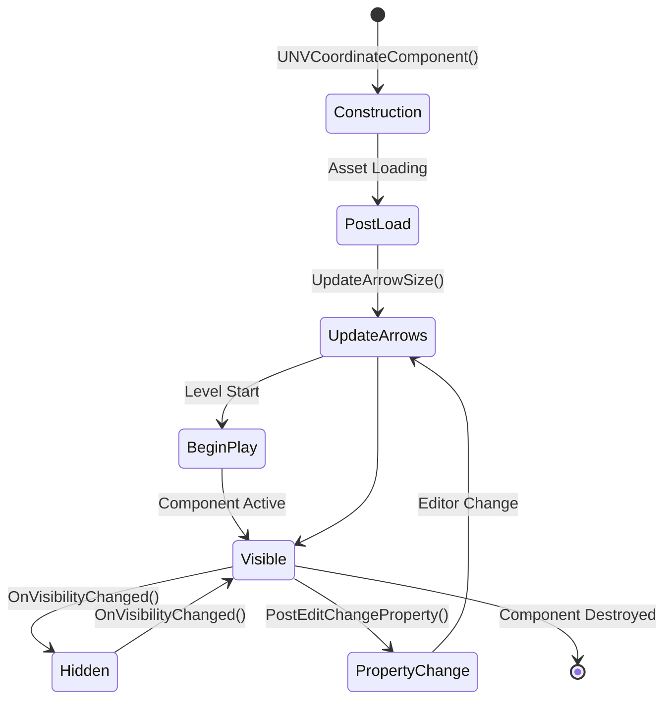
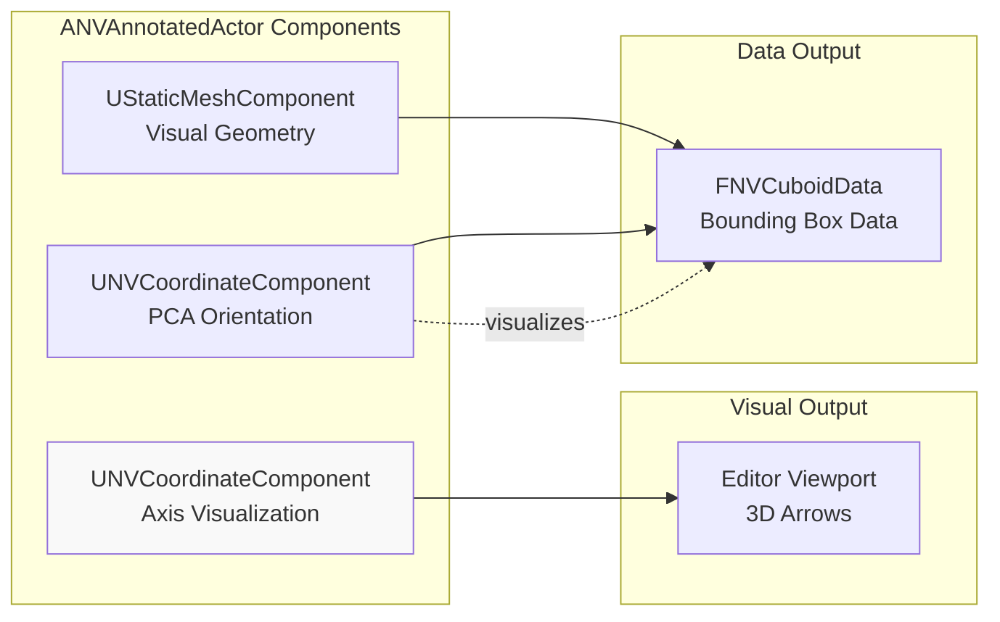
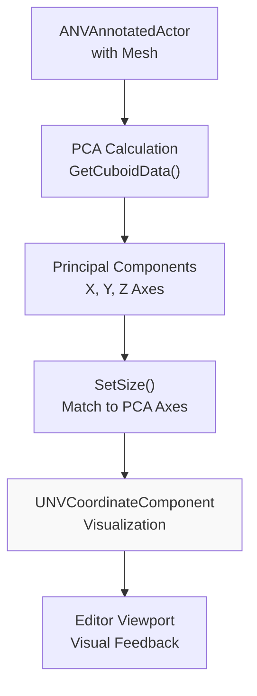
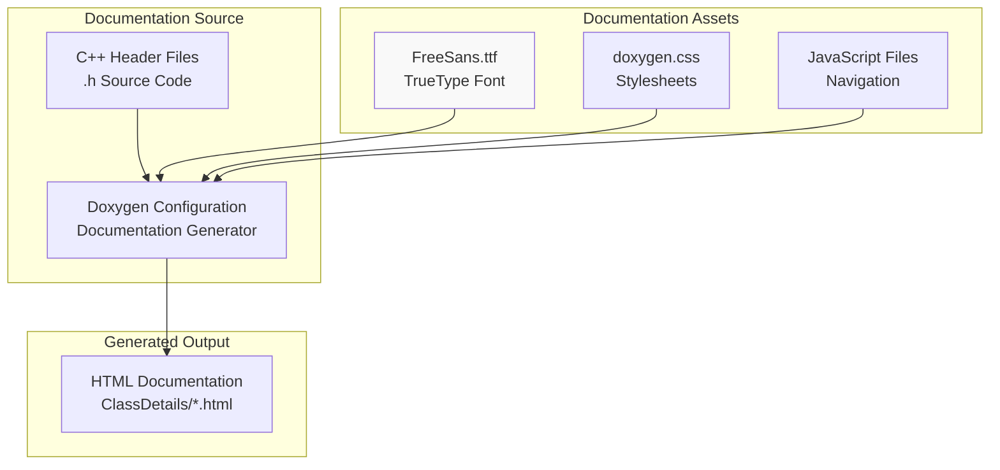
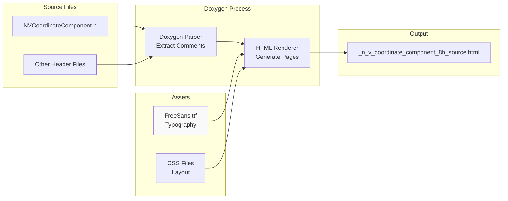

<!-- source: DeepWiki mcp.deepwiki.com · repo NVIDIA/Dataset_Synthesizer · page 8 Utility Components · fetched 2026-10-26 -->

# Utility Components

Relevant source files

The following files were used as context for generating this wiki page:

- [Documentation/ClassDetails/FreeSans.ttf](Documentation/ClassDetails/FreeSans.ttf)
- [Documentation/ClassDetails/_n_v_coordinate_component_8h_source.html](Documentation/ClassDetails/_n_v_coordinate_component_8h_source.html)

This document covers supporting utility components and helper systems in the NDDS codebase that assist with visualization and documentation generation. These components are not part of the core domain randomization or scene capture pipelines, but provide auxiliary functionality for debugging, visualization, and documentation purposes.

The utility components documented here include:
- **Coordinate Visualization**: `UNVCoordinateComponent` for rendering coordinate axes on annotated actors
- **Documentation Resources**: Asset files used in generating API documentation

For information about the core annotated actor system that uses coordinate components, see [Annotated Actors](#5.1). For scene capture functionality, see [Scene Capture Component](#5.2).

---

## Overview of Utility Components

The utility components serve supporting roles in the NDDS system. They are optional components that enhance the user experience during development, debugging, and documentation generation, but are not required for the core dataset synthesis functionality.

**Purpose**: Utility components are segregated from core functionality to maintain clean separation of concerns. The coordinate component provides visual feedback during scene setup, while documentation assets ensure consistent rendering of API documentation.

**Sources**: [Documentation/ClassDetails/_n_v_coordinate_component_8h_source.html:1-155](), [Documentation/ClassDetails/FreeSans.ttf:1-76]()

---

## Coordinate Visualization System

### UNVCoordinateComponent Architecture

`UNVCoordinateComponent` is an Unreal Engine primitive component that renders 3D coordinate axes on actors. It inherits from `UPrimitiveComponent` to leverage Unreal's rendering pipeline for drawing visual elements in the editor viewport.

**Component Properties**:

| Property | Type | Purpose |
|----------|------|---------|
| `ArrowThickness` | `float` | Controls the thickness of rendered axis arrows |
| `AxisSize` | `FVector` | Defines the length of each axis (X, Y, Z) |

**Sources**: [Documentation/ClassDetails/_n_v_coordinate_component_8h_source.html:23-48]()

---

### Component Lifecycle and Behavior

The coordinate component follows Unreal Engine's standard component lifecycle with specialized behavior for axis visualization:

**Key Lifecycle Methods**:

- **`PostLoad()`** [Documentation/ClassDetails/_n_v_coordinate_component_8h_source.html:33](): Called after component is loaded from disk; initializes arrow geometry
- **`BeginPlay()`** [Documentation/ClassDetails/_n_v_coordinate_component_8h_source.html:34](): Called when gameplay begins; may hide coordinate axes in packaged builds
- **`OnVisibilityChanged()`** [Documentation/ClassDetails/_n_v_coordinate_component_8h_source.html:35](): Responds to visibility state changes
- **`PostEditChangeProperty()`** [Documentation/ClassDetails/_n_v_coordinate_component_8h_source.html:37](): Editor-only method that updates visualization when properties are modified in the editor

**Sources**: [Documentation/ClassDetails/_n_v_coordinate_component_8h_source.html:28-40]()

---

### Usage in Annotated Actors

The coordinate component is typically attached to `ANVAnnotatedActor` instances to visualize their local coordinate systems. This is particularly useful when debugging PCA-based oriented bounding box calculations.

**Configuration Pattern**:

The `SetSize()` method [Documentation/ClassDetails/_n_v_coordinate_component_8h_source.html:30]() allows dynamic adjustment of axis lengths to match the scale of the actor or its bounding box dimensions. This ensures coordinate axes remain proportional to the object being visualized.

**Sources**: [Documentation/ClassDetails/_n_v_coordinate_component_8h_source.html:23-48]()

---

### Integration with PCA Orientation

When annotated actors compute PCA-based oriented bounding boxes (see [Annotated Actors](#5.1)), the coordinate component can visualize the principal component axes, making it easier to verify that the OBB orientation is correct.

**Workflow**:
1. `ANVAnnotatedActor` computes cuboid data using PCA
2. Principal component vectors define OBB orientation
3. `UNVCoordinateComponent` axis lengths are set to match OBB dimensions
4. Visual arrows render in the editor viewport aligned with PCA axes

**Sources**: [Documentation/ClassDetails/_n_v_coordinate_component_8h_source.html:17-48]()

---

## Documentation Resources

### FreeSans Font Asset

The `FreeSans.ttf` file is a TrueType font included in the documentation resources. It is used by the Doxygen documentation generation system to render text in API documentation HTML files.

**Font Details**:

| Attribute | Value |
|-----------|-------|
| **Family** | FreeSans |
| **Weight** | Medium |
| **License** | GNU General Public License |
| **Copyright** | Free Software Foundation (2002, 2003, 2005) |
| **Purpose** | Consistent text rendering in documentation |

**Sources**: [Documentation/ClassDetails/FreeSans.ttf:1-76]()

---

### License Information

The FreeSans font is licensed under the GNU General Public License, making it freely redistributable with the NDDS project. The font metadata contains the following license information:

- **License Text**: "The use of this font is granted subject to GNU General Public License."
- **License URL**: `http://www.gnu.org/copyleft/gpl.html`

This ensures that the documentation generation process uses open-source assets that are compatible with the project's licensing requirements.

**Sources**: [Documentation/ClassDetails/FreeSans.ttf:1-76]()

---

### Documentation Generation Pipeline

The font asset is referenced by Doxygen-generated HTML files to ensure consistent typography across all documentation pages:

**Generated Documentation Structure**:
- Class hierarchy diagrams use FreeSans for labels
- Source code listings use FreeSans for line numbers
- Navigation elements use FreeSans for consistency

**Sources**: [Documentation/ClassDetails/_n_v_coordinate_component_8h_source.html:1-155](), [Documentation/ClassDetails/FreeSans.ttf:1-76]()

---

## Summary

The utility components in NDDS provide essential supporting functionality:

1. **`UNVCoordinateComponent`**: Visualizes 3D coordinate axes on annotated actors, particularly useful for debugging PCA-based bounding box orientations. Key methods include `SetSize()` for dynamic axis scaling and lifecycle hooks for proper initialization.

2. **FreeSans Font**: Provides consistent typography for Doxygen-generated API documentation under the GNU GPL license.

These utility components are designed to be optional and non-intrusive, enhancing the development and documentation experience without adding complexity to the core dataset synthesis pipeline.

**Sources**: [Documentation/ClassDetails/_n_v_coordinate_component_8h_source.html:1-155](), [Documentation/ClassDetails/FreeSans.ttf:1-76]()

---

