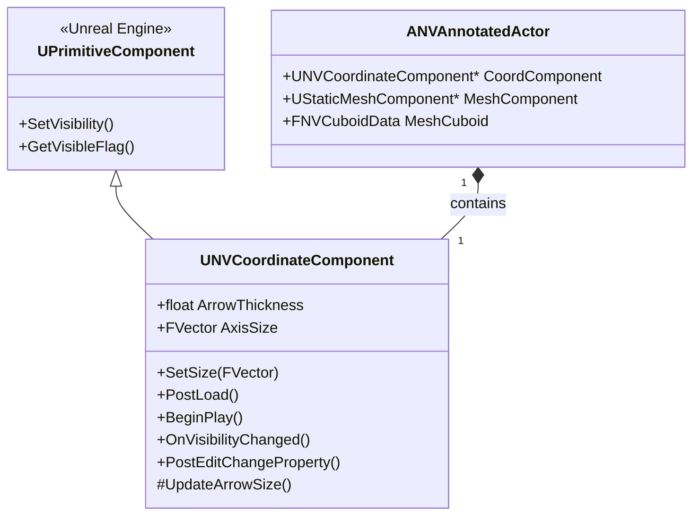
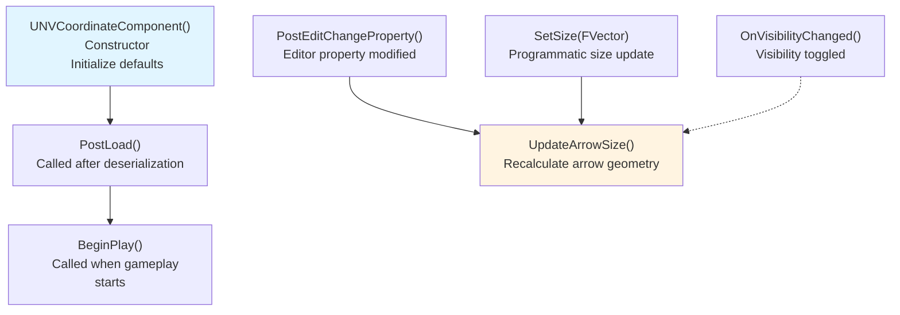
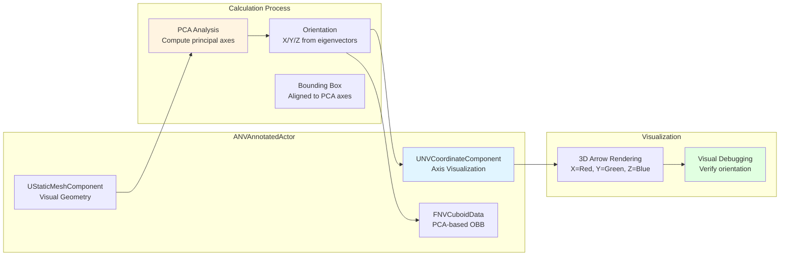

<!-- source: DeepWiki mcp.deepwiki.com · repo NVIDIA/Dataset_Synthesizer · page 8.1 Coordinate Visualization · fetched 2026-10-26 -->

# Coordinate Visualization

<details>
<summary>Relevant source files</summary>

The following files were used as context for generating this wiki page:

- [Documentation/ClassDetails/_n_v_coordinate_component_8h_source.html](Documentation/ClassDetails/_n_v_coordinate_component_8h_source.html)

</details>


## Purpose and Scope

The `UNVCoordinateComponent` is a visual debugging utility that renders 3D coordinate axes to display object orientation in the scene. This component is primarily used for visualizing the Principal Component Analysis (PCA)-based orientation of annotated actors, helping developers verify that oriented bounding boxes are correctly aligned with object geometry.

For information about the annotated actors that use this component, see [Annotated Actors](#5.1). For details about cuboid calculation via PCA, also see [Annotated Actors](#5.1).

---

## Component Overview

`UNVCoordinateComponent` inherits from Unreal Engine's `UPrimitiveComponent`, making it a renderable scene component that can be attached to actors. The component draws three colored arrows representing the X, Y, and Z axes, with configurable size and thickness.

**Sources:** [Documentation/ClassDetails/_n_v_coordinate_component_8h_source.html:23-48]()

---

## Class Structure



**Diagram:** UNVCoordinateComponent class hierarchy and relationships

The component is typically attached to `ANVAnnotatedActor` instances to visualize their coordinate systems, particularly after PCA-based cuboid calculation determines the object's principal axes.

**Sources:** [Documentation/ClassDetails/_n_v_coordinate_component_8h_source.html:23-48]()

---

## Component Properties

### Editable Properties

The component exposes two primary properties that can be configured in the Unreal Editor or via Blueprints:

| Property | Type | Access | Description |
|----------|------|--------|-------------|
| `ArrowThickness` | `float` | `EditAnywhere, BlueprintReadOnly` | Controls the visual thickness of the coordinate axis arrows |
| `AxisSize` | `FVector` | `EditAnywhere, BlueprintReadOnly` | Defines the length of each axis arrow (X, Y, Z components) |

Both properties are marked as `BlueprintReadOnly`, meaning they can be read from Blueprint scripts but should be modified through C++ or the editor interface.

**Sources:** [Documentation/ClassDetails/_n_v_coordinate_component_8h_source.html:43-47]()

---

## Component Lifecycle



**Diagram:** UNVCoordinateComponent lifecycle and update flow

### Lifecycle Methods

The component implements several Unreal Engine lifecycle methods:

- **Constructor** [`UNVCoordinateComponent(const FObjectInitializer&)`](): Initializes default values for `ArrowThickness` and `AxisSize`
- **`PostLoad()`** [Documentation/ClassDetails/_n_v_coordinate_component_8h_source.html:33](): Called after the component is loaded from disk; ensures arrow geometry is properly configured
- **`BeginPlay()`** [Documentation/ClassDetails/_n_v_coordinate_component_8h_source.html:34](): Called when the actor enters gameplay; performs initial setup
- **`OnVisibilityChanged()`** [Documentation/ClassDetails/_n_v_coordinate_component_8h_source.html:35](): Responds to visibility changes to update rendering state

### Editor-Only Methods

- **`PostEditChangeProperty()`** [Documentation/ClassDetails/_n_v_coordinate_component_8h_source.html:37](): Responds to property changes in the Unreal Editor, triggering arrow size updates when `ArrowThickness` or `AxisSize` is modified

**Sources:** [Documentation/ClassDetails/_n_v_coordinate_component_8h_source.html:28-38]()

---

## Public Interface

### SetSize Method

```
void SetSize(const FVector& NewAxisSize)
```

The `SetSize()` method [Documentation/ClassDetails/_n_v_coordinate_component_8h_source.html:30]() allows programmatic modification of the coordinate axes lengths. This is useful when dynamically adjusting visualization based on object bounds or when scaling the coordinate display to match object size.

**Typical Usage Pattern:**
- Calculate object bounds or PCA-based cuboid dimensions
- Call `SetSize()` with appropriate scale factor
- Component updates arrow geometry via `UpdateArrowSize()`

### UpdateArrowSize Method

```
void UpdateArrowSize()
```

The protected `UpdateArrowSize()` method [Documentation/ClassDetails/_n_v_coordinate_component_8h_source.html:40]() recalculates and updates the arrow geometry based on current `AxisSize` and `ArrowThickness` values. This method is called internally whenever properties change.

**Sources:** [Documentation/ClassDetails/_n_v_coordinate_component_8h_source.html:30-40]()

---

## Integration with Annotated Actors



**Diagram:** Coordinate component integration with PCA-based cuboid calculation

The coordinate component serves as a visual debugging aid for verifying that PCA-based oriented bounding boxes are correctly aligned. When `ANVAnnotatedActor` calculates cuboid data using PCA, the coordinate component can be configured to display the principal axes, making it easy to verify that the orientation matches the expected object geometry.

**Common Use Cases:**

1. **Debugging Cuboid Orientation:** Visualize whether PCA correctly identified the object's principal axes
2. **Verifying Dataset Annotations:** Ensure exported bounding box orientations match visual expectations
3. **Development and Testing:** Quick visual confirmation during scene setup and randomization

**Sources:** [Documentation/ClassDetails/_n_v_coordinate_component_8h_source.html:23-48]()

---

## Module Organization

The `UNVCoordinateComponent` class is part of the NVSceneCapturer module:

```
UEModules/
  Plugins/
    NVSceneCapturer/
      Source/
        NVSceneCapturer/
          public/
            NVCoordinateComponent.h     # Header declaration
```

The component is exported with the `NVSCENECAPTURER_API` macro [Documentation/ClassDetails/_n_v_coordinate_component_8h_source.html:23](), making it accessible to other modules and Blueprint scripts.

**Configuration:**
- **ClassGroup:** NVIDIA
- **Config:** Engine
- **Hidden Categories:** Replication, Tick, Tags, Input

These settings organize the component in the editor UI and hide unnecessary property categories for a visualization-only component.

**Sources:** [Documentation/ClassDetails/_n_v_coordinate_component_8h_source.html:21-23](), [Documentation/ClassDetails/_n_v_coordinate_component_8h_source.html:147]()

---

## Summary

`UNVCoordinateComponent` is a lightweight utility component that provides visual debugging of 3D coordinate systems. Its primary role is to help developers verify PCA-based object orientation by rendering colored axis arrows. The component integrates seamlessly with `ANVAnnotatedActor` and supports both editor-time configuration and runtime updates, making it a valuable tool for validating synthetic dataset generation accuracy.

**Key Characteristics:**
- Inherits from `UPrimitiveComponent` for rendering support
- Configurable arrow thickness and axis lengths
- Editor-responsive with automatic updates on property changes
- Designed for debugging PCA-based cuboid orientations

**Sources:** [Documentation/ClassDetails/_n_v_coordinate_component_8h_source.html:1-154]()

---

